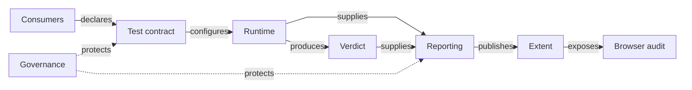
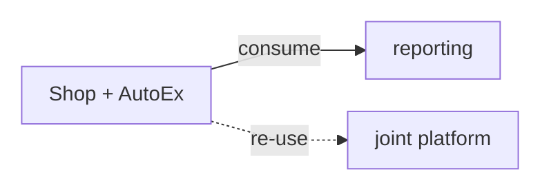
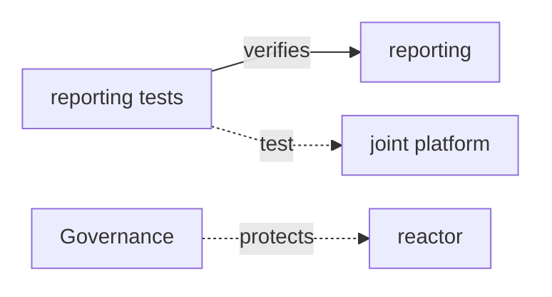
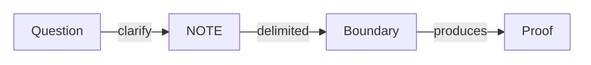
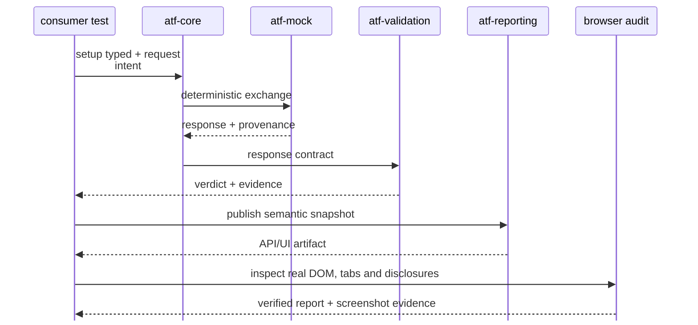
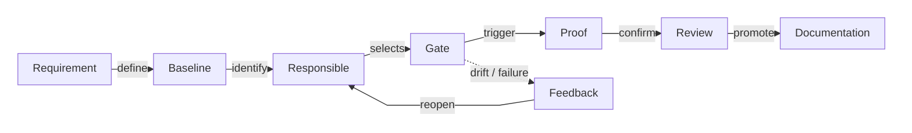

# ATF Java — modular testing and auditable results

ATF Java is a Maven reactor for deterministic API execution, semantic validation, Extent reports and browser auditing. It contains the source of six reusable libraries, integration fixtures and governance tests.

`Deterministic API → semantic validation → Extent report → UI audit`

## At a glance

The 12 modules separate reusable contracts, execution, verdicts, reporting, consumer integration and governance:

| Area | Live modules | Responsibility | Reader's question |
|---|---|---|---|
| **Contract & foundation** | `atf-test-kit`, `atf-core` | test annotations, neutral resolvers, lifecycle and transport ports | What can be reused independently of reporting and business rules? |
| **Execution & verdict** | `atf-mock`, `atf-validation`, `atf-console` | deterministic exchanges, semantic verdicts and diagnostics | What makes a test reproducible and explainable? |
| **Reporting & UI audit** | `atf-reporting`, `atf-ui`, `atf-debug-ui` | standalone artifacts, browser inspection and read-only serving | How is the result published and inspected? |
| **Composition + consumers** | `atf-reporting-tests`, `atf-test-practice-shop`, `atf-test-auto-ex` | the harness verifies Reporting in test scope; Shop and AutoEx compose application journeys | Who verifies libraries and integrates them into applications? |
| **Governance** | `atf-tests` | reactor graph and module boundaries | Who protects module responsibilities? |

## Core diagram

<strong>Legend - flow, ownership and limits</strong>

**Flow**

- **Consumers** provides the intention, configuration and fixtures;
- **Contract** fixes the test layer and reusable boundary;
- **Runtime** shall perform generic exchange and, where necessary, fake transport;
- **Verdict** assesses the response and produces diagnostic / evidence;
- **Reporting** publishes the Extent standalone artifact;
- **Artifact** is the result of HTML / CSS / JavaScript inspectable;
- **Audit** checks DOM, tables, filters and browser rendering;
- **Governance** protects the direction of dependency without entering production.

The diagram quickly answers the question "What does ATF do and where does each module stop?." The implementation details, class contracts and rolling steps continue in the documents of the hosts below.

**Ownership and verification**

The table below explains the responsibility of each boundary and the level of associated verification. It is not a second map of navigation; it is the operational part of the same legend.

| Boundary | Owner | Role | Verification |
|---|---|---|---|
| test contract | `atf-test-kit` | level / channel / output / setup / docs and transverse guard annotations | architecture/unit |
| kernel | `atf-core` | Neutral models, lifecycle, transport and ports | unit |
| transport determinist | `atf-mock` | Configurable fake transport and routes | component |
| verdict | `atf-validation` | Answering contracts, valuation and evidence | unit |
| diagnostic | `atf-console` | Console and formatter projection | unit |
| reporting library | `atf-reporting` | renderer Extent, HTML, CSS / JS and artifact | standalone unit/component |
| browser runtime | `atf-ui` | Playwright session and generic policies | component |
| debug inspector | `atf-debug-ui` | serves read-only a HTML on the loop back | component |
| reporting test harness | `atf-reporting-tests` | component / API mok → publisher and UI / E2E for reporting library | component/integration/E2E |
| consumer applications | `atf-test-practice-shop`, `atf-test-auto-ex` | Config, locators, pages and independent journeys | component/E2E |
| whole-ATF governance | `atf-tests` | reactor graph and boundary modules | component/architecture |
The short labels shall be kept as follows:

| In the scheme | Full meaning |
|---|---|
| Runtime | Generic runtime |
| Verdict | Verdict + diagnostics |
| Reporting | Standalone reporting |
| Extent | Extent artifact |
| exposes | exposure for |
| protects | architecture gates |
| protects | dependency gates |

## Module map

Two perspectives of the same reactor: consumers and then checking with governance. The inventory includes all 12 modules: seven platform, library reporting, two consumers, reporting tests and governance.

### Consumption

<strong>Legend - shared consumers and modules</strong>

- `Consumers` brings together `atf-test-practice-shop` and `atf-test-auto-ex`; each
  keep your configuration, selects and journey;
- `Reporting` is `atf-reporting`, the shared library used by consumers;
- `Platform` represents the other seven reusable modules listed in
  table; arrows differentiate the reporter from the joint contracts.

### Verification and governance

<strong>Legend - verification and boundaries</strong>

- `ReportingTests` is `atf-reporting-tests`: check `atf-reporting` and
  uses other shared modules only in `test` scope;
- `Governance` is `atf-tests`; `întreg reactorul` means all 12 modules,
  not just the common libraries;
- the arrows are straight to keep the labels legible; details and
  The ownership of each module is in the table and README module.

| Group | Module | Owned | Does not own |
|---|---|---|---|
| platform | `atf-test-kit` | annotations, neutral resistors and guards | Runtime or business fixtures |
| platform | `atf-core` | demand / response, lifecycle, transport and ports | HTML, Extent, business services |
| platform | `atf-mock` | fake transport and catalog determinist | HTTP live or verdicts |
| platform | `atf-validation` | response contracts, verdict and evidence | transport or HTML |
| platform | `atf-console` | diagnostic output | reporting UI or transport |
| reporting library | `atf-reporting` | renderer, semantic document and artifact | ATF, mock or browser modules |
| platform | `atf-ui` | Playwright session and browser policies | page objects product |
| platform | `atf-debug-ui` | read-only publication for investigation | generation or modification of HTML |
| test harness | `atf-reporting-tests` | reporting library tests and their fixtures in `test` scope | testing of a real application or production runtime |
| consumer | `atf-test-practice-shop` | Shop Practice Application tests | whole governance - ATF |
| consumer | `atf-test-auto-ex` | UI E2E tests for Automation Exercise | Shop Practice tests |
| governance | `atf-tests` | reactor graph and boundary gates | YAML, pages, flows or purchase E2E |

The details of the Maven dependencies are in [`docs/ATF_Architecture.md`](docs/ATF_Architecture.md). The above map does not replace POM; it explains the ownership and direction of reading.

## Test layer map

The layer is explicitly chosen by annotation from `atf-test-kit`, not deducted from the folder name. Same rule applies to API, UI tests and reporting:

<strong>Legend - how to choose the layer</strong>

- choose the smallest layer that can demonstrate the contract;
- promotion to component / integration / e2e only when the boundary checked requires it;
- `support` provides input, locators, fixtures or helpers, but does not produce
  independent verdict;
- Same ratio may have unit tests for markup / CSS / JS, component tests
  for contracts and E2E tests for observable behavior in the browser. Short labels shall keep the following meaning:

| In the scheme | Full meaning |
|---|---|
| Question | test question |
| Annotation | Annotation from atf-test-kit |
| Boundary | boundary and controlled input |
| Proof | evidence and verdict |

| Layer | Annotation | Boundary verificat | The verdict must demonstrate |
|---|---|---|---|
| unit | `@AtfUnitTest` | rule, model, markup, CSS / JS or pure asset | deterministic behaviour without external boundary |
| component | `@AtfComponentTest` | renderer, loader, auditor, locator or fixture controlled | component contract and product record |
| integration | `@AtfIntegrationTest` | two or more actual modules + transport / mock | integration and the resulting artifact |
| e2e | `@AtfE2eTest` | published artifact + browser / Playwright | DOM, tabs, filters, discrete and observable rendering |
| support | — | fixtures, locators, loaders, flows and assertion helpers | does not have independent verdict and does not become the default test |

The plugin-and replay composition follows the same axis: a test declares the layer and scope, the support provides the input, and the verified module remains the contract owner. E2E tests validate the observable flow; do not replace the unit / component tests for each internal combination.

## Model of evolution and verification

ATF-ul develops by strengthening an existing platform, not by adding an isolated test and parallel abstraction. Each change must be traceable from the observed contract to the evidence produced:

```mermaid
%%{init: {"themeVariables":{"fontSize":"15px"},"themeCSS":".nodeLabel, .nodeLabel p { font-size: 15px !important; line-height: 1.35 !important; } .edgeLabel, .edgeLabel p { font-size: 12px !important; font-weight: 400 !important; line-height: 1.2 !important; } .edgeLabel .labelBkg, .edgeLabel p { background: transparent !important; } .edgeLabel foreignObject { transform: translateY(-18px); overflow: visible; } .node rect { rx: 6px; ry: 6px; }","flowchart":{"curve":"linear","nodeSpacing":24,"rankSpacing":40,"padding":10,"diagramPadding":16}}}%%
flowchart LR
    Need[Requirement]
    Inspect["Cod live"]
    Layer[Minimum layer]
    Change["Change"]
    Verify["Proof"]
    Harden["Contract"]

    Need -->|clarify| Inspect
    Inspect -->|choose| Layer
    Layer -->|delimited| Change
    Change -->|produces| Verify
    Verify -->|gap real| Change
    Verify -->|confirm| Harden
```

<strong>Legend - discipline of evolution</strong>

- **live inspection**: read implementation, POM, tests and contract
  documented before we assume that a TODO is still active;
- **minimum layer**: choose unit / component / integration / e2e according to
  boundary demonstrated, not according to how visible the test is;
- **minimum change**: We modify the responsible owner and do not duplicate
  vocabulary, configuration, fixtures or logic renderer in the consumer;
- **verification**: We run the narrowest test that can prove change,
  then check the artifact if the result is HTML / UI;
- **hardening**: promotion of the solution in reusable contract only after
  the evidence remains stable and can be resumed without the context of the initial run.

A new test is useful even when it does not add business functionality: it can demonstrate a real limit of reporting, a boundary or a UI projection. In this case, the test becomes evidence for strengthening ATF-, not a reason to keep a duplicate class. Short labels keep the following meaning:

| In the scheme | Full meaning |
|---|---|
| Live code | Live inspection |
| Change | Local change |
| Proof | Test + evidence |
| Contract | Stable contract |
| confirms | sufficient evidence |

## API execution → report → audit

<strong>Legend - API sequence → report → audit</strong>

- the consumption composes the typed setup and the intention of the request;
- `atf-core` performs the generic contract through the chosen transport;
- `atf-validation` turns the response into verdict and evidence;
- `atf-reporting` publishes semantic snapshots as an artifact API / UI;
- the browser checks DOM, tables, disclosures and visible evidence;
- The body, headers, sections, screenshots, CSS-ul and tables are
  defined in [ATF_Reporting_Contract.md](docs/ATF_Reporting_Contract.md) and validated by the reporting consumer, not duplicated here.

## Consistency and governance changes

ATF changes follow a controlled decision, not an isolated editing. README to the owners, tests and gates remain stable contracts; feedback is dynamically updated when evidence appears, ToDos are closed or the gaping changes.

<strong>Legend - protecting the process</strong>

- **Explicit requirement** determines what is authorised; we do not deduce a
  major refactoring from a local failure and we are not changing a gate just to get green;
- **baseline-ul live** read before editing: code, POM, tests,
  README and current feedback have priority over an old copy or generated report;
- **Owner and boundary** decides where the solution enters: `atf-tests` defends
  The reactor, `atf-test-kit` classifies the layers and the modules retain their local contracts;
- **existing neck** is not incidental refactoring material. Anything
  change of a regulatory README or existing test-gate requires explicit requirement, explicit approval, documented reason and new proof for the changed contract;
- **feedback-ul activ** is the dynamic register of the work: it can be updated,
  restricted, reorganized or closed when the code and tests confirm progress; however, it does not become a permanent contract just because it was noted there;
- **failure-ul** is an analysis signal: repair the owner or implementation,
  do not delete, relax or mask the assertion to make the problem disappear;
- **review and synchronization** only closes the increment after the relevant test,
  The new artifact when there is UI / reporting and the selective update of README to the owner and feedback.

Details of staging, active processes, promotion and anti-undo are in [`ATF_Build_And_Execution_Safety.md`](docs/ATF_Build_And_Execution_Safety.md), do not repeat in overview. Short labels keep the following meaning:

| In the scheme | Full meaning |
|---|---|
| Requirement | Explicit requirement |
| Baseline | Baseline live |
| Owner | Owner + boundary |
| Gate | Existing geese |
| Proof | Test + evidence |
| Review | Review + approval |
| Documentation | README + feedback |
| Feedback | Feedback activ |

## Module and contract guides

Overview sets the flow and ownership.The documents below keep local details. The reader can enter directly into the host that interests him without going through the same explanation in the root and in each module; the documentation index is in [`docs/README.md`](docs/README.md).

<strong>Open README plugin map</strong>

| Area | Owning document | Question to which he answers |
|---|---|---|
| Transversal contract | [TestKit](atf-test-kit/README.md), [implemented annotations](docs/ATF_Test_Infrastructure_Annotations.md) | how do we declare the level, channel, output and set of a test? |
| reusable kernel | [`atf-core/README.md`](atf-core/README.md) | What models, lifecycle and ports are neutral? |
| transport determinist | [`atf-mock/README.md`](atf-mock/README.md) | how do we get reproducible API exchanges? |
| verdict semantic | [`atf-validation/README.md`](atf-validation/README.md) | How does a response turn into a verdict? |
| diagnostic | [`atf-console/README.md`](atf-console/README.md) | How do neutral events get into the console? |
| reporting standalone | [`atf-reporting/README.md`](atf-reporting/README.md) | how to build the artifact without ATF modules? |
| browser runtime | [`atf-ui/README.md`](atf-ui/README.md) · [convention for locators](atf-ui/README.md#convenții-pentru-locatori-ui) | how are the browser and generic convention for locators controlled without product logic? |
| inspector read-only | [`atf-debug-ui/README.md`](atf-debug-ui/README.md) | How do we investigate a HTML already generated? |
| reporting test harness | [`atf-reporting-tests/README.md`](atf-reporting-tests/README.md) | how are the API / mock composition and the UI rendering of the reporting? |
| application consumer | [`atf-test-practice-shop/README.md`](atf-test-practice-shop/README.md) | how does a real application use ATF infrastructure? |
| consumer Automation Exercise | [`atf-test-auto-ex/README.md`](atf-test-auto-ex/README.md) | How do UI E2E-uri consist using separate Test Kit annotations? |
| reactor governance | [`atf-tests/README.md`](atf-tests/README.md) | who defends modules and direction of dependency? |

Cross-cutting contracts, documentation rules and execution protocol are in the list of regulatory references below; they are not duplicate in this map.

## Regulatory references

| Topic | Document |
|---|---|
| architecture, modules and dependencies | [`docs/ATF_Architecture.md`](docs/ATF_Architecture.md) |
| reporting, record and rendering | [`docs/ATF_Reporting_Contract.md`](docs/ATF_Reporting_Contract.md) · [`docs/ATF_Reporting_Display_Contract.md`](docs/ATF_Reporting_Display_Contract.md) |
| build, staging and checking MCP | [`docs/ATF_Build_And_Execution_Safety.md`](docs/ATF_Build_And_Execution_Safety.md) |
| OOP, naming and layers rules | [`docs/README_Atf_BestPractices.md`](docs/README_Atf_BestPractices.md) |
| README and diagrams | [`docs/README_Atf_DocumentationBestPractices.md`](docs/README_Atf_DocumentationBestPractices.md) |
| Active feedback, live reconciliation and closure criteria | [`docs/feedback/README.md`](docs/feedback/README.md) |

Root README describes the system from top to bottom. It does not keep the internal lifecycle, the complete YAML scheme, class contracts, CSS or the log of a run; they belong to the owner and are protected by its tests.

## Core as library - owner and deployment

Core source and native tests remain in this 12-module reactor. The [library contract](docs/ATF_Core_Consumer.md) separates source ownership and publication from independent consumer acceptance.

## Reporting library and audit contracts

This project owns Reporting source and permanent mock, contract and browser regressions. The contracts below describe evidence ownership and artifact behavior.

| Topic | Current owner contract |
|---|---|
| neutral ACTION/OBSERVE, failures and assertion ownership | [Reporting API](atf-reporting/README.md#neutral-ui-attribution-and-failure-ownership) |
| complete PNG, redacted inline evidence and preview 240 | [Inline audit](docs/ATF_Inline_Audit_Contract.md) |
| incremental navigation, cold readiness and original deadlines | [Navigation](docs/ATF_Large_Report_Navigation.md) |
| latest verification note beside the producer package | [Sampling](docs/ATF_Workspace_Synchronization.md#release-evidence-retention) |

Library publication/rendering acceptance is separate from new business, device, broker or acoustic ASR execution. Release notes are not stored in project documentation or consumer `lib`.

## Workspace connections

The [workspace index](docs/workspaces/README.md) routes library producers and consumers to their own documentation; [library maintenance](lib/README.md) describes the shared publication boundary.
