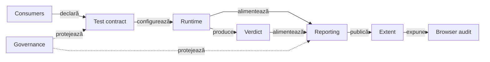
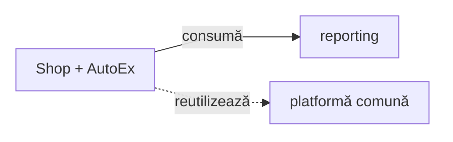
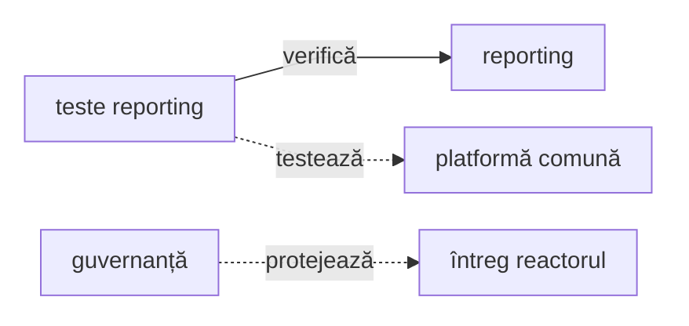
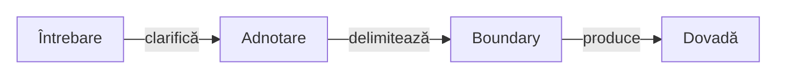
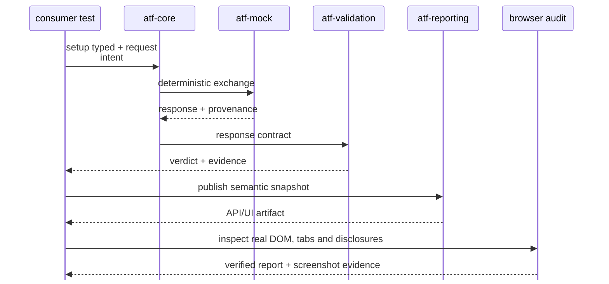
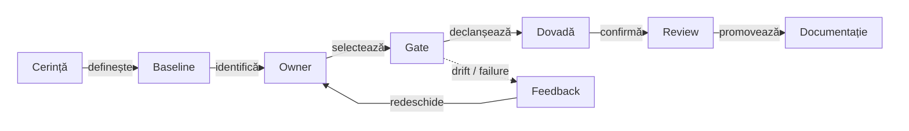

# ATF — platformă modulară pentru testare și rezultate verificabile

Referința surselor Core/Reporting și a regresiilor este `atf_j0`; distribuția către J1 și J2 urmează [protocolul de sincronizare](docs/ATF_Workspace_Synchronization.md).

Scenariile AutoEx/Shop au owner în J1; copiile din acest reactor verifică
consumul Reporting sursă. J2 pregătește separat testarea cozilor și mesajelor.

`API determinist → validare semantică → raport Extent → audit UI`

## ATF Java — prezentare executivă

| Workspace | Rol și punct de intrare |
|---|---|
| J0 | 12 module, sursa Reporting și regresiile native/mock/browser; [atlasul sursei](../atf_j0/docs/ATF_Context_Atlas.md) |
| J1 | 9 module sursă, scenarii AutoEx/Shop și Core/Reporting JAR; [atlasul consumerului](../atf_j1/docs/ATF_Context_Atlas.md) |
| J2 · WIP | 7 module sursă, Core/Reporting JAR, un modul de test Kafka/mesagerie și Setup PowerShell în Podman; [atlasul WIP](../atf_j2/docs/ATF_Context_Atlas.md) |

Rolul proiectului și rezultatul verificat sunt distincte: un build sau un MOCK verde nu certifică serviciul extern, brokerul ori întregul ATF.

ATF Java este platforma care leagă execuția deterministă a testelor API de
validarea semantică, publicarea artefactului Extent și auditul UI al rezultatului.
Pentru orientare rapidă, modulele sunt grupate după întrebarea la care răspund,
nu enumerate ca un inventar Maven:

| Zonă | Module live | Responsabilitate | Întrebarea cititorului |
|---|---|---|---|
| **Contract & foundation** | `atf-test-kit`, `atf-core` | adnotări de test, resolvere neutre, lifecycle, transport ports | ce poate fi reutilizat fără reporting sau business? |
| **Execution & verdict** | `atf-mock`, `atf-validation`, `atf-console` | schimb determinist, verdict semantic și diagnostic | cum devine un test reproductibil și explicabil? |
| **Reporting & UI audit** | `atf-reporting`, `atf-ui`, `atf-debug-ui` | artifact standalone, browser audit și publicare read-only | cum devine rezultatul observabil și verificabil? |
| **Composition + consumers** | `atf-reporting-tests`, `atf-test-practice-shop`, `atf-test-auto-ex` | harness-ul verifică reporting-ul în test scope; Shop și AutoEx compun journey-uri de aplicație | cine verifică librăriile și cine le folosește într-un produs? |
| **Governance** | `atf-tests` | graph-ul reactorului și boundary gates | cine protejează separarea modulelor? |

## Diagramă de bază

<strong>Legendă — flux, ownership și limite</strong>

**Fluxul**

- **Consumers** furnizează intenția, configurația și fixture-urile;
- **Contract** fixează layer-ul testului și boundary-ul reutilizabil;
- **Runtime** execută schimbul generic și, când este necesar, transportul fake;
- **Verdict** evaluează răspunsul și produce diagnostic/evidence;
- **Reporting** publică artifactul Extent standalone;
- **Artifact** este rezultatul HTML/CSS/JavaScript inspectabil;
- **Audit** verifică DOM-ul, tab-urile, filtrele și randarea în browser;
- **Governance** protejează direcția dependențelor fără să intre în producție.

Diagrama răspunde rapid la întrebarea „ce face ATF și unde se oprește fiecare
modul?”. Detaliile de implementare, contractele claselor și pașii de rulare
continuă în documentele ownerilor de mai jos.

**Ownership și verificare**

Tabelul de mai jos explică responsabilitatea fiecărui boundary și nivelul de
verificare asociat. Nu este o a doua hartă de navigare; este partea operațională
a aceleiași legende.

| Boundary | Owner | Rol | Verificare |
|---|---|---|---|
| test contract | `atf-test-kit` | adnotări nivel/canal/output/setup/docs și guard transversal | architecture/unit |
| kernel | `atf-core` | modele neutre, lifecycle, transport și porturi | unit |
| transport determinist | `atf-mock` | rute și răspunsuri fake configurabile | component |
| verdict | `atf-validation` | contracte response, evaluare și evidence | unit |
| diagnostic | `atf-console` | proiecție de consolă și formatter | unit |
| reporting library | `atf-reporting` | renderer Extent, HTML, CSS/JS și artifact | standalone unit/component |
| browser runtime | `atf-ui` | sesiune Playwright și politici generice | component |
| debug inspector | `atf-debug-ui` | servește read-only un HTML pe loopback | component |
| reporting test harness | `atf-reporting-tests` | component/API mock → publisher și UI/E2E pentru librăria reporting | component/integration/E2E |
| aplicații consumatoare | `atf-test-practice-shop`, `atf-test-auto-ex` | config, locatori, pages și journey-uri independente | component/E2E |
| whole-ATF governance | `atf-tests` | module graph și boundary-uri ale reactorului | component/architecture |
Etichetele scurte păstrează următorul sens:

| În schemă | Sens complet |
|---|---|
| Runtime | Generic runtime |
| Verdict | Verdict + diagnostics |
| Reporting | Standalone reporting |
| Extent | Extent artifact |
| expune | expune pentru |
| protejează | architecture gates |
| protejează | dependency gates |

## Harta modulelor

Două perspective ale aceluiași reactor: consumatorii și apoi verificarea cu
guvernanța. Inventarul cuprinde toate cele 12 module: șapte de platformă,
librăria reporting, doi consumatori, testele reporting și guvernanța.

### Consum

<strong>Legendă — consumatori și module partajate</strong>

- `Consumers` reunește `atf-test-practice-shop` și `atf-test-auto-ex`; fiecare
  păstrează configurația, selectorii și journey-ul propriu;
- `Reporting` este `atf-reporting`, librăria partajată folosită de consumatori;
- `Platform` reprezintă celelalte șapte module reutilizabile, enumerate în
  tabel; săgețile diferențiază reporting-ul de contractele comune.

### Verificare și guvernanță

<strong>Legendă — verificare și boundary-uri</strong>

- `ReportingTests` este `atf-reporting-tests`: verifică `atf-reporting` și
  folosește celelalte module partajate numai în `test` scope;
- `Governance` este `atf-tests`; `întreg reactorul` înseamnă toate cele 12 module,
  nu doar librăriile comune;
- săgețile sunt drepte pentru a păstra etichetele lizibile; detaliile și
  ownership-ul fiecărui modul sunt în tabel și în README-ul modulului.

| Grup | Module | Deține | Nu deține |
|---|---|---|---|
| platform | `atf-test-kit` | adnotări, resolvere neutre și guard-uri | runtime sau fixture-uri de business |
| platform | `atf-core` | request/response, lifecycle, transport și porturi | HTML, Extent, business services |
| platform | `atf-mock` | fake transport și catalog determinist | HTTP live sau verdicturi |
| platform | `atf-validation` | response contracts, verdict și evidence | transport sau HTML |
| platform | `atf-console` | diagnostic output | reporting UI sau transport |
| reporting library | `atf-reporting` | renderer, document semantic și artifact | module ATF, mock sau browser |
| platform | `atf-ui` | sesiune Playwright și politici browser | page objects de produs |
| platform | `atf-debug-ui` | publicare read-only pentru investigație | generare sau modificare de HTML |
| test harness | `atf-reporting-tests` | testele librăriei reporting și fixture-urile lor, în `test` scope | testarea unei aplicații reale sau runtime de producție |
| consumer | `atf-test-practice-shop` | testele aplicației Practice Shop | guvernanță whole-ATF |
| consumer | `atf-test-auto-ex` | testele UI E2E pentru Automation Exercise | testele Practice Shop |
| governance | `atf-tests` | graph-ul reactorului și boundary gates | YAML, pages, flows sau purchase E2E |

Detaliile despre dependențele Maven sunt în
[`docs/ATF_Architecture.md`](docs/ATF_Architecture.md). Harta de mai sus nu
înlocuiește POM-ul; ea explică ownership-ul și direcția de citire.

## Harta straturilor de test

Stratul este ales explicit prin adnotarea din `atf-test-kit`, nu dedus din
numele folderului. Aceeași regulă se aplică testelor API, UI și reporting:

<strong>Legendă — cum alegem stratul</strong>

- alegem cel mai mic strat care poate demonstra contractul;
- promovăm la component/integration/e2e doar când boundary-ul verificat o cere;
- `support` furnizează input, locatori, fixture-uri sau helpers, dar nu produce
  un verdict independent;
- același raport poate avea teste unitare pentru markup/CSS/JS, teste component
  pentru contracte și teste E2E pentru comportamentul observabil în browser.
Etichetele scurte păstrează următorul sens:

| În schemă | Sens complet |
|---|---|
| Întrebare | întrebarea testului |
| Adnotare | annotation din atf-test-kit |
| Boundary | boundary și input controlat |
| Dovadă | evidence și verdict |

| Strat | Adnotare | Boundary verificat | Verdictul trebuie să demonstreze |
|---|---|---|---|
| unit | `@AtfUnitTest` | regulă, model, markup, CSS/JS sau asset pur | comportament determinist, fără boundary extern |
| component | `@AtfComponentTest` | renderer, loader, auditor, locator sau fixture controlat | contractul componentei și evidence-ul produs |
| integration | `@AtfIntegrationTest` | două sau mai multe module reale + transport/mock | integrarea și artifactul rezultat |
| e2e | `@AtfE2eTest` | artifact publicat + browser/Playwright | DOM, tabs, filtre, disclosure și randare observabilă |
| support | — | fixture-uri, locatori, loaders, flows și assertion helpers | nu are verdict independent și nu devine test implicit |

Compoziția plug-and-play urmează aceeași axă: un test declară stratul și
scope-ul, suportul îi furnizează inputul, iar modulul verificat rămâne ownerul
contractului. Testele E2E validează fluxul observabil; nu înlocuiesc testele
unitare/componentă pentru fiecare combinație internă.

## Model de evoluție și verificare

ATF-ul se dezvoltă prin întărirea unei platforme existente, nu prin adăugarea
unui test izolat și a unei abstracții paralele. Fiecare schimbare trebuie să
poată fi urmărită de la contractul observat până la dovada produsă:

```mermaid
%%{init: {"themeVariables":{"fontSize":"15px"},"themeCSS":".nodeLabel, .nodeLabel p { font-size: 15px !important; line-height: 1.35 !important; } .edgeLabel, .edgeLabel p { font-size: 12px !important; font-weight: 400 !important; line-height: 1.2 !important; } .edgeLabel .labelBkg, .edgeLabel p { background: transparent !important; } .edgeLabel foreignObject { transform: translateY(-18px); overflow: visible; } .node rect { rx: 6px; ry: 6px; }","flowchart":{"curve":"linear","nodeSpacing":24,"rankSpacing":40,"padding":10,"diagramPadding":16}}}%%
flowchart LR
    Need[Cerință]
    Inspect["Cod live"]
    Layer[Strat minim]
    Change["Schimbare"]
    Verify["Dovadă"]
    Harden["Contract"]

    Need -->|clarifică| Inspect
    Inspect -->|alege| Layer
    Layer -->|delimitează| Change
    Change -->|produce| Verify
    Verify -->|gap real| Change
    Verify -->|confirmă| Harden
```

<strong>Legendă — disciplină de evoluție</strong>

- **inspectare live**: citim implementarea, POM-ul, testele și contractul
  documentat înainte să presupunem că un TODO mai este activ;
- **stratul minim**: alegem unit/component/integration/e2e în funcție de
  boundary-ul demonstrat, nu în funcție de cât de vizibil este testul;
- **schimbare minimă**: modificăm ownerul responsabil și nu duplicăm
  vocabulary, configuration, fixture-uri sau renderer logic în consumer;
- **verificare**: rulăm testul cel mai îngust care poate dovedi schimbarea,
  apoi verificăm artifactul dacă rezultatul este HTML/UI;
- **hardening**: promovăm soluția în contract reutilizabil doar după ce
  dovada rămâne stabilă și poate fi reluată fără contextul run-ului inițial.

Un test nou este util chiar și când nu adaugă funcționalitate de business:
poate demonstra o limită reală a reporting-ului, a unui boundary sau a unei
proiecții UI. În acest caz, testul devine dovadă pentru întărirea ATF-ului, nu
un motiv pentru a păstra o clasă duplicată.
Etichetele scurte păstrează următorul sens:

| În schemă | Sens complet |
|---|---|
| Cod live | Inspectare live |
| Schimbare | Schimbare locală |
| Dovadă | Test + evidence |
| Contract | Contract stabil |
| confirmă | dovadă suficientă |

## Secvența executivă API → raport → audit

<strong>Legendă — secvența API → raport → audit</strong>

- consumerul compune setup-ul typed și intenția request-ului;
- `atf-core` execută contractul generic prin transportul ales;
- `atf-validation` transformă răspunsul în verdict și evidence;
- `atf-reporting` publică snapshot-ul semantic ca artifact API/UI;
- browserul verifică DOM-ul, tab-urile, disclosure-urile și evidence-ul vizibil;
- body-ul, header-ele, secțiunile, screenshot-urile, CSS-ul și tab-urile sunt
  definite în [ATF_Reporting_Contract.md](docs/ATF_Reporting_Contract.md) și
  validate de consumerul reporting, nu duplicate aici.

## Coerență și modificări guvernate

Schimbările ATF urmează o decizie controlată, nu o editare izolată. README-urile
ownerilor, testele și gate-urile rămân contracte stabile; feedback-ul se
actualizează dinamic când apar dovezi, se închid ToDo-uri sau se schimbă gap-ul.

<strong>Legendă — ce protejează procesul</strong>

- **Cerința explicită** stabilește ce este autorizat; nu deducem o
  refactorizare majoră dintr-un failure local și nu schimbăm un gate doar ca să
  obținem verde;
- **baseline-ul live** se citește înainte de editare: codul, POM-ul, testele,
  README-urile și feedback-ul curent au prioritate față de o copie veche sau un
  raport generat;
- **ownerul și boundary-ul** decid unde intră soluția: `atf-tests` apără
  reactorul, `atf-test-kit` clasifică layerele, iar modulele își păstrează
  contractele locale;
- **gate-ul existent** nu este material de refactorizare incidentală. Orice
  schimbare a unui README normativ sau a unui test-gate existent cere cerință
  explicită, aprobare explicită, motiv documentat și dovadă nouă pentru
  contractul schimbat;
- **feedback-ul activ** este registrul dinamic al lucrului: poate fi actualizat,
  restrâns, reorganizat sau închis când codul și testele confirmă progresul;
  nu devine însă contract permanent doar pentru că a fost notat acolo;
- **failure-ul** este semnal de analiză: se repară ownerul sau implementarea,
  nu se șterge, relaxează ori se maschează assertion-ul ca să dispară problema;
- **review-ul și sincronizarea** închid incrementul numai după testul relevant,
  artifactul nou când există UI/reporting și actualizarea selectivă a README-ului
  ownerului și a feedback-ului.

Detaliile despre staging, procese active, promovare și anti-undo sunt în
[`ATF_Build_And_Execution_Safety.md`](docs/ATF_Build_And_Execution_Safety.md),
nu se repetă în overview.
Etichetele scurte păstrează următorul sens:

| În schemă | Sens complet |
|---|---|
| Cerință | Cerință explicită |
| Baseline | Baseline live |
| Owner | Owner + boundary |
| Gate | Gate existent |
| Dovadă | Test + evidence |
| Review | Review + aprobare |
| Documentație | README + feedback |
| Feedback | Feedback activ |

## Aprofundare pe module și contracte

Overview-ul fixează fluxul și ownership-ul; documentele de mai jos păstrează
detaliile locale. Cititorul poate intra direct în ownerul care îl interesează,
fără să parcurgă aceeași explicație în root și în fiecare modul; indexul documentației este în [`docs/README.md`](docs/README.md).

<strong>Deschide harta README-urilor de modul</strong>

| Zonă | Document owner | Întrebarea la care răspunde |
|---|---|---|
| contract transversal | [TestKit](atf-test-kit/README.md), [adnotări implementate](docs/ATF_Test_Infrastructure_Annotations.md) | cum declarăm nivelul, canalul, output-ul și setup-ul unui test? |
| kernel reutilizabil | [`atf-core/README.md`](atf-core/README.md) | ce modele, lifecycle și porturi sunt neutre? |
| transport determinist | [`atf-mock/README.md`](atf-mock/README.md) | cum obținem schimburi API reproducibile? |
| verdict semantic | [`atf-validation/README.md`](atf-validation/README.md) | cum se transformă un response într-un verdict? |
| diagnostic | [`atf-console/README.md`](atf-console/README.md) | cum ajung evenimentele neutre în consolă? |
| reporting standalone | [`atf-reporting/README.md`](atf-reporting/README.md) | cum se construiește artifactul fără module ATF? |
| browser runtime | [`atf-ui/README.md`](atf-ui/README.md) · [convenții pentru locatori](atf-ui/README.md#convenții-pentru-locatori-ui) | cum sunt controlate browserul și convențiile generice pentru locatori, fără logică de produs? |
| inspector read-only | [`atf-debug-ui/README.md`](atf-debug-ui/README.md) | cum investigăm un HTML deja generat? |
| reporting test harness | [`atf-reporting-tests/README.md`](atf-reporting-tests/README.md) | cum sunt verificate compoziția API/mock și randarea UI a reportingului? |
| consumer aplicație | [`atf-test-practice-shop/README.md`](atf-test-practice-shop/README.md) | cum folosește o aplicație reală infrastructura ATF? |
| consumer Automation Exercise | [`atf-test-auto-ex/README.md`](atf-test-auto-ex/README.md) | cum se compun UI E2E-uri separate folosind adnotările Test Kit? |
| guvernanță reactor | [`atf-tests/README.md`](atf-tests/README.md) | cine apără modulele și direcția dependențelor? |

Contractele transversale, regulile de documentație și protocolul de execuție sunt
în lista de referințe normative de mai jos; nu se duplică în această hartă.

## Referințe normative

| Subiect | Document |
|---|---|
| arhitectură, module și dependențe | [`docs/ATF_Architecture.md`](docs/ATF_Architecture.md) |
| reporting, evidence și randare | [`docs/ATF_Reporting_Contract.md`](docs/ATF_Reporting_Contract.md) · [`docs/ATF_Reporting_Display_Contract.md`](docs/ATF_Reporting_Display_Contract.md) |
| build, staging și verificare MCP | [`docs/ATF_Build_And_Execution_Safety.md`](docs/ATF_Build_And_Execution_Safety.md) |
| reguli OOP, naming și layers | [`docs/README_Atf_BestPractices.md`](docs/README_Atf_BestPractices.md) |
| scrierea README-urilor și diagramelor | [`docs/README_Atf_DocumentationBestPractices.md`](docs/README_Atf_DocumentationBestPractices.md) |
| feedback activ, reconciliere live și criterii de închidere | [`docs/feedback/README.md`](docs/feedback/README.md) |

Root README-ul descrie sistemul de sus în jos. Nu păstrează lifecycle-ul intern,
schema completă YAML, class contracts, CSS sau jurnalul unui run; acestea aparțin
ownerului și sunt protejate de testele lui.

## Core ca bibliotecă — owner și deployment

J0 păstrează sursa și testele native Core; reactorul sursă are în continuare 12 module.
[Contractul Core C3](docs/ATF_Core_Consumer.md) separă sursa, publicarea și acceptanțele J1/J2/J3.
Testele native se păstrează în J0, iar acceptanța pe binar rulează în TMP.

[Acceptanța JSON C2/J9](docs/ATF_JSON_Binary_Verification.md) separă sursa, JAR-ul, rendererele și limitele rămase.

[Reporting J10](docs/ATF_Reporting_J10_Verification.md) documentează disclosure-ul local, puntea binară și regresiile sursă/JAR.

[Reporting J12](docs/ATF_Reporting_J12_Verification.md) fixează profilul explicit al inspectorului, sursele de timing și indicatorul assertions; acceptanțele J11 rămân istorice.

## Core C3 — contract consolidat

[Verificarea Core C3](docs/ATF_Core_C3_Verification.md) leagă noua pereche JAR/POM de nativele sursă/JAR și de acceptanța fiecărui consumer. Acceptanța C3 a folosit Reporting J12; livrarea curentă Reporting este consemnată separat mai jos, cu preview 240 și oracole independente.

[Reporting J15](docs/ATF_Reporting_J15_Verification.md) păstrează PNG-urile integrale la publicare și expected/observed ACTION/OBSERVE colapsabile, cu preview 240. Core C3 rămâne identic; acceptanțele sursă/JAR și ale fiecărui consumer sunt consemnate separat.

| Contract J15 | Comportament păstrat |
|---|---|
| rând UI comun | ACTION/OBSERVE folosesc aceeași redacție, inclusiv titlul capturii |
| dovadă integrală | expected/observed conservă whitespace-ul capturat |
| audit | preview 240 și verdict original, fără reevaluare |

J15 păstrează și CR/LF literal, inclusiv prima linie din corpurile TEXT inline.
