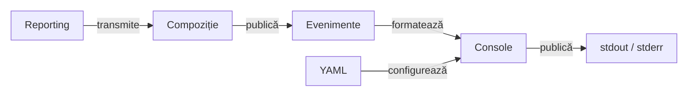
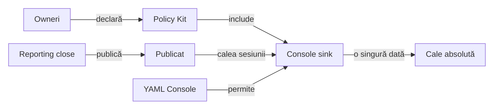

# ATF Console — proiecție diagnostică

`atf-console` este implementarea separată și configurabilă YAML a proiecției de
consolă pentru evenimentele neutre ATF. Nu produce HTML și nu calculează
verdicturi.

## Pe scurt

**Trasee rapide:** [Configurație](#configurație-yaml) · [Integrare JUnit](#integrare) · [Copii dinamici](#testare) · [Probă locală](#verificare-rapidă)

Politica declarativă per clasă este implementată prin
`@AtfConsoleMessages` din TestKit și aplicată de `AtfConsoleTestExtension` peste
`ConsoleSettings`/YAML. Testele dinamice folosesc helperul explicit descris mai jos;
concurența și lifecycle-ul sunt acoperite de o probă JUnit Platform. Contractul
API și precedența sunt în
[documentația adnotărilor](../docs/ATF_Test_Infrastructure_Annotations.md), iar
comportamentul specific consolei este descris în acest README.

| Intrare | Output | Limită |
|---|---|---|
| `AtfConsoleEvent` + `ConsoleSettings` | diagnostic stdout/stderr | nu produce artifact |
| lifecycle execution | evenimente formatate | nu decide verdictul |
| YAML `reporting.console` | detalii configurabile | nu schimbă execuția |
| `@AtfConsoleMessages` | policy per clasă, inclusiv meta/inheritance | nu reactivează consola dezactivată global |

Publicarea căii raportului este opt-in și independentă de detaliile testului:

- `REPORT_PUBLISHED` poartă calea absolută a artifactului Extent confirmat;
- `AtfConsoleReporter` o afișează numai dacă primește explicit opțiunea de path;
  constructorii standard și `configuredStdout()` o lasă oprită;
- `reporting.console.enabled: false` oprește și această linie;
- `@AtfConsoleMessages` controlează detaliile de test, nu publicarea căii;
- adnotarea și agregarea pentru raportul partajat sunt implementate; contractul
  adnotării și al agregării este documentat în
  [contractul adnotărilor TestKit](../docs/ATF_Test_Infrastructure_Annotations.md#opt-in-pentru-calea-raportului).

| Simptom | Verifică mai întâi | Limită |
|---|---|---|
| nu apar mesaje sau detalii | [politica YAML](#configurație-yaml) și [integrarea](#integrare) | politica mesajelor nu calculează verdictul |
| HTML-ul există, dar locația nu este anunțată | [notificarea căii](#calea-raportului-publicat) | notificarea este opt-in, separată de generarea HTML |
| copilul dinamic pierde contextul părintelui | [restaurarea scope-ului](#restaurarea-contextelor-imbricate) | helperul și extensia au probe distincte de formatter |

## Diagramă de bază



<details>
<summary><strong>Legendă — proiecția de consolă</strong></summary>

- atf-core definește evenimentul neutru și portul; atf-console îl formatează;
- compoziția test-scoped transmite câmpurile sursei externe fabricii neutre
  Core; Console și Reporting nu depind unul de celălalt;
- extensia JUnit din atf-console consumă opțional declarația neutră din
  TestKit; dependența nu este propagată pe classpath-ul aplicațiilor;
- configurația reporting.console controlează numai această proiecție;
- ieșirea este diagnostică (stdout/stderr), nu artifact HTML și nu verdict;
- adaptorul traduce contracte, dar nu depinde de ExtentReports și nu deține
  lifecycle-ul ori randarea HTML.
Etichetele scurte păstrează următorul sens:

| În schemă | Sens complet |
|---|---|
| Evenimente | core events |
| YAML | YAML policy |
| Reporting | evenimente externe |
| Compoziție | compoziție de test |

</details>

## Limite de responsabilitate

Compozițiile de test conectează sursele externe la portul Core prin
`AtfConsoleEvent.fromExternalEnums(...)`; reporterul consumă evenimente Core și configurația proprie. Adaptorul JUnit
folosește separat Test Kit prin dependența `optional compile` declarată în POM.

```text
atf-core       definește AtfConsoleEvent și AtfConsoleSink
atf-core        publică evenimente prin sink-ul opțional
atf-console    formatează evenimentele și citește reporting.console din YAML
atf-console    include lifecycle-ul și extension-ul JUnit opțional
consumer test  adaptează câmpurile evenimentului extern către fabrica Core
atf-reporting  produce numai artifacte HTML/Extent
```

### Contracte de consum

- `AtfConsoleReporter` consumă doar `AtfConsoleEvent` din `atf-core` și
  `ConsoleSettings` din propriul modul;
- Core deține conversia neutră a enumurilor prin `fromExternalEnums(...)`;
  compozițiile test-scoped leagă porturile și păstrează politica per rulare;
- consola și detaliile sunt active implicit, inclusiv când YAML-ul lipsește;
- `reporting.console.detailsEnabled: false` ascunde detaliile și body-urile;
  `reporting.console.enabled: false` oprește întreaga proiecție;
- consola proiectează diagnosticul; calculul verdictului rămâne la ownerul testului.

### Responsabilitatea asupra fluxurilor de ieșire

- `atf-console` deține singur referințele la `System.out`/`System.err` și
  singurul `println` din proiecția de consolă;
- launcher-ele și test-kit-ul nu primesc `PrintStream` și nu scriu direct;
- consumatorii folosesc `AtfConsoleReporter.configuredStdout()` sau un
  `AtfConsoleSink` injectat;
- `AtfDebugUiLauncher` folosește `info(...)` pentru bootstrap;
- raportarea HTML rămâne renderer-neutrală.

### Responsabilități OOP

- `AtfConsoleReporter` — adaptor thread-safe către `PrintStream`;
- `AtfConsoleFormatter` — renderer pur al unui eveniment;
- `ConsoleOutputStyle` — glyph-uri în funcție de stream;
- `ConsoleLifecycleState` — nesting și numai nesting;
- niciuna dintre componente nu calculează verdicturi și nu cunoaște HTML/Extent.

Formatterul păstrează secvența:

```text
scenario → phase → request → validation → complete(status, duration-ms)
```

Pentru stream-uri UTF-8 sunt folosite glyph-urile `▶`, `•` și statusurile
vizuale. Pentru `System.out` pe Windows/IDE se folosește fallback ASCII (`>`,
`-`, `PASS`, `FAIL`, `WARNING`) când encoding-ul real nu poate reda glyph-urile.
Body-urile trebuie să fie deja redacted înainte de publicare.

## Configurație YAML

Loaderul `AtfConsoleConfigurationLoader` citește numai secțiunea consolei din
`atf.yaml`; nu parsează `reporting.extent` și nu are dependență către
`atf-reporting`:

```yaml
reporting:
  console:
    enabled: true
    detailsEnabled: true
```

Ordinea de rezolvare este explicită: context injectat, proprietatea
`atf.report.config`, variabila `ATF_REPORT_CONFIG`, apoi căutare ascendentă după
`atf.yaml`/`atf.yml`. Configurația este citită o singură dată la bootstrap și
devine `AtfConsoleConfiguration` immutable.

Lansarea din Maven și IntelliJ folosește aceeași politică. Nu sunt necesare
VM options pentru detalii; fișierele temporare ori testele de renderer care
cer liniște pot injecta explicit un sink `noOp`. Body-urile publicate trebuie
să fie deja redactate înainte să ajungă la formatter.

- `ConsoleDefaultsGovernanceTest` din `atf-tests` protejează fallback-ul,
configurația rezolvată din directoarele modulelor și composition root-urile
UI/API. Testele modulului verifică efectiv output-ul și override-ul `false`.

## Integrare

Un composition root injectează explicit sink-ul:

```java
var settings = AtfConsoleConfigurationLoader.load().settings();
var console = AtfConsoleReporter.configuredStdout();
var module = ApiModuleFactory.create(config, console);
```

Suportul JUnit este opțional și se află în subpachetul
`atf.console.junit` din același artefact; folosește loaderul consolei și nu
importă `atf-reporting`. `HtmlReportSession` și
`ExtentReportSession` acceptă în continuare un `AtfConsoleSink` explicit, dar
constructorii lor impliciți folosesc `noOp`.

### Calea raportului publicat

`@AtfReportPath` din `atf-test-kit` controlează separat mesajul final cu calea
raportului. Extension-ul JUnit rezolvă declarațiile directe, meta-adnotările și
moștenirea.

- Fără opt-in, calea nu este afișată.
- Mesajul apare numai după închiderea sesiunii Reporting și verificarea fișierului final.
- `reporting.console.enabled` rămâne autoritar; `@AtfConsoleMessages` nu activează opt-in-ul pentru cale și `OFF` nu îl suprimă.
- Lifecycle-ul obișnuit și `dynamicTest(owner, ...)` păstrează aceeași separare a politicilor.
- Calea este cea absolută, normalizată, emisă de sesiune; mesajul o păstrează integral, inclusiv spații și Unicode. Plafonul de 240 aparține preview-urilor aserțiunilor.

Pentru un artifact partajat, fiecare owner trebuie înregistrat într-un
`AtfReportPathOptIn` înainte de publicare.

- Oricare owner activ cere o singură notificare, indiferent de ordine.
- `ShopE2eTestSupport` compune raportul suitei; `AutoExRunFactory` deține resursa E2E root.
- Sink-ul final este separat de mesajele lifecycle ale primei metode.
- Generarea raportului și verdictul testului nu depind de notificare.



<details>
<summary><strong>Legendă — notificare la ownerul final</strong></summary>

Componenta conectează sink-ul clasei la sesiunea deținută. Un raport partajat
agregă opțiunile tuturor ownerilor; cel puțin un owner activ cere notificarea.
`flush()` nu anunță artifactul final. Wrapperul dinamic transportă evenimentul
unei resurse deținute explicit, fără să creeze un raport pentru fiecare copil.
Etichetele scurte păstrează următorul sens:

| În schemă | Sens complet |
|---|---|
| Owneri | Owneri Jupiter |
| Policy Kit | Politica Kit |
| Console sink | Sink Console |
| Publicat | REPORT_PUBLISHED |
| YAML Console | Console YAML |
| Cale absolută | Calea absolută în consolă |
| include | include fiecare owner |
| publică | publică și verifică fișierul |
| permite | permite afișarea |
| o singură dată | o dată per artifact |

</details>

Pentru probele launcherelor, `AtfConsoleOutputCapture.capture(action, observer)`
ține observarea fluxului de proces în Console și îl restaurează inclusiv la excepție.

- Helperul observă sincron liniile `println` la emitere și returnează output-ul capturat.
- Capturile cooperante sunt serializate; rulările fără legătură nu trebuie să scrie concurent.
- Consumerii verifică artifactul și politica, fără să preia ownership-ul `stdout`.

## Testare

### Restaurarea contextelor imbricate

Extensia JUnit și `AtfConsoleTestContext.dynamicTest(...)` salvează binding-ul
thread-ului înaintea copilului și îl restaurează în finally. După PASS, FAIL
sau SKIP, corpul părintelui folosește același lifecycle și sink; după ownerul
exterior binding-ul revine la absență. Lansarea Jupiter imbricată respectă
aceeași regulă, fără fallback global în mijlocul testului.

[NestedConsoleContextIntegrationTest](src/test/java/atf/console/junit/NestedConsoleContextIntegrationTest.java)
probează nesting-ul dinamic și extensia reală; probele existente păstrează
izolarea paralelă și independența notificării de path față de politica mesajelor.

Testarea este împărțită după responsabilitate:

- `AtfConsoleReporterTest` — nesting, statusuri, durată (`ms` până la `300 ms`,
  apoi `s`), redaction boundary, pretty-print, detalii și fallback ASCII/UTF-8;
- `ConsoleLifecycleStateTest` — tranziții de nesting și completarea defensivă
  la adâncime zero;
- `AtfConsoleMessagePolicyResolverTest` și `AtfConsoleMessagePolicyTest` —
  rezolvare, precedență și maparea policy-ului la `ConsoleSettings`;
- `AtfConsoleConfigurationLoaderTest` — discovery, precedence, path resolution
  și validarea boolean-urilor;
- `AtfConsoleTestExtensionIntegrationTest` — `@AtfIntegrationTest`, callback-uri
  Jupiter reale prin `EngineTestKit`, inclusiv invocări dinamice și concurente;
- `AtfReportPathPolicyResolverTest` din Test Kit și `AtfReportPathOptInTest`
  din Console — `@AtfUnitTest`, politici locale, conflicte și agregare
  indiferent de ordinea ownerilor;
- testele de execuție — publicarea separată a evenimentelor.
- `AtfReportPathLifecycleIntegrationTest` — lifecycle obișnuit/dinamic cu `OFF`,
  opt-out și întrerupătorul global, păstrând calea completă.

- Jupiter nu rulează `BeforeEachCallback`/`TestWatcher` pentru fiecare copil din `@TestFactory`.
- Pentru verdict și lifecycle per copil, folosește `AtfConsoleTestContext.dynamicTest(owner, displayName, body)`.
- Factory-ul nu primește un start/end fals; helperul finalizează fiecare copil cu PASS, SKIP sau FAIL.
- Copiii construiți direct cu `DynamicTest.dynamicTest` nu au proiecție console per-copil.

## Verificare rapidă

| Decizie | Sursă și limită |
|---|---|
| Proiecție de diagnostic din evenimente typed | [sursa ownerului](src/main/java/atf/console/AtfConsoleReporter.java); probă: [AtfConsoleReporterTest](src/test/java/atf/console/AtfConsoleReporterTest.java) |
| Dependențe și source-set-uri | [POM](pom.xml); scope-ul declarat este autoritatea pentru integrare |
| Ce nu demonstrează această probă | Output-ul consolei nu constituie verdict ori dovadă de publicare HTML. |

<details>
<summary><strong>Comandă pentru proba locală</strong></summary>

Rulați din rădăcina unui [staging extern](../docs/ATF_Build_And_Execution_Safety.md), cu JDK 21 și Maven.

```powershell
mvn -B -pl atf-console -am "-Dtest=AtfConsoleReporterTest" "-Dsurefire.failIfNoSpecifiedTests=false" test
```

Comanda selectează proba numită și construiește dependențele; nu declară
trecerea întregului modul. Output-ul consolei nu constituie verdict ori dovadă de publicare HTML.

</details>
