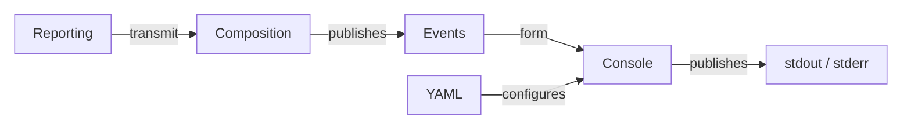
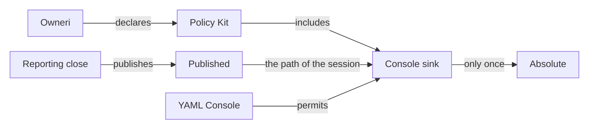

<a id="atf-console--diagnostic-projection"></a>
<a id="atf-console--proiecție-diagnostică"></a>
# ATF Console — diagnostic projection

`atf-console` provides a separate, YAML-configurable console projection of neutral
ATF events. It produces diagnostic output and does not calculate verdicts or HTML.

<a id="at-a-glance"></a>
<a id="pe-scurt"></a>
## At a glance

**Quick links:** [Configuration](#configurație-yaml) · [JUnit integration](#integrare) · [Dynamic children](#testare) · [Local sample](#verificare-rapidă)

`@AtfConsoleMessages` in TestKit declares the class policy, applied by `AtfConsoleTestExtension` over `ConsoleSettings`/YAML. Dynamic tests use the explicit helper below; a JUnit Platform probe covers concurrency and lifecycle. The [annotation contract](../docs/ATF_Test_Infrastructure_Annotations.md) owns API precedence, while this README owns Console behavior.

| Input | Output | Boundary |
|---|---|---|
| `AtfConsoleEvent` + `ConsoleSettings` | diagnostic stdout/stderr | does not produce artifact |
| lifecycle execution | events | not to decide the verdict |
| YAML `reporting.console` | configurable details | does not change execution |
| `@AtfConsoleMessages` | policy per class, including meta / inheritance | does not reactivate the global deactivated console |

The publication of the report path is eighty-in and independent of the test details:

- `REPORT_PUBLISHED` bears the absolute path of the confirmed Extent artifact;
- `AtfConsoleReporter` only displays it if it receives the option of path explicitly;
  standard manufacturers and `configuredStdout()` leave it off;
- `reporting.console.enabled: false` also stops this line;
- `@AtfConsoleMessages` controls test details, not path publication;
- annotation and aggregation for shared report are implemented;
  annotation and aggregation is documented in [contract of annotations TestKit](../docs/ATF_Test_Infrastructure_Annotations.md#opt-in-pentru-calea-raportului).

| Simptom | Check it out first. | Boundary |
|---|---|---|
| no messages or details | [YAML policy](#configurație-yaml) and [integration](#integrare) | message policy does not calculate the verdict |
| HTML exists, but the location is not announced | [notification of the path](#calea-raportului-publicat) | notification is 8-in, separate from generation HTML |
| dynamic child loses parent context | [restoration of the scope](#restaurarea-contextelor-imbricate) | Helper and extension have distinct formatter samples |

<a id="core-diagram"></a>
<a id="diagramă-de-bază"></a>
## Core diagram



<details>
<summary><strong>Legend - Console projection</strong></summary>

- atf-core defines the neutral event and port; atf-console forms it;
- test-scoped composition transmits fields of external source to the neutral factory
  Core; Console and Reporting do not depend on each other;
- JUnit extension of atf-console optionally consumes the neutral declaration of
  TestKit; dependency is not propagated on the application rankings;
- the reporting.consoles configuration controls only this projection;
- the output is diagnostic (stdout / stderr), not artifact HTML and not verdict;
- Adapter translates contracts but does not depend on ExtentReports and does not hold
  Lifecyclem or HTML rendering. Short labels keep the following meaning:

| In the scheme | Full meaning |
|---|---|
| Events | core events |
| YAML | YAML policy |
| Reporting | external events |
| Composition | test composition |

</details>

<a id="liability-limits"></a>
<a id="limite-de-responsabilitate"></a>
## Liability limits

The test compositions connect external sources to the Core port via `AtfConsoleEvent.fromExternalEnums(...)`; the reporter consumes Core events and its own configuration. JUnit adaptor uses Test Kit separately by `optional compile` dependence declared in POM.

```text
atf-core       definește AtfConsoleEvent și AtfConsoleSink
atf-core        publică evenimente prin sink-ul opțional
atf-console    formatează evenimentele și citește reporting.console din YAML
atf-console    include lifecycle-ul și extension-ul JUnit opțional
consumer test  adaptează câmpurile evenimentului extern către fabrica Core
atf-reporting  produce numai artifacte HTML/Extent
```

<a id="consumer-contracts"></a>
<a id="contracte-de-consum"></a>
### Consumer contracts

- `AtfConsoleReporter` only consumes `AtfConsoleEvent` from `atf-core` and
  `ConsoleSettings` from its own module;
- Core holds the neutral conversion of enumerations by `fromExternalEnums(...)`;
  test-scoped compositions link ports and maintain policy per run;
- the console and details are implicit active, including when YAML is missing;
- `reporting.console.detailsEnabled: false` hides details and bodywork;
  `reporting.console.enabled: false` stops the entire projection;
- The console projects the diagnosis; the calculation of the verdict remains at the test owner.

<a id="liability-on-output-flows"></a>
<a id="responsabilitatea-asupra-fluxurilor-de-ieșire"></a>
### Liability on output flows

- `atf-console` alone owns references to `System.out`/`System.err` and
  the only `println` in the console projection;
- the launchers and test-kit do not receive `PrintStream` and do not write directly;
- consumers using `AtfConsoleReporter.configuredStdout()` or a
  `AtfConsoleSink` injected;
- `AtfDebugUiLauncher` uses `info(...)` for bootstrap;
- HTML reporting remains neutral renderer.

<a id="oop-responsibilities"></a>
<a id="responsabilități-oop"></a>
### OOP Responsibilities

- `AtfConsoleReporter` - Threadsafe adaptor to `PrintStream`;
- `AtfConsoleFormatter` - pure renderer of an event;
- `ConsoleOutputStyle` - stream-based glyphs;
- `ConsoleLifecycleState` owns nesting, and only nesting;
- any of the components does not calculate verdicts and does not know HTML / Extent.

The formatter shall retain the sequence:

```text
scenario → phase → request → validation → complete(status, duration-ms)
```

UTF-8 streams use the `▶` and `•` glyphs and visual statuses. On Windows/IDE, `System.out` uses the ASCII fallback (`>`, `-`, `PASS`, `FAIL`, `WARNING`) when the actual encoding cannot display the glyphs. Bodies must already be redacted before publication.

<a id="yaml-configuration"></a>
<a id="configurație-yaml"></a>
## YAML configuration

`AtfConsoleConfigurationLoader` Loader reads only the `atf.yaml` console section; does not park `reporting.extent` and has no dependence on `atf-reporting`:

```yaml
reporting:
  console:
    enabled: true
    detailsEnabled: true
```

The order of solution is explicit: injected context, `atf.report.config` property, `ATF_REPORT_CONFIG` variable, then ascending search after `atf.yaml` / `atf.yml`. The configuration is read once at bootstrap and becomes `AtfConsoleConfiguration` immutable.

The launch from Maven and IntelliJ uses the same policy. VM options are not required for details; temporary files or quieter renderer tests can explicitly inject a `noOp` sink. Published bodywork should be already written before reaching the formatter.

- `ConsoleDefaultsGovernanceTest` in `atf-tests` protects the fallback,
the configuration resolved from module directories and composition roots UI / API. Module tests effectively check the output and override `false`.

<a id="integration"></a>
<a id="integrare"></a>
## Integration

A composition root explicitly injects the synchronization:

```java
var settings = AtfConsoleConfigurationLoader.load().settings();
var console = AtfConsoleReporter.configuredStdout();
var module = ApiModuleFactory.create(config, console);
```

JUnit support is optional and is located in the `atf.console.junit` sub-pack of the same artifact; uses the console reader and does not import `atf-reporting`. `HtmlReportSession` and `ExtentReportSession` continue to accept an explicit `AtfConsoleSink`, but their implanted buildings use `noOp`.

<a id="path-of-the-published-report"></a>
<a id="calea-raportului-publicat"></a>
### Path of the published report

`@AtfReportPath` in `atf-test-kit` controls the final message separately with the ratio path. JUnit Extensión solves direct statements, meta-annotations and inheritance.

- Without the eighth in, the path is not displayed.
- The message only appears after the end of the Reporting session and the final file verification.
- `reporting.console.enabled` remains authoritarian; `@AtfConsoleMessages` does not activate the eighty-one for the path and `OFF` does not suppress it.
- The usual lifecycle and `dynamicTest(owner, ...)` keep the same policy separation.
- The path is the absolute, normalized one, issued by the session; the message keeps it entirely, including spaces and Unicode. 240 ceiling belongs to the previews of the assertions.

For a shared artifact, each owner must be registered in a `AtfReportPathOptIn` prior to publication.

- Any active owner requires a single notification, no matter what orders.
- `ShopE2eTestSupport` composes the suite ratio; `AutoExRunFactory` holds the E2E root resource.
- The final synchronization is separated from the lifecycle messages of the first method.
- The generation of the report and the test verdict do not depend on notification.



<details>
<summary><strong>Legend - notification to the final owner</strong></summary>

The component connects the class synchronization to the session held. A shared report aggregate the options of all the hosts; at least one active owner requests notification. `flush()` does not announce the final artifact. Dynamic rapper carries the event of an explicit resource without creating a report for each child. Short labels keep the following meaning:

| In the scheme | Full meaning |
|---|---|
| Owneri | Owneri Jupiter |
| Policy Kit | Kit policy |
| Console sink | Sink Console |
| Published | REPORT_PUBLISHED |
| YAML Console | Console YAML |
| Absolute | Absolute path in console |
| includes | include each owner |
| publishes | publish and check the file |
| permits | allows display |
| once only | once per artifact |

</details>

`AtfConsoleOutputCapture.capture(action, observer)` shall maintain the process flow in Console for the test of the lasers and shall restore it to the exception.

- The helper is synchronous to the `println` lines at issue and returns the captured output.
- Cooperating catches are serialized; unrelated runs must not write competitor.
- Consumers check the artifact and politics without taking over the `stdout` ownership.

<a id="testing"></a>
<a id="testare"></a>
## Testing

<a id="restoration-of-nested-contexts"></a>
<a id="restaurarea-contextelor-imbricate"></a>
### Restoration of nested contexts

The JUnit extension and `AtfConsoleTestContext.dynamicTest(...)` save the thread binding before a child and restore it in finally. After PASS, FAIL or SKIP, the parent body uses the same lifecycle and sink; closing the outer owner restores the absent binding. Nested Jupiter launches follow the same rule, without a global fallback during the test.

[NestedConsoleContextIntegrationTest](src/test/java/atf/console/junit/NestedConsoleContextIntegrationTest.java) is proposing dynamic nesting and real extension; existing evidence maintains parallel isolation and independence of the Path notification from message policy.

The test is divided according to responsibility:

- `AtfConsoleReporterTest` — nesting, statuses and duration (`ms` through `300 ms`,
  `s`), redaction boundary, pretty-print, details and fallback ASCII / UTF-8;
- `ConsoleLifecycleStateTest` - non-performing transitions and defensive completion
  at zero depth;
- `AtfConsoleMessagePolicyResolverTest` and `AtfConsoleMessagePolicyTest` -
  resolution, precedence and mapping of the policy at `ConsoleSettings`;
- `AtfConsoleConfigurationLoaderTest` — discovery, precedence, path resolution
  and validation of booleans;
- `AtfConsoleTestExtensionIntegrationTest` — `@AtfIntegrationTest`, callback-uri
  actual Jupiter via `EngineTestKit`, including dynamic and competing invoicing;
- `AtfReportPathPolicyResolverTest` of Test Kit and `AtfReportPathOptInTest`
  Console - `@AtfUnitTest`, local policies, conflicts and aggregation regardless of the order of the hosts;
- execution tests - separate publication of events.
- `AtfReportPathLifecycleIntegrationTest` - regular / dynamic lifecycle with `OFF`,
  The eighth-out and global switch, keeping track complete.

- Jupiter does not run `BeforeEachCallback` / `TestWatcher` for each child in `@TestFactory`.
- For verdict and lifecycle per child, uses `AtfConsoleTestContext.dynamicTest(owner, displayName, body)`.
- The factory does not receive a false start / end; the helper completes each child with PASS, SKIP or FAIL.
- Children built directly with `DynamicTest.dynamicTest` do not have child-per- console projection.

<a id="quick-check"></a>
<a id="verificare-rapidă"></a>
## Quick check

| Decision | Source and limit |
|---|---|
| Diagnostic projection from typed events | [source of the host](src/main/java/atf/console/AtfConsoleReporter.java); sample [AtfConsoleReporterTest](src/test/java/atf/console/AtfConsoleReporterTest.java) |
| Dependencies and source- sets | [POM](pom.xml); declared scope authority for integration |
| What this probe does not prove | The output of the console does not constitute a verdict or evidence of publication of HTML. |

<details>
<summary><strong>Command for local sample</strong></summary>

Run from the root of a [external staging](../docs/ATF_Build_And_Execution_Safety.md), with JDK 21 and Maven.

```powershell
mvn -B -pl atf-console -am "-Dtest=AtfConsoleReporterTest" "-Dsurefire.failIfNoSpecifiedTests=false" test
```

The command selects the sample called and builds the dependencies; does not declare the passage of the entire module. The Output of the console does not constitute a verdict or evidence of publication of HTML.

</details>


## Library publication

J0 keeps this implementation and its complete native test catalog. J1–J6 use the same published JAR and parentless POM directly in lib, with no shadow source module.

[Platform library consumption](../docs/ATF_Platform_Libraries.md) defines Core version pinning, the Console optional Kit bridge, Maven/IntelliJ bootstrap and physical-JAR acceptance. Package evidence stays beside the producer artifact in owned TMP.
