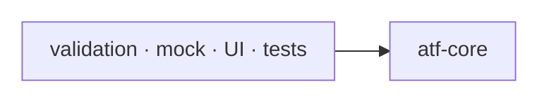
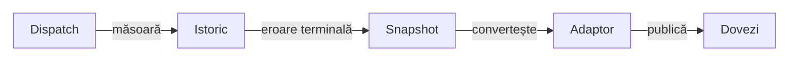

# ATF Core — kernel neutru și porturi

`atf-core` este stratul de bază al ATF Java. Conține modele, contracte și
abstracții reutilizabile, fără să decidă cum este orchestrat un scenariu sau
cum este randat un raport.

## Pe scurt

**Trasee rapide:** [Eroare și istoric](#istoric-la-eroare-terminală) · [Sync sigur](#manifest-și-promovare-guarded) · [Probă locală](#verificare-rapidă)

| Deține | Consumatori | Limită |
|---|---|---|
| lifecycle, ports, HTTP vocabulary și module IDs | validation, mock, UI și guvernanță | nu publică HTML |
| snapshot-uri și politici neutre | composition roots | nu deține scenarii concrete |

## Diagramă de bază



<details>
<summary><strong>Legendă — poziția kernelului</strong></summary>

- săgeata înseamnă „modulul din stânga depinde de modulul din dreapta”;
- atf-core este ultimul boundary comun din această hartă;
- atf-core nu depinde de modulele care îl consumă;
- fixture-urile concrete, browserul, JUnit-ul și rendererul rămân în modulele consumatoare.
</details>

<details>
<summary><strong>Harta de lectură</strong></summary>

- [responsabilități](#responsabilități) și
  [lifecycle](#ciclu-de-viață-generic-și-reutilizabil) — boundary-ul kernelului;
- [vocabular HTTP](#coeziune-și-responsabilitate-pentru-vocabularul-http) și
  [decuplare](#regula-de-decuplare) — ownership și direcția dependențelor;
- [selecție API](#contractul-reutilizabil-pentru-selecția-api),
  [catalog live](#catalogul-live-explicit) și
  [promovare guarded](#manifest-și-promovare-guarded);
- [determinism](#determinism-și-concurență) și
  [teste](#teste) — protecțiile executabile.

</details>

## Alege boundary-ul de integrare

| Intenție | Intrare și dovadă | Consumerul păstrează |
|---|---|---|
| execută HTTP cu deadline comun | [ApiExecutor](src/main/java/atf/core/http/execution/ApiExecutor.java) → [istoric terminal](#istoric-la-eroare-terminală) | endpoint-ul, operația și verdictul business |
| selectează transport live | [catalog explicit](#catalogul-live-explicit) | opt-in-ul și autentificarea |
| rulează cleanup LIFO | [CleanupRegistry](src/main/java/atf/core/lifecycle/CleanupRegistry.java) | dobândirea resurselor și politica erorilor |
| inspectează surse ori promovează fișiere | [referințe Java](#responsabilități) / [manifest guarded](#manifest-și-promovare-guarded) | root-urile și lista aprobată |

Contractele Core și cele din biblioteca Reporting au owneri separați.
Adaptorul consumerului face conversia explicită; similaritatea numelor nu
creează o dependență runtime Reporting → Core.

`CleanupRegistry` colectează `RuntimeException` și continuă acțiunile LIFO.
Contractul său nu promite agregarea oricărui `Throwable`; un adaptor de browser
trebuie să-și probeze separat achiziția parțială și cauza primară.

- Contextul redactării este în [harta pachetului security](src/main/java/atf/core/security/README.md):
  input original, strategie, fallback și limita dintre redactare și preview.

## Responsabilități

| Zonă | Owner în `atf-core` | Nu face |
|---|---|---|
| HTTP | `ApiRequest`, `ApiResponse`, `ApiTransport`, `ApiExecutor` | nu definește scenarii sau assertions |
| routing neutru | `ApiPathTemplate`, `ApiRoute`, `ApiUrlBuilder` | nu deține serviciile Users/Posts sau rutele concrete |
| timp și retry | `ApiExecutionClock`, `ApiExecutionDeadline`, `ApiRetryWaiter`, `RetryPolicy` | nu decide verdictul testului |
| configurație typed | `AtfConfiguration`, `AtfRuntimeSnapshot`, `ApiSettings`, `ReportingSettings` și snapshot-uri | nu recitește configurația în fiecare request |
| source adapters | `config.source.ApiBootstrapConfigurationLoader`, `ApiEnvironment` | nu execută request-uri și nu deține catalogul Users/Posts |
| statusuri | `AtfReportStatus`, `ReportStatusAggregator` | nu randă badge-uri |
| file/source discovery | `AtfPathLocator`, `AtfJavaSourceReferences` | rezolvă căi din rădăcinile callerului, fără căi de workstation hardcodate; nu confundă literalii cu dependențe Java |
| reporting ports | `AtfReportPorts`, `ValidationSink`, `ReportStepScope`, `AtfConsoleEvent`, `AtfConsoleSink` | nu importă Extent, HTML, `System.out` sau implementarea `atf-console` |
| redaction | `Redactor`, `RedactionContext`, strategiile de redaction | nu modifică input-ul original |
| selecție API neutră | `ApiScenarioSelection` | declarațiile test-only `ApiScenarioSetup` și `ApiTestRef` aparțin TestKit; catalogul rămâne la consumator |
| live transport adapter | `ApiLiveTransportCatalog` și `ApiTransportPolicy` | nu activează rețeaua din URL, default sau un flag implicit |
| guarded sync | `AtfPromotionManifest`, `AtfPromotionGuard` | nu promovează fișiere în afara manifestului și nu șterge surse |
| reactor vocabulary | `config.module.AtfModuleIds` | nu orchestrează modulele și nu introduce dependențe în sus |

`AtfConsoleEvent.fromExternalEnums(...)` primește explicit câmpurile unui
eveniment și convertește enumurile compatibile după nume. Core păstrează
validarea statusului, duratei și căii publicate, fără reflection sau dependențe
către sursa externă; compoziția de test transmite câmpurile evenimentului Reporting.

`AtfPathLocator.locateSourceFile(...)` rezolvă un fișier relativ din source root-uri
candidate, fie când testul pornește din directorul modulului, fie din reactor.
Validarea respinge căi absolute și traversal; caller-ul declară explicit layout-ul
acceptat în loc să reproducă bucla de ancestor-walk în fiecare test.

- `AtfJavaSourceReferences.containsNamespace(...)` caută referințe Java reale,
  cu delimitarea exactă a identificatorilor.
- Traduce escape-urile Unicode înainte de a exclude comentariile și literalii;
  un escape invalid este respins.
- `codeOnly(...)` oferă aceiași tokeni lexicali guard-urilor de adnotări și tipuri;
  textul documentar nu poate declara sau exclude o clasă executabilă.
- Guard-urile de arhitectură îl refolosesc; [probele controlate](src/test/java/atf/core/files/AtfJavaSourceReferencesTest.java)
  acoperă importuri, nume calificate și prefixe asemănătoare.
- `AtfJavaSourceReferences.annotationArguments(...)` citește adnotarea reală a
  ownerului, păstrând literalii argumentelor și ignorând comentariile, exemplele
  string/text block și declarațiile nested; escape-urile Unicode sunt traduse înaintea analizei.

## Ciclu de viață generic și reutilizabil

Pachetul `atf.core.lifecycle` deține mecanica neutră a scenariului:

- plan și orchestration: `ApiScenarioPlan`, `ApiScenarioLifecycleRunner`,
  `ApiScenarioPhaseExecutor`;
- rezultat: `ApiScenarioOutcome` și `ApiScenarioSkipException`;
- ordine: `SETUP → TEST BODY → TEARDOWN`, cu precedence pentru cauze și
  `PASS/WARNING/SKIP/FAIL`;
- boundary: fără servicii Users/Posts, rute concrete, YAML, Extent sau JUnit.

```text
test adapter / library consumer
             ↓
core lifecycle ports + immutable outcome
             ↓
execution service | reporting publisher | another consumer
```

Boundary-ul lifecycle-ului se citește astfel:

- `CleanupRegistry` rămâne în core ca mecanism generic;
- fixture-urile concrete (`ApiModule`, servicii, `RoutePaths`) și adapter-ele
  lor rămân în test scope-ul `atf-reporting-tests`;
- orice consumer API/UI poate reutiliza lifecycle-ul fără a importa fixture-uri
  în production;
- `atf-reporting` rămâne standalone și nu depinde de core;
- un lifecycle nou intră în core numai dacă este endpoint-neutral și are teste
  unitare fără browser sau transport real.

## Coeziune și responsabilitate pentru vocabularul HTTP

Pachetele production au cel mult opt clase și grupează o singură responsabilitate:

| Pachet | Deține |
|---|---|
| `http.request` | forma request-ului: `ApiRequest`, `ApiPathTemplate`, `ApiRoute`, `ApiUrlBuilder`, `HttpMethod`, `HttpHeader`, `MediaTypes` |
| `http.response` | rezultatul response-ului, politica JSON și diagnosticul neutru `ApiBodyEvidence` pentru corpuri indisponibile |
| `http.auth` | autentificarea, tipurile standard și numele normalizate de profil prin `AuthProfiles` |
| `http.protocol` | URI-uri absolute și profile reutilizabile de headere, fără host-uri de produs |
| `http.execution` | execuția și rezultatul ei |
| `http.transport` | boundary-ul transportului |
| `diagnostics` | mesaje de excepție compacte și bounded, independente de Playwright sau produs |

`ApiPathTemplate` face join, validare și rezolvare sigură a segmentelor; nu este
catalogul de rute al unui produs.

### Cataloge concrete și direcția dependency-ului

- `atf-reporting-tests` deține `RoutePaths`, `ApiRoutes` și serviciile Users/Posts
  în test scope;
- `atf-mock` deține `MockRoutePaths` pentru fixture-ul built-in;
- reporting production nu deține endpoint-uri și nu devine dependent de un catalog
  de business;
- `ApiPaths` a fost eliminat din core pentru a nu prezenta un catalog concret ca
  platformă generică;
- direcția corectă este `consumer → atf-core`, iar reporting rămâne standalone.

```text
ApiPathTemplate (core, generic)
        ├── RoutePaths / ApiRoutes (reporting-tests, concrete API fixtures)
        ├── MockRoutePaths (mock, built-in fixture)
        └── reporting tests consume semantic references; no raw URL literals
```

### Vocabular și guard-uri

- **HTTP vocabulary** — verbe, headere, media type-uri, scheme URI și profile
  auth sunt constante/enum-uri cu owner semantic; `ApiUris`,
  `HttpHeaderProfiles` și `AuthProfiles` elimină copiile din consumatori;
- **diagnostics** — `ThrowableDiagnostics` produce mesaje single-line bounded;
  consumatorul decide unde sunt publicate și nu mută politica de business în core;
- **fără bucket global** — nu se introduce un `AtfConstants` global;
- **write requests** — `HttpHeader.CONTENT_TYPE`,
  `MediaTypes.APPLICATION_JSON`, `HttpMethod.POST` și `HttpMethod.PUT` sunt
  folosite de request, mock și validare; contractul JSON este verificat la
  transport și în raport;
- **reactor** — `AtfModuleIds` deține string-urile Maven, `REACTOR_MODULES`
  reprezintă modulele root POM, iar `SOURCE_GOVERNED_MODULES` reprezintă modulele
  inspectate de guardul global;
- **test-kit** — rămâne în reactor și își guvernează separat test-layer-ul;
- **config keys** — enum-ul `AtfModule` rămâne separat pentru cheile logice;
- **package cohesion** — `AtfPackageCohesionGovernanceTest` verifică inventarul
  de producție și source-set-urile; peste 8 clase înseamnă separare după
  responsabilitate, iar excepțiile rămân explicite;
- **controlled discovery** — `AtfPathLocator` caută în directoarele părinte și
  rezolvă source root-ul numai când markerul relativ există;
- **single owner** — `locateAtfTestSourceRoot(...)` păstrează candidatele
  suportate într-un singur loc; testele și composition roots nu repetă traversal-ul;
- **relocatabilitate** — utilitarul nu expune root-ul în evidence și nu introduce
  căi locale în raport.

## Regula de decuplare

```text
ApiRequest / ApiResponse / ValidationResult / Report ports
                         ↓
              modulele de execuție și reporting
```

Core poate defini porturi și source adapters fail-closed, dar nu implementează
Extent, HTML, CSS, JavaScript, formatarea consolei, scrierea în `System.out`,
JUnit sau servicii de business.
Un port trebuie să fie mic, semantic și
testabil cu fake-uri în memorie.

Configurația de execuție este typed și immutable:

- `config.source` citește o singură dată YAML, properties sau environment;
- loaderul produce snapshot-ul validat și nu intră în transport;
- fiecare sesiune păstrează propriile timeout, retry, auth și redaction policy;
- rulările paralele nu își pot suprascrie configurația reciproc.

Exemple de direcții corecte:

```text
ApiExecutor → ApiExecutionResult
Validator    → ValidationResult
Reporting   → AtfReportPorts
```

Direcții interzise:

```text
core → ExtentTest
core → JUnit
core → HTML/CSS
core → UsersService / PostsService
```

## Contractul reutilizabil pentru selecția API

Modelul `ApiScenarioSelection` din `atf-core` este neutru față de consumer:

- declarațiile `@ApiScenarioSetup` și `@ApiTestRef` sunt în `atf.testkit.setup.api`, consumate în test scope;
- `ApiScenarioSelection` transmite snapshot-ul immutable către composition root;
- UI testele, acceptance runner-ele și alți consumatori pot reutiliza contractul;
- catalogul concret al testelor nu intră în `atf-core`.

```text
consumer annotation
  → ApiScenarioSetup / ApiTestRef (TestKit)
  → consumer catalog resolves owner + method
  → ApiScenarioSelection
  → API/reporting composition root
```

| Responsabilitate | Owner |
|---|---|
| mapping `UsersApiScenarios`, `PostsApiScenarios`, `LifecycleApiScenarios` | composition scope-ul `atf-reporting-tests` |
| loader generic pentru `atf.yaml` | `config.source` din core |
| catalog concret, YAML mock, JUnit și orchestration | modulele consumatoare |

Catalogul de servicii este compoziție de produs, nu platformă generică.
Contractul adnotărilor este în [documentația de infrastructură](../docs/ATF_Test_Infrastructure_Annotations.md);
Core main nu depinde de TestKit.

`RecordingApiTransport` este decoratorul generic pentru evidence:

- capturează ultimul `ApiRequest` și delegă execuția;
- nu cunoaște reporting, mock sau JUnit;
- poate fi reutilizat pentru API report, component tests și replay, fără a copia
  fixture-uri din test scope.

## Catalogul live explicit

`ApiLiveTransportCatalog` este adaptorul public pentru request-uri reale; regulile
sale sunt:

- ține endpoint-uri numite;
- produce un `ApiTransport` numai după `ApiTransportPolicy` cu profil `LIVE` și
  opt-in explicit;
- politica `ACCEPTANCE` nu consultă catalogul;
- placeholder-ul acceptance (`ApiEnvironment.MOCK_BASE_URI`) este respins chiar
  dacă operatorul a activat opt-in-ul.

```text
ApiBootstrapConfiguration
  → ApiTransportPolicy.LIVE + explicit opt-in
  → ApiLiveTransportCatalog.open(endpoint)
  → ApiBootstrap.live / ApiTransportBinding.live
  → ApiExecutor
```

Catalogul aplică limitele de siguranță înainte de a crea transportul:

- acceptă numai `http/https` și profile endpoint neambigue;
- limitează fiecare transport la originea endpoint-ului numit;
- delegă autentificarea la `ApiAuthenticator` și nu expune token-uri;
- nu construiește cURL sau HTML; redaction-ul replay-ului aparține reporting-ului;
- factory-ul injectabil permite verificarea contractului fără rețea reală.

Mock-ul rămâne default-ul sigur și este compus separat prin `atf-mock`. Faptul
că o configurație conține `baseUri` nu este niciodată suficient pentru a deschide
network-ul.

## Manifest și promovare guarded

`AtfPromotionManifest` fixează baseline-ul fișierelor aprobate înainte de staging:

- căile sunt relative; fișierele existente păstrează dimensiunea și SHA-256;
- o intrare absentă aprobă crearea acelui fișier și detectează crearea paralelă;
- rădăcina checkout-ului nu este persistată, iar manifestul nu ajunge în HTML.

Promovarea reutilizabilă:

```text
live root + approved relative files
  → AtfPromotionManifest.capture(...)
  → build/test în staging extern
  → AtfPromotionGuard.promote(staging, live, baseline)
  → verificare drift + copiere atomică numai a fișierelor aprobate
```

Guard-ul verifică întregul baseline live înaintea primei copieri și revalidează
destinația înaintea fiecărui fișier. Lock-ul extern per rădăcină coordonează
promotorii cooperanți; sursele staging rămân păstrate, fără ștergeri implicite.

- Atomicitatea privește înlocuirea unui fișier, nu întregul lot.
- Guard-ul construiește planul complet înaintea primei scrieri: fiecare sursă
  aprobată trebuie să fie fișier regulat, eligibil și deschizabil pentru citire.
  O sursă ulterioară absentă sau director refuză întregul plan fără modificări live.
- Părinții existenți ai fiecărei destinații trebuie să fie directoare. Preflight-ul
  refuză un fișier intermediar, inclusiv apărut după capturarea manifestului,
  înaintea oricărei copieri. Părinții absenți sunt permiși și se creează numai la execuție.
- Execuția revalidează baseline-ul per destinație. Un eșec I/O sau un drift
  apărut după prevalidare poate lăsa un lot parțial; operatorul recitește starea
  efectivă înainte de reluare. Preflight-ul nu promite o tranzacție pentru lot.
- `AtfPromotionPreflightTest` probează refuzul înaintea oricărei scrieri,
  crearea concurentă, părinții direcți/intermediari neeligibili și promovarea
  exclusiv a fișierelor aprobate. Refuzul păstrează sursele și nu creează părinți.
- Baseline-ul urmărește conținutul fișierelor aprobate; părintele invalid este
  o verificare structurală separată. Ea și refuzul symlink-urilor sunt reluate
  înaintea copierii fiecărui fișier, fără a elimina posibilitatea unui eșec I/O ulterior.
- Manifestul JSON portabil este audit al procesului, fără evidence în HTML
  sau sincronizare ca output generat.

## Izolarea diagnosticului de execuție

`ApiExecutor` deține câte un `AtfConsoleDiagnostics` per invocare. Un
`RuntimeException` al sink-ului la START, DETAIL, CODE sau COMPLETE nu oprește
dispatch-ul și nu înlocuiește rezultatul. La eroare funcțională, cauzele
diagnostice distincte sunt atașate ca suppressed aceleiași excepții cu snapshot;
nu se republică prin sink-ul defect și nu se folosește stdout de rezervă.

Politica este best-effort pentru erori runtime ale diagnosticului. `Error`
rămâne fatal; nu este convertit în succes.

- Timeout-ul, anularea și retry-ul păstrează deadline-ul, încercările și proveniența execuției.

[ApiDiagnosticIsolationTest](src/test/java/atf/core/http/diagnostics/ApiDiagnosticIsolationTest.java)
probează aceste limite prin portul public, fără Console sau Reporting în producție.

## Istoric la eroare terminală

`ApiExecutionException.snapshot()` expune un `ApiExecutionSnapshot` imutabil
pentru transport eșuat, timeout și întrerupere. Anularea rămâne
`CancellationException`, prin subtipul `ApiExecutionCancelledException`.



<details>
<summary><strong>Legendă — execuție observată, fără răspuns fabricat</strong></summary>

- `ApiExecutionFailure.find(error)` caută snapshot-ul pe lanțul cauzei primare,
  cu protecție la cicluri; o eroare suppressed de cleanup nu poate furniza
  evidence pentru altă operație.
- Snapshot-ul păstrează request-ul, URL-ul rezolvat, proveniența declarată,
  durata monotonă totală, încercările, retry-urile planificate și terminarea.
  Listele sunt copii imutabile, iar încercările au ordine contiguă.
- `response()` este Optional; lipsa răspunsului terminal nu reutilizează 503-ul
  unei încercări anterioare. Un răspuns capturat înaintea unei erori de policy
  rămâne distinct de absența răspunsului.
- `ApiAttemptRecord.httpStatus()` este gol pentru sentinelul legacy zero;
  acesta nu reprezintă HTTP 0. Core păstrează constructorii existenți.
- Anularea înaintea dispatch-ului are zero încercări. Oprirea în backoff
  păstrează retry-ul planificat, fără a inventa următorul apel.
- Cauza, stack-ul și suppressed rămân păstrate; întreruperea păstrează flag-ul
  thread-ului și anulează future-ul pending.
- Deadline-ul și politica de retry sunt cele originale. Capturarea ori
  publicarea snapshot-ului nu retrimite request-ul.

Etichetele scurte păstrează următorul sens:

| În schemă | Sens complet |
|---|---|
| Dispatch | Dispatch efectuat |
| Istoric | Încercări + retry-uri planificate |
| Snapshot | Snapshot imutabil + cauză |
| Adaptor | Adaptor consumer |
| Dovezi | Execution evidence |
| convertește | convertește la owner |
| publică | publică fără replay |

</details>

Un răspuns final, inclusiv non-2xx, continuă să întoarcă `ApiExecutionResult`.
Outcome-ul legacy SUCCESS al unei încercări înseamnă răspuns final primit,
fără a declara succesul business.

`ApiTerminalExecutionEvidenceTest` folosește transport și ceas controlate
pentru 503 → eroare/timeout, anulare, întrerupere și eroare la primul apel.
Redactarea și verdictul raportului rămân la consumer și Reporting, fără
dependență a Core către renderer.

## Determinism și concurență

Probele concurente de anulare confirmă intrarea transportului prin barieră,
apoi verifică rezultatul workerului în threadul JUnit prin `FutureTask`.
Un sleep nu dovedește dispatch-ul, iar o aserțiune pierdută în worker nu este verdict JUnit.

- Înainte de dispatch, transportul nu este apelat și future-ul nepredat rămâne neanulat.
- După dispatch, future-ul predat este anulat, iar snapshot-ul păstrează încercarea
  și categoria `CANCELLED`; eroarea workerului este observată de caller.
- Cleanup-ul semnalizează anularea, întrerupe și face join bounded inclusiv la
  eșecul probei; limitele API și ale join-ului nu se măresc pentru sincronizare.

`ExecutionResilienceTest` verifică threadul real, iar
`ApiTerminalExecutionEvidenceTest` verifică separat deadline-ul și snapshot-urile
cu clock controlat. Testele unitare Core păstrează categoria fără raport HTML.

Istoricul din `ApiExecutionResult` este disponibil când execuția întoarce un
răspuns final. La eroare terminală, [snapshot-ul parțial](#istoric-la-eroare-terminală)
păstrează încercările observate și cauza, fără a retrimite operația.

- **snapshot și timp** — fiecare execuție primește setări snapshot-uite;
- **clock injectabil** — timpul monotonic, deadline-ul request-ului și delay-ul
  de retry nu cer timp real în teste;
- **modele immutable** — obiectele ieșite din core nu expun colecții mutabile și
  nu păstrează state static de rulare;
- **write contracts** — `ApiRoute.request(...)` respinge `POST` și `PUT` fără
  body, iar `requestBody(...)` cere JSON valid, ne-gol și normalizează
  `Content-Type: application/json`;
- **verdict observabil** — invariantă aparține construcției transportului și este
  verificată din nou de publisher/auditor în evidence;
- **redaction** — `RedactionContext` immutable păstrează masca literală și encodează numai valoarea ei la boundary-ul regex; strategiile păstrează grupurile structurale. JSON-ul și câmpurile nominale folosesc masca brută, fără să modifice request-ul, response-ul sau assertion-ul original. [Harta security](src/main/java/atf/core/security/README.md#masca-și-protocolul-replacement) delimitează comparația, redactarea și preview-ul.

## Teste

Testele din `atf-core` verifică separat:

- request/response și autentificare;
- timeout, cancellation, retry și `Retry-After` cu clock injectabil;
- snapshot-uri și precedence-ul configurației;
- status aggregation și precedența `FAIL > SKIP > WARNING > PASS`;
- redaction pe JSON, headers, query, path și PII;
- referințe namespace Java reale față de exemple în comentarii/literali;
- contractele porturilor fără Extent concret.
- `ApiScenarioSelection` și contractele de annotation fără JUnit/browser;

Un test core nu generează raport HTML. Dovada vizuală și scenariile end-to-end
ale raportării aparțin composition scope-ului `atf-reporting-tests`. `atf-tests` deține guvernanța whole-reactor; numai
selecțiile legacy documentate păstrează rolul de compatibilitate.

## Verificare rapidă

Contractul concurent păstrează [distincția înainte/după dispatch](#determinism-și-concurență).

| Decizie | Sursă și limită |
|---|---|
| Execuție, deadline și istoric terminal | [sursa ownerului](src/main/java/atf/core/http/execution/ApiExecutor.java); probă: [ApiTerminalExecutionEvidenceTest](src/test/java/atf/core/http/execution/ApiTerminalExecutionEvidenceTest.java) |
| Dependențe și source-set-uri | [POM](pom.xml); scope-ul declarat este autoritatea pentru integrare |
| Ce nu demonstrează această probă | Nu calculează verdictul business și nu publică HTML. |

<details>
<summary><strong>Comandă pentru proba locală</strong></summary>

Rulați din rădăcina unui [staging extern](../docs/ATF_Build_And_Execution_Safety.md), cu JDK 21 și Maven.

```powershell
mvn -B -pl atf-core -am "-Dtest=ApiTerminalExecutionEvidenceTest" "-Dsurefire.failIfNoSpecifiedTests=false" test
```

Comanda selectează proba numită și construiește dependențele; nu declară
trecerea întregului modul. Nu calculează verdictul business și nu publică HTML.

</details>

## Media type, headere și vocabular de protocol

| Boundary | Contract verificat |
|---|---|
| `MediaTypes.isJson` | clasifică numai tipul/subtipul concret, fără parametri; acceptă JSON și sufixul `+json`, independent de casing |
| tip și payload | un MIME corect nu repară JSON invalid; `json` numai într-un parametru sau într-un subtip asemănător nu este suficient |
| headere efective | default-uri → headere request → profilul de autentificare selectat; înlocuirea este case-insensitive, fără valori reziduale pentru același header |
| profil `NONE` | păstrează headerul furnizat de caller; un profil selectat deține numai headerele pe care le declară |
| transport | construiește și expediază o singură cerere; nu compensează headerele prin replay |
| vocabular | numele auth/policy se normalizează cu `Locale.ROOT`, separat de textul business |

[MediaTypesTest](src/test/java/atf/core/http/request/MediaTypesTest.java),
[headerele request-ului real construit](src/test/java/atf/core/http/transport/HttpClientRequestHeadersTest.java)
și [profilele auth](src/test/java/atf/core/http/auth/AuthProfilesTest.java) păstrează
nominalele și negativele. Proba loopback verifică separat ambele transporturi,
valorile complete, body-ul și o singură expediere, fără serviciu extern.

## Core distribution

J0 păstrează sursa și toate testele native. POM-ul Core este parentless, cu
Java 21 și dependențe runtime Jackson explicite; Test Kit și JUnit sunt doar
pentru teste și nu intră în tranzitivele de producție.

J1/J2/J3/J4 consume the same Core JAR/POM pair directly in lib, alongside the independently versioned Reporting pair. The [publication and consumption contract](../docs/ATF_Core_Consumer.md) defines Maven/IntelliJ bootstrap, provenance and acceptance without Core source.

### Timeout și ownership în probele native

Contractul distinge expirarea înainte de dispatch de timeout-ul unui future
preluat: numai al doilea poate fi anulat de executor. Probele folosesc clock-ul
injectabil existent și verifică numărul de dispatch-uri, durata, outcome-ul și
absența unui răspuns inventat, fără presupuneri de scheduling într-un buget real de 30 ms.

## Probele deadline-ului și ownership-ul future-ului

Un deadline poate expira înainte ca transportul să fie apelat. Probele native
verifică separat cele două stări, fără să mărească bugetul de execuție.

| Boundary | Criteriu executabil |
|---|---|
| înainte de dispatch | clock controlat 11 ms pentru buget 10 ms; zero apeluri, zero attempts/history, fără răspuns și future-ul callerului rămâne incomplet |
| după dispatch | clock controlat consumă exact 10 ms prin get; un apel/attempt, o singură anulare, TIMED_OUT și fără răspuns inventat |
| diagnostice pe clock real | 20 repetări la 10 ms; calls observate decid ownership-ul, iar anularea, istoricul și snapshot-ul trebuie să corespundă acelei stări |
| cauză | TimeoutException și diagnosticul original suppressed rămân vizibile; expirarea trebuie confirmată de durata snapshot-ului |
| protecția probei | failsafe JUnit 5 s previne o probă blocată; nu schimbă deadline-ul produsului de 10 ms |

[ApiTerminalExecutionEvidenceTest](src/test/java/atf/core/http/execution/ApiTerminalExecutionEvidenceTest.java)
forțează ambele stări; [ApiDiagnosticIsolationTest](src/test/java/atf/core/http/diagnostics/ApiDiagnosticIsolationTest.java)
verifică integrarea diagnosticului. Probele externe refuză mutații fără
cancel, fără verificare înainte de dispatch și fără atașarea diagnosticului.

HttpClientTransport links cancellation to its owned upstream operation. UrlConnectionTransport currently cancels only its exposed future: a pending body publisher can survive cancellation or the caller deadline and later dispatch. The [Core feedback](../docs/feedback/ATF_Core_Feedback.md#core-urlconnection-cancel-126--body-subscription-and-dispatch-ownership) owns this transport-specific gap; cancellation never proves server-side rollback.

## Document JSON complet și evidence fidel

| Boundary | Contract |
|---|---|
| JsonDocuments | un document complet, fără trailing content sau chei duplicate, inclusiv nested; reader imuabil, arbore nou per apel |
| sintaxă și write | scalarii și literalul null sunt JSON; fabrica POST/PUT JSON refuză null înainte ca request-ul să poată fi expediat |
| request explicit | căile form/text rămân disponibile; executorul nu deduce JSON doar din metoda HTTP |
| egalitate Mock | decimale BigDecimal fără narrowing; număr/string și integer/decimal păstrează distincțiile existente; raw body rămâne intact |
| redactare Core | tokenuri numerice și câmpuri publice duplicate păstrate; fiecare valoare sensibilă este mascată integral |
| display Reporting | proiecție streaming autonomă, fără dependență Core; numerele și duplicatele se păstrează înaintea truncării configurate |
| assertions | expected/actual se redactează separat; verdictul callerului rămâne independent de preview-ul implicit 240 |

- Parserul strict refuză documentul ambiguu pentru decizii; proiecția evidence păstrează toate aparițiile câmpurilor.
- Mock acceptă literalul null ca sintaxă, separat de interdicția fabricii write.
- JSON invalid de diagnostic nu devine payload valid.

Nativele Core și regresiile generice Reporting rămân numai în J0. Harness-urile
temporare verifică JAR-urile fizice, fără surse de implementare shadow.

## Proiecția console și anularea transportului

| Boundary | Contract |
|---|---|
| lifecycle START/COMPLETE | numele complet method/path este redactat înaintea emisiei; transportul păstrează inputul original |
| CODE JSON | câmpurile sensibile sunt mascate structural; string-urile publice decodate folosesc regulile text configurate |
| fidelitate | numerele păstrează tokenul exact, câmpurile duplicate rămân distincte, iar vecinii nesensibili rămân vizibili |
| cancel după dispatch | future-ul expus transmite o singură cerere best effort upstream, cu același interrupt flag |
| competiție cu finalizarea | primul rezultat terminal câștigă; cancel după succes/eșec nu anulează retroactiv operația |
| cleanup refuzat/eșuat | anularea callerului rămâne terminală; excepția cleanup este suppressed, fără pretenție de rollback server-side |

[HttpClientCancellationTest](src/test/java/atf/core/http/transport/HttpClientCancellationTest.java)
controlează succesul, eșecul, anularea și cursele fără rețea.
[HttpClientReadCancellationTest](src/test/java/atf/core/http/transport/HttpClientReadCancellationTest.java)
verifică separat un GET local blocat: un dispatch, CANCELLED și fără răspuns inventat.

[Proiecția console](src/test/java/atf/core/http/ApiExecutorConsoleRedactionTest.java)
verifică absența canary-ului în fiecare canal, păstrând request/response originale.
[Politica string-urilor JSON](src/test/java/atf/core/security/json/JsonPublicStringRedactionTest.java)
acoperă enabled/disabled și măști literale; redactarea nu este detecție universală de secrete.
