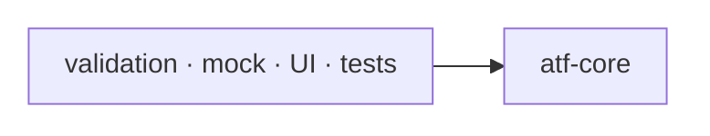
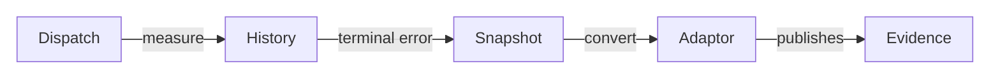

<a id="atf-core---neutral-kernel-and-ports"></a>
<a id="atf-core--kernel-neutru-și-porturi"></a>
# ATF Core - neutral kernel and ports

`atf-core` is the base layer of ATF Java. It contains reusable models, contracts and abstractions, without deciding how a scenario is orchestrated or how a report is rendered.

<a id="at-a-glance"></a>
<a id="pe-scurt"></a>
## At a glance

**Quick links:** [Error and history](#istoric-la-eroare-terminală) · [Safe synchronization](#manifest-și-promovare-guarded) · [Local sample](#verificare-rapidă)

| Owned | Consumers | Boundary |
|---|---|---|
| lifecycle, ports, HTTP vocabulary and module IDs | validation, mock, UI and governance | does not publish HTML |
| Snapshots and neutral policies | composition roots | does not have any concrete scenarios |

<a id="core-diagram"></a>
<a id="diagramă-de-bază"></a>
## Core diagram



<details>
<summary><strong>Legend - position of the kernel</strong></summary>

- the arrow means "the module on the left depends on the module on the right ';
- atf-core is the last common boundary in this map;
- atf-core does not depend on the modules that consume it;
- Concrete fixtures, browser, JUnit and renderer remain in the consuming modules.
</details>

<details>
<summary><strong>Reading map</strong></summary>

- [responsibilities](#responsabilități) and
  [lifecycle](#ciclu-de-viață-generic-și-reutilizabil) — boundary-ul kernel;
- [HTTP vocabulary](#coeziune-și-responsabilitate-pentru-vocabularul-http) and
  [decoupling](#regula-de-decuplare) - ownership and direction of dependence;
- [API selection](#contractul-reutilizabil-pentru-selecția-api),
  [catalog live](#catalogul-live-explicit) and [promotion guarded](#manifest-și-promovare-guarded);
- [determinism](#determinism-și-concurență) and
  [tests](#teste) - executable protection.

</details>

<a id="choose-integration-boundary"></a>
<a id="alege-boundary-ul-de-integrare"></a>
## Choose integration boundary

| Intent | Entry and proof | Consumption keeps |
|---|---|---|
| HTTP with shared deadline | [ApiExecutor](src/main/java/atf/core/http/execution/ApiExecutor.java) → [terminal history](#istoric-la-eroare-terminală) | endpoint, operation and business verdict |
| select live transport | [catalog explicit](#catalogul-live-explicit) | 180-in and authentication |
| LIFO Cleanup | [CleanupRegistry](src/main/java/atf/core/lifecycle/CleanupRegistry.java) | resource acquisition and error policy |
| inspects sources or promotes files | [Java references](#responsabilități) / [manifest guarded](#manifest-și-promovare-guarded) | approved roots and list |

Core contracts and those in the Reporting library have separate owners. The consumer adapter makes explicit conversion; the similarity of names does not create a runtime dependence Reporting → Core.

`CleanupRegistry` collects `RuntimeException` and continues LIFO actions. His contract does not promise to aggregate any `Throwable`; a browser adapter must try to obtain part of its acquisition and the primary cause separately.

- The context of the redaction is in [Security package map](src/main/java/atf/core/security/README.md):
  original input, strategy, fallback and the limit between redaction and foresight.

<a id="liabilities"></a>
<a id="responsabilități"></a>
## Liabilities

| Area | Owner in `atf-core` | Don't |
|---|---|---|
| HTTP | `ApiRequest`, `ApiResponse`, `ApiTransport`, `ApiExecutor` | does not define scenarios or assertions |
| neutral routing | `ApiPathTemplate`, `ApiRoute`, `ApiUrlBuilder` | does not own Users / Posts services or concrete routes |
| time and retry | `ApiExecutionClock`, `ApiExecutionDeadline`, `ApiRetryWaiter`, `RetryPolicy` | not decide the test verdict |
| Typed configuration | `AtfConfiguration`, `AtfRuntimeSnapshot`, `ApiSettings`, `ReportingSettings` and snapshots | does not read configuration in each request |
| source adapters | `config.source.ApiBootstrapConfigurationLoader`, `ApiEnvironment` | does not perform requests and does not own the Users / Posts catalogue |
| statusuri | `AtfReportStatus`, `ReportStatusAggregator` | no render badges |
| file/source discovery | `AtfPathLocator`, `AtfJavaSourceReferences` | solves paths from the roots of the caller without hardcoded workstation paths; does not confuse literals with Java dependencies |
| reporting ports | `AtfReportPorts`, `ValidationSink`, `ReportStepScope`, `AtfConsoleEvent`, `AtfConsoleSink` | do not import Extent, HTML, `System.out` or `atf-console` implementation |
| redaction | `Redactor`, `RedactionContext`, strategies de redaction | does not alter the original input |
| neutral API selection | `ApiScenarioSelection` | `ApiScenarioSetup` and `ApiTestRef` test-only declarations belong to TestKit; the catalogue remains with the consumer |
| live transport adapter | `ApiLiveTransportCatalog` and `ApiTransportPolicy` | does not activate the URL network, default or default flag |
| guarded sync | `AtfPromotionManifest`, `AtfPromotionGuard` | does not promote files outside the manifest and does not delete sources |
| reactor vocabulary | `config.module.AtfModuleIds` | does not orchestrate modules and introduce dependencies up |

`AtfConsoleEvent.fromExternalEnums(...)` explicitly receives the fields of an event and converts the compatible enumerations by name. Core maintains the validation of the published status, duration and path, without reflection or dependence on the external source; the test composition transmits the fields of the Reporting event.

`AtfPathLocator.locateSourceFile(...)` solves a relative file of source candidate roots, either when the test starts from the module directory or from the reactor. Validation rejects absolute and cross paths; the caller explicitly declares the accepted layout instead of reproducing the ancestor traversal loop in each test.

- `AtfJavaSourceReferences.containsNamespace(...)` seeks real Java references,
  with the exact delimits of the identifiers.
- Translate Unicode escapes before excluding comments and literals;
  an invalid escape is denied.
- `codeOnly(...)` offers the same lexical tokens as annotational guards and types;
  the documentary text cannot declare or exclude an executable class.
- Architectural guards re-use it; [evidence controlled](src/test/java/atf/core/files/AtfJavaSourceReferencesTest.java)
  covers imports, qualified names and similar prefixes.
- `AtfJavaSourceReferences.annotationArguments(...)` read the actual annotation of the
  The owner, keeping the literals of arguments and ignoring comments, examples string / text block and declarations nested; Unicode escapes are translated prior to analysis.

<a id="generic-and-reusable-life-cycle"></a>
<a id="ciclu-de-viață-generic-și-reutilizabil"></a>
## Generic and reusable life cycle

`atf.core.lifecycle` package holds neutral mechanics of the scenario:

- plan and orchestration: `ApiScenarioPlan`, `ApiScenarioLifecycleRunner`,
  `ApiScenarioPhaseExecutor`;
- result: `ApiScenarioOutcome` and `ApiScenarioSkipException`;
- orders: `SETUP → TEST BODY → TEARDOWN`, with precedence for causes; and
  `PASS/WARNING/SKIP/FAIL`;
- Boundary: Users / Posts free of service, concrete routes, YAML, Extent or JUnit.

For a reporting port, `Phase.supportsDetails()` declares whether `detail` retains evidence; `false` default retains the compatibility of the legacy adapter. This default does not claim that the diagnosis has been published.

- Errors from `detail`, capability queries, `complete` and `close` do not interrupt phase cleanup.
- First business cause remains primary; subsequent errors are `suppressed`
  in the order of appearance.
- If the phase cannot be opened, the runner shall record FAIL and continue
  teardown-ul.
- Lifecycle failure becomes FAIL when there is no primary cause; runner
  try `scenario.close()` and keep the precedent of the plan.

The contract is protected by [Core tests](src/test/java/atf/core/lifecycle/ApiScenarioPhaseExecutorTest.java) and [contract tests](../atf-reporting-tests/src/test/java/atf/reporting/api/execution/ApiScenarioLifecycleRunnerTest.java). The Extent and fallback performance, including the collapsed discoloration of the assertions and the cause of the Fails, is verified by [permanent browser sample](../atf-reporting-tests/src/test/java/atf/ui/tests/extent/component/lifecycle/ApiScenarioLifecycleReportComponentTest.java).

```text
test adapter / library consumer
             ↓
core lifecycle ports + immutable outcome
             ↓
execution service | reporting publisher | another consumer
```

The boundary of the lifecycle is read as follows:

- `CleanupRegistry` remains in the core as a generic mechanism;
- specific fixtures (`ApiModule`, services, `RoutePaths`) and adapters
  THEIR REMAIN IN THE TEST THE `atf-reporting-tests` SCOPE;
- any API / UI consumer may reuse lifecycle without importing fixtures
  in production;
- `atf-reporting` remains standalone and does not depend on core;
- a new lifecycle enters the core only if it is endpoint-neutral and has tests
  units without browser or actual transport.

<a id="cohesion-and-responsibility-for-http-vocabulary"></a>
<a id="coeziune-și-responsabilitate-pentru-vocabularul-http"></a>
## Cohesion and responsibility for HTTP vocabulary

Production packages have no more than eight classes and group only one responsibility:

| Package | Owned |
|---|---|
| `http.request` | form of a quest: `ApiRequest`, `ApiPathTemplate`, `ApiRoute`, `ApiUrlBuilder`, `HttpMethod`, `HttpHeader`, `MediaTypes` |
| `http.response` | response result, JSON policy and neutral diagnosis `ApiBodyEvidence` for unavailable bodies |
| `http.auth` | authentication, standard types and normalized profile names via `AuthProfiles` |
| `http.protocol` | URI-X absolute and reusable headers profiles without product hosts |
| `http.execution` | execution and outcome |
| `http.transport` | boundary transport |
| `diagnostics` | Compact and bounded exceptional messages, independent of Playwright or product |

`ApiPathTemplate` makes a joint, validation and secure segment resolution; it is not a product route catalogue.

<a id="concrete-catalogues-and-direction-of-dependence"></a>
<a id="cataloge-concrete-și-direcția-dependency-ului"></a>
### Concrete catalogues and direction of dependence

- `atf-reporting-tests` owns `RoutePaths`, `ApiRoutes` and Users / Posts services
  in the scope test;
- `atf-mock` holds `MockRoutePaths` for the built-in fixture;
- reporting production does not hold endpoints and does not become dependent on a catalogue
  de business;
- `ApiPaths` has been removed from the core to not present a concrete catalogue as
  generic platform;
- The correct direction is `consumer → atf-core`, and reporting remains standalone.

```text
ApiPathTemplate (core, generic)
        ├── RoutePaths / ApiRoutes (reporting-tests, concrete API fixtures)
        ├── MockRoutePaths (mock, built-in fixture)
        └── reporting tests consume semantic references; no raw URL literals
```

<a id="vocaular-and-guardines"></a>
<a id="vocabular-și-guard-uri"></a>
<a id="vocaular-and-guards"></a>
### Vocaular and guards

- **HTTP vocabulary** - verbs, heads, media types, URI schemes and profiles
  auth are constant / enumerations with semantic owner; `ApiUris`, `HttpHeaderProfiles` and `AuthProfiles` remove copies from consumers;
- **diagnostics** - `ThrowableDiagnostics` produces singleline bound messages;
  the consumer decides where they are published and does not move business policy to core;
- **without a global bucket** - no global `AtfConstants` is inserted;
- **write requests** — `HttpHeader.CONTENT_TYPE`,
  `MediaTypes.APPLICATION_JSON`, `HttpMethod.POST` and `HttpMethod.PUT` are used by the demand, mock and validation; the JSON contract is checked for transport and in the report;
- **reactor** - `AtfModuleIds` holds Maven, `REACTOR_MODULES` strings
  represents the POM root modules and `SOURCE_GOVERNED_MODULES` represents the modules inspected by the global guard;
- **test-kit** - remains in the reactor and governs its test-layer separately;
- **keys configure** - the `AtfModule` enumeration remains separate for logical keys;
- **package cohesion** - `AtfPackageCohesionGovernanceTest` checks inventory
  production and source- sets; over 8 classes means separation after responsibility and exceptions remain explicit;
- **controlled discovery** - `AtfPathLocator` searches the parent directories and
  solves the root source only when the relative marker exists;
- **single owner** - `locateAtfTestSourceRoot(...)` keeps the candidates
  supported in one place; tests and composition roots do not repeat the crosswalk;
- **relocatabilitate** - Utilizer does not expose the robot to evidence and does not introduce
  local routes in the report.

<a id="uncoupling-rule"></a>
<a id="regula-de-decuplare"></a>
## Uncoupling rule

```text
ApiRequest / ApiResponse / ValidationResult / Report ports
                         ↓
              modulele de execuție și reporting
```

Core can define ports and source adapters fail- closed, but does not implement Extent, HTML, CSS, JavaScript, console formatting, writing in `System.out`, JUnit or business services. A port must be small, semantic and testable with fakes in memory.

The execution configuration is typed and immutable:

- `config.source` only reads YAML, properties or environment;
- The loader produces the validated snapshots and does not enter the transport;
- each session shall keep its own time-out, retry, auth and editorial policy;
- parallel runs cannot override each other's configuration.

Examples of correct directions:

```text
ApiExecutor → ApiExecutionResult
Validator    → ValidationResult
Reporting   → AtfReportPorts
```

Prohibited directions:

```text
core → ExtentTest
core → JUnit
core → HTML/CSS
core → UsersService / PostsService
```

<a id="reusable-contract-for-api-selection"></a>
<a id="contractul-reutilizabil-pentru-selecția-api"></a>
## Reusable contract for API selection

`ApiScenarioSelection` model in `atf-core` is neutral from the consumer:

- `@ApiScenarioSetup` and `@ApiTestRef` declarations are in `atf.testkit.setup.api`, consumed in the scope test;
- `ApiScenarioSelection` transmits the snapshots immutable to the composition root;
- UI tests, acceptance runners and other consumers may re-use the contract;
- The specific catalogue of tests does not enter `atf-core`.

```text
consumer annotation
  → ApiScenarioSetup / ApiTestRef (TestKit)
  → consumer catalog resolves owner + method
  → ApiScenarioSelection
  → API/reporting composition root
```

| Responsibility | Owner |
|---|---|
| mapping `UsersApiScenarios`, `PostsApiScenarios`, `LifecycleApiScenarios` | composition scope-ul `atf-reporting-tests` |
| generic loader for `atf.yaml` | `config.source` of core |
| specific catalogue, YAML mok, JUnit and orchestration | consumption modules |

The service catalogue is product composition, not generic platform. The annotation contract is in [infrastructure documentation](../docs/ATF_Test_Infrastructure_Annotations.md); Core main does not depend on TestKit.

`RecordingApiTransport` is the generic decorative for the highlight:

- capture the last `ApiRequest` and delegate the execution;
- be not aware of reporting, mock or JUnit;
- can be reused for API report, component tests and replay without copy
  The fixtures from the scope test.

<a id="explicit-live-catalogue"></a>
<a id="catalogul-live-explicit"></a>
## Explicit live catalogue

`ApiLiveTransportCatalog` is the public adapter for real quests; its rules are:

- keep endpoints called;
- produce a `ApiTransport` only after `ApiTransportPolicy` with `LIVE` profile and
  opt-in explicit;
- `ACCEPTANCE` policy does not consult the catalogue;
- the acceptance placeholder (`ApiEnvironment.MOCK_BASE_URI`) is rejected even
  if the operator has activated the eighty-nine.

```text
ApiBootstrapConfiguration
  → ApiTransportPolicy.LIVE + explicit opt-in
  → ApiLiveTransportCatalog.open(endpoint)
  → ApiBootstrap.live / ApiTransportBinding.live
  → ApiExecutor
```

The catalogue shall apply the safety limits before creating the transport:

- accept only `http/https` and endpoint unambiguous profiles;
- limit each consignment to the origin of the named endpoint;
- delegate authentication to `ApiAuthenticator` and do not expose tokens;
- does not build cURL or HTML; the replica editor belongs to the reporting;
- The injectable factory allows the verification of the contract without real network.

Mock remains the safe default and is composed separately by `atf-mock`. The fact that a configuration contains `baseUri` is never enough to open the network.

<a id="manifest-and-guaranteed-promotion"></a>
<a id="manifest-și-promovare-guarded"></a>
## Manifest and guaranteed promotion

`AtfPromotionManifest` fixes the baseline of the approved files prior to staging:

- the paths are relative; existing files retain size and SHA-256;
- an absent entry approves the creation of that file and detects parallel creation;
- The root of the checkout is not persistent, and the manifest does not reach HTML.

Re-usable promotion:

```text
live root + approved relative files
  → AtfPromotionManifest.capture(...)
  → build/test în staging extern
  → AtfPromotionGuard.promote(staging, live, baseline)
  → verificare drift + copiere atomică numai a fișierelor aprobate
```

The guard checks the entire live baseline before the first copy and revalidates the destination before each file. The external location per root coordinates the co-operating promoters; the staging sources remain preserved without default deletions.

- The atomicity concerns the replacement of a file, not the whole lot.
- The guard builds the complete plan before the first writing: each source
  approved must be a regular, eligible and open file for reading. A subsequent source absent or directory refuses the entire plan without live changes.
- The existing parents of each destination must be the director.
  refuse an intermediate file, including that which occurred after the capture of the manifesto, prior to any copy. Absent parents are allowed and are created only upon execution.
- Execution revalidates each destination baseline. I/O failure or drift after preflight may leave a partial batch; reread actual state before resuming. Preflight does not promise a batch transaction.
- `AtfPromotionPreflightTest` is proposing refusal before any writing,
  creating competition, direct parents / ineligible intermediaries and promoting only approved files. Denying keeps the sources and does not create parents.
- Baseline follows the content of approved files; the invalid parent is
  a separate structural check. It and the refusal of the symlinks are resumed prior to copying each file, without eliminating the possibility of a subsequent I / O failure.
- Portable JSON Manifesto is process audit without evidence in HTML
  or synchronization as generated output.

<a id="isolation-of-the-execution-diagnosis"></a>
<a id="izolarea-diagnosticului-de-execuție"></a>
## Isolation of the execution diagnosis

`ApiExecutor` holds one `AtfConsoleDiagnostics` per invoicing. `RuntimeException` of the synchronization at START, DETAIL, CODE or COMPLETE does not stop the display and does not replace the result. At functional error, distinct diagnostic causes are attached as suppressed with the same exception of snapshot; do not be Republic through the defective synchronization and no spare stdout shall be used.

Politics is best- effort for runtime errors of diagnosis. `Error` remains fatal; it is not converted into success.

- The timeout, cancellation and retry shall retain the deadline, tests and provenance of execution.

[ApiDiagnosticIsolationTest](src/test/java/atf/core/http/diagnostics/ApiDiagnosticIsolationTest.java) shall propose these limits by public port, without Console or Reporting in production.

<a id="terminally-incorrect-history"></a>
<a id="istoric-la-eroare-terminală"></a>
## Terminally incorrect history

`ApiExecutionException.snapshot()` shows a `ApiExecutionSnapshot` immutable for failed transport, timeout and interruption. Cancellation remains `CancellationException`, via `ApiExecutionCancelledException` subtype.



<details>
<summary><strong>Legend - observed execution, no response manufactured</strong></summary>

- `ApiExecutionFailure.find(error)` is looking for the snapshots on the primary cause chain,
  with cycle protection; a clerical suppressed error cannot provide evidence for any other operation.
- Snapshots keep the quest, URL-ul solved, the declared provenance,
  The total monotony duration, the tests, the planned retries and the endings. The lists are immutable copies and the tests are contiguous.
- `response()` is Optional; no terminal response reuses 503
  A response captured prior to a police error remains distinct from the lack of response.
- `ApiAttemptRecord.httpStatus()` is empty for the sentinel legacy zero;
  this does not represent HTTP 0. Core retains the existing constructors.
- Cancellation before the Display has zero attempts. Stopping in the backoff
  keep the retry planned, without inventing the next call.
- The cause, stack and suppressed remains preserved; interruption retains the flag
  Thread and cancel the fucking pending.
- The Deadline and policy of the retry are the original ones. Capturing times
  Publication of snapshots does not return the request.

The short labels shall be kept as follows:

| In the scheme | Full meaning |
|---|---|
| Dispatch | Dispatch performed |
| History | Tests + planned retries |
| Snapshot | Snapshot immutable + cause |
| Adapter | Adaptor consumer |
| Evidence | Execution evidence |
| convert | convert to owner |
| publishes | release |

</details>

A final response, including non-2xx, continues to return `ApiExecutionResult`. The SUCCESS legacy outcomer of a test means the final response received without declaring business success.

`ApiTerminalExecutionEvidenceTest` uses controlled transport and watch for 503 → error / timeout, cancellation, interruption and error on the first call. The report's redaction and verdict remain at the consumer and Reporting, without Core's dependence on the renderer.

<a id="determinism-and-competition"></a>
<a id="determinism-și-concurență"></a>
## Determinism and competition

The competing evidence of cancellation confirms the entry of the transport through the barrier, then checks the result of the workshop in the JUnit Thread via `FutureTask`. A sleep does not prove the display, and a loss of assertion in the workshop is not JUnit verdict.

- Before the dispatch, the shipment is not called and the unturned future remains uncancelled.
- After the display, the future handed over is cancelled, and the snapshots keep trying.
  and category `CANCELLED`; worker error is observed by the caller.
- The Cleanup signals the cancellation, interrupts and makes the join bound including at
  evidence failure; API and join limits do not increase for timing.

`ExecutionResilienceTest` checks the real thread, and `ApiTerminalExecutionEvidenceTest` checks the deadline and controlled-clock snapshots separately. Core unit tests maintain the category without HTML ratio.

The `ApiExecutionResult` history is available when execution returns a final response. At terminal error, [partial snapshots](#istoric-la-eroare-terminală) retains the observed tests and cause without sending back the operation.

- **Snapshot and time** - each execution receives snapshots-look settings;
- **clock injectable** - monotonic time, the deadline of the request and the delay
  Retry does not require real time in tests;
- **IMMUTABLE MODEL** - objects exited from the core do not exhibit mutable collections and
  does not keep static rolling states;
- **written contracts** - `ApiRoute.request(...)` rejects `POST` and `PUT` without
  body, while `requestBody(...)` requires valid, nonempty JSON and normalizes `Content-Type: application/json`;
- **Observed verdict** - invariant belongs to the construction of the transport and is
  re-checked by publisher / auditor in evidence;
- **redaction** - `RedactionContext` immutable maintains the literal mask and encodes only its value at the regex boundary; strategies keep the structural groups. JSON and the nominal fields use the gross mask without altering the quest, the original response or the assertion. [Security Map](src/main/java/atf/core/security/README.md#masca-și-protocolul-replacement) delimits the comparison, editing and preview.

<a id="tests"></a>
<a id="teste"></a>
## Tests

`atf-core` tests shall verify separately:

- Require / reply and authentication;
- timeout, cancellation, retry and `Retry-After` with injection clock;
- Snapshots and the precedence of configuration;
- status aggregation and precedence of `FAIL > SKIP > WARNING > PASS`;
- Redaction on JSON, heads, query, path and PII;
- actual namespace Java references to examples in comments / literals;
- port contracts without specific Extent.
- `ApiScenarioSelection` and Annotation Contracts without JUnit / browser;

A core test does not generate HTML ratio. Visual evidence and end to end scenarios of the reporting belong to the `atf-reporting-tests` Scopeship. `atf-tests` holds the whole-reactor governance; only documented legacy selections retain the role of compatibility.

<a id="quick-check"></a>
<a id="verificare-rapidă"></a>
## Quick check

The competing contract keeps [Distinguishing number of the country which has granted authorisation](#determinism-și-concurență).

| Decision | Source and limit |
|---|---|
| Execution, deadline and terminal history | [source of the host](src/main/java/atf/core/http/execution/ApiExecutor.java); sample [ApiTerminalExecutionEvidenceTest](src/test/java/atf/core/http/execution/ApiTerminalExecutionEvidenceTest.java) |
| Dependencies and source- sets | [POM](pom.xml); declared scope authority for integration |
| What this probe does not prove | Do not calculate the business verdict and do not publish HTML. |

<details>
<summary><strong>Command for local sample</strong></summary>

Run from the root of a [external staging](../docs/ATF_Build_And_Execution_Safety.md), with JDK 21 and Maven.

```powershell
mvn -B -pl atf-core -am "-Dtest=ApiTerminalExecutionEvidenceTest" "-Dsurefire.failIfNoSpecifiedTests=false" test
```

The command selects the sample called and builds the dependencies; does not declare the passage of the entire module. Do not calculate the business verdict and do not publish HTML.

</details>

<a id="average-type-heads-and-protocol-vocabulary"></a>
<a id="media-type-headere-și-vocabular-de-protocol"></a>
## Average type, heads and protocol vocabulary

| Boundary | Verified contract |
|---|---|
| `MediaTypes.isJson` | only classifies the specific type / subtype without parameters; accept JSON and the `+json` suffix independently of casing |
| type and payload | A correct MIME does not repair invalid JSON; `json` only in a parameter or similar subtype is not sufficient |
| actual heads | default → headers request → selected authentication profile; replacement is case insensitive, without residual values for the same header |
| `NONE` profile | keep the header provided by the caller; a selected profile holds only the headers it declares |
| transport | build and send only one request; do not compensate headers by replay |
| vocabulary | the name of the author / policy normalises with `Locale.ROOT`, separate from the business text |

[MediaTypesTest](src/test/java/atf/core/http/request/MediaTypesTest.java), [actual built demand headers](src/test/java/atf/core/http/transport/HttpClientRequestHeadersTest.java) and [auth profiles](src/test/java/atf/core/http/auth/AuthProfilesTest.java) keep the nominations and negatives. The loopback sample checks both shipments, complete values, body and one shipment without external service.

## Core distribution

J0 retains source and all native tests. The Core POM is parentless, targets Java 21 and declares Jackson runtime dependencies explicitly. Test Kit and JUnit are test-only dependencies and do not enter production transitives.

J1–J6 consume the same Core JAR/POM pair directly in lib, alongside the independently versioned Reporting pair. The [publication and consumption contract](../docs/ATF_Core_Consumer.md) defines Maven/IntelliJ bootstrap, provenance and acceptance without Core source.

<a id="timeout-and-ownership-in-native-samples"></a>
<a id="timeout-și-ownership-în-probele-native"></a>
### Timeout and ownership in native samples

The contract distinguishes the expiry before the disassembly from the timeout of a future taken over: only the second can be cancelled by the executor. The samples use the existing injectable clicker and check the number of mismatches, duration, outcomer and absence of an invented response, without assumptions of scheduling in a real budget of 30 ms.

<a id="the-samples-of-the-deadline-and-the-ownership-of-the-fuck"></a>
<a id="probele-deadline-ului-și-ownership-ul-future-ului"></a>
## The samples of the deadline and the ownership of the fuck

A deadline may expire before the shipment is called. Native samples check the two states separately without increasing the execution budget.

| Boundary | Executable criterion |
|---|---|
| prior to dispatch | 11 ms controlled clock for budget 10 ms; zero calls, zero attempts / history, unanswered and caller future remains incomplete |
| after dispatch | controlled clock consume exactly 10 ms by get; one call / attempt, one cancellation, TIMED_OUT and unanswered invented |
| diagnoses on actual clock | 20 repeats 10 ms; calls observed decide ownership, and cancellation, history and snapshots must correspond to that condition |
| cause | TimeoutException and the original diagnosis suppressed remain visible; the expiry must be confirmed by the duration of the snapshots |
| protection of the sample | the JUnit 5 s failsafe prevents a stuck test; it does not change the product's 10 ms deadline |

[ApiTerminalExecutionEvidenceTest](src/test/java/atf/core/http/execution/ApiTerminalExecutionEvidenceTest.java) forces both states; [ApiDiagnosticIsolationTest](src/test/java/atf/core/http/diagnostics/ApiDiagnosticIsolationTest.java) checks the integration of the diagnosis. External samples refuse mutations without canel, without checking before mismatch and without attaching the diagnosis.

HttpClientTransport keeps up the operation; UrlConnectionTransport owns the body subscriber, virtual workshop and connection. A late body cannot send after the original cancellation or deadline. [Core contract](../docs/feedback/ATF_Core_Feedback.md#core-urlconnection-cancel-126--body-subscription-and-dispatch-ownership) keeps independent samples of the shipments; cancellation does not prove rollback on the server.

<a id="full-json-document-and-accurate-record"></a>
<a id="document-json-complet-și-evidence-fidel"></a>
## Full JSON document and accurate record

| Boundary | Contract |
|---|---|
| JsonDocuments | a complete document, without trailing content or duplicate keys, including nested; immutable reader, new tree per call |
| Syntax and write | The scalars and the literal null are JSON; POST / PUT JSON factory refuses null before the quest can be shipped |
| request explicit | Formal / text paths remain available; the executor does not deduct JSON from HTTP method only |
| Mock equality | decimal BigDecimal without narrowing; number / string and integer / decimal keep existing distinctions; raw body remains intact |
| Core redaction | numerical tokens and duplicate public fields kept; each sensitive value is fully masked |
| display Reporting | Core independent streaming projection; numbers and duplicates shall be kept prior to the configuration of the drive |
| assertions | Expected / current is drafted separately; the caller verdict remains independent of the default 240 preview- |

- The strict parser refuses the ambiguous document for decisions; the obvious projection retains all the appearances of the fields.
- Mock accepts literally null as syntax, separated from the prohibition of the write factory.
- JSON invalid diagnostic does not become valid payload.

Core natives and generic regressions Reporting remain only in J0. Temporary Harnesses check JAR physically without sources of shadow implementation.

<a id="projection-of-consoles-and-cancellation-of-transport"></a>
<a id="proiecția-console-și-anularea-transportului"></a>
## Projection of consoles and cancellation of transport

| Boundary | Contract |
|---|---|
| lifecycle START/COMPLETE | Full name method / path is written prior to issue; the consignment retains the original input |
| CODE JSON | Sensitive fields are structurally masked; decoded public strings use configured text rules |
| fidelity | numbers keep the exact token, duplicate fields remain distinct, and non-sensitive neighbours remain visible |
| cancellation after dispatch | The exposed future forwards one best-effort upstream cancellation request with the same interrupt flag |
| competition with completion | the first terminal result wins; canel after success / failure does not retroactively cancel the operation |
| URLConnection prior to disconnect | the operation holds the body subscriber, virtual workshop and connection; the delayed body cannot re-launch a terminal request |
| deadline URLConnection | body, connect and read share the original monotonous budget; the deadline caller is independent of virtual carriers without default retry |
| cleanup refused / failed | the cancellation of the caller remains terminal; the exception of cleanup is suppressed without claim of the server-side rollback |

[HttpClientCancellationTest](src/test/java/atf/core/http/transport/HttpClientCancellationTest.java) controls success, failure, cancellation and non-network races. [HttpClientReadCancellationTest](src/test/java/atf/core/http/transport/HttpClientReadCancellationTest.java) checks separately a local GET blocked: a display, CANCELLED and uninvented response.

[UrlConnectionCancellationTest](src/test/java/atf/core/http/transport/UrlConnectionCancellationTest.java) and [UrlConnectionDeadlineTest](src/test/java/atf/core/http/transport/UrlConnectionDeadlineTest.java) check delayed subscription, own deadline and 250 ms call, blocked publisher, cause / suppressed and races; cancellation after disconnect does not prove rollback.

[Isolation of the deadline](src/test/java/atf/core/http/transport/UrlConnectionDeadlineIsolationTest.java) checks in a JVM separate progress with a single virtual locked carrier.

[Console projection](src/test/java/atf/core/http/ApiExecutorConsoleRedactionTest.java) checks the absence of canary in each channel, keeping demand / original responses. [JSON Stringings Policy](src/test/java/atf/core/security/json/JsonPublicStringRedactionTest.java) covers enabled / disabled and literal masks; the redaction is not universal detection of secrets.
