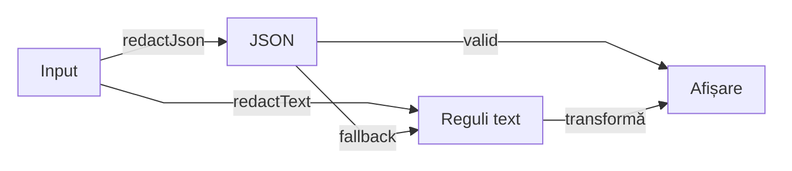

# Core security — redactare înaintea afișării

## Pe scurt

Pachetul transformă o valoare în reprezentarea ei sigură pentru diagnostic.
Nu modifică request-ul sau expected-ul și nu decide verdictul; preview-ul,
HTML-ul și publicarea aparțin callerului.

## Intrări și responsabilități

| Intrare | Owner | Limită |
|---|---|---|
| text sau câmp nominal | [SensitiveDataRedactor](SensitiveDataRedactor.java) | fațadă și selecția strategiei |
| politica imutabilă | [RedactionSettings](RedactionSettings.java) și [RedactionContext](RedactionContext.java) | enabled, mască, câmpuri sensibile și PII opt-in |
| credențiale în text | [SecretPatternRedactor](SecretPatternRedactor.java) | JSON textual, authorization, query și segmente de path |
| date personale opționale | [PiiRedactor](PiiRedactor.java) | email și valori de forma telefonului |
| căi de profil local | [LocalPathRedactor](LocalPathRedactor.java) | reprezentare diagnostică, nu rezolvarea fișierului |
| JSON structural | [StructuredJsonRedactor](StructuredJsonRedactor.java) | câmpuri configurate; fallback textual la parse eșuat |

## Fluxul reprezentării

<strong>Legendă — structură și fallback</strong>

| În schemă | Sens complet |
|---|---|
| Input | text original, păstrat intact |
| JSON | parse și traversare structurală a câmpurilor sensibile |
| Reguli text | strategii regex pentru credențiale, PII și căi locale |
| Afișare | valoare livrată callerului; bounding-ul și rendererul sunt în afara pachetului |

Un JSON valid maschează structural câmpurile selectate; textul liber și
fallback-ul trec prin strategiile regex. Săgețile exprimă transformări de date.

## Invariante și limita curentă

- Activarea PII este explicită; input-ul original nu se rescrie și nu devine un expected artificial.
- Redactarea precede scurtarea la preview; limita implicită a aserțiunilor rămâne la ownerul auditului.
- Strategiile text interpretează încă masca prin protocolul regex replacement; [criteriul literal](../../../../../../../docs/feedback/ATF_Core_Boundaries_Feedback.md) rămâne deschis pentru `$` și backslash.
- Redactarea nu autentifică, nu execută HTTP și nu certifică absența oricărei date sensibile dintr-un format necunoscut.

## Probe și context

[RedactionStrategiesTest](../../../../../test/java/atf/core/security/RedactionStrategiesTest.java)
și [CoreContractTest](../../../../../test/java/atf/core/CoreContractTest.java)
protejează regulile existente; măștile speciale cer negativele din feedback.
Continuă cu [README-ul Core](../../../../../../README.md) și
[atlasul ATF](../../../../../../../docs/ATF_Context_Atlas.md).
