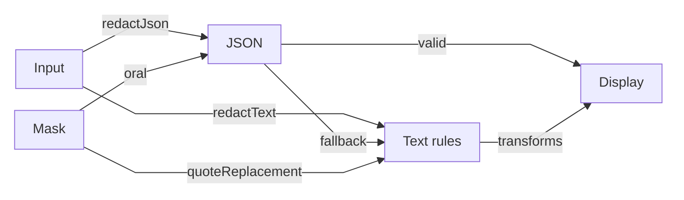

# Core security - editing prior to display

## At a glance

The package transforms a value in its safe representation for diagnosis. Do not modify the quest or the expectation and do not decide the verdict; the preview-, HTML and publication belong to the caller-.

## Entry points and responsibilities

| Input | Owner | Boundary |
|---|---|---|
| nominal text or field | [SensitiveDataRedactor](SensitiveDataRedactor.java) | façade and strategy selection |
| policy that is immutable | [RedactionSettings](RedactionSettings.java) and [RedactionContext](RedactionContext.java) | enabled, mask, sensitive fields and PII opt-in |
| credit institutions | [SecretPatternRedactor](SecretPatternRedactor.java) | JSON textual, authorization, query and path segments |
| optional personal data | [PiiRedactor](PiiRedactor.java) | E-mail and phone-shape values |
| local profile pathways | [LocalPathRedactor](LocalPathRedactor.java) | diagnostic representation, not file resolution |
| JSON structural | [StructuredJsonRedactor](StructuredJsonRedactor.java) | configured fields and text rules on decoded strings; fallback to failed parse |

## Representation flow

<strong>Legend - structure and fallback</strong>

| In the scheme | Full meaning |
|---|---|
| Input | original text, kept intact |
| JSON | crossing tokens; sensitive fields and public decoded strings |
| Text rules | regex strategies for credit, PII and local ways; receive encoded mask for replacement |
| Mask | RedactionSettings literal value; JSON structurally receives it without regex coding |
| Display | caller value; bounding- and renderer-value are out of the package |

A valid JSON structurally masks the selected fields. Public decoded strings, free text and fallback pass through the configured strategies for the credit, PII and local paths. The arrows express data transformations.

## Invariants and literal masks

- The PII activation is explicit; the original input does not rewrite and does not become an artificial expected.
- The redaction precedes the shortening to the preview; the implicit limit of the assertions remains at the audit owner.
- The configured mask is literal text, including `$0`, `$1`, `$MASK`, backslash and combinations; no part of it becomes backreference.
- The editing does not authenticate, does not execute HTTP and does not certify the absence of any sensitive data from an unknown format.

## Mask and Replacement Protocol

| Value | Owner and Usage |
|---|---|
| `replacement()` | gross mask; nominal fields and structural JSON use it directly |
| `quotedReplacement()` | context encodes only the mask via `Matcher.quoteReplacement` at the regex boundary |
| `$1`, `$2` structurale | strategies explicitly retain the captured prefixes and delimiters; no complete replacement expression is exceeded |

The valid JSON is serialized by Jackson with the gross mask, without backslashes added to the regex protocol. The malformed JSON backdrop uses text strategies; keeps the same literal mask and does not repair the document.

| Boundary | Preserved Invariant |
|---|---|
| Activation | global policy, PII, local paths and configured fields keep their scope; the default mask remains nominal control |
| Comparison | caller compares original values before editor injected into neutral policy Kit |
| Preview | The drawing prior to shortening; the display limit belongs to the caller |
| Publication | Reporting renderer and its configuration remain independent of Core |

The local publication sample verifies the literal values and absence of canary in HTML. The original comparison remains FAIL when the displayed values are identical or shortened; Core tests remain unitary.

## Authorization quoted and truncated diagnosis

| Channel | Contract |
|---|---|
| simple header | keep the name and scheme Bearer / Basic; replace the credential |
| literal JSON key `authorization`, including in a textual diagnosis | Mask the entire string value with original delimiters and the same literal mask |
| malformed JSON fallback | remove the known value even if the final string or escapes are unfinished; do not repair the document |
| JSON structural valid | Jackson keeps its mask raw and fields unsensitive; the caller observation remains intact |

The editing recognises documented syntax; it is not universal parser for arbitrary formats or encoding. Full comparison precedes the secure representation and display ceiling of the caller.

[QuotedAuthorizationRedactionTest](../../../../../test/java/atf/core/security/QuotedAuthorizationRedactionTest.java) checks the exact values, escapes, activation and non-sensitive neighbors. Core → Kit → Extent / fallback checks the absence of canary and FAIL- separately for the two distinct values that become identical after the redaction.

## Prohibitions and context

[RedactionStrategiesTest](../../../../../test/java/atf/core/security/RedactionStrategiesTest.java) and [CoreContractTest](../../../../../test/java/atf/core/CoreContractTest.java) protect prefixes, non-sensitive neighbours, special masks, JSON structurally and fallback, with PII and local routes oci- in. Continue with [README-ul Core](../../../../../../README.md) and [ATF atlas](../../../../../../../docs/ATF_Context_Atlas.md).

## Public strings and consoles

The known syntax Authority, query / path credential and key = value is also written in the string values of the JSON valid. Public fields do not become fully sensitive; only recognised segments transform and disabled policy keeps the exact input.

ApiExecutor applies the same policy to lifecycle names and bodies CODE. Comparison, transport payload, numerical tokens and duplicate appearances remain independent of safe projection.
