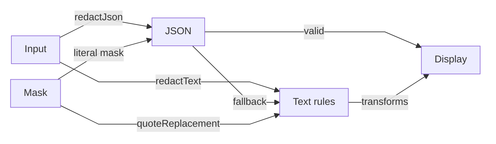

# Core security — redaction before display

## At a glance

This package projects values into safe diagnostics. It preserves the original request and expectation and does not decide the verdict; preview limits, HTML and publication belong to the caller.

## Entry points and responsibilities

| Input | Owner | Boundary |
|---|---|---|
| nominal text or field | [SensitiveDataRedactor](SensitiveDataRedactor.java) | façade and strategy selection |
| immutable policy | [RedactionSettings](RedactionSettings.java) and [RedactionContext](RedactionContext.java) | enabled, mask, sensitive fields and PII opt-in |
| credentials | [SecretPatternRedactor](SecretPatternRedactor.java) | JSON textual, authorization, query and path segments |
| optional personal data | [PiiRedactor](PiiRedactor.java) | E-mail and phone-shape values |
| local profile paths | [LocalPathRedactor](LocalPathRedactor.java) | diagnostic representation, not file resolution |
| structured JSON | [StructuredJsonRedactor](StructuredJsonRedactor.java) | configured fields and text rules on decoded strings; text fallback when parsing fails |

## Representation flow

<strong>Legend — structure and fallback</strong>

| In the scheme | Full meaning |
|---|---|
| Input | original text, kept intact |
| JSON | token traversal; sensitive fields and decoded public strings |
| Text rules | regex strategies for credentials, PII and local paths; the replacement mask is quoted for regex use |
| Mask | literal RedactionSettings value; structured JSON receives it without regex quoting |
| Display | display value; preview limits and rendering remain outside this package |

Valid JSON masks selected fields structurally. Decoded public strings, free text and malformed-JSON fallback use the configured credential, PII and local-path strategies; arrows show these transformations.

## Invariants and literal masks

- PII redaction is opt-in; it neither rewrites the original input nor fabricates an expected value.
- Redact before truncating the preview; the audit owner retains its default assertion limit.
- The configured mask is literal text, including `$0`, `$1`, `$MASK`, backslash and combinations; no part of it becomes backreference.
- Redaction neither authenticates nor executes HTTP, and it cannot certify unknown formats as free of secrets.

## Mask and Replacement Protocol

| Value | Owner and Usage |
|---|---|
| `replacement()` | raw literal mask; named fields and structured JSON use it directly |
| `quotedReplacement()` | context encodes only the mask via `Matcher.quoteReplacement` at the regex boundary |
| structural `$1`, `$2` references | strategies retain captured prefixes and delimiters; never quote the complete replacement expression |

Jackson serializes valid JSON with the raw mask, without regex replacement escapes. Malformed JSON uses textual fallback with the same literal mask; fallback does not repair the document.

| Boundary | Preserved Invariant |
|---|---|
| Activation | global policy, PII, local paths and configured fields keep their scope; the default mask remains nominal control |
| Comparison | the caller compares original values before applying the redactor injected into Kit display policy |
| Preview | redaction precedes truncation; the caller owns the display limit |
| Publication | Reporting renderer and its configuration remain independent of Core |

The publication probe checks literal masks and absence of secret canaries in HTML. The original comparison remains FAIL even when redaction or truncation makes displayed values identical; Core tests retain their unit scope.

## Quoted Authorization values and truncated diagnostics

| Channel | Contract |
|---|---|
| simple header | preserve the header name and Bearer/Basic scheme; replace the credential |
| literal JSON key `authorization`, including in a textual diagnosis | Mask the entire string value with original delimiters and the same literal mask |
| malformed JSON fallback | remove the known value even if the final string or escapes are unfinished; do not repair the document |
| JSON structural valid | Jackson preserves the raw mask and nonsensitive fields; the caller’s observation stays intact |

Redaction recognizes documented syntax, rather than arbitrary formats or encodings. Compare full values before producing the safe representation and applying the caller’s display limit.

[QuotedAuthorizationRedactionTest](../../../../../test/java/atf/core/security/QuotedAuthorizationRedactionTest.java) checks exact values, escapes, activation and nonsensitive neighbors. Core → Kit → Extent/fallback checks both canary removal and a retained FAIL when two different original values produce identical redacted text.

## Tests and related contracts

[RedactionStrategiesTest](../../../../../test/java/atf/core/security/RedactionStrategiesTest.java) and [CoreContractTest](../../../../../test/java/atf/core/CoreContractTest.java) protect prefixes, nonsensitive neighbors, special masks, structured JSON and fallback, with PII and local paths opt-in. Continue with the [Core README](../../../../../../README.md) and [ATF atlas](../../../../../../../docs/ATF_Context_Atlas.md).

## Public strings and consoles

Known Authorization, query/path credential and key=value syntax is also redacted inside string values of valid JSON. Public fields remain public; only recognized sensitive segments change, and disabled policy preserves the exact input.

ApiExecutor applies the same policy to lifecycle labels and CODE bodies. Comparison, transport payloads, numeric tokens and duplicate field occurrences remain independent of this diagnostic projection.
