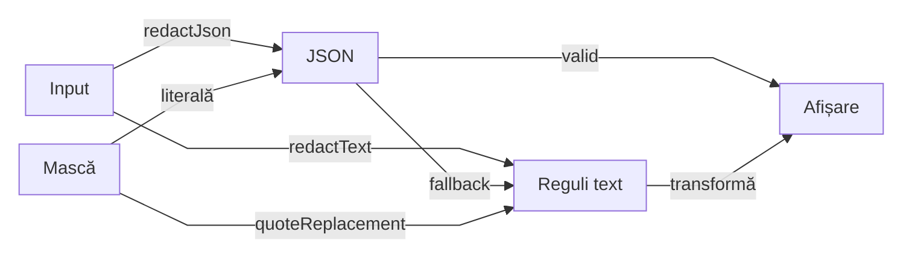

# Core security — redactare înaintea afișării

## Pe scurt

Pachetul transformă o valoare în reprezentarea ei sigură pentru diagnostic.
Nu modifică request-ul sau expected-ul și nu decide verdictul; preview-ul,
HTML-ul și publicarea aparțin callerului.

## Intrări și responsabilități

| Intrare | Owner | Limită |
|---|---|---|
| text sau câmp nominal | [SensitiveDataRedactor](SensitiveDataRedactor.java) | fațadă și selecția strategiei |
| politica imutabilă | [RedactionSettings](RedactionSettings.java) și [RedactionContext](RedactionContext.java) | enabled, mască, câmpuri sensibile și PII opt-in |
| credențiale în text | [SecretPatternRedactor](SecretPatternRedactor.java) | JSON textual, authorization, query și segmente de path |
| date personale opționale | [PiiRedactor](PiiRedactor.java) | email și valori de forma telefonului |
| căi de profil local | [LocalPathRedactor](LocalPathRedactor.java) | reprezentare diagnostică, nu rezolvarea fișierului |
| JSON structural | [StructuredJsonRedactor](StructuredJsonRedactor.java) | câmpuri configurate; fallback textual la parse eșuat |

## Fluxul reprezentării

<strong>Legendă — structură și fallback</strong>

| În schemă | Sens complet |
|---|---|
| Input | text original, păstrat intact |
| JSON | parse și traversare structurală a câmpurilor sensibile |
| Reguli text | strategii regex pentru credențiale, PII și căi locale; primesc masca codificată pentru replacement |
| Mască | valoarea literală din RedactionSettings; JSON-ul structural o primește fără codificare regex |
| Afișare | valoare livrată callerului; bounding-ul și rendererul sunt în afara pachetului |

Un JSON valid maschează structural câmpurile selectate; textul liber și
fallback-ul trec prin strategiile regex. Săgețile exprimă transformări de date.

## Invariante și măști literale

- Activarea PII este explicită; input-ul original nu se rescrie și nu devine un expected artificial.
- Redactarea precede scurtarea la preview; limita implicită a aserțiunilor rămâne la ownerul auditului.
- Masca configurată este text literal, inclusiv `$0`, `$1`, `$MASK`, backslash și combinații; nicio parte din ea nu devine backreference.
- Redactarea nu autentifică, nu execută HTTP și nu certifică absența oricărei date sensibile dintr-un format necunoscut.

## Masca și protocolul replacement

| Valoare | Owner și utilizare |
|---|---|
| `replacement()` | masca brută; câmpurile nominale și JSON-ul structural o folosesc direct |
| `quotedReplacement()` | contextul encodează numai masca prin `Matcher.quoteReplacement`, la boundary-ul regex |
| `$1`, `$2` structurale | strategiile păstrează explicit prefixele și delimitatorii capturați; nu se escapează expresia replacement completă |

JSON-ul valid este serializat de Jackson cu masca brută, fără backslash-uri
adăugate pentru protocolul regex. Fallback-ul unui JSON malformat folosește
strategiile text; păstrează aceeași mască literală și nu repară documentul.

| Boundary | Invariantă păstrată |
|---|---|
| Activare | politica globală, PII, căile locale și câmpurile configurate își păstrează scope-ul; masca implicită rămâne control nominal |
| Comparație | callerul compară valorile originale, înaintea redactorului injectat în politica neutră Kit |
| Preview | redactarea precede scurtarea; limita de afișare aparține callerului |
| Publicare | rendererul Reporting și configurația lui rămân independente de Core |

Proba locală de publicare verifică valorile literale și absența canary-ului din
HTML. Comparația originală rămâne FAIL când valorile afișate sunt identice ori
scurtate; testele Core rămân unitare.

## Authorization quoted și diagnostic trunchiat

| Canal | Contract |
|---|---|
| header simplu | păstrează numele și schema Bearer/Basic; înlocuiește credentialul |
| cheie JSON literală `authorization`, inclusiv într-un diagnostic textual | maschează întreaga valoare string, cu delimitatorii originali și aceeași mască literală |
| fallback JSON malformat | elimină valoarea cunoscută chiar dacă string-ul sau escape-ul final sunt neterminate; nu repară documentul |
| JSON structural valid | Jackson păstrează masca brută și câmpurile nesensibile; observația callerului rămâne intactă |

Redactarea recunoaște sintaxele documentate; nu este parser universal pentru
formate ori encodări arbitrare. Comparația integrală precede reprezentarea sigură
și plafonul de display al callerului.

[QuotedAuthorizationRedactionTest](../../../../../test/java/atf/core/security/QuotedAuthorizationRedactionTest.java)
verifică valorile exacte, escape-uri, activare și vecini nesensibili.
Callerul neutru Core → Kit → Extent/fallback verifică separat absența canary-ului
și FAIL-ul celor două valori distincte care devin identice după redactare.

## Probe și context

[RedactionStrategiesTest](../../../../../test/java/atf/core/security/RedactionStrategiesTest.java)
și [CoreContractTest](../../../../../test/java/atf/core/CoreContractTest.java)
protejează prefixele, vecinii nesensibili, măștile speciale, JSON-ul structural și fallback-ul, cu PII și căi locale opt-in.
Continuă cu [README-ul Core](../../../../../../README.md) și
[atlasul ATF](../../../../../../../docs/ATF_Context_Atlas.md).
