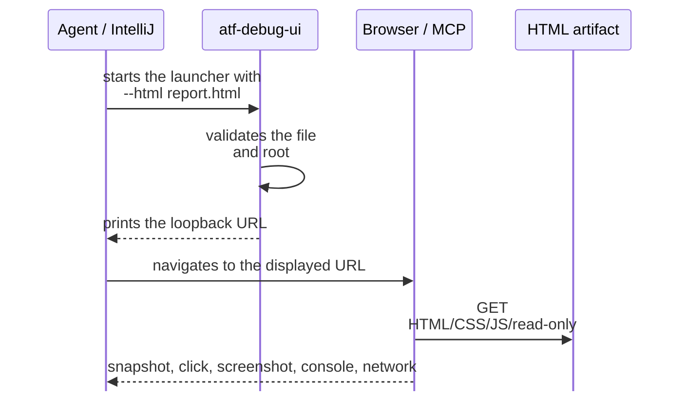

# ATF Debug UI

`atf-debug-ui` is an infrastructure module for manually inspecting an
already-generated HTML report. It does not generate or modify the report; its
tests verify the loopback boundary, path traversal protection, parallel startup,
and memory policy rather than a UI product. It serves only the directory
containing the selected artifact on `127.0.0.1` and prints the URL to open in
Playwright/TAB MCP.

<a id="at-a-glance"></a>
<a id="pe-scurt"></a>
## At a glance

| Step | Owner | Result |
|---:|---|---|
| 1 | launcher | validates the path and root |
| 2 | loopback server | serves HTML/CSS/JS read-only |
| 3 | Playwright/TAB MCP | verifies the DOM, clicks, screenshots, and console |

It is not a product browser and does not replace the E2E gate.

<a id="core-diagram"></a>
<a id="diagramă-de-bază"></a>
## Core diagram



<details>
<summary><strong>Legend — read-only inspection</strong></summary>

- the launcher validates the input and serves only over loopback;
- Playwright/TAB MCP inspects the artifact; it does not repair or rewrite it;
- HTML/CSS/JavaScript belongs to the artifact produced by atf-reporting;
- the E2E test remains the gate for observable behavior, while Debug UI is an
  exploration tool.
The short labels have the following meanings:

| In the diagram | Full meaning |
|---|---|
| Browser / MCP | Playwright / TAB MCP |

</details>

Responsibilities remain separate:

| Component | Responsibility |
|---|---|
| `atf-reporting` | generates and publishes Extent HTML |
| `atf-debug-ui` | serves the local artifact read-only over loopback |
| `atf-ui` | owns generic policies and the Java Playwright adapter |
| Shop/AutoEx consumer tests | local checks that inspect generated Extent reports |
| agent + TAB MCP | interactive manual inspection |

<a id="startup"></a>
<a id="pornire"></a>
## Startup

From IntelliJ, run `atf.debugui.AtfDebugUiLauncher` with these arguments:

```text
--html <configured-report-path>
--port 0
```

The launcher prints the effective URL, for example:

```text
[ATF DEBUG UI] Target for Playwright/TAB MCP: http://127.0.0.1:PORT/report.html
```

Open that exact URL with Playwright MCP to manually inspect tabs, filters,
expandable nodes, the DOM, console errors, network, and rendering. The server
remains active until `Ctrl+C`; `--port 0` automatically selects an available
port and supports parallel runs in different directories.

<a id="verifying-static-or-generated-reports"></a>
<a id="verificare-pentru-raport-static-sau-dinamic"></a>
## Verifying static or generated reports

ATF Debug UI is the final interactive check, not a simple file server. For a
`GENERATED_API` report, first open the API report generated by setup/mock, then
the UI report generated by the audit. For `STATIC_PATH` or `STATIC_RESOURCE`,
open the existing input read-only, then the derived UI artifact. In both cases,
retain the same evidence:

```text
source report → ATF Debug UI → browser MCP
  → DOM + accessibility tree + console/network + computed style
  → UI audit report → ATF Debug UI → browser MCP → verdict
```

Required checklist before closing a report change:

- inspect the exact fresh artifact from staging, not a historical report;
- verify tabs and deep links, one positive and one negative case,
  expand/collapse, scrollable JSON, and the screenshot link;
- `UI validation` keeps actions, observations, and assertions as sibling
  sections without decorative horizontal rules; `📷 base64 img` stays inline
  and vertically aligned with the status;
- POST/PUT contain valid, non-empty request and response JSON; the status,
  headers, mock expectation, and validations are visible in the report;
- do not use a real Windows browser or stop another agent's process or run.

Run builds and tests in an external staging directory, for example
`${ATF_STAGING_ROOT}/atf-debug-ui-<id>`, not in the project staging area. Copy approved artifacts later into
`${ATF_REPORT_OUTPUT_DIR}` or its configured UI subdirectory.

To compile and run the contract test:

```text
mvn -pl atf-debug-ui -am test
```

The test verifies HTML publishing and blocks traversal to files outside the
root. No separate reporting-test module is added: Practice Shop and AutoEx
verify their local report scenarios in their own modules; `atf-tests` owns
reactor and documentation governance, not application report journeys.

<a id="closing-owned-connections"></a>
<a id="închiderea-conexiunilor-deținute"></a>
### Closing owned connections

The server tracks accepted sockets. Close stops accepting, closes owned
connections, and then waits for the executor; an incomplete request line or
header does not require client cooperation to terminate. Connection
registration and shutdown share the same synchronization boundary, and close
is idempotent.

[DebugUiShutdownComponentTest](src/test/java/atf/debugui/DebugUiShutdownComponentTest.java)
verifies incomplete requests, idle clients, and concurrent shutdown using
loopback readiness and a test deadline. GET/HEAD, read-only streaming,
realpath, and traversal refusal retain their existing contracts.

<a id="parallel-runs-and-memory"></a>
<a id="rulări-paralele-și-memorie"></a>
### Parallel runs and memory

Each Debug UI session is a separate JVM. The launcher fails fast if the JVM has
a heap larger than the default bounded limit (512 MB). For parallel runs, use
an explicit memory limit so abandoned sessions or sessions started by other
agents cannot trigger `hs_err_pid` by reserving the JVM's default heap:

```text
java -Xms16m -Xmx128m -XX:MaxMetaspaceSize=64m \
  -cp <resolved-debug-runtime-classpath> \
  atf.debugui.AtfDebugUiLauncher \
  --html <configured-report-path> --port 0
```

The resolved classpath includes `atf-debug-ui`, `atf-console`, and their
transitive runtime dependencies. `atf-debug-ui/target/classes` alone is
insufficient: the launcher uses the console module, which also loads the
configuration libraries.

- IntelliJ: select the `atf-debug-ui` module classpath; the IDE resolves Maven
  dependencies.
- Terminal: use the runtime classpath resolved by the build/IDE for that
  module, with the platform's path separator.

Do not stop another agent's processes. If the host is already saturated,
report-producing tests can run in-process with `-DforkCount=0`; this is a diagnostic or
resource measure, does not change the test contract, and does not become the
default for normal runs.

The launcher classpath must include `atf-console`, `atf-core`, and their
runtime dependencies. In PowerShell, prepare it before an independent run; the
value in `<report-path>` is the path to the approved artifact:

```powershell
mvn -pl atf-debug-ui -am -DskipTests package
mvn -q -pl atf-debug-ui dependency:build-classpath '-Dmdep.outputFile=target/debug-classpath.txt' '-Dmdep.includeScope=runtime'
$runtimeDependencies = Get-Content -Raw 'atf-debug-ui/target/debug-classpath.txt'
$launcherClasspath = 'atf-debug-ui/target/classes;atf-console/target/classes;atf-core/target/classes;' + $runtimeDependencies
$report = '<report-path>'
java -Xms16m -Xmx128m -XX:MaxMetaspaceSize=64m -cp $launcherClasspath atf.debugui.AtfDebugUiLauncher --html $report --port 0
```

In IntelliJ, an `Application` configuration for `AtfDebugUiLauncher` includes
the module's runtime classpath automatically. Set the same limits in `VM
options` and `--html <report-path> --port 0` in `Program arguments`.

<a id="uri-path-identity"></a>
<a id="identitatea-path-ului-uri"></a>
## URI path identity

| Input | Result |
|---|---|
| literal plus or `%2B` | same file containing a plus, distinct from a file containing a space |
| `%20` | space in the path; not produced by transforming a literal plus |
| `%252B` | one decoding level; retains `%2B` in the filename |
| malformed target, authority, scheme, or fragment | rejected before file access |
| traversal after decoding | lexical containment and realpath; cannot escape the root |

GET returns the requested file's contents. HEAD retains Content-Length and
Content-Type without a body; the query does not change path identity. The
server remains loopback-only and read-only, with bounded closing of owned
connections.

[DebugUiServerTest](src/test/java/atf/debugui/DebugUiServerTest.java) uses
distinct files and exact bodies with fixtures isolated in TMP.
