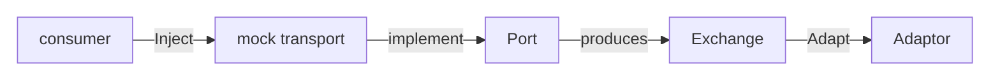
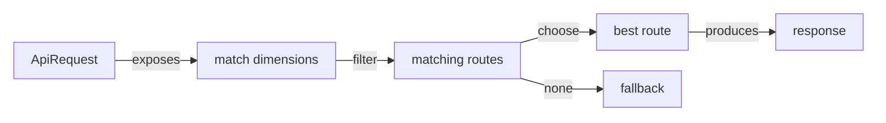

# ATF Mock Transport

`atf-mock` provides deterministic API transport for offline component tests. It
replaces the `ApiTransport` port without DNS, TLS, sockets or a local server, and
produces a reproducible `ApiResponse` for each configured request.

<a id="at-a-glance"></a>
<a id="pe-scurt"></a>
## At a glance

**Quick links:** [Catalog YAML](#configurația-yaml) · [Matching](#potrivirea-și-prioritatea-rutelor) · [Offline test](#verificare-rapidă)

- **Input**: `atf-mock.yaml` route catalogue or built-in configuration;
- **Matching**: method, path, authentication profile, query, heads and body;
- **Output**: status, heads, body, duration and URL kept for evidence;
- **Responsible**: mock module holds fake transport and route vocabulary;
- **Boundary**: `atf-reporting` is not dependent on production;
- **Domain**: acceptance, component and integration tests offline;
- **Live HTTP**: is activated separately by `HttpClientTransport`, explicitly.

```mermaid
%%{init: {"themeVariables":{"fontSize":"15px"},"themeCSS":".nodeLabel, .nodeLabel p { font-size: 15px !important; line-height: 1.35 !important; } .edgeLabel, .edgeLabel p { font-size: 12px !important; font-weight: 400 !important; line-height: 1.2 !important; } .edgeLabel .labelBkg, .edgeLabel p { background: transparent !important; } .edgeLabel foreignObject { transform: translateY(-18px); overflow: visible; } .node rect { rx: 6px; ry: 6px; }","flowchart":{"curve":"linear","nodeSpacing":24,"rankSpacing":16,"padding":10,"diagramPadding":16}}}%%
flowchart LR
    Source["YAML / defaults"] -->|load| Loader["Loader"]
    Loader -->|create| Catalog["Catalog"]
    Catalog -->|supplies| Transport["Mock transport"]
    Transport -->|implement| Port["ApiTransport"]
    Port -->|produces| Response["ApiResponse"]
```



<details>
<summary><strong>Legend - how to produce the fake response</strong></summary>

- `Source` provides only test data, not production configuration;
- `Loader` validates the scheme and builds immutable models;
- `Catalog` decides the winning route or fallback;
- `AtfMockTransport` implements the neutral port of `atf-core`;
- `ApiResponse` shall maintain the observable form of HTTP traffic-free exchange;
- the consumer owns each publisher, auditor and renderer.
The short labels shall be kept as follows:

| In the scheme | Full meaning |
|---|---|
| YAML / defaults | YAML catalogue or default |
| Loader | typed loader |
| Catalog | route catalog |
| ApiResponse | deterministic ApiResponse |

</details>

<a id="choice-and-diagnosis-of-transport"></a>
<a id="alegerea-și-diagnosticul-transportului"></a>
## Choice and diagnosis of transport

| Observation | Check with the owner | Required result |
|---|---|---|
| demand without eligible route | [matching and priority](#potrivirea-și-prioritatea-rutelor) | configured fallback with URL- stored |
| two routes with similar label | [route identity](src/test/java/atf/mock/MockRouteIdentityTest.java) | the selected source remains distinct from the diagnostic label |
| duplicate or empty query | [catalog YAML](#configurația-yaml) | pairs are not lost by conversion to map |
| Fake response right, wrong report | [consumption adapter](../atf-reporting-tests/README.md#fidelitatea-query-ului-și-asocierea-mock) | Same route and same evidence is adapted |

Start with `AtfMockTransport.defaults()` for an offline sample or `fromConfiguration(...)` for explicit catalogue. Choosing a URL in request does not convert the mock transport into live transport.

<a id="module-contract"></a>
<a id="contractul-modulului"></a>
## Module contract

| Question | Contractual response |
|---|---|
| What's the replacement? | `ApiTransport` port for offline executions |
| What's he doing? | Masking determinist and building a `ApiResponse` |
| What's not running? | DNS, TLS, socket, server, real retry or browser |
| What's he holding? | `atf-mock` scheme, fake routes, fallback and their own fixtures |
| What's he eating? | `atf-core` and Jackson YAML in production |
| Who uses it? | composition roots and consumer tests by explicit injection |

**Boundary rule:** `atf-mock` does not import `atf-reporting`, `atf-ui`, JUnit or fixtures of an application. Reporting can consume transport data, but does not become a responsibility of this module.



<details>
<summary><strong>Legend - direction of dependency</strong></summary>

- the consumer chooses the consignment and injects it;
- `atf-mock` depends on the port in `atf-core`, not the other way around;
- the record is a consequence of the execution, not a hidden integration with reporting;
- the adapter for `atf-reporting-tests` remains in the test for the consumer's scope;
- `atf-test-practice-shop` does not use `atf-mock`; the decision is documented in
  its module feedback. Short labels keep the following meaning:

| In the scheme | Full meaning |
|---|---|
| Port | core port |
| Exchange | request + response |
| Adapter | consumer adapter |

</details>

<a id="yaml-configuration"></a>
<a id="configurația-yaml"></a>
## YAML configuration

The mock catalogue is intended to be separated from `atf.yaml`:

- `atf.yaml` - API configuration, validation and reporting;
- `atf-mock.yaml` / `atf-mock.yml` - routes, replies and offline fallback;
- mandatory scheme - root `mock` and list `mock.routes`;
- Sensitive values - never hardcoded in the catalogue.

<a id="order-of-sources"></a>
<a id="ordinea-surselor"></a>
### Order of sources

| Priority | Source | Behavior |
|---:|---|---|
| 1 | `-Datf.mock.config=<path>` | override explicit JVM |
| 2 | `ATF_MOCK_CONFIG` | explicit environmental override |
| 3 | discovery ascendent | Search `atf-mock.yaml` and `atf-mock.yml` |
| 4 | default values incorporated | only uses when there is no set-up catalogue |

<details>
<summary><strong>Loading rules and fast-track</strong></summary>

- The explicit path can be relative to the process director's working;
- explicit non-existing or invalid path stops loading;
- a generic `atf.yaml` catalogue is not interpreted as a mock catalogue;
- the loader searches the current directory and then the parents;
- the configuration is loaded to the composition root and reused as snapshot;
- the lack of an external file does not activate actual HTTP; uses default;
- for parallel runs, the consumer may provide an explicit route of its own.
</details>

<a id="minimum-form-of-a-catalogue"></a>
<a id="forma-minimă-a-unui-catalog"></a>
### Minimum form of a catalogue

```yaml
mock:
  routes:
    - method: GET
      path: /public/v2/users
      status: 200
      duration: PT0.012S
      headers:
        Content-Type: application/json
      body: '[{"id":1,"name":"ATF User"}]'
  fallback:
    status: 500
    body: '{"message":"Unexpected mock route"}'
```

- `duration` is ISO-8601 Java: `PT0.012S` means 12 ms;
- `headers` describes the response, not the headers of the request;
- explicit fallback prevents false-green for forgotten routes;
- `status` must be within HTTP `100..599`;
- The body remains the text that will be delivered in `ApiResponse`.

<a id="matching-and-priority-of-routes"></a>
<a id="potrivirea-și-prioritatea-rutelor"></a>
## Matching and priority of routes



<details>
<summary><strong>Legend - how the route is chosen</strong></summary>

- the method and the paths shall correspond;
- the pathogen may be exactly or the `/*` wildcard;
- `auth-profile` may be the exact or `*` wildcard;
- configured query is a mandatory subset of query of the query;
- when several routes correspond, win the route with multiple query parameters;
- the name of the headers of the request shall be compared to the case- sensitive;
- the values of the headers of the quest shall be compared exactly;
- the body and `request-body-mode` may further restrict the fit;
- No match is delivered to the fallback, not a successful status invented.
</details>

`MockRoute.key()` is a diagnostic label, not a unique catalogue identifier. The consumer who adapts the route keeps the selected source separately; the Reporting Adapter uses [direct association](../atf-reporting-tests/README.md#fidelitatea-query-ului-și-asocierea-mock), without reassociation by string or change the Mock rules.

| Dimension | Rule | Owner |
|---|---|---|
| method | normalized verb uppercase | `HttpMethod` + `MockRoute` |
| path | slash leading, exact or wildcard | `MockRoutePaths` + `ApiPathTemplate` |
| auth | Metadata profile, no secret | `MockRoute` |
| query | simple object or list of duplicates | `ApiQueryParameters` |
| request headers | insensitive names, exact values | `HttpHeader` + `MockRoute` |
| request body | JSON valid / non-empty for POST / PUT | `MockRequestBodyMode` + `MockRoute` |
| fallback | status explicit, implicit 500 | `AtfMockConfiguration` |

<a id="configurable-yaml-match"></a>
<a id="potrivire-configurabilă-prin-yaml"></a>
### Configurable YAML match

```yaml
mock:
  routes:
    - method: POST
      path: /public/v2/bulk-import
      auth-profile: api-key
      query:
        mode: validate
      request-headers:
        Content-Type: application/json
        X-Client: atf-java
      status: 202
      body: '{"accepted":true}'
```

<details>
<summary><strong>Details for query, heads and bodies</strong></summary>

- the query may be a map or a list of `name` / `value` pairs;
- the list form explicitly retains empty and duplicate values;
- `auth-profile` does not contain any credential; it is only a matching discriminator;
- `headers` in the responses are distinct from `request-headers`;
- `POST` and `PUT` are required to be body JSON non-empty and `Content-Type` JSON;
- a missing body, invalid or with the wrong average type reaches the fallback;
- the configured contract written response must be valid JSON and
  non-empty;
- an expected demand body can be structurally compared, not just textual.
</details>

<a id="vocaular-and-responsibilities"></a>
<a id="vocabular-și-responsabilități"></a>
## Vocaular and responsibilities

Stable values must have a semantic owner. We do not introduce a global bucket of constants and we do not copy endpoints between modules.

- **protocol** - `HttpMethod`, `HttpHeader`, `MediaTypes` of `atf-core`;
- **query** - `ApiQueryParameters` and `ApiQueryParameter` of `atf-core`;
- **path template** - `ApiPathTemplate` of `atf-core`;
- **middle routines** - `MockRoutePaths` in `atf-mock`;
- **body mode** - the closed `MockRequestBodyMode` enumeration;
- **single payload test** - `MockTransportTestFixtures` in the scope test;
- **reporting scenarios** - `atf-reporting-tests` fixtures, not in
  `atf-mock` production.

`MockRoutePaths` owns the built-in routes of the mock and builds ID-DV dynamic `ApiPathTemplate`. It is not a live endpoints catalogue and should not be moved to `atf-core` or reporting just because it is reused by the tests.

<a id="use-at-the-application-composition-point"></a>
<a id="utilizare-în-punctul-de-compunere-al-aplicației"></a>
## Use at the application composition point

The consumer shall explicitly decide whether to use default or a catalogue of its own:

```java
var transport = AtfMockTransport.fromConfiguration(mockConfigPath);
```

The consumer injects the transport into its own composition root and decides how the executor, services and evidence. `atf-mock` does not publish a composition root for the scenarios of another module.

For rapid isolation:

```java
var transport = AtfMockTransport.defaults();
```

- The factory is orchestration, not room for assertions;
- the configuration is loaded once per composition root;
- transport remains reusable for several scenarios;
- the consumer decides how to publish the request / answer evidence;
- the consumer decides whether a ratio is `ACCEPTANCE / MOCK` or `LIVE_HTTP`.

In `atf-reporting-tests`, the integration catalogue is in `src/test/resources/atf-mock.yaml` and is loaded through the resources of the test. This is a choice of scope test; does not convert YAML into a `atf-mock` production resource.

<a id="module-testing"></a>
<a id="testarea-modulului"></a>
## Module testing

`atf-mock` is tested down and quickly. It has no browser and does not add E2E just to check a transport that is already observable through models and responses.

| Layer | Location | Main evidence |
|---|---|---|
| component | `src/test/java/atf/mock` | loader YAML, matching, fallback, response |
| support | `.../mock/fixtures` | reusable payloads, routes and requests |
| consumer integration | `atf-reporting-tests/src/test` | Adapting data to reporting |
| browser/E2E | outside `atf-mock` | observable effect in the consumer, if necessary |

The local suite shall explicitly protect:

- status and body for built-in routes;
- keeping URL- in response;
- status of the fallback for unknown request;
- Parsing YAML and duration ISO-8601;
- simple query, empty query and duplicate query;
- the headere request case- insensitive and headere response;
- auth profiles and request body models;
- rejection of the JSON invalid for writing trails;
- stable identity of routes with query parameters sorted.

<details>
<summary><strong>Verification orders</strong></summary>

```text
mvn -pl atf-mock -am test
```

The gear must run without network and without requiring an artifact HTML. Tests that check integration with reporting belong to the `atf-reporting-tests` consumer shall not be copied in this module.
</details>

<a id="whats-left-outside-the-module"></a>
<a id="ce-rămâne-în-afara-modulului"></a>
## What's left outside the module

- **`atf-core`** - HTTP ports, neutral models and reusable utilities;
- **`atf-reporting`** - publisher, HTML / Extent, contracts and static audit;
- **`atf-reporting-tests`** - adapter, reforming fixture and composition root;
- **`atf-test-practice-shop`** - application tests without `atf-mock`;
- **`atf-tests`** - government-entire-reactor, not test double concrete.

This delimitation keeps `atf-mock` compilable and reusable without drawing the renderer, browser or business domain after it.

<a id="related-documents"></a>
<a id="documente-asociate"></a>
## Related documents

- [`atf-core`](../atf-core/README.md) - Transport ports consumed;
- [`atf-reporting`](../atf-reporting/README.md) - Standalone library;
- [`atf-reporting-tests`](../atf-reporting-tests/README.md) - consumer and
  composition root for reporting contracts;
- [`ATF Architecture`](../docs/ATF_Architecture.md) - reactor boundary;
- [`Bune practici de cod`](../docs/README_Atf_CodeBestPractices.md) — ownership,
  test models and stratification.

<a id="quick-check"></a>
<a id="verificare-rapidă"></a>
## Quick check

| Decision | Source and limit |
|---|---|
| Determinalist response via ApiTransport port | [source of the host](src/main/java/atf/mock/AtfMockTransport.java); sample [AtfMockTransportTest](src/test/java/atf/mock/AtfMockTransportTest.java) |
| Dependencies and source- sets | [POM](pom.xml); declared scope authority for integration |
| What this probe does not prove | The evidence does not confirm the availability of a real service. |

<details>
<summary><strong>Command for local sample</strong></summary>

Run from the root of a [external staging](../docs/ATF_Build_And_Execution_Safety.md), with JDK 21 and Maven.

```powershell
mvn -B -pl atf-mock -am "-Dtest=AtfMockTransportTest" "-Dsurefire.failIfNoSpecifiedTests=false" test
```

The command selects the sample called and builds the dependencies; does not declare the passage of the entire module. The sample does not confirm the availability of a real service.

</details>

<a id="mime-and-payload-validity"></a>
<a id="mime-și-validitatea-payload-ului"></a>
## MIME and payload validity

Matchings use the Core media classification type, separate from the validity of the body. `text/plain; profile=json` does not satisfy a JSON route; the same valid JSON application can only satisfy the explicit `WRONG_CONTENT_TYPE` mode.

`application/json` and the suffix `+json` keep the parametric and the casino accepted. An invalid payload is refused by both ways; the catalogue configuration does not invent a valid body.

[MockMediaTypeContractTest](src/test/java/atf/mock/MockMediaTypeContractTest.java) checks the opposite decisions and the independent axis of invalid payload.


<a id="json-strictly-and-exact-numerical-fit"></a>
<a id="json-strict-și-potrivire-numerică-exactă"></a>
## JSON strictly and exact numerical fit

Catalogue and requests are complete documents. Trailing content, multiple roots and duplicates nested are denied; the null scalar is valid JSON. An expected absence in YAML does not equate to text JSON null and objects or arrays YAML are not tacitly converted without constraint.

| Match | Verified contract |
|---|---|
| precizie | JSON and YAML numeric scalar use BigDecimal without narrowing via Double |
| Distinguishing values | Neighbors over 2 ^ 53, long fractions, extreme exponents and underflow reach fallback |
| nominal | equal decimal forms and zeroes remain eligible; integer / decimal and number / string keep the distinctions |
| wire | body and configured response are not rewritten |

[Component contracts](src/test/java/atf/mock/json/MockNumericContractComponentTest.java) uses API publicly, independently and freely expected mock transport. They check the fallback, original response and loading YAML without external service.


## Library publication

J0 keeps this implementation and its complete native test catalog. J1–J6 use the same published JAR and parentless POM directly in lib, with no shadow source module.

[Platform library consumption](../docs/ATF_Platform_Libraries.md) defines Core version pinning, the Console optional Kit bridge, Maven/IntelliJ bootstrap and physical-JAR acceptance. Package evidence stays beside the producer artifact in owned TMP.
