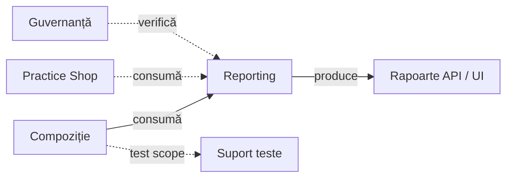
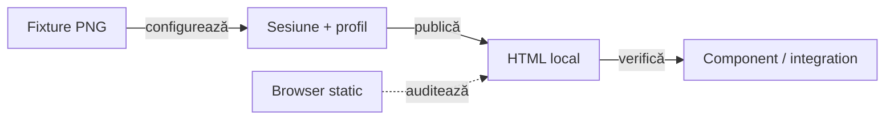

# ATF Reporting Tests — compoziție izolată pentru biblioteca de raportare

## Pe scurt

**Diagnostic neutru:** [graf, buget și publicare](#diagnosticul-neutru-al-excepțiilor).

**Trasee rapide:** [Alege proba](#matricea-de-integrare-și-limitele-verificate) · [Tabele și responsive](#probe-de-lizibilitate-a-panoului) · [Scope-uri](#refuz-recuperabil-al-scope-urilor) · [Browser local și limite](#verificare-rapidă)

`atf-reporting-tests` verifică `atf-reporting` ca librărie reutilizabilă:

- acoperă setup API/mock, renderer, publisher, browser read-only și ATF Debug;
- nu deține testele de business ale unei aplicații;
- testele business aparțin modulului consumer, precum `atf-test-practice-shop`;
- `atf-tests` rămâne dedicat guvernanței whole-ATF.

Pentru extragere, artefactul candidat este `atf-reporting`; acest modul rămâne
suport intern de verificare. Compilarea și rularea pe `target/classes` nu
demonstrează singure consumarea JAR-ului publicat. [Gate-ul distribuției](#gate-ul-bibliotecii-distribuite)
folosește și un consumer fără surse sau module ATF în classpath.

Schimbarea testelor, suportului sau resurselor din acest modul cere un control
tehnic `testChanges` eligibil; [guvernanța whole-ATF](../atf-tests/README.md#guvernanța-schimbării-testelor)
verifică diferența Git și probele negative ale regulii.

## Regresia permanentă a fiecărui defect Reporting

Orice defect observabil în raport, contractul public sau compoziție primește
mai întâi o regresie în acest modul. Proba reproduce comportamentul anterior,
are expected independent și rămâne în inventarul canonic după corectare.

| Boundary | Proba păstrată |
|---|---|
| API, query, status, ownership și corelare | mock configurat și exchange capturat; nominal și refuz, fără endpoint live necesar |
| flow și renderer | același input typed prin publisherul real Extent/fallback, cu număr, ordine și verdict exacte |
| display și navigare | DOM/browser real: tabelul original, geometrie, expand/collapse, tastatură și reload |
| distribuție | binarul candidat, POM-ul său și tranzitivele reale; CodeSource și hash verificate |

```mermaid
%%{init: {"themeVariables":{"fontSize":"15px"},"themeCSS":".nodeLabel, .nodeLabel p { font-size: 15px !important; line-height: 1.35 !important; } .edgeLabel, .edgeLabel p { font-size: 12px !important; font-weight: 400 !important; line-height: 1.2 !important; } .edgeLabel .labelBkg, .edgeLabel p { background: transparent !important; } .edgeLabel foreignObject { transform: translateY(-18px); overflow: visible; } .node rect { rx: 6px; ry: 6px; }","flowchart":{"curve":"linear","nodeSpacing":24,"rankSpacing":40,"padding":10,"diagramPadding":16}}}%%
flowchart LR
    Incident["Defect observat"] -->|reproduce| Regression["Regresie stabilă"]
    Regression -->|protejează| Fix["Corecție Reporting"]
    Fix -->|validează| Jar["JAR candidat"]
    Jar -->|acceptă| Consumer["Consumer binar"]
```



<details>
<summary><strong>Legendă — test păstrat la producător și binar verificat la consum</strong></summary>

- Regresia aparține `atf-reporting-tests`: mock-urile, contractele și probele
  browser rămân întreținute împreună cu implementarea producătorului.
- Testele native ale bibliotecii completează boundary-ul standalone; acceptarea
  artifactului cere și compoziția externă, inclusiv failure-path-urile afectate.
- Consumerul binar poate retrage copia harness-ului din reactorul său. Înaintea
  fiecărei versiuni noi, probele producătorului rulează pe acel JAR într-un consumer TMP.
- Un test verde pe `target/classes` sau o captură manuală nu înlocuiește gate-ul
  binar. Logurile și artifactele rulării rămân în TMP; README-ul păstrează contractul.

</details>

## Alege nivelul dovezii

`UiCrossPhaseCompactFlowComponentTest` probează și un singur TEST BODY, cu
mock API 200/500, FAIL/SKIP și capturi multiple păstrate separat.
`BodyOnlyUnifiedFlowComponentTest` verifică rândurile ACTION/OBSERVE/Assertions,
preview 18/240, disclosure-ul propriu și tastatura în ambele renderere.

| Regresie păstrată | Oracol independent |
|---|---|
| context UI per fază | `PhaseUnifiedFlowContextComponentTest`: aceeași proiecție Extent/fallback, UI și mock API 200/500; metadatele flow-ului nu devin răspuns HTTP, iar exchange-ul real își păstrează statusul și expected-ul 200 |
| expandarea aserțiunilor per fază | `PhaseUnifiedFlowComponentTest`: disclosure propriu, Enter/Space, reload, rânduri ACTION/OBSERVE, captura originală și preview 18/240 |
| titluri fallback lungi | `FallbackLongTitleComponentTest`: fragmentele de text rămân în sidebar și heading la 1280/760/392 px; sibling, anchor, tastatură și reload păstrează identitatea, iar reintroducerea `nowrap` este refuzată |

Selecția câmpurilor este probată separat de HTML prin
`UnifiedFlowProvenanceFieldsTest`, inclusiv context typed fără compactare,
HTTP/custom păstrate și refuzul reclasificării după un nume de câmp izolat.
Metadatele contradictorii, inclusiv markerul compact, păstrează request-ul,
răspunsul mock 500 și execuția capturată, cu expected independent 200.

| Întrebare | Gate | Ce confirmă |
|---|---|---|
| biblioteca compilează singură? | [sursa izolată](#gate-ul-bibliotecii-distribuite) | POM autonom și boundary de producție |
| aplicația folosește JAR-ul fizic? | [consumer binar](#gate-ul-bibliotecii-distribuite) | CodeSource și classpath fără sursa bibliotecii |
| contractul semantic este păstrat? | [matricea de integrare](#matricea-de-integrare-și-limitele-verificate) | modele, cauze și proiecții independente de browser |
| utilizatorul poate audita artifactul? | [tabele și responsive](#tabele-publicate-și-inventar-independent) | comparații, capturi, tastatură și backlink exact |

Inventarul de mai jos indică probele și boundary-ul lor; acceptanța unei lucrări
cere executarea gate-urilor afectate și auditul artifactului nou.
[Restanțele testelor](../docs/feedback/ATF_Reporting_Tests_Feedback.md) separă
oracolul învechit, fixture-ul binar și defectul reproductibil de randare.

Testele consumerului păstrează expected independent și controale negative.
Un HTML care conține textul unei reguli nu demonstrează că utilizatorul poate
ajunge la dovada ei în scenariul, faza și ordinalul corecte.

## Gate-ul bibliotecii distribuite

`ReportingLibraryDistributionIntegrationTest` verifică forma efectiv încărcată:

- din reactor copiază numai POM-ul și `src`, rulează `package` cu testele native,
  apoi creează un consumer Maven extern;
- dintr-un JAR citește POM-ul Maven inclus și verifică acel binar într-un consumer
  extern, fără a căuta sursa în vecinătate.

Ambele trasee verifică hash-ul, CodeSource-ul și aceleași controale negative.

Auditul structurii Java este executat de `ReportingSourceArchitectureTest` în
build-ul nativ al producătorului. Probele runtime de aici consumă clase și resurse
încărcate, indiferent dacă provin din reactor sau din JAR; nu au skip-uri pentru
lipsa sursei. Fixture-urile identifică rădăcina prin propriul POM și resurse.

| Boundary | Oracol și limită |
|---|---|
| sursă fără reactor | [POM-ul producătorului](../atf-reporting/pom.xml) este parentless; guard-ul nativ pornește de la propriul CodeSource și refuză importurile/dependențele ATF și parent-ul prin probe negative |
| classpath runtime | numai Reporting și tranzitivele Maven; fără Core, Kit, UI, JUnit, Playwright ori clase Reporting din reactor |
| Extent și fallback | PASS/FAIL/PASS, diferență după 240, valori proiectate în buget și canary absent din artifact |
| preview implicit | [ReportingSettings](../atf-reporting/src/main/java/atf/reporting/configuration/ReportingSettings.java) declară 240; `ReportingPreviewConfigurationComponentTest` verifică default-ul și override-urile 18/480, cu elipsa inclusă în plafon |
| resursă runtime lipsă | o copie JAR fără `table-viewport.css` este refuzată separat de ambele renderere; raportul anterior rămâne intact, fără workspace abandonat |

Copiile, procesele Maven/Java și logurile rămân în TMP. Testul dovedește consumul
acestui artifact; contractele de release și compatibilitatea întregului API public
au [criterii distincte](../docs/feedback/ATF_Reporting_Feedback.md).

<details>
<summary><strong>Harta de lectură</strong></summary>

- [limitele librăriei](#regula-limitelor-de-responsabilitate) — separarea
  harness-ului de codul de producție;
- [consola](#consola-testelor-de-raportare) — diagnosticul implicit din IntelliJ
  și Maven;
- [contractul titlurilor API](#contractul-de-titlu-pentru-request-uri-api) și
  [reconcilierea evidence-ului](#reconcilierea-dovezilor-api-și-navigarea-fazei);
- [matricea de integrare](#matricea-de-integrare-și-limitele-verificate) —
  legătura dintre seam, probă și limită;
- [limitele consumerilor](#limitele-de-responsabilitate-ale-aplicațiilor-consumatoare)
  — ce rămâne specific aplicațiilor.

</details>

<details>
<summary><strong>Catalogul probelor de failure și al regresiilor adiacente</strong></summary>

`UiFailureReportContractTest` este proba browser annotation-driven pentru
failure UI în Extent:

- SETUP, timeout Playwright, observație și assertion păstrează leaf-ul FAIL sub
  ownerul semantic; documentul pornește colapsat, iar Fails deschide strict
  strămoșii dovezii originale și păstrează scenariile surori închise;
- scenariul Playwright verifică `TimeoutError`, locatorul, durata și redacția;
  UI failure nu trebuie să creeze disclosure HTTP;
- `ExtentReportUiFailureEvidenceTest` și `UiFallbackFailureEvidenceTest`
  verifică fallback-ul și izolarea unui scenariu-frate;
- renderer-ul redă targetul locatorului prin redactor; fără cauză, publicarea o
  derivează dintr-o acțiune FAIL sau respinge input-ul fără diagnostic;
- contractul browser păstrează timeout-ul în scenariul curent și îl exclude din
  scenariile sibling; regula stabilă este în
  [contractul de raportare](../docs/ATF_Reporting_Contract.md#fails-și-legături).

Oracolele backlink-urilor păstrează identitatea:

- `FailureLinkIdentity` compară scenariul și parametrii decodați, inclusiv ordinalul;
- probele negative refuză scenarii străine și parametri duplicați; parametrii
  suplimentari și encoding-ul de reload păstrează aceeași destinație.
- `PublishedFailureNavigationEdgeComponentTest` verifică două grupuri UI
  omonime cu câte un singur FAIL, astfel încât sumarul derivat să fie creat.
  Oracolul selectează comparația din ownerul validation, cu cauze literale,
  reload, ordine inversă și preview 18/240; nu repetă selectorul producției.

Contractul stabil pentru ierarhia vizibilă, layout, responsive viewport,
disclosure-uri și dovezile browser este
[ATF Reporting — contract de display și layout](../docs/ATF_Reporting_Display_Contract.md).
Acest README deține matricea probelor și responsabilitățile suitei; nu
redefinește regulile vizuale în feedback sau în fixture-uri.

`ReportUiEnvironmentTest` protejează vocabularul UI comun, politicile rezolvate
și originile fără credentiale. `ReportGherkinSequenceTest` protejează ancorele,
continuările și izolarea scenariilor; wiring-ul AutoEx/Shop rămâne probat în
modulele consumerilor.

Helper-ele reutilizate de probele HTML UI stau în
`atf.reporting.ui.support`, nu în pachetul testelor de renderer. De exemplu,
`ExtentReportUiEvidenceTestSupport` centralizează fixture-ul și verificările
comune fără să devină un test sau să mute ownership-ul din
`atf-reporting-tests`. Limita de coeziune per pachet rămâne verificată de
`AtfPackageCohesionGovernanceTest`; pragul nu se ajustează pentru a acomoda un
hotspot.

Proiecția contextului UI este verificată la componentă:

| Probă | Contract protejat |
|---|---|
| `UiCheckpointEvidenceProjectionTest` | identitatea checkpoint-ului și `evidence.type`/`evidence.policy` rămân în model; proiecțiile typed/legacy și fallback nu le publică și nu le mută în response |
| `UiApiValidationContractComponentTest` | interzice intrările cu exchange-uri brute în API, lifecycle, publisher și buffer; verifică verdictele UI/API independente și exchange-urile surori în checkpoint, setup, final și unified, plus markup-ul request/response/execution real |
| `ReportRequestHeadersTest` | sursa observată/configurată, override case-insensitive, compatibilitatea clientului existent și copiere imutabilă |
| `ObservedRequestEvidenceComponentTest` | Extent/fallback/UI_API × șase input-uri: absent, necapturat, JSON literal null, headere explicite redactate, default-uri declarate și response fără body; Request details și replay nu inventează headere sau payload |
| `ObservedBodyAuditComponentTest` | 22 de cazuri: audit browser real în cele trei publishere, body absent/necapturat/null literal, JSON fallback collapsed și comparație cu catalogul fără payload inventat |
| `LiveClientHeaderProbe` | HTTP loopback real prin clientul ATF; headerele primite pe fir sunt comparate cu proiecția Reporting și replay-ul sanitizat |
| `UiApiVerdictProjectionComponentTest` | UI PASS/API FAIL, UI FAIL/API PASS, ambele FAIL și corelare API FAIL cu exchange-uri PASS; owner tipizat, request/checkpoint/cauză exacte, ultimul exchange-soră PASS și indicele exact Open in Tests; audit separat cu pași, assertions și capturi pentru cele cinci intrări Fails |
| `ApiWhitespaceBodyComponentTest` + `UiNetworkBodyFidelityComponentTest` din UI | body prezent numai din whitespace rămâne distinct de absent, necapturat și JSON literal null; captură/sanitizare la ownerul UI, apoi formatare/publicare/replay la Reporting |
| `ExtentReportUiEvidencePublishingTest` | publisher-ul UI nu adaugă un request HTTP sintetic; exchange-ul nested păstrează request/response/JSON/execution |
| `ExtentReportDisclosureBrowserComponentTest` | artifact controlat cu PASS/WARNING/FAIL; faza goală nu afișează affordance de expandare, iar API exchange-ul cu evidence mock rămâne expandabil cu mouse/keyboard; niciun tabel introductiv la checkpoint, validări și screenshot disponibile, close fără subarbore vizibil și titluri custom identificate semantic; captură deduplicată deschisă prin click/Enter cu sursa colapsată, fără salt la ancoră |
| `ComponentAssertionStepReportTest` | același nod tipizat și 42 de rânduri în Extent/fallback; pas colapsat implicit, acces la ultimul rând și comutare cu mouse/Enter/Space în Chromium; FAIL în Extent are owner `component`, valori numerice exacte și deep-link redeschis până la tabel, fără request sau durată HTTP |
| `PublishedEvidenceTableComponentTest` | UI/API/UI+API × Extent/fallback; valori literale în 12/40 de rânduri, inventar exact per owner, geometrie reală, expandări, resize și taburi; controalele negative detectează dovezi lipsă, clipping, plafon eliminat și FAIL schimbat în PASS |
| `TerminalExecutionProjectionTest` + `TerminalApiExecutionReportTest` | snapshot parțial strict, 503 urmat de status indisponibil, terminare typed în Execution evidence, fără Response details fabricat; Extent/fallback păstrează plafonul 240, bugetul configurat, redactarea, ultimul rând și Enter/Space; zero dispatch-uri nu declară rețea executată |
| `UiTerminalExchangeReportComponentTest` | checkpoint, setup, final, trace și flow unificat în/peste faze păstrează exchange-ul fără response între doi vecini PASS; diagnostic, attempts, totaluri și tastatură în Extent/fallback, cu buget implicit și personalizat; probele fără verdict sunt deținute de `ReportingStandaloneVerdictComponentTest` în biblioteca standalone |
| `ReportPhaseTimingComponentTest` | timing typed identic în snapshot-urile Extent/fallback; browserul păstrează 12/345/0 ms pe faze, totalurile scenariu/clasă/Overview fără dublare și sursa execuției după expandare; publicarea rămâne separată |
| `BodyOnlyUnifiedFlowComponentTest` | un singur TEST BODY UI-only eligibil: un flow, actions/observations/assertions păstrate, preview 18/240 și mouse/Space/reload în Extent/fallback; contractele typed includ API mock PASS/FAIL și capturile multiple |
| `ComponentExecutionDiagnosticReportTest` | eroare după comparații PASS sau înaintea primei comparații; Fails fără request/durată HTTP inventate ori comparație PASS atribuită erorii; faze măsurate goale și 42 de rânduri în Extent/fallback, cu plafon 240 și tastatură |
| Regresii adiacente | `ExtentReportRuntimeScriptTest` păstrează sursele duratelor; `ExtentReportSessionContractTest` separă câmpurile API/UI în Fails; `AtfReportEvidenceCssTest` protejează containerul și fontul comun, completat de măsurătorile reale din `NarrowEvidenceReadabilityComponentTest` |
| `AssertionAuditPublicationComponentTest` | proiecție redactată înaintea plafonului în Extent/fallback; păstrează rândul FAIL fără fragmente din secretul sintetic și SKIP cu `Abort reason`, fără aserțiuni fabricate |
| `ReportingPreviewBudgetTest` | valoarea integrală afișată include elipsa în limită; null, limita exactă și bugetul JSON independent |
| `LegacyPreviewBudgetComponentTest` | porturi UI directe în Extent/fallback; limite 240/18, redactare completă, verdict din valorile integrale și aceeași limită în Fails după backlink |
| `ReportingPreviewConfigurationComponentTest` | YAML implicit 240 și configurat 18/480, valoarea efectivă în System Extent/fallback, metadata contradictorie refuzată și buget nepozitiv respins |
| `UiFailureContextTest` + `UiFailureContextReportTest` | acțiune FAIL înaintea mesajului tehnic lung, lipsa excepției/acțiunii, acțiuni PASS urmate de eroare, prima secvență FAIL și graf cauze/suppressed cu referințe/cicluri, fără mutarea verdictului sau a dovezilor originale |
| `UiFailureContextComponentTest` | Tests/Fails și backlink în Extent/fallback, preview 240/18, panou de 392 px, contextul acțiunii și timpul măsurat, relații inspectabile în diagnostice INFO și disclosure Enter/Space fără erori JavaScript |
| `UiTimeoutReportComponentTest` | deadline nativ separat de timpul capturat și de contextul compact Fails; Extent/fallback la 240/18, primary/cause/suppressed redactate, HTML fără credențiale, owner și backlink, Enter/Space, ultimul rând și oracol negativ pentru diagnostic lipsă ori secret vizibil |
| `ReportScopeAtomicityComponentTest` | completări repetate, scrieri tardive, close idempotent/FAIL, copii deschiși și sesiune închisă; refuz fără mutație și raport publicabil în Extent/fallback |
| `UiSetupFallbackParityComponentTest` | setup păstrează comparațiile, acțiunile și captura în Extent/fallback; 240/18, redactare, Enter/Space și FAIL evaluat dincolo de preview, inclusiv cu caller PASS |
| `UiPhaseExecutionTest` + `UiPhaseTimingLifecycleComponentTest` | execuție/capturi/publicare delimitate, clock controlat, cauza primară, zero/necunoscut, succes/FAIL/SKIP, setup incomplet, teardown eșuat și flow unificat peste faze |
| `ReportPhaseDiagnosticTest` | conversie explicită, statusul fazei sursă, chei legacy delimitate, context nemodificat și rezultat imutabil; portul diagnostic nu creează HTTP |
| `ReportPhaseAuditBrowserComponentTest` | Extent/fallback cu zero/unul/mai multe exchange-uri și cu/fără metadata; eșec JUnit, asociere lipsă, redacție și închiderea diagnosticului; Fails exclude notele fazei PASS; probe negative pentru bandă ascunsă, redenumită sau goală |

Fixture-ul browser este local și determinist; nu cere o nouă achiziție în
Practice Shop. Raportul timestamped este dovadă de componentă, iar stările
FAIL/WARNING sunt date deliberate ale fixture-ului.

Inventarul numește contractele urmărite; nu certifică automat toate probele.
Fidelitatea dovezii fiecărui scenariu are un
[criteriu de audit independent](../docs/feedback/ATF_Reporting_Tests_Feedback.md#report-test-audit-60--o-dovadă-identificabilă-pentru-fiecare-scenariu).
Un gate focalizat trecut nu înlocuiește rezultatul suitei canonice.

### Tabele publicate și inventar independent

`PublishedEvidenceTableComponentTest` publică UI, API și UI+API prin porturile
reale, în Extent și fallback. Cazul de 12 rânduri păstrează comparațiile scurte;
cele două cazuri de 40 de rânduri mută textul lung în EXPECTED, respectiv ACTUAL.

| Probă | Criteriu observabil |
|---|---|
| Inventar | număr exact per formă și owner; setup, ACTION/OBSERVE, request/response, execution/retry și cele trei roluri trace distincte |
| Geometrie | viewport-uri 1803/1280/991/719/720/721/591/392 px și panouri 591/392 px; lățime completă, font lizibil, coloane aliniate, cap finit, ultimul rând și ultima coloană accesibile; taburile secundare verifică și pragul 760/761 px |
| Dovezi | valori literale independente, Unicode/escaping, PASS/FAIL păstrate și conținut identic după resize, Enter/Space și revenire în Tests |
| Taburi | Overview/System/Tags și tabelul Categories; Fails folosește câmpurile/indexul nativ, iar taburile secundare fallback folosesc carduri/linkuri; absența intenționată a unui tabel este explicită |
| Control negativ | lățime redusă artificial, header/coloană/tabel lipsă, celule verticale, clipping direct/interior, rând ascuns, gutter gol, cap eliminat, valoare modificată ori FAIL schimbat în PASS; Fails ascuns sub navigare și antet tehnic rupt pe litere |

Colectarea browser este grupată în `PublishedEvidenceTableMeasurements`;
`PublishedEvidenceTableOracle` aplică regulile independente. Controalele negative
restaurează exact tabelul publicat și verifică din nou inventarul și conținutul.
Proba așteaptă terminarea tranzițiilor finite înaintea măsurării, inclusiv după
restaurarea unei mutații. Campania browser se rulează separat de achizițiile E2E
publice; bugetele de interacțiune și timeout-urile business rămân neschimbate.

Conținutul canonic este comparat în aceeași ordine după navigare. Proiecțiile
derivate `atf-ui-failure-evidence` se verifică separat: câte una pentru fiecare
owner request/validation eșuat, cu prima comparație originală și fără duplicate
la navigări repetate; pasul component `assertion-step` nu participă la hook.

Lățimea procentuală a primei coloane nu este un oracol estetic. Alocarea după
conținut rămâne protejată de `EvidenceColumnSizingComponentTest`.
Bugetul configurabil și redactarea au probele dedicate existente.

`ReportingCoverageMatrixTest` cere prezența probei pentru configurare/System
și categoria ei componentă; verificarea comportamentului rămâne în acea probă.

Pentru `ExtentReportDisclosureBrowserComponentTest`, `support/inspection/disclosure` deține fixture-ul
și proba browser. Auditul reutilizabil folosește facade-ul din `support/locators`:
identifică validarea UI după rol și acțiunile incluse, nu după titlu, și deschide
ancestorii scenariu → fază → checkpoint → validare înaintea inspecției.

</details>



<details>
<summary><strong>Legendă — composition root pentru reporting</strong></summary>

- atf-reporting este biblioteca verificată, nu un test fixture;
- suportul grupat în diagramă reprezintă dependențele de test scope;
- artifactele API/UI sunt rezultate ale compoziției, nu fișiere normative;
- atf-test-practice-shop și atf-tests sunt consumatori cu responsabilități separate, nu extensii ascunse ale librăriei.
</details>

| Surface | Owner | Dependențe |
|---|---|---|
| renderer, model, CSS/JS, publication | `atf-reporting` | zero module ATF |
| contracte API/mock care produc evidence pentru reporting | `atf-reporting-tests` | core/mock/validation/console |
| browser E2E și ATF Debug pentru raport | `atf-reporting-tests` | ui/debug-ui/Playwright |
| testele Practice Shop | `atf-test-practice-shop` | reporting jar, UI și setup-ul aplicației |
| guvernanță whole-ATF | `atf-tests` | nu deține teste de aplicație |

## Regula limitelor de responsabilitate

`atf-reporting` trebuie să treacă singur:

```text
mvn -f atf-reporting/pom.xml test
```

Fără reactor, fără module ATF locale și fără fixture-uri de business. Testele
din acest modul verifică numai contractele publice ale reportingului. Testele
API/UI/E2E de aici sunt vehicule deterministe pentru a demonstra că reportingul
poate fi consumat; nu sunt suita unei aplicații reale.

Înlocuirea modulului cu un jar nu schimbă consumerii: aceștia depind de
interfețele și contractele publice `atf-reporting`, nu de clasele testului sau
de directoarele locale ale repository-ului.

Locatorii UI sunt centralizați în `src/test/.../support/locators`:

- preferă un selector semantic cu atribut stabil, de exemplu
  `button[data-atf-action='expand']`;
- selectorii structurali sau `nth(...)` rămân în ownerul locatorului când
  markup-ul nu oferă o identitate mai bună;
- testele, flow-urile și auditorii nu compun direct `page.locator(...)`.

## Consola testelor de raportare

UI și API afișează implicit detalii la consolă atât din IntelliJ, cât și din Maven.

- Auditul UI folosește `ReportingTestConsole` pentru browser și raport.
- Testele API direct-runnable declară `@AtfConsoleMessages(DETAILS)`; fixture-ul
  API reutilizează sink-ul lifecycle-ului, astfel încât request/validation apar
  prin aceeași proiecție `[ATF]`, fără reporter duplicat.
- API-ul folosește consola configurată și fără lifecycle JUnit curent.
- `reporting.console.detailsEnabled: false` restrânge detaliile;
  `enabled: false` oprește proiecția. [ATF Console](../atf-console/README.md)
  deține politica și output-ul.

## Contractul de titlu pentru request-uri API

Orice request publicat de un consumer trebuie să fie recognoscibil fără
deschiderea imediată a disclosure-ului:

```text
HTTP_METHOD relativePath — very-short business intent
```

`relativePath` este ruta observată; valorile dinamice rămân în path-ul runtime,
nu în enum-uri. Dacă este necesară intenția de business, consumerul poate folosi
un descriptor typed (`ApiOperationDescriptor`) cu method și route template.

Boundary-ul rămâne independent:

- `atf-reporting` publică titlul primit și nu parsează semantica din el;
- consumerul deține vocabularul aplicației și corelarea cu ruta dinamică;
- example Practice Shop: `SEARCH` → wire `GET` →
  `GET /products/search — find configured product`;
- aliasul browser `QUERY`, dacă apare, rămâne metodă observată la capture
  boundary și nu înlocuiește metoda/titlul request-ului;
- `OPERATION KIND` și `ROUTE TEMPLATE` oferă auditorului contextul stabil
  al execuției Practice Shop.

Contractul este verificat pe două seam-uri:

| Seam | Verificare |
|---|---|
| core vocabulary | `ApiOperationDescriptorContractTest` validează formatul și input-ul invalid |
| reporting fallback/Extent | `HtmlReportComponentContractTest` și `ExtentReportSessionContractTest` validează titlul publicat în artifact |
| consumer Practice Shop | `ShopApiOperationTest`, `ShopStandaloneApiReportTest` și `ShopApiMethodFidelityTest` validează method/path/intent, absența `QUERY`, operation kind și route template |

### Corelarea cauzelor UI

Corelarea cauzelor UI este verificată separat de
`UiFailureCorrelationComponentTest`: aceeași instanță de aserțiune publicată
și excepția sa propagată produc o singură intrare Fails. Fixture-ul neutru
acoperă nouă scenarii în ambele moduri de flow; cele 16 cauze intenționate
rămân distincte, inclusiv UI/API cu texte egale și excepții independente.
Auditul browser verifică fiecare Open in Tests, aserțiunea originală,
diagnosticul terminal și captura păstrată; testul unitar verifică
identitatea, propagarea wrapped, cleanup-ul și ciclurile de cauze.

### Fidelitatea metodei și a timpilor API

- metoda observată rămâne fidelă în snapshot, titlu, semnătură și replay; aliasul
  operației business rămâne separat;
- durata necapturată este distinctă de `0 ms`, iar response time, totalul cu retry
  și durata publicării nu se substituie între ele;
- corp absent, JSON literal `null` și corp necapturat rămân stări distincte;
- replay-ul păstrează argumentele shell citate separat; testul de paritate nu
  presupune ordinea headerelor și nu transformă absența într-un pane JSON;
- `ReportTransportTimingTest` și `ApiExchangeParityComponentTest` verifică
  proiecția Reporting, iar `ShopApiMethodFidelityTest` protejează adaptorul
  consumerului;
- semantica este în [`ATF_Reporting_Contract.md`](../docs/ATF_Reporting_Contract.md),
  iar forma vizibilă este în
  [`ATF_Reporting_Display_Contract.md`](../docs/ATF_Reporting_Display_Contract.md).

### Durata comună în Tests și Overview

| Boundary | Contract și probă |
|---|---|
| Proiecția Timeline | `OverviewDurationProjectionComponentTest` verifică asset-ul real: total, model, bare, zero, fallback, nume duplicate și refresh |
| Inspecția reutilizabilă | `ApiReportDurationProjectionAuditor.inspectCurrentDom` și readerul DOM folosesc aceeași resursă nativă `inspection/duration-projections.js` |
| Oracol semantic | totalul, modelul și valorile graficului trebuie să corespundă claselor canonice; markerul numeric singur nu este suficient |
| Probe negative | componenta corupe separat markerul, modelul și graficul; fiecare inconsistență produce o încălcare explicită |

## Reconcilierea dovezilor API și navigarea fazei

| Boundary | Contract | Probă |
|---|---|---|
| Câmpuri randate | `ApiReportEvidenceField` deține eticheta canonică și aliasurile legacy explicite; aliasurile contradictorii nu ascund o valoare greșită | `ApiReportContractAuditorTest` |
| Query | se extrage din `URL` al request-ului, nu din path sau din URL-ul răspunsului; un răspuns corect nu repară artificial un request incomplet | `ApiReportRenderedEvidenceComponentTest` — nominal și query lipsă |
| Ownership tabel | câmpurile response provin numai din disclosure-ul `Response details`, nu din trace-ul tehnic al execuției | aceeași componentă cere exact un tabel pentru fiecare canal de evidence |
| Fază | binding-ul se verifică pe header, apoi se așteaptă starea open pe card; nu se mărește timeout-ul și nu se face toggle repetat fără citirea stării | aceeași componentă: reselectare, tab round-trip, reîncărcare și TEST BODY absent |
| Captură de audit | publisherul reutilizează tab-ul deja inspectat fără reload sau resetarea acțiunilor; schimbarea tab-ului pentru evidence păstrează istoricul | aceeași componentă verifică identitatea paginii, trace-ul și disclosure-ul deschis |
| Compoziție | setup exact → mock → API artifact → toate secțiunile randate și reconciliere | `SelectedApiTestsReportUiTest` |

Probele de componentă folosesc o publicație Extent controlată și aceleași
locatoare/extractoare ca E2E, fără endpoint extern. Scenariile negative sunt
date ale fixture-ului, nu motive de a dezactiva verificări sau de a inventa PASS.
`ExtentReportDisclosureBrowserComponentTest` folosește și evidence API mock:
nodurile cu request/response/validation se extind, în timp ce o fază fără
conținut copil nu simulează un control interactiv.

### Erori simultane la publicare și close

`UiPublicationFailureComponentTest` injectează erori în porturi controlate,
apelate prin fațada UI publică; nu presupune un incident într-un renderer real.

| Oracol independent | Contract probat |
|---|---|
| Instanța excepției inițiale | achiziție/body/complete rămâne cauza; close distinct devine suppressed |
| Evenimentele porturilor | fiecare scope achiziționat are un singur close, fără replay |
| Aceeași excepție la body și close | fără self-suppression sau substituirea cauzei |
| RuntimeException și Error | aceeași identitate și ordine în toate intrările probate |
| Outcome, setup, checkpoint/media, API, unified, failure delegat | request, validation și API assertions se închid la owner |
| Achiziție parțială | se închide părintele deținut, fără close pe copilul neobținut |
| Erori multiple de cleanup | copilul precedă părintele în suppressed, cu identitățile originale |

Snapshot-urile semantice și probele Extent/fallback verifică separat randarea;
fault injection nu înlocuiește auditul HTML.

Matricea publică este completată de `UiFailurePublicationComponentTest`, pentru
`UiFailureEvidencePublisher` direct și prin fațadă. Porturile nu închid copiii în
cascadă: lipsa close-ului validării este detectată independent. Achiziția parțială,
erorile la body/complete/close, `Error` și self-suppression păstrează cauza inițială.

`PublishedFailureNavigationComponentTest` publică fixture-uri Extent cu UI/API și
assertion-step de componentă în toate fazele. Backlink-ul trebuie să deschidă
comparația exactă fără helper de expandare; tastatura, reload-ul și scenariul
vecin PASS sunt probate separat de geometria generală Extent/fallback.

`PublishedFailureNavigationEdgeComponentTest` completează proba de navigare:

- diagnostice fără comparații în toate fazele și fallback pentru UI/API/component;
- dovada originală, bugetul configurat, ruta reîncărcată și diagnostice intercalate;
- ancestor ascuns care invalidează oracolul, fără expandare asistată.

## Ordinea testelor și responsabilitatea protecțiilor

1. `atf-reporting` — unit/component pentru model, renderer, artifact și CSS/JS;
2. `atf-reporting-tests` — component pentru compoziția controlată mock →
   reporting, integration pentru boundary-urile dintre module și E2E numai
   pentru browser/rendering-ul contractului librăriei `atf-reporting`;
3. `atf-test-practice-shop` — testele consumer pentru journey-ul Practice Shop.
4. `atf-tests` — boundary și guvernanță whole-reactor, inclusiv verificările
   globale de documentație, ownership, coeziune și vocabular.

`src/test/java/atf/reporting/api` rămâne limitat la
verificări care au ca subiect compoziția reporting. Nu duplică guard-uri de
reactor și nu validează README-urile întregului proiect; acestea sunt executate
central prin [`WholeAtfGovernanceSuiteTest`](../atf-tests/README.md#suita-whole-atf-și-reziduul-de-compatibilitate).

### Selecția scenariilor pentru un raport API

`@ApiScenarioSetup(tests = ...)` declară metodele exacte; resolver-ul validează
selecția înaintea colecțiilor mai largi.

Ordinea fallback-ului, când nu sunt declarate metode exacte:

1. proprietatea JVM cu familii API;
2. proprietatea suitei;
3. familiile din adnotare;
4. configurația YAML.

Ownerii și scenariile așteptate nu sunt deduși din DOM-ul rezultat.

| Contract | Proof component | Limită |
|---|---|---|
| selecția exactă și proiecția semantică | `ApiScenarioManifestTest` | verifică owner, titluri, statusuri, ordine și respinge scenarii nealese față de fallback-ul YAML |
| precedence-ul setup-ului și fallback-urilor | `ApiReportAuditSetupTest` | verifică direct că override-ul JVM pentru familii are prioritate față de `tests = ...`, apoi verifică fallback-urile de suite, adnotare și YAML |
| selecție exactă → mock/lifecycle → publisher | `ApiSelectionMockPublisherComponentTest` | verifică răspunsul JSON al mock-ului, request/response/execution evidence în artifact și excluderea scenariilor nealese; selecția invalidă este respinsă înainte de publicare |

Aceste proof-uri sunt complementare: manifestul verifică proiecția, resolver-ul
verifică precedence-ul, iar testul compus dovedește verticala până la artifact.
`SelectedApiTestsReportUiTest` rămâne separat pentru interacțiunea de browser;
nu este folosit ca substitut pentru contractele lower-level.

<details>
<summary><strong>Niveluri de testare și independență</strong></summary>

- **`atf-reporting/src/test`** — boundary standalone al librăriei; verifică
  compilarea independentă și contractele locale fără ATF, mock sau browser,
  inclusiv componenta `ReportingStandaloneVerdictComponentTest`;
  `ReportingVerdictProjectionComponentTest` verifică aici numai proiecția browser,
  totalurile, disclosure-urile, limita 240 și navigarea în ambele renderere;
- **`atf-reporting-tests`** — composition root pentru component, integration/API
  și E2E; leagă reporting-ul de mock, execution, validation, Playwright și
  ATF Debug;
- **`atf-test-practice-shop`** — consumer de aplicație; nu este parte din
  verificarea bibliotecii reporting;
- **`atf-tests`** — governance pentru reactor; nu deține fixture-uri sau flows;
- **regula de independență** — testul E2E verifică numai comportamentul care
  depinde de browser; contractele statice, modelul și asset-urile se verifică
  la nivelurile mai mici;
- **regula de boundary** — mock-ul și browserul nu intră în production JAR-ul
  `atf-reporting`.

</details>

## Capturare generică — suport verificat înaintea modulului consumator

<details>
<summary><strong>Contractele detaliate și probele ownerilor — Capturare generică — suport verificat înaintea modulului consumator</strong></summary>

Contractul transversal pentru flow mode, screenshot policy și capture source este
în [`docs/ATF_Evidence_Capture_Contract.md`](../docs/ATF_Evidence_Capture_Contract.md).
Acest modul îl probează prin fixture-uri deterministe; nu mută politica într-un
consumer și nu cere Practice Shop pentru testarea suportului.



<details>
<summary><strong>Legendă — testare pe niveluri</strong></summary>

- fixture-ul reunește PNG-ul mock, inputul typed și providerul de captură;
- sesiunea folosește profilul și policy-ul, aplicat înaintea providerului;
- unit: policy înainte de provider, target, provenance, PNG și cardinalitate `0/1/N`;
- component: markup, status, disclosure, referință media și păstrarea acțiunilor;
- integration: session → model semantic → HTML, fără endpoint sau browser extern;
- browser opțional: captura reală pe artifact HTML static;
- E2E consumer: dovedește integrarea, nu reimplementează suportul generic;
- fixture-ul poate reprezenta `PASS`, `FAIL`, `WARNING` sau `SKIP`.

</details>

- `ReportEvidenceProfileTest` verifică filtrarea înainte de captură, potrivirea sursei,
  payload-ul PNG și selecția typed a detaliilor acțiunilor.
- `ReportScreenshotTest` verifică encoding-ul Base64 și semnătura PNG;
  contractul nu presupune decodarea completă a imaginii.
- `ExtentReportUiEvidenceRenderingTest` verifică tabelul implicit și că
  `SUMMARY_ONLY` păstrează un disclosure colapsat, fără tabelul detaliat sau
  schimbarea capturii; rendererul nu execută acțiuni UI.
- `ReportEvidenceProfileIntegrationTest` dovedește provider mock → sesiune → HTML local pentru ambele flow mode-uri.
- Aceeași clasă verifică profile diferite pentru scenarii-surori dintr-o sesiune partajată și repetă proba cu ordinea inversată; profilul nu se scurge între scenarii.
- `UNIFIED_FLOW` păstrează un singur request cu propoziția Gherkin finală, fără checkpoint-uri numerotate sau Gherkin duplicat; în proiecția per fază, UI actions și assertions sunt agregate, iar `API validation` este soră cu `UI validation` sub același checkpoint Gherkin și deține exchange-urile sale. Sub `FINAL_ONLY` se publică doar captura `FINAL`.
- `SCREEN_CHECKPOINTS` păstrează request-urile Gherkin independente.
- Profilul typed combină flow mode, screenshot policy, capture source și action-details mode.
  Grouping-ul aparține lifecycle/publisher-ului din `atf-reporting`; alegerea modului
  pentru o adnotare de consumer rămâne responsabilitatea acelui consumer.

Izolarea profilului per scenariu este un contract generic implementat și testat.
Consumerul trebuie să transmită profilul rezolvat la crearea fiecărui scenariu;
un profil furnizat doar la deschiderea raportului rămâne valoarea implicită a
sesiunii. Wiring-ul Practice Shop pentru rapoarte partajate și agregarea fazelor
`SETUP` + `TEST BODY` sunt implementate la consumer și documentate în
[contractul raportului](../atf-reporting/README.md#contractul-raportului).

`ExtentUnifiedFlowMultipleScreenshotTest` verifică regresia generică de
publicare; mapping-ul local rămâne în probele Shop, fără copierea rendererului.

- `UiCrossPhaseCompactFlowComponentTest` publică un scenariu UI-only prin
  lifecycle-ul Extent și verifică proiecția tipizată echivalentă în fallback,
  cu `SETUP`, două checkpoint-uri `TEST BODY` și `CLEANUP`:
  verifică un singur tabel per familie, ordinea acțiunilor, captura terminală
  sub tabel, politica `NONE`, proveniența UI separată de `Response details` și
  absența unui body inventat după setup eșuat. Regresiile existente pentru
  UI+API și capturi multiple rămân neschimbate.
- Același test verifică pregătirea declarată direct în `TEST BODY`, fără
  `SETUP` sau etichetă `Setup validation` inventate, cu assertions și FAIL
  păstrate în ambele renderere. Alegerea fazelor guest/autentificate aparține
  consumerului; proba Shop exercită harness-ul real, separat de fixture-ul neutru.

| Componentă | Contract verificat | Invariantă |
|---|---|---|
| `UiAuditLifecycleTest` din `AtfReportingComponentSuite` | Extent/fallback: captură validă, absentă, payload invalid sau exclusă de policy | Acțiunea, cauza și FAIL rămân vizibile; observația `Screenshot` explică starea fără aserțiune business artificială ori link Base64 inventat. |
| `ExtentReportSessionContractTest` | Artifact și stil comun; Client implicit exact `Configured per execution` sau Client explicit păstrat și redactat în System | Un consumer fără transport declarat nu primește implicit identitatea unui client API. |

- Matricea suplimentară compară snapshot-ul semantic cu HTML-ul public pentru
  toate politicile, inclusiv payload gol, Base64 incorect, non-PNG și failure
  fără acțiuni executate.
- Oracolul Client verifică și unicitatea rândului din System.
- Fixture-ul inspectabil al capturii conține failure-uri sintetice intenționate
  și un scenariu-frate PASS; nu reprezintă o rulare business Shop/AutoEx.
- Componenta verifică modelul și markup-ul; randarea, click-ul capturii și
  Fails → Open in Tests rămân responsabilitatea
  [probei browser de failure](src/test/java/atf/ui/tests/extent/e2e/failure/UiFailureReportContractTest.java).

</details>

## Matricea de integrare și limitele verificate

<details>
<summary><strong>Detalii — matricea de integrare și limitele verificate</strong></summary>

`NetworkCaptureEvidenceTest` aparține pachetului
`atf.ui.tests.extent.component.inspection.network`; cele cinci cazuri rămân
selectate de suita componentă. Selectorii sunt deținuți de
`ReportNetworkCaptureLocators`, fără excepții noi pentru importuri browser
sau selectori în clasa de intenție.

Integration tests rămân grupate după boundary-ul observat, nu după numele
modulului consumat:

| Familie | Clase reprezentative | Boundary verificat |
|---|---|---|
| API scenarios | `UsersApiTests`, `PostsApiTests`, `RequestVariantsApiTests`, `ApiHeadersAndEdgeCasesTests`, `ApiNegativeMatrixTests`, `ApiRequestFlowsTests` | mock → core → validation → reporting evidence |
| reporting API | `MockApiReportIntegrationTest`, `ApiReportArtifactAuditTest`, `ApiManualReplayTest` | fixture API → renderer/publisher → artifact și replay |
| UI composition | `SelectedApiTestsReportUiTest`, `StaticUiExtentReportContractTest` | artifact → ATF Debug/Playwright → DOM/CSS/disclosure |

`StaticUiExtentReportContractTest` include verificările `UI_VALIDATION` și
`INLINE_SCREENSHOT`; inputul trebuie să aibă evidence de screenshot conform
policy-ului declarat. Un raport cu `Screenshot policy = Disabled` nu este input
pentru acest screenshot gate și nu se interpretează ca defect al rendererului.

Fiecare clasă declară layer-ul prin adnotare; package-ul exprimă domeniul și
boundary-ul, nu nivelul de testare. Setup-ul, mock-ul și validatorii comuni
rămân în `support`, ca o clasă nouă să compună scenariul fără copiere.

Boundary-urile suportului rămân mici și verificabile:

- `support.api` ține selecția și publicarea precondiției API;
- `support.config` ține loader-ele, resursele și configurația UI;
- `support.config.environment` deține snapshot factory-urile typed pentru Overview/System;
- `UiReportEnvironmentSnapshotFactoryTest` afirmă valorile configurate și
  rezolvate prin override în rândul System; nu deschide browserul și nu
  măsoară viewport-ul CSS ori DPR;
- geometria nativă este probată la [UI](../atf-ui/README.md#geometria-nativă-a-contextului),
  separat de snapshot-ul metadata și de pixelii screenshot-ului;
- Network Inspector aparține `atf.reporting.ui.network`; nu se adaugă excepții de coeziune pentru clase fără legătură;
- guard-ul whole-ATF limitează fiecare package la maximum opt clase.

`ReportingCoverageMatrixTest` este harta executabilă a seam-urilor publice:

| Verificare | Dovadă obligatorie | Limită intenționată |
|---|---|---|
| coverage | fiecare seam are test `unit`, `component`, `integration` sau `e2e` | un seam nou fără dovadă lower-level e regresie de guvernanță |
| Network Inspector | `ReportNetworkInspectorTest` (`unit`) pentru proiecție/markup; `NetworkInspectorSummaryRoleTest` (`component`) pentru rolul și ordinea summary-ului; `ExtentReportUiEvidencePublishingTest` (`unit`) pentru publicarea aggregate-ului | matricea cere clasele, metodele executabile și adnotările ATF; publicarea rămâne proof separat |
| audit semantic | `Overview`, `Categories`, `Fails`, `UI validation` și `ReportExecutionProjections` | `ReportAuditSnapshot` rămâne renderer-neutral; aceleași proiecții typed pot fi verificate fără browser |
| convergență | JSON și visual sunt verificate împreună | browserul observă; regulile se verifică fără Playwright |
| browser proof | `E2eSuiteBudgetArchitectureTest` plafonează la 8 clase `@AtfE2eTest` | orice clasă nouă cere justificare în feedback și modificarea bugetului |

### Publicarea unui raport voluminos — probă de componentă

`LargeReportPublicationComponentTest` rulează într-un JVM copil cu heap
limitat; nu execută journey-uri pe aplicația externă și nu reduce capturile.
Două profiluri izolează volumul HTML de volumul media.

| Parametru / dovadă | Contractul fixture-ului |
|---|---|
| Heap | `-Xms64m -Xmx384m`, separat de fork-ul Surefire |
| Output | directorul configurabil este creat înaintea logului JVM copil; proba poate porni într-un director nou |
| Profil text/HTML | Unicode, 1.500 referințe PNG inline și două imagini distincte repetate; artifact >9 MB |
| Profil media | Patru PNG-uri generate distincte 256×256, fiecare referit de două ori; după deduplicare rămân patru payload-uri inline, totalul lor depășește 900.000 caractere |
| Integritate | exit code 0, heap total eșantionat la 2 ms, durata publicării, marker final, temă, runtime și referințe screenshot acționabile |
| Failure-path și publicare | `ExtentReportSessionLifecycleTest` verifică destinație blocată, cleanup failure după promovare atomică, staging privat fără scurgeri și evenimentul `REPORT_PUBLISHED` numai după existența fișierului final; închiderea repetată emite o singură notificare, iar publicarea eșuată nu emite succes. `ExtentReportAssetCleanupTest` probează determinist `AccessDeniedException` și `FileSystemException`: lock tranzitoriu/persistent, retry limitat, eroare I/O nereîncercabilă și păstrarea întreruperii |
| Timp | Child process-ul are timeout configurabil `atf.test.publication.timeout.seconds` (implicit 60 s); depășirea oprește forțat doar JVM-ul probei |
| Limită | nu dovedește volume arbitrare sau fotografii de rezoluție foarte mare; timpul este măsurat și limitat doar de timeout-ul probei, nu este SLA |

Proba este contractuală prin limite repetabile, nu prin rezultatele unui run:

- JVM copil: `-Xms64m -Xmx384m`; heap-ul eșantionat trebuie să rămână sub
  `345 MiB`;
- timeout: `atf.test.publication.timeout.seconds`, implicit `60 s`;
- profilul `repeated-pixels` păstrează raportul peste `9 MB` și referințe la
  capturi distincte;
- profilul `distinct-pngs` păstrează raportul peste `2 MB`, patru payload-uri
  PNG inline distincte și peste `900.000` de caractere media;
- durata și heap-ul sunt observate pentru diagnostic, dar nu se copiază ca
  rezultate permanente în README.

Cleanup-ul directorului vendor `spark` tratează `FileSystemException`, inclusiv
`AccessDeniedException`, în maximum patru încercări cu pauze de 50 ms.
Blocarea persistentă se propagă cu diagnostic; întreruperea oprește cleanup-ul
și păstrează flag-ul thread-ului, fără să elimine raportul deja publicat.

### Bugetul asset-urilor publicate

`ReportAssetSizeInventoryTest` măsoară separat sursele native și copiile
compactate/publicate și le verifică față de bugetele explicite ale consumerului.
Pragurile sunt contract de regresie; numărul de bytes observat într-un run este
doar o măsurătoare, nu un nou prag. Orice rebugetare cere motiv și verificarea
impactului asupra artifactului, nu o relaxare incidentală pentru ca testul să
treacă.

Bugetele de regresie sunt explicite în `ReportAssetSizeInventoryTest`; inventarul
este măsurat din asset-urile native și publicate la fiecare execuție. Acestea sunt
plafoane, nu ținte pentru dimensiunea livrată:

| Asset budget | Native | Published |
|---|---:|---:|
| JavaScript | `130.000 B` | `107.000 B` |
| CSS | `140.000 B` | `120.000 B` |
| Total | `265.000 B` | `223.000 B` |

- `ReportAssetSizeBudgetTest` verifică limitele depășite și configurațiile
  invalide; mărirea unui plafon cere motiv și verificarea impactului asupra
  artifactului.
- Pasul tipizat de aserțiuni de componentă folosește disclosure-ul comun în
  JavaScript. Bugetul sursei de la commitul de bază era deja depășit.
- Plafoanele revizuite acoperă sursa și copia compactată măsurate, cu mai puțin
  de 2 KB rezervă în fiecare dimensiune modificată; CSS și totalul nativ
  rămân neschimbate.

### Verificarea randării responsive

Plafonul de scroll și absența overflow-ului nu sunt suficiente pentru lizibilitate.
Se verifică și lățimea utilă a coloanelor, textul vizibil și accesul la ultimul rând,
conform [contractului adaptiv](../atf-reporting/README.md#lizibilitatea-dovezilor-în-panouri-înguste).

`SelectedApiTestsReportUiTest` este entry-point-ul configurabil pentru raportul
Extent generat. `CategoryCardinalityBrowserFixtureTest` este poarta dinamică de
verificare în browser: verifică 0/1/multe categorii și măsoară fixture-uri UI și API
pentru conținut scurt/lung, la lățimea configurată și la `591px`. Raportul de
audit se publică prin `ReportAuditContext` / ATF Debug.

Invarianturile de randare sunt:

- în cele opt suprafețe măsurate în browser (Overview categories,
  System/Environment, tag audit, Playwright actions, Audit/Assertions,
  `TECHNICAL TRACE`, Unique request signatures, Technical diagnostics),
  `scrollWidth <= clientWidth`,
  `max-height` folosește plafonul comun `500px`, iar conținutul scurt rămâne
  natural, fără înălțime goală;
- `TECHNICAL TRACE` este măsurat în API direct și în schimbul API publicat lângă
  checkpoint-ul UI, pentru date scurte și lungi; testele de markup și CSS
  verifică aceeași structură și același token în rendererul fallback;
- `ExtentReportDisclosureBrowserComponentTest` verifică tabelul lung
  `Request details`, imbricat în disclosure-ul request-ului, și retry history
  în Extent: scroll local, ultimul rând accesibil și antet sticky la viewport
  standard și `760px`;
- `ReportApiViewportParityComponentTest` completează matricea cu tabele scurte
  Request details/retry Extent și scurte/lungi în fallback la `1280px` și
  `760px`: înălțime naturală pentru scurt, scroll local/ultimul rând/sticky
  pentru lung, fără overflow orizontal al documentului. `HtmlReportViewsTest`
  păstrează separat contractul structural al wrapperului fallback;
- pentru conținut lung, ultimul rând rămâne accesibil, antetul tabelului rămâne
  fix, iar zona scrollabilă nu depășește plafonul comun;
- `ReportTableViewportComponentTest` verifică wrapperul implicit, inclusiv
  familii noi, input gol/null și aceeași politică publicată în ambele teme;
- `TableViewportBrowserComponentTest` măsoară tabelele reale din toate fazele
  și matricea de densitate/viewport/token, inclusiv celulă unică înaltă,
  limita de overflow, mouse/tastatură și păstrarea titlurilor/contoarelor;
- aceeași probă respinge wrapper lipsă/dublu, plafon greșit, overflow ascuns,
  antet nefixat și ultim rând inaccesibil; inventarul pornește de la tabele,
  nu numai de la wrapper-ele deja conforme;
- rândurile Network Inspector `Unique request signatures` și
  `Technical diagnostics` măsoară `34px` la ambele lățimi și sunt închise
  implicit, aliniate cu celelalte detalii API/UI;
- auditul browserului nu observă erori console/page/request când deschide
  artifactele UI și API selectate; aceasta este dovadă de randare, nu evidence
  publicată în raport;
- raportul păstrează secțiunile, disclosure-urile collapsed la sosire,
  `SETUP → TEST BODY → UI validation`, request/response JSON și glyph-ul
  `＋/−` inline înaintea propoziției, fără `<hr>` decorativ.

Artifactele sunt output de run și nu se copiază în README. Sursa `.js`/`.css`
rămâne formatată în `atf-reporting/src/main/resources`; numai copia publicată în
HTML este compactată de `ReportAssetCompactor`. Astfel testele component pot
verifica fragmentele native, iar browserul verifică efectul compoziției finale.

### Dovezi pentru inspectorul fluxului

Inspectorul de rețea se verifică în două trepte, fără a transforma E2E în owner
al modelului:

```mermaid
%%{init: {"themeVariables":{"fontSize":"15px"},"themeCSS":".nodeLabel, .nodeLabel p { font-size: 15px !important; line-height: 1.35 !important; } .edgeLabel, .edgeLabel p { font-size: 12px !important; font-weight: 400 !important; line-height: 1.2 !important; } .edgeLabel .labelBkg, .edgeLabel p { background: transparent !important; } .edgeLabel foreignObject { transform: translateY(-10px); overflow: visible; } .node rect { rx: 6px; ry: 6px; }","flowchart":{"curve":"linear","nodeSpacing":24,"rankSpacing":40,"padding":10}}}%%
flowchart LR
    Evidence["Schimburi HTTP"] -->|component| Aggregate["JourneyAggregate"]
    Aggregate -->|integration| Publisher["Publisher Extent"]
    Publisher -->|browser proof| Render["HTML colapsat"]
```



<details>
<summary><strong>Legendă — ce trebuie să treacă la fiecare nivel</strong></summary>

- `ReportNetworkInspectorTest` verifică ordered facts, authentication,
  correlation, transport counters, unique signatures și deduplicarea
  diagnosticelor derivate din exchange-uri HTTP eșuate; testul unit verifică și
  markup-ul nested, inclusiv aggregate gol/parțial;
- `NetworkInspectorSummaryRoleTest` este proof-ul component pentru rolul de
  summary, ordinea în flow și toate mode-urile de evidence;
- `ExtentReportUiEvidencePublishingTest` rămâne proof separat pentru publicarea
  aggregate-ului în artifactul Extent; schimbarea lui nu înlocuiește proiecția
  unit sau contractul component de renderer;
- component/integration publisher tests verifică faptul că body-urile rămân în
  disclosures canonical și aggregate-ul nu primește credentiale sau mesaje
  volatile;
- `ApiBodyMediaComponentTest` verifică JSON, JSON declarat `text/html`, form,
  text adversarial, body absent și necapturat în standalone Extent, fallback și
  UI+API; păstrează MIME-ul, redacția și escaping-ul, fără conversie artificială;
- aceeași probă verifică direcția request/response independent de eticheta
  afișată; modelul `ReportJsonBody` și canalul `Request.body(...)` sunt tipizate,
  iar constructorul cu două argumente și `json(...)` păstrează convenția legacy;
  [contractul și limita adaptorilor legacy](../atf-reporting/README.md#dovezi-json-și-componentele-de-randare-ui)
  sunt deținute de Reporting, nu redefinite de fixture-uri;
- publisher proof trebuie să verifice și shape-ul, nu numai prezența label-urilor:
  pentru `0..N` exchange-uri, fiecare pereche request/response și execution
  evidence trebuie să rămână scanabilă ca unitate API; un tabel comun cu prefixe
  `API 1/API 2` nu este suficient;
- UI trace proof trebuie să verifice ierarhia `un singur Gherkin checkpoint →
  UI validation + API validation → disclosures`, cu cele două validation nodes
  ca frați semantici și fără repetarea propoziției Gherkin;
- execution disclosure-ul trebuie să fie identificabil pentru exchange-ul lui;
  două apariții `Execution evidence · 1 attempt` fără context sunt ambigue chiar
  dacă numărul de attempts este corect;
- retry-ul aceluiași request trebuie verificat ca un singur exchange logic:
  attempts/history se păstrează în execution disclosure și nu generează un nou
  `API n`;
- contractul de layout trebuie să păstreze URL-ul complet lizibil la viewport
  îngust, fără break arbitrar în identificator și fără overflow;
- browser/debug verifică numai structură vizibilă, expand/collapse, ordine și
  navigare; nu este necesar pentru fiecare variație de method/status;
- dacă renderer-ul publică fields flat în loc de disclosure-uri nested, modelul
  semantic poate rămâne verde, dar publisher gate-ul trebuie să rămână roșu până
  la corectarea proiecției;
- testele HTML trebuie să selecteze zona semantică a inspectorului și să verifice
  celule/atribute/ordine, nu să folosească `contains` global sau casing vendor.

</details>

Entry-point-urile selectabile direct din IntelliJ sunt separate pe layer:

| Entry point | Include | Rol |
|---|---|---|
| `AtfReportingUnitSuite` | `unit` din `atf.reporting` | model, policy, parser, renderer seam și vocabular |
| `AtfReportingComponentSuite` | `component` din reporting și UI extent | boundary HTML/CSS/JS, contracte și fixture-uri controlate; snapshot-ul de navigation performance este mapat prin `ReportRuntimePerformanceSnapshot`, iar `ReportRuntimePerformanceBudget` verifică fixture-uri configurabile fără verdict business |
| `AtfReportingIntegrationSuite` | `integration` din `atf.reporting` | session, publication, replay și contracte de integrare ale librăriei |
| `AtfReportingApiFixtureSuite` | `integration` din `atf.reporting.api.tests.api` | mock API → core → validation → reporting evidence, fără browser |
| `ExtentReportingE2eSuite` | `e2e` din `atf.ui.tests.extent.e2e` | gate-ul UI canonic, cu `@AtfTestChannel(UI)` |
| `AtfReportingUiAuditSuite` | aceeași selecție | alias de compatibilitate pentru lansările existente; nu se numără ca al doilea gate |

`ReportingUiLauncherSelectionTest` compară prin discovery JUnit identitățile
metodelor și template-urilor parametrizate ale ambelor launchere fără a porni
browserul. Invocările parametrizate apar la execuție; ambele launchere selectează
aceleași definiții și nu se rulează împreună ca probe disjuncte.

Gate-ul API cross-projection este inclus în `AtfReportingComponentSuite` și
legat de `ReportingCoverageMatrixTest`: contract API direct, aceeași dovadă prin
publishers API/fallback/UI, reconciliere browser a query-ului și fazei,
viewport-ul tabelelor API și ARIA/keyboard pentru disclosures. Rulează gate-ul
din rădăcina reactorului cu:

```text
mvn -pl atf-reporting-tests -am "-Dtest=AtfReportingComponentSuite" "-Dsurefire.failIfNoSpecifiedTests=false" test
```

- `-am` construiește modulele de care depinde test harness-ul.
- `failIfNoSpecifiedTests=false` permite modulelor intermediare să nu aibă clasele selectate.
- Comanda pornește suita completă, nu doar testul matricii.
- Probele browser țintite resping Request și Response disclosure absent sau
  mutate la ownerul scenariului și verifică izolarea ownerilor API din același
  artifact în `ApiReportRenderedEvidenceComponentTest`. Același test
  verifică browser collapse/reopen: tabelele Request/Response/Execution dispar
  și reapar vizibil. `UiApiVerdictProjectionComponentTest` verifică ambele
  combinații independente UI PASS/API FAIL și UI FAIL/API PASS, cauza corectă în
  `Fails` și deep-link-ul către scenariul owner. Acesta este contractul stabil
  protejat de probe; verdicturile concrete și numărul de cazuri rămân în output-ul
  testelor, nu în README.
- Surefire poate afișa `0 tests` pe containerul suitei; rezultatele testelor
  copil sunt raportate separat de platforma JUnit.
- Rezultatele și numărul de teste aparțin output-ului execuției, nu contractului
  acestui README. Comanda de mai sus este entry point-ul reproductibil; un
  eșec se diagnostichează din raportul și logul run-ului curent, nu dintr-un
  rezumat istoric păstrat aici.

`ExtentReportingE2eSuite` este launcherul canonic; `AtfReportingUiAuditSuite`
este aliasul deprecated de compatibilitate. Ambele selectează aceleași
definiții JUnit și nu se execută împreună ca două gate-uri independente.

[ReportingUiLauncherSelectionTest](src/test/java/atf/reporting/governance/ReportingUiLauncherSelectionTest.java)
compară identitățile metodelor/template-urilor și metadata UI prin discovery.
Această probă nu pornește browserul; randarea și invocările parametrizate
se verifică la execuție. [Criteriile încă deschise](../docs/feedback/ATF_Reporting_Tests_Feedback.md)
privesc oracolele și acceptanța browserului, nu alegerea deja aplicată a launcherului.

Ancorele de output sunt:

- E2E cu `@ProjectRelativeUiReportDirectory("artifacts/reports/ui/e2e")`:
  `<reactor>/artifacts/reports/ui/e2e`;
- celelalte layer-e UI: `<ui-report-base>`;
- în staging, root-ul proiectului este checkout-ul extern, nu proiectul live.

| Politica de output | Responsabilitate |
|---|---|
| `atf.testkit.output` | Adnotări și resolver neutru; baza UI și rădăcina proiectului sunt primite explicit |
| `ReportingTestResources` | Deleagă alegerea directorului după încărcarea configurației |
| Probe unitare | Director implicit și E2E păstrate; valori goale, absolute sau cu traversare respinse |

- API-ul implementat, precedence-ul și limitele sunt în
  [documentația adnotărilor](../docs/ATF_Test_Infrastructure_Annotations.md);
- verificarea IntelliJ a output-ului project-relative, când se schimbă resolverul
  sau compoziția IDE, este documentată în
  [ghidul suitei Extent](src/test/java/atf/ui/tests/extent/README.md#rulare-directă-din-intellij);
- importă root `pom.xml` ca proiect Maven și folosește **Reload All Maven Projects** înainte de prima rulare sau după schimbări de module;
- run configuration-ul suitei reporting folosește modulul `atf-reporting-tests`, nu modulul legacy `atf-tests`;
- pentru `NoClassDefFoundError` în IntelliJ, verifică modulele `atf-reporting` și `atf-reporting-tests` și dependency graph-ul testului; nu duplica sau muta clasa pentru a compensa un model IDE stale;
- reproduce întâi cu testul forked `ReportStagingWorkspaceTest` în reactorul Maven.

</details>

## Limitele de responsabilitate ale aplicațiilor consumatoare

<details>
<summary><strong>Contractele detaliate și probele ownerilor — Limitele de responsabilitate ale aplicațiilor consumatoare</strong></summary>

<details>
<summary><strong>Detalii — limitele de responsabilitate ale aplicațiilor consumatoare</strong></summary>

Se aplică [regula comună de ownership](../docs/ATF_Testing_Guide.md#owner-ul-testului-business-adaptor-sau-infrastructură):
acest README descrie boundary-ul Reporting, fără să mute testele consumerilor.

`atf-reporting-tests` deține probe reutilizabile ale bibliotecii, nu adaptoare de
aplicație:

- model, publisher și fixtures API neutre;
- paritate între renderere și artifact HTML;
- DOM/CSS și interacțiuni browser, verificate cu mock/fake determinist;
- fără dependențe de endpoint-uri sau reguli business ale aplicației testate.

Practice Shop este izolat în modulul dedicat:

```text
atf-test-practice-shop/src/test/resources/atf-practice-shop.yaml
atf-test-practice-shop/src/main/atf/shop/
├── api/         client, request factory și screen API flows
├── config/      configurare și credențiale typed
├── flow/        acțiuni semantice
├── locators/    singurul owner al selectorilor
├── pages/       page objects
└── support/     checkpoint-uri, mapare API și reguli Shop
atf-test-practice-shop/src/test/atf/shop/tests/
├── component/       teste rapide de module
├── api/component/   variații fake pozitive/negative
├── api/integration/ precondiție login live, opt-in
├── support/         harness browser/report și adaptoare test-only
└── e2e/             journey complet
```

- `atf-tests` nu mai conține YAML, page objects sau flow-uri Practice Shop.
- Testele consumerului rămân în Shop pentru configurație, binding de checkpoint,
  redactare specifică, flow sau adaptarea publică spre Reporting.
- `ShopE2eFailureReportComponentTest` verifică wiring-ul `ShopE2eContext`;
  contractele generice de failure și redactare sunt probate separat aici.
- Dacă un test consumer verifică un invariant Reporting independent de consumer,
  mută proba neutră aici și păstrează în Shop/AutoEx doar integrarea îngustă.
- Un test consumer care produce HTML poate rămâne local numai dacă verifică
  traducerea contractului propriu (de exemplu titlu/rută/intenție business,
  asocierea unei așteptări cu exchange-ul capturat sau politica proprie de
  redactare). Nu verifica în consumer coloanele, nesting-ul, clasele CSS,
  disclosure-urile generice ori semantica generică de retry/failure.
- `AtfReportSemanticSnapshotTest.sameRequestInIndependentScenariosRemainsOwnedByBothScenarios`
  protejează acum în acest modul izolarea generică a request-urilor identice
  între scenarii; copia consumerului Shop a fost eliminată. Shop păstrează
  separat probele asocierii și publicării auditului său API.
- La testele API Shop, separați transportul de owner: probele cu
  `ShopApiComponentFixture` sunt mock-backed, dar validează clientul și
  contractele Practice Shop, deci rămân în consumer. Mutați aici numai
  invariants de model/publicare/rendering care nu importă tipuri sau reguli Shop;
  nu adăugați dependență de `atf-reporting-tests` în modulul consumer.

<details>
<summary><strong>Probe neutre pentru simplificarea testelor Shop și AutoEx</strong></summary>

| Invariant reutilizabil | Probă existentă aici | Rămâne de verificat în consumer |
|---|---|---|
| `AUTH PROFILE` separat de `AUTH TYPE`, paritate standalone/UI+API | `ApiAuthenticationSchemaContractTest` | maparea profilului și mecanismului capturat de adaptorul aplicației |
| replay form-encoded fără expunerea credentialelor | `ApiManualReplayProjectionTest` | artifactul publicat de adaptorul AutoEx nu expune parola |
| request/response/execution unic, cu/fără retry și retry epuizat | `ApiRetryProjectionContractTest`: standalone Extent, fallback și UI+API | mapperul păstrează attempts/history/provenance și publisherul transmite istoricul |
| captura interzisă nu apelează providerul, indiferent de sursă sau punctul capturii | `ReportEvidenceProfileTest`, inclusiv controlul permis și cazurile negative PNG/provenance | maparea politicii din YAML/adnotare și mascarea câmpurilor aplicației |
| flow consolidat și politici de captură | `ReportEvidenceProfileIntegrationTest`, `UiScreenshotPolicyIntegrationTest` | adnotare și YAML aplicate sesiunii locale, inclusiv failure |
| diagnostice fără schimbarea verdictului | `ReportPhaseDiagnosticTest` și `ReportPhaseDiagnosticPublicationComponentTest`: Extent/fallback, PASS/FAIL, fără exchange inventat sau secrete | apelarea portului potrivit cu diagnosticul și cauza consumerului |

- Cardinalitatea și ordinea Request/Response/Execution sunt verificate în DOM-ul
  nodului API din Tests prin locatorii comuni, nu prin numărarea tuturor copiilor
  din Category/Fails sau a datelor serializate.
- `ApiRetryProjectionContractTest` aparține pachetului component UI
  `atf.ui.tests.extent.component.inspection.retry`; păstrează `@AtfComponentTest`
  și selecția existentă din `AtfReportingComponentSuite`.
- Probe neutre consolidate: formatul auth, filtrarea providerului și retry pe
  cele trei proiecții. Niciuna nu substituie forwarding-ul mapperului sau siguranța
  artifactului produs de adaptorul local.
- Înaintea unei ștergeri, comparați inputul, calea publică, verdictul și
  cazul negativ; completați aici lipsa neutră, fără importuri Shop/AutoEx.
- Înlocuiți verificările locale de markup cu rezultate typed/snapshot numai
  dacă rămâne probată invocarea efectivă a adaptorului și politica sa de date.
- Reducerea suplimentară a rulărilor live pentru profile de evidence are
  [criterii separate](../docs/feedback/ATF_Consumer_Business_Test_Focus_Feedback.md#consumer-e2e-profiles-01--variantele-de-evidence-și-acoperirea-business);
  aceste probe neutre nu justifică singure schimbarea selecției E2E.

</details>
- Hook-urile JUnit generice sunt testate în modulul owner (`atf-test-kit`);
  testele de sesiune și publicare Reporting aparțin `atf-reporting-tests`.
- `ApiResourceTestBase` activează explicit `@AtfReportPath`; compoziția JUnit
  transmite evenimentul terminal către consola ATF numai după publicarea
  raportului. Resolverul/adnotarea și politica de output rămân testate în
  `atf-test-kit`/`atf-console`, nu sunt reimplementate aici.

### Fidelitatea query-ului și asocierea Mock

`MockReportContractAuditor` reține asocierea dintre fiecare contract convertit
și instanța exactă `MockRoute`. Ruta selectată de auditor este reasociată prin
acest mapping, fără căutare după eticheta `key()` ori alegerea primei rute.
Numele prefix și delimitatorii din valori pot produce etichete ambigue;
titlul lizibil nu este identitate de catalog.

| Boundary | Probă nominală și negativă |
|---|---|
| conversie și subset cu multiplicitate | [ReportQueryContractComponentTest](src/test/java/atf/reporting/api/query/ReportQueryContractComponentTest.java): perechi duplicate, valori codificate, query incomplet și metadate absente |
| reasociere cu sursa | [MockQueryAssociationComponentTest](src/test/java/atf/reporting/api/query/MockQueryAssociationComponentTest.java): nume prefix, coliziuni de etichetă, ambele ordini de catalog și rută necunoscută |
| proiecție Extent/fallback | [QueryFailureReportComponentTest](src/test/java/atf/ui/tests/extent/component/verdict/QueryFailureReportComponentTest.java): FAIL păstrat împotriva unui complete(PASS), sibling pozitiv, Fails → Tests, disclosure și preview redactat 240 |
| query observat și identitate privată | [ObservedQueryEvidenceComponentTest](src/test/java/atf/reporting/api/query/ObservedQueryEvidenceComponentTest.java): perechi ordonate, copiere imutabilă, amprente distincte în agregat și absente din ambele HTML-uri |

Expected-urile sunt literale și independente de canonicalizerul producției.
Fixture-ul de raportare folosește `AssertionStep`, fără request HTTP inventat;
rulează direct și prin `AtfReportingComponentSuite`, în categoria Reporting.

Traseul inspector → jurnal/mapper este probat în UI și în consumerii reali prin
`UiObservedQueryFingerprintComponentTest`, `ShopObservedQueryComponentTest` și
`AutoExObservedQueryComponentTest`. Captura redactată nu poate recupera valorile:
amprenta păstrează numai identitatea, iar placeholder-ul nu devine un parametru.

### Proiecții neutre fără transport fabricat

| Contract | Probă la owner |
|---|---|
| assertion step în faza callerului | `AssertionAuditStepComponentTest`: FAIL păstrat din valorile complete, redacție și același nod non-HTTP în ambele renderere |
| sumar diagnostic comun | `ReportAssertionSummaryTest`: redacție înaintea plafonului 240, fără schimbarea rândurilor ori verdictului business |
| JSON semantic | `JsonEvidenceRedactionComponentTest` și `JsonEvidenceRedactorTest`: chei Unicode, nesting, non-string, duplicate și canary absent din întregul artifact |
| YAML strict | `ReportingNumericConfigurationTest`: tip integral, interval, formele secțiunilor, chei deținute și defaults legitime |
| cauza terminală în Fails | `TerminalFailureIndexComponentTest` și `TerminalFailureNavigationComponentTest`: request exact, assertions simultane, PASS terminal exclus inclusiv într-un scenariu FAIL, breakpoint îngust și reload până la dovada originală |

Controlul fazei ascunse folosește `content-visibility`, separat de `display`-ul
deținut de navigare. Oracolul verifică vizibilitatea reală, nu numai geometria;
backlink-ul trebuie să deschidă dovada fără clickuri suplimentare care ar colapsa faza.

### Reutilizare neutră între module

- Compatibilitatea consolelor Core/Reporting este verificată aici prin
  `AtfConsoleBridgeTest` și `AtfConsoleBridgeVocabularyTest`: scope-uri,
  statusuri, detalii, durată și notificarea căii publicate. Compoziția transmite
  câmpurile către fabrica neutră Core `AtfConsoleEvent.fromExternalEnums(...)`;
  Console și Reporting nu depind unul de celălalt.
- `ReportModelAdapters` convertește modelele core (`ApiExecutionResult`,
  retry/provenance, assertions și UI actions) fără ca `atf-reporting` să depindă
  la compilare de `atf-core`; vocabularul necunoscut eșuează explicit, nu este
  ghicit sau transformat în `INFO`;
- `ReportQueryParameters.fromUri(...)` este decodorul comun al query-urilor.
  Practice Shop îl folosește în mapper și în assertions, păstrând doar
  semantica de business în jurul lui;
- `AtfPathLocator.locateSourceFile(...)` și `locateModuleRoot(...)` centralizează
  descoperirea generică folosită de testele component; rădăcinile candidate și
  fișierul cerut rămân inputuri explicite, relative și validate;
- capturarea pe host, alegerea endpoint-urilor, recovery-ul login-ului,
  corelarea checkpoint-urilor și redactarea datelor de identitate rămân în
  consumerul Shop. Nu sunt promovate în reporting/core fiindcă depind de
  aplicația testată;
- `ReportModelAdaptersTest` verifică modelul real core și compatibilitatea
  strictă; `ReportQueryParameters` este verificat pentru decoding și duplicate,
  iar testele Shop dovedesc că integrarea folosește același contract.

Rapoartele sunt output de run, nu fixtures păstrate în documentație.

Browser proof-ul folosește un singur seam generic, `StaticHtmlScreenshotAdapter`:

- input: HTML local generat de reporting;
- output: PNG capturat headless prin Playwright;
- integration test: verifică semnătura PNG și viewport-ul;
- limită: nu pornește endpoint, nu cunoaște Practice Shop și nu intră în
  production JAR;
- contractele DOM/CSS rămân în component validators și ATF Debug.

Detaliul normativ al normalizării evidence este în
[`atf-reporting/README.md`](../atf-reporting/README.md#normalizarea-dovezilor-în-artefact).
Aici rămâne numai dovada de consumer: `ExtentReportRuntimeEvidenceComponentTest`
și browser proof-ul verifică faptul că request/response JSON supraviețuiesc
împreună cu execution trace în DOM-ul raportului deschis.

### Probe neutre promovate din consumeri

| Contract | Probă la owner | Ce rămâne în consumer |
|---|---|---|
| Failure evidence din setup, durată, locator și redactare | `UiSetupFailureEvidenceComponentTest` | faza, eticheta setup-ului și siguranța artifactului aplicației |
| Metodă HTTP capturată, body și replay, inclusiv `QUERY` | `ApiManualReplayProjectionTest` | fidelitatea mapperului și asocierea operației business |
| Flow unificat peste setup/body | `ReportEvidenceProfileIntegrationTest` | aplicarea profilului prin composition root-ul propriu |

Probele neutre nu importă Shop/AutoEx. Auditul PNG și secvențele Playwright
aparțin `atf-ui`; primitivele fără UI/Reporting aparțin Kit-ului existent.

- `ReportingTimestampComponentTest` verifică formatul 24h și conservarea
  instantelor la ownerul componentelor Reporting; nu extinde excepția finită
  a testelor de independență din modulul standalone.

### Probe de lizibilitate a panoului

`NarrowEvidenceReadabilityComponentTest` folosește porturile publice Reporting
și fixture-uri neutre Extent/fallback. Matricea include viewport 1280/591/392 px
și panouri 591/392 px într-o fereastră desktop.

| Probă | Contract măsurat |
|---|---|
| Lățime utilă | font comun, antet lizibil, celule fără clipping; datele scurte nu primesc cote procentuale artificiale |
| Coloane | antet vizibil și celule aliniate pe întreaga lățime; scroll orizontal local când spațiul este insuficient, fără overflow al paginii |
| Fixture negativ | UI/API frați, comparație independentă eșuată și `Failure evidence` real prin `UiExtentReportSession`, fără clonarea rândurilor DOM |
| Acces | ultimul rând și ultima coloană, Enter/Space și redeschiderea părintelui după Fails → Tests |
| Probe de refuz | `TableViewportBrowserComponentTest` respinge antetul ascuns, celulele verticale și scroll-ul orizontal blocat, alături de cap, clipping și wrapper dublu |
| Gate-uri independente | politica de înălțime și bugetele asset-urilor; navigare locală cu săgețile în Extent/fallback |

### Refuz recuperabil al scope-urilor

`ReportScopeAtomicityComponentTest` și `ReportingScopeAtomicityComponentTest`
folosesc porturile publice Extent/fallback pentru completări repetate, copii
deschiși, input invalid, close FAIL, consolă best-effort și publicare eșuată.
Snapshot-ul anterior rămâne intact după refuz; colecția callerului este capturată
o singură dată, iar agregatul înlocuit nu produce drift la flush. Fixture-urile
sunt neutre; selecția order și clickul unic aparțin testelor Shop.

Suitele Reporting păstrează categoria lor de contracte și artifactele fixture;
regula unui HTML agregat per suită business rămâne la adaptoarele Shop/AutoEx.

</details>

</details>

## Diagnosticul neutru al excepțiilor

| Probă sau politică | Intrare | Ce confirmă |
|---|---|---|
| sumar diagnostic | [ReportFailureDescriptionTest](src/test/java/atf/reporting/evidence/diagnostic/ReportFailureDescriptionTest.java) | graf ciclic, ordinea cauză/suppressed, redactare înaintea plafonului propriu de 240 |
| dovadă publicată | [ReportFailureDescriptionComponentTest](src/test/java/atf/reporting/evidence/diagnostic/ReportFailureDescriptionComponentTest.java) | aceeași fază, cauză, cleanup și FAIL în Extent/fallback |
| configurare versus helper | [harta politicilor](../atf-reporting/README.md#proiecția-sigură-a-aserțiunilor) | bugetul sesiunii pentru rânduri este separat de plafonul helperului; fără dependență de endpoint ori checkout |

Probele consumerilor păstrează wiring-ul real: configurație, contract API,
raport unic individual/prin suită și aserțiuni auditabile. Un test care verifică
acest adaptor rămâne la aplicație chiar când citește HTML-ul rezultat; nu se
adaugă dependențe ale compoziției Reporting către modulele business.

## Verificare rapidă

| Decizie | Sursă și limită |
|---|---|
| Paritate Extent/fallback pe fixture locală | [sursa ownerului](src/test/java/atf/ui/tests/extent/support/inspection/table/TableViewportReportFixture.java); probă: [NarrowEvidenceReadabilityComponentTest](src/test/java/atf/ui/tests/extent/component/readability/NarrowEvidenceReadabilityComponentTest.java) |
| Dependențe și source-set-uri | [POM](pom.xml); scope-ul declarat este autoritatea pentru integrare |
| Ce nu demonstrează această probă | Fixture-ul local nu certifică o suită business completă. |

<details>
<summary><strong>Comandă pentru proba locală</strong></summary>

Rulați din rădăcina unui [staging extern](../docs/ATF_Build_And_Execution_Safety.md), cu JDK 21 și Maven.
Chromium Playwright trebuie să fie disponibil local; fixture-ul nu navighează pe Shop sau AutoEx.

```powershell
mvn -B -pl atf-reporting-tests -am "-Dtest=NarrowEvidenceReadabilityComponentTest" "-Dsurefire.failIfNoSpecifiedTests=false" test
```

Comanda selectează proba numită și construiește dependențele; nu declară
trecerea întregului modul. Fixture-ul local nu certifică o suită business completă.

</details>
