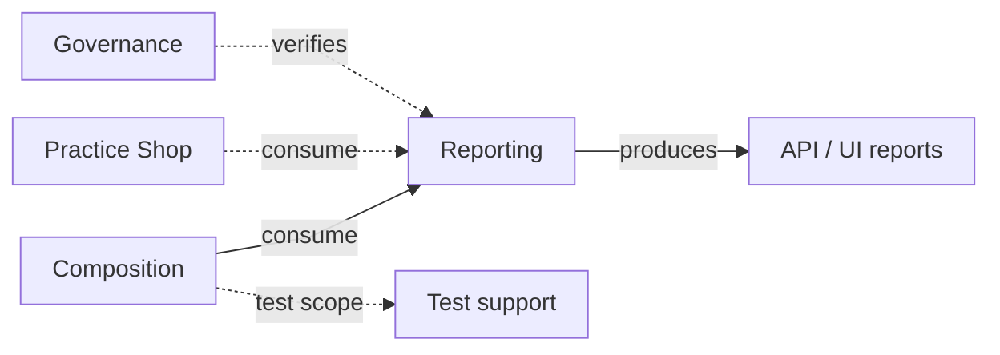
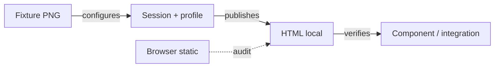

<a id="atf-reporting-tests---isolated-composition-for-the-reporting-library"></a>
<a id="atf-reporting-tests--compoziție-izolată-pentru-biblioteca-de-raportare"></a>
# ATF Reporting Tests - isolated composition for the reporting library

<a id="at-a-glance"></a>
<a id="pe-scurt"></a>
## At a glance

**Neutral Diagnosis:** [graph, budget and publication](#diagnosticul-neutru-al-excepțiilor).

**Quick trails:** [Choose the sample](#matricea-de-integrare-și-limitele-verificate) · [Tables and Respondents](#probe-de-lizibilitate-a-panoului) · [Scope-uri](#refuz-recuperabil-al-scope-urilor) · [Local Browser and Limits](#verificare-rapidă)

`atf-reporting-tests` checks `atf-reporting` as a reusable library:

- covers API / mock setup, renderer, publisher, read-only browser and ATF Debug;
- does not have the business tests of an application;
- business tests belong to the consumer module, such as `atf-test-practice-shop`;
- `atf-tests` remains dedicated to the governance of the whole- ATF.

For extraction, the candidate artifact is `atf-reporting`; this module remains internal verification support. Compilation and running on `target/classes` does not demonstrate the consumption of JAR published on its own. [Distribution Gateul](#gate-ul-bibliotecii-distribuite) uses a consumer without sources or ATF modules in the classpath.

Change of tests, support or resources in this module requires eligible `testChanges` technical control; [whole- ATF governance](../atf-tests/README.md#guvernanța-schimbării-testelor) verifies the Git difference and negative rule samples.

<a id="permanent-regression-of-each-reporting-defect"></a>
<a id="regresia-permanentă-a-fiecărui-defect-reporting"></a>
## Permanent regression of each Reporting defect

Any observable defect in the report, public contract or composition receives first regression in this module. The sample replicates previous behavior, has independently expected and remains in the canon inventory after correction.

| Boundary | Sample retained |
|---|---|
| API, query, status, ownership and correlation | configured mock and captured exchange; nominally and refuse, without necessary live endpoint |
| flow and renderer | Same input typed through actual Extent / fallback, with exact number, order and verdict |
| Display and navigation | DOM / real browser: original table, geometry, expansion / collapse, keyboard and reload |
| distribution | binary candidates, its POM and real transistors; CodeSource and hash checked |

```mermaid
%%{init: {"themeVariables":{"fontSize":"15px"},"themeCSS":".nodeLabel, .nodeLabel p { font-size: 15px !important; line-height: 1.35 !important; } .edgeLabel, .edgeLabel p { font-size: 12px !important; font-weight: 400 !important; line-height: 1.2 !important; } .edgeLabel .labelBkg, .edgeLabel p { background: transparent !important; } .edgeLabel foreignObject { transform: translateY(-18px); overflow: visible; } .node rect { rx: 6px; ry: 6px; }","flowchart":{"curve":"linear","nodeSpacing":24,"rankSpacing":40,"padding":10,"diagramPadding":16}}}%%
flowchart LR
    Incident["Observed defect"] -->|reproduce| Regression["Stable regression"]
    Regression -->|protects| Fix["Reporting correction"]
    Fix -->|validate| Jar["JAR candidate"]
    Jar -->|accept| Consumer["Binary consumer"]
```



<details>
<summary><strong>Legend - test kept at manufacturer and binary checked at consumption</strong></summary>

- Regression belongs to `atf-reporting-tests`: mocks, contracts and evidence
  the browser remains maintained together with the manufacturer's implementation.
- The library's native tests complement the standalone boundary; acceptance
  The artifact also requires external composition, including damaged failures-paths.
- The binary consumer can withdraw the copy of the harness from its reactor.
  Each new version, the manufacturer's samples run on that JAR in a TMP consumer.
- A green test on `target/classes` or a manual capture does not replace the neck
  binary. Running logs and artifacts remain in TMP; README maintains the contract.

</details>

<a id="choose-level-of-proof"></a>
<a id="alege-nivelul-dovezii"></a>
## Choose level of proof

`UiCrossPhaseCompactFlowComponentTest` also verifies one TEST BODY, using a API 200/500 mock, FAIL/SKIP and multiple separately retained captures. `BodyOnlyUnifiedFlowComponentTest` checks ACTION/OBSERVE/Assertions rows, preview 18/240, the owning disclosure and keyboard navigation in both renderers.

| Returned regression | Independent oracle |
|---|---|
| Core → Kit → Reporting | `CoreRedactionPublicationComponentTest`: `$0` and backslash literal masks, original comparison FAIL with identical previews, 240 limit and absent canary Extent / fallback; renderer does not change the requested comparison verdict |
| UI context per phase | `PhaseUnifiedFlowContextComponentTest`: same Extent / fallback, UI and mock API 200/500; flow metadata do not become HTTP response, and the actual exchange retains its status and expect 200 |
| Expansion of assertions per phase | `PhaseUnifiedFlowComponentTest`: own disclosure, Enter / Space, reload, rows ACTION / OBSERVE, original catch and preview 18/240 |
| long fallback titles | `FallbackLongTitleComponentTest`: text fragments remain in the sidebar and heading at 1280/760/392 px; sibling, anchor, keyboard and reload retain identity and the reintroduction of `nowrap` is denied |

The selection of fields is tested separately from HTML via `UnifiedFlowProvenanceFieldsTest`, including the non-compaction typed context, HTTP / preserved custom and the refusal of reclassification by an isolated field name. The conflicting metadata, including the compact marker, retains the quest, the 500 mock response and captured execution, with independent 200 expected.

| Question | Gate | What it confirms |
|---|---|---|
| The library compiles itself? | [isolated source](#gate-ul-bibliotecii-distribuite) | POM autonomous and boundary production |
| Does the app use physical JAR? | [binary consumer](#gate-ul-bibliotecii-distribuite) | CodeSource and classpath without library source |
| Semantic contract is kept? | [integration matrix](#matricea-de-integrare-și-limitele-verificate) | independent browser models, causes and projections |
| Can the user audit the artifact? | [tables and responders](#tabele-publicate-și-inventar-independent) | exact comparisons, catches, keyboard and backlink |

The inventory below indicates their samples and boundary; the acceptance of a paper requires execution of the affected coats and audit of the new artifact. [Test residues](../docs/feedback/ATF_Reporting_Tests_Feedback.md) separates the obsolete oracle, binary fixture and reproducible rendering defect.

Consumer tests keep independent and negative controls. A HTML containing the text of a rule does not demonstrate that the user can reach its proof in the correct scenario, phase and order.

<a id="the-librarys-gatecraet-distributed"></a>
<a id="gate-ul-bibliotecii-distribuite"></a>
## The library's gatecraet distributed

`ReportingLibraryDistributionIntegrationTest` checks the actual loaded form:

- POM and `src` only copy from the reactor, running `package` with native tests,
  then create an external Maven consumer;
- from a JAR read POM Maven included and check that binary in a consumer
  external, without searching the source in the vicinity.

Both routes check hashes, CodeSource and the same negative controls. JAR consumption also checks the targets of the four Extent tables and the timing of the hash with the selected view; Chromium component checks the real changes.

Java structure audit is performed by `ReportingSourceArchitectureTest` in the manufacturer's native building. Runtime samples here consume classes and resources loaded, whether they come from the reactor or JAR; do not have skips for lack of source. Fixturees identify the root through their own POM and resources.

| Boundary | Oracle and limit |
|---|---|
| reactor-free source | [POM manufacturer](../atf-reporting/pom.xml) is parentless; native guard starts from its own CodeSource and refuses imports / dependencies ATF and parent through negative evidence |
| classpath runtime | Reporting only and Maven transistors; without Core, Kit, UI, JUnit, Playwright or Reporting classes in the reactor |
| Extent and fallback | PASS / FAIL / PASS, difference after 240, budgeted and canary values absent from the artifact |
| preview implicit | [ReportingSettings](../atf-reporting/src/main/java/atf/reporting/configuration/ReportingSettings.java) declares 240; `ReportingPreviewConfigurationComponentTest` checks the default and overrides 18/480 with the ellipse included in the ceiling |
| missing runtime resource | a copy of JAR without `table-viewport.css` is refused separately from both renderers; the previous report remains intact without abandoned workspace |

Copies, Maven / Java processes and lobes remain in TMP. The test proves the consumption of this artifact; the release contracts and the compatibility of the entire API public have [separate criteria](../docs/feedback/ATF_Reporting_Feedback.md).

<a id="portable-receipt-for-evidence-of-publication"></a>
<a id="receipt-portabil-pentru-dovezile-publicării"></a>
### Portable Receipt for Evidence of Publication

After Maven consumer acceptance, the distribution gate writes a `.receipt` beside each HTML Extent and fallback report. The receipt pins the run's UUID-, the Maven coordinate, the SHA-256 of the JAR and HTML, and the publication verdict.

1. Keep HTML and the Receipt in the same directory when you file or move proof.
2. Take UUID- from `RUN_ID` from the selected running log and identity
   package from the release entry. Use these expectations for verification.
3. Run JDK 21 controller from J0 root. [Source of verifier](src/test/java/atf/reporting/distribution/ReportEvidenceReceipt.java)

```powershell
$verifier = 'atf-reporting-tests/src/test/java/atf/reporting/distribution/ReportEvidenceReceipt.java'
java $verifier $receiptPath $expectedRunId $expectedCoordinate $expectedJarSha256
```

| Result | Interpretation |
|---|---|
| `VERIFIED` | The running, package and octets of HTML correspond to the Receipt. |
| `REPORT_MISSING` / `REPORT_UNREADABLE` | HTML adjacent missing or path is not a legible file. |
| `REPORT_DIGEST_MISMATCH` | HTML adjacent has other bytes, including when replaced by a homonymous ratio. |
| `WRONG_RUN` / `WRONG_PACKAGE` | The Receipt belongs to another rolling or another package input. |

The verifier shall separately display the historical verdict in the Receipt and return the zero code for `VERIFIED`. [Permanent sample](src/test/java/atf/reporting/distribution/ReportEvidenceReceiptTest.java)

<details>
<summary><strong>Reading map</strong></summary>

- [library boundaries](#regula-limitelor-de-responsabilitate) - separation
  the harness of the production code;
- [console](#consola-testelor-de-raportare) - default diagnosis IntelliJ
  and Maven;
- [contract of titles API](#contractul-de-titlu-pentru-request-uri-api) and
  [reconciliation of the evidence](#reconcilierea-dovezilor-api-și-navigarea-fazei);
- [integration matrix](#matricea-de-integrare-și-limitele-verificate) —
  the connection between seam, sample and limit;
- [limits of consumption](#limitele-de-responsabilitate-ale-aplicațiilor-consumatoare)
  which remains specific to applications.

</details>

<details>
<summary><strong>Catalogue of fault samples and adjacent regression</strong></summary>

`UiFailureReportContractTest` is the annotation-driver browser sample for UI failure in Extent:

- SETUP, Playwright timeout, observation and assertion keep the FAIL Leaf under
  Semantic owner; document starts collapsing, and Fails strictly opens the ancestors of original proof and keeps sister scenarios closed;
- Playwright scenario checks `TimeoutError`, the locator, duration and editorial;
  UI failure must not create disclosure HTTP;
- `ExtentReportUiFailureEvidenceTest` and `UiFallbackFailureEvidenceTest`
  check the fallback and isolation of a brother-screenplay;
- The renderer gives the locator's target through the editor; without cause, the publication of a
  derives from FAIL action or rejects the undiagnosed implant;
- browser contract keeps timeout in current scenario and excludes it from
  Sibling scenarios; stable rule is in [reporting contract](../docs/ATF_Reporting_Contract.md#fails-și-legături).

The backlinks' oracles shall retain the identity:

- `FailureLinkIdentity` compares the decoded scenario and parameters, including the ordinal;
- Negative evidence refuses foreign scenarios and duplicate parameters; parameters
  additional and reload encoding shall retain the same destination.
- `PublishedFailureNavigationEdgeComponentTest` checks two UI groups
  homonymous with a single FAIL, so that the derived summary is created. Oracle selects the comparison in the validation host, with literal causes, reload, reverse orders and preview 18/240; does not repeat the production selector.

The stable contract for the visible hierarchy, layout, responsive view, disclosures and browser evidence is [ATF Reporting - Display contract and layout](../docs/ATF_Reporting_Display_Contract.md). This README holds the matrix of evidence and the responsibilities of the suite; does not redefine visual rules in feedback or fixtures.

`ReportUiEnvironmentTest` protects the common UI vocabulary, resolved policies and uncredited origins. `ReportGherkinSequenceTest` protects the anchors, sequels and isolations of scenarios; AutoEx / Shop wirings remain proven in the consumption modules.

Helpers reused by HTML UI probes belong in `atf.reporting.ui.support`, outside renderer test packages. For example, `ExtentReportUiEvidenceTestSupport` centralizes fixtures and shared checks without becoming a test or moving ownership out of `atf-reporting-tests`. `AtfPackageCohesionGovernanceTest` still checks package cohesion; its threshold is not raised to accommodate a hotspot.

The projection of the context UI is checked by the component:

| Test | Protected contract |
|---|---|
| `UiCheckpointEvidenceProjectionTest` | the identity of the checkpoint and `evidence.type` / `evidence.policy` remain in the model; the projections typed / legacy and fallback do not publish and move them to replies |
| `UiApiValidationContractComponentTest` | prohibit entries with gross exchanges into API, lifecycle, publisher and buffer; check the verdicts UI / API independent and sister exchanges in checkpoint, setup, final and unified, plus mark request / response / actual execution |
| `ReportRequestHeadersTest` | observed / configured source, cas- insensitive override, existing customer compatibility and immutable copying |
| `ObservedRequestEvidenceComponentTest` | Extent / fallback / UI_API × six inputs: absent, unpressed, JSON literal null, explicitly redacted heads, declared defaults and replies without body; Request details and replay does not invent headers or payload |
| `ObservedBodyAuditComponentTest` | 22 cases: actual browser audit in the three publishers, body absent / unclaimed / null literal, JSON fallback collapsed and compared to catalogue without invented payload |
| `LiveClientHeaderProbe` | HTTP loopback real through ATF client; headers received on the wire are compared to Reporting projection and sanitized replica |
| `UiApiVerdictProjectionComponentTest` | UI PASS/API FAIL, UI FAIL/API PASS, both FAIL and API FAIL correlation with PASS exchanges; typed owner, exact request/checkpoint/cause, final PASS sibling exchange and exact Open in Tests index; separate audit with steps, assertions and captures for all five Fails entries |
| `ApiWhitespaceBodyComponentTest` + `UiNetworkBodyFidelityComponentTest` of UI | body present only from whitespace remains distinct from absent, unclaimed and JSON literal null; capture / sanitization to the UI host, then formatting / publishing / replicating to Reporting |
| `ExtentReportUiEvidencePublishingTest` | UI does not add a synthetic HTTP quest; the unspoken exchange keeps quest / response / JSON / execution |
| `ExtentReportDisclosureBrowserComponentTest` | PASS / WARNING / FAIL-controlled artifact; empty phase does not display expansion affordance, and API with evidence mock remains expanding with mouse / keyboard; no introduction table for checkpoint, validations and screenshot available, close without visible subshaft and semantic identified customized titles; removable open by click / Enter with the source collapsed without jumping to anchor |
| `NavigationSelectionBrowserComponentTest` | Extent actual, successively click on the four tables; accessible names for icons, single link `active` and `aria-current="page"`, synchronous with visible view |
| `ComponentAssertionStepReportTest` | Same typed and 42-line node in Extent / fallback; default collapse step, last row access and switch with mouse / Enter / Space in Chromium; FAIL in Extent has `component` owner, exact numerical values and reopened link to table, without demand or duration HTTP |
| `PublishedEvidenceTableComponentTest` | UI / API / UI + API × Extent / fallback; literal values in 12/40 rows, exact inventory per owner, real geometry, expansion, resize and tables; negative controls detect missing evidence, clipping, removed ceiling and FAIL changed to PASS |
| `TerminalExecutionProjectionTest` + `TerminalApiExecutionReportTest` | Snapshot partially strict, 503 followed by status unavailable, end typed in Execution evidence, without manufactured answers details; Extent / fallback keeps 240 ceiling, budget configured, redaction, last row and Enter / Space; zero discounts do not declare executed network |
| `UiTerminalExchangeReportComponentTest` | checkpoint, setup, final, trace and flow unified in / over phases keep the unresponsive exchange between two neighbours PASS; diagnosis, attempts, totals and keyboard in Extent / fallback, with implicit and personalized budget; the unversed samples are held by `ReportingStandaloneVerdictComponentTest` in the standalone library |
| `ReportPhaseTimingComponentTest` | Timing typed identical in Extent / fallback snapshots; browser keeps 12/345/0 ms per phase, scenario / class / Overview totals without duplication and the source of execution after expansion; publication remains separate |
| `BodyOnlyUnifiedFlowComponentTest` | one eligible TEST BODY UI-only body: one flow with retained actions/observations/assertions, preview 18/240 and mouse/Space/reload in Extent/fallback; typed contracts include API mock PASS/FAIL and multiple captures |
| `ComponentExecutionDiagnosticReportTest` | PASS or before first comparison; Fails without quest / duration HTTP invented or comparison PASS attributed to error; empty measured phases and 42 rows in Extent / fallback, with 240 ceiling and keyboard |
| Relays | `ExtentReportRuntimeScriptTest` maintains the sources of duration; `ExtentReportSessionContractTest` separates fields API / UI in Fails; `AtfReportEvidenceCssTest` protects the common container and font, supplemented by actual measurements from `NarrowEvidenceReadabilityComponentTest` |
| `AssertionAuditPublicationComponentTest` | Extent / fallback projection; keep FAIL row without synthetic secrecy fragments and SKIP with `Abort reason` without built assertions |
| `ReportingPreviewBudgetTest` | the full value displayed includes the ellipse in limit; null, exact limit and budget of JSON independent |
| `LegacyPreviewBudgetComponentTest` | direct UI ports in Extent / fallback; 240/18 limits, full wording, verdict from full values and same limit in Fails after backlink |
| `ReportingPreviewConfigurationComponentTest` | YAML default 240 and configured 18/480, effective value in Extent / fallback system, contradictory metadata refused and budget rejected unpositive |
| `UiFailureContextTest` + `UiFailureContextReportTest` | FAIL action prior to long technical message, lack of exception / action, PASS actions followed by error, first FAIL sequence and graf causes / suppressed with references / cycles, without moving the verdict or original evidence |
| `UiFailureContextComponentTest` | Tests / Fails and backlinks in Extent / fallback, preview 240/18, 392 panel, context of action and time measured, inspectable relationships in diagnostics INFO and disclosure Enter / Space without JavaScript errors |
| `UiTimeoutReportComponentTest` | native separate from the time captured and the compact context Fails; Extent / fallback at 240/18, primary / cause / suppressed redacted, HTML without credential, owner and backlink, Enter / Space, last row and negative oracle for diagnosis missing or visible secret |
| `ReportScopeAtomicityComponentTest` | repeated completions, late writing, closed idempotent / FAIL, open children and closed session; refusal without mutation and publicity in Extent / fallback |
| `UiSetupFallbackParityComponentTest` | setup keeps comparisons, actions and capture in Extent / fallback; 240/18, redaction, Enter / Space and FAIL evaluated beyond forecast, including with PASS caller |
| `UiPhaseExecutionTest` + `UiPhaseTimingLifecycleComponentTest` | execution / catches / publication delimited, controlled clock, primary cause, zero / unknown, success / FAIL / SKIP, incomplete setup, failed teardown and unified flow over phases |
| `ReportPhaseDiagnosticTest` | explicit conversion, source phase status, delimited legacy keys, unaltered context and immutable result; the diagnostic port does not create HTTP |
| `ReportPhaseAuditBrowserComponentTest` | Extent / fallback with zero / one / more exchanges and with / without metadata; JUnit failure, missing association, editorial and closure of diagnosis; Fails excludes PASS phase notes; negative samples for hidden tape, renamed or empty |

The browser fixture is local and deterministic; does not require a new purchase in Practice Shop. The timed ratio is evidence of component, and the FAIL / WARNING states are deliberate fixture data.

The inventory calls the contracts pursued; it does not automatically certify all the evidence. The reliability of the evidence of each scenario has a [independent audit criterion](../docs/feedback/ATF_Reporting_Tests_Feedback.md#report-test-audit-60--o-dovadă-identificabilă-pentru-fiecare-scenariu). A focus gate past does not replace the result of the canon suite.

Maven `reporting-release` profile maintains the complete unit suite as a precondition for delivery, along with the browser samples for the tables / hash / keyboard, idempotent initialization, the required-phase-duration association, the original viewports and captures. With the reactor dependencies installed in the private cachet of the staging-:

```text
mvn -pl atf-reporting-tests -Preporting-release test
```

`UnitBaselineBehaviorComponentTest` rejects the unbound table, the duplicate initialization and the / duration of the neighbor PASS. Direct opening in Fails and the relay keeps the index after native handler Tests; the reintroduction of the native class of the host must be rejected by the same oracle. `ScreenshotLinkContract` checks DOM link, PNG octets and caption; The duplicate, the modified catch and the foreign caption remain negative controls. A script selector is not a published link. The same selection is performed with JAR physically without parallel Reporting classes; CodeSource and results are kept near the TMP candidate. JAR installed in the private cachet sets `atf.reporting.test.version` to the published version and `-am` is running the profile. By default, the property follows `${project.version}` and keeps execution on the reactor source.

<a id="browser-setup-and-terminal-verdict"></a>
<a id="setup-browser-și-verdict-terminal"></a>
### Browser Setup and Terminal verdict

Phase markers keep the workshop's monotonous time. At the race between watchdog and the publication of the marker, a transition confirmed in the phase budget may advance the observation. The overcome measured in the worker remains a failure, and the term startup and the total limit of the process remain active.

`ReportArtifactProfileComponentTest` keeps the static inspection and interactive sample separately. `BrowserProbeProcess` performs each sample in its own JVM; a factory locked before navigation produces FAIL, including when HTML conforms.

| Boundary | Contract |
|---|---|
| Setup | 30 s for JVM / SDK, launch and `newPage` startup; no retry or relaxed threshold |
| Driver CLI | prepared once per JVM host or reused from `playwright.cli.dir`; source and time are recorded separately in `driver-runtime.log` |
| Verification | `BrowserProbeBudget.DEFAULT`: 60 s; `BrowserClassRun`: 120 s / class and maximum 10 min total; 5 s action and 30 navigation s remain independent |
| Cleanup | 5 s for normal closure; at failure, forced termination has 5 s and only targets offspring with verified parent chain and same starting identity |
| Diagnostic | phase, PID-uri, log and stacks at timeout; failed matrix and lifecycle controls keep the sample directory and initial cause precedes errors of cleanup |
| TMP native | short, unique and owner- marked directory; JVM and SDK receive the same root without browser profile in the common TMP-ul |
| Acceptance | DONE terminal phase, exit 0 and resources closed; no verdict is PASS |

`BrowserProbeProcessComponentTest` covers non-cooperative factory, blocked cleanup, suppressed causes and parent's interruption; an independent process must survive. `BrowserProcessInventoryContractTest` refuses processes started before the workshop and PID-uri reused. Same SDK and the same samples run on the reactor source and JAR physically via `reporting-release`. Harnessul remains in J0, without Playwright added to the standalone library or in the browser-free consumers.

<a id="published-tables-and-independent-inventory"></a>
<a id="tabele-publicate-și-inventar-independent"></a>
### Published tables and independent inventory

`PublishedEvidenceTableComponentTest` publishes UI, API and UI + API through real ports, Extent and fallback. 12 case keeps short comparisons; the two cases of 40 by rows shift long text to EXPECTED and ACTUAL respectively.

| Test | Observed criterion |
|---|---|
| Inventory | exact number per form and owner; setup, ACTION / OBSERVE, request / response, execution / retry and three distinct Thracian roles |
| Geometry | 1803/1280/991/719/720/721/591/392 px and 591/392 px panels; full width, legible font, aligned columns, finite head, last row and last accessible column; secondary tabs also check 760/761 px threshold |
| Evidence | independent literal values, Unicode / escaping, PASS / FAIL kept and identical content after resize, Enter / Space and return to Tests |
| Taburi | Overview / System / Tags and table Categories; Fails uses native fields / index, and secondary fallback tags use cards / links; the intentional absence of a table is explicit |
| Negative control | artificially reduced width, header / column / missing table, vertical cells, direct / inner clipping, hidden row, empty gutter, removed head, modified value times FAIL changed into PASS; Fails hidden under navigation and technically torn header |

The browser collection is grouped in `PublishedEvidenceTableMeasurements`; `PublishedEvidenceTableOracle` applies independent rules. Negative controls restore the exact published table and check the inventory and content again. The sample is waiting for the completion of the finished transitions prior to measurement, including after restoration of a mutation. The browser campaign runs separately from public E2E purchases; interaction budgets and business timeouts remain unchanged.

Canon content is compared in the same order after navigation. `atf-ui-failure-evidence` derived projections are checked separately: one for each failed owner / validation, with the first original comparison and no duplicates on repeated browsing; `assertion-step` component step does not participate in the hook.

The percentage width of the first column is not an aesthetic oracle. The allocation of content remains protected by `EvidenceColumnSizingComponentTest`. The configurable budget and redaction have existing dedicated evidence.

`ReportingCoverageMatrixTest` requires the presence of the sample for configuration / System and its component category; the behavior check remains in that sample.

For `ExtentReportDisclosureBrowserComponentTest`, `support/inspection/disclosure` holds the fixture and browser sample. The reusable audit uses the `support/locators` facade: identifies the UI validation by role and actions included, not by title, and opens the script ancestors → phase → checkpoint → validation before inspection.

</details>



<details>
<summary><strong>Legend - composition root for reporting</strong></summary>

- atf-reporting is the verified library, not a fixture test;
- the chart-grouped support represents the scope test dependencies;
- API / UI artifacts are composition results, not normative files;
- atf-test-practice-shop and atf-tests are consumers with separate responsibilities, not hidden extensions of the library.
</details>

| Surface | Owner | Dependencies |
|---|---|---|
| renderer, model, CSS/JS, publication | `atf-reporting` | zero module ATF |
| API / mock contracts producing record-keeping for reporting | `atf-reporting-tests` | core/mock/validation/console |
| E2E and ATF Debug browser for report | `atf-reporting-tests` | ui/debug-ui/Playwright |
| Shop Practice tests | `atf-test-practice-shop` | reporting jar, UI and application setup |
| whole governance - ATF | `atf-tests` | does not have application tests |

<a id="rule-of-liability-limits"></a>
<a id="regula-limitelor-de-responsabilitate"></a>
## Rule of liability limits

`atf-reporting` must pass by itself:

```text
mvn -f atf-reporting/pom.xml test
```

No reactor, no local ATF modules and no business fixtures. The tests in this module check only the reporting public contracts. API / UI / E2E tests here are deterministic vehicles to demonstrate that reporting can be consumed; they are not the suite of a real application.

Replacement of the modules with a fire does not change consumption: they depend on public interactions and contracts `atf-reporting`, not on test classes or local reviews of directories.

UI locators are centralized in `src/test/.../support/locators`:

- prefer a semantic selector with a stable attribute, for example
  `button[data-atf-action='expand']`;
- structural selector or `nth(...)` remains in the locator's owner when
  the marker does not provide a better identity;
- tests, flows and auditors do not directly compose `page.locator(...)`.

<a id="reporting-test-console"></a>
<a id="consola-testelor-de-raportare"></a>
## Reporting test console

UI and API display the details of the console both from IntelliJ and Maven.

- UI audit uses `ReportingTestConsole` for browser and report.
- API tests direct- runnable declares `@AtfConsoleMessages(DETAILS)`; fixture
  API reuses the lifecycle synchronization, so that demand / validation appears by the same `[ATF]` projection without duplicate reporter.
- API uses the consonant configured without current lifecycle JUnit.
- `reporting.console.detailsEnabled: false` narrows down details;
  `enabled: false` stops the projection. [ATF Console](../atf-console/README.md) holds the politics and output.

<a id="api-title-contract"></a>
<a id="contractul-de-titlu-pentru-request-uri-api"></a>
## API Title Contract

Any demand published by a consumer shall be recognizable without the immediate opening of the dislocation:

```text
HTTP_METHOD relativePath — very-short business intent
```

`relativePath` is the observed route; dynamic values remain in the runtime paths, not in lists. If business intent is required, the consumer may use a typed descriptor (`ApiOperationDescriptor`) with method and piled routs.

Boundary remains independent:

- `atf-reporting` publishes the title received and does not leave the semantics in it;
- the consumer holds the application vocabulary and correlation with the dynamic route;
- exemplu Practice Shop: `SEARCH` → wire `GET` →
  `GET /products/search — find configured product`;
- `QUERY` browser alias, if present, remains method observed in capture
  boundary and does not replace the method / title of the request;
- `OPERATION KIND` and `ROUTE TEMPLATE` provide the auditor with a stable context
  of the Shop Practice Execution.

The contract is checked on two seams:

| Seam | Verification |
|---|---|
| core vocabulary | `ApiOperationDescriptorContractTest` validates invalid format and input |
| reporting fallback/Extent | `HtmlReportComponentContractTest` and `ExtentReportSessionContractTest` validate the title published in the artifact |
| consumer Practice Shop | `ShopApiOperationTest`, `ShopStandaloneApiReportTest` and `ShopApiMethodFidelityTest` validate the method / path / intent, absence of `QUERY`, operation kind and route template |

<a id="correlation-of-ui-cases"></a>
<a id="corelarea-cauzelor-ui"></a>
### Correlation of UI cases

The correlation of UI cases is checked separately from `UiFailureCorrelationComponentTest`: the same published assertion court and its propagated exception produce a single Fails entry. The neutral fixture covers nine scenarios in both flow modes; the 16 intentional causes remain distinct, including UI / API with equal texts and independent exceptions. Tests, original assertion, terminal diagnosis and retained catch; unitary test checks identity, wrapped propagation, cleanup and cycles of causes.

<a id="fitness-of-method-and-times-api"></a>
<a id="fidelitatea-metodei-și-a-timpilor-api"></a>
### Fitness of method and times API

- method observed remains true in snapshot, title, signature and reply; alias
  the business operation remains separate;
- unclaimed duration is distinct from `0 ms` and response time, total with retry
  and the duration of the publication shall not be substituted for each other;
- Absent body, JSON literal `null` and unattached body remain distinct states;
- The reply keeps the shell arguments quoted separately; parity test does not
  entails the order of the headers and does not turn the absence into a JSON flat;
- `ReportTransportTimingTest` and `ApiExchangeParityComponentTest` check
  Reporting projection and `ShopApiMethodFidelityTest` protects the consumer adapter;
- semantics is in [`ATF_Reporting_Contract.md`](../docs/ATF_Reporting_Contract.md),
  and the visible shape is in [`ATF_Reporting_Display_Contract.md`](../docs/ATF_Reporting_Display_Contract.md).

<a id="common-duration-in-tests-and-overview"></a>
<a id="durata-comună-în-tests-și-overview"></a>
### Common duration in Tests and Overview

| Boundary | Contract and evidence |
|---|---|
| Timeline projection | `OverviewDurationProjectionComponentTest` checks the actual asset: total, model, bars, zero, fallback, duplicate names and refresh |
| Re-usable inspection | `ApiReportDurationProjectionAuditor.inspectCurrentDom` and DOM Reader use the same native resource `inspection/duration-projections.js` |
| Semantic oracle | total, model and chart values shall correspond to the canonical classes; the single numeric marker shall not be sufficient |
| Probe negative | component corrupts the marker, model and chart separately; each inconsistency produces an explicit breach |

<a id="reconciliation-of-api-evidence-and-phase-navigation"></a>
<a id="reconcilierea-dovezilor-api-și-navigarea-fazei"></a>
## Reconciliation of API evidence and phase navigation

| Boundary | Contract | Test |
|---|---|---|
| Rated fields | `ApiReportEvidenceField` holds the canonical label and explicit legacy aliases; contradictory aliases do not hide a wrong value | `ApiReportContractAuditorTest` |
| Query | be withdrawn from the `URL` of the request, not from the patch or URL-ul response; a correct response does not artificially repair an incomplete request | `ApiReportRenderedEvidenceComponentTest` - nominal and query missing |
| Ownership table | responding fields come only from `Response details` disclosure, not from the technical trackside of execution | Same component requires exactly one table for each evidence channel |
| Phase | bindings are checked on the header, then waiting for open status on the card; no increase in timeout and repeated toggle without reading status | Same component: re-selection, round-trip tab, reloading and TEST BODY absent |
| Audit catch | the publisher reuses the already inspected table without reload or resetting the actions; changing the evidence table keeps the history | Same component checks the identity of the page, the tracksuit and the open discoloration |
| Composition | exact setup → mock → API artifact → all sections rendered and reconciling | `SelectedApiTestsReportUiTest` |

Component samples use a controlled Extent publication and the same locators / extractors as E2E without external endpoint. Negative scenarios are fixture data, not reasons to disable checks or invent PASS. `ExtentReportDisclosureBrowserComponentTest` uses and highlight API mock: nodes with demand / response / validation extend, while a phase without child content does not simulate interactive control.

<a id="simultaneous-errors-in-publication-and-close"></a>
<a id="erori-simultane-la-publicare-și-close"></a>
### Simultaneous errors in publication and close

`UiPublicationFailureComponentTest` injects errors in controlled ports, called through public UI facade; does not imply an incident in a real renderer.

| Independent oracle | Proven contract |
|---|---|
| The original exemption court | purchase / body / complete remains the cause; separate close becomes suppressed |
| Port events | each scope purchased has a single close without rephrase |
| Same exception to body and close | without self-pressure or substitution of the case |
| RuntimeException and Error | Same identity and order in all proven entries |
| Outcome, setup, checkpoint / media, API, unified, delegated failure | Require, validation and API assertions close to owner |
| Partial acquisition | close the prisoner parent without close on the child not obtained |
| Multiple errors of cleanup | child precedes parent in suppressed, with original identities |

Semantic snapshots and Extent / fallback samples check the rendering separately; foul injection does not replace the HTML audit.

The public matrix is complemented by `UiFailurePublicationComponentTest`, for `UiFailureEvidencePublisher` directly and through the facade. Ports do not close children in cascade: lack of validation close.Partial acquisition, body / complete / close errors, `Error` and self- pressure keeps the original cause.

`PublishedFailureNavigationComponentTest` publishes Extent fixtures with UI / API and assertion- step component in all phases. Backlink must open the exact comparison without expansion helper; the keyboard, relay and neighbouring PASS scenario are tested separately from the general Extent / fallback geometry.

`PublishedFailureNavigationEdgeComponentTest` completes the navigation sample:

- Extent indexes a single diagnostic chain in Fails; Tests keep each
  source row per phase, collapsible and expanding independently. Fallback keeps one navigable row for each phase;
- Blurred diagnoses in all phases and fallback for UI / API / component;
- original proof, configured budget, recharged route and intercalated diagnostics;
- Hidden ancestor that invalidates the oracle, without assisted expansion.

<a id="order-of-tests-and-responsibility-of-protection"></a>
<a id="ordinea-testelor-și-responsabilitatea-protecțiilor"></a>
## Order of tests and responsibility of protection

1. `atf-reporting` - unit / component for model, renderer, artifact and CSS / JS;
2. `atf-reporting-tests` - component for the controlled mock composition →
   reporting, integration for the Boundary Boundary between modules and E2E only for the browser / contract renderings of `atf-reporting` library;
3. `atf-test-practice-shop` - consumer tests for the Shop practice tour.
4. `atf-tests` - Boundary and Whole-Reactor Governance, including Checks
   Global documentation, ownership, cohesion and vocabulary.

`src/test/java/atf/reporting/api` remains limited to checks that have as their subject the reforming composition. Do not duplicate reactor guards and do not validate README to the entire project; they are centrally executed by [`WholeAtfGovernanceSuiteTest`](../atf-tests/README.md#suita-whole-atf-și-reziduul-de-compatibilitate).

<a id="selecting-scenarios-for-api-ratio"></a>
<a id="selecția-scenariilor-pentru-un-raport-api"></a>
### Selecting scenarios for API ratio

`@ApiScenarioSetup(tests = ...)` declares the exact methods; the resolver validates the selection before wider collections.

Fallback order, when no precise methods are declared:

1. JVM property with API families;
2. property of the suite;
3. families in annotation;
4. YAML configuration.

The expected Owners and scenarios are not deducted from the resulting DOM.

| Contract | Proof component | Boundary |
|---|---|---|
| exact selection and semantic projection | `ApiScenarioManifestTest` | checks the owner, titles, statuses, orders and rejects unelected scenarios against the YAML fallback |
| precedent of the setting and fallbacks | `ApiReportAuditSetupTest` | directly verify that the JVM family override takes priority over `tests = ...`, then check the suite, annotation and YAML fallbacks |
| exact selection → mock / lifecycle → publisher | `ApiSelectionMockPublisherComponentTest` | checks the mock's JSON response, request/response/execution evidence in the artifact and exclusion of unselected scenarios; invalid selection is rejected before publication |

These proofs are complementary: the manifest checks the projection, the resolver checks the precedent, and the composite test proves vertical to the artifact. `SelectedApiTestsReportUiTest` remains separate for browser interaction; it is not used as a substitute for lower- level contracts.

<details>
<summary><strong>Test levels and independence</strong></summary>

- **`atf-reporting/src/test`** - boundary standalone of the library; check
  independent compilation and local contracts without ATF, mock or browser, including the `ReportingStandaloneVerdictComponentTest` component; `ReportingVerdictProjectionComponentTest` verifies here only the browser projection, totals, disclosures, 240 limit and navigation in both renderings;
- **`atf-reporting-tests`** - composition root for component, integration / API
  E2E; links the reporting to mock, execution, validation, Playwright and ATF Debug;
- **`atf-test-practice-shop`** - application consumer; not part of
  checking the reporting library;
- **`atf-tests`** - Government for reactor; does not have fixtures or flows;
- **Rule of independence** - E2E test only checks behaviour
  depends on the browser; static contracts, model and assets are checked at lower levels;
- **Boundary rule** - mock and browser do not enter JAR production
  `atf-reporting`.

</details>

<a id="generic-capture---support-checked-prior-to-the-consumer-module"></a>
<a id="capturare-generică--suport-verificat-înaintea-modulului-consumator"></a>
## Generic capture - support checked prior to the consumer module

<details>
<summary><strong>Detailed contracts and evidence of the owners - Generic capture - support checked before the consumer module</strong></summary>

The cross-cutting contract for flow mode, screening policy and capture source is in [`docs/ATF_Evidence_Capture_Contract.md`](../docs/ATF_Evidence_Capture_Contract.md). This module probes it through deterministic fixtures; does not move policy into a consumer and does not require Shop Practice for testing the support.



<details>
<summary><strong>Legend - testing on levels</strong></summary>

- the fixture reunites PNG mock, typed input and catch provider;
- the session uses the profile and the policy, applied before the provider;
- units: policy before provider, target, provenance, PNG and cardinal `0/1/N`;
- component: markup, status, disclosure, media reference and stock retention;
- integration: session → semantic pattern → HTML, without endpoint or external browser;
- optional browser: actual capture on the artifact HTML static;
- E2E consumer: proves integration, does not reimplement generic support;
- The fixture may represent `PASS`, `FAIL`, `WARNING` or `SKIP`.

</details>

- `ReportEvidenceProfileTest` checks the filtering before the catch, the source's match,
  PNG payload and typed selection of action details.
- `ReportScreenshotTest` checks the Base64 encoding and signature PNG;
  the contract does not entail full decoding of the image.
- `ExtentReportUiEvidenceRenderingTest` checks the default table and that
  `SUMMARY_ONLY` keeps a collapse disclosure without detailed table or change of catch; renderer does not perform UI actions.
- `ReportEvidenceProfileIntegrationTest` proves the mock provider → session → HTML local for both flow models.
- The same class checks different profiles for sister-scenarios in a shared session and repeats the sample with reverse order; the profile does not leak between scenarios.
- `UNIFIED_FLOW` retains one request with the final Gherkin sentence, without numbered checkpoints or duplicated Gherkin. In the phase projection, UI actions and assertions are aggregated; `API validation` is a sibling of `UI validation` under the same Gherkin checkpoint and owns its exchanges. Only the `FINAL` capture is published under `FINAL_ONLY`.
- `SCREEN_CHECKPOINTS` keeps the Gherkin quests independent.
- Typed profile combines flow mode, screening policy, capture source and actions-details mode.
  The Grouping belongs to the lifecycle / publishing house in `atf-reporting`; choosing the mode for a consumer annotation remains the responsibility of that consumer.

The profile isolation per scenario is a generic contract implemented and tested. The consumer must transmit the solved profile when creating each scenario; a profile provided only at the opening of the report remains the default value of the session. The Shop Practical Wirings for shared reports and the aggregation of `SETUP` + `TEST BODY` phases are implemented at the consumer and documented in [contract of the report](../atf-reporting/README.md#contractul-raportului).

`ExtentUnifiedFlowMultipleScreenshotTest` checks the generic regression of publication; local mappings remain in Shop samples without copying the renderer.

- `UiCrossPhaseCompactFlowComponentTest` publishes a UI-only scenario by
  Extent lifecycle and check the equivalent typed projection in fallback with `SETUP`, two `TEST BODY` and `CLEANUP` checkpoints: check one table per family, order of action, terminal capture under the table, `NONE` policy, UI provenance separated from `Response details` and absence of any Body invented after failed setup. Existing regressions for UI + API and multiple catches remain unchanged.
- The same test checks the declared training directly in `TEST BODY`, without
  `SETUP` or invented `Setup validation` label with assertions and FAIL stored in both renderers. The choice of the guest / authenticated phases belongs to the consumer; the Shop sample exercises the actual harness- separate from the neutral fixture.

| Component | Verified contract | Invariant |
|---|---|---|
| `UiAuditLifecycleTest` of `AtfReportingComponentSuite` | Extent / fallback: valid catch, absence, invalid or excluded payload by policy | The action, cause and FAIL remain visible; the `Screenshot` observation explains the status without artificial business assertion or the Base64 link invented. |
| `ExtentReportSessionContractTest` | Artifact and common style; `Configured per execution` default client or explicit client kept and written in System | A consumer without declared transport does not by default receive the identity of a API customer. |

- The additional matrix compares the semantic snapshots with HTML for public
  any policies, including empty payload, incorrect Base64, non-PNG and faulty without executed actions.
- The Client Oracle also checks the uniqueness of the row in the System.
- The inspection fixture of the catch shall contain intended synthetic failures
  and a PASS brother screenplay; it is not a Shop / AutoEx business run.
- The component shall check the model and the marker; the rendering, the catch click and
  Fails → Open in Tests remain the responsibility of [fault browser sample](src/test/java/atf/ui/tests/extent/e2e/failure/UiFailureReportContractTest.java).

</details>

<a id="integration-matrix-and-verified-limits"></a>
<a id="matricea-de-integrare-și-limitele-verificate"></a>
## Integration matrix and verified limits

<details>
<summary><strong>Details - integration matrix and verified limits</strong></summary>

`NetworkCaptureEvidenceTest` belongs to the `atf.ui.tests.extent.component.inspection.network` package; the five cases remain selected by the component suite. The selectors are held by `ReportNetworkCaptureLocators`, without new exceptions for browser imports or selectors in the intent class.

Integration tests remain grouped after observed boundary, not by the name of the module consumed:

| Familie | Representative classes | Boundary verificat |
|---|---|---|
| API scenarios | `UsersApiTests`, `PostsApiTests`, `RequestVariantsApiTests`, `ApiHeadersAndEdgeCasesTests`, `ApiNegativeMatrixTests`, `ApiRequestFlowsTests` | mock → core → validation → reporting evidence |
| reporting API | `MockApiReportIntegrationTest`, `ApiReportArtifactAuditTest`, `ApiManualReplayTest` | API → renderer / publisher → artifact and rephrase |
| UI composition | `SelectedApiTestsReportUiTest`, `StaticUiExtentReportContractTest` | artifact → ATF Debug/Playwright → DOM/CSS/disclosure |

`StaticUiExtentReportContractTest` includes the `UI_VALIDATION` and `INLINE_SCREENSHOT` checks; the input must have screen-shot records according to the stated policy. A ratio to `Screenshot policy = Disabled` is not input for this screen shot gate and is not interpreted as a defect of the renderer.

Each class declares the layer by annotation; the packager expresses the domain and the boundary, not the test level. The set, the mock and the common validators remain in `support`, so that a new class can write the script without copying.

Boundary Boundary Boundarys remain small and verifiable:

- `support.api` shall keep the selection and publication of the precondition API;
- `support.config` holds the loaders, resources and configuration UI;
- `support.config.environment` holds Snapshot factories typed for Overview / System;
- `UiReportEnvironmentSnapshotFactoryTest` states the configured values and
  Solved by override among the System; does not open the browser or measure the CSS or DPR viewport;
- native geometry is tested at [UI](../atf-ui/README.md#geometria-nativă-a-contextului),
  separate from the snapshot metadata and the pixels of the screenshots;
- Network Inspector belongs to `atf.reporting.ui.network`; no cohesion exceptions are added for unrelated classes;
- The whole-ATF guard limits each package to a maximum of eight classes.

`ReportingCoverageMatrixTest` is the executable map of public seams:

| Verification | Mandatory proof | Intent limit |
|---|---|---|
| coverage | Each seam has `unit`, `component`, `integration` or `e2e` test | a new seam without lower- level proof e regression of governance |
| Network Inspector | `ReportNetworkInspectorTest` (`unit`) for projection / markup; `NetworkInspectorSummaryRoleTest` (`component`) for the role and order of the summary; `ExtentReportUiEvidencePublishingTest` (`unit`) for the publication of the aggregates | The matrix requires classes, executable methods and annotations of ATF; publication remains pro separately |
| audit semantic | `Overview`, `Categories`, `Fails`, `UI validation` and `ReportExecutionProjections` | `ReportAuditSnapshot` remains renderer-neutral; same typed projections can be checked without browser |
| Convergence | JSON and visual are checked together | browser notes; rules are checked without Playwright |
| browser proof | `E2eSuiteBudgetArchitectureTest` cap 8 `@AtfE2eTest` classes | any new class requires justification in feedback and change of budget |

<a id="publication-of-a-bulky-report---component-sample"></a>
<a id="publicarea-unui-raport-voluminos--probă-de-componentă"></a>
### Publication of a bulky report - component sample

`LargeReportPublicationComponentTest` runs in a JVM child with limited head; does not run Journeys on external application and does not reduce catches. Two profiles isolate HTML volume from the average volume.

| Parameter / proof | The fixture contract |
|---|---|
| Heap | `-Xms64m -Xmx384m`, separate from the Surefire fork |
| Output | Configurable directory is created before JVM child log; the sample can start in a new directory |
| Text profile / HTML | Unicode, 1.500 references PNG inline and two distinct images repeated; artifact > 9 MB |
| Media profile | Four separate PNG generated 256×256, each referred twice; after the deduction four inline payloads remain, their total exceeds 900.000 characters |
| Integrity | Exit code 0, total heap sampled at 2 ms, duration of publication, final marker, theme, runtime and actionable screenshot references |
| Faillure-path and publication | `ExtentReportSessionLifecycleTest` checks for blocked destination, cleanup failure after atomic promotion, private staging without leads and `REPORT_PUBLISHED` event only after the final file; repeated closure only gives one notification and failed publication does not deliver successes. `ExtentReportAssetCleanupTest` proposes `AccessDeniedException` determinist and `FileSystemException`: transition / persistent lock, limited retry, error I / O nonretryable and maintenance of interruption |
| Time | Child processing has `atf.test.publication.timeout.seconds` configurable timeout (default 60 s); overshoot only JVM sample |
| Boundary | does not prove arbitrary volumes or very high resolution photos; the time is measured and limited only by the sample timeout, it is not SLA |

The test is contractual by repeatable limits, not by the results of a run:

- JVM child: `-Xms64m -Xmx384m`; sampled head should remain below
  `345 MiB`;
- timeout: `atf.test.publication.timeout.seconds`, implicit `60 s`;
- `repeated-pixels` profile keeps the ratio above `9 MB` and references to
  separate catches;
- `distinct-pngs` profile keeps the ratio above `2 MB`, four payloads
  PNG distinct inline and above `900.000` media characters;
- duration and head are observed for diagnosis, but do not copy as
  permanent results in README.

The Cleanup of the Director of Vendor `spark` treats `FileSystemException`, including `AccessDeniedException`, in maximum four attestations with 50 ms breaks. Persistent blocking is spreading with diagnosis; the interruption of the cleanup and retains the flag of the thread, without eliminating the report already published.

<a id="budget-of-published-assets"></a>
<a id="bugetul-asset-urilor-publicate"></a>
### Budget of published assets'

`ReportAssetSizeInventoryTest` measures the native sources and compact / published copies separately and verifies them against the explicit consumer budgets. The threshes are regression contract; the number of bytes observed in a run is only a measurement, not a new threesome. Any rebuilding reasons and verification of the impact on the artifact, not an accidental relaxation for the test to pass.

Regression budgets are explicit in `ReportAssetSizeInventoryTest`; the inventory is measured from native assets and published at each execution. These are ceilings, not targets for delivered size:

| Asset budget | Native | Published |
|---|---:|---:|
| JavaScript | `130.000 B` | `107.000 B` |
| CSS | `140.000 B` | `120.000 B` |
| Total | `265.000 B` | `223.000 B` |

- `ReportAssetSizeBudgetTest` checks the exceeded limits and configurations
  invalids; raising a ceiling requires reason and checking the impact on the artifact.
- The typed step of the component assertions uses the common discoloration in
  JavaScript. The source budget at the basic commissary was already overrun.
- The revised ceilings cover the source and the measured compacted copy with less
  2 KB reserve in each modified dimension; CSS and the native total remain unchanged.

<a id="answering-of-the-liability"></a>
<a id="verificarea-randării-responsive"></a>
### Answering of the liability

The scroll ceiling and the absence of overflow are not sufficient for readability. Check the useful width of the columns, visible text and access to the last row according to [Adaptive contract](../atf-reporting/README.md#lizibilitatea-dovezilor-în-panouri-înguste).

`SelectedApiTestsReportUiTest` is the configurable entry point for the Extent ratio generated. Full crossing activates native disclosures with focus + Enter; component samples keep activation by clicking separately and check for open evidence. `CategoryCardinalityBrowserFixtureTest` is the dynamic gateway to verification in the browser: check 0/1 / many categories and measure UI fixtures and API for short / long content, at configured width and `591px`. The audit report shall be published via `ReportAuditContext` / ATF Debug.

Rendation invariants are:

- in the eight areas measured in the browser (Overview categories,
  System / Environment, tag audit, Playwright actions, Audit / Assertions, `TECHNICAL TRACE`, Unique request signatures, Technical diagnostics), `scrollWidth <= clientWidth`, `max-height` uses the common `500px` ceiling and the short content remains natural without empty height;
- `TECHNICAL TRACE` is measured in API directly and in exchange for API published next to
  UI checkpoint for short and long data; markup and CSS tests check the same structure and token in the fallback renderer;
- `ExtentReportDisclosureBrowserComponentTest` checks the long table
  `Request details`, intoxicated in the discoloration of the quest, and retry history in Extent: local scroll, last accessible row and stick header at standard viewport and `760px`;
- `ReportApiViewportParityComponentTest` completes the matrix with short tables
  Require details / retry Extent and short / long fallback to `1280px` and `760px`: natural height for short, local / last row / sticky for long, without horizontal overflow of the document. `HtmlReportViewsTest` keeps the structural contract of the fallback wrapper separately;
- for long content, the last row remains accessible, the table header remains
  fixed and the scrollable area does not exceed the common ceiling;
- `ReportTableViewportComponentTest` checks default whipper, including
  New families, empty input / null and same policy published in both themes;
- `TableViewportBrowserComponentTest` measures the real tables in all phases
  and the density / view / token matrix, including the single high cell, the overflow limit, mouse / keyboard and the maintenance of the titles / meters;
- Same sample rejects missing / double wrapper, wrong ceiling, hidden overflow,
  unfixed header and last row inaccessible; the inventory starts from tables, not only from already compliant wrappers;
- `Unique request signatures` Network Inspector, and
  `Technical diagnostics` measures `34px` in both widths and are closed by default, aligned with the other API / UI details;
- browser audit does not notice console / page / request errors when opening
  the selected UI and API artifacts; this is evidence of rendering, not evidence published in the report;
- the report keeps the sections, the collapsed disclosures upon arrival,
  `SETUP → TEST BODY → UI validation`, request / response JSON and the glyphs `＋/−` inline prior to the sentence, without the decorative `<hr>`.

Artifacts are routed and do not copy in README. `.js` / `.css` source remains formatted in `atf-reporting/src/main/resources`; only the copy published in HTML is compacted by `ReportAssetCompactor`. Thus, the component tests can check the native fragments and the browser verifies the effect of the final composition.

<a id="evidence-for-the-flow-inspector"></a>
<a id="dovezi-pentru-inspectorul-fluxului"></a>
### Evidence for the flow inspector

The network inspector shall be checked in two steps without transforming E2E into the model owner:

```mermaid
%%{init: {"themeVariables":{"fontSize":"15px"},"themeCSS":".nodeLabel, .nodeLabel p { font-size: 15px !important; line-height: 1.35 !important; } .edgeLabel, .edgeLabel p { font-size: 12px !important; font-weight: 400 !important; line-height: 1.2 !important; } .edgeLabel .labelBkg, .edgeLabel p { background: transparent !important; } .edgeLabel foreignObject { transform: translateY(-10px); overflow: visible; } .node rect { rx: 6px; ry: 6px; }","flowchart":{"curve":"linear","nodeSpacing":24,"rankSpacing":40,"padding":10}}}%%
flowchart LR
    Evidence["HTTP exchanges"] -->|component| Aggregate["JourneyAggregate"]
    Aggregate -->|integration| Publisher["Publisher Extent"]
    Publisher -->|browser proof| Render["HTML collapse"]
```



<details>
<summary><strong>Legend - what must pass at each level</strong></summary>

- `ReportNetworkInspectorTest` checks the ordered facts, authentication,
  correlations, transport counters, unique signatures and the deduction of diagnostics derived from failed HTTP exchanges.The united test also checks the nested marker, including empty / partial aggregates;
- `NetworkInspectorSummaryRoleTest` is the component proof for the role of
  summary, order in flow and all evidence patterns;
- `ExtentReportUiEvidencePublishingTest` remains proof separately for publication
  the aggregate in the artifact Extent; its change does not replace the design unit or the contract component of the renderer;
- component / integration publisher tests verify that the bodywork remains in
  canonical discharges and aggregate do not receive any royalties or volatile messages;
- `ApiBodyMediaComponentTest` checks JSON, JSON declared `text/html`, form
  adversarial text, absent body and unclaimed in standalone Extent, fallback and UI + API; keep MIME-ul, the editorial and escaping without artificial conversion;
- Same sample checks the direction of demand / response independently of the label
  shown; the `ReportJsonBody` model and `Request.body(...)` channel are typed and the two-argument manufacturer and `json(...)` retain the Legacy convention; [contract and limit of legacy adapters](../atf-reporting/README.md#dovezi-json-și-componentele-de-randare-ui) are owned by Reporting, not redefined by fixtures;
- publisher proof must also check the shape- not only the presence of the labels:
  for `0..N` exchanges, each pair required / responded and outright execution shall be stacked as API unit; a common table with `API 1/API 2` prefixes is not sufficient;
- UI trace proof must check the hierarchy 'one Gherkin checkpoint →
  UI validation + API validation → discharges', with the two nodes validation as semantic brothers and without repetition of the Gherkin sentence;
- the execution of the discoloration must be identifiable for its exchange;
  two `Execution evidence · 1 attempt` appearances without context are ambiguous even if the number of attempts is correct;
- the retry of the same request shall be checked as a single logical exchange:
  attempts / history is kept in discrete execution and does not generate a new `API n`;
- the layout contract must keep URL-ul fully legible at view
  narrow, no arbitrary break in the identifier and no overflow;
- browser / debug only checks visible structure, expansion / collapse, orders and
  navigation; not required for each variation of method / status;
- if the renderer publishes fields flat instead of the discoloration nested, model
  Semantic may remain green, but publisher's throat must remain red until the projection is corrected;
- HTML tests shall select the semantic area of the inspector and verify
  cells / attributes / orders, not to use `contains` global or casing vendor.

</details>

The selectable Entrypoints directly from IntelliJ are separated by the layer:

| Entry point | Include | Role |
|---|---|---|
| `AtfReportingUnitSuite` | `unit` of `atf.reporting` | model, policy, parser, renderer seam and vocabulary |
| `AtfReportingComponentSuite` | `component` from reporting and UI from ecstasy | Boundary HTML / CSS / JS, controlled contracts and fixtures; performance navigation snapshots are mapped through `ReportRuntimePerformanceSnapshot` and `ReportRuntimePerformanceBudget` verifies configurable fixtures without a business verdict |
| `AtfReportingIntegrationSuite` | `integration` of `atf.reporting` | session, publication, reply and integration contracts of the library |
| `AtfReportingApiFixtureSuite` | `integration` of `atf.reporting.api.tests.api` | mock API → core → validation → reporting evidence without browser |
| `ExtentReportingE2eSuite` | `e2e` of `atf.ui.tests.extent.e2e` | canonical UI gate with `@AtfTestChannel(UI)` |
| `AtfReportingUiAuditSuite` | Same selection | A.K.A. compatibility for existing launches; not listed as the second gate |

`ReportingUiLauncherSelectionTest` compares by discourse JUnit the identities of the parametric methods and temples of both lasers without starting the browser. Parametric inventions appear on execution; both lasers select the same definitions and do not run together as disjuncts.

The cross-projection API gate is selected by `AtfReportingComponentSuite` and linked to `ReportingCoverageMatrixTest`: a direct API contract, the same evidence through API/fallback/UI publishers, browser reconciliation of query and phase, API table viewports and ARIA/keyboard disclosures. Run the gate from the reactor root with:

```text
mvn -pl atf-reporting-tests -am "-Dtest=AtfReportingComponentSuite" "-Dsurefire.failIfNoSpecifiedTests=false" test
```

- `-am` builds the modules on which the harness test depends.
- `failIfNoSpecifiedTests=false` allows intermediate modules not to have selected classes.
- The command starts the suite completely, not just the matrix test.
- Targeted browser probes reject Request/Response disclosures that are missing or moved to the scenario owner. `ApiReportRenderedEvidenceComponentTest` verifies isolation of API owners within the same artifact and browser collapse/reopen: Request/Response/Execution tables visibly disappear and return. `UiApiVerdictProjectionComponentTest` checks UI PASS/API FAIL and UI FAIL/API PASS independently, the correct cause in `Fails` and the deep link to the owner scenario. This README owns the protected stable contract; concrete verdicts and case counts remain in test output.
- Surefire can display `0 tests` on the suite container; test results
  child are reported separately from JUnit platform.
- Results and number of tests belong to the output of execution, not to the contract
  This README. The above command is the reproducible entry point; a failure is diagnosed from the current run ratio and log, not from a historical summary kept here.

`ExtentReportingE2eSuite` is the canonical launcher; `AtfReportingUiAuditSuite` is the depressed compatibility alias. Both select the same JUnit definitions and do not run together as two independent gates.

[ReportingUiLauncherSelectionTest](src/test/java/atf/reporting/governance/ReportingUiLauncherSelectionTest.java) compares the methods / temples identities and the UI metadata by discovery. This sample does not start the browser; the rendering and parametric invoicing is checked on execution. [criteria still open](../docs/feedback/ATF_Reporting_Tests_Feedback.md) concerns the oracles and the acceptance of the browser, not the already applied choice of the launcher.

The output anchors are:

- E2E with `@ProjectRelativeUiReportDirectory("artifacts/reports/ui/e2e")`:
  `<reactor>/artifacts/reports/ui/e2e`;
- Other layer- e UI: `<ui-report-base>`;
- In staging, the project's root is the external checkout, not the live project.

| Output policy | Responsibility |
|---|---|
| `atf.testkit.output` | NOTES AND Neutral Resolver; UI base and project root are explicitly received |
| `ReportingTestResources` | Delegation the choice of the Director after loading configuration |
| Unit samples | Default Director and E2E Kept; empty, absolute or rejected crossing values |

- API implemented, precedent and limits are in
  [documentation of annotations](../docs/ATF_Test_Infrastructure_Annotations.md);
- checking IntelliJ of the project-relative output when the resolver changes
  or the composition IDE is documented in [Extent Suite Guide](src/test/java/atf/ui/tests/extent/README.md#rulare-directă-din-intellij);
- import `pom.xml` root as Maven project and use **Reload all Maven projects** before the first run or after changes in modules;
- run the reporting suite configuration uses the `atf-reporting-tests` module, not the `atf-tests` legacy module;
- for `NoClassDefFoundError` in IntelliJ, check the `atf-reporting` and `atf-reporting-tests` modules and the dependence of the test graph; do not duplicate or move the class to compensate for a IDE stale model;
- reproduces first with the `ReportStagingWorkspaceTest` Forked Test in the Maven reactor.

</details>

<a id="liability-limits-of-consumer-applications"></a>
<a id="limitele-de-responsabilitate-ale-aplicațiilor-consumatoare"></a>
## Liability limits of consumer applications

<details>
<summary><strong>Detailed contracts and evidence of owners - Liability limits of consumer applications</strong></summary>

<details>
<summary><strong>Details - liability limits of consumer applications</strong></summary>

[common rule of ownership](../docs/ATF_Testing_Guide.md#owner-ul-testului-business-adaptor-sau-infrastructură) applies: this README describes the Reporting boundary without moving the consumer tests.

`atf-reporting-tests` has reusable samples of the library, not application adapters:

- neutral API model, publisher and fixtures;
- parity between renderere and artifact HTML;
- DOM / CSS and browser interactions, checked with mock / fake determinist;
- no dependent on endpoints or business rules of the tested application.

Shop practice is isolated in the dedicated module:

```text
atf-test-practice-shop/src/test/resources/atf-practice-shop.yaml
atf-test-practice-shop/src/main/atf/shop/
├── api/         client, request factory și screen API flows
├── config/      configurare și credențiale typed
├── flow/        acțiuni semantice
├── locators/    singurul owner al selectorilor
├── pages/       page objects
└── support/     checkpoint-uri, mapare API și reguli Shop
atf-test-practice-shop/src/test/atf/shop/tests/
├── component/       teste rapide de module
├── api/component/   variații fake pozitive/negative
├── api/integration/ precondiție login live, opt-in
├── support/         harness browser/report și adaptoare test-only
└── e2e/             journey complet
```

- `atf-tests` no longer contains YAML, page objects or practical Shop flows.
- Consumer tests remain in Shop for configuration, checkpoint binding,
  specific redaction, flow or public adaptation to Reporting.
- `ShopE2eFailureReportComponentTest` checks `ShopE2eContext`;
  generic construction and redaction contracts are tested separately here.
- If a consumer test checks an independent consumer Reporting invariant,
  Move the neutral sample here and keep in Shop / AutoEx only narrow integration.
- A consumer test that produces HTML can only stay local if it checks
  translation of own contract (e.g. title / route / business intent, association of an expectation with the captured exchange or own redaction policy). Do not check the columns, non-contact, CSS classes, generic disclosures or generic retry / failure semantics.
- `AtfReportSemanticSnapshotTest.sameRequestInIndependentScenariosRemainsOwnedByBothScenarios`
  now protects generic isolation of identical requests across scenarios in this module; the Shop consumer copy was removed. Shop separately retains checks for association and publication of its API audit.
- In API Shop tests, separate transport from the owner: samples with
  `ShopApiComponentFixture` are mock- backed, but it validates the client and the Practical contracts Shop, so they stay in the consumer. Only model / publication / rendering invariants that do not import Shop types or rules; do not add dependence on `atf-reporting-tests` to the consumer module.

<details>
<summary><strong>Neutral samples to simplify Shop and AutoEx tests</strong></summary>

| Reusable invariant | Sample existing here | Remaining to be checked in consumer |
|---|---|---|
| `AUTH PROFILE` separate from `AUTH TYPE`, standalone parity / UI + API | `ApiAuthenticationSchemaContractTest` | profile and mechanism mapping captured by application adapter |
| form-encoded rephrase without exposure of the credential | `ApiManualReplayProjectionTest` | the artifact published by the AutoEx adapter does not expose the password |
| Require / response / single execution with / without retry and depleted retry | `ApiRetryProjectionContractTest`: standalone Extent, fallback and UI + API | The mapper keeps attempts / history / provenance and the publisher transmits the history |
| the prohibited catch does not call the provider, regardless of source or point of capture | `ReportEvidenceProfileTest`, including permitted control and negative cases PNG / provenance | YAML policy mapping / annotation and masking of application fields |
| reinforced flow and catch policies | `ReportEvidenceProfileIntegrationTest`, `UiScreenshotPolicyIntegrationTest` | annotation and YAML applied to local session, including failure |
| diagnoses without change of verdict | `ReportPhaseDiagnosticTest` and `ReportPhaseDiagnosticPublicationComponentTest`: Extent / fallback, PASS / FAIL, without invented or secret exchange | calling the port according to the diagnosis and cause of the consumption |

- The Cardinality and Order Request / Response / Execution are checked in DOM
  API node in tests by common locations, not by counting all children in Category / Fails or serialized data.
- `ApiRetryProjectionContractTest` belongs to the UI component package
  `atf.ui.tests.extent.component.inspection.retry`; keeps `@AtfComponentTest` and existing `AtfReportingComponentSuite` selection.
- Reinforced neutral samples: auth format, filter of the provider and retry on
  The three projections. None substitute the forwarding of the mapper or the safety of the artifact produced by the local adapter.
- Before a deletion, compare the input, public path, verdict and
  negative case; fill in here the neutral lack, without imports Shop / AutoEx.
- Replace local markup checks with typed / snapshot results only
  if the actual invoicing of the adapter and its data policy remains proven.
- Additional reduction of live runs for evidence profiles
  [separate criteria](../docs/ATF_Testing_Guide.md#acceptanța-business-individual-și-prin-suită); these neutral samples do not justify changing the E2E selection on their own.

</details>
- Generic JUnit Hookies are tested in the Osner module (`atf-test-kit`);
  Reporting Session and Publication Tests belong to `atf-reporting-tests`.
- `ApiResourceTestBase` explicitly activates `@AtfReportPath`; JUnit composition
  transmit the terminal event to ATF console only after the report has been published. Resolver / annotation and output policy remain tested in `atf-test-kit` / `atf-console`, are not reimplemented here.

<a id="query-fidelity-and-mock-combination"></a>
<a id="fidelitatea-query-ului-și-asocierea-mock"></a>
### Query fidelity and Mock combination

`MockReportContractAuditor` retains the association between each converted contract and the exact `MockRoute` court. The route selected by the auditor is reassociated with this mapping, without search after the `key()` label or the choice of the first route. Prefix name and the delimiters in the values may produce ambiguous labels; the legible title is not a catalogue identity.

| Boundary | Nominal and negative sample |
|---|---|
| multiplication conversion and subset | [ReportQueryContractComponentTest](src/test/java/atf/reporting/api/query/ReportQueryContractComponentTest.java): duplicate pairs, encoded values, incomplete query and missing metadata |
| re-association with source | [MockQueryAssociationComponentTest](src/test/java/atf/reporting/api/query/MockQueryAssociationComponentTest.java): prefix names, tag collisions, both catalogue orders and unknown route |
| Extent / fallback projection | [QueryFailureReportComponentTest](src/test/java/atf/ui/tests/extent/component/verdict/QueryFailureReportComponentTest.java): FAIL stored against a complete (PASS), sibling positive, Fails → Tests, Disclosure and Preview redacted 240 |
| observed query and private identity | [ObservedQueryEvidenceComponentTest](src/test/java/atf/reporting/api/query/ObservedQueryEvidenceComponentTest.java): orderly pairs, implausible copying, distinct fingerprints in aggregate and absent from both HTML |

The expectations are literal and independent of the production canonicalizer. The reporting device uses `AssertionStep`, without the required HTTP invented; runs directly through `AtfReportingComponentSuite`, in category Reporting.

The inspector → log / mapper route is tested in UI and in actual consumers via `UiObservedQueryFingerprintComponentTest`, `ShopObservedQueryComponentTest` and `AutoExObservedQueryComponentTest`. The print cannot recover the values: the print only preserves the identity and the placeholder does not become a parameter.

<a id="neutral-projections-without-manufactured-transport"></a>
<a id="proiecții-neutre-fără-transport-fabricat"></a>
### Neutral projections without manufactured transport

| Contract | Test at the owner |
|---|---|
| Assertion step in the caller phase | `AssertionAuditStepComponentTest`: FAIL kept from complete values, editorial and same non-HTTP node in both renderers |
| common diagnostic summary | `ReportAssertionSummaryTest`: before 240 ceiling, without changing rows or business verdict |
| JSON semantic | `JsonEvidenceRedactionComponentTest` and `JsonEvidenceRedactorTest`: Unicode keys, non-linking, non-string, duplicated and canary absent from the entire artifact |
| YAML strict | `ReportingNumericConfigurationTest`: full type, range, section forms, keys held and legitimate defaults |
| terminal cause in Fails | `TerminalFailureIndexComponentTest` and `TerminalFailureNavigationComponentTest`: exact request, simultaneous assertions, PASS excluded terminal including in a FAIL scenario, narrow breakpoint and reload up to original proof |

Hidden phase control uses `content-visibility`, separated from `display`ul owned by navigation. Oracle checks the real visibility, not only geometry; backlink must open the proof without additional clicks that would collapse the phase.

<a id="neutral-reuse-between-modules"></a>
<a id="reutilizare-neutră-între-module"></a>
### Neutral reuse between modules

- The compatibility of Core / Reporting consoles is verified here by
  `AtfConsoleBridgeTest` and `AtfConsoleBridgeVocabularyTest`: scoops, statuses, details, duration and notification of the published path. The composition transmits fields to the neutral Core `AtfConsoleEvent.fromExternalEnums(...)`; Console and Reporting do not depend on each other.
- `ReportModelAdapters` converts the core models (`ApiExecutionResult`,
  Retry / provenance, assertions and UI actions) without `atf-reporting` depending on `atf-core` compilation; unknown vocabulary fails explicitly, is not guessed or transformed into `INFO`;
- `ReportQueryParameters.fromUri(...)` is the common decoder of queries.
  Practical Shop uses it in mapper and assertions, keeping only business semantics around it;
- `AtfPathLocator.locateSourceFile(...)` and `locateModuleRoot(...)` centralize
  generic discovery used by component tests; candidate roots and requested file remain explicit, relative and validated inputs;
- the capture of the host, the choice of endpoints, the recovery of the login,
  the matching of checkpoints and the redaction of identity data remains in the Shop consumer. They are not promoted in reporting / core because they depend on the tested application;
- `ReportModelAdaptersTest` checks the real core model and compatibility
  strict; `ReportQueryParameters` is checked for decoding and duplicates, and Shop tests prove that integration uses the same contract.

Reports are output of run, not fixtures kept in documentation.

Browser the proofer uses one generic seam, `StaticHtmlScreenshotAdapter`:

- input: HTML local generated by reporting;
- Output: PNG captured headless by Playwright;
- integration test: check the signature of PNG and the Viewporter;
- limit: does not start endpoint, does not know Shop Practice and does not enter
  production JAR;
- DOM / CSS contracts remain in validators and ATF Debug.

The regulatory detail of the obvious normalization is in [`atf-reporting/README.md`](../atf-reporting/README.md#normalizarea-dovezilor-în-artefact). Here remains only proof of the consumer: `ExtentReportRuntimeEvidenceComponentTest` and the browser the proofer checks that the request / response JSON survive along with execution trace in DOM the open report.

<a id="neutral-samples-promoted-from-consumption"></a>
<a id="probe-neutre-promovate-din-consumeri"></a>
### Neutral samples promoted from consumption

| Contract | Test at the owner | What remains in the consumer |
|---|---|---|
| Proven failure from setting, duration, locator and redaction | `UiSetupFailureEvidenceComponentTest` | phase, setup label and application artifact safety |
| Captured HTTP method, body and replay, including `QUERY` | `ApiManualReplayProjectionTest` | the loyalty of the mapper and the association of the business operation |
| Flow unified over setup / body | `ReportEvidenceProfileIntegrationTest` | application of profile by composition your own robot |

Neutral samples do not import Shop / AutoEx. PNG audit and Playwright sequences belong to `atf-ui`; primates without UI / Reporting belong to the existing Kiti.

- `ReportingTimestampComponentTest` checks format 24h and conservation
  the courts at the owner of the components Reporting; do not extend the finite exception of the independence tests in the standby module.

<a id="the-test-shall-be-carried-out-in-accordance-with-the-requirements-of-paragraph-51312-of-this-regulation"></a>
<a id="probe-de-lizibilitate-a-panoului"></a>
### The test shall be carried out in accordance with the requirements of paragraph 5.1.3.1.2 of this Regulation.

`NarrowEvidenceReadabilityComponentTest` uses Reporting public ports and neutral Extent / fallback fixtures. The matrix includes 1280/591/392 px viewport and 591/392 px panels in a desktop window.

| Test | Measure contract |
|---|---|
| Useful width | Common font, legible header, cells without clipping; short data do not receive artificial percentage rates |
| Column | visible header and cells lined up across the width; local horizontal scroll when the space is insufficient, without overflow of the page |
| Negative fixture | UI/API siblings, an independently failed comparison and real `Failure evidence` through `UiExtentReportSession`, without cloning DOM rows |
| Access | Last row and last column, Enter / Space and parent reopening after Fails → Tests |
| Refusal evidence | `TableViewportBrowserComponentTest` rejects hidden header, vertical cells and horizontal scroller blocked alongside head, clipping and double wrapper |
| Independent cooking | height policy and the budgets of assets.Local arrow navigation in Extent / fallback |

<a id="recoverable-refusal-of-the-scope"></a>
<a id="refuz-recuperabil-al-scope-urilor"></a>
### Recoverable refusal of the scope

`ReportScopeAtomicityComponentTest` and `ReportingScopeAtomicityComponentTest` use public ports Extent / fallback for repeated additions, open copies, invalid input, close FAIL, best- effort console and failed publication. The previous snack remains intact after refusal; the caller captured once, and the replaced aggregate does not produce drift to flush. The fixtures are neutral; the order selection and the single click belong to Shop tests.

Reporting Suites retain their contract category and fixture artifacts; the rule of an aggregated HTML per suite business remains with Shop / AutoEx adapters.

</details>

</details>

<a id="neutral-diagnosis-of-exceptions"></a>
<a id="diagnosticul-neutru-al-excepțiilor"></a>
## Neutral diagnosis of exceptions

| Test or policy | Input | What it confirms |
|---|---|---|
| diagnostic summary | [ReportFailureDescriptionTest](src/test/java/atf/reporting/evidence/diagnostic/ReportFailureDescriptionTest.java) | Cyclic graph, order / suppressed, redaction before the 240 ceiling |
| published evidence | [ReportFailureDescriptionComponentTest](src/test/java/atf/reporting/evidence/diagnostic/ReportFailureDescriptionComponentTest.java) | Same phase, cause, cleanup and FAIL in Extent / fallback |
| configuration versus helper | [policy map](../atf-reporting/README.md#proiecția-sigură-a-aserțiunilor) | the line-session budget is separated from the ceiling of the helper; without dependence on endpoint or checkout |

Consular samples keep the actual wirling: configuration, API contract, individual / suite unique ratio and auditable assertions. A test that checks this adapter stays on the application even when reading the resulting HTML; no dependence of the Reporting composition to business modules is added.

<a id="quick-check"></a>
<a id="verificare-rapidă"></a>
## Quick check

| Decision | Source and limit |
|---|---|
| Extent / fallback parity on local fixture | [source of the host](src/test/java/atf/ui/tests/extent/support/inspection/table/TableViewportReportFixture.java); sample [NarrowEvidenceReadabilityComponentTest](src/test/java/atf/ui/tests/extent/component/readability/NarrowEvidenceReadabilityComponentTest.java) |
| Dependencies and source- sets | [POM](pom.xml); declared scope authority for integration |
| What this probe does not prove | The local fixture doesn't certify a complete business suite. |

<details>
<summary><strong>Command for local sample</strong></summary>

Run from the root of a [external staging](../docs/ATF_Build_And_Execution_Safety.md), with JDK 21 and Maven. Chromium Playwright must be available locally; the fixture does not navigate Shop or AutoEx.

```powershell
mvn -B -pl atf-reporting-tests -am "-Dtest=NarrowEvidenceReadabilityComponentTest" "-Dsurefire.failIfNoSpecifiedTests=false" test
```

The command selects the sample called and builds the dependencies; does not declare the passage of the entire module. The local fixture does not certify a complete business suite.

</details>
<a id="neutral-observations-and-intoxicated-discorsure"></a>
<a id="observații-neutre-și-disclosure-imbricat"></a>
<a id="neutral-observations-and-intoxicated-disclosure"></a>
## Neutral observations and intoxicated disclosure

`ReportObservationComponentTest` protects neutral INFO, the absence of HTTP manufactured, FAIL unmasked, preview 240, complete body and URI. `ObservationBrowserProbe` checks two distinct invokes, local glyph, Enter / Space, End and last row in Extent / fallback; Fallback keeps the browser's native marker. The distribution fixture publishes the same observation on physical JAR, with zero Core / Kit / JUnit / Playwright packages in the external consumer runtime.

<a id="validation-of-api-collapsible-in-each-renderer"></a>
<a id="validarea-api-colapsabilă-în-fiecare-renderer"></a>
## Validation of API collapsible in each renderer

`ApiValidationDisclosureFixture` neutral fixture publishes mock snapshots through public ports without Eventuate or external services. `ApiValidationDisclosureComponentTest` test is discovered by the suite of components.

| Test | Contract |
|---|---|
| 12 nominal | Extent / fallback × individual / aggregate × PASS / FAIL / WARNING; single table for owner, four columns and three exact comparisons |
| 4 media cases | HTTP status PASS, mean FAIL / WARNING and null PASS; exchange of verdicts between rows is refused without change of total negative |
| navigation | closed on arrival; click, Enter / Space, last row, backlink Fails, reload and panel 392 px |
| values | Object / array / null, pre-preview 240 and miss by limit remaining FAIL |
| 6 mutants | removed control, default open or last row moved to a sibling; each is refused |
| assets | ARIA growth is measured separately; the limit of the fallback owner refuses a byte over baseline even when the format has headroom |
| standalone | `ReportingStandaloneValidationDisclosureTest`: empty shell and validation; no browser or other ATF modules |

Extent holds the collapse by validation card; the fallback by native `details`. The duplicate diagnosis and DOM Extent can not replace the original table. The same matrices are performed on the physical JAR without Reporting sources.

<a id="json-regressions-per-source-and-jar"></a>
<a id="regresii-json-pe-sursă-și-jar"></a>
## JSON regressions per source and JAR

ReportingStandaloneJsonFidelityTest natives check the editorial and formatter separately. JsonEvidenceFidelityComponentTest publishes mocks through public ports in Extent / fallback, individually and aggregate, with PASS neighbours.

- The Oracle reads the body tokens from the active host and refuses rounding up or eliminating a duplicate appearance.
- Comparison keeps FAIL-ul JSON short, FAIL- after preview 240 and final row PASS.
- Mouse, Enter and Space check out the collapsed discoloration and access to the last row.
- The fixture declares body preview 240; the standalone body default remains 100, and the assertions maintain 240 by default.

JAR regression is running in a TMP harness without Reporting implementation. Live consumers keep only JAR / POM and their own application samples.

<a id="disclosure-and-binary-compatibility-regressions"></a>
<a id="regresii-pentru-disclosure-și-compatibilitatea-binară"></a>
## Disclosure and binary compatibility regressions

| Test | Proof |
|---|---|
| SiblingDisclosureStateComponentTest | Extent / fallback, individual / aggregate, mouse / Enter / Space; neighbours keep status and last row |
| Visibility check | oracle refuses the hidden body even when all expanded values and attributes remain in DOM |
| ReportingTagBinaryCompatibilityTest | customer compiled against old ABI without steeple in runtime classloader |
| observation | the two components are in atf.reporting.observation; assertions and fixtures remain the same |

The same independent disclosure oracles run against source and the physical JAR. Visibility corruption must fail without changing captured values or expanded attributes; generic regressions remain in J0.

<a id="system-metadata-and-fallback-index-contracts"></a>
<a id="contractele-metadatelor-system-și-ale-indexului-fallback"></a>
## System metadata and fallback index contracts

ReportSystemMetadataComponentTest reads six exact facts at the Overview Owner, Extent / fallback and individual / aggregate. FallbackIndexPresentationComponentTest checks the neighbors Pass / Fail / Skip, full titles / classes, contrast, geometry, Enter and a mutant that colors the whole link. Natives check the overrides typed, unknown explicit, editorial, calculated preview and refusal without mutation after close.

Same neutral fixture runs on physical JAR. Do not use Android, ASR or invented HTTP; the inspector's profile and the timing remain separate criteria.

<a id="inspector-timing-and-indicator-assertions"></a>
<a id="probe-inspector-timing-și-indicator-assertions"></a>
## Inspector, timing and indicator assertions

| Permanent sample | Oracle and negative controls |
|---|---|
| `ReportArtifactProfileComponentTest` | Extent / fallback, individual / aggregate, assertion / observation-only and HTTP mandatory; owner, final row, status, script / theme, request, moved / removed table and incomplete reconstructed result |
| `ReportProfileLabelsComponentTest` | Extent / fallback, literal titles with script canary, multi-line labels, full body with CRLF and FAIL after preview 240. The title marked with the same visible text is refused. |
| `RecordedPublicationTimingComponentTest` | post-capture publication barrier without slaps; 11 ms execution, 7 ms transport and separate publishing clock without summation or clamp |
| `AssertionIndicatorComponentTest` | closed / open / reclosed indicator, mouse / Enter / Space and last visible row; mutant only hides glyphs and is refused |
| native standalone | Public result empty / partial / contradictory, immutable profile and severity, zero versus absent transport |

`support/inspection/ArtifactProfileFixture` has independently provided the names and statuses expected. A numerical mismatch and one after the character 240 keep FAIL even when the displayed previews coincide. Static inspection does not substitute original navigation; source and JAR sample have different classifications and results.

## Core projection in reports

[CoreConsoleProjectionComponentTest](src/test/java/atf/reporting/security/CoreConsoleProjectionComponentTest.java) compares the policy of JSON public strings to Core CODE boundary and to the Extent / fallback artifact. The original input remains intact; the canary must be missing from the entire HTML, and the precise numerical tokens and the public neighbor remain visible.

- The sample is selected by the existing component package and runs identical on source and physical JAR.
- [CoreRedactionPublicationComponentTest](src/test/java/atf/reporting/security/CoreRedactionPublicationComponentTest.java) keeps the original FAIL- when the masked previews become identical.
- HTTP cancellation and adaptor natives belong to Core; Reporting harness does not take over the transport ownerships.

<a id="volume-regression-and-complete-cells"></a>
<a id="regresii-de-volum-și-celule-complete"></a>
## Volume regression and complete cells

| Permanent sample | Independent oracle | Controlled refusal |
|---|---|---|
| CapturedVolumePublicationComponentTest | actual model: 321 checkpoints, 6.634 comparisons, 577 ACTION/OBSERVE and 321 distinct PNG; child JVM 1 GiB | checksum per PNG, original owner and last comparison removed |
| UiFullValueComponentTest | Extent / fallback, two scenarios with identical preview and distinct suffix, 239/240/241 values | the last scalar removed; secret missing in the entire artifact |
| UiFullValueBrowserComponentTest | Enter / Space, End, narrow panel, independent cells, geometry without overlap | The summary the content that comes out of the neighbor does not pass the oracle |
| UiPhaseObservationComponentTest | authored profile for SETUP / TEST BODY / TEARDOWN, full body, zero requests and assertions | null and publication after completion refused |
| ReportingStandaloneInlinePayloadTest in the library | exact round-trip, Unicode, duplicates, buffer edge and private file removed | failure writer and truncated spool keep IOexception / EOF |

- The volume sample uses valid synthetic PNG without device or application.
- Original hashes predate publication; favicons do not enter the catch population.
- The source and JAR physically perform the same fixtures; the existing 384 MiB samples and the budgets of the assets remain unchanged.

[Reporting owner contract](../atf-reporting/README.md) shall maintain the selections, measurements and limits.

<a id="ui-fidelity-and-joint-editorial"></a>
<a id="fidelitate-ui-și-redacție-comună"></a>
## UI fidelity and joint editorial

| Test | Oracle |
|---|---|
| ReportingStandaloneContractTest | payload with whitespace and CRLF stored byte with byte in the model; normalized metadata and compatible null |
| UiRowProjectionComponentTest | Extent / fallback, ACTION / OBSERVE, ordinal / status, full value, PNG title and original PNG bytes |
| Custom policy | HtmlReportEvidenceView and Extent renderer consume the same non-idempotent replacement, exactly once at the row boundary |
| UiRowProjectionBrowserComponentTest | LF / CRLF initial and identical final whitespace in textContent, Enter / Space, End and collapse / reopening |

The synthetic canary is rejected throughout HTML, including hidden attributes and channels. Regression retains the existing profiles and limit 240; they do not close the criterion separately for long values of assertions.

<a id="inline-evidence-without-external-artifacts"></a>
<a id="dovezi-inline-fără-artifacte-externe"></a>
## Inline evidence without external artifacts

[Generic contract](../docs/ATF_Inline_Audit_Contract.md) has neutral fixture, with synthetic data and oracle independent of the renderer.

| Test | Cover |
|---|---|
| SelfContainedAuditComponentTest / SelfContainedArtifactInspectionComponentTest | individual / combined matrix and Extent / fallback; evidence and resources mutants to the public inspector |
| SelfContainedAuditBrowserComponentTest / SelfContainedArtifactOfflineComponentTest | exact values, keyboard, collapse neighbor; HTML detached offline with original PNG |
| ReportingStandaloneObservationTest | PRE keeps LF / CR and literal entities without executable markup |

They do not execute Android and do not close the business oracle J4. The catches are PNG synthetic distinct for checking the host and transport.

## Screenshot viewer contracts

[ScreenshotReferenceComponentTest](src/test/java/atf/reporting/observation/ScreenshotReferenceComponentTest.java) verifies original PNG bytes, local captions and one-time entity decoding. [ScreenshotViewerBrowserComponentTest](src/test/java/atf/ui/tests/extent/component/screenshot/ScreenshotViewerBrowserComponentTest.java) uses mocked captures to exercise both native renderers with two owners and a long checkpoint sequence.

| Invariant | Permanent oracle |
|---|---|
| fit geometry | full viewport, all image edges and original aspect ratio for portrait, landscape and square |
| reference ownership | same owner/disclosures and local caption, including a hidden canonical capture in another test |
| reading position | exact legal scroll without reflow; same visible checkpoint after resize, with zero-reset negative |
| interaction | mouse, Enter, Space, fit/original-size, close/Escape and return focus |
| fidelity | 45 checkpoint images, exact bytes and escaped caption literals; no external files or real device |

The [inline audit contract](../docs/ATF_Inline_Audit_Contract.md) defines source/JAR regression boundaries; dated acceptance remains with the package. These neutral regressions do not certify Android rules or capture dimensions.

<a id="large-report-navigation"></a>
<a id="navigarea-rapoartelor-mari"></a>
## Large-report navigation

[The incremental navigation contract](../docs/ATF_Large_Report_Navigation.md) keeps all assertions and original PNG with preview 240. The processing of hidden tables is delayed, DOM updates are aggregated, and the search for execution markers is cache- only for a aggregation pass.

[navigation contract](../docs/ATF_Large_Report_Navigation.md) distinguishes browser acceptance from fresh business/device execution; neutral permanent regressions remain in Reporting Tests.

<a id="cold-startup-and-readiness"></a>
<a id="pornire-la-rece-și-readiness"></a>
## Cold startup and readiness

Bootstrep applies the requested view once, independently of load timing. The successful normalization publicly represents; the error does not produce ready. Observers and explicit navigation remain active.

[The cold-start contract](../docs/ATF_Large_Report_Navigation.md) retains fresh-browser 10 s readiness/action and 45 s navigation bounds, canonical PNG payloads, comparisons and preview 240. Bulk acceptance selects at most two source owners.

<a id="native-timeline-label-fidelity"></a>
<a id="fidelitatea-etichetelor-native-ale-cronologiei"></a>
## Native timeline label fidelity

TimelineTitleEncodingComponentTest publishes neutral reports with quoted, multiline, backslash and Unicode owner names. It executes the actual native timeline script, compares complete keys and rejects browser errors at the original readiness/action and navigation deadlines.

<a id="neutral-ui-attribution-and-captured-failure-catalogue"></a>
<a id="atribuire-ui-neutră-și-catalogul-eșecurilor-capturate"></a>
## Neutral UI attribution and captured failure catalogue

Neutral captured input is verified independently on source and physical JAR, in Extent and fallback.

| Permanent contract | Independent oracle |
|---|---|
| `UiActionAttributionContractTest` | identical web entries / Android; PASS, FAIL at second action and only OBSERVE-; false driver mutation only in title; legitimate tool names are kept |
| `UiFailureCatalogueContractTest` | interleaved request/validation ACTION and OBSERVE; separate comparison counts, causes, original ordinals and passing sibling |
| `UiActionAttributionComponentTest` | actual keyboard expansion and Fails backlinks; no helper repairs after navigation; original 10 s action/readiness and 45 s navigation bounds |
| `UiActionAttributionComponentSuite` | focused Maven/IDE discovery on source and physical JAR |
| screenshot population | actual DOM anchors and multiplicity; script-only, one-frame, duplicate-anchor and missing-attribute controls |

<a id="isolation-of-all-browser-inputs"></a>
<a id="izolarea-tuturor-intrărilor-browser"></a>
## Isolation of all browser inputs

`@ReportBrowserTest` performs the class selection once in an exclusive-owned workshop. Methods, iterations and dynamic cases retain the identity of JUnit; each parent result requires the final verdict of the original case. `@BeforeAll` and `@AfterAll` remain common to the selection.

| Boundary | Contract |
|---|---|
| setup / cleanup | `BrowserResources` keeps the SDK objects concrete; 30 s setup, cleanup 5 s per call SDK effective with the overall legacy limit kept separately |
| Playwright binary | the workman disables the download; the right binaries are installed before the suite, outside the setup deadline |
| Chromium Windows | After closing the contexts through SDK, the workshop finishes and confirms the exit of Chromium headless temporarily and its driver in the same budget of cleanup |
| publication | closing a server or publishing HTML keeps calling phase; only SDK display consumes the term cleanup |
| discovery JUnit | The workshop discovers the exact selection with Jupiter and performs the same `TestPlan`; `DISCOVERY` has its own diagnosis, in the same budget as the entry into `VERIFY` |
| verification | 120 s per verification scope and 10 min per class; existing thresholds for actions, navigation and performance remain independent |
| error | initial cause remains primary; the disposal exceptions keep trying the other resources and become suppressed; a blockage stops the workshop and its own processes |
| identity | Distinguishing resources remain distinct from the disposal; poor references keep the idempotent closure without retention of SDK objects |
| selection | absent, foreign, duplicate, zero cases, skip / abort or failed container refutes PASS |
| initial cause | The test body is captured prior to the disposal; intentionally caught errors are removed from the provisional diagnosis after completion of the body |
| diagnostic | stdout / stderr Java are UTF-8; invalid native bytes do not replace the original error and the raw file remains preserved |
| output | The workshop reports use the exclusive short-handed scratch.path and ATF_OWNER to link the output to the diagnostic folder |
| processes | The sampling of the descendants is separated from the deadline; failure immediately restores the inventory, and a reused PID replaces only the already dead handler itself |
| Phase channel | incremental reading without log rescan; only the complete frame changes phase, and immutable markers keep the audit |
| inventory | governance inspects typed SDK calls and indirect routes; `AtfReportingBrowserSuite` selects `report-browser` tag |

`reporting-release` profile selects the canon unit suite and browser suite, on source and JAR physical. Controlled customer exercises selection by method, iteration and dynamic case.

- A block in the discovery does not start the class lifecycle.
- An unsolvable ID Unique fails in DISCOVERY.
- A valid dynamic factory without cases fails in VERIFY and does not certify a
  Run naked as PASS.
- A blockage to the test body remains cleanup, with the body's error preserved.

For Chromium headless from Playwright package on Windows, the workshop correlates PID-ul reported by CDP with its process shaft and parent driver. Finish only the claimed processes and wait for their exit before PASS. A foreign PID or a remaining active process means FAIL.

External browsers, headed and branded, keep the SDK closed.

The audit session uses the same resource owner and keeps UI configuration for view, timeouts, actions and network monitoring.

Logs, phase markers, stacks and HTML remain in TMP. 240, PNG and original oracles are not replaced by the success of the workshop transport.
