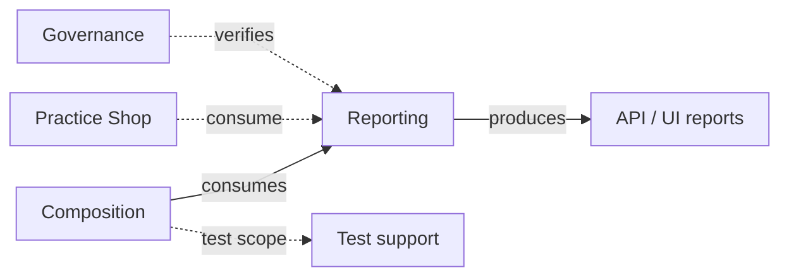
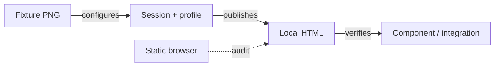

```mermaid
%%{init: {"themeVariables":{"fontSize":"15px"},"themeCSS":".nodeLabel, .nodeLabel p { font-size: 15px !important; line-height: 1.35 !important; } .edgeLabel, .edgeLabel p { font-size: 12px !important; font-weight: 400 !important; line-height: 1.2 !important; } .edgeLabel .labelBkg, .edgeLabel p { background: transparent !important; } .edgeLabel foreignObject { transform: translateY(-18px); overflow: visible; } .node rect { rx: 6px; ry: 6px; }","flowchart":{"curve":"linear","nodeSpacing":24,"rankSpacing":40,"padding":10,"diagramPadding":16}}}%%
flowchart LR
    Incident["Observed defect"] -->|reproduce| Regression["Stable regression"]
    Regression -->|protects| Fix["Reporting correction"]
    Fix -->|validate| Jar["JAR candidate"]
    Jar -->|accept| Consumer["Binary consumer"]
```

<a id="atf-reporting-tests---isolated-composition-for-the-reporting-library"></a>
<a id="atf-reporting-tests--compoziție-izolată-pentru-biblioteca-de-raportare"></a>
# ATF Reporting Tests - isolated composition for the reporting library

<a id="at-a-glance"></a>
<a id="pe-scurt"></a>
## At a glance

**Neutral Diagnosis:** [graph, budget and publication](#diagnosticul-neutru-al-excepțiilor).

**Quick links:** [Choose a probe](#matricea-de-integrare-și-limitele-verificate) · [Tables and responsive layout](#probe-de-lizibilitate-a-panoului) · [Scopes](#refuz-recuperabil-al-scope-urilor) · [Browser verification and limits](#verificare-rapidă)

`atf-reporting-tests` checks `atf-reporting` as a reusable library:

- covers API / mock setup, renderer, publisher, read-only browser and ATF Debug;
- does not have the business tests of an application;
- business tests belong to the consumer module, such as `atf-test-practice-shop`;
- `atf-tests` remains dedicated to the governance of the whole- ATF.

`atf-reporting` is the distributable artifact; this module is internal verification support. Compilation against `target/classes` does not prove independent JAR consumption. The [distribution gate](#gate-ul-bibliotecii-distribuite) uses a consumer classpath without producer sources or ATF modules.

Changes to tests, support or resources require an eligible `testChanges` control; [whole-ATF governance](../atf-tests/README.md#guvernanța-schimbării-testelor) checks the Git delta and negative policy fixtures.

<a id="permanent-regression-of-each-reporting-defect"></a>
<a id="regresia-permanentă-a-fiecărui-defect-reporting"></a>
## Permanent regression of each Reporting defect

Every observable report, public-contract or composition defect first receives a permanent regression here. The probe reproduces the prior behavior with an independent expected result and remains in canonical discovery after the fix.

| Boundary | Sample retained |
|---|---|
| API, query, status, ownership and correlation | configured mock and captured exchange; nominal and rejection paths without a required live endpoint |
| flow and renderer | same typed input through real Extent/fallback publication, with exact population, order and verdict |
| Display and navigation | DOM / real browser: original table, geometry, expansion / collapse, keyboard and reload |
| distribution | candidate binary, its POM and actual transitives; verified CodeSource and hashes |



<details>
<summary><strong>Legend - test kept at manufacturer and binary checked at consumption</strong></summary>

- `atf-reporting-tests` owns mock, contract and browser regressions, maintained
  alongside the producer implementation.
- Native library tests protect standalone boundaries; artifact acceptance
  additionally requires external composition and failure-path probes.
- Binary consumers can remove parallel harness source from their reactors;
  each new version runs the producer probes against that physical JAR in owned TMP.
- Passing `target/classes` tests or retaining a screenshot does not replace
  the binary gate. Logs and artifacts stay in TMP; this README owns the durable contract.

</details>

<a id="choose-level-of-proof"></a>
<a id="alege-nivelul-dovezii"></a>
## Choose level of proof

`UiCrossPhaseCompactFlowComponentTest` also verifies one TEST BODY, using a API 200/500 mock, FAIL/SKIP and multiple separately retained captures. `BodyOnlyUnifiedFlowComponentTest` checks ACTION/OBSERVE/Assertions rows, preview 18/240, the owning disclosure and keyboard navigation in both renderers.

| Returned regression | Independent oracle |
|---|---|
| Core → Kit → Reporting | `CoreRedactionPublicationComponentTest`: `$0` and backslash literal masks, original comparison FAIL with identical previews, 240 limit and absent canary Extent / fallback; renderer does not change the requested comparison verdict |
| UI context per phase | `PhaseUnifiedFlowContextComponentTest`: same Extent / fallback, UI and mock API 200/500; flow metadata do not become HTTP response, and the actual exchange retains its status and expect 200 |
| Expansion of assertions per phase | `PhaseUnifiedFlowComponentTest`: independent disclosure, Enter/Space, reload, ACTION/OBSERVE rows, original screenshot and preview 18/240 |
| long fallback titles | `FallbackLongTitleComponentTest`: text fragments remain in the sidebar and heading at 1280/760/392 px; sibling, anchor, keyboard and reload retain identity and the reintroduction of `nowrap` is denied |

`UnifiedFlowProvenanceFieldsTest` checks field selection independently of HTML, including noncompact typed context, retained HTTP/custom fields and rejection of classification from an isolated field name. Conflicting metadata, including a compact marker, preserves the request, captured mock 500 response and execution; the expected status remains independently 200.

| Question | Gate | What it confirms |
|---|---|---|
| The library compiles itself? | [isolated source](#gate-ul-bibliotecii-distribuite) | POM autonomous and boundary production |
| Does the app use physical JAR? | [binary consumer](#gate-ul-bibliotecii-distribuite) | CodeSource and classpath without library source |
| Semantic contract is kept? | [integration matrix](#matricea-de-integrare-și-limitele-verificate) | independent browser models, causes and projections |
| Can the user audit the artifact? | [tables and responders](#tabele-publicate-și-inventar-independent) | exact comparisons, screenshots, keyboard and backlink |

The inventory below indicates their samples and boundary; the acceptance of a paper requires execution of the affected coats and audit of the new artifact. [Test residues](../docs/feedback/ATF_Reporting_Tests_Feedback.md) separates the obsolete oracle, binary fixture and reproducible rendering defect.

Consumer tests keep independent and negative controls. A HTML containing the text of a rule does not demonstrate that the user can reach its proof in the correct scenario, phase and order.

<a id="the-librarys-gatecraet-distributed"></a>
<a id="gate-ul-bibliotecii-distribuite"></a>
## Distributed-library gate

`ReportingLibraryDistributionIntegrationTest` checks the actual loaded form:

- POM and `src` only copy from the reactor, running `package` with native tests,
  then create an external Maven consumer;
- from a JAR read POM Maven included and check that binary in a consumer
  external, without searching the source in the vicinity.

Both routes check hashes, CodeSource and the same negative controls. JAR consumption also checks the targets of the four Extent tables and the timing of the hash with the selected view; Chromium component checks the real changes.

`ReportingSourceArchitectureTest` audits Java structure in the producer’s native build. Runtime probes here inspect loaded classes/resources from either the reactor or physical JAR, without skipping when producer sources are absent; fixtures locate roots through their own POM and resources.

| Boundary | Oracle and limit |
|---|---|
| reactor-free source | [POM manufacturer](../atf-reporting/pom.xml) is parentless; native guard starts from its own CodeSource and refuses imports / dependencies ATF and parent through negative evidence |
| classpath runtime | Reporting only and Maven transistors; without Core, Kit, UI, JUnit, Playwright or Reporting classes in the reactor |
| Extent and fallback | PASS / FAIL / PASS, difference after 240, budgeted and canary values absent from the artifact |
| preview implicit | [ReportingSettings](../atf-reporting/src/main/java/atf/reporting/configuration/ReportingSettings.java) declares 240; `ReportingPreviewConfigurationComponentTest` checks the default and overrides 18/480 with the ellipse included in the ceiling |
| missing runtime resource | a copy of JAR without `table-viewport.css` is refused separately from both renderers; the previous report remains intact without abandoned workspace |

Copies, Maven / Java processes and lobes remain in TMP. The test proves the consumption of this artifact; the release contracts and the compatibility of the entire API public have [separate criteria](../docs/feedback/ATF_Reporting_Feedback.md).

<a id="portable-receipt-for-evidence-of-publication"></a>
<a id="receipt-portabil-pentru-dovezile-publicării"></a>
### Portable publication evidence receipt

After Maven consumer acceptance, the distribution gate writes a `.receipt` beside each HTML Extent and fallback report. The receipt pins the run's UUID-, the Maven coordinate, the SHA-256 of the JAR and HTML, and the publication verdict.

1. Keep HTML and the Receipt in the same directory when you file or move proof.
2. Take UUID- from `RUN_ID` from the selected running log and identity
   package from the release entry. Use these expectations for verification.
3. Run JDK 21 controller from J0 root. [Source of verifier](src/test/java/atf/reporting/distribution/ReportEvidenceReceipt.java)

```powershell
$verifier = 'atf-reporting-tests/src/test/java/atf/reporting/distribution/ReportEvidenceReceipt.java'
java $verifier $receiptPath $expectedRunId $expectedCoordinate $expectedJarSha256
```

| Result | Interpretation |
|---|---|
| `VERIFIED` | The running, package and octets of HTML correspond to the Receipt. |
| `REPORT_MISSING` / `REPORT_UNREADABLE` | HTML adjacent missing or path is not a legible file. |
| `REPORT_DIGEST_MISMATCH` | HTML adjacent has other bytes, including when replaced by a homonymous ratio. |
| `WRONG_RUN` / `WRONG_PACKAGE` | The Receipt belongs to another rolling or another package input. |

The verifier shall separately display the historical verdict in the Receipt and return the zero code for `VERIFIED`. [Permanent sample](src/test/java/atf/reporting/distribution/ReportEvidenceReceiptTest.java)

<details>
<summary><strong>Reading map</strong></summary>

- [library boundaries](#regula-limitelor-de-responsabilitate) - separation
  the harness of the production code;
- [console](#consola-testelor-de-raportare) - default diagnosis IntelliJ
  and Maven;
- [contract of titles API](#contractul-de-titlu-pentru-request-uri-api) and
  [reconciliation of the evidence](#reconcilierea-dovezilor-api-și-navigarea-fazei);
- [integration matrix](#matricea-de-integrare-și-limitele-verificate) —
  the connection between seam, sample and limit;
- [limits of consumption](#limitele-de-responsabilitate-ale-aplicațiilor-consumatoare)
  which remains specific to applications.

</details>

<details>
<summary><strong>Catalogue of fault samples and adjacent regression</strong></summary>

`UiFailureReportContractTest` is the annotation-driver browser sample for UI failure in Extent:

- SETUP, Playwright timeout, observation and assertion retain the FAIL leaf under its semantic owner; the document starts collapsed, and Fails opens only original-evidence ancestors while sibling scenarios stay closed.
- The Playwright scenario checks `TimeoutError`, locator, duration and redaction; UI failure creates no HTTP disclosure.
- `ExtentReportUiFailureEvidenceTest` and `UiFallbackFailureEvidenceTest`
  check the fallback and isolation of a brother-screenplay;
- The renderer redacts locator targets; without an explicit cause, it derives one from a FAIL action or rejects input lacking a diagnostic.
- browser contract keeps timeout in current scenario and excludes it from
  Sibling scenarios; stable rule is in [reporting contract](../docs/ATF_Reporting_Contract.md#fails-și-legături).

The backlinks' oracles shall retain the identity:

- `FailureLinkIdentity` compares the decoded scenario and parameters, including the ordinal;
- Negative evidence refuses foreign scenarios and duplicate parameters; parameters
  additional and reload encoding shall retain the same destination.
- `PublishedFailureNavigationEdgeComponentTest` checks two identically named UI groups with one FAIL each, triggering derived summaries; its oracle selects the original validation comparison using literal causes, reload, reverse order and preview 18/240 rather than copying the production selector.

The stable contract for the visible hierarchy, layout, responsive view, disclosures and browser evidence is [ATF Reporting - Display contract and layout](../docs/ATF_Reporting_Display_Contract.md). This README holds the matrix of evidence and the responsibilities of the suite; does not redefine visual rules in feedback or fixtures.

`ReportUiEnvironmentTest` protects the common UI vocabulary, resolved policies and uncredited origins. `ReportGherkinSequenceTest` protects the anchors, sequels and isolations of scenarios; AutoEx / Shop wirings remain proven in the consumption modules.

Helpers reused by HTML UI probes belong in `atf.reporting.ui.support`, outside renderer test packages. For example, `ExtentReportUiEvidenceTestSupport` centralizes fixtures and shared checks without becoming a test or moving ownership out of `atf-reporting-tests`. `AtfPackageCohesionGovernanceTest` still checks package cohesion; its threshold is not raised to accommodate a hotspot.

The projection of the context UI is checked by the component:

| Test | Protected contract |
|---|---|
| `UiCheckpointEvidenceProjectionTest` | the identity of the checkpoint and `evidence.type` / `evidence.policy` remain in the model; the projections typed / legacy and fallback do not publish and move them to replies |
| `UiApiValidationContractComponentTest` | rejects raw-exchange inputs in API, lifecycle, publisher and buffer; checks independent UI/API verdicts and sibling exchanges in checkpoint/setup/final/unified publication, plus real request/response/execution markup |
| `ReportRequestHeadersTest` | observed/configured sources, case-insensitive override, existing-client compatibility and immutable copying |
| `ObservedRequestEvidenceComponentTest` | Extent/fallback/UI_API × six inputs: absent, uncaptured, literal JSON null, explicit redacted headers, declared defaults and body-free responses; Request details/replay invent no headers or payload |
| `ObservedBodyAuditComponentTest` | 22 cases: real browser audit across three publishers, absent/uncaptured/literal-null bodies, collapsed fallback JSON and catalog comparison without invented payload |
| `LiveClientHeaderProbe` | HTTP loopback real through ATF client; headers received on the wire are compared to Reporting projection and sanitized replica |
| `UiApiVerdictProjectionComponentTest` | UI PASS/API FAIL, UI FAIL/API PASS, both FAIL and API FAIL correlation with PASS exchanges; typed owner, exact request/checkpoint/cause, final PASS sibling exchange and exact Open in Tests index; separate audit with steps, assertions and captures for all five Fails entries |
| `ApiWhitespaceBodyComponentTest` + `UiNetworkBodyFidelityComponentTest` of UI | body present only from whitespace remains distinct from absent, unclaimed and JSON literal null; capture / sanitization to the UI host, then formatting / publishing / replicating to Reporting |
| `ExtentReportUiEvidencePublishingTest` | the UI publisher adds no synthetic HTTP request; nested exchanges retain request/response/JSON/execution |
| `ExtentReportDisclosureBrowserComponentTest` | controlled PASS/WARNING/FAIL artifact; empty phases offer no expansion, while mock API evidence remains mouse/keyboard expandable; no introductory checkpoint table, retained validations/screenshots, hidden subtree on close and semantically identified custom titles; deduplicated captures open by click/Enter while the source stays collapsed, without an anchor jump |
| `NavigationSelectionBrowserComponentTest` | real Extent, sequential clicks across four tabs; accessible icon names, one `active`/`aria-current="page"` link synchronized with the visible view |
| `ComponentAssertionStepReportTest` | the same typed node and 42 rows in Extent/fallback; initially collapsed, last-row access and mouse/Enter/Space in Chromium; Extent FAIL retains `component` ownership, exact numeric values and a deep link opening the table without fabricated HTTP request/duration |
| `PublishedEvidenceTableComponentTest` | UI / API / UI + API × Extent / fallback; literal values in 12/40 rows, exact inventory per owner, real geometry, expansion, resize and tables; negative controls detect missing evidence, clipping, removed ceiling and FAIL changed to PASS |
| `TerminalExecutionProjectionTest` + `TerminalApiExecutionReportTest` | strict partial snapshot, 503 followed by unavailable status, typed termination in Execution evidence without fabricated Response details; Extent/fallback retain preview 240, configured budgets, redaction, last-row access and Enter/Space; zero dispatches claim no network execution |
| `UiTerminalExchangeReportComponentTest` | checkpoint/setup/final/trace and unified flow within/across phases retain a response-free exchange between two PASS neighbors; diagnostics, attempts, totals and keyboard in Extent/fallback with default/custom budgets; verdict-free probes belong to standalone-library `ReportingStandaloneVerdictComponentTest` |
| `ReportPhaseTimingComponentTest` | Timing typed identical in Extent / fallback snapshots; browser keeps 12/345/0 ms per phase, scenario / class / Overview totals without duplication and the source of execution after expansion; publication remains separate |
| `BodyOnlyUnifiedFlowComponentTest` | one eligible TEST BODY UI-only body: one flow with retained actions/observations/assertions, preview 18/240 and mouse/Space/reload in Extent/fallback; typed contracts include API mock PASS/FAIL and multiple captures |
| `ComponentExecutionDiagnosticReportTest` | exception after PASS comparisons or before the first comparison; Fails invents neither HTTP request/duration nor a failed PASS comparison; empty measured phases and 42 rows in Extent/fallback, preview 240 and keyboard access |
| Relays | `ExtentReportRuntimeScriptTest` maintains the sources of duration; `ExtentReportSessionContractTest` separates fields API / UI in Fails; `AtfReportEvidenceCssTest` protects the common container and font, supplemented by actual measurements from `NarrowEvidenceReadabilityComponentTest` |
| `AssertionAuditPublicationComponentTest` | redaction before the limit in Extent/fallback; retains FAIL without synthetic-secret fragments and SKIP with `Abort reason`, without fabricated assertions |
| `ReportingPreviewBudgetTest` | the full value displayed includes the ellipse in limit; null, exact limit and budget of JSON independent |
| `LegacyPreviewBudgetComponentTest` | direct UI ports in Extent / fallback; 240/18 limits, full wording, verdict from full values and same limit in Fails after backlink |
| `ReportingPreviewConfigurationComponentTest` | default YAML 240 and configured 18/480; effective value in Extent/fallback System, contradictory metadata rejected and nonpositive budgets refused |
| `UiFailureContextTest` + `UiFailureContextReportTest` | FAIL action before long technical text, missing exception/action, PASS actions followed by error, first FAIL sequence and cause/suppressed graphs with references/cycles; verdict and original evidence stay intact |
| `UiFailureContextComponentTest` | Tests / Fails and backlinks in Extent / fallback, preview 240/18, 392 panel, context of action and time measured, inspectable relationships in diagnostics INFO and disclosure Enter / Space without JavaScript errors |
| `UiTimeoutReportComponentTest` | native separate from the time captured and the compact context Fails; Extent / fallback at 240/18, primary / cause / suppressed redacted, HTML without credential, owner and backlink, Enter / Space, last row and negative oracle for diagnosis missing or visible secret |
| `ReportScopeAtomicityComponentTest` | repeated completions, late writing, closed idempotent / FAIL, open children and closed session; refusal without mutation and publicity in Extent / fallback |
| `UiSetupFallbackParityComponentTest` | setup keeps comparisons, actions and capture in Extent / fallback; 240/18, redaction, Enter / Space and FAIL evaluated beyond forecast, including with PASS caller |
| `UiPhaseExecutionTest` + `UiPhaseTimingLifecycleComponentTest` | separate execution/capture/publication, controlled clock, primary cause, zero/unknown, success/FAIL/SKIP, incomplete setup, failed teardown and cross-phase unified flow |
| `ReportPhaseDiagnosticTest` | explicit conversion, source phase status, delimited legacy keys, unaltered context and immutable result; the diagnostic port does not create HTTP |
| `ReportPhaseAuditBrowserComponentTest` | Extent / fallback with zero / one / more exchanges and with / without metadata; JUnit failure, missing association, editorial and closure of diagnosis; Fails excludes PASS phase notes; negative samples for hidden tape, renamed or empty |

The browser fixture is local and deterministic; does not require a new purchase in Practice Shop. The timed ratio is evidence of component, and the FAIL / WARNING states are deliberate fixture data.

The inventory calls the contracts pursued; it does not automatically certify all the evidence. The reliability of the evidence of each scenario has a [independent audit criterion](../docs/feedback/ATF_Reporting_Tests_Feedback.md#report-test-audit-60--o-dovadă-identificabilă-pentru-fiecare-scenariu). A focus gate past does not replace the result of the canon suite.

Maven `reporting-release` profile maintains the complete unit suite as a precondition for delivery, along with the browser samples for the tables / hash / keyboard, idempotent initialization, the required-phase-duration association, the original viewports and captures. With the reactor dependencies installed in the private cachet of the staging-:

```text
mvn -pl atf-reporting-tests -Preporting-release test
```

`UnitBaselineBehaviorComponentTest` rejects an unbound tab, duplicate initialization and a neighboring PASS request or duration. Direct entry to Fails and reload preserve the index after the native Tests handler; restoring the native host class must fail the same oracle. `ScreenshotLinkContract` checks the published DOM link, PNG bytes and caption, with duplicate links, altered images and foreign captions as negative controls. A script selector is not a published link. Run the same selection against the physical JAR without parallel Reporting classes; retain CodeSource and results beside the TMP candidate. For a JAR installed in a private cache, set `atf.reporting.test.version` to its published version and run the profile without `-am`; the default `${project.version}` keeps reactor-source execution.

<a id="browser-setup-and-terminal-verdict"></a>
<a id="setup-browser-și-verdict-terminal"></a>
### Browser setup and terminal verdict

Phase markers retain the worker’s monotonic timestamps. If a watchdog check races marker publication, only a transition completed within its phase budget can advance observation; a worker-measured overrun remains a failure. Startup and total process deadlines remain active independently.

`ReportArtifactProfileComponentTest` separates static inspection from interactive verification. `BrowserProbeProcess` runs each probe in its own JVM; a factory blocked before navigation fails even when the input HTML satisfies static checks.

| Boundary | Contract |
|---|---|
| Setup | 30 s for JVM/SDK startup, browser launch and `newPage`; no retry or relaxed threshold |
| Driver CLI | prepared once per host JVM, or reused from `playwright.cli.dir`; `driver-runtime.log` records its source and preparation time separately |
| Verification | `BrowserProbeBudget.DEFAULT`: 60 s; `BrowserClassRun`: 120 s per verification scope with a 10 min class lifetime; 5 s action and 30 s navigation timeouts remain independent |
| Cleanup | 5 s for normal cleanup; forced termination after failure has its own 5 s budget and targets only descendants with a verified parent chain and matching start identity |
| Diagnostic | phase, PIDs, logs and timeout thread dumps; failed matrix/lifecycle probes retain their directories, and the original cause precedes cleanup failures |
| Native TMP | short, unique, owner-marked directory shared by JVM and SDK; browser profiles do not leak into shared TMP |
| Acceptance | terminal DONE, exit code 0 and closed resources; a missing verdict is not PASS |

`BrowserProbeProcessComponentTest` covers noncooperative factories, blocked cleanup, suppressed causes and parent interruption while preserving an unrelated process. `BrowserProcessInventoryContractTest` rejects processes predating the worker and reused PIDs. The same SDK and probes run against reactor source and the physical JAR through `reporting-release`; the harness stays in J0 without adding Playwright to the standalone library or browser-free consumers.

<a id="published-tables-and-independent-inventory"></a>
<a id="tabele-publicate-și-inventar-independent"></a>
### Published tables and independent inventory

`PublishedEvidenceTableComponentTest` publishes UI, API and UI+API through real ports in Extent and fallback. Its 12-row case retains short comparisons; two 40-row cases place long text in EXPECTED and ACTUAL respectively.

| Test | Observed criterion |
|---|---|
| Inventory | exact population per shape and owner: setup, ACTION/OBSERVE, request/response, execution/retry and three distinct trace roles |
| Geometry | viewports 1803/1280/991/719/720/721/591/392 px and panels 591/392 px; full width, readable font, aligned columns, bounded height and accessible last row/column; secondary tabs also check the 760/761 px threshold |
| Evidence | independent literal values, Unicode/escaping and retained PASS/FAIL; identical content after resize, Enter/Space and return to Tests |
| Tabs | Overview/System/Tags and the Categories table; Fails uses native fields/index, while secondary fallback tabs use cards/links; intentionally absent tables are explicit |
| Negative control | artificially reduced width, missing header/column/table, vertical cells, direct/inner clipping, hidden rows, empty gutter, removed height limit, altered values or FAIL changed to PASS; Fails hidden behind navigation and technical headers broken into letters |

`PublishedEvidenceTableMeasurements` collects browser observations; `PublishedEvidenceTableOracle` applies independent rules. Negative controls restore the exact published table, then recheck inventory and content after finite transitions finish. This browser campaign remains separate from public purchase E2E, preserving interaction budgets and business timeouts.

Compare canonical content in the same order after navigation. Check derived `atf-ui-failure-evidence` projections separately: one per failed request/validation owner, retaining its first original comparison without duplicates on repeated navigation; the `assertion-step` component node does not participate in this hook.

The percentage width of the first column is not an aesthetic oracle. The allocation of content remains protected by `EvidenceColumnSizingComponentTest`. The configurable budget and redaction have existing dedicated evidence.

`ReportingCoverageMatrixTest` requires the presence of the sample for configuration / System and its component category; the behavior check remains in that sample.

For `ExtentReportDisclosureBrowserComponentTest`, `support/inspection/disclosure` holds the fixture and browser sample. The reusable audit uses the `support/locators` facade: identifies the UI validation by role and actions included, not by title, and opens the script ancestors → phase → checkpoint → validation before inspection.

</details>



<details>
<summary><strong>Legend - composition root for reporting</strong></summary>

- atf-reporting is the verified library, not a fixture test;
- the chart-grouped support represents the scope test dependencies;
- API / UI artifacts are composition results, not normative files;
- atf-test-practice-shop and atf-tests are consumers with separate responsibilities, not hidden extensions of the library.
</details>

| Surface | Owner | Dependencies |
|---|---|---|
| renderer, model, CSS/JS, publication | `atf-reporting` | no dependencies on ATF modules |
| API/mock contracts that produce reporting evidence | `atf-reporting-tests` | core/mock/validation/console |
| report E2E browser and ATF Debug | `atf-reporting-tests` | ui/debug-ui/Playwright |
| Practice Shop tests | `atf-test-practice-shop` | reporting jar, UI and application setup |
| whole-ATF governance | `atf-tests` | does not own application tests |

<a id="rule-of-liability-limits"></a>
<a id="regula-limitelor-de-responsabilitate"></a>
## Responsibility boundaries

`atf-reporting` must pass by itself:

```text
mvn -f atf-reporting/pom.xml test
```

No reactor, no local ATF modules and no business fixtures. The tests in this module check only the reporting public contracts. API / UI / E2E tests here are deterministic vehicles to demonstrate that reporting can be consumed; they are not the suite of a real application.

Replacement of the modules with a fire does not change consumption: they depend on public interactions and contracts `atf-reporting`, not on test classes or local reviews of directories.

UI locators are centralized in `src/test/.../support/locators`:

- prefer a semantic selector with a stable attribute, for example
  `button[data-atf-action='expand']`;
- structural selector or `nth(...)` remains in the locator's owner when
  the marker does not provide a better identity;
- tests, flows and auditors do not directly compose `page.locator(...)`.

<a id="reporting-test-console"></a>
<a id="consola-testelor-de-raportare"></a>
## Reporting test console

UI and API display the details of the console both from IntelliJ and Maven.

- UI audit uses `ReportingTestConsole` for browser and report.
- API tests direct- runnable declares `@AtfConsoleMessages(DETAILS)`; fixture
  API reuses the lifecycle synchronization, so that demand / validation appears by the same `[ATF]` projection without duplicate reporter.
- API uses the consonant configured without current lifecycle JUnit.
- `reporting.console.detailsEnabled: false` narrows down details;
  `enabled: false` stops the projection. [ATF Console](../atf-console/README.md) holds the politics and output.

<a id="api-title-contract"></a>
<a id="contractul-de-titlu-pentru-request-uri-api"></a>
## API Title Contract

Any demand published by a consumer shall be recognizable without the immediate opening of the dislocation:

```text
HTTP_METHOD relativePath — very-short business intent
```

`relativePath` is the observed route; dynamic values remain in the runtime paths, not in lists. If business intent is required, the consumer may use a typed descriptor (`ApiOperationDescriptor`) with method and piled routs.

Boundary remains independent:

- `atf-reporting` publishes the title received and does not leave the semantics in it;
- the consumer holds the application vocabulary and correlation with the dynamic route;
- exemplu Practice Shop: `SEARCH` → wire `GET` →
  `GET /products/search — find configured product`;
- `QUERY` browser alias, if present, remains method observed in capture
  boundary and does not replace the method / title of the request;
- `OPERATION KIND` and `ROUTE TEMPLATE` provide the auditor with a stable context
  of the Shop Practice Execution.

The contract is checked on two seams:

| Seam | Verification |
|---|---|
| core vocabulary | `ApiOperationDescriptorContractTest` validates invalid format and input |
| reporting fallback/Extent | `HtmlReportComponentContractTest` and `ExtentReportSessionContractTest` validate the title published in the artifact |
| consumer Practice Shop | `ShopApiOperationTest`, `ShopStandaloneApiReportTest` and `ShopApiMethodFidelityTest` validate the method / path / intent, absence of `QUERY`, operation kind and route template |

<a id="correlation-of-ui-cases"></a>
<a id="corelarea-cauzelor-ui"></a>
### UI failure-cause correlation

`UiFailureCorrelationComponentTest` checks that the same published assertion instance and its propagated exception produce one Fails entry. Its neutral fixture covers nine scenarios in both flow modes and preserves 16 intentional causes, including equal UI/API text and independent exceptions; browser audit checks every Open in Tests link, original assertion, terminal diagnostic and retained screenshot, while unit tests check identity, wrapped propagation, cleanup and cause cycles.

<a id="fitness-of-method-and-times-api"></a>
<a id="fidelitatea-metodei-și-a-timpilor-api"></a>
### API method and timing fidelity

- The observed method stays intact in snapshot, title, signature and replay; the business-operation alias remains separate.
- Uncaptured duration differs from `0 ms`; response time, retry-inclusive total and publication duration are not interchangeable.
- Absent body, literal JSON `null` and uncaptured body remain distinct states.
- Replay retains separately quoted shell arguments; parity tests assume no header order and do not turn absence into a JSON pane.
- `ReportTransportTimingTest` and `ApiExchangeParityComponentTest` check
  Reporting projection and `ShopApiMethodFidelityTest` protects the consumer adapter;
- semantics is in [`ATF_Reporting_Contract.md`](../docs/ATF_Reporting_Contract.md),
  and the visible shape is in [`ATF_Reporting_Display_Contract.md`](../docs/ATF_Reporting_Display_Contract.md).

<a id="common-duration-in-tests-and-overview"></a>
<a id="durata-comună-în-tests-și-overview"></a>
### Common duration in Tests and Overview

| Boundary | Contract and evidence |
|---|---|
| Timeline projection | `OverviewDurationProjectionComponentTest` checks the actual asset: total, model, bars, zero, fallback, duplicate names and refresh |
| Re-usable inspection | `ApiReportDurationProjectionAuditor.inspectCurrentDom` and DOM Reader use the same native resource `inspection/duration-projections.js` |
| Semantic oracle | total, model and chart values shall correspond to the canonical classes; the single numeric marker shall not be sufficient |
| Probe negative | component corrupts the marker, model and chart separately; each inconsistency produces an explicit breach |

<a id="reconciliation-of-api-evidence-and-phase-navigation"></a>
<a id="reconcilierea-dovezilor-api-și-navigarea-fazei"></a>
## Reconciliation of API evidence and phase navigation

| Boundary | Contract | Test |
|---|---|---|
| Rated fields | `ApiReportEvidenceField` holds the canonical label and explicit legacy aliases; contradictory aliases do not hide a wrong value | `ApiReportContractAuditorTest` |
| Query | extracted from the request `URL`, not its path or the response URL; a correct response cannot repair an incomplete request | `ApiReportRenderedEvidenceComponentTest` - nominal and query missing |
| Ownership table | responding fields come only from `Response details` disclosure, not from the technical trackside of execution | Same component requires exactly one table for each evidence channel |
| Phase | check binding on the header, then await the card’s open state; do not increase timeouts or toggle repeatedly without reading state | Same component: re-selection, round-trip tab, reloading and TEST BODY absent |
| audit capture | the publisher reuses the inspected tab without reload or action reset; switching to the evidence tab retains history | the same component checks page identity, trace and open disclosure |
| Composition | exact setup → mock → API artifact → all sections rendered and reconciling | `SelectedApiTestsReportUiTest` |

Component probes use controlled Extent publication and the same locators/extractors as E2E, without external endpoints; negative scenarios are fixture data, never reasons to disable checks or invent PASS. `ExtentReportDisclosureBrowserComponentTest` also uses mock API evidence: nodes with request/response/validation expand, while an empty phase does not simulate an interactive control.

<a id="simultaneous-errors-in-publication-and-close"></a>
<a id="erori-simultane-la-publicare-și-close"></a>
### Simultaneous errors in publication and close

`UiPublicationFailureComponentTest` injects errors into controlled ports through the public UI facade; it does not imply a real-renderer incident.

| Independent oracle | Proven contract |
|---|---|
| original exception instance | acquisition/body/complete remains primary; a distinct close failure is suppressed |
| Port events | one close per acquired scope, without replay |
| Same exception to body and close | no self-suppression or cause replacement |
| RuntimeException and Error | same identity and order across all probed entry points |
| Outcome, setup, checkpoint / media, API, unified, delegated failure | Require, validation and API assertions close to owner |
| Partial acquisition | close the owned parent, never the unacquired child |
| Multiple errors of cleanup | child precedes parent in suppressed failures, with original identities |

Semantic snapshots and Extent/fallback probes verify rendering separately; fault injection does not replace HTML audit.

`UiFailurePublicationComponentTest` complements the public matrix with direct/facade checks of `UiFailureEvidencePublisher`. Ports do not cascade child closure, so missing validation close is independently detectable; partial acquisition, body/complete/close failures, `Error` and self-suppression retain the original cause.

`PublishedFailureNavigationComponentTest` publishes Extent UI/API and component assertion-step fixtures in every phase. The backlink must open the exact comparison without expansion helpers; keyboard, reload and the PASS neighbor are checked separately from general Extent/fallback geometry.

`PublishedFailureNavigationEdgeComponentTest` completes the navigation sample:

- Extent indexes one diagnostic chain in Fails while Tests retains each phase source row as an independent disclosure; fallback retains one navigable row per phase.
- Diagnostics without comparisons across all phases, with fallback UI/API/component coverage.
- Original evidence, configured budget, reloaded route and interleaved diagnostics.
- A hidden ancestor invalidates the oracle without assisted expansion.

<a id="order-of-tests-and-responsibility-of-protection"></a>
<a id="ordinea-testelor-și-responsabilitatea-protecțiilor"></a>
## Order of tests and responsibility of protection

1. `atf-reporting` - unit / component for model, renderer, artifact and CSS / JS;
2. `atf-reporting-tests` - component for the controlled mock composition →
   reporting, integration for the Boundary Boundary between modules and E2E only for the browser / contract renderings of `atf-reporting` library;
3. `atf-test-practice-shop` - consumer tests for the Shop practice tour.
4. `atf-tests` - Boundary and Whole-Reactor Governance, including Checks
   Global documentation, ownership, cohesion and vocabulary.

`src/test/java/atf/reporting/api` remains limited to checks that have as their subject the reforming composition. Do not duplicate reactor guards and do not validate README to the entire project; they are centrally executed by [`WholeAtfGovernanceSuiteTest`](../atf-tests/README.md#suita-whole-atf-și-reziduul-de-compatibilitate).

<a id="selecting-scenarios-for-api-ratio"></a>
<a id="selecția-scenariilor-pentru-un-raport-api"></a>
### Scenario selection for an API report

`@ApiScenarioSetup(tests = ...)` declares exact methods, resolved after explicit JVM family/suite overrides and before annotation families or YAML. Selection is validated before publication.

When no exact methods are declared, family precedence is:

1. JVM property with API families;
2. property of the suite;
3. families in annotation;
4. YAML configuration.

The expected Owners and scenarios are not deducted from the resulting DOM.

| Contract | Proof component | Boundary |
|---|---|---|
| exact selection and semantic projection | `ApiScenarioManifestTest` | checks owners, titles, statuses and order; rejects unselected scenarios against the YAML fallback |
| precedent of the setting and fallbacks | `ApiReportAuditSetupTest` | directly checks JVM family overrides before `tests = ...`, then suite, annotation and YAML fallbacks |
| exact selection → mock / lifecycle → publisher | `ApiSelectionMockPublisherComponentTest` | checks the mock's JSON response, request/response/execution evidence in the artifact and exclusion of unselected scenarios; invalid selection is rejected before publication |

These probes complement each other: the manifest checks projection, the resolver checks precedence, and the composed test reaches the artifact. `SelectedApiTestsReportUiTest` separately checks browser interaction rather than replacing lower-level contracts.

<details>
<summary><strong>Test levels and independence</strong></summary>

- **`atf-reporting/src/test`** - boundary standalone of the library; check
  independent compilation and local contracts without ATF, mock or browser, including the `ReportingStandaloneVerdictComponentTest` component; `ReportingVerdictProjectionComponentTest` verifies here only the browser projection, totals, disclosures, 240 limit and navigation in both renderings;
- **`atf-reporting-tests`** - composition root for component, integration / API
  E2E; links the reporting to mock, execution, validation, Playwright and ATF Debug;
- **`atf-test-practice-shop`** - application consumer; not part of
  checking the reporting library;
- **`atf-tests`** - Government for reactor; does not have fixtures or flows;
- **Rule of independence** - E2E test only checks behaviour
  depends on the browser; static contracts, model and assets are checked at lower levels;
- **Boundary rule** - mock and browser do not enter JAR production
  `atf-reporting`.

</details>

<a id="generic-capture---support-checked-prior-to-the-consumer-module"></a>
<a id="capturare-generică--suport-verificat-înaintea-modulului-consumator"></a>
## Generic capture — verified before consumer integration

<details>
<summary><strong>Detailed contracts and evidence of the owners - Generic capture - support checked before the consumer module</strong></summary>

The cross-cutting contract for flow mode, screening policy and capture source is in [`docs/ATF_Evidence_Capture_Contract.md`](../docs/ATF_Evidence_Capture_Contract.md). This module probes it through deterministic fixtures; does not move policy into a consumer and does not require Shop Practice for testing the support.



<details>
<summary><strong>Legend - testing on levels</strong></summary>

- The fixture combines mock PNG, typed input and a capture provider.
- The session applies profile/policy before invoking the provider.
- Unit: policy before provider, target, provenance, PNG and cardinality `0/1/N`.
- Component: markup, status, disclosure, media reference and retained actions.
- Integration: session → semantic model → HTML, without external endpoint/browser.
- Optional browser probe: real capture of a static HTML artifact.
- Consumer E2E: integration proof, without reimplementing generic support.
- The fixture may represent `PASS`, `FAIL`, `WARNING` or `SKIP`.

</details>

- `ReportEvidenceProfileTest` checks filtering before capture, source matching, PNG payload and typed action-detail selection.
- `ReportScreenshotTest` checks Base64 encoding and PNG signature; the contract does not assume full image decoding.
- `ExtentReportUiEvidenceRenderingTest` checks the default table and that `SUMMARY_ONLY` retains a collapsed disclosure without its detailed table or screenshot changes; the renderer performs no UI actions.
- `ReportEvidenceProfileIntegrationTest` proves the mock provider → session → HTML local for both flow models.
- The same class checks different profiles for sibling scenarios in one shared session, then reverses order; profiles do not leak between scenarios.
- `UNIFIED_FLOW` retains one request with the final Gherkin sentence, without numbered checkpoints or duplicated Gherkin. Per-phase projection aggregates UI actions/assertions, with `API validation` owning its exchanges beside sibling `UI validation`; `FINAL_ONLY` publishes only the `FINAL` screenshot.
- `SCREEN_CHECKPOINTS` keeps the Gherkin quests independent.
- Typed profile combines flow mode, screening policy, capture source and actions-details mode.
  The Grouping belongs to the lifecycle / publishing house in `atf-reporting`; choosing the mode for a consumer annotation remains the responsibility of that consumer.

Per-scenario profile isolation is implemented and tested as a generic contract. The consumer passes the resolved profile when creating each scenario; a report-opening profile remains only the session default, while Practice Shop’s shared-report wiring and `SETUP` + `TEST BODY` aggregation are implemented at the consumer and described in the [report contract](../atf-reporting/README.md#contractul-raportului).

`ExtentUnifiedFlowMultipleScreenshotTest` checks the generic regression of publication; local mappings remain in Shop samples without copying the renderer.

- `UiCrossPhaseCompactFlowComponentTest` publishes a UI-only Extent lifecycle scenario and checks the equivalent typed fallback projection across `SETUP`, two `TEST BODY` checkpoints and `CLEANUP`: one table per family, action order, terminal screenshot below the table, `NONE` policy, UI provenance separate from `Response details` and no invented body after failed setup. Existing UI+API and multiple-screenshot regressions remain intact.
- The same test checks preparation declared directly in `TEST BODY`, without fabricated `SETUP` or `Setup validation`, retaining assertions/FAIL in both renderers; guest/authenticated phase choices stay with the consumer, whose Shop probe exercises the real harness separately.

| Component | Verified contract | Invariant |
|---|---|---|
| `UiAuditLifecycleTest` of `AtfReportingComponentSuite` | Extent/fallback: valid or absent screenshot, invalid payload or policy-excluded capture | action, cause and FAIL stay visible; the `Screenshot` observation explains state without an artificial business assertion or fabricated Base64 link |
| `ExtentReportSessionContractTest` | artifact/shared style; exact default Client `Configured per execution`, or explicit Client retained and redacted in System | A consumer without declared transport does not by default receive the identity of a API customer. |

- The additional matrix compares semantic snapshots and public HTML across all policies, including empty payload, invalid Base64, non-PNG and failure without executed actions.
- The Client Oracle also checks the uniqueness of the row in the System.
- The inspectable screenshot fixture contains intentional synthetic failures and a PASS sibling; it is not a Shop/AutoEx business run.
- The component checks model/markup; rendering, screenshot interaction and Fails → Open in Tests belong to the [failure browser probe](src/test/java/atf/ui/tests/extent/e2e/failure/UiFailureReportContractTest.java).

</details>

<a id="integration-matrix-and-verified-limits"></a>
<a id="matricea-de-integrare-și-limitele-verificate"></a>
## Integration matrix and verified limits

<details>
<summary><strong>Details - integration matrix and verified limits</strong></summary>

`NetworkCaptureEvidenceTest` belongs to the `atf.ui.tests.extent.component.inspection.network` package; the five cases remain selected by the component suite. The selectors are held by `ReportNetworkCaptureLocators`, without new exceptions for browser imports or selectors in the intent class.

Integration tests remain grouped after observed boundary, not by the name of the module consumed:

| Familie | Representative classes | Boundary verificat |
|---|---|---|
| API scenarios | `UsersApiTests`, `PostsApiTests`, `RequestVariantsApiTests`, `ApiHeadersAndEdgeCasesTests`, `ApiNegativeMatrixTests`, `ApiRequestFlowsTests` | mock → core → validation → reporting evidence |
| reporting API | `MockApiReportIntegrationTest`, `ApiReportArtifactAuditTest`, `ApiManualReplayTest` | API → renderer / publisher → artifact and rephrase |
| UI composition | `SelectedApiTestsReportUiTest`, `StaticUiExtentReportContractTest` | artifact → ATF Debug/Playwright → DOM/CSS/disclosure |

`StaticUiExtentReportContractTest` includes the `UI_VALIDATION` and `INLINE_SCREENSHOT` checks; the input must have screen-shot records according to the stated policy. A ratio to `Screenshot policy = Disabled` is not input for this screen shot gate and is not interpreted as a defect of the renderer.

Each class declares the layer by annotation; the packager expresses the domain and the boundary, not the test level. The set, the mock and the common validators remain in `support`, so that a new class can write the script without copying.

Boundary Boundary Boundarys remain small and verifiable:

- `support.api` shall keep the selection and publication of the precondition API;
- `support.config` holds the loaders, resources and configuration UI;
- `support.config.environment` holds Snapshot factories typed for Overview / System;
- `UiReportEnvironmentSnapshotFactoryTest` states the configured values and
  Solved by override among the System; does not open the browser or measure the CSS or DPR viewport;
- native geometry is tested at [UI](../atf-ui/README.md#geometria-nativă-a-contextului),
  separate from the snapshot metadata and the pixels of the screenshots;
- Network Inspector belongs to `atf.reporting.ui.network`; no cohesion exceptions are added for unrelated classes;
- The whole-ATF guard limits each package to a maximum of eight classes.

`ReportingCoverageMatrixTest` is the executable map of public seams:

| Verification | Mandatory proof | Intent limit |
|---|---|---|
| coverage | Each seam has `unit`, `component`, `integration` or `e2e` test | a new seam without lower- level proof e regression of governance |
| Network Inspector | `ReportNetworkInspectorTest` (`unit`) for projection / markup; `NetworkInspectorSummaryRoleTest` (`component`) for the role and order of the summary; `ExtentReportUiEvidencePublishingTest` (`unit`) for the publication of the aggregates | The matrix requires classes, executable methods and annotations of ATF; publication remains pro separately |
| audit semantic | `Overview`, `Categories`, `Fails`, `UI validation` and `ReportExecutionProjections` | `ReportAuditSnapshot` remains renderer-neutral; same typed projections can be checked without browser |
| Convergence | JSON and visual are checked together | browser notes; rules are checked without Playwright |
| browser proof | `E2eSuiteBudgetArchitectureTest` cap 8 `@AtfE2eTest` classes | any new class requires justification in feedback and change of budget |

<a id="publication-of-a-bulky-report---component-sample"></a>
<a id="publicarea-unui-raport-voluminos--probă-de-componentă"></a>
### Large-report publication — component probe

`LargeReportPublicationComponentTest` runs in a child JVM with bounded heap, without external application journeys or reduced captures. Two profiles isolate HTML volume from media volume.

| Parameter / proof | The fixture contract |
|---|---|
| Heap | `-Xms64m -Xmx384m`, separate from the Surefire fork |
| Output | the configurable directory is created before the child JVM log; the probe can start in a new directory |
| Text profile / HTML | Unicode, 1,500 inline PNG references and two distinct repeated images; artifact >9 MB |
| Media profile | four distinct generated 256×256 PNGs, each referenced twice; deduplication retains four inline payloads totaling over 900,000 characters |
| Integrity | exit code 0, total heap sampled every 2 ms, publication duration, final marker, theme/runtime and actionable screenshot references |
| Faillure-path and publication | `ExtentReportSessionLifecycleTest` checks blocked destination, cleanup failure after atomic promotion, leak-free private staging and `REPORT_PUBLISHED` only after the final file exists; repeated close notifies once, while failed publication announces no success. `ExtentReportAssetCleanupTest` deterministically probes `AccessDeniedException`/`FileSystemException`: transient/persistent locks, bounded retries, nonretryable I/O and preserved interruption |
| Time | child timeout `atf.test.publication.timeout.seconds` is configurable (default 60 s); expiry forcibly stops only the probe JVM |
| Boundary | does not prove arbitrary volume or very high-resolution photos; time is measured and bounded by the probe timeout, not an SLA |

The test is contractual by repeatable limits, not by the results of a run:

- JVM child: `-Xms64m -Xmx384m`; sampled head should remain below
  `345 MiB`;
- timeout: `atf.test.publication.timeout.seconds`, implicit `60 s`;
- The `repeated-pixels` profile retains an artifact above `9 MB` with references to distinct screenshots.
- `distinct-pngs` profile keeps the ratio above `2 MB`, four payloads
  PNG distinct inline and above `900.000` media characters;
- duration and head are observed for diagnosis, but do not copy as
  permanent results in README.

Vendor `spark` directory cleanup handles `FileSystemException`, including `AccessDeniedException`, with at most four attempts 50 ms apart. Persistent locks propagate diagnostics; interruption stops cleanup and preserves the thread flag without deleting the already published report.

<a id="budget-of-published-assets"></a>
<a id="bugetul-asset-urilor-publicate"></a>
### Published asset budgets

`ReportAssetSizeInventoryTest` measures native sources and compacted/published copies separately against explicit consumer budgets. Thresholds are regression contracts, not run measurements; changing them requires a reason and artifact-impact verification.

Regression budgets are explicit in `ReportAssetSizeInventoryTest`; the inventory is measured from native assets and published at each execution. These are ceilings, not targets for delivered size:

| Asset budget | Native | Published |
|---|---:|---:|
| JavaScript | `130.000 B` | `107.000 B` |
| CSS | `140.000 B` | `120.000 B` |
| Total | `265.000 B` | `223.000 B` |

- `ReportAssetSizeBudgetTest` checks exceeded limits and invalid configurations; raising a ceiling requires a reason and artifact-impact verification.
- Typed component assertion nodes reuse the common JavaScript disclosure implementation; native and published asset budgets remain separate.
- Review budget changes against measured source and compacted output; a passing size budget does not prove the rendered interaction contract.

<a id="answering-of-the-liability"></a>
<a id="verificarea-randării-responsive"></a>
### Responsive rendering verification

A scroll-height cap and absence of overflow do not by themselves establish readability. Check usable column widths, visible text and access to the final row under the [adaptive contract](../atf-reporting/README.md#lizibilitatea-dovezilor-în-panouri-înguste).

`SelectedApiTestsReportUiTest` is the configurable entry for generated Extent reports: full traversal activates native disclosures through focus + Enter, while component probes separately cover clicks and inspect opened evidence. `CategoryCardinalityBrowserFixtureTest` checks 0/1/many categories and short/long UI/API fixtures at configured width and `591px`. Publish the audit through `ReportAuditContext` / ATF Debug.

Rendering invariants:

- in the eight areas measured in the browser (Overview categories,
  System / Environment, tag audit, Playwright actions, Audit / Assertions, `TECHNICAL TRACE`, Unique request signatures, Technical diagnostics), `scrollWidth <= clientWidth`, `max-height` uses the common `500px` ceiling and the short content remains natural without empty height;
- `TECHNICAL TRACE` is measured in direct API reports and API exchanges beside UI checkpoints with short/long data; markup and CSS tests protect the same fallback structure and token;
- `ExtentReportDisclosureBrowserComponentTest` checks long Request details nested within the request disclosure and Extent retry history: local scrolling, accessible final row and sticky header at standard width and `760px`;
- `ReportApiViewportParityComponentTest` adds short Extent Request details/retry tables and short/long fallback tables at `1280px` and `760px`: natural short-content height and long-content local scrolling, final-row access and sticky headers without document overflow; `HtmlReportViewsTest` separately protects fallback wrapper structure;
- for long content, the last row remains accessible, the table header remains
  fixed and the scrollable area does not exceed the common ceiling;
- `ReportTableViewportComponentTest` checks default wrapping, including new table families, empty/null input and the same published policy in both themes;
- `TableViewportBrowserComponentTest` measures real tables across phases and the density/viewport/token matrix, including a single tall cell, overflow boundaries, mouse/keyboard and retained titles/counts;
- the same probe rejects missing/double wrappers, wrong caps, hidden overflow, nonsticky headers and an unreachable final row; inventory begins with tables rather than only compliant wrappers;
- Network Inspector rows `Unique request signatures` and `Technical diagnostics` measure `34px` at both widths, start closed and align with other API/UI details;
- opening the selected UI/API artifacts produces no observed console/page/request errors; this verifies rendering, separately from evidence published inside the report;
- the report keeps the sections, the collapsed disclosures upon arrival,
  `SETUP → TEST BODY → UI validation`, request / response JSON and the glyphs `＋/−` inline prior to the sentence, without the decorative `<hr>`.

Generated artifacts are run output and do not belong in READMEs. `.js`/`.css` source stays formatted under `atf-reporting/src/main/resources`; `ReportAssetCompactor` compacts only the copy embedded in HTML, so component probes can inspect native fragments while the browser verifies final composition.

<a id="evidence-for-the-flow-inspector"></a>
<a id="dovezi-pentru-inspectorul-fluxului"></a>
### Evidence for the flow inspector

Verify the network inspector at two levels, keeping E2E separate from model ownership:

```mermaid
%%{init: {"themeVariables":{"fontSize":"15px"},"themeCSS":".nodeLabel, .nodeLabel p { font-size: 15px !important; line-height: 1.35 !important; } .edgeLabel, .edgeLabel p { font-size: 12px !important; font-weight: 400 !important; line-height: 1.2 !important; } .edgeLabel .labelBkg, .edgeLabel p { background: transparent !important; } .edgeLabel foreignObject { transform: translateY(-10px); overflow: visible; } .node rect { rx: 6px; ry: 6px; }","flowchart":{"curve":"linear","nodeSpacing":24,"rankSpacing":40,"padding":10}}}%%
flowchart LR
    Evidence["HTTP exchanges"] -->|component| Aggregate["JourneyAggregate"]
    Aggregate -->|integration| Publisher["Extent publisher"]
    Publisher -->|browser proof| Render["HTML collapse"]
```



<details>
<summary><strong>Legend - what must pass at each level</strong></summary>

- `ReportNetworkInspectorTest` checks ordered facts, authentication, correlation, transport counters, unique signatures and deduplicated diagnostics from failed HTTP exchanges; its unit oracle also checks nested markup and empty/partial aggregates;
- `NetworkInspectorSummaryRoleTest` checks the component summary role, flow order and all evidence modes;
- `ExtentReportUiEvidencePublishingTest` separately verifies aggregate publication in Extent; changing it does not replace unit projection or renderer-component coverage;
- component/integration publisher probes keep bodies inside canonical disclosures and exclude credentials or volatile messages from aggregates;
- `ApiBodyMediaComponentTest` covers JSON, JSON declared `text/html`, form, adversarial text, absent and uncaptured bodies in standalone Extent, fallback and UI+API; MIME, redaction and escaping are retained without artificial conversion;
- the same probe checks request/response direction independently of display labels; typed `ReportJsonBody` and `Request.body(...)` coexist with the legacy two-argument constructor and `json(...)`. Reporting owns the [contract and legacy adapter boundary](../atf-reporting/README.md#dovezi-json-și-componentele-de-randare-ui), rather than redefining them in fixtures;
- publisher verification checks shape as well as labels: for `0..N` exchanges, each request/response pair and its execution evidence remains a readable API unit; one shared table prefixed `API 1/API 2` is insufficient;
- UI trace verification checks `one Gherkin checkpoint → UI validation + API validation → disclosures`, with sibling validation nodes and no duplicated Gherkin sentence;
- each execution disclosure is identifiable with its exchange; two bare `Execution evidence · 1 attempt` labels are ambiguous even when attempt counts are correct;
- retries of one request remain one logical exchange: attempts/history belong in its execution disclosure and do not create another `API n`;
- narrow layout keeps the complete URL readable without arbitrary identifier breaks or overflow;
- browser/debug verification checks visible structure, expand/collapse, order and navigation; every method/status variation does not need a separate browser run;
- flat fields in place of nested disclosures may pass semantic-model checks, but must fail the publisher gate until projection is corrected;
- HTML probes select the inspector’s semantic region and verify cells, attributes and order rather than global `contains` or vendor casing.

</details>

The selectable Entrypoints directly from IntelliJ are separated by the layer:

| Entry point | Include | Role |
|---|---|---|
| `AtfReportingUnitSuite` | `unit` of `atf.reporting` | model, policy, parser, renderer seam and vocabulary |
| `AtfReportingComponentSuite` | `component` from Reporting and Extent UI | Boundary HTML / CSS / JS, controlled contracts and fixtures; performance navigation snapshots are mapped through `ReportRuntimePerformanceSnapshot` and `ReportRuntimePerformanceBudget` verifies configurable fixtures without a business verdict |
| `AtfReportingIntegrationSuite` | `integration` of `atf.reporting` | session, publication, replay and library integration contracts |
| `AtfReportingApiFixtureSuite` | `integration` of `atf.reporting.api.tests.api` | mock API → core → validation → reporting evidence without browser |
| `ExtentReportingE2eSuite` | `e2e` of `atf.ui.tests.extent.e2e` | canonical UI gate with `@AtfTestChannel(UI)` |
| `AtfReportingUiAuditSuite` | Same selection | compatibility alias for existing launches; not a second independent gate |

`ReportingUiLauncherSelectionTest` compares method and parameterized-template identities through JUnit discovery without starting a browser. Parameterized invocations arise during execution; both launchers select the same definitions and are not independent gates to run together.

The cross-projection API gate is selected by `AtfReportingComponentSuite` and linked to `ReportingCoverageMatrixTest`: a direct API contract, the same evidence through API/fallback/UI publishers, browser reconciliation of query and phase, API table viewports and ARIA/keyboard disclosures. Run the gate from the reactor root with:

```text
mvn -pl atf-reporting-tests -am "-Dtest=AtfReportingComponentSuite" "-Dsurefire.failIfNoSpecifiedTests=false" test
```

- `-am` builds the modules on which the harness test depends.
- `failIfNoSpecifiedTests=false` allows intermediate modules not to have selected classes.
- The command starts the suite completely, not just the matrix test.
- Targeted browser probes reject Request/Response disclosures that are missing or moved to the scenario owner. `ApiReportRenderedEvidenceComponentTest` verifies isolation of API owners within the same artifact and browser collapse/reopen: Request/Response/Execution tables visibly disappear and return. `UiApiVerdictProjectionComponentTest` checks UI PASS/API FAIL and UI FAIL/API PASS independently, the correct cause in `Fails` and the deep link to the owner scenario. This README owns the protected stable contract; concrete verdicts and case counts remain in test output.
- Surefire may show `0 tests` for a suite container; JUnit Platform reports child-test results separately.
- Test results and counts belong in run output, rather than this README’s contract. The command above is the reproducible entry; diagnose failures from current reports/logs, without retaining historical result summaries here.

`ExtentReportingE2eSuite` is the canonical launcher; `AtfReportingUiAuditSuite` is its deprecated compatibility alias. Both select the same JUnit definitions and must not be counted as independent gates.

[ReportingUiLauncherSelectionTest](src/test/java/atf/reporting/governance/ReportingUiLauncherSelectionTest.java) compares method/template identities and UI metadata through discovery. It does not start a browser; rendering and parameterized invocations are verified during execution. [Open criteria](../docs/feedback/ATF_Reporting_Tests_Feedback.md) concern oracles and browser acceptance, separately from the implemented launcher selection.

The output anchors are:

- E2E with `@ProjectRelativeUiReportDirectory("artifacts/reports/ui/e2e")`:
  `<reactor>/artifacts/reports/ui/e2e`;
- Other UI layers: `<ui-report-base>`;
- In staging, the project's root is the external checkout, not the live project.

| Output policy | Responsibility |
|---|---|
| `atf.testkit.output` | neutral annotations/resolver; UI base and project root are explicit inputs |
| `ReportingTestResources` | delegates directory selection after configuration loading |
| Unit samples | default/E2E directories retained; empty, absolute or traversal values rejected |

- API implemented, precedent and limits are in
  [documentation of annotations](../docs/ATF_Test_Infrastructure_Annotations.md);
- checking IntelliJ of the project-relative output when the resolver changes
  or the composition IDE is documented in [Extent Suite Guide](src/test/java/atf/ui/tests/extent/README.md#rulare-directă-din-intellij);
- import `pom.xml` root as Maven project and use **Reload all Maven projects** before the first run or after changes in modules;
- run the reporting suite configuration uses the `atf-reporting-tests` module, not the `atf-tests` legacy module;
- for `NoClassDefFoundError` in IntelliJ, check the `atf-reporting` and `atf-reporting-tests` modules and the dependence of the test graph; do not duplicate or move the class to compensate for a IDE stale model;
- First reproduce with the forked `ReportStagingWorkspaceTest` in the Maven reactor.

</details>

<a id="liability-limits-of-consumer-applications"></a>
<a id="limitele-de-responsabilitate-ale-aplicațiilor-consumatoare"></a>
## Consumer application responsibilities

<details>
<summary><strong>Detailed owner contracts — consumer application responsibilities</strong></summary>

<details>
<summary><strong>Details — consumer application responsibilities</strong></summary>

[common rule of ownership](../docs/ATF_Testing_Guide.md#owner-ul-testului-business-adaptor-sau-infrastructură) applies: this README describes the Reporting boundary without moving the consumer tests.

`atf-reporting-tests` owns reusable library probes rather than application adapters:

- neutral API model, publisher and fixtures;
- renderer parity and HTML artifacts;
- DOM/CSS and browser interactions with deterministic mocks/fakes;
- no dependencies on application endpoints or business rules.

Practice Shop is isolated in its dedicated module:

```text
atf-test-practice-shop/src/test/resources/atf-practice-shop.yaml
atf-test-practice-shop/src/main/atf/shop/
├── api/         client, request factory și screen API flows
├── config/      configurare și credențiale typed
├── flow/        acțiuni semantice
├── locators/    singurul owner al selectorilor
├── pages/       page objects
└── support/     checkpoint-uri, mapare API și reguli Shop
atf-test-practice-shop/src/test/atf/shop/tests/
├── component/       teste rapide de module
├── api/component/   variații fake pozitive/negative
├── api/integration/ precondiție login live, opt-in
├── support/         harness browser/report și adaptoare test-only
└── e2e/             journey complet
```

- `atf-tests` contains no Practice Shop YAML, page objects or flows.
- Consumer tests remain in Shop for configuration, checkpoint binding,
  specific redaction, flow or public adaptation to Reporting.
- `ShopE2eFailureReportComponentTest` checks `ShopE2eContext` wiring; generic failure/redaction contracts are tested separately here.
- Move consumer-independent Reporting invariants here and retain narrow integration probes in Shop/AutoEx.
- A consumer HTML test stays local when it verifies its own adapter contract, such as title/route/business intent, expectation-to-exchange association or application redaction policy. Generic columns, nesting, CSS, disclosures and retry/failure semantics belong here.
- `AtfReportSemanticSnapshotTest.sameRequestInIndependentScenariosRemainsOwnedByBothScenarios` protects generic isolation of identical requests across scenarios; Shop separately checks association/publication of its API audit.
- Separate transport from ownership in Shop API tests: mock-backed `ShopApiComponentFixture` probes still validate the Practice Shop client/contracts and stay with that consumer. Move only consumer-independent model/publication/rendering invariants here; do not add a consumer dependency on `atf-reporting-tests`.

<details>
<summary><strong>Neutral probes and consumer responsibilities</strong></summary>

| Reusable invariant | existing probe here | Remaining to be checked in consumer |
|---|---|---|
| `AUTH PROFILE` separate from `AUTH TYPE`, standalone parity / UI + API | `ApiAuthenticationSchemaContractTest` | profile and mechanism mapping captured by application adapter |
| form-encoded replay without exposed credentials | `ApiManualReplayProjectionTest` | the artifact published by the AutoEx adapter does not expose the password |
| one request/response/execution, with or without retries and after retry exhaustion | `ApiRetryProjectionContractTest`: standalone Extent, fallback and UI + API | The mapper keeps attempts / history / provenance and the publisher transmits the history |
| disallowed capture never invokes the provider, regardless of source/capture point | `ReportEvidenceProfileTest`, including permitted control and negative cases PNG / provenance | YAML policy mapping / annotation and masking of application fields |
| consolidated flow and screenshot policies | `ReportEvidenceProfileIntegrationTest`, `UiScreenshotPolicyIntegrationTest` | annotation and YAML applied to local session, including failure |
| diagnoses without change of verdict | `ReportPhaseDiagnosticTest` and `ReportPhaseDiagnosticPublicationComponentTest`: Extent/fallback, PASS/FAIL, no invented exchanges or secrets | invoking the correct port with the consumer’s diagnostic and cause |

- Check Request/Response/Execution cardinality and order in the Tests API owner’s DOM using shared locators; do not count Category/Fails copies or serialized data.
- `ApiRetryProjectionContractTest` belongs to the UI component package
  `atf.ui.tests.extent.component.inspection.retry`; keeps `@AtfComponentTest` and existing `AtfReportingComponentSuite` selection.
- Neutral probes cover authentication format, provider filtering and retry across three projections; they do not substitute mapper forwarding or local-adapter artifact safety.
- Before deleting a probe, compare input, public path, verdict and negative cases; fill neutral gaps here without Shop/AutoEx imports.
- Replace local markup checks with typed results/snapshots only when actual adapter invocation and data policy remain verified.
- Additional reduction of live runs for evidence profiles
  [separate criteria](../docs/ATF_Testing_Guide.md#acceptanța-business-individual-și-prin-suită); these neutral samples do not justify changing the E2E selection on their own.

</details>
- Generic JUnit hooks are tested in their owner (`atf-test-kit`); Reporting session/publication tests belong to `atf-reporting-tests`.
- `ApiResourceTestBase` explicitly activates `@AtfReportPath`; JUnit composition
  transmit the terminal event to ATF console only after the report has been published. Resolver / annotation and output policy remain tested in `atf-test-kit` / `atf-console`, are not reimplemented here.

<a id="query-fidelity-and-mock-combination"></a>
<a id="fidelitatea-query-ului-și-asocierea-mock"></a>
### Query fidelity and mock association

`MockReportContractAuditor` retains the association between each converted contract and its exact `MockRoute` instance; it rebinds through that mapping, never by `key()` label or first-route selection. Prefix names and value delimiters can produce ambiguous labels, so readable titles are not catalog identity.

| Boundary | Nominal and negative sample |
|---|---|
| conversion and multiset subset matching | [ReportQueryContractComponentTest](src/test/java/atf/reporting/api/query/ReportQueryContractComponentTest.java): duplicate pairs, encoded values, incomplete query and missing metadata |
| re-association with source | [MockQueryAssociationComponentTest](src/test/java/atf/reporting/api/query/MockQueryAssociationComponentTest.java): prefix names, tag collisions, both catalogue orders and unknown route |
| Extent / fallback projection | [QueryFailureReportComponentTest](src/test/java/atf/ui/tests/extent/component/verdict/QueryFailureReportComponentTest.java): FAIL stored against a complete (PASS), sibling positive, Fails → Tests, Disclosure and Preview redacted 240 |
| observed query and private identity | [ObservedQueryEvidenceComponentTest](src/test/java/atf/reporting/api/query/ObservedQueryEvidenceComponentTest.java): ordered pairs, immutable copying and distinct aggregate fingerprints absent from both HTML artifacts |

Expectations are literal and independent of the production canonicalizer. The fixture uses `AssertionStep` without fabricated HTTP and runs directly or through `AtfReportingComponentSuite` in the Reporting category.

`UiObservedQueryFingerprintComponentTest`, `ShopObservedQueryComponentTest` and `AutoExObservedQueryComponentTest` check the inspector → journal/mapper route in UI and real consumers. Redacted captures cannot recover values; the fingerprint retains identity only, and a placeholder never becomes a parameter.

<a id="neutral-projections-without-manufactured-transport"></a>
<a id="proiecții-neutre-fără-transport-fabricat"></a>
### Neutral projections without manufactured transport

| Contract | Test at the owner |
|---|---|
| Assertion step in the caller phase | `AssertionAuditStepComponentTest`: FAIL retained from full values, redaction and the same non-HTTP node in both renderers |
| common diagnostic summary | `ReportAssertionSummaryTest`: redaction before the 240-character limit, without changing rows or business verdict |
| JSON semantic | `JsonEvidenceRedactionComponentTest` and `JsonEvidenceRedactorTest`: Unicode keys, nesting, non-string values, duplicates and no canary anywhere in the artifact |
| YAML strict | `ReportingNumericConfigurationTest`: integer type/range, section shapes, owned keys and legitimate defaults |
| terminal cause in Fails | `TerminalFailureIndexComponentTest` and `TerminalFailureNavigationComponentTest`: exact request, simultaneous assertions, PASS excluded terminal including in a FAIL scenario, narrow breakpoint and reload up to original proof |

The hidden-phase control uses `content-visibility`, separately from navigation-owned `display`. The oracle checks actual visibility rather than geometry alone; backlinks must reveal evidence without extra clicks that would collapse its phase.

<a id="neutral-reuse-between-modules"></a>
<a id="reutilizare-neutră-între-module"></a>
### Neutral reuse between modules

- `AtfConsoleBridgeTest` and `AtfConsoleBridgeVocabularyTest` check Core/Reporting console compatibility: scopes, statuses, details, durations and published-path notification. Composition forwards fields to neutral Core factory `AtfConsoleEvent.fromExternalEnums(...)`; Console and Reporting do not depend on each other.
- `ReportModelAdapters` converts the core models (`ApiExecutionResult`,
  Retry / provenance, assertions and UI actions) without `atf-reporting` depending on `atf-core` compilation; unknown vocabulary fails explicitly, is not guessed or transformed into `INFO`;
- `ReportQueryParameters.fromUri(...)` is the shared query decoder; Practice Shop uses it in its mapper/assertions and retains only surrounding business semantics.
- `AtfPathLocator.locateSourceFile(...)` and `locateModuleRoot(...)` centralize
  generic discovery used by component tests; candidate roots and requested file remain explicit, relative and validated inputs;
- the capture of the host, the choice of endpoints, the recovery of the login,
  the matching of checkpoints and the redaction of identity data remains in the Shop consumer. They are not promoted in reporting / core because they depend on the tested application;
- `ReportModelAdaptersTest` checks the real core model and compatibility
  strict; `ReportQueryParameters` is checked for decoding and duplicates, and Shop tests prove that integration uses the same contract.

Reports are output of run, not fixtures kept in documentation.

Browser verification uses one generic seam, `StaticHtmlScreenshotAdapter`:

- input: HTML local generated by reporting;
- Output: PNG captured headless by Playwright;
- integration test: PNG signature and viewport;
- limit: no endpoint, Practice Shop knowledge or production-JAR inclusion;
- DOM / CSS contracts remain in validators and ATF Debug.

The normative [evidence normalization contract](../atf-reporting/README.md#normalizarea-dovezilor-în-artefact) belongs to Reporting. Here, `ExtentReportRuntimeEvidenceComponentTest` and browser verification check that request/response JSON and execution trace coexist in the opened report DOM.

<a id="neutral-samples-promoted-from-consumption"></a>
<a id="probe-neutre-promovate-din-consumeri"></a>
### Neutral probes and adapter boundaries

| Contract | Test at the owner | What remains in the consumer |
|---|---|---|
| setup failure evidence, duration, locator and redaction | `UiSetupFailureEvidenceComponentTest` | phase, setup label and application artifact safety |
| Captured HTTP method, body and replay, including `QUERY` | `ApiManualReplayProjectionTest` | mapper fidelity and business-operation association |
| Flow unified over setup / body | `ReportEvidenceProfileIntegrationTest` | profile applied through the consumer’s composition root |

Neutral probes import neither Shop nor AutoEx; PNG audit and Playwright sequences belong to `atf-ui`, while primitives without UI/Reporting belong to Test Kit.

- `ReportingTimestampComponentTest` checks 24-hour formatting and preserved instants at the Reporting component owner, without extending the standalone module’s finite independence-test exception.

<a id="the-test-shall-be-carried-out-in-accordance-with-the-requirements-of-paragraph-51312-of-this-regulation"></a>
<a id="probe-de-lizibilitate-a-panoului"></a>
### Panel readability probes

`NarrowEvidenceReadabilityComponentTest` uses Reporting public ports and neutral Extent / fallback fixtures. The matrix includes 1280/591/392 px viewport and 591/392 px panels in a desktop window.

| Test | measured contract |
|---|---|
| Useful width | Common font, legible header, cells without clipping; short data do not receive artificial percentage rates |
| Column | visible header and cells lined up across the width; local horizontal scroll when the space is insufficient, without overflow of the page |
| Negative fixture | UI/API siblings, an independently failed comparison and real `Failure evidence` through `UiExtentReportSession`, without cloning DOM rows |
| Access | Last row and last column, Enter / Space and parent reopening after Fails → Tests |
| Refusal evidence | `TableViewportBrowserComponentTest` rejects hidden header, vertical cells and horizontal scroller blocked alongside head, clipping and double wrapper |
| Independent cooking | height policy and the budgets of assets.Local arrow navigation in Extent / fallback |

<a id="recoverable-refusal-of-the-scope"></a>
<a id="refuz-recuperabil-al-scope-urilor"></a>
### Recoverable scope rejection

`ReportScopeAtomicityComponentTest` and `ReportingScopeAtomicityComponentTest` exercise public Extent/fallback ports: repeated completion, open children, invalid input, FAIL closure, best-effort console and failed publication. Rejection preserves the prior snapshot, caller collections are captured once and replaced aggregates do not drift at flush; fixtures are neutral, while order selection and single-click behavior belong to Shop tests.

Reporting Suites retain their contract category and fixture artifacts; the rule of an aggregated HTML per suite business remains with Shop / AutoEx adapters.

</details>

</details>

<a id="neutral-diagnosis-of-exceptions"></a>
<a id="diagnosticul-neutru-al-excepțiilor"></a>
## Neutral diagnosis of exceptions

| Test or policy | Input | What it confirms |
|---|---|---|
| diagnostic summary | [ReportFailureDescriptionTest](src/test/java/atf/reporting/evidence/diagnostic/ReportFailureDescriptionTest.java) | cyclic graphs, cause/suppressed order and redaction before the helper’s own 240-character limit |
| published evidence | [ReportFailureDescriptionComponentTest](src/test/java/atf/reporting/evidence/diagnostic/ReportFailureDescriptionComponentTest.java) | Same phase, cause, cleanup and FAIL in Extent / fallback |
| configuration versus helper | [policy map](../atf-reporting/README.md#proiecția-sigură-a-aserțiunilor) | session row budgets remain separate from helper limits; no endpoint/checkout dependency |

Consular samples keep the actual wirling: configuration, API contract, individual / suite unique ratio and auditable assertions. A test that checks this adapter stays on the application even when reading the resulting HTML; no dependence of the Reporting composition to business modules is added.

<a id="quick-check"></a>
<a id="verificare-rapidă"></a>
## Quick check

| Decision | Source and limit |
|---|---|
| Extent / fallback parity on local fixture | [source of the host](src/test/java/atf/ui/tests/extent/support/inspection/table/TableViewportReportFixture.java); sample [NarrowEvidenceReadabilityComponentTest](src/test/java/atf/ui/tests/extent/component/readability/NarrowEvidenceReadabilityComponentTest.java) |
| Dependencies and source- sets | [POM](pom.xml); declared scope authority for integration |
| What this probe does not prove | The local fixture doesn't certify a complete business suite. |

<details>
<summary><strong>Command for local sample</strong></summary>

Run from the root of a [external staging](../docs/ATF_Build_And_Execution_Safety.md), with JDK 21 and Maven. Chromium Playwright must be available locally; the fixture does not navigate Shop or AutoEx.

```powershell
mvn -B -pl atf-reporting-tests -am "-Dtest=NarrowEvidenceReadabilityComponentTest" "-Dsurefire.failIfNoSpecifiedTests=false" test
```

The command selects the sample called and builds the dependencies; does not declare the passage of the entire module. The local fixture does not certify a complete business suite.

</details>
<a id="neutral-observations-and-intoxicated-discorsure"></a>
<a id="observații-neutre-și-disclosure-imbricat"></a>
<a id="neutral-observations-and-intoxicated-disclosure"></a>
## Neutral observations and nested disclosure

`ReportObservationComponentTest` protects neutral INFO, no fabricated HTTP, unmasked FAIL, preview 240, full bodies and URIs. `ObservationBrowserProbe` checks two distinct invocations, local glyph, Enter/Space, End and final-row access in Extent/fallback, with fallback retaining the native browser marker; the distribution fixture publishes the same observation on a physical JAR without Core/Kit/JUnit/Playwright packages in the external consumer runtime.

<a id="validation-of-api-collapsible-in-each-renderer"></a>
<a id="validarea-api-colapsabilă-în-fiecare-renderer"></a>
## Collapsible API validation in each renderer

`ApiValidationDisclosureFixture` neutral fixture publishes mock snapshots through public ports without Eventuate or external services. `ApiValidationDisclosureComponentTest` test is discovered by the suite of components.

| Test | Contract |
|---|---|
| 12 nominal | Extent / fallback × individual / aggregate × PASS / FAIL / WARNING; single table for owner, four columns and three exact comparisons |
| 4 media cases | HTTP status PASS, media FAIL/WARNING and null PASS; swapped row verdicts are rejected even when the total negative count stays unchanged |
| navigation | closed on arrival; click, Enter / Space, last row, backlink Fails, reload and panel 392 px |
| values | object/array/null, redaction before preview 240 and mismatch beyond the limit retaining FAIL |
| 6 mutants | removed control, default open or last row moved to a sibling; each is refused |
| assets | ARIA growth is measured separately; the limit of the fallback owner refuses a byte over baseline even when the format has headroom |
| standalone | `ReportingStandaloneValidationDisclosureTest`: nonempty shell and empty validation; no browser or other ATF modules |

Extent owns collapse through the validation card and fallback through native `details`. Duplicate diagnostics or hidden Extent DOM cannot replace the original table; the same matrix also runs on the physical JAR without Reporting source.

<a id="json-regressions-per-source-and-jar"></a>
<a id="regresii-json-pe-sursă-și-jar"></a>
## JSON regressions per source and JAR

Native ReportingStandaloneJsonFidelityTest checks redaction and formatting separately. JsonEvidenceFidelityComponentTest publishes mock data through public ports in Extent/fallback, individually and aggregated, with PASS neighbors.

- The oracle reads body tokens from the active owner and rejects rounding or missing duplicate occurrences.
- Comparisons retain short-JSON FAIL, FAIL beyond preview 240 and the final null PASS row.
- Mouse, Enter and Space check initially collapsed disclosure and access to the final row.
- The fixture declares body preview 240; the standalone body default remains 100, and the assertions maintain 240 by default.

JAR regression is running in a TMP harness without Reporting implementation. Live consumers keep only JAR / POM and their own application samples.

<a id="disclosure-and-binary-compatibility-regressions"></a>
<a id="regresii-pentru-disclosure-și-compatibilitatea-binară"></a>
## Disclosure and binary compatibility regressions

| Test | Proof |
|---|---|
| SiblingDisclosureStateComponentTest | Extent / fallback, individual / aggregate, mouse / Enter / Space; neighbours keep status and last row |
| Visibility check | oracle refuses the hidden body even when all expanded values and attributes remain in DOM |
| ReportingTagBinaryCompatibilityTest | client compiled against the old ABI; no stub in the runtime classloader |
| observation | the two components are in atf.reporting.observation; assertions and fixtures remain the same |

The same independent disclosure oracles run against source and the physical JAR. Visibility corruption must fail without changing captured values or expanded attributes; generic regressions remain in J0.

<a id="system-metadata-and-fallback-index-contracts"></a>
<a id="contractele-metadatelor-system-și-ale-indexului-fallback"></a>
## System metadata and fallback index contracts

ReportSystemMetadataComponentTest reads six exact Overview System facts in Extent/fallback, individually and aggregated. FallbackIndexPresentationComponentTest checks Pass/Fail/Skip neighbors, full titles/classes, contrast, geometry, Enter and a whole-link badge mutant; native tests cover typed overrides, explicit unknown values, redaction, computed preview and rejection without mutation after close.

Same neutral fixture runs on physical JAR. Do not use Android, ASR or invented HTTP; the inspector's profile and the timing remain separate criteria.

<a id="inspector-timing-and-indicator-assertions"></a>
<a id="probe-inspector-timing-și-indicator-assertions"></a>
## Inspector, timing and assertion indicator probes

| Permanent sample | Oracle and negative controls |
|---|---|
| `ReportArtifactProfileComponentTest` | Extent / fallback, individual / aggregate, assertion / observation-only and HTTP mandatory; owner, final row, status, script / theme, request, moved / removed table and incomplete reconstructed result |
| `ReportProfileLabelsComponentTest` | Extent / fallback, literal titles with script canary, multi-line labels, full body with CRLF and FAIL after preview 240. The title marked with the same visible text is refused. |
| `RecordedPublicationTimingComponentTest` | post-capture publication barrier without sleeps; 11 ms execution, 7 ms transport and a separate publication clock, without summation or clamping |
| `AssertionIndicatorComponentTest` | closed / open / reclosed indicator, mouse / Enter / Space and last visible row; mutant only hides glyphs and is refused |
| native standalone | Public result empty / partial / contradictory, immutable profile and severity, zero versus absent transport |

`support/inspection/ArtifactProfileFixture` independently supplies expected names/statuses. Numeric mismatch and mismatch beyond character 240 retain FAIL even with identical previews; static inspection never replaces navigation to the original row, and source/JAR probes have distinct classpaths and results.

## Core projection in reports

[CoreConsoleProjectionComponentTest](src/test/java/atf/reporting/security/CoreConsoleProjectionComponentTest.java) compares the policy of JSON public strings to Core CODE boundary and to the Extent / fallback artifact. The original input remains intact; the canary must be missing from the entire HTML, and the precise numerical tokens and the public neighbor remain visible.

- The sample is selected by the existing component package and runs identical on source and physical JAR.
- [CoreRedactionPublicationComponentTest](src/test/java/atf/reporting/security/CoreRedactionPublicationComponentTest.java) keeps the original FAIL- when the masked previews become identical.
- HTTP cancellation and adaptor natives belong to Core; Reporting harness does not take over the transport ownerships.

<a id="volume-regression-and-complete-cells"></a>
<a id="regresii-de-volum-și-celule-complete"></a>
## Volume regression and complete cells

| Permanent sample | Independent oracle | Controlled refusal |
|---|---|---|
| CapturedVolumePublicationComponentTest | real model: 321 checkpoints, 6,634 comparisons, 577 ACTION/OBSERVE entries and 321 distinct PNGs; child JVM 1 GiB | checksum per PNG, original owner and last comparison removed |
| UiFullValueComponentTest | Extent / fallback, two scenarios with identical preview and distinct suffix, 239/240/241 values | the last scalar removed; secret missing in the entire artifact |
| UiFullValueBrowserComponentTest | Enter / Space, End, narrow panel, independent cells, geometry without overlap | a summary or content overlapping its neighbor fails the oracle |
| UiPhaseObservationComponentTest | authored profile for SETUP / TEST BODY / TEARDOWN, full body, zero requests and assertions | null and publication after completion refused |
| ReportingStandaloneInlinePayloadTest in the library | exact round-trip, Unicode, duplicates, buffer edge and private file removed | writer failure and truncated spool preserve IOException/EOF |

- The volume sample uses valid synthetic PNG without device or application.
- Original hashes precede publication; favicons are excluded from the screenshot population.
- The source and JAR physically perform the same fixtures; the existing 384 MiB samples and the budgets of the assets remain unchanged.

[Reporting owner contract](../atf-reporting/README.md) shall maintain the selections, measurements and limits.

<a id="ui-fidelity-and-joint-editorial"></a>
<a id="fidelitate-ui-și-redacție-comună"></a>
## UI fidelity and shared redaction

| Test | Oracle |
|---|---|
| ReportingStandaloneContractTest | payload with whitespace and CRLF stored byte with byte in the model; normalized metadata and compatible null |
| UiRowProjectionComponentTest | Extent/fallback, ACTION/OBSERVE, ordinal/status, full value, redacted PNG title and original PNG bytes |
| Custom policy | HtmlReportEvidenceView and Extent renderer consume the same non-idempotent replacement, exactly once at the row boundary |
| UiRowProjectionBrowserComponentTest | initial LF/CRLF and trailing whitespace identical in textContent; Enter/Space, End and collapse/reopen |

The synthetic canary is rejected throughout HTML, including hidden attributes and channels. Regression retains the existing profiles and limit 240; they do not close the criterion separately for long values of assertions.

<a id="inline-evidence-without-external-artifacts"></a>
<a id="dovezi-inline-fără-artifacte-externe"></a>
## Inline evidence without external artifacts

[Generic contract](../docs/ATF_Inline_Audit_Contract.md) has neutral fixture, with synthetic data and oracle independent of the renderer.

| Test | Cover |
|---|---|
| SelfContainedAuditComponentTest / SelfContainedArtifactInspectionComponentTest | individual / combined matrix and Extent / fallback; evidence and resources mutants to the public inspector |
| SelfContainedAuditBrowserComponentTest / SelfContainedArtifactOfflineComponentTest | exact values, keyboard, collapse neighbor; HTML detached offline with original PNG |
| ReportingStandaloneObservationTest | PRE keeps LF / CR and literal entities without executable markup |

These probes run no Android code and do not close J4’s business oracle. Distinct synthetic PNGs check ownership and transport.

## Screenshot viewer contracts

[ScreenshotReferenceComponentTest](src/test/java/atf/reporting/observation/ScreenshotReferenceComponentTest.java) verifies original PNG bytes, local captions and one-time entity decoding. [ScreenshotViewerBrowserComponentTest](src/test/java/atf/ui/tests/extent/component/screenshot/ScreenshotViewerBrowserComponentTest.java) uses mocked captures to exercise both native renderers with two owners and a long checkpoint sequence.

| Invariant | Permanent oracle |
|---|---|
| fit geometry | full viewport, all image edges and original aspect ratio for portrait, landscape and square |
| reference ownership | same owner/disclosures and local caption, including a hidden canonical capture in another test |
| reading position | exact legal scroll without reflow; same visible checkpoint after resize, with zero-reset negative |
| interaction | mouse, Enter, Space, fit/original-size, close/Escape and return focus |
| fidelity | 45 checkpoint images, exact bytes and escaped caption literals; no external files or real device |

The [inline audit contract](../docs/ATF_Inline_Audit_Contract.md) defines source/JAR regression boundaries; dated acceptance remains with the package. These neutral regressions do not certify Android rules or capture dimensions.

<a id="large-report-navigation"></a>
<a id="navigarea-rapoartelor-mari"></a>
## Large-report navigation

The [incremental navigation contract](../docs/ATF_Large_Report_Navigation.md) retains all assertions and original PNGs with preview 240; hidden-table processing is deferred, DOM updates are batched and execution-marker lookup is cached only within one aggregation pass.

[navigation contract](../docs/ATF_Large_Report_Navigation.md) distinguishes browser acceptance from fresh business/device execution; neutral permanent regressions remain in Reporting Tests.

<a id="cold-startup-and-readiness"></a>
<a id="pornire-la-rece-și-readiness"></a>
## Cold startup and readiness

Bootstrap applies the requested view once, independently of load timing. Successful normalization publishes readiness; failure does not mark it ready, while observers and explicit navigation remain active.

[The cold-start contract](../docs/ATF_Large_Report_Navigation.md) retains fresh-browser 10 s readiness/action and 45 s navigation bounds, canonical PNG payloads, comparisons and preview 240. Bulk acceptance selects at most two source owners.

<a id="native-timeline-label-fidelity"></a>
<a id="fidelitatea-etichetelor-native-ale-cronologiei"></a>
## Native timeline label fidelity

TimelineTitleEncodingComponentTest publishes neutral reports with quoted, multiline, backslash and Unicode owner names. It executes the actual native timeline script, compares complete keys and rejects browser errors at the original readiness/action and navigation deadlines.

<a id="neutral-ui-attribution-and-captured-failure-catalogue"></a>
<a id="atribuire-ui-neutră-și-catalogul-eșecurilor-capturate"></a>
## Neutral UI attribution and captured failure catalogue

Neutral captured input is verified independently on source and physical JAR, in Extent and fallback.

| Permanent contract | Independent oracle |
|---|---|
| `UiActionAttributionContractTest` | identical web/Android inputs; PASS, second-action FAIL and OBSERVE-only; title-only false-driver mutation, with legitimate tool names retained |
| `UiFailureCatalogueContractTest` | interleaved request/validation ACTION and OBSERVE; separate comparison counts, causes, original ordinals and passing sibling |
| `UiActionAttributionComponentTest` | actual keyboard expansion and Fails backlinks; no helper repairs after navigation; original 10 s action/readiness and 45 s navigation bounds |
| `UiActionAttributionComponentSuite` | focused Maven/IDE discovery on source and physical JAR |
| screenshot population | actual DOM anchors and multiplicity; script-only, one-frame, duplicate-anchor and missing-attribute controls |

<a id="isolation-of-all-browser-inputs"></a>
<a id="izolarea-tuturor-intrărilor-browser"></a>
## Isolation of all browser inputs

`@ReportBrowserTest` executes a class selection once in an exclusively owned worker. Methods, iterations and dynamic cases retain their JUnit identities; each parent result requires its original case’s terminal verdict. `@BeforeAll` and `@AfterAll` remain shared by that selection.

| Boundary | Contract |
|---|---|
| setup / cleanup | `BrowserResources` keeps concrete SDK objects; setup is 30 s and cleanup is 5 s per actual SDK disposal call, separately from the retained legacy global limit |
| Playwright binary | the worker disables downloads; install matching browser binaries before the suite, outside setup timing |
| Chromium Windows | after SDK context cleanup, the worker terminates and confirms exit of its temporary headless Chromium and owned driver within the same cleanup budget |
| publication | closing a server or publishing HTML preserves the caller’s phase; only SDK disposal consumes cleanup time |
| discovery JUnit | the worker discovers the exact selection through Jupiter and executes that same `TestPlan`; DISCOVERY has its own diagnostics within the verification budget |
| verification | 120 s per verification scope and a 10 min class lifetime; existing action, navigation and performance thresholds remain independent |
| error | the original cause stays primary; disposal failures do not prevent attempts to close remaining resources and are suppressed, while a hang terminates only the worker and its owned processes |
| identity | distinct resources remain distinct at disposal; weak references preserve idempotent closure without retaining SDK objects |
| selection | missing, foreign or duplicate results, zero cases, skip/abort or failed containers prevent PASS |
| initial cause | capture test-body failure before disposal; clear provisional diagnostics for intentionally handled exceptions only after the body completes |
| diagnostic | Java stdout/stderr use UTF-8; invalid native bytes cannot replace the original failure, and the raw log remains available |
| output | worker reports use short, exclusively owned scratch space; `scratch.path` and `ATF_OWNER` link output to its diagnostic directory |
| processes | descendant sampling is separate from deadline measurement; failure immediately refreshes inventory, and a reused PID can replace only the worker’s own already-dead handle |
| Phase channel | incremental reads without rescanning logs; only a complete frame advances the phase, and immutable markers retain the audit trail |
| inventory | governance inspects typed SDK calls and indirect routes; `AtfReportingBrowserSuite` selects `report-browser` tag |

The `reporting-release` profile selects canonical unit and browser suites for source and physical-JAR runs. A controlled client exercises method, iteration and dynamic-case selection.

- A discovery hang never starts the class lifecycle.
- An unresolved Unique ID fails in DISCOVERY.
- A valid dynamic factory with no cases fails in VERIFY; an empty run cannot establish PASS.
- A hang after the test body remains a cleanup failure and preserves the body’s original error.

For bundled headless Chromium on Windows, the worker correlates the CDP-reported PID with its own process tree and parent driver. It terminates only claimed processes and confirms their exit before PASS; a foreign PID or surviving owned process fails verification.

External, headed and branded browsers retain SDK-based closure.

The audit session uses the same resource owner and keeps UI configuration for view, timeouts, actions and network monitoring.

Logs, phase markers, thread dumps and HTML remain in owned TMP. Successful worker transport does not replace the 240 preview, PNG evidence or original test oracles.
