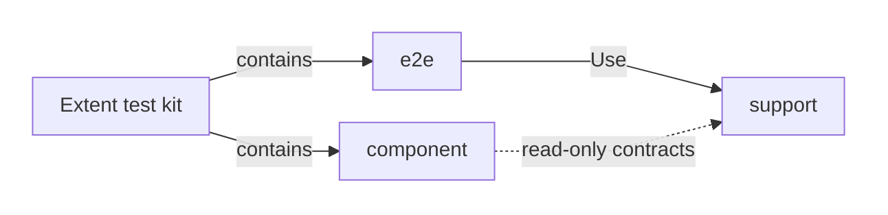

<a id="ui-test-kit-for-extent"></a>
<a id="kit-de-testare-ui-pentru-extent"></a>
# UI test kit for Extent

This `atf-reporting-tests` package tests Extent renderer produced by ATF. It does not test UI application and does not introduce API business tests. API is used here only as a declarative setup when a report needs to be generated that we are read- only inspecting in the browser.

<a id="at-a-glance"></a>
<a id="pe-scurt"></a>
## At a glance

| Input | Flow | Evidence |
|---|---|---|
| API report + mock contract | setup read-only → UI navigation → validators | actions, audit, assertions, screenshot |
| UI YAML | selectors, viewport, zoom and output policy | Configurable, without redundant flag |
| generated HTML | Chromium/Playwright MCP | DOM / CSS / consoles and fresh artifact |

<details>
<summary><strong>Reading map</strong></summary>

- [API Setup versus UI validation](#pregătirea-prin-api-față-de-validarea-ui) and
  [Overview versus steps](#prezentarea-generală-față-de-pașii-de-validare) - semantic separation of the evidence;
- [E2E contracts](#contracte-e2e-specializate) and
  [configuration](#configurație-gestionată-de-atf-reporting) - how to compose the verified report;
- [IntelliJ rolling](#rulare-directă-din-intellij) - manual execution;
- [the contract of rendering](#contractul-e2e-al-randării),
  [guard-uri](#guard-uri-pentru-contribuții) and [table view](#tabele-de-evidență-cu-resize-content-aware) - visual evidence and regression protection.

</details>

<a id="core-diagram"></a>
<a id="diagramă-de-bază"></a>
## Core diagram



<details>
<summary><strong>Legend - Extent test separation</strong></summary>

- `component` verifies the input, model, marker and policies; browser components use local fixed fixed devices;
- `e2e` checks the artifact audit journey and the integration of setup / browser;
- `support` reuses setup, locators and validators, but is not a root test;
- The browser and locators are adapted in `support`; the layer is is chosen after the checked boundary.
</details>

The rule is purposely strict:

| Area | Responsibility | Can Playwright contain? | Is it running by default? |
|---|---|---:|---:|
| `component` | contracts, models, policies, validators and local browser fixtures | Yes, via `support`, only for local fixture | yes |
| `e2e` | browser scenarios and validation of actual rendering | Yes, through `support` | only explicit |
| `support` | reusable code for the above tests | Yes, when it's browser adapter | not as root test |

A complete audit journey belongs to `e2e`; an isolated browser component verifies only the local fixture and declared boundary. A flow, locator, fixture, inspector or dynamic engine belongs to `support`. `component` is not allowed to become a helper-e deposit.

The level, channel and output are declared via [TestKit annotations](../../../../../../../../docs/ATF_Test_Infrastructure_Annotations.md).

<a id="api-preparation-against-ui-validation"></a>
<a id="pregătirea-prin-api-față-de-validarea-ui"></a>
## API preparation against UI validation

API ratio generated from `atf-mock.yaml` is a readonly precondition for UI tests, not a screen validation. Before the browser is checked in the component or integration: request / response JSON, provenance mock, structure HTML, CSS / JavaScript, vocabulary, projections and contracts between sections. E2E remains only the behaviors that require real rendering:

```text
mock + API setup
      ↓
API report read-only
      ↓
component/integration: contract, JSON, markup, CSS/JS
      ↓
E2E: tab, click, collapse, computed-style, wrapping, screenshot, consolă
```

`SelectedApiTestsReportUiTest` is the configuration of the root:

- select the methods through `@ApiTestRef` and build the fixture;
- delegate the sections to the engine / publisher;
- do not clone the test per tab and do not insert `Page` into `atf.reporting.api.tests.api`;
- browser-free assertions remain in the component / integration for
  Quick and deterministic rolling.

This is the only README of Extent test. `e2e/uireport` and `e2e/failure` packages do not have local README: their contracts are documented below, together with common rules, so that architecture can be read in one place and no divergent documentation appears.

<a id="general-presentation-of-validation-steps"></a>
<a id="prezentarea-generală-față-de-pașii-de-validare"></a>
## General presentation of validation steps

The title of each section is produced by `ExtentSectionGherkin` and used identical by the dynamic test and Extent. The title is a normal and concise overview:

```text
Request evidence includes request JSON, response JSON and execution evidence
```

`Overview` and nested steps have distinct responsibilities:

- `Overview` calls the area checked and the observable result;
- nested steps publish detailed evidence;
- the phase without steps / obvious child is terminal and does not receive affordance of
  expansion; the JUnit assertions of a configuration test do not become invented steps;
- the validators shall keep separate assertions for each relevant criterion;
- `Tests` publishes the project and owners / scripts;
- `Categories` publishes counties and filters;
- `Fails` publishes causes and deep links;
- `Evidence` publishes request / response JSON and execution evidence;
- `THEN` may appear in the nested step that publishes validation;
- GIVEN / WHEN / THEN is not repeated as a test title.

<a id="current-structure"></a>
<a id="structura-curentă"></a>
## Current structure

<details>
<summary><strong>Package map and cohesion rules</strong></summary>

```text
component/
├── architecture/       guard-uri pentru limitele de pachet și selector
├── audit/               teste pentru așteptări și rezultate de audit
├── inspection/         politici pure și teste de proiecție
├── locators/            testul limitei de locator
├── plan/                manifest/spec de scenariu
└── section/
    ├── architecture/
    └── contract/

e2e/
├── ExtentReportingE2eSuite.java
├── configurable/       scenarii configurabile de cardinalitate
├── failure/             raport de failure și evidența Playwright
├── navigation/          traversare și agregare între tab-uri
├── sanity/              verificări mici de disclosure și layout
├── section/             secțiuni generate din setup/API
└── uireport/            contractul static al unui raport existent

support/
├── api/                 setup, profiluri, flow-uri și declarații API
├── audit/               context, validatori și adaptoare browser
├── config/              resursele autonome ale modulului
├── failure/             fixture/factory/engine pentru failure
├── inspection/          inspectori DOM și responsive
├── lifecycle/           lifecycle browser și captură de evidence
├── locators/            singura zonă care compune selectori Playwright
├── navigation/          flow-uri semantice de navigare
├── section/             extractoare, module, publisher și runtime
└── uireport/            fixture, contract input și inspectori de tab-uri
```

`support/section`, the composition runtime is explicitly separated from `runtime/SectionAuditDynamicEngine` and `runtime/SectionAuditFixture`; thus `support.section` packager does not become a mixed container. Similarly, `support/uireport/browser` can only use the `support/locators` facade, not the Playwright direct selector.

`ReportUiLocators` is the stable public facade for existing consumers, not the owner of all the selectors. The implementation is divided into cohesive boundary: `ReportLocatorSupport` for common composition, `ReportPageLocators` for page and table, `ReportTreeLocators` for discoloration / card tree and `ReportUiValidationLocators` for surfaces DOM / CSS of UI validation. `ReportEvidenceLocators`, `ReportCategoryLocators` and `ReportFailureLocators` remain vertical. Thus, tests and flows depend on façade / flow, and the change of a family of selectors no longer obliges the change of a monolithic class.

New locators prefer CSS semantic `element[attribute=value]`, e.g. `button[data-atf-action='expand']`, `div[data-atf-node-role='scenario']` or `table[class~='helm-validation-table']`. `~=` operator is used for classes because `class` is a list of tokens; for identities `[id='...']` is used. Shorthandul `.class` remains allowed in CSS asset, but not in Playwright Reporting test locations.

`nth(...)`, `:scope`, text filters and XPath remain internal details of the `support/locators` host, only when the generated marker does not display a better contractual attribute. The dynamic values are validated by the common helper before composition, through a single `Pattern` compiled at `ReportLocatorSupport` level; do not reconstitute the regex at each dynamic locator. Neither test nor flow. nor the auditor repeats the selection or validation policy.

Subpackages are deliberate: the main limit is `component/e2e/support`, and the subpackages separate the vertical without reintroducing a root package with mixed responsibilities. No main package must pass the eight-class limit; if it does, a coherent responsibility is extracted, no files are arbitrarily moved.

</details>

<a id="specialised-e2e-contracts"></a>
<a id="contracte-e2e-specializate"></a>
## Specialised E2E contracts

<a id="static-ui-report"></a>
<a id="raport-ui-static"></a>
### Static UI Report

`StaticUiExtentReportContractTest` checks the Extent renderer on an already produced HTML artifact:

- input is readonly;
- The verdict concerns only the report's contract: taboos, navigation,
  Displosuries, CSS, text, evidence and observable behaviour;
- the business application is not tested here;
- browser adapters are in `support/uireport/browser`;
- the input is in `support/uireport/contract`;
- Pure validators remain in the production of `atf-reporting`.

```text
previous UI HTML report
        ↓
ATF Debug / loopback read-only
        ↓
Playwright: tab + disclosure + DOM/computed-style
        ↓
static contract validator
        ↓
Extent assertion / evidence
```

- Change input via `-Datf.ui.report=<report.html>`; no way required
  absolute or hardcoded checkout.
- The coat checks Overview, Tests, Categories and Fails, plus / minus inline,
  `📷` screenshot as a link inline, actions including `getText`, lack of `<hr>` and overflow, default closed disclosures and console without errors.
- `TIME` is only listed in the Playwright action table; static observations are not available.
  be given an artificial duration.
- For UI tree, `UI validation` is the only public title; marker
  Internal `ui-validation` can identify visual evidence without creating a second label in the report.
- The density contract is common: API exchange / aggregate and UI evidence
  `34px` summary, `9px 12px` padding and `18px` glyph inline in Extent and fallback; `500px` applies only to long table viewports.
- `AtfReportEvidenceCssTest` / `AtfReportThemeTokensTest` checks the tokens and
  CSS parity; `UiValidationSectionExtractor` measures the computer hold, padding, glyph, badge and the gaping between actions / observations / assertions on the rendered ratio. E2E / static contract + Browser MCP visually confirms the same geometry in the normal and narrow viewport.

<a id="failed-report"></a>
<a id="raport-de-eșec"></a>
### Failed report

`UiFailureReportContractTest` uses a controlled negative fixture to verify that a failure is localized by hierarchy, without duplication and without marking a phase as failed when only an informative detail is present. The mandatory surfaces are distinct and auditable:

```text
SETUP              input / raport / fixture disponibil
PLAYWRIGHT_ACTION  contextul acțiunii și diagnosticul original separat
AUDIT_OBSERVATION  ce a fost găsit în DOM și computed-style
ASSERTION          expected / actual / verdict reutilizabil
```

The failure contract is schematic:

- the action has `TARGET`;
- the case is published in the area which produced it;
- `Tests` and `Fails` indicate the same identity;
- The native timeout and the redaction shall be checked in Audit Observations in Tests;
  Fails keep the compact context with measured time and backlink;
- The screenshot is evidently inline with `📷`:
  - PNG Base64 directly; or
  - inline link implicit to the canonical PNG anchor with local bound reference
    (`screenshot-n`), not with the internal finger print;
- an isolated hash without link and visible marker is not obvious;
- `Setup evidence` remains setup;
- `UI validation` occurs in `TEST BODY` after browser actions and inspection
  DOM/style;
- Disclosuries are collapsed by default;
- the area frame closes its edges regardless of the number of rows.

These contracts are documented here because they are distinct responsibilities of the test-kit, not because they would require a README pack.

<a id="atf-reporting-managed-configuration"></a>
<a id="configurație-gestionată-de-atf-reporting"></a>
## `atf-reporting`-managed configuration

`atf-reporting-tests/src/test/resources/atf-reporting-ui.yaml` is the internal UI configuration for the contracts of this module. `ui:` section was removed from `atf.yaml`; the project only keeps the API common configuration and reporting. Thus, the change of UI set does not alter the project bootstrap and does not create an artificial Boolean key of type `ui.enabled`.

For more stubborn screenshots, the configuration explicitly uses `ui.zoomPercent: 70`. `UiViewportScale` maintains the required output and derives the CSS and DPR native Viewer; does not inject CSS zoom into the document or iframe. The image enters several lines through context geometry, and the screenshot and the configuration metadata remain separate evidence.

- The key is configurable per YAML, accepts `25..200`, and its absence means `100`.
- [Contract and native evidence](../../../../../../../../atf-ui/README.md#geometria-nativă-a-contextului)
  have the relationship between the output, layout CSS, DPR and pointer.

The code's ownership is as strict as the YAML ownership:

```text
atf-ui
  UiBrowserConfiguration
  UiScreenValidationConfiguration
  PlaywrightUiSession / acțiuni / capture PNG
        ↓ politici runtime generice
atf-reporting-tests composition scope
  support/config/UiConfiguration
  support/config/UiAuditSuiteConfiguration
  support/config/AtfUiConfigurationLoader + Context
  support/config/UiConfigurationYamlReader
  ReportingTestResources → Extent output / audit input / API setup
```

Classes in `support/config` are dedicated reporting-test support: they model Extent reports, UI output, audit suites and API setup-to-report integration. They therefore remain outside `atf-ui` and a generic module's `src/main` publication. A Playwright consumer without Extent may use `atf-ui` runtime policies independently of these classes.

`atf-reporting-tests/src/test/resources/atf-mock.yaml` is the mock catalogue used by autonomous reporting tests. It is a controlled copy of the project catalogue, and `atf-mock` remains the owner of the loader and the scheme. Reporting tests no longer depend implicitly on the directory from which Maven or IntelliJ was started. `ReportingTestResources` applies the following priority:

1. `-Datf.ui.config=...` for an explicit UI configuration;
2. `atf-reporting-ui.yaml` internal configuration;
3. UI artifacts in `${ATF_REPORT_OUTPUT_DIR}` or UI subdirectory configured;
4. `-Datf.ui.report=...` only for the input of an existing report.

Mock internal is explicitly loaded from the module's top. For a API / UI test using the reporting set, `ReportingTestResources.mockConfiguration()` or `.mockTransport()` are used, not `AtfMockTransport.fromProjectConfiguration()`.

The chain is audible:

```text
atf-reporting-ui.yaml
        ↓
setup API declarativ / colecție selectată
        ↓
atf-reporting-tests/src/test/resources/atf-mock.yaml
        ↓
raport Extent API
        ↓
e2e Playwright read-only
        ↓
validări pe Tests, Overview, Categories, Fails, Evidence și UI validation
```

<a id="direct-run-from-intellij"></a>
<a id="rulare-directă-din-intellij"></a>
## Direct run from IntelliJ

For browser-backed suite you run class:

```text
atf.ui.tests.extent.e2e.ExtentReportingE2eSuite
```

In IntelliJ: Run / Debug on class, with working directory either the root of `atf` project or `atf-reporting` module. No manual copying of YAML is required and no existing server or process is stopped.

At changes in the output resolver, the composition of the root or the configuration IDE, perform the smoke- test:

- separate suite running with working directory at reactor root and at
  `atf-reporting`; both runs must pass;
- confirms that each run creates a new report in
  `<reactor>/artifacts/reports/ui/e2e` and that the `atf-reporting` run does not create a copy under `atf-reporting/artifacts/reports/ui/e2e`;
- Open current ATF Debug / Playwright MCP and check provenance
  His; automatic tests simulate the director's working, but do not launch IntelliJ.

This is an operational control at relevant changes, not a permanent ToDo.

Maven equivalent, from the root of external staging:

```text
mvn -pl atf-reporting-tests -am \
  -Dtest=ExtentReportingE2eSuite \
  -DforkCount=0 -DreuseForks=false test
```

For an existing UI artifact:

```text
mvn -pl atf-reporting-tests -am \
  -Dtest=StaticUiExtentReportContractTest \
  -Datf.ui.report=<configured-ui-report> \
  -DforkCount=0 -DreuseForks=false test
```

At the debugging, the final report is checked through ATF Debug and Playwright MCP. No real Windows browser is used. The verdict is not complete until HTML is opened, the tables are inspected, the screenshots are visible, there is no horizontal overflow, and the console does not report errors.

<a id="rating-contract-verified"></a>
<a id="contract-de-randare-verificată"></a>
## Rating contract verified

E2E tests must publish short but explicit sentences: `GIVEN` for setup / input, `WHEN` for Playwright and `THEN` for display verdict. `Setup evidence` is setup, not `UI validation`; UI validation should be shown below `TEST BODY` and name the verified table / surface.

In each report checked, the following shall be kept:

- plus / minus inline, always in front of the sentence;
- relevant screenshot as inline link with current emoji;
- table Playwright with relevant actions, including `getText` / text extract;
- the number of each action is a compact `#n` badge, with natural width;
  be able to inherit the width of the collapsible area and cannot extend the delimitation on the viewport;
- Require / response JSON for API setup when the ratio is exposed;
- without `<hr>` and without artificial delimitation between areas of a section;
- input of the report as auditable evidence without SHA-256 hashes displayed as
  sub-substitute for the link to the artifact.

<a id="contributions-guardours"></a>
<a id="guard-uri-pentru-contribuții"></a>
<a id="contributions-guards"></a>
## Contributions guards

- E2E tests remain few and configurable; no cloning test is required for
  Each API family. Concrete scenarios are chosen through annotations / profiles.
- Playwright locators are only composed in `support/locators`; tests and flow-
  Uses use semantic facades.
- Fixturees do not become `*Test` classes; tests remain short and express only
  intent, setup and verdict.
- DOM / Style validation is divided into extraction, snapshot / policy and publication;
  pure parts remain testable without browser.
- API POST / PUT in the mock must have the body JSON and the response JSON, and
  the pair shall be visible in the Extent ratio.
- Any refactor of CSS / JavaScript / HTML requires external build in `${ATF_STAGING_ROOT}`,
  controlled timing in live code and visual check of a fresh report.

<a id="e2e-contract-for-labels"></a>
<a id="contract-e2e-pentru-etichete"></a>
## E2E contract for labels

`ReportNavigationAggregationFlowTest` is the configurable flow for dynamic filtration of the `Tests` table. It must prove in the report, not just in code, the following sequence: baseline owners → `Pass` → the first tag → the second tag → `Clear` → `Categories` → `Overview`.

For each execution check:

- `aria-pressed` and names of options;
- visible scenarios and restored status;
- `tag1 → tag2` transition;
- `active=1` and `replaced=true`;
- `owners=3, tags=0` after `Clear`;
- number of checkpoints in the collapsible header;
- the full details in the audit table;
- the final artifact opened in ATF Debug / MCP browser prior to the promotion.

<a id="liability-limits-for-ui-evidence-and-reporting-providers"></a>
<a id="limitele-de-responsabilitate-pentru-dovezile-ui-și-furnizorii-de-raportare"></a>
## Liability limits for UI evidence and reporting providers

The cross-cutting rule for configurable capture belongs in the [dedicated document](../../../../../../../../docs/ATF_Evidence_Capture_Contract.md). This README owns browser audit and observable artifact contracts; it does not own a consumer’s flow mode or YAML mapping.

| Contract | Owner | What's left in the test |
|---|---|---|
| HTML vocabulary and stable attributes | `AtfReportHtmlVocabulary` | checking public DOM contract |
| Colours and geometry | `atf-reporting/.../theme/tokens` | checking computer style and rendering |
| UI style | `theme/evidence/AtfUiEvidenceCss` | verification of catch, steps and table |
| data of each run | records/POJO-uri immutable | input runtime; no scattered strings or dynamic enumerations |

E2E checks the browser and observable report; does not reimplement CSS or HTML in test classes.

The order of coverage is:

- units - tokens, markups and providers;
- component - sections and record-keeping contracts;
- integration - assembly of the report and manifest asset;
- E2E - browser, rendering, clicks, expansion / collapse, inline links and tabs.

Implementing rules:

- any change is checked in ATF Debug with Playwright / Chromium headless;
- actual Windows browser is not part of the validation;
- `＋/−` remains inline before the sentence;
- Disclosuries are closed by default when they are not part of the scenario;
- `<hr>` or horizontal overflow separators are not available;
- inline catch linkages shall be retained;
- CSS-ul / JavaScript is separated after semantic responsibility;
- new providers receive Tiguan identifiers and tokens;
- The test checks the resulting public output.

<a id="the-e2e-ranking-contract"></a>
<a id="contractul-e2e-al-randării"></a>
## The E2E Ranking Contract

This is the regulatory gear for any extraction or change that can change the ratio. A gate does not validate a historical HTML and does not just validate substrings in the source: uses the ratio generated by the current run or a static input explicitly chosen by configuration. The name, timestamp and path of an generated artifact are not kept in README.

<a id="rules-that-always-apply"></a>
<a id="reguli-care-se-aplică-întotdeauna"></a>
### Rules that always apply

- The report is opened via ATF Debug / Chromium headless and is checked in
  MCP browser; the actual Windows browser is not part of the gate.
- E2E- checks the observable effect: DOM, calculated style, navigation, click,
  Extend / collapse, links and rendering. Do not reimplement the provider or contract rules already tested at the lower level.
- The dynamic data of the run - test names, locators, JSON bodywork,
  durations, assets and results - remain runtime data in models / fixtures; not moved in lists or constant just to shorten the test.
- The stable vocabulary - tables, operations, contract keys and public classes -
  can be typed in constants / enumerations with one owner.
- The promotion uses a fresh artifact and a manifesto of assets'
  reconciled; an old report can only serve to local investigation.
- The geometry is measured in the real browser: viewport CSS, DPR and container.
  `ui.viewport.width/height` describes the required output, and `ui.zoomPercent` determines the native context scale; the Snapshots System does not substitute the measurement.

<a id="the-secondary-audit-contract-in-overview"></a>
<a id="contractul-auditului-secundar-din-overview"></a>
### The secondary audit contract in Overview

The two disks ATF - `#atf-execution-metadata` and `#atf-tag-audit` - are checked on the same existing E2E scenario without a new class. The validator does not stop at the `open` attribute or at a generic number of elements:

```text
stare inițială închisă
        ↓
expandare prin acțiuni Playwright
        ↓
metrici + tabele + headere + rânduri populate
        ↓
assertions semantice
        ↓
închidere și verificare fără corp vizibil
```

The semantic contract is:

- 6 execution metrics: classes, scenarios, pass, fail, skipped, warnings;
- precisely 3 audit tables: `atf-audit-scenarios`, `atf-audit-packages`,
  `atf-audit-tags`;
- Each table has non-zero headers, at least one row and populated cells;
- both bodies become visible at expansion and effectively disappear at closure;
- Dynamic values remain extracted from DOM; only the structural vocabulary is
  constant.

The sample is divided by levels:

- `OverviewSecondaryContractValidatorTest` checks the rules pure;
- `SelectedApiTestsReportUiTest` executes them on the actual report;
- the scenario must show `Audit observations · 6` and `Assertions · 7`, with
  green rows and no overflow;
- the Deeplink is `#test-id=48&scenario-index=6&expand=ui-validation`;
  the rest of the report remains closed by default.

The order of the evidence is strict and semantic:

```text
Playwright actions: navigate → wait → open Overview → expand ATF zones
        ↓
Screenshot: capturat cât timp ambele zone sunt deschise
        ↓
Assertions: conținut metrici, tabele, vizibilitate și restore closed
```

The order of the artifact shall remain:

- `Playwright action sequence (7 entries)`;
- `Screenshot` as the last visual checkpoint immediately after the actions that produced
  status check;
- `Assertions · 7` after the catch.

Restore clicks are technical cleanup: they are not published as stock shares after catch.

<a id="native-assetas-and-filtering-tests"></a>
<a id="asset-uri-native-și-filtrarea-tests"></a>
### Native Assetas and Filtering Tests

`.js` / `.css` assets are publicly verified, at both limits:

- `atf-reporting` checks the resource loader and composer;
- UI tests check the effect in DOM and rendering;
- `ExtentReportRuntimeTestFilters` is a Java facade over
  `extent-tests-filters.js`; stable vocabulary is typed, the algorithm remains native JavaScript;
- any change requires contract component and E2E gate on the fresh report.

<a id="executable-checklist-for-e2e-gate"></a>
<a id="checklist-executabil-pentru-un-gate-e2e"></a>
### Executable checklist for E2E gate

Each tick below must be `✅` in the result of its run or explicitly marked `N/A` for reason. A new gate is not valid if it leaves a mandatory check unexecuted.

<a id="1-input-and-navigation"></a>
<a id="1-input-și-navigare"></a>
#### 1. Input and navigation

- ☐ input is the current run ratio or static input indicated in the
  configuration;
- ☐ the gear is running at the configured view and, for responders, at a width
  not more than 25% lower; a width below this limit is exploratory and shall be reported separately as `known issue`, not confused with the gate verdict;
- ☐ page is loaded without browsing errors, missing assets or resources
  mandatory external;
- ☐ `Tests`, `Overview`, `Categories` and `Fails` are accessible and Deeplink
  The correct view is activated;
- ☐ `Tags` is verified when published by that report;
- ☐ the active table, title and return link remain consistent after navigation; and
  refresh.

<a id="2-hierarchy-and-discharsuri-in-tests"></a>
<a id="2-ierarhia-și-disclosure-urile-din-tests"></a>
<a id="2-hierarchy-and-disclosures-in-tests"></a>
#### 2. Hierarchy and disclosures in `Tests`

- ☐ `＋/−` is inline before the title and remains vertically aligned with the title;
- ☐ `SETUP` is distinct from `TEST BODY` and `TEARDOWN` only occurs when there is
  in lifecycle;
- ☐ relevant scenario and phases can be opened / closed by clicking, or
  keyboard without changing the order or owner of the content;
- ☐ after expansion see `THEN` and `UI validation` when the scenario
  be supported by UI;
- ☐ in `UI validation`, follow-up actions in the order executed,
  including target, expected, observed, result and duration;
- ☐ `Audit observations` and `Assertions` are distinct, legible and
  reported according to the actions it explains;
- ☐ the screenshot or inline link is visible when part of the contract;
  a removable link shall have the `📷 base64 img`, `data-atf-screenshot-ref` marker and shall result in a valid canonical PNG that can be opened.

<a id="3-api-contract-and-evidence-when-applicable"></a>
<a id="3-contractul-api-și-al-dovezilor-când-se-aplică"></a>
#### 3. API contract and evidence (when applicable)

- ☐ the quest and the JSON response are shown as separate evidence, including
  body JSON, heads / status and origin mock;
- ☐ execution evidence linking the quest to the test, route and result
  product;
- ☐ a failure indicates the cause and offers `Open in Tests` without losing the test
  original;
- ☐ UI ratio using API setup can be reconciled with API ratio
  selected by the run configuration: mock → API → UI → validation.

<a id="4-dom-css-and-console"></a>
<a id="4-dom-css-și-consolă"></a>
#### 4. DOM, CSS and console

- ☐ for document, report root and declared containers
  non-scrollable, `scrollWidth <= clientWidth` to the supported viewport;
- ☐ the wrapping keeps visible columns and shares without overflow
  Hidden horizontally;
- ☐ no decorative `<hr>`; delimitations are made through components
  Semantics and their CSS-ul;
- ☐ `＋/−`, badges, table, screen shot link and collapsible sections
  b. Computer-style consistent with theme and legible contrast;
- ☐ no consoles, page errors, request failures or images
  broken;
- ☐ any other information that may be relevant to the audit process;
  evidence of the run, not hardcoded file names in documentation.

<a id="atf-debug-manual-exploration-steps--mcp-browser"></a>
<a id="pașii-de-explorare-manuală-atf-debug--browser-mcp"></a>
### ATF Debug manual exploration steps / MCP browser

These are the recommended steps when a gate changes structure, layout or flower, not a list of assertions that doubles all unit tests:

1. Open the artifact chosen by the run configuration and start from `Tests`.
2. Select a test that has setup and body test; check status first
   The scenario is then collapsed and then opened, `SETUP`, `TEST BODY`, `THEN` and `UI validation`.
3. Follow actions from the first `Navigate/Wait` until the last validation;
   For each check the target, the expectation and the observer, not just the text of the operation.
4. Open separate request evidence, answer evidence, execution evidence,
   `Audit observations` and `Assertions`; check the link between each disconnect and the row it explains.
5. Repeat navigation for `Overview`, `Categories`, `Fails` and, if any,
   `Tags`. For a API ratio, UI / API pair is opened in separate MCP tables and reconciled through the run manifest, not by a name written in README.
6. Run DOM / CSS / console check and capture the final status only after
   If the MCP browser area is narrower than the supported limit, note the observation as additional exploration; do not use it to promote or reject the configured run.

<a id="implementation-of-the-gate--and-evidence-of-coverage"></a>
<a id="implementarea-gate-ului-și-dovada-de-acoperire"></a>
### Implementation of the gate- and evidence of coverage

The contract shall be performed on three seasons without duplication of the selects or rules:

| Seam | Owner | Executable proof |
|---|---|---|
| explicit selected static report | `StaticUiExtentReportContractTest` + `UiReportContractDynamicEngine` | all four tables, click / collapse in Tests, UI validation, screenshot, style / render boundary |
| API Setup ratio | `SelectedApiTestsReportUiTest` + `SectionAuditRegistry` | mock → API, POST / PUT request / response JSON, owner / scenario / phase, Categories / Overview / Fails / Evidence and render- health on all tables |
| browser render health | `UiReportStyleValidator` + `ReportAuditContext` | overflow document / body / non-scrollable, zero `<hr>`, images, glyph `＋/−`, consoles / page / request diagnostics |

`UiValidationSectionExtractor` explicitly verifies:

- areas for Playwright shares, Audit observations and Assertions;
- a valid PNG Base64 link, directly or by reference,
- `📷 base64 img` marker and vertical alignment of the link;
- actual presence of areas, not just the number of cards;
- `UI validation` on the artifact UI producing evidence; a second title
  visible for the same category is rejected on the artifacts generated by the current;
- `N/A` for UI missing in a API report with mandatory API render- health;
- `PlaywrightUiSession` zoom without forward dereferencing
  `documentElement`;
- E2E complementary component tests and gates on real artifacts.

Overview secondary discards have this verifiable cycle:

- **fresh:** `#atf-execution-metadata` and `#atf-tag-audit` are closed;
- **expand:** click on `summary` displays the body directly;
- **collapse:** second click hide body;
- **owner:** `OverviewSecondaryContractValidator.validateExpansion(...)`
  re-use the existing scenario without new E2E class.

Deeplink for full proof:

```text
#test-id=48&scenario-index=6&expand=ui-validation
```

It opens `TEST BODY → THEN ATF metadata sections expansion → Screen validation` and extends `Playwright action sequence`, `Audit observations` and `Assertions`. Upon closure of the scenario, the disclosures return to collapse; the component also checks this transition.

<a id="ui-retests-public-policy-default-stop-at-uncertainty"></a>
<a id="reîncercări-ui-politică-publică-oprire-implicită-la-incertitudine"></a>
### UI retests: public policy, default stop at uncertainty

Playwright is a policy of action, not a test replica. `UiRetryPolicy` has a single attempt and no eligible operation. YAML can only activate listed operations available only in read (`navigate`, `wait-for-visible`, `wait-for-text`, `wait-for-enabled`, `wait-for-state`, `wait-for-disclosure`):

```yaml
ui:
  retry:
    maxAttempts: 2
    backoff: PT0S
    eligibleOperations: [wait-for-visible]
    reason: "DOM stabilization"
```

`click`, `fill` and `select-option` are not eligible by design. Each retry is row `Info` in table Playwright with the attempt and reason bounded; the final action retains the actual verdict. The logger, recorder and renderer have component / unit tests, and E2E only verifies the observable browser effect.

<a id="content-aware-tables"></a>
<a id="tabele-de-evidență-cu-resize-content-aware"></a>
### Content-aware tables

The record tables in the report must not use a uniform division when `EXPECTED`, `OBSERVED`, `VALUE` or `REASON` contain long diagnostics. `extent-evidence-table-layout.js` asset applies the same plugin-and-play policy to UI and API for Playwright actions, audit observations, Assertions, setup, request / response details, execution, return history and technical trace:

```text
maximum rendered text width per column → reserve RESULT/TIME/STATUS
                 → bounded min/max allocation → publish width diagnostics
                 → render without overflow
```

The rules are dynamic and common Extent / fallback:

- measure the lettering and maxim of the visible text with the font, the padding and
  actual bays; keep real maxim in pixels without artificial ceiling;
- keep short columns, including status / time / attempt, at the measured width;
  the space available shall be distributed proportionately to the remaining demand for the long text;
- table occupies the full width available; the surplus returns proportionally
  the content columns, keeping the technical columns compact;
- drop only the scrollbar required content, do not reserve the gutter for a
  brief table; the sample compares the physical width of the container, not only `clientWidth`;
- `VALUE` does not receive a fixed quota above a longer text `FIELD`;
- keep the header and cells in the columns; horizontal scroller appears only in
  the wrapper if the sum of the legible minima does not fit in the panel;
- `data-atf-content-column-max-px` and `data-atf-content-column-widths`
  in the same order; the markers legacy validation and field / value remain available;
- make an initial normalization, then use text / font fingerprint /
  width and a single frame for tables affected by mutations or resize;
- `ResizeObserver`, text change, `hidden → visible` and aperture
  the parent invalidates locally; the cachet is updated after the new geometry;
- the common selection includes the tables in `ReportTableViewport`, including a
  new family; it does not depend on the title of the case, endpoint or length of fixture.

`EvidenceColumnSizingComponentTest` checks in the browser long text in different columns, short technical columns, table across the width, resize, mutation, reopening and family added later. Includes setup, texts with the same number of characters but different widths and competing requests over the old ceiling. The family of faILUREN inserted later is also proven without initial wrapper.

Oracle measures real rectangle and rejects artificial equal widths, hollow gutter or vertical cells even if audit attributes are still present.

The aggregate tables Overview, Category and System use the same algorithm in their existing containers without additional nested viewport. Numerical totals retain the measured width; the content column receives the surplus. The existing colgroups synchronize with the header and the body; the vendor tables for layout / events do not represent the data tables.

<a id="verification-contract"></a>
<a id="contractul-de-verificare"></a>
### Verification contract

- `ValidationTableLayoutComponentTest` - minimum contract for policy;
- `ValidationTableLayoutInspector` - OOP adapter used by
  `UiValidationSectionExtractor` for all families UI / API of evidence tables; new sizing sample checks geometry separately without trusting markers only;
- metric - compare `data-atf-content-column-max-px` with the widest column
  flexible and check the amount of the widths plus the overflow;
- E2E / MCP - check `1440×900` and `1280×900`:
  - `data-atf-content-column-widths` is present;
  - Each column is aligned with the header and the last column is accessible;
  - the document and the body do not have overflow;
- audit catch - shows wider `OBSERVED/EXPECTED` when values are higher
  long and keeps `RESULT` compact.

<a id="liability-by-levels"></a>
<a id="responsabilitatea-pe-niveluri"></a>
### Liability by levels

| Level | ♪ Check ♪ | ❌ Does not replace |
|---|---|---|
| unit | models, parser- e, vocabulary, policies and tokens | actual browser and rendering |
| component | Provider, public markup, CSS / JS contract and section modules | full flow and asset publication |
| integration | assembled ratio, mock → execution → validation, output and asset manifest | Clicks and computers-style |
| E2E | actual effect in Chromium: taboos, click / collapse, highlight, layout, links and console | static rules of the provider |

`N/A` is only allowed for an area not published by that artifact (e.g. `UI validation` in a pure API report). It is not allowed for a verification that exists in DOM but has not been explored.

<a id="acceptance-criterion"></a>
<a id="criteriu-de-acceptare"></a>
### Acceptance criterion

A gate shall be accepted only when:

- The correct level has verified its contract;
- The applicable E2E checklist is complete, including manual steps;
- The supported view does not exist overflow in document / root / container.
  non-scrollable, `<hr>` decorative, console errors or broken assets;
- The artifact, manifesto and staging / live sources are reconciled;
- The result can be repeated by another person in the report without knowledge
  internal implementation.

<a id="quick-check"></a>
<a id="verificare-rapidă"></a>
## Quick check

| Intent | Test and configuration | Boundary |
|---|---|---|
| Local browser component | [NarrowEvidenceReadabilityComponentTest](component/readability/NarrowEvidenceReadabilityComponentTest.java) | Extent fixture / fallback; no Journey on public website |
| E2E of the artifact | [specialised contracts](#contracte-e2e-specializate) and [IntelliJ](#rulare-directă-din-intellij) | validate the report, not the Shop / AutoEx business |
| Actions / Audit / Assert tables | [Display contract](../../../../../../../../docs/ATF_Reporting_Display_Contract.md#restabilirea-prezentării-tabelare-a-dovezilor) | measured columns in Extent / fallback including resize and modified values |

The local command and precondition Chromium are at [README module](../../../../../../../README.md#verificare-rapidă). Native policies, output and verdict remain with existing owners; the support package does not become the mode or runtime of the product.
