<a id="atf-reporting--independent-extent-artifact-library"></a>
<a id="atf-reporting--bibliotecă-autonomă-pentru-artefacte-extent"></a>
# ATF Reporting — independent Extent artifact library

`atf-reporting` turns typed models into semantic reporting and verifiable
Extent/HTML artifacts. The library does not execute APIs, start a browser or
read application mocks and fixtures.

<a id="at-a-glance"></a>
<a id="pe-scurt"></a>
## At a glance

- **Binary adoption:** the [minimal consumer](docs/README.md#minimal-binary-consumer) runs against the physical JAR and its declared runtime dependencies, without Core, Kit or producer source directories.

**Quick links:** [JAR adoption](#consumarea-bibliotecii-ca-jar) · [Tree and ownership](#contractul-raportului) · [Assertions and budget](#proiecția-sigură-a-aserțiunilor) · [Timing](#timing-e2e-la-ownerul-runtime) · [Tables](#lizibilitatea-dovezilor-în-panouri-înguste) · [Prohibitions and limits](#verificare-rapidă)

- **production** — typed contracts, semantic models, renderers, assets and
  publication, without dependencies on other ATF modules;
- **tests** — standalone boundaries and native contracts, without mock
  transport, Playwright or application fixtures;
- **composition** - `atf-reporting-tests` is the canonical consumer for
  API / integration and UI / E2E reporting;
- **output** — Extent/HTML with bundled CSS and JavaScript, preserving
  consumer verdicts rather than inventing them;
- **adoption** — the consumer supplies typed input, status, evidence and
  output policy through the public API.

[Contracts and feedback](#contracte-și-feedback) routes semantic and display rules to their owners. [Reporting Tests](../atf-reporting-tests/README.md) owns the harness; the [code atlas](src/main/java/atf/reporting/README.md) maps inputs, invariants, native sources and probes by responsibility.

<a id="consular-use-of-the-library-as-jar"></a>
<a id="consumarea-bibliotecii-ca-jar"></a>
## Consuming the library as a JAR

The [portable library contract](docs/README.md) links entry points, boundaries and extraction probes using destinations inside this module. It supports isolated-source adoption; release qualification remains separate.

The library targets **Java 21** and is distributed as a thin Maven JAR:

- the application resolves the runtime dependencies declared in the POM;
- JAR, compiler and Surefire plugins have explicit versions; the output
  timestamp is normalized for reproducible builds;
- FreeMarker is a direct dependency of the pinned Spark adapter;
- Jsoup 1.23.2 parses local artifacts for inspection; it neither executes
  JavaScript nor accesses the network;
- `atf-reporting-tests` remains internal verification support, outside the
  application’s runtime dependencies.

```xml
<dependency>
    <groupId>atf.api</groupId>
    <artifactId>atf-reporting</artifactId>
    <version>1.0.0-SNAPSHOT</version>
</dependency>
```

| Input | Responsibility |
|---|---|
| `AtfReportPorts` and Typed Models | the consumer provides the observations and the verdict; the library preserves and publishes the evidence |
| `ExtentReportSession` | Extent renderer and final publication at `close()` |
| `HtmlReportSession` | the fallback renderer; has its own publication lifecycle |
| `UiExtentReportOptions` / `UiExtentReportSession` | evidence profile and checkpoint composition, without a browser or HTTP executor |

<details>
<summary><strong>Example Java - observation report provided by the application</strong></summary>

```java
import atf.reporting.configuration.ReportingSettings;
import atf.reporting.contract.AtfAssertion;
import atf.reporting.contract.AtfReportStatus;
import atf.reporting.extent.session.ExtentReportSession;
import java.nio.file.Path;
import java.util.List;

public final class ReportExample {
    public static void main(String[] args) {
        if (args.length != 2) throw new IllegalArgumentException("Expected: output.html observed-state");
        String expected = "ready";
        String actual = args[1];
        boolean passed = expected.equals(actual);
        var status = passed ? AtfReportStatus.PASS : AtfReportStatus.FAIL;
        try (var session = new ExtentReportSession(Path.of(args[0]), ReportingSettings.defaults());
             var scenario = session.startScenario("ConsumerExample", "the observed state is ready", List.of("component"));
             var phase = scenario.startPhase("TEST BODY");
             var checks = phase.startAssertionStep("Component assertions")) {
            checks.assertions(List.of(new AtfAssertion("Observed state", expected, actual, passed)));
            checks.complete(status);
            phase.complete(status);
            scenario.complete(status);
        }
        if (!passed) throw new AssertionError("Observed state differs; inspect the generated report");
    }
}
```

- The application supplies observation and comparison; the example does not
  execute business tests inside the library or require other ATF modules.
- Close scopes from child to parent; the final Extent artifact is published
  when the session closes, and `flush()` does not replace `close()`.
- The example uses the development POM coordinate; release publication and
  compatibility guarantees require the qualification criteria below.

</details>

The JAR can be consumed outside this reactor. [Release criteria](../docs/feedback/ATF_Reporting_Feedback.md) still govern the supported public API, qualification gate and portable distribution documentation; [Reporting Tests](../docs/feedback/ATF_Reporting_Tests_Feedback.md) owns independent JAR/browser oracles.

<a id="choose-adoption-route"></a>
<a id="alege-traseul-de-adopție"></a>
## Choose adoption route

| Reader | Input | Proof to be followed |
|---|---|---|
| application that consumes JAR | [context portable](docs/README.md) → [minimum example](#consumarea-bibliotecii-ca-jar) | input typed, verdict and artifact available after close |
| Semantics maintainer | [models and projections](#modelele-semantice-și-proiecția-comună) | same population in Tests, Fails and Overview |
| publication maintainer | [lifecycle](#publicare-și-ieșire) and [atlas local](src/main/java/atf/reporting/README.md) | Ownership, primary cause and previously protected output |
| probe author | [Reporting Tests](../atf-reporting-tests/README.md) | Isolated source, physical JAR and browser have distinct gates |

Links to `../docs` and neighboring modules describe ATF reactor integration. The portable entry uses library-local destinations; complete documentation portability and distribution delivery remain release criteria.

Isolated compilation, physical JAR consumption and rendering prove different boundaries. The example demonstrates its ports without declaring the whole API release-stable; [API scope and compatibility](../docs/feedback/ATF_Reporting_Feedback.md) remain explicit criteria even when a candidate JAR is consumable.

<a id="limits-of-the-autonomous-library-and-the-canonical-consumer"></a>
<a id="limitele-librăriei-autonome-și-consumatorul-canonic"></a>
## Limits of the autonomous library and the canonical consumer

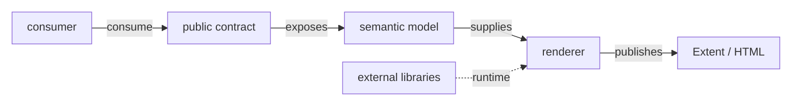

<details>
<summary><strong>Legend - the standalone boundary</strong></summary>

- `atf-reporting` receives input typed and publishes the artifact; does not orchestrate tests;
- `Contract → Model → Renderer → Artifact` route is inside the library;
- `consumer` is canonically `atf-reporting-tests`, but can be replaced by
  any application using API publicly;
- `atf-reporting-tests` is the only canonical consumer for the composition ATF;
- Jackson, ExtentReports, FreeMarker and Jsoup are external dependencies declared in POM standalone;
- mock behavior, browser, JUnit orchestration and fixtures do not enter the library's production.
</details>

| Surface | Responsibility | Boundary |
|---|---|---|
| `src/main` | production library and published artifact | undependent to ATF modules, browser or business fixture |
| `src/test` | guarantees, standalone contracts and audit of Java source | without mock, Playwright or live endpoint; composition is at Reporting Tests |
| `atf-reporting-tests` | canonical consumer for component / integration API and UI / E2E | does not enter JAR reporting |
| Other modules | can consume API publicly for normalization of models at their own boundary; do not replace the composition of the canon root | The policy remains in the consumer, and test-scope couplings are followed separately in feedback |

<details>
<summary><strong>Standalone proof, adoption and cut-off limit</strong></summary>

- `atf-reporting/pom.xml` is parentless and does not declare dependence on modules
  ATF in production;
- `src/test` can check the standalone boundary without contaminating JAR;
- `atf-reporting` publishes HTML by typed contracts, immutable records, ports,
  records, snapshot and renderer. `atf.reporting.*` Namespace also includes technical public implementation; the external supported API inventory has [separate criterion](../docs/feedback/ATF_Reporting_Feedback.md#report-public-api-43--suprafață-susținută-și-ownership);
- `ReportModelAdapters` is the generic public adapter based solely on reflection for the request,
  execution / retry / provenance, assertions, UI actions and statuses; URI decoding is owned by `ReportQueryParameters`. These API do not contain application rules and do not add compile-time dependence to `atf-core`;
- `CoreReportPortsAdapter` remains exclusively in test / composition scope and uses
  the same adapters, without maintaining a second map;
- These adapters can be used by consumers in production code only at
  normalisation / interoperability boundary; does not implement policy and become a business layer: execution decides HTTP exchange, validation decides verdict, UI produces action, reporting preserves and publishes the evidence. The consumer keeps only its own context - for example, the tracer and the identity of Shop;
- any dependency test-scopes outside the canonical consummation is tracked in
  [feedback-ul activ](../docs/feedback/README.md), not duplicated as TODO here;
- POM and runtime do not require parent of reactor or artifact ATF.
  The guard starts from CodeSourceX of its own tests and inspections the modules liaison of the name of the director or working director;
- `ReportingLibraryDistributionIntegrationTest` copies only module in one
  TMP new, runs the pack with local tests, then consumes JAR / POM real from another Maven project. Check the loaded hash, runtime transistors and refusal of both renderers when the JAR copy loses a resource;
- the complete composition and browser oracles remain in `atf-reporting-tests`.

</details>

<a id="the-reliability-of-the-query-contract"></a>
<a id="fidelitatea-contractului-query"></a>
## The reliability of the query contract

`ReportQueryParameters` keeps the pairs and number of appearances. The conversion of an external model reads the `values()` collection prior to the legacy view `asMap()`; a defective user is explicitly refused. `asMap()` only retains the last value by name and is intended for compatibility, not validation.

- `ReportRequest.queryParameters()` and the typed cylinder keep the pairs
  complete, including `toBuilder()` and Core / reflection adapter. `query()` remains the list-value legacy view-- existing manufacturers remain available.
- The signature shall sort the name, keep the order of the occurrence of the same name, and
  Mask sensitive values according to existing policy. It is identity by grouping reliable evidence without authority for business selection or replay.
- When UI removes all query values, the catch shall retain only one fingerprint
  Opac. `ReportRequest.queryFingerprint()` preserves this identity by mapper, `toBuilder()` and Thracian; HTML hides the digest and declares the unpaced query without a `redacted-query` parameter. The legacy that has already lost the identity cannot be rebuilt.

- Match is a subset with multiplication: `tag=red&tag=blue` requires both
  pairs, and two identical appearances require two observed appearances.
- Additional parameters and permutations are accepted. URI Decoding maintains
  Empty values, Unicode and encoded delimiters; empty separators are ignored.
- The auditor checks the query without the mated metadata. A retained candidate
  The choice after status does not eliminate this violation.
- Contracts without query keep the URL-ul compatible. Label
  `key()` is readable; adapters keep the combination with the source separately.

The samples are in [Reporting Tests](../atf-reporting-tests/README.md#fidelitatea-query-ului-și-asocierea-mock), including FAIL projection in Extent and fallback. This contract does not change the report layout.

<a id="typed-model"></a>
<a id="modelul-tipizat"></a>
## Typed model

The permanent rule is:

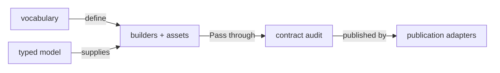

<details>
<summary><strong>Legend - vocabulary, models and renderer</strong></summary>

- the lists and constants have the finished vocabulary: tag, class, attributes, view, status and token;
- `AtfReportHtmlVocabulary.element(...)` and `voidElement(...)` compose the elements without any
  re-enter raw tags into views; `HtmlReportShell` exclusively holds the fallback shellum (`html/head/body/meta/title/style/script`);
- POJO-uri / Immutable records hold runtime data: quest, JSON, evidence and checks;
- builders and renderers transform the model into HTML/CSS/JavaScript;
- Validators check the output and adapters publish it; dynamic values do not become artificial enumerations.
</details>

| Information type | Owner | Rule |
|---|---|---|
| tag, class, attribute, element, view, status | `AtfReportHtmlVocabulary`, `HtmlReportShell`, `AtfReportAsset`, `ExtentReportRuntimeVocabulary`, `AtfReportStatus` | enum / unique constant; `element(...)` / `voidElement(...)` retains the form HTML; `displayValue()` produces the lowercase value for CSS / filter; without the literal distributions |
| Colours and geometry | `AtfReportColors`, `AtfReportCssSelectors`, theme tokens | stable token; output CSS determinist |
| CSS evidence | `AtfUiEvidenceCss` and theme / evidence providence | The selects and tokens are typed; the stylesheet is native to the CSS asset, and the dynamic values are only composition placeholders |
| module JavaScript | `HtmlReportScriptModule`, Builders and Runtime Section Modules | explicit orders and ownership |
| fields, body JSON, screenshot, checks | `ReportField`, `ReportJsonBody`, `ReportScreenshot`, `ReportCheck` | records / POJO immutable; legacy serializer is boundary |
| scenarios and phases | `ReportExecutionModel`, `AtfReportSemanticSnapshot` | Semantic tree, not markup |
| sentences, URL-uri, payloads, test values | input runtime | does not artificially convert into enumerations |

<details>
<summary><strong>Tags and annotations policy</strong></summary>

- **normalisation** - `trim` → elimination of empty values / null → lowercase with
  `Locale.ROOT` → deductions in order of first occurrence;
- **projection** - the canonical list reaches the categories Extent, snapshots
  Semantic and JavaScript legacy filters;
- **publisher** - passes through `ReportTagNormalizer`; does not call directly
  `assignCategory` with raw input;
- **statusuri** - `PASS`, `FAIL`, `WARNING`, `SKIP` and `INFO` are verdicts
  Typed in `AtfReportStatus`; `CLEAR` remains the UI filter separately;
- **proof** - component / integration tests of this policy belong to
  [specialised consumption](../atf-reporting-tests/README.md), are not duplicated in README library.

</details>

<a id="semantic-models-and-common-projection"></a>
<a id="modelele-semantice-și-proiecția-comună"></a>
## Semantic models and common projection

<details>
<summary><strong>Details - semantic models and common projection</strong></summary>

The code keeps two models of immutable with distinct local responsibilities linked to a common projection. Thus, there is no need to force the Extent renderer and the fallback to share the same internal structure:

| Model | Role |
|---|---|
| `AtfReportSemanticSnapshot` | Extent lifecycle population: class → scenario → phase → node |
| `ReportExecutionModel` | Fallback tree: scenario → phase → request / validation and `Overview`, `Categories`, `Failures` projections |

`AtfReportSemanticSnapshot.from(ReportExecutionModel)` is the common adapter:

- Fallback uses it for `semanticSnapshot()`;
- Session fails before render if the snapshots derived from the tree differ
  Lifecycle recorder;
- Projections keep package, metadata request / response JSON, validations and
  number of actions / screenshots;
- Semantic test compares Extent and fallback on the tree
  `class → scenario → phase → request → validation`;
- the models remain separate: `Overview/Categories/Fails` are specific to fallback,
  And the snapshots are the common renderer-neutral contract.

`ReportExecutionModel.projections()` collects the same population in a single renderer-neutral crossing and returns `ReportExecutionProjections`.

- `overview()`, `categories()` and `failures()` facades remain for
  compatibility;
- The aggregate may be used for the production of the aggregate.
  choose projections from different sources;
- The aggregate is pure: does not own lifecycle states or alter the IMMUTABLE tree;
- The removable recorder and projection remain separate responsibilities.

<a id="time-displayed-and-file-timestamp"></a>
<a id="ora-afișată-și-timestamp-ul-fișierului"></a>
### Time displayed and file timestamp

- The visible time uses `HH:mm:ss`, without `AM/PM`, in the navbar, Overview, Tests,
  Logs and Categories; the full date / time uses `yyyy-MM-dd HH:mm:ss`.
- `ExtentReportTimestampReporter` only adapts the presentation of Spark, including
  The expression categories of the vendor, in memory. Do not change JAR, courts, time zones, durations or payloads.
- `ReportingTimestampComponentTest` in `atf-reporting-tests`,
  checks midnight, lunch, after-lunch hours and canonical session. It is `@AtfComponentTest` sample; the standalone library remains independent of Test Kit; the browser sample does not enter the final inventory of standalone tests.
- The file name policy is separate from the time displayed; its options are in
  [Output contract](../docs/ATF_Reporting_Contract.md#numele-raportului-și-diferențierea-rulărilor).

<a id="zoom-for-overview--system"></a>
<a id="instantaneu-tipizat-pentru-overviewsystem"></a>
### Zoom for Overview / System

The relevant configuration of a run is published by a snapshot allowlisted-uit, not by the arbitrary dumping of YAML:

```java
var environment = ReportEnvironmentSnapshot.builder()
        .put(ReportEnvironmentField.ENVIRONMENT, "LOCAL")
        .put(ReportEnvironmentField.PROFILE, "users-posts")
        .put(ReportEnvironmentField.UI_TIMEOUT, "20 s")
        .build();
```

`ReportUiEnvironment` in `configuration.ui` forms common operational fields AutoEx / Shop: browser, target, timeouts and effective record policies. The consumer provides resolved values and adds only its API semantics; the formatter does not read YAML, JVM, Playwright or JUnit annotations.

The rules of the typed snapshots are explicit:

- `ReportEnvironmentField` holds the vocabulary and semantic classification:
  `Run`, `Targets`, `Browser`, `Time`, `Flow`, `Auth`, `Network`, `Evidence` and `Reporting`. The groups are metadata, not visual headers.
- `Overview/System` displays a flat list of label / value pairs. `Client` is
  The operational metadata of the `Browser` group; `Suite` and other contextual details do not reach this section.
- The generic FALD for `Client` is `Configured per execution`; Reporting
  do not assume that any run uses ApiTransport. The robot declares the concrete value (e.g. UI browser) only when it knows the actual channel.
- `ReportEnvironmentSnapshot` is immutable, ignores empty values and separates
  `displayValues()` (context typed) by `systemDisplayValues()` (operational allowlist for `Overview/System`). `ReportEnvironment` applies the editorial to Extent boundary.
- For a shared session, the robot compositions
  `includeScenarioEnvironment(snapshot)` with the solved data of each scenario. `ReportEnvironmentSnapshot.common(...)` maintains common values; differences or fields absent in a brother become `Mixed — varies by scenario`. The first scenario does not implicitly represent the entire suite.
- `ReportEvidenceProfile.actionDetailsMode` is transmitted to the scope of the
  publish the actions, including setup, unified flow and failure. The brothers can independently choose `included-collapsed` and `summary-only`; the validation fallback models keep the same policy. The selection of the summary does not delete the registered actions and does not remove the allowed screenshot.
- The old overloads with `Map<String,String>` remain for compatibility and
  migration. The new code prefers the typed snapshots, avoiding arbitrary keys, duplicates and non-actionable technical values in `System/Environment`.
- Snapshots do not replace the observed evidence: demand / response, retry,
  Screenshot and verdict remain in `TEST BODY`; `Overview/System` describes only the actual operational configuration of the run.
- `Suite`, `Test package`, `Flow`, `Fixture`, `Checkout` and business payload
  does not publish in `Overview/System`.

`ReportGherkinSequence` is an optional primitive composition on the scenario. It converts a repeated anchor into `AND`, keeps `AND` / `BUT` explicit and lets the consumer declare business groups; the renderer does not rewrite the narrative. AutoEx transmits the unique result to both checkpoint and its correlation.

A new consumer uses public contracts at the level of data:

| Data provided by the consumer | Contract typed | Publication |
|---|---|---|
| operational configuration per run | `ReportEnvironmentSnapshot` | `ExtentReportSession` or `UiExtentReportOptions.environment(...)`; System receives only the allowlist fields - look and redacted |
| cauzalitate per exchange | `ReportTraceMetadata` in `ReportExecutionEvidence` | `AtfReportPorts.Request.execution(...)`; request / response / execution remain together in the step that caused them |

The consumer builds the values at the composition root; the renderer does not deduct business facts from the title or YAML. The two contracts are not brought together in a session provider: the trace can vary at each exchange, while the snack system is stable during the report. The combined contract is checked with a synthetic consumer in `ReportTraceMetadataRenderingTest`.

</details>

<a id="atomic-start-of-scenarios-and-phases"></a>
<a id="pornirea-atomică-a-scenariilor-și-fazelor"></a>
## Atomic start of scenarios and phases

- The call-owned tags and scenario profile are validated prior to
  creating nodes; an invalid argument does not leave a node without usable handle.
- If semantic start fails after Extent node creation, compensation
  Withdraw the scenario / phase and the remaining new-class root. The original cause remains primary; a secondary compensation failure is maintained as `suppressed`.
- The Console sink provides best-effort diagnostics: runtime notification exceptions do not interrupt lifecycle or invent verdicts or HTTP exchanges.
- `TestRunInitialization` only closes the resources for which it received the handle;
  Reporting internal atomicity is not delegated to the consumer or Test Kit.

`ExtentReportSessionLifecycleTest` and `ReportEvidenceProfileIntegrationTest` protect invalid arguments, failure injected after Extent mutation, secondary compensation and re-use of the session. The samples are local and deterministic; do not require external endpoint or product journey.

<a id="the-commission-shall-adopt-implementing-acts-laying-down-the-rules-for-the-application-of-this-regulation"></a>
<a id="cauza-publicării-și-scope-urile-deținute"></a>
## The Commission shall adopt implementing acts laying down the rules for the application of this Regulation.

Direct publication and `UiFailureEvidencePublisher` uses the same `ReportPublicationScope` protocol: the original cause is preserved when the closure of evidence fails. The projection of the exchanges belongs to the internal collaborator `ApiEvidencePublisher`; the facade, models and API to the consumers remain the same.

| Situation | Propagated cause | Closing |
|---|---|---|
| Body or complete fails | Same initial court, including `Error` | each purchased scope closes once |
| Body / complete and close fails | initial with close error in suppressed | without reopening the publication |
| Only Close Failed | Same close error | without additional complete |
| Close throws the same court as body | initial, without self-pressure | one close test |
| Child acquisition fails | Same acquisition error | close the prisoner parent without close on the child not obtained |

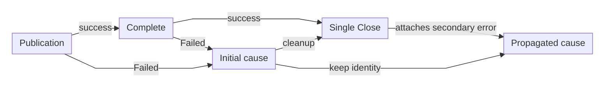

<details>
<summary><strong>Legend - ownership, order and projection API</strong></summary>

- The joint publication protocol closes the request and the validations created,
  including UI standard validation / media and API assertions.
- The diagram describes the common closure protocol.
  be separately in possession of the application and validation; the child closes before the parent, including after failure at assertions or complete.
- A defective child closes before the parent; its or her body and complete body do not
  be reexecuted to compensate for a close error.
- API Collaborator receives `UiApiValidationEvidence` and Reporting ports.
  Keep the API, the exchanges and the assertions assessed at the consumer.
- Collaborators remaining in-house implementation: without expanding the face of consumption,
  browser / JUnit dependence, new mode or relaxation of the type limit per package.
- Flow grouping, screenshot policies, timing and configured preview
  keep existing contracts; the cleanup does not reassess comparisons.

</details>

`UiPublicationFailureComponentTest` sample injects errors through public facade, in outcome, setup, checkpoint, media, trait API, flow unified in / over phases and delegated failure. The matrix also checks the child's acquisition, `Error` identical and multiple errors of cleanup, with child closure before the parent.

`UiFailurePublicationComponentTest` independently challenges the failure, directly and through the facade: ports without cleanup in cascade, partial acquisition, body / complete / close and same `RuntimeException` / `Error` court. The reported business cause remains separate from publication error; comparisons shall not be reassessed.

The common rule of verification is in [test guide](../docs/ATF_Testing_Guide.md#proba-fiecărui-owner-de-resurse).

<a id="contract-of-the-report"></a>
<a id="contractul-raportului"></a>
## Contract of the report

<details>
<summary><strong>Details - report contract</strong></summary>

Canon rules for visible hierarchy, inline glyphs, disclosures, viewport, responsive layout and browser verification are in [Display and layout contract](../docs/ATF_Reporting_Display_Contract.md). The section below only keeps the semantic contract and limits specific to the library implementation.

```text
TestCase
├── SETUP (opțional; precondiții / dobândire și verificare fixture)
├── TEST BODY (acțiunea și validarea)
│   ├── Request
│   │   ├── Request details + body (JSON / form / text / absent)
│   │   ├── Response details + body (numai pentru response capturat)
│   │   ├── Execution evidence
│   │   └── Contract validation (când este evaluat un contract al răspunsului)
│   │       └── aggregate assertion table
└── TEARDOWN (opțional; cleanup / read-back)
```

| Rule | Contract |
|---|---|
| ownership API direct | The response contract validation is the child of the demand that holds the exchange; the assessment table belongs to the Extent validation collapses the validation node; fallback envelops the void table in the original `Assertions · n` standard disclosure. Click, Enter / Space and Fails backlink keeps the owner, rows and PASS / FAIL / WARNING; empty validation does not invent table or discrete. |
| setup evidence | table `CHECK / EXPECTED / ACTUAL / RESULT` summarises the precondition; actual exchanges remain `API validation` distinct under the same checkpoint `SETUP` |
| format body | Require / answer keeps the captured format (JSON, form or text); a JSON contract is required by the consumer validator, not deducted from the HTTP method |
| body absent | Request / reply details remain present; `ABSENT` and `NOT_CAPTURED` have distinct explanations without invented payload; only JSON literal `null` captured becomes JSON document |
| child-free phase | a non-published content phase remains terminal node: the renderer does not display `＋/−`, does not make it flawless and does not invent steps in the assertions JUnit; actual content published in the phase remains interactive disclosure |
| component assertions | `Phase.startAssertionStep` publishes a typed child in the owner phase (`SETUP`, `TEST BODY` or `TEARDOWN`) without the need HTTP; `AtfAssertion` rows use the table, the editorial and common statuses in Extent and fallback. The step exists only when the effective assessment of the public assertions is made. |
| UI evidence | `SETUP` remains setup; in `TEST BODY`, the actions, observations, assertions and verdict UI are published under the sole title `UI validation` |
| assertions in flow UI | Extent and fallback keep their own disclosure `Assertions · n`, initially collapsed, for both the unified flower per phase and for the compact presentation over phases. All original rows, the configured preview, Enter / Space and the relay have samples at [Reporting Tests](../atf-reporting-tests/README.md#regresia-permanentă-a-fiecărui-defect-reporting). |
| the context of the flower | `UI flow context · n fields` presents the aggregation metadata per phase. `UI flow provenance · n checkpoints` keeps the origin of checkpoints over phases. Typed identity decides the section; fields HTTP / custom and actual exchanges keep their request / response / execution evidence. |
| UI `UNIFIED_FLOW` on one or more phases | The consumer calls `UiScenario.unifyAcrossPhases()` before the first phase and `UiPhase.completeFinal(status)` at the terminal phase. Exactly one `TEST BODY` body is eligible, including preparation declared inside that body. On UI-only success, Reporting publishes one UI validation with a ACTION table, a OBSERVE table when observations exist and an assertion table when checks exist, retaining every row in order. An allowed `FINAL` capture appears under Playwright, before the audit. `UI flow provenance` retains phases/checkpoints and verdicts separately from HTTP responses. UI+API, failed setup and explicit multiple-capture policies retain per-checkpoint validations. `completeFinal(FAIL)` in `SETUP` creates neither `TEST BODY` nor a final capture. Without opt-in, existing phase behavior remains. |
| layout | `＋/−` is inline before the sentence; Request details, Response details and Execution evidence are sister discharges in the quest; Contract validation is its child; UI / API validations are sister copies of the same checkpoint Gherkin |
| responsive evidence | Header and columns remain semantically visible and aligned to any width of the panel; insufficient space produces local horizontal scroll without overflow of the page, vertical cells or font shrinking |
| table running | Containers use `height:auto` and `max-height:var(--atf-table-scroll-height)` derived from `AtfReportThemeTokens.TABLE_SCROLL_HEIGHT` (`500px` currently); short content does not reserve empty space, long content runs under the fixed header. Last row and last column remain accessible. JSON / code panels do not enter this contract |
| common view policy | `ReportTableViewport` and `table-viewport.css` asset are common Extent / fallback; the cylinder implicitly envelops any data table including setup, execution and future families. The rule does not depend on the title, counter, phase or parent `validation`; the wrapper is focused for keyboard scrolls |
| the limits of the port | single Wrapper per table; layout tables `Status / Details`, children and screenshots do not enter the view. Legacy normalization verifies only the direct parent of the candidate table and reuses existing wrapper |
| scroll local la input | `table-viewport.js` isolates the wheel and navigation from the keyboard from the host panel; inputs, links, summits and code panels keep their behavior. There is one delegated binding without scans at each gesture |
| `TECHNICAL TRACE` | all `helm-trace-table` tables are wrapped by the common `atf-trace-table-wrap` marker; the whapper uses `height:auto`, `max-height:var(--atf-table-scroll-height)`, vertical scroll and stick header. Apply in Extent and fallback, strictly in the table, not in the external disclosure or JSON |
| Request details / retry history | `helm-request-table` metadata table and `retry-history-table` table use `atf-api-table-wrap` wrapper, common ceiling and stick header in Extent and fallback; Request JSON remains outside the wrapper and the external discoloration does not run the table |
| cardinality labels | `AtfReportLabels` is the common source Extent / fallback: `1 field/check/attempt/entry`, respectively plural for zero and more; publishers do not make up local labels |
| action number | each action displays `#n` in a dedicated token, `atf-ui-action-number`, compact (`inline-block` / `max-content`); do not reuse the `atf-ui-action-sequence` extensible class |
| screenshot | inline link to current emoji; payload Base64 for first bounded local appearance or reference (`screenshot-n`) for a weakened state; the fingerprint remains internal and is not displayed in place of the link |
| action table | relevant actions include `getText` / text extract; time occurs only for actions |
| failures | `Setup`, `UI action`, `Audit observation` and `Assertion` have distinct causes and `Open in Tests` |
| navigation | `Tests`, `Category`, `Fails`, `Overview` have accessible names; a transition preserves a single link `active` and `aria-current="page"`, aligned with the visible view- |

This API hierarchy should not be confused with the UI reporting: `UI validation` and `API validation` are semantic copies of the same checkpoint Gherkin, and each `API validation` has its exchanges.The verdict of a JUnit method is not a API demand and should not be introduced as method `ASSERT` / Synthetic route.

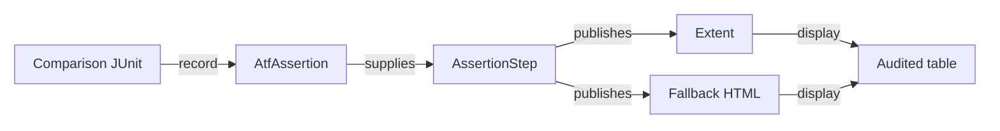

<details>
<summary><strong>Legend - proof of component</strong></summary>

- JUnit decides the method's verdict; reported row describes the same comparison.
- `AssertionStep` belongs to the phase and does not fall into the number of API quests.
- The two yields shall retain the same proof and status.

</details>

`AssertionStep` is a type of node distinct from `Request` and `Validation`.

- His status enters the status of the phase and scenario, and a FAIL row appears
  in `Fails` with the owner `component` and field `STEP`.
- Comparison values remain accurate, including numbers resembling statuses
  HTTP; no demand or duration of response invented.
- UI / API validations remain under their checkpoint or exchange.

- Compaction is a presentation projection for a successful UI-only flow with one or more declared phases; the model retains original action/assertion objects, provenance and verdict. Technical API request details remain in their channel; [narrow panels](#lizibilitatea-dovezilor-în-panouri-înguste) defines adaptive presentation.

<a id="phase-context-and-execution-diagnosis"></a>
<a id="context-de-fază-și-diagnostic-de-execuție"></a>
### Phase context and execution diagnosis

[ReportFailureDescription](src/main/java/atf/reporting/evidence/diagnostic/ReportFailureDescription.java) forms the safe summary of an existing exception: no more than four distinct objects, cause and suppressed in order of the breadth-first, with identity for cycles. Redaction precedes the total limit of 240 characters, including ellipsis. The original graph and verdict do not change; the summary is not proof of demand.

AutoEx and Shop adapt the summary to their own phase and exchange. Generic graph and publication samples Extent / fallback are in [Reporting Tests](../atf-reporting-tests/README.md#diagnosticul-neutru-al-excepțiilor); composition and business rules remain checked in application modules.

| Input | Owner and projection |
|---|---|
| `Phase.detail` | Internal context; do not publish `Audit details`, log table or empty wapper in phase |
| `Phase.diagnostic(Kind, message)` | explicit diagnosis of the scenario, redacted; does not create demand or business assertion |
| Request / validation | Keep HTTP evidence and contracts effectively assessed |

`ReportPhaseDiagnostic` delimits the compatibility for `Failure cause`, `JUnit failure` and `API contract association`. The rest of the phase details do not become diagnostic by deduction. `ReportPhaseDiagnosticMarkup` is the common projection Extent / fallback; Fails retains the real cause of failed phases.

- In Extent, `extent-scenarios.js` includes the diagnosis in the script panel
  and eliminates the vendor wrapper; closing hides it, normalization does not double it.
- Without exchanges, HTTP or PASS is not invented; a diagnosis
  The Association does not change the JUnit verdict alone.
- The model retains the status of the source phase; Fails does not assign a failure to the notes
  from a phase that didn't fail.
- `Setup evidence` and the aggregated inspector remain distinct channels.

<a id="api-evidence-attached-to-a-ui-step"></a>
<a id="dovezi-api-atașate-unui-pas-ui"></a>
### API evidence attached to a UI step

A consumer may attach one or more `ReportExecutionEvidence` to the same checkpoint UI via the `UiExtentReportSession.step(...)` overload. Reporting does not create an artificial test and does not recalculate the verdict; it designs the exchange in the existing contract of the quest:

```text
UI checkpoint
├── UI validation → actions, observations, assertions și screenshot inline
└── API validation (numai când există exchange-uri selectate)
    └── HTTP exchange
        ├── Request details → method/path/url/auth/headers/transport/replay + REQUEST JSON
        ├── Response details → status/content-type + RESPONSE JSON (numai pentru response capturat)
        └── Execution evidence → attempts/retries/duration/outcome
```

- `request.action`, `request.target`, `evidence.type`, and `evidence.policy` are
  internal context of checkpoint: remain in the model and in the configured diagnosis, but not published in the tables required / replies. `EvidenceTableFormatter` applies the same Extent projection, fallback and legacy, with exact match of keys, regardless of casing;
- type `ui-validation` delimiting policy filtering; explicit contracts
  `api-trace` / `unified-ui-flow` and `ui-failure` catch diagnosis remain unchanged;
- the UI checkpoint receives neither `Request details`, `Response details` nor a
  `Status / Details / Info` introduction table for identity or politics. Without public fields / payload, the renderer does not create an empty log;
- Playwright action targets, screenshots and assertions remain in
  `UI validation`; real HTTP fields remain public at the API exchange;
- Displosures are closed by default and belong to the API exchange;
- in the UI consumption, the target form is' one step Gherkin → UI validation +
  API validation → exchange discharges'; the two nodes validation are semantic copies of the same step and have their own statuses;
- `UiApiValidationEvidence` is the only API input for checkpoint, setup,
  Final catch, trays and the unified flower buffer. Intractions with gross lists of exchanges are removed without overload or fallback. UI-only explicitly uses `UiApiValidationEvidence.empty()`; an observation without checkouts remains an exchange typed without inheriting the UI verdict;
- `UiApiValidationEvidence` typed publishers separate the assertions UI from those
  API: correlations are attached to the validation of API, and each exchange retains its own assertions / status. Checkpoint status aggregates up without recoloring the children or brother exchanges.Business verdict is explicit in assertion, not only deducted from HTTP status;
- `apiTrace(...)` must not produce a second card visible with the same
  Gherkin title as UI checkpoint. If a consumer has API evidence for the same sentence, the publisher must attach the validation to the existing node or use an equivalent composition without duplication;
- `Exchange n` is a local identifier in `API validation`; do not return to
  `API n · ...` flat keys and do not multiply the Gherkin sentence for different quests;
- `Execution evidence · 1 attempt` cannot remain a repeated title without
  context: the exchanger must be identified by the parent disclosure or by means of a semantic label per exchange;
- `API network inspector` only accepts HTTP exchanges and checkpoints
  their causative; there is no generic channel for diagnosed consoles / pages;
- `Technical diagnostics` is derived only from failed HTTP exchanges and
  remains obvious transport, not a Gherkin step or business validation;
- Technical nodes use the common visual focus, but do not invent a verdict
  or status for an exchange;
- the technical children of these nodes inherit the same visual family without
  receives an artificial verdict or new Gherkin card;
- UI projection uses the same semantics and editorial policy as API ratio
  direct: browser headers and volatile headers are filtered and stable headers are optional;
- bodies use the `reporting.bodyMaxDisplayCharacters` consumer limit;
- The editor precedes the render; the default is `100`, and `0` deactivates
  limit for body preview;
- the renderer does not introduce a hardcoded limit;
- the consumer provides typed data and `atf-reporting` only publishes
  Semantic contract and verifiable layout, independent of mock, browser and app.

The verdict is calculated by execution / validation and only published by reporting. The Renderer does not invent statuses.

<a id="api-execution-completed-unanswered"></a>
<a id="execuție-api-terminată-fără-răspuns"></a>
### API execution completed unanswered

`ReportExecutionEvidence` may have absent responses and metadata typed `Termination`; they belong to the execution, separately from HTTP. `ApiExchangeEvidence.publish` maintains the known quest, history and diagnosis including without responses. `publishFailure` also allows the URL-ul resolved by the caller; none of the entries decides the consumer's verdict.

`UiApiValidationEvidence.Exchange` requires captured demand. Without replies, the explicit status different from INFO or the assertions assessed provides the verdict; the absence of both is denied by `IllegalArgumentException` prior to publication. INFO alone is observation, not verdict. An empty API channel remains valid and INFO.

A FAIL terminal request is indexed in Fails and without assertions via `ReportExecutionFailure`. The context, application and time available come from the same evidence execution; PASS neighbours do not provide identity fallbacks.

- Backlink opens the original Execution evidence, including after reload.
  Extent keeps the `execution` type and its ordinal; fallback follows the order of the common projection. Different types have distinct navigation identities.
- An expected transport error and judgment PASS is not indexed.
  terminal and a business comparison FAIL remains distinct evidence, each once; the shortened text is not the key to the deduction.
- In Fails, the assertion and diagnosis of execution remain distinct entries and
  The orderly chain of causes appears in a single diagnostic input per scenario; the original rows remain in Tests, and the backlink opens the source row of the diagnosis.

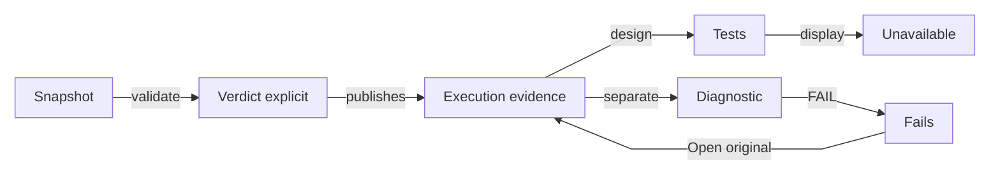

<details>
<summary><strong>Legend - Extent parity / fallback and compatibility</strong></summary>

- The `ReportModelAdapters.partialExecution` legacy signal requires availability
  explicit by Optional; existing Reporting builders remain available. Core models do not enter the standalone library's ranking.
- The unresponsive Sentinel becomes Unavailable in the history displayed; no
  invents status, body or response duration for terminal testing.
- Termination and diagnosis are in the performance disclosure.
  In the absence of response, no discrete Response details are manufactured.
- Each valid exchange remains API child in setup, checkpoint, final validation,
  Unitary trays and flow, including between phases. Lack of response does not filter the exchange and renumerate the neighbors. FAIL / SKIP from assertions dominates PASS transmitted by the caller; PASS for an expected failure requires its explicit verdict.
- A URL solved unknown remains empty; the route does not become a URL invented or
  An order replay.Absent termination does not receive an alleged cause.
- Zero discharges keep the selected transport without claiming that the network
  was executed or that the manual replica would have checked.
- The full text is written before the full ceiling of 240
  characters, including ellipsis; the customised budget applies to the projection.
- `TerminalExecutionProjectionTest` and `TerminalApiExecutionReportTest`
  check the model, Extent / fallback, the editor, the keyboard and the last row.
- `ReportingStandaloneVerdictComponentTest` protects the standalone boundary, and
  `UiTerminalExchangeReportComponentTest` checks UI / API tree, diagnosis, testing, totals and dislocator in Extent / fallback, with implicit and customized budget. The samples use local snapshots without HTTP Display.
- The total pass-like in Overview is PASS + WARNING in both renderers;
  WARNING remains distinct in the tree and does not become a failure in Fails.

The short labels shall be kept as follows:

| In the scheme | Full meaning |
|---|---|
| Snapshot | Snapshot consumer |
| Verdict explicit | status call different from INFO or assessed assertions of the unresponded exchange |
| Execution evidence | Execution evidence + Termination |
| Tests | In order tests |
| Diagnostic | Performing Diagnosis |
| Unavailable | Uavailable, without HTTP invented |
| Fails | index of the case typed, with jump to original proof and identity of navigation retained |
| display | display absence |

</details>

<a id="be-decisions-without-default-success-verdict"></a>
<a id="decizii-be-fără-verdict-de-succes-implicit"></a>
### BE decisions without default success verdict

AutoEx / Shop adapters publish recovery decisions by INFO observations, with the policy and budget in Expected, and the decision, reason and time in Observed. These rows do not represent repeated clicks and do not rewrite a published FAIL. Receiptor and source of policy, operation, trial and time / back / total are auditable observations; body HTTP and the credentials are not captured.

The existing projection keeps the disclosures and the ceiling configured after the full text is redacted. The aggregate recovery indicator, SKIP port and the complete UI / UI_API matrix remain in [audit feedback](../docs/feedback/ATF_Reporting_Feedback.md#ui-recovery-audit-01--încercări-inspectabile-în-extent).

<a id="background-to-error-prior-to-technical-diagnosis"></a>
<a id="contextul-erorii-înaintea-diagnosticului-tehnic"></a>
### Background to error prior to technical diagnosis

`UiFailureContext` designs the first FAIL proof in order of `sequence`: type of exception, operation and number, target, time measured and waiting. The same projection appears in `Failure cause`, Observed and Fails. PASS does not become the cause of any subsequent exception; the lack of failed action or exception is explicit and OBSERVE is still the source.

- The native message of a timeout belongs to the separate diagnosis in Tests.
- `elapsed` is the time of the action captured, without deduction of the deadline from the exception.

`UiFailureEvidencePublisher` holds the publication of this evidence through neutral ports Reporting; `UiEvidencePublisher` delegates it to the default-paths, without JUnit, browser or reassessment of the business verdict.


<details>
<summary><strong>Legend - context, relationships and boundaries</strong></summary>

- The context uses only captured evidence; does not leave a stack for
  Invent dispatch, HTTP response, navigation confirmed or recovery.
- Diagnostics `INFO` in Audit Observations keep type and message
  the primary exception, causes and suppressed, with numbered relationships. The common references and cycles are finished; the throwable and original rows remain intact.
- Redaction the entire value precedes the configured ceiling, implicitly 240 inclusive
  ellipsis, and for each diagnosis. Expansion does not publish unlimited gross text.
- Safe / safe edges include redaction and ceiling; area separation
  does not create a secondary path for the publication of gross values.
- Fails prefers the context of the UI assertion to the technical diagnosis of the phase;
  The diagnosis remains in Tests. API maintains its causal chain and its own owner.
- FAIL verdict, identity correlation and policy without replication remain
  responsibilities distinct from this projection.

</details>

| Surface | Observed contract |
|---|---|
| Tests → UI action sequence | Operation, target, duration measured and context of first evidence FAIL |
| Tests → Audit observations | Distinguished INFO diagnoses: type / primary message, causes, suppressed and original observation; each complies with the budget |
| Fails → Cause | Compact context; native message and redaction marker are not mandatory in this summary |
| Open in Tests | the scenario and the ordinary of the failed comparison opens the original path in Extent; the phase, the quest / step, validation and discoloration become visible without `Expand all` |

`UiFailureReportContractTest` checks the surfaces through the real UI facade; `UiTimeoutReportComponentTest` checks Extent / fallback to 240 and 18, the redaction of the entire HTML, diagnostic relationships, isolation and backlink.The negative samples detect the elimination of native diagnosis and the exposure of a credential in DOM.

<a id="capture-at-the-fault"></a>
<a id="captura-la-failure"></a>
### Capture at the fault

- Adapter throws `UiCheckpointFailure(message, assertions)` with courts
  exact of the assertions UI FAIL published in the current scenario.
- In Fails remains the original assertion; diagnosis of propagation and capture
  The final remains in `Failure evidence` in Tests, including unified flow.
- No comparison of titles or messages. Normal exceptions, different courts
  with the same content, the failures of API and cleanup / independent actions remain separate.

`Failure evidence` keeps the actions executed and the original cause. `UiFailureScreenshotState` assesses policy before payload:

| Status | Condition | Image link |
|---|---|---|
| `DISABLED_BY_POLICY` | Policy excludes capture at failure | absent |
| `UNAVAILABLE` | Payload null, empty or whitespace | absent |
| `INVALID` | Base64 incorrect or non-PNG signature | absent |
| `CAPTURED` | Allowed catch, encoding Base64 and accepted PNG signature | inline with emoji |

- `ReportScreenshot.hasPngSignature(...)` checks the encoding and signature PNG;
  does not decode pixels and does not guarantee full image integrity.
- `Screenshot` observation has `OBSERVE` source and `INFO` status; does not become
  business assertion and does not create a second checkpoint.
- Extent and fallback shall keep the content of the published actions and catches,
  not only meters; UI step does not receive fictional HTTP metadata.

<a id="terminal-audit-in-ui-validation"></a>
<a id="audit-terminal-în-ui-validation"></a>
### Terminal Audit in UI validation

- Terminal contract validation publishes exactly one `Audit screen contract` observation in `Audit observations`, in the same validation as actions, assertions and capture; it does not create a second Gherkin checkpoint.
- The observation has `OBSERVE` source, does not become Playwright action or assertion
  duplicate. It shall be recorded prior to drainage of the publication sequence.
- The remark identifies the subject matter, the contract verdict, the number of assertions,
  status of the catch and safe URL-ul; does not copy bodywork or secret.
- Screenshots are outside the action table view immediately after
  This is the actual profile. The path without catch explicitly declares absence; an invalid payload is not presented as valid PNG.
- Assertions remain the source of the verdict; a catch does not prove `PASS` alone.
  `FINAL_ONLY` does not invent the final state after a failed setup.

`ExtentReportUiEvidenceRenderingTest` checks generic DOM and `ACTION` / `OBSERVE` separation; Shop / AutoEx terminal samples check local mappings, the uniqueness and order of `record → drain`. The browser verification of a changed layout remains distinct from these automatic samples.

`UiAuditLifecycleTest` checks the failure separately, including empty payload, deactivated policy and lack of executed actions. The visible status is observed in `Failure evidence`; internal metadata remain filtered from HTTP.

<a id="aggregated-ui--api-flow-inspector"></a>
<a id="inspector-agregat-pentru-flux-uiapi"></a>
### Aggregated UI / API flow inspector

`ReportNetworkInspector.JourneyAggregate` is the semantic projection of the journey; it is not a second stage and does not replace the canonical outlook of an exchange.

The contract for a summary requested shall be:

- Lifecyclem shall publish it once after the UI / API checkpoints and evidence failure, just prior to the phase closure;
- the summary is the last technical node of `TEST BODY` without checkpoint or proof of failure after it;
- an explicit request without exchanges produces `0 exchanges`; a UI-only profile omits it by not requesting it;
- The summary remains informative (`PASS`); the verdict belongs to checkpoints and script.

`networkInspector(..., ReportNetworkCaptureStatus)` Overload adds `Capture coverage`: scope, accepted / retested / excluded / dropped, pending catches, ceiling and separation of setup / causal. `Complete within scope` requires zero losses and zero ongoing catches at snapshot; no future traffic promises. Without optional metadata, API previously does not invent completeness.

| Situation | What the report expresses | What it does not infer |
|---|---|---|
| Zero exchanges, full catch | there is no causal traffic in the scope at snapshot | absence of all browser traffic |
| Catch with overflow or ongoing | `Incomplete within scope`, with explicit totals | FAIL business verdict or manufactured requests |
| Setup + causative traffic | The aggregate shall be counted on a causal basis. | doubling precondition in the causative total |

`uiValidation(..., apiEvidence, capturePoint, status)` keeps the terminal exchanges with the final screen as brothers of the UI validation without repetition of the Gherkin sentence. Probes: `NetworkCaptureEvidenceTest` in `atf-reporting-tests`, including artifact and local browser.

`NetworkInspectorSummaryRoleTest` checks order in both randing modes.

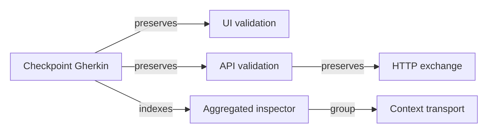

<details>
<summary><strong>Legend - what enters the aggregates and what remains local</strong></summary>

- `authentication` only groups method / source / status / count; semantics is
  `observed`, not the validation of tokens, issuers or clams; the presence of a Cookie does not certify the identity or authentication of the user;
- `correlation` shall maintain the link between checkpoint and the resulting exchanges;
- `transport` numbers observations, success / failure, attempts, retries and
  provenance live/mock/unknown;
- `signatures` groups the safe-deposit box with count and statuses and displays it
  only once as a compact card with method, route, authentication, evidence source and phase;
- `diagnostics` deducts the failures HTTP after method / route / status / reason and
  keep `count` and the transport source; browser signals without an associated exchange are not collected and cannot enter the aggregates;
- JSON bodywork, sensitive headers and execution details remain in the disclosure
  canonical of the exchange; not copied in summary;
- the index attached to the inspector's request contains only three facts bound:
  the number of canonical exchanges, the number of Gherkin steps and the number of unique signatures; the completed steps appear only in `Scenario correlation` and the requests only in `Unique request signatures`;
- the signature of the request and the digests of the body remain an internal identity for
  grouping/retry; the public HTML displays only `body=present|absent` and the bounded `internal digest hidden` marker;
- the consumer selects the evidence before publisher, by contract typed;
  the renderer does not decide which requirements enter;
- `Overview → System` is not an owner for trac, auth, diagnostic or body;
  they belong to the inspector / evidence.

</details>

The Thracian contract shall be read as follows:

- generic brigade publishes the aggregate in a single collapsed `TRACE` node,
  with disclosures nested for auth, correlation, transport, signatures and diagnoses;
- for checkpoints with multiple exchanges, lower- level pipeline
  keep `API validation → Exchange → request → response → execution` without duplicated JSON; the retry remains in the record of the same exchange;
- the consumption attaches API validation to the same Gherkin node with `UI validation`;
  the technical diagnosis of transport comes from the exchange and does not introduce an additional Gherkin sentence.

The contract is verified by the [`keepsUiAndApiValidationUnderOneGherkinCheckpoint`](../atf-reporting-tests/src/test/java/atf/reporting/ui/ExtentReportUiEvidencePublishingTest.java) component test: the Gherkin title appears once and the validations UI / API and the exchange evidence coexists under that checkpoint. A duplicate Gherkin card is regression of this contract, not an active ToDo.

</details>

<a id="production-structure"></a>
<a id="structura-producției"></a>
## Production structure

<details>
<summary><strong>The inventory of the maintainer - packages, resources and ownership</strong></summary>

[Package Atlas](src/main/java/atf/reporting/README.md) is the entry for local revision; the inventory below then allows to find concrete details.

<details>
<summary><strong>Details - production structure</strong></summary>

| Boundary | Owner Main | Verifiable output |
|---|---|---|
| semantic/model | `semantic`, `model`, `contract` | Snapshot, execution tree, status and assertions |
| markup/render | `markup`, `html`, `extent` | Extent nodes and Fallback HTML |
| asset/theme | `asset`, `theme`, `runtime` | CSS / JavaScript native, vocabulary and manifesto |
| audit/publication | `ui/audit`, `artifact`, `publication` | contracts, inspector, workspace and final artifact |
| input/config | `api`, `configuration`, `evidence` | request / response / evidence typed and policy of output |

<details>
<summary><strong>Details - internal map and split CSS / JavaScript</strong></summary>

```text
atf.reporting
├── semantic/       snapshot, recorder facade, lifecycle orchestrator și state aggregate mutation intern
├── model/          execution tree și evidence POJO
├── markup/         Extent nodes, assets și vocabulary bridge
├── html/            fallback document și script builder
├── theme/           tokens, CSS selectors, theme/evidence providers
├── runtime/         JavaScript Extent split pe responsabilități
├── ui/              contracte, audit și UI lifecycle
│   └── model/       evidence rows tipizate pentru acțiuni UI
├── api/             acceptance/report contract și JSON evidence audit
├── artifact/        inspector și contracte ale artifactului
├── publication/     workspace, coordinator, finalizer
├── configuration/   reporting settings și environment
└── evidence/        transport/UI evidence și style contract
```

CSS / JavaScript splits are semantic, not cosmetic. `ExtentReportRuntimeBehaviour` composes core / tests / overview / evidence / navigation / durability / failure; theme / evidence providers own related CSS-ul. No more classes are created just to reduce the number of lines.

For navigation, the limit is explicit and verifiable: `ExtentReportRuntimeNavigation` composes three native JavaScript assets--DOM contract, discrete and controller - via `ReportAssetComposer`. Java facades remain only semantic and no longer retain inline bodies; component tests check both published functions and manifest The `Scenarios`, `Categories`, the evidence fragments and Overview CSS comply with the same limit; `AtfReportOverviewCss` now composes separate native assets for layout, tag audit, category tables and category status. The same limit is applied to the theme Extent: responsive, base, category / category-status, Fails layout / status, navigation, script and detail are native CSS assets, and Java facades only solve tokens and composition seams. Evidence interaction / table / disclosure / stack and fallback theme uses the same boundary. The published HTML no longer includes `onclick` inline; hash links are the static contract and the native controller activates them by hash.

The geometry of discoloration is a common contract in Extent and fallback: the usual summers API / UI uses `34px`, `9px 12px` padding and the common line-height. `Unique request signatures` and `Technical diagnostics` rows in the Network Inspector keep the same compact height `34px`, collapsed by default; double summary style does not apply to aggregated rows and does not leave empty vertical space when the title falls in a row. In viewport narrow, text can flow naturally without changing the default height of the ordinary case.

The height of the table area is a separate contract: `TABLE_SCROLL_HEIGHT` (`500px`) is the common ceiling, published as `--atf-table-scroll-height`. Containers have `height:auto` and `max-height`, thus short content does not reserve empty space and long content runs within the same ceiling. Headers remain fixed; contract covers Overview, audit, UI evidence, aggregates API and `TECHNICAL TRACE` table in `Response details`, plus request metadata and retry history in `atf-api-table-wrap`. Trail and CSS-ul viewXul port are common to Extent renderers and fallback; browser sample checks API directly and API trace Published as a causative brother of a checkpoint UI.

</details>

<details>
<summary><strong>Details - runtime Overview, Scenarios, Categories and Fails</strong></summary>

Fallback navigation and Extent document boot follow the same rule: `fallback-navigation.js` and `runtime-boot.js` are native assets and `HtmlReportNavigationScript` and `ExtentReportRuntimeBehaviour` are just facade / publication seams typed. JavaScript Extent modules are injected into the boot placeholder without the boot Java to rebuild executable functions or expressions.

The same limit is now applied to the `ExtentReportRuntimeOverview` family: `Audit`, `Labels`, `Charts` and `Cleanup` family are separate native assets, and the `Fragment` enumeration remains the command of the Order Root. Java no longer contains function bodies; it is exposed by testable facades and `ReportAssetComposer`.

`ExtentReportRuntimeScenarios` and `ExtentReportRuntimeCategories` use the same border: `extent-scenarios.js` and `extent-categories.js` have browser functions, and Java only keeps the public facades and typed vocabulary. Thus, filtering, script annotations and deep- links to Categories can be checked in a component without re-entering the literal JavaScript in runtime classes.

Evidence follows the same separation: `ExtentReportRuntimeEvidenceDisclosure`, `ExtentReportRuntimeEvidenceFailures` and `ExtentReportRuntimeEvidenceTableLayout` are small Java facades over `extent-evidence-disclosure.js`, `extent-evidence-failures.js` and `extent-evidence-table-layout.js`. The first normalizes request/response/JSON/assertion disclosures, the second projects UI failure evidence, and the third measures actual values and publishes deterministic column widths. Layout stays separate from evidence semantics, with one owner per responsibility.

The implementation invariants of these assets are documented here, outside the JavaScript payload: `table-viewport.js` handles keys only while its viewport has focus and leaves nested controls in charge of their own keys. It captures the wheel before vendor handlers to retain local scrolling. Evidence disclosures reuse the canonical media link and listen to `toggle` during capture because that event does not bubble. The JSON disclosure retains its owner and stays separate from the adjacent trace. Scenario normalization moves only explicit diagnostics into the panel and removes the vendor log wrapper. Shared allocation retains measured technical-column widths and distributes only the remaining flexible-content demand. The legacy adapter inspects the table's immediate parent; Java markup owns the new viewports.

`appendUiFailureEvidence` is running on `request` and `validation` typed nodes: the quest holds API failure and the UI validation holds the failure Playwright / audit / Assertion. `Fail` leaflets are attached to the event table of the same owner, with UI case Concrete; UI- only does not receive the disclosures Request / Response invented. `ExtentReportRuntimeEvidenceLifecycle` holds the order of this normalization.

In Java markup, `ReportEvidenceDisclosure` is the typed model of a collapsible region, while `ReportEvidenceMarkup` supplies the shared disclosure shell and status badge. `AtfReportMarkup.tableHtml` builds canonical key/value tables; `ReportEvidenceJsonFormatter` owns the shared label → redaction → pretty print → display-limit policy. The Extent renderer and HTML fallback receive the same typed `ReportField` list and JSON display policy. Only the publication adapter differs: Extent Markup versus a HTML document. Component/unit tests protect parity without an additional E2E.

`AtfReportStatus` is also the unique owner for the inline marker, human label and compact result; renderers do not define local switches for emoji or status text, and the HTML fallback uses the same typed presentation as the UI highlight.

`Fails` is now separated by native responsibilities: detection, context, cause-chain and projection have an asset JS and a facade Java. `ExtentReportFailureRuntime` composes stable order without having function bodies; so tests can independently verify the cause, context and rendering of the fault without browser, and E2E test checks the Deeplink to the exact test.

The final audit of the CSS vocabulary / building and small publishing seeds is covered by the component contracts and the standard / responsive fresh gear. Any future change remains incremental and requires the same evidence; there is no TODO open just because the assets are divided into native files. `AtfUiEvidenceCss` is facade typed over `ui-evidence.css`, and `Duration` and `RuntimeCore` are composed of native JavaScript assets; none of these families assemble large bodies in Java. `ScenarioCss` is facade typed over `theme-scenario.css` and `ExtentReportNavigationView` only publishes markup and hash links; does not generate JavaScript anymore `ExtentReportCategoryMarkup` uses the same semantic construction for the category shell. typed vocabulary governs tags, classes, attributes and empty state, and `atf-fails-view` vendor marker is kept only as the documented insertion boundary. `ExtentReportCategoryMarkupTest` verifies idempotency separately, order in DOM and contract CSS / accessibility. `HtmlReportFailsView` uses the same primitives for Fails fallback, including semantic status, scenario-level and empty state links; thus the Extent / fallback parity is verifiable by LOWER-level tests. `HtmlReportTestsView` and `ExtentReportPublicationPipeline` use the same boundary for scenarios, Phase / request nodes, theme and view identifiers. `ExtentReportScreenshotDeduplicator` keeps the fingerprint only internally for deduction; in the ratio remains the inline link with the current emoji, not a hash displayed. `HtmlReportScriptBuilder` remains only generic infrastructure for typed / custom ports and tests; it is no longer used to build navigation or boot in production. The formatting rule is explained: `.js` / `.css` in the classpath remain multi-line and easy to revise, and `ReportAssetCompactor` compacts only the copy injected into HTML.

</details>

<details>
<summary><strong>Details - function ownership and duration</strong></summary>

Further migration is incremental and requires an equivalent component contract, live reconciliation and a fresh report; do not mechanically convert every Java constant into a token if that would hide the contract or complicate debugging.

JavaScript functions generated have the same rule of ownership: each published function has a single owner runtime and a single authoritative definition. The orchestration function is not subsequently reunited with another string; the reading of DOM, data derivation and projection in DOM are separate helpers and named after responsibility. `ExtentReportFailureRuntime` maintains one single `failureContext` and a single `renderFails`.

The duration is issued by the unique seams with owner, composed by public façade `ExtentReportDurationRuntime`:

| Seam | Responsibility | Component proof |
|---|---|---|
| `ExtentReportDurationParsing` | read, normalize and formatting durations | Parsing functions declared once only |
| `ExtentReportDurationDom` | crossing DOM, selects and identity of node | The selectors / attributes are not literally scattered |
| `ExtentReportDurationMemory` | Remembrance of measurements and lasting lookup | precedent between marker, path and node id |
| `ExtentReportDurationAggregation` | copies, evidence of transport and aggregation of nodes | direct duration vs. aggregate |
| `ExtentReportDurationProjectionLookup` | resolution of the scenario card | separate look-up rendering |
| `ExtentReportDurationProjectionViews` | Categories, Overview, Fails and projections | each view keeps its owner |
| `ExtentReportDurationProjectionPublication` | badges, summa-ness and publication of class duration | consistent output in all tables |
| `ExtentReportDurationScheduling` / `Lifecycle` | scheduling, click hooks, observer and boot | Idempotent activation and ready marker |
| `ExtentReportDurationVocabulary` | Typed contract for attributes, selectors and functions | Static verified cardinality and uniqueness |

- Overview projects the canonical durations of the classes in total, model and bars
  Timeline; does not use the total native of a class already completed during the suite.
- `OverviewDurationProjectionComponentTest` performs the actual asset and checks
  Zero, fallback, identical names, refresh and isolation of status charts.

Navigation also has a separate asset, `extent-navigation-performance.js`, composed by `ExtentReportRuntimeNavigationPerformance`. It does not decide the verdict and writes business content; it only displays an optional diagnostic snapshot through `window.__atfReportPerformance`, with the number / duration of normalisations, relevant bursts, toggle, readiness, loading, first toggle and long- tasks available to the browser. `html` by `data-atf-performance-*` attributes, so that an adapter MCP / component can observe the same evidence without direct access to `window`. The controller consumes this seam by small functions (`atfPerformanceStart/End`, `atfPerformanceBeginReadiness`, `atfPerformanceMarkReady`, `atfPerformanceRecordDisclosureToggle`), so that the component tests can check the ownership and order without browser, and MCP tests can audit the actual cost of a fresh artifact. Java typed Boundary is `ReportRuntimePerformanceSnapshot` + `ReportRuntimePerformanceBudget`: Snapshots can be built from the map returned by the browser, and the budget is configurable for each fixture and produces only technical violations, not business verdict. The native Asset remains formed, and the public compacts it with the rest of `.js`.

`ReportArtifactInspectorTest` and runtime contracts check the uniqueness and presence of these sessions in HTML published. Dynamic strings are composed locally through small fragments and `String.join`; lists print browser protocol, not runtime data. Any remaining mixed function is justified in feedback through a concrete semantic contract, not through a cosmetic line split.

</details>

<details>
<summary><strong>Details - composition root and component contracts</strong></summary>

The `ExtentReportRuntimeModule` registry is the single composition root of the injected runtime. It maps each controller to one `HtmlReportScriptModule` and publishes it in `CORE → TESTS → OVERVIEW → EVIDENCE → NAVIGATION → DURATION → FAILURES → FAILURE_CAUSE` semantic order. `ExtentReportRuntimeBehaviour` orchestrates boot/ready and iterates the registry instead of repeating the class list. `Duration`, `Evidence`, `Overview`, `Navigation`, `Tests` and failure projection can therefore be tested independently; integration checks composition and ordering.

| Controller | Boundary inmate | Main component contract |
|---|---|---|
| `ExtentReportRuntimeCore` | DOM vocabulary, query, identity and status | Printed primates, unique declarations |
| `ExtentReportRuntimeTests` | Test / Categories filters and scenario projection | status/tag filters, category links |
| `ExtentReportRuntimeOverview` | audit, summary, chart and percentages | Overview projection without false evidence |
| `ExtentReportRuntimeEvidence` | roles, disclosure and evidence of failure | request/response/assertion/UI evidence |
| `ExtentReportRuntimeNavigation` | hash, tab, collapse and Deeplink | navigation and `＋/−` inline |
| `ExtentReportDurationRuntime` | parsing, measuring, aggregation and publication | durance precedence and clone parity |
| `ExtentReportFailureRuntime` | failure states, rows and cause chain | an owner for Fails and Diagnostic |

`ExtentReportRuntimeModuleTest` checks non-empty source, the publication owner, the order of modules and the fact that a JavaScript function is not declared by two modules. It is a cohesion contract, not a cosmetic check of the number of lines; browser behaviour remains checked separately by ATF Debug and Playwright MCP.

</details>

<details>
<summary><strong>Runtime Vocabulary</strong></summary>

- **unique owner** - `ExtentReportRuntimeVocabulary` holds the function name
  Injected DOM selectors, `data-atf-*` attributes, CSS semantic classes and status finite values;
- **emission** - `ExtentReportRuntimeCore` publishes primates in stable order,
  by small emitters; the protocol is not rebuilt in strings concatenations;
- **composition** - `ExtentReportRuntimeModule` retains semantic order and
  Mapping each controller to a single asset / modules;
- **boundary** - vocabulary, model and assets remain responsibilities of
  the library; fixtures and browsers belong to the consumer;
- **external proof** - component / integration / E2E matrix, test contracts and
  the cohesion limit is documented in [README-ul `atf-reporting-tests`](../atf-reporting-tests/README.md).

</details>

<details>
<summary><strong>Composition consumption</strong></summary>

`atf-reporting-tests` composes reporting with mock transport, execution, validation, API fixtures, Playwright and ATF Debug. These details stay outside the `atf-reporting` package and are documented in [`atf-reporting-tests/README.md`](../atf-reporting-tests/README.md) and the Extent test README ([`ui/tests/extent/README.md`](../atf-reporting-tests/src/test/java/atf/ui/tests/extent/README.md)).

Reporting only shows contracts; it does not have the structure of the test- kit, locators, fixtures, API setup or composition roots. A consumer test can use the contracts reporting without the library importing the test code backwards.

The structure of the packages, annotations, mock YAML, Playwright locators and the unitary / component / integration / E2E division are consumer details and are only followed in dedicated README, do not duplicate in this library.

</details>

</details>

</details>

<a id="input-and-configuration-in-the-library"></a>
<a id="intrări-și-configurare-în-bibliotecă"></a>
## Input and configuration in the library

<details>
<summary><strong>Details - entries and configuration in the library</strong></summary>

`atf-reporting` production only holds the configuration required for publication: `ReportingSettings`, `ExtentReportConfiguration`, the starting context and the YAML loader. The consumer provides the configuration; the reporter validates the limits, output directory, file name, timestamp policy and catch policy before publication.

YAML empty / null and absent / null sections keep defaults. The root and sections `reporting` / `reporting.extent` when contained must be objects. Budgets require full numbers in the range `int`: strictly positive, non-egative body assertions; zero only disables the body ceiling. The breaks and numerical strings are rejected, without conversion or implicit truncation.

The other root sections and the `reporting.console` content belong to other owners. `extent.enabled` is loaded in configuration; the caller decides whether to open the session. The direct builder of the explicit public renderer, regardless of this flag.

```mermaid
%%{init: {"themeVariables":{"fontSize":"15px"},"themeCSS":".nodeLabel, .nodeLabel p { font-size: 15px !important; line-height: 1.35 !important; } .edgeLabel, .edgeLabel p { font-size: 12px !important; font-weight: 400 !important; line-height: 1.2 !important; } .edgeLabel .labelBkg, .edgeLabel p { background: transparent !important; } .edgeLabel foreignObject { transform: translateY(-18px); overflow: visible; } .node rect { rx: 6px; ry: 6px; }","flowchart":{"curve":"linear","nodeSpacing":24,"rankSpacing":40,"padding":10,"diagramPadding":16}}}%%
flowchart LR
    Input[typed input] -->|supplies| Model[semantic model]
    Model -->|enter| Render[renderer]
    Render -->|Use| Assets[CSS + JavaScript]
    Assets -->|form| Output[configured artifact]
```

<details>
<summary><strong>Legend - what config the reporter and what not</strong></summary>

- the reporter can read the output configuration and display limits;
- Screenshot policy is browser-neutral and can be set through
  `reporting.extent.screenshotPolicy`; mock behavior, endpoint and browser belong to the consumer;
- the output is configurable and the documentation does not keep names or runways;
- a status is received semantically from execution / validation and only published.
</details>

`null` remains different from the empty string; the editor applies before the render, and the limits are typed and configurable. `POST` and `PUT` can have required / replied JSON; `GET`, `204` and `304` explicitly retain the absence of the body.

<a id="policy-typed-for-catch-evidence"></a>
<a id="politică-tipizată-pentru-dovezile-de-captură"></a>
### policy typed for catch evidence

`ReportScreenshotPolicy` is the public contract for the policy of publishing the catches UI. No Boolean or arbitrary publisher strings shall be passed; an enum value shall be chosen and the point of capture shall be explicit when a flow marks a final state:

The cross-cutting contract - including the difference between flow mode, screening policy, capture source and publisher - is in [`docs/ATF_Evidence_Capture_Contract.md`](../docs/ATF_Evidence_Capture_Contract.md). This README maintains only the part owned by `atf-reporting`: the policy publication list, the validation of the target and the projection in the artifact.

| YAML / API value | `CapturePoint` published | Use |
|---|---|---|
| `each-checkpoint` | checkpoint, final, failure | compatible with default behaviour; keep records for each state |
| `final-only` | final | a long flow only publishes the stated final state explicitly |
| `failure-only` | failure | compact diagnostic-oriented ratio |
| `final-and-failure` | final, failure | status of success and evidence of regression are maintained |
| `none` | niciunul | flow without screen shot, keeping actions and assertions |

- `UiExtentReportSession` exposes the `ReportScreenshotPolicy` overload;
- `UiPhase` exposes the `ReportScreenshotPolicy.CapturePoint.FINAL` overload;
- `UiEvidencePublisher` checks the target only when the payload is published;
- a missing target cannot produce an orphan screenshot;
- the contract is checked in `atf-reporting-tests` by unit tests and
  integration on local HTML without browser and Shop Practice;
- the typed sign for extended configuration is `ReportEvidenceProfile`;
- the profile composes `ReportEvidenceFlowMode`, `ReportScreenshotPolicy`,
  `ReportEvidenceCaptureSource` and `ReportUiActionDetailsMode`;
- `ReportUiActionDetailsMode` selects `INCLUDED_COLLAPSED` or `SUMMARY_ONLY`;
  only changes the disclosure of Playwright shares, not capture, assertions or verdict;
- `ReportEvidenceCaptureProvider` is the public name for the browser or mock;
  `ReportEvidenceProfile.capture(...)` applies policy before the provider, checks the source and validates the encoding / signature by `ReportScreenshot.hasPngSignature(...)` when the catch is allowed;
- `flowMode` is applied by the reporting lifecycle, not just kept as metadata;
- `SCREEN_CHECKPOINTS` publishes each sentence of Gherkin independently, as before;
- `UNIFIED_FLOW` publishes a single Gherkin request for the phase: prefers the last
  Checkpoint `THEN` (otherwise the last checkpoint) and keeps the script title separate as metadata, without duplicates Gherkin or `Checkpoint N`;
- shares and assertions UI are aggregated in a single validation UI; exchanges
  The selected API are grouped in a single API validation sister with UI validation under the same checkpoint Gherkin in order of execution;
- screening policy remains independent of flow mode: permitted catches
  publish in the validation of the UI joint, and `FINAL_ONLY` includes only the catch marked `FINAL`;
- The profile is built by built or `fromConfig(...)` and passed to
  `UiExtentReportSession.openConfigured(..., profile)`;
- profile describes policy and provenance, does not execute browser; mock and
  Playwright remains in consumer / scope test;
- entry the preferred point for UI session is
  `UiExtentReportOptions.builder(outputDirectory)`;
- the builder groups `fileName`, `AtfConsoleSink`, `ReportEvidenceProfile` and
  `timestampEnabled` and historical overloads remain compatibility delegations;
- configuration only reloads once, and `openConfiguredResolved` can
  disable the timestamp without rebuilding a second configuration.

<a id="json-evidence-and-ui-rendering-components"></a>
<a id="dovezi-json-și-componentele-de-randare-ui"></a>
### JSON evidence and UI rendering components

HTTP's contract separates the direction of the format, including for non-JSON external traffic:

- `ReportJsonBody` keeps payload, `Direction.REQUEST/RESPONSE` and
  `Format.JSON/FORM/TEXT`; historical name does not require JSON format;
- `AtfReportPorts.Request.body(...)` is the typed channel; Extent and fallback
  group by direction, not by the label text;
- the two-argument manufacturer and the port `json(label, body)` retain
  the historical JSON convention; the legacy direction is deducted only once at entry from the prefix `REQUEST`, otherwise it is `RESPONSE`;
- Legacy adaptors that implement `json(...)` only remain compatible by
  the implicit delegation of `body(...)`; to preserve typed metadata explicitly implements the new channel;
- `ApiExchangeEvidence` classifies the urlencoded / multipart form as `FORM`, document
  JSON valid as `JSON` even if MIME- is `text/html` and the rest as `TEXT`; MIME-ul upstream is not rewritten;
- the labels are `REQUEST/RESPONSE JSON`, `REQUEST/RESPONSE FORM BODY` or
  `REQUEST/RESPONSE BODY`, for body only `AVAILABLE`; `ABSENT` explains the confirmed lack of the body, `NOT_CAPTURED` explains the lack of evidence. None of these two states publish a JSON document. The text captured `null` remains available JSON, distinct from both states.

<a id="fidelity-of-the-request-and-the-assertion-owner"></a>
<a id="fidelitatea-request-ului-și-ownerul-aserțiunilor"></a>
#### Fidelity of the request and the assertion owner

| Typed input | Publication |
|---|---|
| `ReportRequestHeaders.observed(captured)` | observed headers are authoritative; noise browser filtering and the editorial does not add `Accept` or `Content-Type` |
| `ReportRequestHeaders.configured(defaults, overrides)` | The composition of the robot declares the actual defaults; the override replaces the box-insensitive key |
| `ReportRequest.builder(method, path)` | observation without default headers; `body(text, availability)` keeps content and availability separately |
| `ReportRequest.toBuilder()` | immutable copying with the source of the headers, authentication and availability kept |
| `ReportRequest(...)` existing manufacturers | compatibility for API JSON ATF client; not browser catches |

Request details and manual replay consume the same header projection. The response's MIME- does not supply the request's MIME-. The legacy `json(...)` port may explicitly receive JSON `null`; that does not prove a captured HTTP body and does not replace `ReportBodyAvailability`.

| Owner / case | Contract Fails |
|---|---|
| `ReportEvidenceOwner.UI/API` | is a valid and snapshots; `data-atf-evidence-owner` takes priority over the heuristic legacy, is not deducted from the free title |
| UI FAIL | `STEP`, without propagating status to API PASS |
| API FAIL | `REQUEST`, validation, cause and checkpoint of Gherkin owner; UI PASS remains independent |
| API FAIL correlation, PASS exchanges | `API correlation`, not the PASS sister request or duration |

<a id="fidelitatea-json"></a>

The JSON projection preserves public numeric tokens and all duplicate-field occurrences during redaction and pretty-print. Every sensitive value is masked in full. Projection precedes the configured preview without rewriting the raw body or captured verdict.

The common training shall not alter the execution requirement:

- the editor applies first; only `Format.JSON` uses the prettyprint
  `ReportJsonBodyFormatter` joint determinist;
- form / text keeps the content redacted without conversion to JSON; limit
  `bodyMaxDisplayCharacters` is applied after display formatting;
- The marker shows the prefix and total length; `0` publishes the body
  complete;
- the objects, arrays, scalar and `null` are kept;
- invalid payload remains unchanged for diagnosis and is not converted
  artificial JSON; HTML escapes also protects sequences such as `</textarea>`;
- `ApiBodyMediaComponentTest` of `atf-reporting-tests` checks average / capture,
  Extent, Fallback and UI + API, plus direction independent of visible label.

Common protection for bodywork already implemented:

- `MultipartEvidenceRedactor` redacts sensitive values prior to display,
  Replicay and consoles, including multiline, incomplete delimitations and aliases; public data and delimitations remain audible.
- `AVAILABLE` whitespace remains text captured and appears in reply; it is not
  confused with `ABSENT`, literal JSON `null` or `NOT_CAPTURED`.
- Text body signature keeps the whitespace; canonicalization JSON and
  JSON legacy port has a separate contract.
- `ApiMultipartBodyComponentTest` and `ApiWhitespaceBodyComponentTest` check
  Extent, fallback and UI + API with synthetic data; the sample does not require any account or actual site.

`ExtentUiEvidenceRenderer` is orchestration- only:

- The marker is divided into `ExtentUiActionRenderer`,
  `ExtentUiObservationRenderer` and `ExtentUiAssertionRenderer`;
- Escaping / status / publication are primitive common in `ExtentUiEvidenceMarkup`;
- each fragment can be tested in a component and the session tests check
  actual composition and inline screenshot;
- Semantic shellum for discoloration is reused by Extent and fallback
  HTML by `ReportEvidenceMarkup`;
- start, accessible title, glyphs and closure not copy in each
  renderer;
- The body remains responsible for the concrete renderer: Extent can publish
  specific vendor markup, and the fallback keeps `<pre>`.

<a id="normalization-of-evidence-in-the-artifact"></a>
<a id="normalizarea-dovezilor-în-artefact"></a>
### Normalization of evidence in the artifact

Normalisation is a boundary of publication, not a second source of evidence:

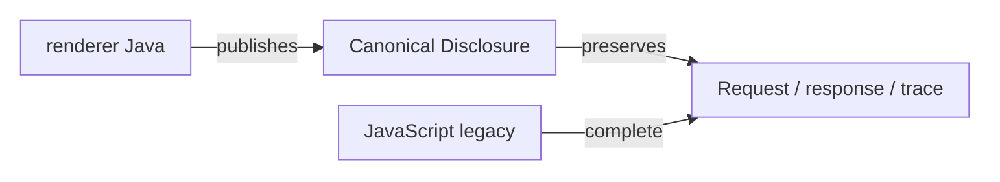

<details>
<summary><strong>Legend - who writes and who just completes</strong></summary>

- Java renderer publishes canonical discoloration and typed metadata;
- JavaScript only completes the missing vendor legacy rows;
- any existing disclosure is not replaced or is not re-serialized unnecessarily;
- JSON, JSON response and execution trac remain together in DOM;
- The idempotence is checked in `atf-reporting-tests`, including the artifact HTML.

</details>

</details>

<a id="publication-and-output"></a>
<a id="publicare-și-ieșire"></a>
## Publication and output

The output is configured by `reporting.extent.outputDirectory` and `fileName`; UI runtime uses the UI directory configured by the test separately. The documentation describes only the output policy and the square, not the concrete reports generated.

`ExtentReportSession.close()` holds the completion and confirmation of the publication:

The manufacturer's arguments and metadata are validated prior to the acquisition. If the renderer initialization or loading assets fails after the acquisition, the session releases the workspace and retains the primary cause, including for `Error`.

| Lifecycle | Extent | HTML fallback |
|---|---|---|
| `flush()` | update status status staked; previous report remains public | write the current snapshots at destination |
| `close()` | complete and publish; release workspace | publish the last snapshot |
| thread | session concluded to the thread that created it | without a guard; the consumer serialises access |
| path | absolute and normalized at opening | keep the path. you prefer an absolute path |

The joint port does not promise that `flush()` is committed. Purposes close child → parent prior to the session.

A mistake after the completion starts leaves the marked session closed; a new close does not try to republish. Extent refusal for the wrong thread precedes completion and does not close the session. The caller checks the result before announcing the artifact.

- complete the nodes, make the flush, publish the artifact staged and confirm
  the existence of the final file;
- only after confirmation send `REPORT_PUBLISHED` synchronization with absolute path
  normalized;
- re-closure does not issue a duplicate and failed publication does not announce success;
- sink is diagnostic: its failure does not change the test verdict;
- display and 8oin- the console belongs to
  [ATF Console](../atf-console/README.md); event does not automatically activate each consumer.

Spark's clearance treats bounded both `AccessDeniedException` and the other `FileSystemException`: maximum four attempts with 50 ms between them. I / O error of another type is not re-tested; the limit is exhausted and the interruption stops the cleanup and retains the mark of the threaded.

<a id="delayed-navigation-and-explicit-interaction"></a>
<a id="navigare-amânată-și-interacțiune-explicită"></a>
### Delayed navigation and explicit interaction

- `atfOpenTest` is associated with the delayed opening of the current sailing generation.
- A new jump or explicit interaction in Tests invalidates the previous callback.
  A mouse closure, Enter or Space remains in effect.
- At each transition, the tabs reset their state and the visible destination
  receives `active` and `aria-current="page"`. Deeplink follows the same path.
- Icon links include the label on the accessible name.

<a id="return-to-failed-comparison"></a>
<a id="revenirea-la-comparația-eșuată"></a>
#### Return to Failed Comparison

In Extent, Fails keeps the type of proof and its order in the original scenario, along with the script class and index. The identifier is kept in hash, including after reload; truncated text is not used for identification.

The audit shall distinguish the causes of the scenarios that hold them:

| Fact | Meaning and expected |
|---|---|
| `failureCount` | atomic rows Fails; a scenario may have several causes |
| `failedScenarioCount` | distinct identity owner + scenario index; compared to the Statutes of the independent manifesto |
| the manufacturer of the four arguments legacy | keep the format with a summary row per scenario; atomic extraction shall transmit explicitly the number of scenarios |
| record pattern Java | Deconstruction uses the five components; the preserved legacy manufacturer does not imply the same importance for the patents at recompiling |

The document starts collapsing. Backlink reveals the exact proof and all her ancestors; rest of the tree remains closed.

- The order only counts the original comparisons.
  add a cause and cannot move the destination after normalisation of HTML.
- Groups with the same label shall each keep their own comparison and cause;
  reverse navigation and reload use the same typed identity.

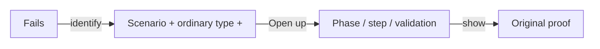

<details>
<summary><strong>Legend - exact path and independent evidence</strong></summary>

- `openScenarioFailurePath` solves indexed row and only opens ancestors
  Its including the step-assertion and native disclosures. SETUP, TEST BODY and TEARDOWN use the same path; a checkpoint subsequently does not open the first step.
- `PublishedFailureNavigationComponentTest` checks UI / API / component, panels
  narrow and desktop, keyboard, reload and repeated navigation. Repeated labels and identical previews cannot substitute the identity of comparison.
- The Oracle shall verify visibility before any assisted expansion; and
  Reject the closed phase under a visible scenario. Neighbor PASS remains broken; verdict and columns of original comparison are kept.
- A FAIL without comparisons indexes existing execution diagnoses on
  Fails show DIAGNOSTIC and EVIDENCE; do not produce expected, current, contractual validations or HTTP identity. Extent aggregate the chain in one entry Fails, and Tests keeps the discoloration of each phase; fallback keeps one entry Fails navigable per phase. The cause respects the configured budget.
- Fallback keeps semantic projection order: phase diagnoses, then
  The backlink opens the original discoloration and keeps the route to the reload, including when the diagnoses are intercaled. The route holds the scroller: restores after the document initialization and the layout of the columns without automatically restoring the position competently by the browser.
- `PublishedFailureNavigationEdgeComponentTest` checks these edges separately,
  configured previews, keyboard, scroll and negative control for hidden ancestor. Opening legacy and exact ones reuse the same function of the Reveal.

</details>

<a id="prosperity-of-visual-evidence"></a>
<a id="prospețimea-dovezii-vizuale"></a>
### Prosperity of visual evidence

A HTML generated prior to reuploading classes or reportable resources is a historical artifact, not evidence for current code. For any visual audit:

- regenerate the ratio after the cylinder containing the change;
- check the component / integration tests first, then the fresh report;
- does not reopen a ToDo from an old artifact if the current renderer already has
  contract and appropriate test;
- if the old artifact contradicts the current contract, mark it stale and don't it
  copy in feedback or README.

Internal digestion for grouping does not become human evidence: HTML publicly only projects the bounded state (`body=present|absent`, `internal digest hidden`).

`ReportPublicationCoordinator` has the following responsibilities:

- protect the publication path, the location and competition;
- can use the internal identity / hash for ownership and reenactment, without
  be shown in HTML as a replacement for human evidence;
- apply the return bound after the atomic attempt on filesystems that can keep
  temporary file opened;
- allows non-atomic fallback only for
  `AtomicMoveNotSupportedException`;
- Propate persistent error after the last test;
- keep the retry in production publication boundary, not test-kit and not in
  browser.

<a id="verification-for-contributions"></a>
<a id="verificare-pentru-contribuții"></a>
## Verification for contributions

`mvn -f atf-reporting/pom.xml test` native neck explicitly selects `atf.reporting.standalone` package and fails if it fails to find tests. `BUILD SUCCESS` without any class / case execution proves the library contract.

| Control | Contract to be kept |
|---|---|
| [Release Reporting Tests](../atf-reporting-tests/README.md) | `reporting-release` profile: complete unit suite and source browser samples / JAR with recorded CodeSource; native neck remains separate |
| Negative controls | Quest and duration of the correct phase, single initialization and original PNG |
| Host Fails | class, separate from the native `.detail-body`; hash / reload and selection tests keep diagnosis; the full tree opens through backlink |

[ReportingStandaloneVerdictComponentTest](src/test/java/atf/reporting/standalone/ReportingStandaloneVerdictComponentTest.java) is the native component sample for lifecycle, status and snapshot, with JUnit `@Tag("component")`, without external ATF imports or browser. The browser projection is checked separately in [ReportingVerdictProjectionComponentTest](../atf-reporting-tests/src/test/java/atf/ui/tests/extent/component/verdict/ReportingVerdictProjectionComponentTest.java).

The selection of the reactor may omit the module by the documented `-Dsurefire.failIfNoSpecifiedTests=false` option; omitting a module without the required test is not a native cooking.

```text
cod live curent
  → staging extern nou (target/artifacts excluse)
  → test focalizat
  → gate unit/component/integration
  → gate E2E dacă se schimbă DOM/layout/interacțiunea
  → ATF Debug + Playwright/Chromium headless
  → reconciliere live ↔ staging
  → sync selectiv și README owner actualizat
```

The checklist here is just a quick map. The regulatory checklist, with mandatory / conditional rules and manual exploration steps, is in [`../atf-reporting-tests/src/test/java/atf/ui/tests/extent/README.md`](../atf-reporting-tests/src/test/java/atf/ui/tests/extent/README.md).

<details>
<summary><strong>Checklist browser - consumer responsibility</strong></summary>

- ✅ `Tests`, `Overview`, `Categories`, `Fails` and deep-link navigation;
- • Disputes that are collapsed by default where the contract does not require otherwise;
- ✅ inline `＋/−`, inline screenshot, actions, audit observations and assertions;
- ✅ `scrollWidth <= clientWidth`, wrapping and computed style;
- ✅ no decorative `<hr>`, console/page errors or broken assets;
- ✅ request/response JSON, status and mock provenance reconciled when they are
  published;
- ATF Debug + Chromium / Playwright MCP without Windows browser
  actual and without stopping active runes.

</details>

<a id="contracts-and-feedback"></a>
<a id="contracte-și-feedback"></a>
## Contracts and feedback

- contract semantic: [`docs/ATF_Reporting_Contract.md`](../docs/ATF_Reporting_Contract.md);
- contract display/layout: [`docs/ATF_Reporting_Display_Contract.md`](../docs/ATF_Reporting_Display_Contract.md);
- Architecture: [`docs/ATF_Architecture.md`](../docs/ATF_Architecture.md);
- Good practices: [`docs/README_Atf_BestPractices.md`](../docs/README_Atf_BestPractices.md);
- feedback activ: [`docs/feedback/README.md`](../docs/feedback/README.md).

README maintains validated contracts, limits and test criteria; the condition of the gaping remains in [feedback registry](../docs/feedback/README.md). A rule enters here only after it is confirmed by the code and live tests; until then there is auditable feedback, not stable documentation.

<details>
<summary><strong>Details - native browser assets and Java government</strong></summary>

The CSS- and JavaScript shipped in HTML remain in `src/main/resources`, in small files grouped by responsibility (`theme`, `overview`, `evidence`, `navigation`, `filters`, `runtime-core`, `duration`). Overview separately uses `overview-layout.css`, `overview-tag-audit.css`, `overview-category-tables.css` and `overview-category-status.css`; scenarios use `theme-scenario.css`, with no duplicated CSS rule in the Java facade. `ReportAsset` is the single asset vocabulary; `ReportAssetManifest.production()` is the validated, ordered publication-boundary inventory. The manifest rejects duplicate assets/paths/owners, resources outside the reporting namespace, incompatible extensions and missing assets. `ReportAssetLoader` reads the classpath resource. `ReportAssetComposer` resolves Java tokens, including finite colors, and produces the final body while retaining typed asset identity. Runtime facades retain explicit composition order. The same boundary serves nine `duration-*.js` assets and three `runtime-core-*.js` assets; JavaScript fragments retain semantic ownership and Java facades retain only composition order.

The native sources `.css` and `.js` remain formed on several lines in the classpath for review, debugging and component testing. `ReportAssetLoader.load(...)` and `render(...)` expose this readable source; `loadForPublication(...)` and `renderForPublication(...)` only pass the copy intended for HTML via `ReportAssetCompactor`. Remove the whitespace and the safe comments outside the quoted values, keep the significant text spaces, selectors and phrases JS / CSS and do not change native files. Thus HTML Extent does not receive unnecessary indentation enters and the source remains easy to maintain and test separately.

`ReportAssetSizeInventory` measures bytes separately for each native source and published copy, aggregated on format and owner. It is a diagnostic and contract test tool. `ReportAssetSizeBudget` receives the limits from the consummation configuration for total, format and owner and produces only the observed violations; it has no hardcoded baseline. HTML / evidence bundler is budgeted in the consumer, where the complete artifact exists, not in the library such an optimization can be verified without converting the name or hash of the artifact into API.

The native sources JavaScript / CSS use LF, governed by `.gitattributes` of the module; budgets remain comparable in Windows / Linux checkouts. Compact only changes the published copy.

Java facades (`AtfFallbackTheme`, `AtfReportOverviewCss`, CSS facades / evidence, `HtmlReportNavigationScript`, `ExtentReportRuntimeEvidenceRoles` and `ExtentReportRuntimeTestFilters`) remain API facades. They do not reconstruct the script's body by large concatenations; Java `ExtentReportRuntimeTestsVocabulary.Template` governs the asset placeholders and the common functions (`aggregateClassDurations`, `captureDomContract`) come from the central runtime vocabulary, not from facade isolated strings.The contract is checked separately by asset tests, component and browser E2E.

</details>

<a id="consistency-of-the-status-transmitted-by-the-caller"></a>
<a id="consistența-statusului-transmis-de-caller"></a>
## Consistency of the status transmitted by the caller

<details>
<summary><strong>Details - consistency of the status transmitted by the caller</strong></summary>

`ReportStatusAggregator.resolve(...)` reconciles caller status with actual results of child rows and goals. Business assessment remains on the consumer; Reporting does not again compare expected to current.

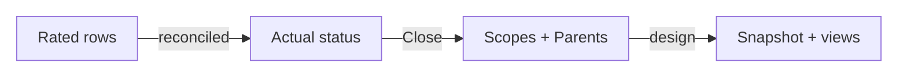

<details>
<summary><strong>Legend - same policy in Extent, fallback and recorder</strong></summary>

- The effective severity cannot be reduced by `complete(PASS)` or
  `complete(SKIP)` when there is a row or child FAIL.
- `AtfAssertion.resultStatus` maintains the policy evaluated; `passed=false` with
  `resultStatus=PASS` is rejected prior to publication. An explicit SKIP is valid.
- Absent status contributes INFO; the INFO observation does not invent a verdict
  business. An expected exception is assessed prior to reporting and can produce PASS.
- Console, Tests, Categories, Fails and Overview receive the reconciled verdict;
  SKIP comparison does not become the cause of FAIL of a nested demand.
- Repeated `assertions(...)` calls replace the unpublished set, including
  The name and verdict in the recorder. Snapshots keep the demands intoxicated without storing the full values of comparison in semantic population.
- UI buffer keeps the checkpoint verdict before publication
  UNIFIED_FLOW, including over phases. Each sister-writer keeps its result.
- The budget drawn up shall be by default 240 including ellipse; status not calculated
  of preview, badge or HTML.

</details>

<a id="evidence-ui-and-setup-in-fallback"></a>
<a id="evidence-ui-și-setup-în-fallback"></a>
### Evidence UI and setup in fallback

`ReportRequestUiEvidence` keeps the actions, catches and disclosure in the fallback snapshots; the meters do not replace the auditable content. `ReportSetupEvidenceMarkup` designs the same setup comparisons in both renderers.

- Expected / current are fully written before the configured ceiling,
  240 including ellipse; a FAIL beyond the preview remains FAIL.
- `publishSetup` maintains the status of the already assessed assertions, even if
  the caller provides PASS; Reporting does not reassess the comparison in the text displayed.
- A request with ACTION shares shall not be accepted by a separate inline catch at most.
  The gallery without actions and media validations maintain their behaviour; the incompatible input is refused prior to the mutation, with the valid recoverable status.
- `UiSetupFallbackParityComponentTest` checks 240/18, the inspection catch,
  Enter / Space, verdict and absence of a fictional HTTP in Extent / fallback.

<a id="the-astronomical-nature-of-the-scope-transitions"></a>
<a id="atomicitatea-tranzițiilor-de-scope"></a>
### The astronomical nature of the scope transitions

Semantic record validates the transition before the model, nodes, meters or notifications mutation. Extent and fallback use the same decision; a rejected call keeps the snapshots and allows the publication of the valid status.

| Operation | Contract |
|---|---|
| `complete(status)` valid | one transition; evidence of children retains FAIL / SKIP / INFO / WARNING policy |
| repeated or parent complete with open copies | refusal without effect; children can be closed, then parent completed normally |
| `close()` after completion | idempotent; no notifications or duplicate publication |
| `close()` prior to completion, without open copies | complete FAIL; does not invent a PASS business result |
| `close()` with open copies | I refuse without abandonment of the parent or deconstruction of the meters |
| writing after completion / closure of session | refusal before mutation; snapshots remain inspectable |
| error in closing / publishing the session | the case is spreading; the session is closed and the second close does not try to republish |

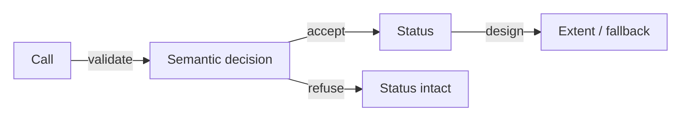

<details>
<summary><strong>Legend - validated lifecycle prior to effects</strong></summary>

- The refusal of protocol shall not create nodes, evidence, statuses or partial events.
- The default FAIL closure shall retain the safe verdict of an incomplete scope;
  The closure of children is explicit, without rollback or retry hidden in the renderer.
- Console is best- effort in both renderers; diagnostic error does not interrupt
  transition and does not change the verdict. UI composer has [publication protocol](#cauza-publicării-și-scope-urile-deținute): same original cause and secondary close errors in suppressed.
- The assertion collections are captured once before the update
  the model and recorder; a null element does not delete the previous valid rows.
- The network aggregate occupies a single semantic slot, regardless of the replacement or
  the details added later; null is the noop on a demand still open.
- `ReportingScopeAtomicityComponentTest` adds evidence for invalid payload,
  exchange, aggregate replaced and publication errors without business comparisons.
- `ReportScopeAtomicityComponentTest` checks public ports, late mutations,
  nested requirements, recoverable refusal, closed session and single notification.

</details>

</details>

<a id="safe-projection-of-assertions"></a>
<a id="proiecția-sigură-a-aserțiunilor"></a>
## Safe projection of assertions

<details>
<summary><strong>Details - safe projection of assertions</strong></summary>

`AssertionAuditReport` publishes phases and steps of assertions via `AtfReportPorts.Session`; it is not dependent on JUnit, Test Kit or Validation. The consumer provides him with its identity, rated rows, phase status and diagnosis.

`AssertionAuditReport.publishStep` publishes and a non-HTTP group in a phase owned by the caller without closing it. Reuse the aggregation of typed statuses; an evaluated FAIL cannot be weakened by a requested PASS and an empty group does not produce steps.

`ReportAssertionSummary` holds the neutral summary to be expected and the failures used by the consumers.It redacts by field name before the full budget of 240, including ellipse; complete rows and business decision remain at the call.

JSON valid is redacted semantically prior to formatting: Unicode keys, syntax / array / object sensitive values and duplicate fields are treated without loss of unsensitive fields. JSON channel explained omits the invalid document; free text and syntax of locators keep the textual editor without wearing imposed.

The phases of this publisher open after evaluation. `ReportPhaseTiming` overload receives separately the duration of the execution already measured and the number of callbacks; the publication of the snapshots does not replace the time of the method.

The budget shall be configured in YAML Reporting and captured at the opening of the session. The implicit shall be 240; only positive whole values shall be accepted:

```yaml
reporting:
  assertionMaxDisplayCharacters: 240
```

`Overview → System` displays `Assertion preview = N characters` from the actual renderer setting, including fallback. The metadata of the consumer and the aggregation of scenarios cannot overwrite this fact. A joint session keeps the same budget for its duration; the configuration change requires a new session.

`AssertionAuditRun.assertionMaxDisplayCharacters()` provides the same budget to the AutoEx / Shop components adapters before collection. Thus a value configured over 240 is not prematurely cut to default. `bodyMaxDisplayCharacters` and HTTP capture limits are separate policies.

<details>
<summary><strong>Budget Map - Session setting or diagnostic helper</strong></summary>

| Surface | Source | Meaning |
|---|---|---|
| assertions rows and value in the System | [ReportingSettings](src/main/java/atf/reporting/configuration/ReportingSettings.java) | `assertionMaxDisplayCharacters` is positive, default 240; capture per session |
| body display | same configuration | `bodyMaxDisplayCharacters` is independent, default 100; 0 deactivates only the body display ceiling |
| diagnostic summary of the exception | [ReportFailureDescription](src/main/java/atf/reporting/evidence/diagnostic/ReportFailureDescription.java) | the helper redacts and caps on the default 240 constant; does not read the session setting |
| diagnostic summary of comparisons | [ReportAssertionSummary](src/main/java/atf/reporting/evidence/diagnostic/ReportAssertionSummary.java) | Same default own limit; summary does not recalculate the verdict |

The extension of the line limit does not automatically extend the diagnostic summary or capture HTTP. The samples of these helpers are at [Reporting Tests](../atf-reporting-tests/README.md#diagnosticul-neutru-al-excepțiilor); the display limit does not allow the publication of a secret or gross value.

</details>

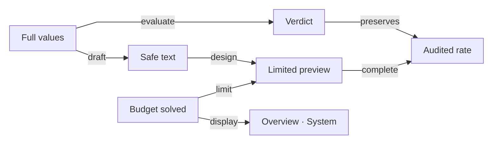

<details>
<summary><strong>Legend - text before ceiling</strong></summary>

- The diagram describes data to runtime, not Maven dependencies.
- The resolved budget configures the collector and the renderer; System shows value
  Same session, without an implicit copied into the consumer metadata.
- The collector receives a display policy at the composition root; JSON complete
  is redacted before cutting, so that a long secret does not lose context of the key.
- Full value decides the verdict; the report receives only safe and limited text,
  240 charter default including `…`. Expansion does not published an unlimited dump.
- E2E direct assertions and action values use the same total budget
  Extent and fallback, including Fails; `…` marking within limit.
- Fails prioritises failed action and time measured before headline
  the exception; a multiline stack does not consume the context of triage.
- `AssertionPreviewBudgetTest` and `BoundedFailureEvidenceComponentTest` check
  the decoded limit, the complete wording and absence of gross dumping; the context sample is in `UiSetupFailureEvidenceComponentTest`.
- `ReportingPreviewConfigurationComponentTest` checks YAML default / configured,
  System in both renderere, contradictory metadata and refugee of negative values. Consular scoops check 18/240/480 individually and through suite.
- `LegacyPreviewBudgetComponentTest` checks direct UI ports in the browser,
  240/18 limits, secrets across the cut border and different verdict beyond preview. Fails and backlink use the limit captured by the script.
- `Component assertions` remains initially collapsed in Extent and fallback; a diagnosis
  Without comparison, they do not invent a step or a HTTP request.
- Assumption interruption keeps `SKIP` and diagnosis `Abort reason`;
  a real failure of an unsummed assertion retains `FAIL`.
- `AssertionAuditPublicationComponentTest` protects the editorial section in both renderers;
  `ComponentAssertionStepReportTest` protects interaction, the last line and Fails → Tests.

</details>

<a id="diagnosis-without-failed-comparison"></a>
<a id="diagnostic-fără-comparație-eșuată"></a>
### Diagnosis without failed comparison

An exception after successful checks or prior to the first comparison produces a diagnosis of execution. `Fails` retains the cause of the phase and the link to the test; does not select a PASS row as a failed comparison.

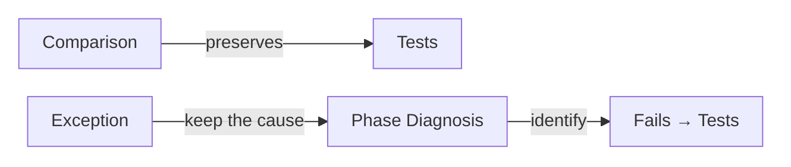

<details>
<summary><strong>Legend - comparisons and exceptions with separate evidence</strong></summary>

- `AssertionStep` identifies the component proof. Without a step of assertions,
  The diagnosis without transport remains `execution`; no owner API is inferred.
- The omitted `REQUEST` index and the duration of HTTP when there is no associated request;
  do not publish `No response duration recorded` for component error.
- `failureValidationCandidate` selects only failed comparisons; a table
  prior to PASS remains available in Tests without becoming the cause of error.
- Classification uses verdict metadata or `RESULT` cell; a `❌`
  Expected / current is an audited value, not a failed comparison.
- The uncompared phases shall be maintained for duration, including measured zero.
  Internal metadata do not create an expansion control without content.
- `ComponentExecutionDiagnosticReportTest` checks Extent / fallback, diagnosis
  without comparison, those 42 rows of collapsible rows, keyboard and ceiling of 240.

</details>

<a id="timing-measured-prior-to-publication"></a>
<a id="timing-măsurat-înaintea-publicării"></a>
### Timing measured prior to publication

`AtfReportPorts.Phase.executionTiming(...)` accepts a single typed value for the phase. Extent and fallback keep it in semantic snapshots; manufacturers and publishers without explicit timeouts keep their existing behaviour.

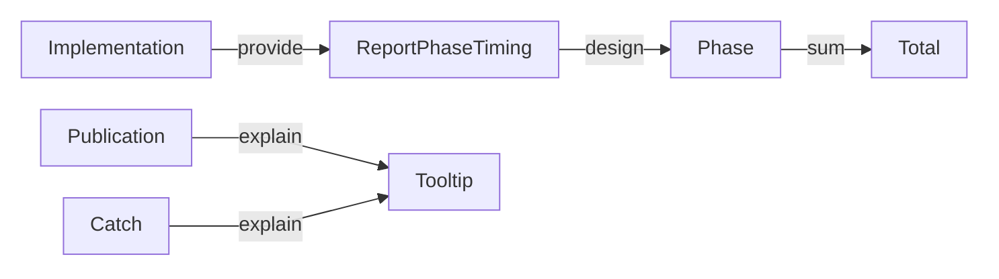

<details>
<summary><strong>Legend - execution, publication and aggregation</strong></summary>

- The phase Badge uses execution, including callback comparisons.
  The tooltip indicates the number of callbacks and the cost of publishing snapshots. The explanation comes from the same Java format for Extent and fallback; JavaScript projects the text received in metadata.
- Typed metadata keep original nanoseconds; display rounded up
  Zero does not become positive.
- The scenario sums up direct phases and the class direct scenarios.
  the publication and technical badge of the `Component assertions` step shall not be added to the inclusive execution of the phase. Expansion shall not change the source or total.
- These amounts represent cumulative time-run, not the suite's wall- clock;
  parallel executions can overlap. Fallback only publishes the amount when all phases have known timing. Do not replace the absent information by zero.
- In Extent, internal metadata are moved to phase and the technical row is removed;
  no additional public event or required HTTP fictitious.
- Publication is measured separately at phase level; does not include final flurry
  Console lifecycle continues to describe the purpose of the publication.
- The UI gear shall have its own measurement; their time shall not be added
  execution and is not used as a latency HTTP.
- `ReportPhaseTimingComponentTest` checks semantic parity, Tests / Overview,
  zero values, totals without doubling and reopening with keyboard.

</details>

<a id="synthetic-payment-data-from-the-demo-fixture"></a>
<a id="date-payment-sintetice-din-fixture-ul-demo"></a>
### Synthetic payment data from the demo fixture

For the AutoEx demo fixture, the synthetic `card_number` and `cvc` values remain visible in the HTTP body and in the cURL. This is the accepted behaviour of the sample without open requirement for editing for these test data.

Masking of UI shares and the configured budget of assertions, implicitly 240, is maintained.

<a id="timing-e2e-at-runtime-owner"></a>
<a id="timing-e2e-la-ownerul-runtime"></a>
### Timing E2E at runtime Owner

`UiPhase.executionTiming(...)` is already measured; `UiPhase.measureExecution()` opens the explicit measurement held by runtime. The two options are exclusive for the same phase.

`UiExtentReportSession.adaptScenario(...)` composes the same UI facade over a Extent script port or fallback. The host keeps the session and flush- ownership; the profile and isolation of the scenarios remain explicit.

| Interval | What it measures and where it closes |
|---|---|
| execution | Monotonous time between phase opening and completion, without instrumented catches / publication |
| catches | `UiPhaseExecution.capture(...)`; including failed catch, distinct from the latency HTTP |
| publication of evidence | UI publishers, delayed flower and phase projection to snapshot; do not add over execution |
| cleanup and resources | runtime stops execution before final cleanup and browser release |
| flush HTML | the session completes it separately; does not enter into operation or at the cost of publication before snapshot |
| Legacy source without timing | remains `aggregated`; unknown time does not become zero measured |

AutoEx stops TEST BODY before the final lifecycle; Shop measures SETUP and TEST BODY separately and does not invent an incomplete body for setting. Both consumers' catches pass through the same reusable Boundary Reporting, without any JUnit or Test Kit dependency in the main runtime.

<details>
<summary><strong>Metadata, totals and samples</strong></summary>

- `ReportPhaseTiming` maintains execution, number of intervals and optional
  `ReportPhaseEvidenceTiming`; the two-argument legacy manufacturer remains compatible.
- `data-atf-execution-duration-ms`, `data-atf-capture-duration-ms` and
  `data-atf-publication-duration-ms` describes distinct sources; the missing catch as a measurement is not published as known zero.
- Tests, Category and Overview use typed execution once. Expanding,
  Extent native timestamps and publication in the terminal phase do not replace it.
- `UiPhaseExecutionTest` maintains the primary cause and tests the controlled clock;
  `UiPhaseTimingLifecycleComponentTest` checks success / FAIL / SKIP, incomplete setup, failed teardown and unified flow over phases in Extent / fallback.
- Component Timin remains on Kit Adapter; HTTP duration unattached
  The cumulative totals are not the suite's wall clock.

</details>

<a id="common-session-of-components"></a>
<a id="sesiunea-comună-a-componentelor"></a>
### Common session of components

`AssertionAuditRun` holds the session, and `open(identity)` returns a `AssertionAuditReport` that only borrows the session and holds its script. `AssertionAuditReport(session, ...)` public builder keeps the session owner for the standalone publishers and the existing fixtures.

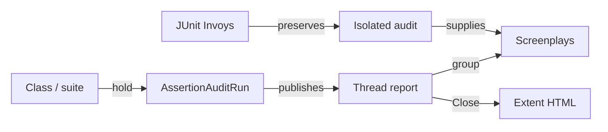

<details>
<summary><strong>Legend - ownership and actual thread of the session</strong></summary>

- `extent(...)` captures the configuration and creates the session on the report thread;
  scenario and close operations are running synchronously on the same thread.
- JUnit tests and comparisons remain on their threads. Publication does not reexecute
  The business and does not relax the Thread Guard in `ExtentReportSession`.
- A claim only closes the borrowed scenario; the class / suite owner closes
  the session and the workshop, including after a publication error.
- Identical titles do not replace the identity of scenarios; phases and assertions
  any claim may not be borrowed by any other claim.
- The work already sent is completed once; a stopped call is
  keep the indicator to be interrupted. The path configuration and notification policy are captured prior to publication and the notification follows the existing final artifact.

</details>

`AssertionAuditRunComponentTest` checks the ownership. causes and competition; consumer samples check the Jupiter scope and the policy of final notification. The configuration budget of the session and the `Component assertions` step collapse are maintained.

<a id="lizability-of-evidence-in-narrow-panels"></a>
<a id="lizibilitatea-dovezilor-în-panouri-înguste"></a>
### Lizability of evidence in narrow panels

The window width and the width available to the table are different measurements. Extent indentation can leave a narrow panel right in a desktop window. `table-viewport.css` keeps the table, visible header and cells on the columns; does not turn the rows into cards at a breakpoint.

The same allocator measures the header, values, font and padding in Extent and fallback, including capitals / lowercase applied visually via CSS. The table occupies the entire width available; technical columns remain compact and the space is first distributed to the demand for unsatisfied content, then proportionally to flexible columns.

The policy covers the setup, assertions, Actions / Audit, API evidence and the Overview / Category / System tables. The latter reuse their container and the numerical totals remain compact; the existing colgroups follow the common allocation. The runtime added worktables receive the same policy, including the common viewport when their initial marker does not have a container.

The categories table of scenarios receives the same view; `Status` and `Timestamp` are compact technical columns. Adaptation of `Status/Details` structural tables does not apply to data tables, including in narrow panels. On narrow screen, the Fails index and details begin after the visible navigation bar; the absence of overflow of the document does not prove this accessibility alone.

In fallback, the grid allows the content panel to narrow without widening the document. Fails cards share long messages on rows and use the container width to place the value observed under the error identification.

| Situation | Presentation |
|---|---|
| Article 429 (1) (b) of CRR | table across width without artificial edge to the right; surplus is to be given to the content columns |
| Some values are long | the columns are given the remaining space; status and time shall retain the measured width |
| The panel does not allow for any letterheads and legible base | local horizontal scroll with header and all accessible columns |
| Resize, new text or reopening | incremental invalidation and recalculation without reassessment of assertions |

The sticky Header, the common font and the vertical ceiling are kept; a short table occupies only the height of its content. There are no minimum table widths required by the number of columns.

The text maxim in pixels is not capped: two long messages remain distinguishable, including the same number of characters. Gutter does not reserve empty space to the right; only the scrollbar required content reduces the useful width.

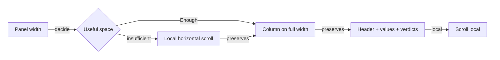

<details>
<summary><strong>Legend - Stolen columns, local auditable scroll</strong></summary>

- Published Headings and order of columns remain the same in Extent / fallback;
  Each cell aligns with its own header without repeating it in the body.
- Narrow panels reduce renderer indentation; in fallback, the list and
  the contents shall be placed vertically when the container does not allow two columns.
- The preview of the assertions is drawn up before the configured ceiling, implicitly 240 characters;
  rearranging CSS does not alter text or verdict.
- `NarrowEvidenceReadabilityComponentTest` checks 1803/1280/591/392 px viewports
  and 591/392/719/720/721 px panels in a desktop view. Check the useful width, font, header, last column, final turn and reopening with the keyboard, along with negative projection and backlink Fails → Tests.
- `TableViewportBrowserComponentTest` rejects hidden header, vertical cells
  and the horizontal scroll locked, in addition to existing samples for the ceiling and clipping.
- `EvidenceColumnSizingComponentTest` compares geometry with physical width
  available including setup, dashboard, colgroup, competing texts and naked gutter; a marker of layout present does not certify the rendering alone.
- `PublishedEvidenceTableComponentTest` checks UI / API / UI + API publications
  both renderers with inventory and independent values, 12/40 rows and the projections Tes / Overview / Categories / Fails. Negative controls also cover overlapping navigation over Fails and breaking technical letterheads in letters; the percentages of a column are not aesthetic oracle.

</details>

</details>

<a id="quick-check"></a>
<a id="verificare-rapidă"></a>
## Quick check

| Decision | Source and limit |
|---|---|
| Semantic snapshot and standalone coherent verdict | [source of the host](src/main/java/atf/reporting/extent/session/ExtentReportSession.java); sample [ReportingStandaloneVerdictComponentTest](src/test/java/atf/reporting/standalone/ReportingStandaloneVerdictComponentTest.java) |
| Dependencies and source- sets | [POM](pom.xml); declared scope authority for integration |
| What this probe does not prove | The local sample does not show rendering in the browser; it belongs to Reporting Tests. |

<details>
<summary><strong>Command for local sample</strong></summary>

Run from the root of a [external staging](../docs/ATF_Build_And_Execution_Safety.md), with JDK 21 and Maven.

```powershell
mvn -B -pl atf-reporting -am "-Dtest=ReportingStandaloneVerdictComponentTest" "-Dsurefire.failIfNoSpecifiedTests=false" test
```

The command selects the sample called and builds the dependencies; does not declare the entire module to be passed. The local sample does not demonstrate the rendering in the browser; it belongs to Reporting Tests.

</details>

<a id="inspection-timing-and-distribution-boundaries"></a>
<a id="limitele-inspecției-timing-ului-și-distribuției"></a>
## Inspection, timing and distribution boundaries

| Surface | Limit and owner |
|---|---|
| generic inspector | the caller declares artifact profile and renderer through [inspection intent](#inspecția-artifactului-cu-intenție-explicită); a legacy HTTP default cannot certify every report structure |
| captured/publication timing | [recorded timing](#originea-duratelor-sub-o-fază-capturată) separates execution, transport and publication; a correct verdict does not certify duration attribution |
| API and distribution | [release criteria](../docs/feedback/ATF_Reporting_Feedback.md) remains distinct from compilation or consumption of JAR candidate |

The contracts delivered are described in the sections of the owners. The gaps remain in feedback, with [permanent regression](../atf-reporting-tests/README.md#regresia-permanentă-a-fiecărui-defect-reporting) before correction and a new JAR.
<a id="public-comments-without-transport"></a>
<a id="observații-publice-fără-transport"></a>
## Public comments without transport

Typed observations publish non-transport facts through a shared Extent/fallback projection.

`AssertionAuditReport.phase(..., observations)` publishes the facts provided by the caller in the same phase as `Component assertions`, as independent INFO nodes. The list is optional; an observation does not become assertion, quest or verdict. A renderer without the capacity of observations refuses publication, and the status of the phase remains the one solved by the owner.

| Boundary | Contract |
|---|---|
| Port and model | `Phase.supportsObservations()`, `Phase.observation(ReportObservation)`; title-based model, fields, bodies TEXT / JSON and references |
| Verdict | INFO without quest / invented validation; does not weaken FAIL / SKIP; the unqualified adapter refuses publication |
| Context | `Phase.detail` remains internal; semantic snapshots keep labels, without values / bodies or artefacts |
| Projection | before booking / preview, collapse discourse and accessible body with keyboard up to the end |
| Bugete | fields / assertions default 240; body default 100 standalone, configured independently by each consumer; evaluation receives full input |
| URI | filet / http / https are references without fetch; credential / query / fragment and active schemes refused; the location redacted does not persist in href |
| Compatibility | `ObservationStep` / `ObservationSnapshot` extend the sealed trees; supported binary symbols and source- exhaustive switches request separate compatibility checks when sealed trees evolve |
| Return | glyphs depends on the summary / open itself; End / Home / PageUp / PageDown uses the common `atf-observation-body` scroller; bulk expend retains local evidence status |
| Owner | complete raw to call; native regressions, composition / browser and JAR physical gate at J0 |

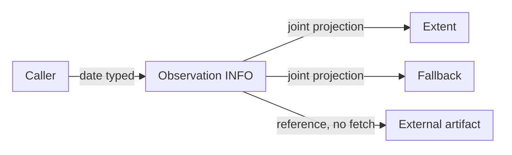

<details>
<summary><strong>Legend - information and verdict</strong></summary>

- The field observed is not assertion and does not invent transport.
- Renderers share escaping, editorial, preview and discourse.
- The caller keeps the assessment, raw and retention policy.

</details>

<a id="local-state-of-expansion"></a>
<a id="starea-locală-a-expandărilor"></a>
## Local state of expansion

| Action | Contract |
|---|---|
| click / Enter / Space on Extent script | changes only the scenario; its phases are reset according to local contract |
| Open Neighbor Screen | its phases, demands, validations and evidence keep its status and visibility |
| Expand all / Collapse all | explicit action on the active Owner tree; evidence disclosures remain local controls |
| fallback | each native disclosure remains independent, including mouse and keyboard |
| assertion | original value and verdict, preview default 240; DOM hidden does not certify visible proof |

<a id="binary-tags-and-compatibility"></a>
<a id="taguri-și-compatibilitate-binară"></a>
## Binary tags and compatibility

Normalisation has semantic owner in ReportTags: remove null / blank, apply trim and Locale.ROOT, maintain the order of first appearance and return an immutable list.

| Surface | Maintenance rule |
|---|---|
| atf.reporting.semantic.tags.ReportTags | Single implementation; renderers and snapshots use this owner |
| atf.reporting.model.ReportTagNormalizer | façade deprecated without a disposal commitment; keeps exactly the old public signature |
| model | eight active contracts plus the only binary deck, nine physically explicitly inventoried files |
| Governance | General threshold 8 remains; a tenth class or substitution of a contract is refused, even with the same physical number |
| ABI | customer compiled separately against old signature, then executed with actual implementation; the student does not enter the classloader |

Normalization does not hold business rules or renderer status. The deck is not an allowlist for the growth of the package and does not add a module.

<a id="background-system-and-fallback-index"></a>
<a id="context-system-și-index-fallback"></a>
## Background System and Fallback index

Both public renderere Environment, Runtime, OS, Client, Reporting and Assertion preview. Host facts are captured at the opening of the session; lack of value does not invent a client, endpoint or transport. The default custodian is configured per execution.

| Surface | Contract |
|---|---|
| HtmlReportSession.updateEnvironment | goes typed through the allowlist and the newsletter; update null / after close is refused prior to mutation |
| overrides | Environment, Client and explicit optional fields are kept; the snapshots of the caller remain immutable |
| facts calculate | Fallback publishes its own identity; the actual preview is ReportingSettings, implicitly 240 |
| index fallback | title and class in neutral colors; Pass / Fail / Skip in separate badge with the same href and original ID |
| access | Wrapping without hiding / truncation, visible focus and Enter to original scenario |

The permanent samples check the data in the visible System table, contrast to the text of at least 4,5:1 and lack of overflow to 1280 and 392 px. Mutants remove only one fact or reinsert the badge on the entire link; they are refused.

<a id="inspection-of-the-explicit-intent-artifact"></a>
<a id="inspecția-artifactului-cu-intenție-explicită"></a>
## Inspection of the explicit-intent artifact

Declare a [ReportArtifactProfile](src/main/java/atf/reporting/artifact/ReportArtifactProfile.java) with renderer, scenarios, phases and mandatory evidence. `ReportArtifactInspector.inspect(path, profile)` and `inspectFresh` overload keep the profile in `ProfileInspection`. The profile-free version keeps the strict contract Extent / HTTP; a legitimate report without HTTP uses the explicit overload.

| Responsibility | Contract |
|---|---|
| the intention of the caller | identity of class / scenario, phases, statuses, observation fields / bodies, assertion rows or exchange and mandatory HTTP channels |
| Inspector | DOM original, exact inventory and verdict; same policy of operational resources for Extent / fallback and declared profile |
| public outcome | complete inventory, unique and consistent diagnoses; an empty, partial or contradictory result is not in line |
| business comparison | Expected / current and full evaluation belong to the caller; profile does not recalculate business values from the preview |
| browser | visibility, keyboard, geometry and Deeplink remain separate from static inspection |

- Without fictional HTTP; the elimination of a mandatory request is non-compliant.
- Verdicts and API legacy are maintained; reconstruction uses `ProfileInspection`.
- External resources and operational evidence are denied, with owner / attribute / reference in diagnosis; text paths and documentary links remain valid. PNG removes require a unique inline target.

<a id="titles-and-profile-labels"></a>
<a id="titluri-și-etichete-ale-profilului"></a>
### Titles and profile labels

| Input | Extent contract and fallback |
|---|---|
| Titles and labels | Literal text in HTML. Spark encodes the keys in the Timeline script separately. |
| Multiline tags | `ReportArtifactProfile.visibleLabel` projects LF, CRLF, tab, NBSP and repeated spaces to the text compared to DOM. |
| Values and bodies | The assertions retain their fully evaluated verdict and default 240 preview.Bodies follow their budget and keep the whitespace captured. |

[Permanent sample](../atf-reporting-tests/README.md#probe-inspector-timing-și-indicator-assertions) checks both renderers and refuses to use the title converted into the mark, even if the visible text coincides.

<a id="origin-of-durations-under-a-captured-phase"></a>
<a id="originea-duratelor-sub-o-fază-capturată"></a>
### Origin of durations under a captured phase

| Level | value and label |
|---|---|
| the phase with explicit timing | execution provided, tagged Execution; children are not added over it |
| Require with executions typed | total transport provided, tagged Transport, including real zero |
| Extent scope created at publication | Time of publication, tagged Publication; not representing transport or business execution |
| assertion-step fallback below captured phase | Publication label not numerically invented |
| timing absent | Legacy behavior is preserved; unknown does not become zero |

Validation of fallback without its own clock shall not be made for a numerical duration.

Assertions use the common discoloration with a visible indicator plus / minus, ARIA status and mouse / Enter / Space access. The table remains collapsed by default with the same four columns and default preview 240. Permanent regressions are in [Reporting Tests](../atf-reporting-tests/README.md#probe-inspector-timing-și-indicator-assertions).

<a id="publication-of-png-at-large-volume"></a>
<a id="publicarea-png-la-volum-mare"></a>
## Publication of PNG at large volume

Large PNG Payloads remain in the private session spooler until atomic publication.

| Stage | Contract |
|---|---|
| internal catch | PNG complete on disk; same identity for identical payload |
| transformare | Assets / navigation operates on the compact HTML structure without UTF-16 copies of PNG |
| restaurare | fixed buffers write Base64 entirely in the atomic file; HTML final is autonomous |
| cleanup | closed spool and eliminated at success / failure; the destination is replaced only after full restoration |
| limit | model Extent / Spark and text still use heap proportional to evidence; there is no universal ceiling |

The captured timing contract separates publication duration, allocations and observed memory from the captured execution interval.

<a id="action--observe---preview-and-complete-values"></a>
<a id="actionobserve--preview-și-valori-complete"></a>
## ACTION / OBSERVE - preview and complete values

INCLUDED_COLLAPSED keeps expected / fully observed, redacted and with HTML escaping, in the same cell.

| Surface | Policy |
|---|---|
| preview | 240 default; summary compact in a visual row with text available in DOM |
| value complete | initial closed disclosure, newline / Unicode / order / last preserved scalar |
| security and verdict | before both projections; the catch verdict shall not be reassessed |
| keyboard | Enter / Space for each Disclosure; End / Home and scroll in the existing Focusable Viewport |
| SUMMARY_ONLY | keep explicit omission of ACTION details |
| body display limit | control the bodies, independent of these cells |
| comments by phase | UiPhase.observation (ReportObservation) delegate neutral port; supportsObservations () exposes capability |
| lifecycle | refusal after completion and publication excluded from measured time frame; zero requirements or made-up assertions |

Assertions values have separate contracts: the already reduced text of the caller cannot be rebuilt. [The remaining criterion](../docs/feedback/ATF_Android_UI_Reporting_Feedback.md) delimits that family.

<a id="fitness-of-the-ui-line-and-drafting-policy"></a>
<a id="fidelitatea-rândului-ui-și-politica-de-redactare"></a>
<a id="fitness-of-the-ui-line-and-redaction-policy"></a>
## Fitness of the UI line and redaction policy

| Boundary | Contract |
|---|---|
| AtfUiActionRecord | operation / target are normalized metadata; expected / observed keep the captured whitespace, including LF / CRLF / CR; null remains empty |
| joint projection | UiEvidenceRowMarkup holds the identity and cells ACTION / OBSERVE; the renderer adds only the TIME column and source specific structure |
| fallback | transmit the original records and the same SensitiveDataRedactor instance without reconstruction or second default policy |
| Published metadata | operation, target and title PNG inline are redacted prior to HTML escaping |
| complete values | 240 plus disclosure; CR is encoded as a numerical reference and LF is initially protected by HTML parser rule for pre |
| invariants | Normal, status, bytes PNG, screen shot policy and SUMMARY_ONLY are kept; comparisons are not reassessed |

A custom replacement is checked precisely, including when it is not idempotent. The caller remains responsible for the text captured before the Reporting model; the library does not rebuild the information already removed by an adapter.

<a id="full-evidence-in-the-same-html"></a>
<a id="dovezi-complete-în-același-html"></a>
### Full evidence in the same HTML

[Inline contract](../docs/ATF_Inline_Audit_Contract.md) separates the captured data, the evaluated comparisons and the rendering.

| Composition | Publication rule |
|---|---|
| without external files | empty artifacts; the context required for the decision is published by fields / bodies |
| component | standard assertions and full status; optional PNG |
| UI | Same structure plus PNG original to checkpoint |
| text PRE | LF initial, CR / LF and the final whitespace preserved after the editorial / limitation |

240 provides body budget remaining distinct. The caller does not replace comparisons with the reading statuses of XML and does not ask the renderer to deduce the verdict.

<a id="screenshot-viewer-and-independent-readers"></a>
<a id="viewer-de-capturi-și-cititori-independenți"></a>
## Screenshot viewer and independent readers

PNG evidence opens in one shared Extent/fallback viewer using the available browser viewport. Fit mode preserves the full image and aspect ratio; Original size is an explicit inspection mode. Closing or Escape restores the clicked checkpoint, keyboard focus, disclosure state and reading position.

- Deduplicated captures resolve the original bytes without clicking or selecting the canonical owner; the local caption remains attached to the clicked checkpoint.
- Mouse, Enter and Space open the same viewer; resize recomputes fit, and controls remain keyboard accessible without browser/OS fullscreen.
- The producer supplies meaningful test purpose, effective setup/inputs, independent expected values and clear evidence limits; hashes and raw file dumps do not establish business correctness.

The [inline contract](../docs/ATF_Inline_Audit_Contract.md) separates primary audit content from optional technical provenance. Permanent neutral [reference contracts](../atf-reporting-tests/src/test/java/atf/reporting/observation/ScreenshotReferenceComponentTest.java) and [browser journeys](../atf-reporting-tests/src/test/java/atf/ui/tests/extent/component/screenshot/ScreenshotViewerBrowserComponentTest.java) cover the viewport and return context; Android capture/oracles stay in the consumer.

<a id="large-report-navigation"></a>
<a id="navigarea-rapoartelor-mari"></a>
## Large-report navigation

[The incremental navigation contract](../docs/ATF_Large_Report_Navigation.md) keeps all assertions and original PNG with preview 240. The processing of hidden tables is delayed, DOM updates are aggregated, and the search for execution markers is cache- only for a aggregation pass.

[navigation contract](../docs/ATF_Large_Report_Navigation.md) distinguishes browser acceptance from fresh business/device execution; neutral permanent regressions remain in Reporting Tests.

Tests, Category, Fails and Overview share one navigation contract: the selected view, the sole accessible current link and the URL fragment identify the same pane. `NavigationSelectionBrowserComponentTest` exercises all four transitions in Chromium.

<a id="cold-startup-and-readiness"></a>
<a id="pornire-la-rece-și-readiness"></a>
## Cold startup and readiness

The navigation bootstrap honors the requested view once across DOMContentLoaded and load. Load timing updates independently; successful normalization publishes readiness, while an error leaves the cycle unready. Dynamic-content observers and explicit view switches remain active.

[The cold-start contract](../docs/ATF_Large_Report_Navigation.md) retains fresh-browser 10 s readiness/action and 45 s navigation bounds, canonical PNG payloads, comparisons and preview 240. Bulk acceptance selects at most two source owners.

<a id="native-timeline-labels"></a>
<a id="etichete-native-pentru-timeline"></a>
## Native timeline labels

The Spark presentation adapter encodes timeline keys as JSON strings while preserving full caller labels and captured duration values. The pinned vendor expression is checked before publication; a changed template fails explicitly.

The [native timeline contract](../docs/ATF_Large_Report_Navigation.md#native-timeline-labels) covers quoted and multiline JSON, backslashes and Unicode, alongside the unchanged 24-hour clock.

<a id="neutral-ui-attribution-and-failure-ownership"></a>
<a id="atribuire-ui-neutră-și-ownership-ul-eșecurilor"></a>
## Neutral UI attribution and failure ownership

`AtfUiActionRecord` captures an operation, target, observed result and duration. Its ACTION/OBSERVE channel identifies the evidence kind.

- Default publication uses **UI action sequence** and **UI action**, without inferring a driver.
- Captured tool names remain intact; Android, web and mock callers share the neutral contract.

| Evidence | Audit boundary |
|---|---|
| ACTION | actual dispatched operation, captured result and original sequence; a successful dispatch does not certify the resulting UI state |
| OBSERVE | captured read-only observation; an observation-only checkpoint does not fabricate an ACTION table |
| comparison | independently evaluated expected/actual/result; UI records do not inflate the assertion population |
| Fails | captured failed ACTION, OBSERVE, comparison or execution diagnostic; navigation addresses the original owner and row |
| screenshot | original complete PNG and checkpoint ownership; deduplication preserves each source link |

Fallback projects request-owned and validation-owned UI failures in rendered ACTION/OBSERVE/comparison order. Native Fails preserves separate UI and assertion ordinals; its source links reveal the original ACTION/OBSERVE row without a second user expansion or a synthetic comparison.

- A terminal exception contributes one index entry through its original failed row. Tests also keeps its diagnostic context.
- If the terminal row is absent or hidden by action summary-only mode, the exception supplies its own navigable cause.
- Independent comparisons retain their own entries even when their label matches a diagnostic.

- Preview remains 240 characters; publication performs no business evaluation or driver inference.
- Failure labels and causes share the original evidence redaction boundary.
- Legacy public constants and contract check keys remain compatible; published headings use neutral wording.

Permanent source and physical-JAR contracts belong to Reporting Tests. Android dispatch, hierarchy extraction and independent application oracles remain in J4.
