# ATF Reporting — bibliotecă autonomă pentru artefacte Extent

`atf-reporting` transformă modele typed în raportare semantică și artifacte
Extent/HTML verificabile. Librăria nu execută API-uri, nu pornește browserul și
nu citește mock-uri sau fixture-uri de aplicație.

## Pe scurt

**Trasee rapide:** [Adopție JAR](#consumarea-bibliotecii-ca-jar) · [Arbore și ownership](#contractul-raportului) · [Aserțiuni și buget](#proiecția-sigură-a-aserțiunilor) · [Timing](#timing-e2e-la-ownerul-runtime) · [Tabele](#lizibilitatea-dovezilor-în-panouri-înguste) · [Probe și limite](#verificare-rapidă)

- **producție** — contracte typed, modele semantice, renderer, asset-uri și
  publication; zero dependențe către module ATF;
- **teste proprii** — verifică standalone boundary-ul și contracte locale fără
  mock, Playwright sau fixture-uri de aplicație;
- **compoziție** — `atf-reporting-tests` este consumatorul canonic pentru
  API/integration și UI/E2E reporting;
- **output** — artifact Extent/HTML cu CSS și JavaScript native, fără verdicturi
  inventate de renderer;
- **adopție** — consumatorul furnizează inputul typed, statusul, evidence-ul și
  politica de output prin API-ul public.

Contractele de semantică și display sunt legate din [contracte și feedback](#contracte-și-feedback).
Structura harness-ului aparține [Reporting Tests](../atf-reporting-tests/README.md).
Pentru consolidare, [atlasul codului](src/main/java/atf/reporting/README.md)
selectează contextul pe responsabilitate: intrări, invariante, surse și probe locale.

## Consumarea bibliotecii ca JAR

Biblioteca se compilează pentru **Java 21**. Artefactul Maven este un JAR thin:
aplicația îl consumă împreună cu dependențele runtime rezolvate din POM;
`atf-reporting-tests` rămâne modul intern de verificare, nu dependență a aplicației.

```xml
<dependency>
    <groupId>atf.api</groupId>
    <artifactId>atf-reporting</artifactId>
    <version>1.0.0-SNAPSHOT</version>
</dependency>
```

| Intrare | Responsabilitate |
|---|---|
| `AtfReportPorts` și modelele typed | consumerul furnizează observațiile și verdictul; biblioteca conservă și publică dovezile |
| `ExtentReportSession` | rendererul Extent și publicarea finală la `close()` |
| `HtmlReportSession` | rendererul fallback; are propriul lifecycle de publicare |
| `UiExtentReportOptions` / `UiExtentReportSession` | profilul de evidence și compoziția checkpoint-urilor, fără browser sau executor HTTP |

<details>
<summary><strong>Exemplu Java — raport din observație furnizată de aplicație</strong></summary>

```java
import atf.reporting.configuration.ReportingSettings;
import atf.reporting.contract.AtfAssertion;
import atf.reporting.contract.AtfReportStatus;
import atf.reporting.extent.session.ExtentReportSession;
import java.nio.file.Path;
import java.util.List;

public final class ReportExample {
    public static void main(String[] args) {
        if (args.length != 2) throw new IllegalArgumentException("Expected: output.html observed-state");
        String expected = "ready";
        String actual = args[1];
        boolean passed = expected.equals(actual);
        var status = passed ? AtfReportStatus.PASS : AtfReportStatus.FAIL;
        try (var session = new ExtentReportSession(Path.of(args[0]), ReportingSettings.defaults());
             var scenario = session.startScenario("ConsumerExample", "the observed state is ready", List.of("component"));
             var phase = scenario.startPhase("TEST BODY");
             var checks = phase.startAssertionStep("Component assertions")) {
            checks.assertions(List.of(new AtfAssertion("Observed state", expected, actual, passed)));
            checks.complete(status);
            phase.complete(status);
            scenario.complete(status);
        }
        if (!passed) throw new AssertionError("Observed state differs; inspect the generated report");
    }
}
```

- Observația și comparația sunt ale aplicației; exemplul nu execută un test
  business în interiorul bibliotecii și nu are nevoie de module ATF suplimentare.
- Scope-urile sunt închise copil → părinte; artifactul final Extent este
  disponibil după închiderea sesiunii. `flush()` nu înlocuiește acel `close()`.
- Coordonatele descriu versiunea de dezvoltare din POM; publicarea unei versiuni
  release și garanțiile de compatibilitate cer criteriile de mai jos.

</details>

JAR-ul fizic poate fi consumat separat de reactor. Pregătirea pentru release
are încă [criterii active](../docs/feedback/ATF_Reporting_Feedback.md): redactarea
JSON, configurația, API-ul și probele de izolare.

## Limitele librăriei autonome și consumatorul canonic

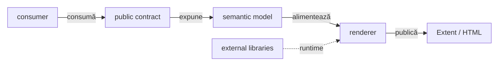

<details>
<summary><strong>Legendă — boundary-ul standalone</strong></summary>

- `atf-reporting` primește input typed și publică artifactul; nu orchestrează teste;
- traseul `Contract → Model → Renderer → Artifact` este interiorul bibliotecii;
- `consumer` este în mod canonic `atf-reporting-tests`, dar poate fi înlocuit de
  orice aplicație care folosește API-ul public;
- `atf-reporting-tests` este singurul consumator canonic pentru compoziția ATF;
- Jackson și ExtentReports sunt dependențe externe declarate în POM-ul standalone;
- mock-ul, browserul, JUnit orchestration și fixture-urile nu intră în producția librăriei.
</details>

| Suprafață | Responsabilitate | Limită |
|---|---|---|
| `src/main` | librăria producție și artifactul publicat | fără dependențe către module ATF, browser sau fixture de business |
| `src/test` | guard-uri și contracte standalone | fără mock, Playwright sau endpoint live; compoziția este la Reporting Tests |
| `atf-reporting-tests` | consumatorul canonic pentru component/integration API și UI/E2E | nu intră în JAR-ul reporting |
| alte module | pot consuma API-ul public pentru normalizarea modelelor la boundary-ul propriu; nu înlocuiesc composition root-ul canonic | policy-ul rămâne în consumer, iar cuplajele test-scope se urmăresc separat în feedback |

<details>
<summary><strong>Dovadă standalone, adopție și limită de decuplare</strong></summary>

- `atf-reporting/pom.xml` este parentless și nu declară dependențe către module
  ATF în production;
- `src/test` poate verifica boundary-ul standalone fără să contamineze JAR-ul;
- `atf-reporting` publică HTML prin contracte typed, records immutable, porturi,
  evidence, snapshot și renderer. Namespace-ul `atf.reporting.*` include și
  implementări publice tehnic; inventarul API-ului susținut extern are
  [criteriu separat](../docs/feedback/ATF_Reporting_Feedback.md#report-public-api-43--suprafață-susținută-și-ownership);
- `ReportModelAdapters` este adaptorul public generic, reflection-only pentru request,
  execution/retry/provenance, assertions, UI actions și statusuri; decodarea URI
  este deținută de `ReportQueryParameters`. Aceste API-uri nu conțin reguli de
  aplicație și nu adaugă dependență compile-time către `atf-core`;
- `CoreReportPortsAdapter` rămâne exclusiv în test/composition scope și folosește
  aceiași adaptoare, fără a întreține o a doua mapare;
- aceste adaptoare pot fi folosite de consumatori în cod de producție numai la
  boundary-ul de normalizare/interoperabilitate; nu implementează policy și nu
  devin layer de business:
  execution decide schimbul HTTP, validation decide verdictul, UI produce
  acțiunea, iar reporting conservă și publică evidence-ul. Consumatorul păstrează
  doar contextul propriu — de exemplu, trace-ul și redactarea identității Shop;
- orice dependență test-scope din afara consumerului canonic este urmărită în
  [feedback-ul activ](../docs/feedback/README.md), nu duplicată ca TODO aici;
- POM-ul și runtime-ul nu cer parent-ul reactorului ori artifacte ATF.
  Guard-ul propriu de dependențe caută încă rădăcina ATF: copierea modulului
  singur nu trece integral gate-ul de teste. [Izolarea completă](../docs/feedback/ATF_Reporting_Feedback.md#report-standalone-isolation-41--modulul-copiat-singur)
  cere această probă, separat de build-ul în checkout și de consumarea JAR-ului;
- compoziția completă și oracolele browser rămân în `atf-reporting-tests`.

</details>

## Fidelitatea contractului query

`ReportQueryParameters` păstrează perechile și numărul aparițiilor. Conversia
unui model extern citește colecția `values()` înaintea view-ului legacy
`asMap()`; un accessor defect este refuzat explicit. `asMap()` păstrează numai
ultima valoare pe nume și este destinat compatibilității, nu validării.

- Potrivirea este un subset cu multiplicitate: `tag=red&tag=blue` cere ambele
  perechi, iar două apariții identice cer două apariții observate.
- Parametrii suplimentari și permutările sunt acceptați. Decodarea URI păstrează
  valorile goale, Unicode și delimitatorii codificați; separatoarele goale sunt ignorate.
- Auditorul verifică query-ul și fără metadate randate. Un candidat păstrat
  pentru diagnostic nu devine conform când query-ul lipsește sau este greșit.
  Alegerea după status nu elimină această încălcare.
- Contractele fără query păstrează compatibilitatea cu URL-ul absent. Eticheta
  `key()` este lizibilă; adaptoarele păstrează separat asocierea cu sursa.

Probele sunt în [Reporting Tests](../atf-reporting-tests/README.md#fidelitatea-query-ului-și-asocierea-mock),
inclusiv proiecția FAIL în Extent și fallback. Acest contract nu schimbă layout-ul raportului.

## Modelul tipizat

Regula permanentă este:

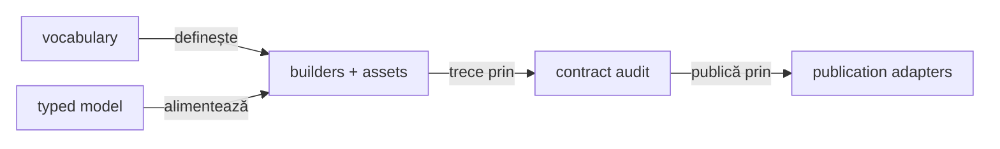

<details>
<summary><strong>Legendă — vocabular, modele și renderer</strong></summary>

- enum-urile și constantele dețin vocabularul finit: tag, class, attribute, view, status și token;
- `AtfReportHtmlVocabulary.element(...)` și `voidElement(...)` compun elementele fără
  a reintroduce tag-uri raw în view-uri; `HtmlReportShell` deține exclusiv shell-ul
  fallback (`html/head/body/meta/title/style/script`);
- POJO-urile/record-urile immutable dețin datele runtime: request, JSON, evidence și checks;
- builder-ele și renderer-ele transformă modelul în HTML/CSS/JavaScript;
- validatorii verifică output-ul, iar adapterele îl publică; valorile dinamice nu devin enum-uri artificiale.
</details>

| Tip de informație | Owner | Regulă |
|---|---|---|
| tag, class, attribute, element, view, status | `AtfReportHtmlVocabulary`, `HtmlReportShell`, `AtfReportAsset`, `ExtentReportRuntimeVocabulary`, `AtfReportStatus` | enum/constant unic; `element(...)`/`voidElement(...)` păstrează forma HTML; `displayValue()` produce valoarea lowercase pentru CSS/filter; fără literali distribuiți |
| culori și geometrie | `AtfReportColors`, `AtfReportCssSelectors`, theme tokens | token stabil; output CSS determinist |
| CSS evidence | `AtfUiEvidenceCss` și providerii theme/evidence | selectorii și token-urile sunt typed; stylesheet-ul este asset CSS nativ, iar valorile dinamice sunt doar placeholder-e de compoziție |
| module JavaScript | `HtmlReportScriptModule`, builders și runtime section modules | ordine și ownership explicite |
| fields, body JSON, screenshot, checks | `ReportField`, `ReportJsonBody`, `ReportScreenshot`, `ReportCheck` | records/POJO immutable; serializerul legacy este boundary |
| scenarii și faze | `ReportExecutionModel`, `AtfReportSemanticSnapshot` | arbore semantic, nu markup |
| propoziții, URL-uri, payload-uri, valori de test | input runtime | nu se transformă artificial în enum-uri |

<details>
<summary><strong>Politica tag-urilor și adnotărilor</strong></summary>

- **normalizare** — `trim` → eliminare valori goale/null → lowercase cu
  `Locale.ROOT` → deduplicare în ordinea primei apariții;
- **proiecție** — lista canonicală ajunge în categoriile Extent, snapshot-ul
  semantic și filtrele JavaScript legacy;
- **publisher** — trece prin `ReportTagNormalizer`; nu apelează direct
  `assignCategory` cu input brut;
- **statusuri** — `PASS`, `FAIL`, `WARNING`, `SKIP` și `INFO` sunt verdicturi
  typed în `AtfReportStatus`; `CLEAR` rămâne filtru UI separat;
- **proof** — testele component/integration ale acestei politici aparțin
  [consumerului specializat](../atf-reporting-tests/README.md), nu sunt duplicate
  în README-ul bibliotecii.

</details>

## Modelele semantice și proiecția comună

<details>
<summary><strong>Detalii — modelele semantice și proiecția comună</strong></summary>

Codul păstrează două modele immutable cu responsabilități locale distincte,
legate printr-o proiecție comună. Astfel nu este nevoie să forțăm rendererul
Extent și fallback-ul să împartă aceeași structură internă:

| Model | Rol |
|---|---|
| `AtfReportSemanticSnapshot` | populația lifecycle-ului Extent: class → scenario → phase → node |
| `ReportExecutionModel` | arborele fallback: scenario → phase → request/validation și proiecțiile `Overview`, `Categories`, `Failures` |

`AtfReportSemanticSnapshot.from(ReportExecutionModel)` este adaptorul comun:

- fallback-ul îl folosește pentru `semanticSnapshot()`;
- sesiunea eșuează înainte de render dacă snapshot-ul derivat din arbore diferă
  de recorderul lifecycle;
- proiecția păstrează package-ul, metadata request/response JSON, validations și
  numărul de acțiuni/screenshot-uri;
- testul semantic compară Extent și fallback pe arborele
  `class → scenario → phase → request → validation`;
- modelele rămân separate: `Overview/Categories/Fails` sunt specifice fallback-ului,
  iar snapshot-ul este contractul comun renderer-neutral.

`ReportExecutionModel.projections()` colectează aceeași populație într-o singură
traversare renderer-neutrală și returnează `ReportExecutionProjections`.

- fațadele `overview()`, `categories()` și `failures()` rămân pentru
  compatibilitate;
- composition roots și validatorii noi pot transmite agregatul complet, fără
  să aleagă proiecții din surse diferite;
- agregatul este pur: nu deține lifecycle state și nu modifică arborele immutable;
- recorderul mutabil și proiecția rămân responsabilități separate.

### Ora afișată și timestamp-ul fișierului

- Ora vizibilă folosește `HH:mm:ss`, fără `AM/PM`, în navbar, Overview, Tests,
  loguri și Categories; data/ora completă folosește `yyyy-MM-dd HH:mm:ss`.
- `ExtentReportTimestampReporter` adaptează numai prezentarea Spark, inclusiv
  expresia Categories a vendorului, în memorie. Nu schimbă JAR-ul, instanții,
  fusul orar, duratele sau payload-urile.
- `ReportingTimestampComponentTest`, în `atf-reporting-tests`,
  verifică miezul nopții, prânzul, orele de după prânz și sesiunea canonică.
  Este probă `@AtfComponentTest`; biblioteca standalone rămâne independentă
  de Test Kit, iar inventarul finit al testelor sale nu se extinde.
- Politica numelui fișierului este separată de ora afișată; opțiunile sale sunt în
  [contractul de output](../docs/ATF_Reporting_Contract.md#numele-raportului-și-diferențierea-rulărilor).

### Instantaneu tipizat pentru Overview/System

Configurația relevantă a unui run se publică printr-un snapshot allowlist-uit,
nu prin dump-ul arbitrar al YAML-ului:

```java
var environment = ReportEnvironmentSnapshot.builder()
        .put(ReportEnvironmentField.ENVIRONMENT, "LOCAL")
        .put(ReportEnvironmentField.PROFILE, "users-posts")
        .put(ReportEnvironmentField.UI_TIMEOUT, "20 s")
        .build();
```

`ReportUiEnvironment` din `configuration.ui` formatează câmpurile operaționale
comune AutoEx/Shop: browser, țintă, timeouts și politici efective de evidence.
Consumerul furnizează valori rezolvate și adaugă numai semantica sa API;
formatterul nu citește YAML, JVM, Playwright sau adnotări JUnit.

Regulile snapshot-ului typed sunt explicite:

- `ReportEnvironmentField` deține vocabularul și clasificarea semantică:
  `Run`, `Targets`, `Browser`, `Time`, `Flow`, `Auth`, `Network`, `Evidence` și
  `Reporting`. Grupurile sunt metadate, nu headere vizuale.
- `Overview/System` afișează o listă plată de perechi label/value. `Client` este
  metadata operațională din grupul `Browser`; `Suite` și alte detalii contextuale
  nu ajung în această secțiune.
- Fallback-ul generic pentru `Client` este `Configured per execution`; Reporting
  nu presupune că orice run folosește ApiTransport. Composition root-ul declară
  valoarea concretă (de exemplu browserul UI) numai când cunoaște canalul efectiv.
- `ReportEnvironmentSnapshot` este immutable, ignoră valorile goale și separă
  `displayValues()` (context typed) de `systemDisplayValues()` (allowlist-ul
  operațional pentru `Overview/System`). `ReportEnvironment` aplică redaction la
  boundary-ul Extent.
- Pentru o sesiune partajată, composition root-ul apelează
  `includeScenarioEnvironment(snapshot)` cu datele rezolvate ale fiecărui
  scenariu. `ReportEnvironmentSnapshot.common(...)` păstrează valorile comune;
  diferențele sau câmpurile absente la un frate devin `Mixed — varies by scenario`.
  Primul scenariu nu reprezintă implicit întreaga suită.
- `ReportEvidenceProfile.actionDetailsMode` se transmite până la scope-ul care
  publică acțiunile, inclusiv setup, unified flow și failure. Frații pot alege
  independent `included-collapsed` și `summary-only`; modelele fallback de
  validation păstrează aceeași politică. Selectarea summary-ului nu șterge
  acțiunile înregistrate și nu elimină screenshot-ul permis.
- Overload-urile vechi cu `Map<String,String>` rămân pentru compatibilitate și
  migrare. Codul nou preferă snapshot-ul typed, evitând chei arbitrare, duplicate
  și valori tehnice neacționabile în `System/Environment`.
- Snapshot-ul nu înlocuiește evidence-ul observat: request/response, retry,
  screenshot și verdictul rămân în `TEST BODY`; `Overview/System` descrie numai
  configurația operațională efectivă a run-ului.
- `Suite`, `Test package`, `Flow`, `Fixture`, `Checkout` și payload-ul business
  nu se publică în `Overview/System`.

`ReportGherkinSequence` este o primitivă opțională de compoziție pe scenariu.
Ea transformă o ancoră repetată în `AND`, păstrează `AND`/`BUT` explicite și
lasă consumerul să declare grupurile business; rendererul nu rescrie narațiunea.
AutoEx transmite rezultatul unic atât checkpoint-ului, cât și corelării lui.

Un consumer nou folosește contractele publice la nivelul la care există datele:

| Date furnizate de consumer | Contract typed | Publicare |
|---|---|---|
| configurație operațională per run | `ReportEnvironmentSnapshot` | `ExtentReportSession` sau `UiExtentReportOptions.environment(...)`; System primește doar câmpurile allowlist-uite și redacted |
| cauzalitate per exchange | `ReportTraceMetadata` în `ReportExecutionEvidence` | `AtfReportPorts.Request.execution(...)`; request/response/execution rămân împreună în pasul care le-a cauzat |

Consumerul construiește valorile la composition root; rendererul nu deduce
business facts din titlu sau YAML. Cele două contracte nu sunt reunite într-un
provider de sesiune: trace-ul poate varia la fiecare exchange, în timp ce
snapshot-ul System este stabil pe durata raportului. Contractul combinat este
verificat cu un consumer sintetic în `ReportTraceMetadataRenderingTest`.

</details>

## Pornirea atomică a scenariilor și fazelor

- Tag-urile caller-owned și profilul scenariului sunt validate înainte de
  crearea nodurilor; un argument invalid nu lasă un nod fără handle utilizabil.
- Dacă pornirea semantică eșuează după crearea nodului Extent, compensarea
  retrage scenariul/faza și rădăcina de clasă nouă rămasă goală. Cauza inițială
  rămâne primară; un eșec secundar de compensare este păstrat ca `suppressed`.
- Sink-ul Console este diagnostic best-effort: excepțiile runtime la notificare
  nu întrerup lifecycle-ul și nu inventează verdicturi sau exchange-uri HTTP.
- `TestRunInitialization` închide doar resursele pentru care a primit handle;
  atomicitatea internă Reporting nu este delegată consumerului sau Test Kit-ului.

`ExtentReportSessionLifecycleTest` și `ReportEvidenceProfileIntegrationTest`
protejează argumentele invalide, eșecul injectat după mutația Extent, compensarea
secundară și reutilizarea sesiunii. Probele sunt locale și deterministe; nu
necesită endpoint extern sau journey de produs.

## Cauza publicării și scope-urile deținute

Publicarea directă și `UiFailureEvidencePublisher` folosesc același protocol
`ReportPublicationScope`: cauza inițială este păstrată când închiderea dovezii
eșuează. Proiecția exchange-urilor aparține colaboratorului intern
`ApiEvidencePublisher`; fațada, modelele și API-ul consumerilor rămân aceleași.

| Situație | Cauză propagată | Închidere |
|---|---|---|
| Body sau complete eșuează | aceeași instanță inițială, inclusiv `Error` | fiecare scope achiziționat se închide o dată |
| Body/complete și close eșuează | inițiala cu eroarea close în suppressed | fără reluarea publicării |
| Numai close eșuează | aceeași eroare close | fără complete suplimentar |
| Close aruncă aceeași instanță ca body | inițiala, fără self-suppression | o singură încercare close |
| Achiziția copilului eșuează | aceeași eroare de achiziție | se închide părintele deținut, fără close pe copilul neobținut |

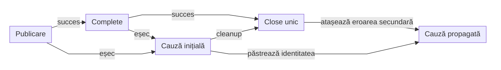

<details>
<summary><strong>Legendă — ownership, ordine și proiecție API</strong></summary>

- Protocolul comun de publicare închide request-ul și validările create,
  inclusiv UI validation standard/media și API assertions.
- Diagrama descrie protocolul comun de închidere. Publisherul de failure
  deține separat request-ul și validarea; copilul se închide înaintea părintelui,
  inclusiv după eșec la assertions sau complete.
- Un copil defect se închide înaintea părintelui; body-ul și complete-ul nu
  sunt reexecutate pentru a compensa o eroare close.
- Colaboratorul API primește `UiApiValidationEvidence` și porturi Reporting.
  Păstrează ownerul API, exchange-urile și aserțiunile evaluate la consumer.
- Colaboratorii rămân implementare internă: fără extinderea fațadei consumerilor,
  dependență browser/JUnit, modul nou sau relaxarea limitei de tipuri pe pachet.
- Gruparea flow-ului, politicile screenshot, timing-ul și preview-ul configurat
  păstrează contractele existente; cleanup-ul nu reevaluează comparații.

</details>

Proba `UiPublicationFailureComponentTest` injectează erori prin fațada publică,
în outcome, setup, checkpoint, media, trace API, flow unificat în/peste faze și
failure delegat. Matricea verifică și achiziția copilului, `Error` identic și
erori multiple de cleanup, cu închidere copil înaintea părintelui.

`UiFailurePublicationComponentTest` probează independent publisherul de failure,
direct și prin fațadă: porturi fără cleanup în cascadă, achiziție parțială,
body/complete/close și aceeași instanță `RuntimeException`/`Error`. Cauza business
raportată rămâne separată de eroarea de publicare; comparațiile nu se reevaluează.

Regula comună de verificare este în
[ghidul de testare](../docs/ATF_Testing_Guide.md#proba-fiecărui-owner-de-resurse).

## Contractul raportului

<details>
<summary><strong>Detalii — contractul raportului</strong></summary>

Regulile canonice pentru ierarhia vizibilă, glyph-ul inline, disclosure-uri,
viewport, responsive layout și verificarea browser sunt în
[Contractul de display și layout](../docs/ATF_Reporting_Display_Contract.md).
Secțiunea de mai jos păstrează numai contractul semantic și limitele specifice
implementării librăriei.

```text
TestCase
├── SETUP (opțional; precondiții / dobândire și verificare fixture)
├── TEST BODY (acțiunea și validarea)
│   ├── Request
│   │   ├── Request details + body (JSON / form / text / absent)
│   │   ├── Response details + body (numai pentru response capturat)
│   │   ├── Execution evidence
│   │   └── Contract validation (când este evaluat un contract al răspunsului)
│   │       └── aggregate assertion table
└── TEARDOWN (opțional; cleanup / read-back)
```

| Regula | Contract |
|---|---|
| ownership API direct | response contract validation este copilul request-ului care deține schimbul; tabelul de assertions aparține validation-ului |
| setup evidence | tabelul `CHECK / EXPECTED / ACTUAL / RESULT` rezumă precondiția; exchange-urile reale rămân `API validation` distinctă sub același checkpoint `SETUP` |
| format body | request/response păstrează formatul capturat (JSON, form sau text); un contract JSON este cerut de validatorul consumerului, nu dedus din metoda HTTP |
| body absent | request/response details rămân prezente; `ABSENT` și `NOT_CAPTURED` au explicații distincte, fără payload inventat; numai JSON literal `null` capturat devine document JSON |
| fază fără evidence copil | o fază fără conținut publicat rămâne nod terminal: rendererul nu afișează `＋/−`, nu o face focusabilă și nu inventează pași din aserțiunile JUnit; conținutul real publicat sub fază rămâne disclosure interactiv |
| aserțiuni de componentă | `Phase.startAssertionStep` publică un copil tipizat în faza owner (`SETUP`, `TEST BODY` ori `TEARDOWN`), fără request HTTP; rândurile `AtfAssertion` folosesc tabelul, redacția și statusurile comune în Extent și fallback. Pasul există numai când testul publică aserțiuni evaluate efectiv. |
| UI evidence | `SETUP` rămâne setup; în `TEST BODY`, acțiunile, observațiile, aserțiunile și verdictul UI sunt publicate sub unicul titlu `UI validation` |
| UI `UNIFIED_FLOW` peste faze | Consumerul apelează `UiScenario.unifyAcrossPhases()` înainte de prima fază și `UiPhase.completeFinal(status)` la faza terminală. Pe succes UI-only, Reporting publică o singură validare UI cu un tabel ACTION, unul OBSERVE (dacă există observații) și unul assertions (dacă există aserțiuni), păstrând toate rândurile în ordine. Captura `FINAL` permisă apare sub tabelul Playwright, înaintea auditului; fazele/checkpoint-urile și verdictele sunt în `UI flow provenance`, separat de răspunsurile HTTP. UI+API, setup eșuat și politicile explicite cu capturi multiple păstrează validările pe checkpoint. `completeFinal(FAIL)` în `SETUP` nu creează `TEST BODY` sau o captură finală. Fără opt-in, comportamentul existent per fază rămâne valabil. |
| layout | `＋/−` este inline înaintea propoziției; Request details, Response details și Execution evidence sunt disclosures surori în request; Contract validation este copilul lui; UI/API validations sunt copii surori ale aceluiași checkpoint Gherkin |
| responsive evidence | antetul și coloanele rămân vizibile semantic și aliniate la orice lățime a panoului; spațiul insuficient produce scroll orizontal local, fără overflow al paginii, celule verticale sau micșorarea fontului |
| tabele cu derulare | containerele folosesc `height:auto` și `max-height:var(--atf-table-scroll-height)`, derivat din `AtfReportThemeTokens.TABLE_SCROLL_HEIGHT` (`500px` în prezent); conținutul scurt nu rezervă spațiu gol, conținutul lung derulează sub antetul fix. Ultimul rând și ultima coloană rămân accesibile. Panourile JSON/cod nu intră în acest contract |
| politica comună de viewport | `ReportTableViewport` și asset-ul `table-viewport.css` sunt comune Extent/fallback; builderul învelește implicit orice tabel de date, inclusiv setup, execution și familii viitoare. Regula nu depinde de titlu, contor, fază sau părinte `validation`; wrapperul este focusabil pentru scroll din tastatură |
| limitele viewportului | un singur wrapper per tabel; tabelele de layout `Status / Details`, copiii și screenshot-urile nu intră în viewport. Normalizarea legacy verifică numai părintele direct al tabelului candidat și reutilizează wrapperul existent |
| scroll local la input | `table-viewport.js` izolează rotița și navigarea din tastatură de panoul gazdă; inputurile, linkurile, summary-urile și panourile de cod își păstrează comportamentul. Există un singur binding delegat, fără scanări la fiecare gest |
| `TECHNICAL TRACE` | toate tabelele `helm-trace-table` sunt învelite de markup-ul comun `atf-trace-table-wrap`; wrapperul folosește `height:auto`, `max-height:var(--atf-table-scroll-height)`, scroll vertical și header sticky. Se aplică în Extent și fallback, strict tabelului, nu disclosure-ului exterior sau JSON-ului |
| Request details / retry history | tabelul de metadate `helm-request-table` și tabela `retry-history-table` folosesc wrapperul `atf-api-table-wrap`, plafonul comun și header sticky în Extent și fallback; Request JSON rămâne în afara wrapperului și disclosure-ul exterior nu derulează tabelul |
| etichete de cardinalitate | `AtfReportLabels` este sursa comună Extent/fallback: `1 field/check/attempt/entry`, respectiv plural pentru zero și mai multe; publisherii nu compun etichete local |
| action number | fiecare acțiune afișează `#n` într-un token dedicat, `atf-ui-action-number`, compact (`inline-block`/`max-content`); nu se reutilizează clasa extensibilă `atf-ui-action-sequence` |
| screenshot | link inline cu emoji-ul curent; payload Base64 pentru prima apariție sau referință locală bounded (`screenshot-n`) pentru o stare deduplicată; fingerprint-ul rămâne intern și nu este afișat în locul linkului |
| action table | acțiunile relevante includ `getText`/text extraction; timpul apare numai pentru acțiuni |
| failures | `Setup`, `Playwright action`, `Audit observation` și `Assertion` au cauze distincte și `Open in Tests` |
| navigation | `Tests`, `Overview`, `Categories`, `Fails` folosesc aceeași identitate semantică și deep-link |

Această ierarhie API nu trebuie confundată cu raportarea UI: acolo `UI validation`
și `API validation` sunt copii semantici ai aceluiași checkpoint Gherkin, iar
fiecare `API validation` își deține exchange-urile. Verdictul unei metode JUnit
nu este un request API și nu trebuie introdus ca metodă `ASSERT`/rută sintetică.

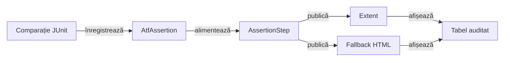

<details>
<summary><strong>Legendă — dovada de componentă</strong></summary>

- JUnit decide verdictul metodei; rândul raportat descrie aceeași comparație.
- `AssertionStep` aparține fazei și nu intră în numărul de request-uri API.
- Cele două randări păstrează aceeași dovadă și același status.

</details>

`AssertionStep` este un tip de nod distinct de `Request` și `Validation`.

- Statusul său intră în statusul fazei și al scenariului, iar un rând FAIL apare
  în `Fails` cu owner `component` și câmpul `STEP`.
- Valorile comparației rămân exacte, inclusiv numere care seamănă cu statusuri
  HTTP; nu apar request ori durată de răspuns inventate.
- Validările UI/API rămân sub checkpoint-ul sau exchange-ul lor.

- Compactarea este o proiecție de prezentare pentru flow-ul UI-only reușit;
  modelul reține obiectele originale de acțiune/aserțiune, proveniența și verdictul.
  Detaliile tehnice ale request-urilor API rămân în canalul lor; prezentarea
  adaptivă este normată în [panouri înguste](#lizibilitatea-dovezilor-în-panouri-înguste).

### Context de fază și diagnostic de execuție

| Intrare | Owner și proiecție |
|---|---|
| `Phase.detail` | Context intern; nu publică `Audit details`, tabel de log sau wrapper gol în fază |
| `Phase.diagnostic(Kind, message)` | Diagnostic explicit al scenariului, redactat; nu creează request sau aserțiune business |
| Request / validation | Păstrează dovezile HTTP și contractele efectiv evaluate |

`ReportPhaseDiagnostic` delimitează compatibilitatea pentru `Failure cause`,
`JUnit failure` și `API contract association`. Restul detaliilor de fază nu
devin diagnostic prin deducție. `ReportPhaseDiagnosticMarkup` este proiecția
comună Extent/fallback; Fails păstrează cauza reală a fazelor eșuate.

- În Extent, `extent-scenarios.js` include diagnosticul în panoul scenariului
  și elimină wrapper-ul vendor; închiderea îl ascunde, normalizarea nu îl dublează.
- Fără exchange-uri nu se inventează HTTP sau PASS contractual; un diagnostic
  de asociere nu schimbă singur verdictul JUnit.
- Modelul păstrează statusul fazei sursă; Fails nu atribuie unui eșec notele
  dintr-o fază care nu a eșuat.
- `Setup evidence` și inspectorul agregat rămân canale distincte.

### Dovezi API atașate unui pas UI

Un consumer poate atașa unul sau mai multe `ReportExecutionEvidence` la același
checkpoint UI prin overload-ul `UiExtentReportSession.step(...)`. Reporting nu
creează un test artificial și nu recalculează verdictul; proiectează schimbul
în contractul existent al request-ului:

```text
UI checkpoint
├── UI validation → actions, observations, assertions și screenshot inline
└── API validation (numai când există exchange-uri selectate)
    └── HTTP exchange
        ├── Request details → method/path/url/auth/headers/transport/replay + REQUEST JSON
        ├── Response details → status/content-type + RESPONSE JSON (numai pentru response capturat)
        └── Execution evidence → attempts/retries/duration/outcome
```

- `request.action`, `request.target`, `evidence.type` și `evidence.policy` sunt
  context intern al checkpoint-ului:
  rămân în model și în diagnosticul configurat, dar nu se publică în tabelele
  request/response. `EvidenceTableFormatter` aplică aceeași proiecție Extent,
  fallback și legacy, cu potrivire exactă a cheilor, indiferent de casing;
- tipul `ui-validation` delimitează filtrarea politicii; contractele explicite
  `api-trace`/`unified-ui-flow` și diagnosticul capturii `ui-failure` rămân neschimbate;
- checkpoint-ul UI nu primește `Request details`, `Response details` sau un
  tabel introductiv `Status / Details / Info` pentru identitate ori politică.
  Fără câmpuri/payload publice, rendererul nu creează un log gol;
- țintele acțiunilor Playwright, screenshot-urile și aserțiunile rămân în
  `UI validation`; câmpurile HTTP reale rămân publice la exchange-ul API;
- disclosures sunt închise by default și aparțin exchange-ului API;
- în consumerul UI, forma țintă este `un singur pas Gherkin → UI validation +
  API validation → exchange disclosures`; cele două validation nodes sunt copii
  semantici ai aceluiași pas și au statusuri proprii;
- `UiApiValidationEvidence` este unicul input API pentru checkpoint, setup,
  captură finală, trace și bufferul flow-ului unificat. Intrările cu liste brute
  de exchange-uri sunt eliminate, fără overload sau fallback. UI-only folosește
  explicit `UiApiValidationEvidence.empty()`; o observație fără checks rămâne
  un exchange typed, fără a moșteni verdictul UI;
- publisher-ul tipizat `UiApiValidationEvidence` separă aserțiunile UI de cele
  API: corelările sunt atașate validării API, iar fiecare exchange își păstrează
  assertions/status propriu. Statusul de checkpoint se agregă în sus, fără să
  recoloreze copiii sau exchange-urile frate. Verdictul de business este explicit
  în assertion, nu dedus numai din statusul HTTP;
- `apiTrace(...)` nu trebuie să producă un al doilea card vizibil cu același
  titlu Gherkin ca checkpoint-ul UI. Dacă un consumer are API evidence pentru
  aceeași propoziție, publisher-ul trebuie să atașeze validation-ul la nodul
  existent sau să folosească o compoziție echivalentă fără duplicare;
- `Exchange n` este identificator local în `API validation`; nu se revine la
  chei flat `API n · ...` și nu se multiplică propoziția Gherkin pentru
  request-uri diferite;
- `Execution evidence · 1 attempt` nu poate rămâne un titlu repetat fără
  context: exchange-ul trebuie identificat prin disclosure-ul părinte sau printr-un
  label semantic per exchange;
- `API network inspector` acceptă numai exchange-uri HTTP și checkpoint-urile
  lor cauzale; nu există un canal generic pentru console/page diagnostics;
- `Technical diagnostics` este derivat numai din exchange-uri HTTP eșuate și
  rămâne transport evidence, nu un pas Gherkin sau o validare de business;
- nodurile tehnice folosesc accentul vizual comun, dar nu inventează un verdict
  sau un status pentru un exchange;
- copiii tehnici ai acestor noduri moștenesc aceeași familie vizuală, fără să
  primească un verdict artificial sau un card Gherkin nou;
- proiecția UI folosește aceeași semantică și redaction policy ca raportul API
  direct: headerele browserului și response headers volatile sunt filtrate,
  iar response headers stabile sunt opționale;
- body-urile folosesc limita consumerului `reporting.bodyMaxDisplayCharacters`;
- redaction-ul precedă render-ul; default-ul este `100`, iar `0` dezactivează
  limita pentru body preview;
- renderer-ul nu introduce o limită hardcodată;
- consumerul furnizează datele typed, iar `atf-reporting` publică numai
  contractul semantic și layout-ul verificabil, independent de mock, browser și
  aplicație.

Verdictul este calculat de execution/validation și doar publicat de reporting.
Rendererul nu inventează statusuri.

### Execuție API terminată fără răspuns

`ReportExecutionEvidence` poate avea response absent și metadata typed
`Termination`; acestea aparțin execuției, separat de HTTP.
`ApiExchangeEvidence.publish` păstrează request-ul cunoscut, istoricul și
diagnosticul inclusiv fără response. `publishFailure` permite și URL-ul rezolvat
cunoscut de caller; niciuna dintre intrări nu decide verdictul consumerului.

`UiApiValidationEvidence.Exchange` cere request capturat. Fără response, statusul
explicit diferit de INFO ori aserțiunile evaluate furnizează verdictul; absența
ambelor este refuzată prin `IllegalArgumentException` înaintea publicării.
INFO singur este observație, nu verdict. Un canal API gol rămâne valid și INFO.

Diagnosticul este inspectabil în Tests. Indexarea Fails a unui FAIL terminal
fără assertions are încă [un criteriu separat](../docs/feedback/ATF_Reporting_Feedback.md#report-terminal-failure-index-48--cauza-transportului-în-indexul-fails):
contextul generic Extent și omisiunea fallback nu sunt garanții de paritate.

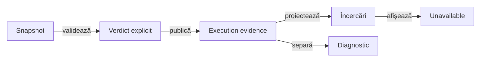

<details>
<summary><strong>Legendă — paritate Extent/fallback și compatibilitate</strong></summary>

- Seam-ul legacy `ReportModelAdapters.partialExecution` cere disponibilitate
  explicită prin Optional; constructorii Reporting existenți rămân disponibili.
  Modelele Core nu intră în classpath-ul librăriei standalone.
- Sentinelul fără răspuns devine Unavailable în istoricul afișat; nu se
  inventează status, body ori response duration pentru încercarea terminală.
- Terminarea și diagnosticul stau în disclosure-ul Execution evidence.
  În lipsa răspunsului nu apare un disclosure Response details fabricat.
- Fiecare exchange valid rămâne copil API în setup, checkpoint, validare finală,
  trace și flow unificat, inclusiv între faze. Lipsa response-ului nu filtrează
  exchange-ul și nu renumerotează vecinii. FAIL/SKIP din aserțiuni domină PASS
  transmis de caller; PASS pentru un eșec așteptat cere verdictul său explicit.
- Un URL rezolvat necunoscut rămâne gol; ruta nu devine un URL inventat sau
  o comandă replay. Terminarea absentă nu primește o cauză presupusă.
- Zero dispatch-uri păstrează transportul selectat, fără afirmația că rețeaua
  a fost executată ori că replay-ul manual ar fi verificat.
- Textul complet este redactat înaintea plafonului integral de 240 de
  caractere, inclusiv elipsa; bugetul personalizat se aplică la proiecție.
- `TerminalExecutionProjectionTest` și `TerminalApiExecutionReportTest`
  verifică modelul, Extent/fallback, redacția, tastatura și ultimul rând.
- `ReportingStandaloneVerdictComponentTest` protejează boundary-ul standalone, iar
  `UiTerminalExchangeReportComponentTest` verifică arborele UI/API, diagnosticul,
  încercările, totalurile și disclosure-ul în Extent/fallback, cu buget implicit
  și personalizat. Probele folosesc snapshot-uri locale, fără dispatch HTTP.
- Totalul pass-like din Overview este PASS + WARNING în ambele renderere;
  verdictul WARNING rămâne distinct în arbore și nu devine failure în Fails.

Etichetele scurte păstrează următorul sens:

| În schemă | Sens complet |
|---|---|
| Snapshot | Snapshot consumer |
| Verdict explicit | status caller diferit de INFO sau aserțiuni evaluate ale exchange-ului fără response |
| Execution evidence | Execution evidence + Termination |
| Încercări | Încercări în ordine |
| Diagnostic | Diagnostic de execuție |
| Unavailable | Unavailable, fără HTTP inventat |
| afișează | afișează absența |

</details>

### Decizii BE fără verdict de succes implicit

Adaptoarele AutoEx/Shop publică deciziile recuperării prin observații INFO,
cu politica și bugetul în Expected, iar decizia, motivul și timpii în Observed.
Aceste rânduri nu reprezintă clickuri repetate și nu rescriu un FAIL publicat.
Receipt-ul și sursa politicii, operația, încercarea și timpii probe/backoff/total
sunt observații auditabile; corpul HTTP și credentialele nu sunt capturate.

Proiecția existentă păstrează disclosure-urile și plafonul configurat
după redactarea textului complet. Indicatorul agregat de recuperare,
abort SKIP și matricea completă UI/UI_API rămân în
[feedback-ul auditului](../docs/feedback/ATF_UI_Backend_Guided_Recovery_Feedback.md#ui-recovery-audit-01--încercări-inspectabile-în-extent).

### Contextul erorii înaintea diagnosticului tehnic

`UiFailureContext` proiectează prima dovadă FAIL în ordinea `sequence`:
tipul excepției, operația și numărul, ținta, timpul măsurat și așteptarea.
Aceeași proiecție apare în `Failure cause`, în Observed și în Fails.
O acțiune PASS nu devine cauza unei excepții ulterioare; lipsa unei acțiuni
eșuate ori a excepției este explicită, iar sursa OBSERVE rămâne observație.

- Mesajul nativ al unui timeout aparține diagnosticului separat din Tests.
- `elapsed` este timpul acțiunii capturat, fără deducerea deadline-ului din excepție.

`UiFailureEvidencePublisher` deține publicarea acestei dovezi prin porturile
neutre Reporting; `UiEvidencePublisher` îi deleagă failure-path-ul, fără JUnit,
browser sau reevaluarea verdictului business.

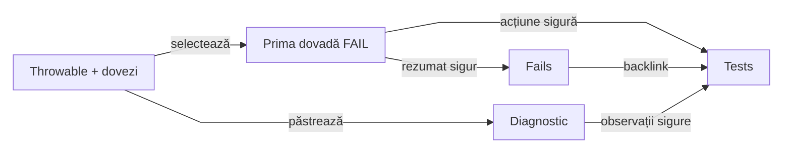

<details>
<summary><strong>Legendă — context, relații și limite</strong></summary>

- Contextul folosește numai evidence capturat; nu parsează un stack pentru
  a inventa dispatch, răspuns HTTP, navigare confirmată sau recuperare.
- Diagnosticele `INFO` din Audit observations păstrează tipul și mesajul
  excepției primare, cauzele și suppressed, cu relații numerotate. Referințele
  comune și ciclurile sunt finite; Throwable-ul și rândurile originale rămân intacte.
- Redactarea întregii valori precede plafonul configurat, implicit 240 inclusiv
  elipsa, și pentru fiecare diagnostic. Expandarea nu publică text brut nelimitat.
- Muchiile „sigură/sigure” includ redactarea și plafonul; separarea suprafețelor
  nu creează o cale secundară pentru publicarea valorilor brute.
- Fails preferă contextul aserțiunii UI față de diagnosticul tehnic al fazei;
  diagnosticul rămâne în Tests. API își păstrează lanțul cauzal și ownerul propriu.
- Verdictul FAIL, corelarea prin identitate și politica fără replay rămân
  responsabilități distincte de această proiecție.

</details>

| Suprafață | Contract observabil |
|---|---|
| Tests → Playwright action sequence | operația, locatorul, durata măsurată și contextul primei dovezi FAIL |
| Tests → Audit observations | diagnostice INFO distincte: tip/mesaj primar, cauze, suppressed și observația originală; fiecare respectă bugetul |
| Fails → Cause | context compact; mesajul nativ și markerul de redactare nu sunt obligatorii în acest rezumat |
| Open in Tests | scenariul și ordinalul comparației eșuate deschid calea originală în Extent; faza, request-ul/pasul, validarea și disclosure-ul devin vizibile fără `Expand all` |

`UiFailureReportContractTest` verifică suprafețele prin fațada UI reală;
`UiTimeoutReportComponentTest` verifică Extent/fallback la 240 și 18, redactarea
întregului HTML, relațiile diagnosticului, izolarea și backlink-ul. Probele negative
detectează eliminarea diagnosticului nativ și expunerea unei credențiale în DOM.

### Captura la failure

- Adaptorul aruncă `UiCheckpointFailure(message, assertions)` cu instanțele
  exacte ale aserțiunilor UI FAIL publicate în scenariul curent.
- În Fails rămâne aserțiunea originală; diagnosticul de propagare și captura
  finală rămân în `Failure evidence` din Tests, inclusiv în flow unificat.
- Nu se compară titluri sau mesaje. Excepțiile obișnuite, instanțele diferite
  cu același conținut, eșecurile API și cleanup/acțiunile independente rămân separate.

`Failure evidence` păstrează acțiunile executate și cauza inițială.
`UiFailureScreenshotState` evaluează politica înaintea payload-ului:

| Stare | Condiție | Link imagine |
|---|---|---|
| `DISABLED_BY_POLICY` | Politica exclude captura la failure | absent |
| `UNAVAILABLE` | Payload null, gol sau whitespace | absent |
| `INVALID` | Base64 incorect ori semnătură non-PNG | absent |
| `CAPTURED` | Captură permisă, encoding Base64 și semnătură PNG acceptate | inline, cu emoji |

- `ReportScreenshot.hasPngSignature(...)` verifică encoding-ul și semnătura PNG;
  nu decodează pixelii și nu garantează integritatea completă a imaginii.
- Observația `Screenshot` are sursa `OBSERVE` și statusul `INFO`; nu devine
  aserțiune business și nu creează un al doilea checkpoint.
- Extent și fallback păstrează conținutul acțiunilor și capturilor publicate,
  nu numai contoarele; pasul UI nu primește metadate HTTP fictive.

### Audit terminal în UI validation

- Validarea contractului terminal publică exact o observație `Audit screen
  contract` în `Audit observations`, în aceeași validare cu acțiunile,
  aserțiunile și captura; nu creează un al doilea Gherkin checkpoint.
- Observația are sursa `OBSERVE`, nu devine acțiune Playwright sau aserțiune
  duplicată. Se înregistrează înainte de drenarea secvenței pentru publicare.
- Observația identifică obiectul, verdictul contractului, numărul aserțiunilor,
  starea capturii și URL-ul sigur; nu copiază body-uri ori secrete.
- Screenshot-ul este în afara viewportului tabelului de acțiuni, imediat după
  acesta, conform profilului efectiv. Calea fără captură declară explicit
  absența; un payload invalid nu este prezentat drept PNG valid.
- Aserțiunile rămân sursa verdictului; o captură nu dovedește singură `PASS`.
  `FINAL_ONLY` nu inventează starea finală după un setup eșuat.

`ExtentReportUiEvidenceRenderingTest` verifică DOM-ul generic și separarea
`ACTION`/`OBSERVE`; probele terminale Shop/AutoEx verifică mapping-ul local,
unicitatea și ordinea `record → drain`. Verificarea browser a unui layout
schimbat rămâne distinctă de aceste probe automate.

`UiAuditLifecycleTest` verifică separat failure-ul, inclusiv payload gol,
politica dezactivată și lipsa acțiunilor executate. Starea vizibilă este
observație în `Failure evidence`; metadatele interne rămân filtrate din HTTP.

### Inspector agregat pentru flux UI/API

`ReportNetworkInspector.JourneyAggregate` este proiecția semantică a journey-ului;
nu este un al doilea trace și nu înlocuiește evidence-ul canonical al unui exchange.

Contractul pentru un summary solicitat este:

- lifecycle-ul îl publică o singură dată, după checkpoint-urile UI/API și failure evidence, chiar înainte de închiderea fazei;
- summary-ul este ultimul nod tehnic al `TEST BODY`, fără checkpoint sau dovadă de eșec după el;
- o cerere explicită fără exchange-uri produce `0 exchanges`; profilul UI-only îl omite prin necerere;
- summary-ul rămâne informativ (`PASS`); verdictul aparține checkpoint-urilor și scenariului.

Overload-ul `networkInspector(..., ReportNetworkCaptureStatus)` adaugă
`Capture coverage`: scope, accepted/retained/excluded/dropped, capturi în
curs, plafon și separarea setup/causal. `Complete within scope` cere zero
pierderi și zero capturi în curs la snapshot; nu promite trafic viitor.
Fără metadatele opționale, API-ul anterior nu inventează completitudinea.

| Situație | Ce exprimă raportul | Ce nu deduce |
|---|---|---|
| Zero exchange-uri, captură completă | nu există trafic cauzal în scope la snapshot | absența întregului trafic browser |
| Captură cu overflow sau în curs | `Incomplete within scope`, cu totalurile explicite | verdict business FAIL sau request-uri fabricate |
| Setup + trafic cauzal | setup rămâne la precondiție; agregatul numără numai causal | dublarea precondiției în totalul cauzal |

`uiValidation(..., apiEvidence, capturePoint, status)` păstrează
exchange-urile terminale alături de ecranul final, ca frați ai validării UI,
fără repetarea propoziției Gherkin. Probe: `NetworkCaptureEvidenceTest` în
`atf-reporting-tests`, inclusiv artifact și browser local.

`NetworkInspectorSummaryRoleTest` verifică ordinea în ambele moduri de randare.

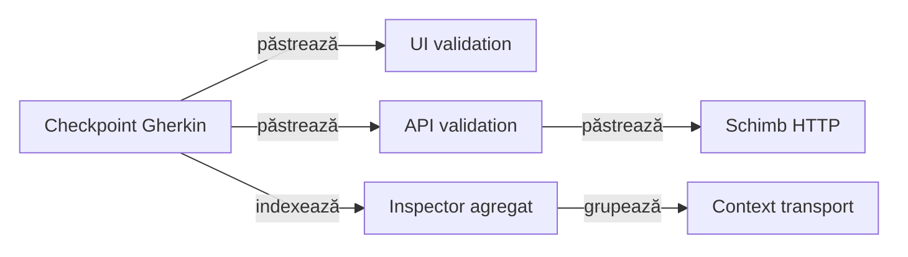

<details>
<summary><strong>Legendă — ce intră în aggregate și ce rămâne local</strong></summary>

- `authentication` grupează numai method/source/status/count; semantica este
  `observed`, nu validarea tokenului, issuerului sau claims-urilor;
  prezența unui Cookie nu certifică identitatea sau autentificarea utilizatorului;
- `correlation` păstrează legătura dintre checkpoint și exchange-urile cauzate;
- `transport` numără observations, success/failure, attempts, retries și
  provenance live/mock/unknown;
- `signatures` grupează signature-ul safe cu count și statusuri și îl afișează
  o singură dată ca un card compact cu method, route, authentication, evidence
  source și phase;
- `diagnostics` deduplicatează eșecurile HTTP după method/route/status/reason și
  păstrează `count` și sursa de transport; semnalele browser fără un exchange
  asociat nu sunt colectate și nu pot intra în aggregate;
- body-urile JSON, headerele sensibile și execution details rămân în disclosure-ul
  canonical al exchange-ului; nu se copiază în sumar;
- indexul atașat request-ului de inspector conține numai trei facts bounded:
  numărul de exchange-uri canonice, numărul de pași Gherkin și numărul de
  semnături unice; pașii compleți apar numai în `Scenario correlation`, iar
  request-urile numai în `Unique request signatures`;
- semnătura request-ului și digesturile body-ului rămân identitate internă pentru
  grouping/retry; HTML-ul public afișează doar `body=present|absent` și markerul
  bounded `internal digest hidden`;
- consumerul selectează evidence-ul înainte de publisher, prin contract typed;
  renderer-ul nu decide ce request-uri intră;
- `Overview → System` nu este owner pentru trace, auth, diagnostic sau body;
  acestea aparțin inspectorului/evidence-ului.

</details>

Contractul de trace se citește astfel:

- bridge-ul generic publică aggregate-ul într-un singur nod collapsed `TRACE`,
  cu disclosure-uri nested pentru auth, correlation, transport, signatures și
  diagnostics;
- pentru checkpoint-uri cu mai multe exchange-uri, pipeline-ul lower-level
  păstrează `API validation → Exchange → request → response → execution`, fără
  JSON duplicat; retry-ul rămâne în evidence-ul aceluiași exchange;
- consumerul atașează API validation la același nod Gherkin cu `UI validation`;
  diagnosticul tehnic de transport provine din exchange și nu introduce o
  propoziție Gherkin suplimentară.

Contractul este verificat de testul component
[`keepsUiAndApiValidationUnderOneGherkinCheckpoint`](../atf-reporting-tests/src/test/java/atf/reporting/ui/ExtentReportUiEvidencePublishingTest.java):
titlul Gherkin apare o singură dată, iar validările UI/API și exchange evidence
coexistă sub acel checkpoint. Un card Gherkin duplicat este regresie a acestui
contract, nu un ToDo activ.

</details>

## Structura producției

[Atlasul pachetelor](src/main/java/atf/reporting/README.md) este intrarea pentru
o revizie locală; inventarul de mai jos permite apoi găsirea detaliilor concrete.

<details>
<summary><strong>Detalii — structura producției</strong></summary>

| Boundary | Owner principal | Output verificabil |
|---|---|---|
| semantic/model | `semantic`, `model`, `contract` | snapshot, execution tree, status și assertions |
| markup/render | `markup`, `html`, `extent` | Extent nodes și fallback HTML |
| asset/theme | `asset`, `theme`, `runtime` | CSS/JavaScript native, vocabulary și manifest |
| audit/publication | `ui/audit`, `artifact`, `publication` | contracte, inspector, workspace și artifact final |
| input/config | `api`, `configuration`, `evidence` | request/response/evidence typed și policy de output |

<details>
<summary><strong>Detaliu — harta internă și split-ul CSS/JavaScript</strong></summary>

```text
atf.reporting
├── semantic/       snapshot, recorder facade, lifecycle orchestrator și state aggregate mutation intern
├── model/          execution tree și evidence POJO
├── markup/         Extent nodes, assets și vocabulary bridge
├── html/            fallback document și script builder
├── theme/           tokens, CSS selectors, theme/evidence providers
├── runtime/         JavaScript Extent split pe responsabilități
├── ui/              contracte, audit și UI lifecycle
│   └── model/       evidence rows tipizate pentru acțiuni UI
├── api/             acceptance/report contract și JSON evidence audit
├── artifact/        inspector și contracte ale artifactului
├── publication/     workspace, coordinator, finalizer
├── configuration/   reporting settings și environment
└── evidence/        transport/UI evidence și style contract
```

Split-ul CSS/JavaScript este semantic, nu cosmetic. `ExtentReportRuntimeBehaviour`
compune core/tests/overview/evidence/navigation/duration/failure; providerii
theme/evidence dețin CSS-ul aferent. Nu se mai creează clase doar pentru a reduce
numărul de linii.

Pentru navigare, limita este explicită și verificabilă: `ExtentReportRuntimeNavigation`
compune trei asset-uri JavaScript native — DOM contract, disclosure și controller —
prin `ReportAssetComposer`. Fațadele Java rămân doar owneri semantici și nu mai
rețin corpuri inline; testele de componentă verifică atât funcțiile publicate, cât
și manifestul asset-urilor. `Scenarios`, `Categories`, fragmentele de evidence
și Overview CSS respectă aceeași limită; `AtfReportOverviewCss` compune acum
asset-uri native separate pentru layout, tag audit, category tables și category
status. Aceeași limită este aplicată și theme-ului Extent: responsive, base,
category/category-status, Fails layout/status, navigation, scenario și detail sunt asset-uri
CSS native, iar fațadele Java rezolvă doar token-uri și seam-urile de compoziție.
Evidence interaction/table/disclosure/stack și fallback theme folosesc aceeași
graniță. Navigarea HTML publicată nu mai include `onclick` inline; linkurile cu
hash sunt contractul static, iar controllerul nativ le activează prin hash.

Geometria disclosure-urilor este un contract comun în Extent și fallback:
summary-urile obișnuite API/UI folosesc `34px`, padding-ul `9px 12px` și
line-height-ul comun. Rândurile `Unique request signatures` și
`Technical diagnostics` din Network Inspector păstrează aceeași înălțime
compactă `34px`, collapsed implicit; stilul de summary dublu nu se aplică
rândurilor aggregate și nu lasă spațiu vertical gol când titlul încape pe un
rând. La viewport îngust, textul poate curge natural fără să schimbe înălțimea
implicită a cazului obișnuit.

Înălțimea zonei tabelului este un contract separat: `TABLE_SCROLL_HEIGHT` (`500px`)
este plafonul comun, publicat ca `--atf-table-scroll-height`. Containerele au
`height:auto` și `max-height` comun, astfel conținutul scurt nu rezervă spațiu
gol, iar conținutul lung derulează în interiorul aceluiași plafon. Header-ele
rămân fixe; contractul acoperă Overview, audit, dovezile UI, agregatele API și
tabelul `TECHNICAL TRACE` din `Response details`, plus request metadata și
retry history în `atf-api-table-wrap`. Markup-ul trace și CSS-ul
viewportului sunt comune rendererelor Extent și fallback; proba browser verifică
API direct și trace-ul API publicat ca frate cauzal al unui checkpoint UI.

</details>

<details>
<summary><strong>Detaliu — runtime Overview, Scenarios, Categories și Fails</strong></summary>

Fallback navigation și boot-ul documentului Extent urmează aceeași regulă:
`fallback-navigation.js` și `runtime-boot.js` sunt asset-uri native, iar
`HtmlReportNavigationScript` și `ExtentReportRuntimeBehaviour` sunt doar
fațade/publication seams typed. Modulele JavaScript Extent sunt injectate în
placeholder-ul de boot fără ca Java să reconstruiască funcții sau expresii
executabile.

Aceeași limită este aplicată acum și familiei `ExtentReportRuntimeOverview`:
`Audit`, `Labels`, `Charts` și `Cleanup` sunt asset-uri native distincte, iar
enum-ul `Fragment` rămâne composition root-ul ordinii. Java nu mai conține
corpurile funcțiilor; le expune prin fațade testabile și `ReportAssetComposer`.

`ExtentReportRuntimeScenarios` și `ExtentReportRuntimeCategories` folosesc aceeași
graniță: `extent-scenarios.js` și `extent-categories.js` dețin funcțiile browser,
iar Java păstrează doar facade-ul public și vocabularul typed. Astfel filtrarea,
adnotările de scenariu și deep-link-urile către Categories pot fi verificate
componentar fără să reintroducem literali JavaScript în clasele runtime.

Evidence are aceeași separare: `ExtentReportRuntimeEvidenceDisclosure`,
`ExtentReportRuntimeEvidenceFailures` și `ExtentReportRuntimeEvidenceTableLayout`
sunt fațade Java mici peste `extent-evidence-disclosure.js`,
`extent-evidence-failures.js` și `extent-evidence-table-layout.js`. Primul normalizează
disclosure-urile pentru request/response/JSON/assertions, al doilea proiectează
failure evidence UI, iar al treilea măsoară valorile reale și publică lățimi de
coloane deterministe. Nu se amestecă layout-ul cu semantica evidence și nu se
introduce un al doilea owner al aceleiași funcții.

Invariantele de implementare ale acestor asset-uri sunt documentate aici, nu
în payload-ul JavaScript: `table-viewport.js` gestionează tastele doar când
viewport-ul are focus (fără să fure tastele controalelor imbricate) și captează
rotița înaintea handlerelor vendor pentru a păstra scroll-ul local. Evidence
disclosure reutilizează linkul media canonic pentru referințe și ascultă `toggle`
în capture deoarece evenimentul nu bubble-uiește; disclosure-ul JSON își păstrează
ownership-ul și nu este confundat cu trace-ul vecin. Normalizarea scenariilor
mută doar diagnosticele explicite în panel și elimină wrapper-ul de log vendor.
Alocarea comună păstrează lățimea măsurată a coloanelor tehnice și distribuie
numai cererea de spațiu rămasă a conținutului flexibil. Adapterul legacy
inspectează părintele imediat al tabelului; viewport-urile noi sunt deținute de markup-ul Java.

`appendUiFailureEvidence` rulează pe nodurile typed `request` și `validation`:
request-ul deține failure API, iar validarea UI deține eșecul
Playwright/audit/assertion. Leaf-ul `Fail` este atașat tabelului de evenimente
al aceluiași owner, cu cauza UI concretă; UI-only nu primește disclosures
Request/Response inventate. `ExtentReportRuntimeEvidenceLifecycle` deține
ordinea acestei normalizări.

La nivelul markup-ului Java, `ReportEvidenceDisclosure` este modelul typed al
unei zone colapsabile, iar `ReportEvidenceMarkup` este shell-ul comun pentru
disclosure-uri și badge-ul de status. `AtfReportMarkup.tableHtml` este builder-ul canonical pentru
tabelele key/value, iar `ReportEvidenceJsonFormatter` deține politica comună
label → redaction → pretty print → display-limit. Renderer-ul Extent și
fallback-ul HTML primesc aceeași listă typed de `ReportField` și același JSON
display policy; diferența rămasă este numai adaptorul de publicare (Markup
Extent versus document HTML). Paritatea este protejată prin teste component/unit,
nu printr-un E2E suplimentar.

`AtfReportStatus` este și owner-ul unic pentru markerul inline, label-ul uman și
rezultatul compact; rendererele nu își definesc switch-uri locale pentru emoji sau
text de status, iar fallback-ul HTML folosește aceeași prezentare typed ca evidence-ul UI.

Și proiecția `Fails` este acum separată pe responsabilități native: detection,
context, cause-chain și projection au câte un asset JS și o fațadă Java proprie.
`ExtentReportFailureRuntime` compune ordinea stabilă, fără să dețină corpuri de
funcții; astfel testele pot verifica independent cauza, contextul și randarea
failure fără browser, iar testul E2E verifică deep-link-ul către testul exact.

Auditul final al vocabularului/builder-ului CSS și al seam-urilor mici de
publicare este acoperit de contractele component și de gate-ul fresh
standard/responsive. Orice schimbare viitoare rămâne incrementală și cere
aceeași dovadă; nu există un TODO deschis doar pentru că asset-urile sunt
împărțite în fișiere native. `AtfUiEvidenceCss` este facade typed peste
`ui-evidence.css`, iar `Duration` și `RuntimeCore` sunt compuse din asset-uri
JavaScript native; niciuna dintre aceste familii nu mai asamblează corpuri mari în
Java. `ScenarioCss` este facade typed peste `theme-scenario.css`, iar
`ExtentReportNavigationView` publică numai markup și hash links; nu mai generează
JavaScript executabil inline.
`ExtentReportCategoryMarkup` folosește aceeași construcție semantică pentru
shell-ul Category: vocabularul typed guvernează tag-uri, clase, atribute și
empty-state, iar markerul vendor `atf-fails-view` este păstrat doar ca boundary
de inserare documentat. `ExtentReportCategoryMarkupTest` verifică separat
idempotency, ordinea în DOM și contractul CSS/accessibility.
`HtmlReportFailsView` folosește aceleași primitive pentru fallback-ul Fails,
inclusiv statusul semantic, deep-link-ul scenariului și empty-state-ul; astfel
paritatea dintre Extent și fallback este verificabilă prin teste lower-level.
`HtmlReportTestsView` și `ExtentReportPublicationPipeline` folosesc aceeași
graniță pentru scenarii, phase/request nodes, theme și view identifiers.
`ExtentReportScreenshotDeduplicator` păstrează fingerprint-ul doar intern,
pentru deduplicare; în raport rămâne linkul inline cu emoji-ul curent, nu un
hash afișat.
`HtmlReportScriptBuilder` rămâne numai infrastructură generică pentru porturi
typed/custom și teste; nu mai este folosit pentru a construi navigation sau boot
în producție. Regula de formatare este explicită: fișierele `.js`/`.css` din
classpath rămân multiline și ușor de revizuit, iar `ReportAssetCompactor`
compactează numai copia injectată în HTML.

</details>

<details>
<summary><strong>Detaliu — ownership-ul funcțiilor și durata</strong></summary>

Migrarea următoare se face incremental, cu contract component echivalent,
reconciliere live și raport fresh; nu se transformă mecanic toate constantele Java
în token-uri dacă asta ar ascunde contractul sau ar îngreuna debugging-ul.

Funcțiile JavaScript generate au aceeași regulă de ownership: fiecare funcție
publicată are un singur owner runtime și o singură definiție autoritativă. Funcția
de orchestrare nu este rebinding-uită ulterior de un alt string; citirea DOM-ului,
derivarea datelor și proiecția în DOM sunt helperi separați și numiți după
responsabilitate. `ExtentReportFailureRuntime` păstrează un singur `failureContext`
și un singur `renderFails`.

Durata este emisă de seams cu owner unic, compuse de facade-ul public
`ExtentReportDurationRuntime`:

| Seam | Responsabilitate | Dovadă componentă |
|---|---|---|
| `ExtentReportDurationParsing` | citire, normalizare și formatare a duratelor | funcții de parsing declarate o singură dată |
| `ExtentReportDurationDom` | traversare DOM, selectori și identitate de nod | selectorii/atributele nu sunt literali împrăștiați |
| `ExtentReportDurationMemory` | memorarea măsurătorilor și lookup-ul de durată | precedence între marker, path și node id |
| `ExtentReportDurationAggregation` | copii, evidence transport și agregare de noduri | durată directă vs. agregată |
| `ExtentReportDurationProjectionLookup` | rezolvarea cardului de scenariu | lookup separat de randare |
| `ExtentReportDurationProjectionViews` | Categories, Overview, Fails și proiecții | fiecare view își păstrează ownerul |
| `ExtentReportDurationProjectionPublication` | badge-uri, summary și publicarea class duration | output consistent în toate tab-urile |
| `ExtentReportDurationScheduling` / `Lifecycle` | scheduling, click hooks, observer și boot | activare idempotentă și ready marker |
| `ExtentReportDurationVocabulary` | contract typed pentru atribute, selectori și funcții | cardinalitate și unicitate verificate static |

- Overview proiectează duratele canonice ale claselor în total, model și barele
  Timeline; nu folosește totalul nativ al unei clase deja încheiate în timpul suitei.
- `OverviewDurationProjectionComponentTest` execută asset-ul real și verifică
  zero, fallback, nume identice, refresh și izolarea graficelor de status.

Navigation are și un asset separat, `extent-navigation-performance.js`, compus
prin `ExtentReportRuntimeNavigationPerformance`. El nu decide verdictul și nu
scrie conținut de business; expune doar un snapshot diagnostic opțional prin
`window.__atfReportPerformance`, cu numărul/durata normalizărilor, burst-urile
relevante, toggle-urile, readiness-ul, încărcarea, primul toggle și long-task-urile
disponibile browserului. Valorile sunt oglindite și pe `html` prin atribute
`data-atf-performance-*`, astfel încât un adapter MCP/component să poată observa
aceeași dovadă fără acces direct la `window`.
Controllerul consumă acest seam prin funcții mici (`atfPerformanceStart/End`,
`atfPerformanceBeginReadiness`, `atfPerformanceMarkReady`,
`atfPerformanceRecordDisclosureToggle`), astfel încât testele component pot
verifica ownership-ul și ordinea fără browser, iar testele MCP pot audita costul
efectiv al unui artifact fresh. Boundary-ul Java typed este
`ReportRuntimePerformanceSnapshot` + `ReportRuntimePerformanceBudget`: snapshot-ul
poate fi construit din mapa returnată de browser, iar bugetul este configurabil
pentru fiecare fixture și produce numai violări tehnice, nu verdict business.
Asset-ul nativ rămâne formatat,
iar publisher-ul îl compactează împreună cu celelalte `.js`.

`ReportArtifactInspectorTest` și contractele runtime verifică unicitatea și
prezența acestor seams în HTML-ul publicat. Stringurile dinamice se compun local,
prin fragmente mici și `String.join`; enum-urile tipizează protocolul browser,
nu datele runtime. Orice funcție rămasă mixtă se justifică în feedback printr-un
contract semantic concret, nu printr-un split cosmetic de linii.

</details>

<details>
<summary><strong>Detaliu — composition root și contractele component</strong></summary>

Registrul `ExtentReportRuntimeModule` este singurul composition root pentru
runtime-ul injectat. El mapează fiecare controller la un singur
`HtmlReportScriptModule` și îl publică în ordinea semantică `CORE → TESTS →
OVERVIEW → EVIDENCE → NAVIGATION → DURATION → FAILURES → FAILURE_CAUSE`.
`ExtentReportRuntimeBehaviour` doar orchestrează boot/ready și iterează registrul;
nu mai repetă manual lista claselor. Astfel `Duration`, `Evidence`, `Overview`,
`Navigation`, `Tests` și failure projection pot fi testate independent ca
module component, iar integrarea verifică doar compoziția și ordinea.

| Controller | Boundary deținut | Contract component principal |
|---|---|---|
| `ExtentReportRuntimeCore` | vocabular DOM, query, identitate și status | primitive tipizate, declarații unice |
| `ExtentReportRuntimeTests` | filtre Tests/Categories și proiecția scenariilor | status/tag filters, category links |
| `ExtentReportRuntimeOverview` | audit, summary, chart și procentaje | proiecție Overview fără evidence fals |
| `ExtentReportRuntimeEvidence` | roluri, disclosure și evidence failure | request/response/assertion/UI evidence |
| `ExtentReportRuntimeNavigation` | hash, tab, collapse și deep-link | navigare și `＋/−` inline |
| `ExtentReportDurationRuntime` | parsing, măsurare, agregare și publicare | duration precedence și clone parity |
| `ExtentReportFailureRuntime` | failure state, rows și cause chain | un owner pentru Fails și diagnostic |

`ExtentReportRuntimeModuleTest` verifică non-empty source, owner-ul de publicare,
ordinea modulelor și faptul că o funcție JavaScript nu este declarată de două
module. Este un contract de coeziune, nu o verificare cosmetică a numărului de
linii; comportamentul browserului rămâne verificat separat prin ATF Debug și
Playwright MCP.

</details>

<details>
<summary><strong>Vocabularul runtime</strong></summary>

- **owner unic** — `ExtentReportRuntimeVocabulary` deține numele funcțiilor
  injectate, selectorii DOM, atributele `data-atf-*`, clasele CSS semantice și
  valorile finite de status;
- **emisie** — `ExtentReportRuntimeCore` publică primitivele în ordine stabilă,
  prin emitătoare mici; protocolul nu este reconstruit în concatenări de stringuri;
- **compoziție** — `ExtentReportRuntimeModule` păstrează ordinea semantică și
  mapează fiecare controller la un singur asset/module;
- **boundary** — vocabularul, modelul și asset-urile rămân responsabilități ale
  librăriei; fixture-urile și browserul aparțin consumerului;
- **proof extern** — matricea component/integration/E2E, contractele de test și
  limita de coeziune sunt documentate în
  [README-ul `atf-reporting-tests`](../atf-reporting-tests/README.md).

</details>

<details>
<summary><strong>Consumerul de compoziție</strong></summary>

`atf-reporting-tests` este locul în care se leagă reporting-ul de mock, execution,
validation, API fixtures, Playwright și ATF Debug. Aceste detalii nu aparțin
package-ului `atf-reporting` și sunt documentate separat în
[`atf-reporting-tests/README.md`](../atf-reporting-tests/README.md) și în README-ul
dedicat testelor Extent
([`ui/tests/extent/README.md`](../atf-reporting-tests/src/test/java/atf/ui/tests/extent/README.md)).

Reporting-ul expune numai contracte; nu deține structura test-kit-ului, locatori,
fixture-uri, setup API sau composition roots. Un test consumer poate folosi
contractele reporting fără ca librăria să importe invers codul testului.

Structura package-urilor, adnotările, mock YAML, locatorii Playwright și
împărțirea unit/component/integration/E2E sunt detalii ale consumerului și se
urmăresc numai în README-ul dedicat, nu se duplică în această librărie.

</details>

</details>

## Intrări și configurare în bibliotecă

<details>
<summary><strong>Detalii — intrări și configurare în bibliotecă</strong></summary>

Producția `atf-reporting` deține numai configurația necesară publicării:
`ReportingSettings`, `ExtentReportConfiguration`, contextul de pornire și loaderul
YAML. Consumatorul furnizează configurația; reporting-ul validează limitele,
output directory, numele fișierului, timestamp policy și politica typed de captură
înainte de publication.

```mermaid
%%{init: {"themeVariables":{"fontSize":"15px"},"themeCSS":".nodeLabel, .nodeLabel p { font-size: 15px !important; line-height: 1.35 !important; } .edgeLabel, .edgeLabel p { font-size: 12px !important; font-weight: 400 !important; line-height: 1.2 !important; } .edgeLabel .labelBkg, .edgeLabel p { background: transparent !important; } .edgeLabel foreignObject { transform: translateY(-18px); overflow: visible; } .node rect { rx: 6px; ry: 6px; }","flowchart":{"curve":"linear","nodeSpacing":24,"rankSpacing":40,"padding":10,"diagramPadding":16}}}%%
flowchart LR
    Input[typed input] -->|alimentează| Model[semantic model]
    Model -->|intră în| Render[renderer]
    Render -->|folosește| Assets[CSS + JavaScript]
    Assets -->|formează| Output[configured artifact]
```

<details>
<summary><strong>Legendă — ce configurează reporting-ul și ce nu</strong></summary>

- reporting-ul poate citi configurația de output și limitele de display;
- politica de screenshot este browser-neutral și poate fi setată prin
  `reporting.extent.screenshotPolicy`; mock-ul, endpoint-ul și browserul aparțin
  consumerului;
- output-ul este configurabil, iar documentația nu păstrează nume sau căi de run;
- un status este primit semantic de la execution/validation și doar publicat.
</details>

Pentru body-uri și assertions, `null` rămâne diferit de string gol; redaction-ul
se aplică înainte de render, iar limitele sunt typed și configurabile. `POST` și
`PUT` pot avea request/response JSON; `GET`, `204` și `304` păstrează explicit
absența body-ului.

### Politică tipizată pentru dovezile de captură

`ReportScreenshotPolicy` este contractul public pentru politica de publicare a
capturilor UI. Nu se pasează
booleene sau string-uri arbitrare prin publisher; se alege o valoare enum, iar
punctul de captură este explicit atunci când un flow marchează o stare finală:

Contractul transversal — inclusiv diferența dintre flow mode, screenshot policy,
capture source și publisher — este în
[`docs/ATF_Evidence_Capture_Contract.md`](../docs/ATF_Evidence_Capture_Contract.md).
Acest README păstrează numai partea deținută de `atf-reporting`: enum-ul de
publication policy, validarea target-ului și proiecția în artifact.

| Valoare YAML/API | `CapturePoint` publicat | Utilizare |
|---|---|---|
| `each-checkpoint` | checkpoint, final, failure | compatibil cu comportamentul implicit; păstrează evidence pentru fiecare stare |
| `final-only` | final | un flow lung publică numai starea finală declarată explicit |
| `failure-only` | failure | raport compact, orientat pe diagnostic |
| `final-and-failure` | final, failure | starea de succes și dovada de regresie sunt păstrate |
| `none` | niciunul | flow fără screenshot, păstrând acțiunile și assertions |

- `UiExtentReportSession` expune overload-ul cu `ReportScreenshotPolicy`;
- `UiPhase` expune overload-ul cu `ReportScreenshotPolicy.CapturePoint.FINAL`;
- `UiEvidencePublisher` verifică target-ul numai când payload-ul va fi publicat;
- un target lipsă nu poate produce un screenshot orfan;
- contractul este verificat în `atf-reporting-tests` prin teste unitare și
  integration pe HTML local, fără browser și fără Practice Shop;
- seam-ul typed pentru configurare extinsă este `ReportEvidenceProfile`;
- profilul compune `ReportEvidenceFlowMode`, `ReportScreenshotPolicy`,
  `ReportEvidenceCaptureSource` și `ReportUiActionDetailsMode`;
- `ReportUiActionDetailsMode` selectează `INCLUDED_COLLAPSED` sau `SUMMARY_ONLY`;
  schimbă numai disclosure-ul acțiunilor Playwright, nu capturarea, aserțiunile
  sau verdictul;
- `ReportEvidenceCaptureProvider` este seam-ul public pentru browser sau mock;
  `ReportEvidenceProfile.capture(...)` aplică policy înainte de provider,
  verifică source-ul și validează encoding-ul/semnătura prin
  `ReportScreenshot.hasPngSignature(...)` când captura este permisă;
- `flowMode` este aplicat de lifecycle-ul reporting, nu doar păstrat ca metadata;
- `SCREEN_CHECKPOINTS` publică fiecare propoziție Gherkin independent, ca înainte;
- `UNIFIED_FLOW` publică un singur request Gherkin pentru fază: preferă ultimul
  checkpoint `THEN` (altfel ultimul checkpoint) și păstrează titlul scenariului
  separat ca metadata, fără duplicate Gherkin sau `Checkpoint N`;
- acțiunile și assertions UI sunt agregate într-o singură validare UI; exchange-urile
  API selectate sunt grupate într-o singură validare API, soră cu validarea UI sub
  același checkpoint Gherkin, în ordinea execuției;
- screenshot policy rămâne independentă de flow mode: capturile permise se
  publică în validarea UI comună, iar `FINAL_ONLY` include doar captura marcată
  `FINAL`;
- profilul se construiește prin builder sau `fromConfig(...)` și se pasează în
  `UiExtentReportSession.openConfigured(..., profile)`;
- profilul descrie policy și proveniență, nu execută browserul; mock-ul și
  Playwright rămân în consumer/test scope;
- entry point-ul preferat pentru sesiunea UI este
  `UiExtentReportOptions.builder(outputDirectory)`;
- builder-ul grupează `fileName`, `AtfConsoleSink`, `ReportEvidenceProfile` și
  `timestampEnabled`, iar overload-urile istorice rămân delegări de compatibilitate;
- configurația se încarcă o singură dată, iar `openConfiguredResolved` poate
  dezactiva timestamp-ul fără a reconstrui o a doua configurație.

### Dovezi JSON și componentele de randare UI

Contractul body-ului HTTP separă direcția de format, inclusiv pentru trafic
extern non-JSON:

- `ReportJsonBody` păstrează payload-ul, `Direction.REQUEST/RESPONSE` și
  `Format.JSON/FORM/TEXT`; numele istoric nu impune formatul JSON;
- `AtfReportPorts.Request.body(...)` este canalul tipizat; Extent și fallback
  grupează după direcție, nu după textul etichetei;
- constructorul cu două argumente și portul `json(label, body)` păstrează
  convenția JSON istorică; direcția legacy se deduce o singură dată la intrare
  din prefixul `REQUEST`, altfel este `RESPONSE`;
- adaptorii legacy care implementează numai `json(...)` rămân compatibili prin
  delegarea implicită a `body(...)`; pentru păstrarea metadatelor tipizate
  implementează explicit canalul nou;
- `ApiExchangeEvidence` clasifică form-urlencoded/multipart ca `FORM`, documentul
  JSON valid ca `JSON` chiar dacă MIME-ul este `text/html`, iar restul ca `TEXT`;
  MIME-ul upstream nu este rescris;
- etichetele sunt `REQUEST/RESPONSE JSON`, `REQUEST/RESPONSE FORM BODY` sau
  `REQUEST/RESPONSE BODY`, numai pentru body `AVAILABLE`; `ABSENT` explică lipsa
  confirmată a body-ului, iar `NOT_CAPTURED` explică lipsa dovezii. Niciuna dintre
  aceste două stări nu publică un document JSON. Textul capturat `null` rămâne
  JSON disponibil, distinct de ambele stări.

#### Fidelitatea request-ului și ownerul aserțiunilor

| Input tipizat | Publicare |
|---|---|
| `ReportRequestHeaders.observed(captured)` | headerele observate sunt autoritative; filtrarea browser noise și redacția nu adaugă `Accept` sau `Content-Type` |
| `ReportRequestHeaders.configured(defaults, overrides)` | composition root-ul declară default-urile efective; override-ul înlocuiește cheia case-insensitive |
| `ReportRequest.builder(method, path)` | observație fără headere implicite; `body(text, availability)` păstrează separat conținutul și disponibilitatea |
| `ReportRequest.toBuilder()` | copiere imutabilă, cu sursa headerelor, autentificarea și disponibilitatea păstrate |
| constructorii existenți `ReportRequest(...)` | compatibilitate pentru clientul API JSON ATF; nu reprezintă capturi browser |

Request details și manual replay consumă aceeași proiecție de headere. MIME-ul
response-ului nu completează MIME-ul request-ului. Portul legacy `json(...)`
poate primi explicit valoarea JSON `null`; el nu dovedește că un body HTTP a fost
capturat și nu înlocuiește `ReportBodyAvailability`.

| Owner / caz | Contract Fails |
|---|---|
| `ReportEvidenceOwner.UI/API` | aparține validării și snapshot-ului; `data-atf-evidence-owner` are prioritate față de euristicile legacy, nu este dedus din titlul liber |
| UI FAIL | `STEP`, fără propagarea statusului către API PASS |
| API FAIL | `REQUEST`, validarea, cauza și checkpoint-ul Gherkin proprietar; UI PASS rămâne independent |
| corelare API FAIL, exchange-uri PASS | `API correlation`, nu request-ul-soră PASS sau durata lui |

Formatarea comună nu modifică request-ul executat:

- redaction-ul se aplică primul; numai `Format.JSON` folosește pretty-print-ul
  determinist comun `ReportJsonBodyFormatter`;
- form/text păstrează conținutul redactat fără conversie în JSON; limita
  `bodyMaxDisplayCharacters` se aplică după formatarea pentru afișare;
- markerul de truncare arată prefixul și lungimea totală; `0` publică body-ul
  complet;
- obiectele, array-urile, scalarul și `null` sunt păstrate;
- payload-ul invalid rămâne neschimbat pentru diagnostic și nu este transformat
  artificial în JSON; escaping-ul HTML protejează și secvențe precum `</textarea>`;
- `ApiBodyMediaComponentTest` din `atf-reporting-tests` verifică media/capture,
  redacția și escaping-ul în Extent, fallback și UI+API, plus direcția independentă
  de eticheta vizibilă.

Protecții comune pentru body-uri deja implementate:

- `MultipartEvidenceRedactor` redactează valorile sensibile înainte de display,
  replay și console, inclusiv multiline, delimitări incomplete și aliasuri;
  datele publice și delimitările rămân auditabile.
- `AVAILABLE` whitespace rămâne text capturat și apare în replay; nu este
  confundat cu `ABSENT`, JSON literal `null` sau `NOT_CAPTURED`.
- Semnătura body-ului text păstrează whitespace-ul; canonicalizarea JSON și
  portul JSON legacy au contract separat.
- `ApiMultipartBodyComponentTest` și `ApiWhitespaceBodyComponentTest` verifică
  Extent, fallback și UI+API cu date sintetice; proba nu cere cont sau site real.

`ExtentUiEvidenceRenderer` este orchestration-only:

- markup-ul este împărțit în `ExtentUiActionRenderer`,
  `ExtentUiObservationRenderer` și `ExtentUiAssertionRenderer`;
- escaping/status/publication sunt primitive comune în `ExtentUiEvidenceMarkup`;
- fiecare fragment poate fi testat componentar, iar testele de session verifică
  compoziția reală și screenshot-ul inline;
- shell-ul semantic pentru disclosure-uri este reutilizat de Extent și fallback
  HTML prin `ReportEvidenceMarkup`;
- începutul, titlul accesibil, glyph-ul și închiderea nu se copiază în fiecare
  renderer;
- body-ul rămâne responsabilitatea renderer-ului concret: Extent poate publica
  markup vendor-specific, iar fallback-ul păstrează `<pre>`.

### Normalizarea dovezilor în artefact

Normalizarea este un boundary de publicare, nu o a doua sursă de evidence:

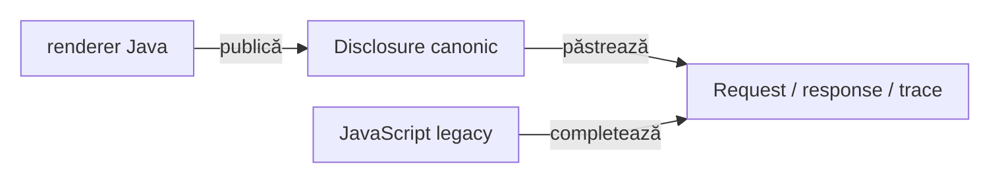

<details>
<summary><strong>Legendă — cine scrie și cine doar completează</strong></summary>

- renderer-ul Java publică disclosure-ul canonical și metadata typed;
- JavaScript-ul completează numai rândurile vendor legacy care lipsesc;
- un disclosure existent nu este înlocuit și nu se reserializează inutil;
- request JSON, response JSON și execution trace rămân împreună în DOM;
- idempotența este verificată în `atf-reporting-tests`, inclusiv pe artifact HTML.

</details>

</details>

## Publicare și ieșire

Output-ul este configurabil prin `reporting.extent.outputDirectory` și
`fileName`; runtime-ul UI folosește separat directorul UI configurat de test.
Documentația descrie numai politica și pattern-ul de output, nu nume concrete de
rapoarte generate.

`ExtentReportSession.close()` deține finalizarea și confirmarea publicării:

- finalizează nodurile, face flush, publică artifactul staged și confirmă
  existența fișierului final;
- numai după confirmare trimite sink-ului `REPORT_PUBLISHED` cu calea absolută
  normalizată;
- reînchiderea nu emite un duplicat, iar publicarea eșuată nu anunță succes;
- sink-ul este diagnostic: eșecul lui nu schimbă verdictul testului;
- afișarea și opt-in-ul la consolă aparțin
  [ATF Console](../atf-console/README.md); evenimentul nu activează automat
  fiecare consumer.

Cleanup-ul asset-urilor Spark tratează bounded atât `AccessDeniedException`, cât
și celelalte `FileSystemException`: maximum patru încercări, cu 50 ms între ele.
O eroare I/O de alt tip nu este reîncercată; epuizarea limitei se propagă, iar
întreruperea oprește cleanup-ul și păstrează flag-ul thread-ului.


### Navigare amânată și interacțiune explicită

`atfOpenTest` asociază deschiderea amânată cu generația navigării curente.
Un salt mai nou sau inputul explicit în Tests invalidează callback-ul anterior;
o închidere prin mouse, Enter sau Space nu este anulată ulterior de acel callback.

#### Revenirea la comparația eșuată

În Extent, Fails păstrează tipul dovezii și ordinalul ei în scenariul original,
alături de clasa și indexul scenariului. Identificatorul este păstrat în hash,
inclusiv după reload; textul trunchiat nu este folosit pentru identificare.

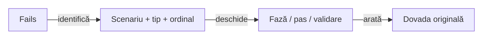

<details>
<summary><strong>Legendă — cale exactă și probă independentă</strong></summary>

- `openScenarioFailurePath` rezolvă rândul indexat și deschide numai ancestorii
  săi, inclusiv assertion-step și disclosure-urile native. SETUP, TEST BODY și
  TEARDOWN folosesc aceeași cale; un checkpoint ulterior nu deschide primul pas.
- `PublishedFailureNavigationComponentTest` verifică UI/API/component, panouri
  înguste și desktop, tastatură, reload și navigare repetată. Etichetele repetate
  și preview-urile identice nu pot substitui identitatea comparației.
- Oracolul verifică vizibilitatea înaintea oricărei expandări asistate și
  respinge faza închisă sub un scenariu vizibil. Vecinul PASS rămâne colapsat;
  verdictul și coloanele comparației originale se păstrează.
- Un FAIL fără comparații indexează diagnosticele de execuție existente, pe
  faze, cu tip explicit. Fails arată DIAGNOSTIC și EVIDENCE; nu fabrică expected,
  actual, validări contractuale sau identitate HTTP. Cauza respectă bugetul configurat.
- Fallback-ul păstrează ordinalul proiecției semantice: diagnosticele fazei, apoi
  comparațiile copiilor în ordinea arborelui. Backlink-ul deschide disclosure-ul
  original și păstrează ruta la reload, inclusiv când diagnosticele sunt intercalate.
  Ruta deține scroll-ul: restaurează după inițializarea documentului și layout-ul
  coloanelor, fără restaurarea automată concurentă a poziției de către browser.
- `PublishedFailureNavigationEdgeComponentTest` verifică separat aceste margini,
  preview-uri configurate, tastatură, scroll și control negativ pentru ancestor
  ascuns. Deschiderea legacy și cea exactă reutilizează aceeași funcție de reveal.

</details>

### Prospețimea dovezii vizuale

Un HTML generat înainte de recompilarea claselor sau a resurselor reporting este
un artifact istoric, nu dovadă pentru codul curent. Pentru orice audit vizual:

- regenerează raportul după build-ul care conține schimbarea;
- verifică întâi testele component/integration, apoi raportul proaspăt;
- nu redeschide un ToDo dintr-un artifact vechi dacă rendererul actual are deja
  contractul și testul corespunzător;
- dacă artifactul vechi contrazice contractul curent, marchează-l stale și nu-l
  copia în feedback sau README.

Digesturile folosite intern pentru grouping nu devin evidence umană: HTML-ul
public proiectează numai starea bounded (`body=present|absent`, `internal digest
hidden`).

`ReportPublicationCoordinator` are următoarele responsabilități:

- protejează publication path, lock-ul și concurența;
- poate folosi identitatea/hash-ul intern pentru ownership și deduplicare, fără
  să-l afișeze în HTML ca înlocuitor pentru evidence-ul uman;
- aplică retry bounded după tentativa atomică pe filesystem-uri care pot păstra
  temporar fișierul deschis;
- permite fallback non-atomic numai pentru
  `AtomicMoveNotSupportedException`;
- propagă eroarea persistentă după ultima încercare;
- păstrează retry-ul în production publication boundary, nu în test-kit și nu în
  browser.

## Verificare pentru contribuții

Gate-ul nativ `mvn -f atf-reporting/pom.xml test` selectează explicit pachetul
`atf.reporting.standalone` și implicit eșuează dacă nu descoperă teste.
Un `BUILD SUCCESS` fără clase/cazuri executate nu dovedește contractul librăriei.

[ReportingStandaloneVerdictComponentTest](src/test/java/atf/reporting/standalone/ReportingStandaloneVerdictComponentTest.java)
este proba de componentă nativă pentru lifecycle, status și snapshot, cu
JUnit `@Tag("component")`, fără importuri ATF externe sau browser.
Proiecția browser este verificată separat în
[ReportingVerdictProjectionComponentTest](../atf-reporting-tests/src/test/java/atf/ui/tests/extent/component/verdict/ReportingVerdictProjectionComponentTest.java).

Selecția reactorului poate omite modulul prin opțiunea documentată
`-Dsurefire.failIfNoSpecifiedTests=false`; omiterea unui modul fără testul cerut
nu este o execuție a gate-ului nativ.

```text
cod live curent
  → staging extern nou (target/artifacts excluse)
  → test focalizat
  → gate unit/component/integration
  → gate E2E dacă se schimbă DOM/layout/interacțiunea
  → ATF Debug + Playwright/Chromium headless
  → reconciliere live ↔ staging
  → sync selectiv și README owner actualizat
```

Checklist-ul de aici este doar harta rapidă. Checklist-ul normativ, cu reguli
obligatorii/condiționale și pași de explorare manuală, este în
[`../atf-reporting-tests/src/test/java/atf/ui/tests/extent/README.md`](../atf-reporting-tests/src/test/java/atf/ui/tests/extent/README.md).

<details>
<summary><strong>Checklist browser — responsabilitatea consumerului</strong></summary>

- ✅ `Tests`, `Overview`, `Categories`, `Fails` și deep-link navigation;
- ✅ disclosure-uri colapsate implicit unde contractul nu cere altceva;
- ✅ `＋/−` inline, screenshot inline, acțiuni, audit observations și assertions;
- ✅ `scrollWidth <= clientWidth`, wrapping și computed-style;
- ✅ zero `<hr>` decorative, console/page errors sau asset-uri rupte;
- ✅ request/response JSON, status și mock provenance reconciliate când sunt
  publicate;
- ✅ verificare prin ATF Debug + Chromium/Playwright MCP, fără browser Windows
  real și fără oprirea run-urilor active.

</details>

## Contracte și feedback

- contract semantic: [`docs/ATF_Reporting_Contract.md`](../docs/ATF_Reporting_Contract.md);
- contract display/layout: [`docs/ATF_Reporting_Display_Contract.md`](../docs/ATF_Reporting_Display_Contract.md);
- arhitectură: [`docs/ATF_Architecture.md`](../docs/ATF_Architecture.md);
- bune practici: [`docs/README_Atf_BestPractices.md`](../docs/README_Atf_BestPractices.md);
- feedback activ: [`docs/feedback/README.md`](../docs/feedback/README.md).

README-ul păstrează contractele validate, limitele și criteriile de testare;
starea gap-urilor rămâne în [registrul de feedback](../docs/feedback/README.md).
O regulă intră aici numai după ce este confirmată de codul și testele live; până
atunci rămâne feedback auditabil, nu documentație stabilă.

<details>
<summary><strong>Detaliu — asset-uri browser native și guvernare Java</strong></summary>

CSS-ul și JavaScript-ul livrat în HTML se păstrează în `src/main/resources`,
în fișiere mici, grupate după responsabilitate (`theme`, `overview`, `evidence`,
`navigation`, `filters`, `runtime-core`, `duration`). Overview-ul folosește separat
`overview-layout.css`, `overview-tag-audit.css`,
`overview-category-tables.css` și `overview-category-status.css`, iar scenariile
folosesc `theme-scenario.css`; nu există o regulă CSS duplicată în facade-ul Java.
`ReportAsset` este vocabularul unic al asset-urilor, iar
`ReportAssetManifest.production()` este inventarul validat și ordonat folosit
de publication boundary. Manifestul respinge duplicate de asset/path/owner,
resurse din afara namespace-ului reporting, extensii incompatibile cu formatul
și asset-uri lipsă. `ReportAssetLoader` citește resursa din classpath, iar
`ReportAssetComposer` rezolvă token-urile Java (inclusiv culorile finite) și
produce corpul final păstrând identitatea typed a asset-ului; ordinea efectivă de
compoziție rămâne explicită în facade-urile runtime. Aceeași graniță este folosită de cele nouă asset-uri
`duration-*.js` și de cele trei asset-uri `runtime-core-*.js`; fragmentele
JavaScript păstrează ownership-ul semantic, iar facade-urile Java păstrează doar
ordinea de compoziție.

Sursele native `.css` și `.js` rămân formatate pe mai multe linii în classpath,
pentru review, depanare și teste component. `ReportAssetLoader.load(...)` și
`render(...)` expun această sursă lizibilă; `loadForPublication(...)` și
`renderForPublication(...)` trec numai copia destinată HTML-ului prin
`ReportAssetCompactor`. Compactorul elimină whitespace-ul și comentariile sigure
în afara valorilor quoted, păstrează spațiile semnificative din text, selectorii
și expresiile JS/CSS și nu modifică fișierele native. Astfel HTML-ul Extent nu
primește enter-uri de indentare inutile, iar sursa rămâne ușor de întreținut și
de testat separat.

`ReportAssetSizeInventory` măsoară separat bytes pentru fiecare sursă nativă și
copia publicată, agregat pe format și owner. El este un instrument de diagnostic
și contract test. `ReportAssetSizeBudget` primește limitele din configurația
consumerului pentru total, format și owner și produce doar încălcările
observate; nu are baseline hardcodat. Bundle-ul HTML/evidence se bugetează în
consumer, unde există artifactul complet, nu în biblioteca standalone. Astfel o optimizare
poate fi verificată fără să transforme numele sau hash-ul artifactului în API.

Sursele native JavaScript/CSS folosesc LF, guvernat de `.gitattributes` al
modulului; bugetele rămân comparabile în checkout-uri Windows/Linux.
Compactarea modifică numai copia publicată.

Facade-urile Java (`AtfFallbackTheme`, `AtfReportOverviewCss`, facades-urile CSS
theme/evidence,
`HtmlReportNavigationScript`, `ExtentReportRuntimeEvidenceRoles` și
`ExtentReportRuntimeTestFilters`) rămân API-ul de integrare. Ele nu reconstruiesc
corpul scriptului prin concatenări mari; Java guvernează doar asset-ul, token-urile
și ordinea de compoziție. `ExtentReportRuntimeTestsVocabulary.Template` guvernează
placeholder-ele asset-ului, iar funcțiile comune (`aggregateClassDurations`,
`captureDomContract`) provin din vocabularul runtime central, nu din string-uri
izolate în facade. Contractul se verifică separat prin teste de asset, component
și browser E2E.

</details>

## Consistența statusului transmis de caller

<details>
<summary><strong>Detalii — consistența statusului transmis de caller</strong></summary>

`ReportStatusAggregator.resolve(...)` reconciliază statusul callerului cu
rezultatele efective ale rândurilor și scope-urilor copil. Evaluarea business
rămâne la consumer; Reporting nu compară din nou expected cu actual.

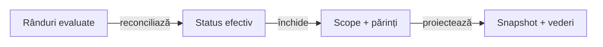

<details>
<summary><strong>Legendă — aceeași politică în Extent, fallback și recorder</strong></summary>

- Severitatea efectivă nu poate fi redusă prin `complete(PASS)` sau
  `complete(SKIP)` când există un rând ori copil FAIL.
- `AtfAssertion.resultStatus` păstrează politica evaluată; `passed=false` cu
  `resultStatus=PASS` este respins înaintea publicării. Un SKIP explicit este valid.
- Statusul de închidere absent contribuie INFO; observația INFO nu inventează un verdict
  business. O excepție așteptată este evaluată înaintea raportării și poate produce PASS.
- Console, Tests, Categories, Fails și Overview primesc verdictul reconciliat;
  comparația SKIP nu devine cauza FAIL a unui request imbricat.
- Apelurile `assertions(...)` repetate înlocuiesc setul încă nepublicat, inclusiv
  numele și verdictul din recorder. Snapshot-ul păstrează request-urile imbricate,
  fără a stoca valorile integrale ale comparației în populația semantică.
- Bufferul UI păstrează verdictul checkpoint-ului înaintea publicării
  UNIFIED_FLOW, inclusiv peste faze. Fiecare scenariu-soră își păstrează rezultatul.
- Bugetul redactat rămâne implicit 240 inclusiv elipsa; statusul nu se calculează
  din preview, badge sau HTML.

</details>

### Evidence UI și setup în fallback

`ReportRequestUiEvidence` păstrează acțiunile, capturile și modul de disclosure
în snapshot-ul fallback; contoarele nu înlocuiesc conținutul auditabil.
`ReportSetupEvidenceMarkup` proiectează aceleași comparații setup în ambele renderere.

- Expected/actual sunt redactate integral înaintea plafonului configurat,
  implicit 240 inclusiv elipsa; un FAIL dincolo de preview rămâne FAIL.
- `publishSetup` păstrează statusul aserțiunilor deja evaluate, chiar dacă
  apelantul furnizează PASS; Reporting nu reevaluează comparația din textul afișat.
- Un request cu acțiuni ACTION acceptă cel mult o captură inline distinctă.
  Galeriile fără acțiuni și validările media își păstrează comportamentul;
  inputul incompatibil este refuzat înaintea mutației, cu starea validă recuperabilă.
- `UiSetupFallbackParityComponentTest` verifică 240/18, captura inspectabilă,
  Enter/Space, verdictul și absența unui HTTP fictiv în Extent/fallback.

### Atomicitatea tranzițiilor de scope

Recorderul semantic validează tranziția înaintea mutației modelului, nodurilor,
contoarelor sau notificărilor. Extent și fallback folosesc aceeași decizie;
un apel respins păstrează snapshot-ul și permite publicarea stării valide.

| Operație | Contract |
|---|---|
| `complete(status)` valid | o singură tranziție; dovezile copiilor păstrează politica FAIL/SKIP/INFO/WARNING |
| completare repetată sau părinte cu copii deschiși | refuz fără efecte; copiii pot fi închiși, apoi părintele completat normal |
| `close()` după completare | idempotent; fără notificări ori publicare duplicate |
| `close()` înainte de completare, fără copii deschiși | completează FAIL; nu inventează un rezultat business PASS |
| `close()` cu copii deschiși | refuz fără abandonarea părintelui ori decrementarea contoarelor |
| scriere după completare/închiderea sesiunii | refuz înaintea mutației; snapshot-ul rămâne inspectabil |
| eroare la închiderea/publicarea sesiunii | cauza se propagă; sesiunea se închide, iar al doilea close nu reîncearcă publicarea |

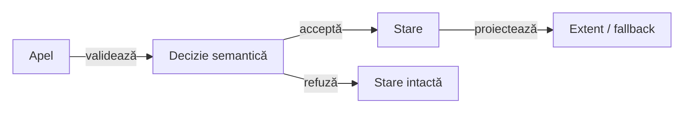

<details>
<summary><strong>Legendă — lifecycle validat înaintea efectelor</strong></summary>

- Refuzul de protocol nu creează noduri, evidence, statusuri sau evenimente parțiale.
- Închiderea implicită FAIL păstrează verdictul sigur al unui scope incomplet;
  închiderea copiilor este explicită, fără rollback ori retry ascuns în renderer.
- Consola este best-effort în ambele renderere; eroarea diagnostică nu întrerupe
  tranziția și nu schimbă verdictul. Compozitorul UI are
  [protocolul propriu de publicare](#cauza-publicării-și-scope-urile-deținute):
  aceeași cauză inițială și erori close secundare în suppressed.
- Colecțiile de aserțiuni sunt capturate o singură dată înaintea actualizării
  modelului și recorderului; un element null nu șterge rândurile valide anterioare.
- Agregatul de rețea ocupă un singur slot semantic, indiferent de înlocuire sau
  de detaliile adăugate ulterior; null este no-op pe un request încă deschis.
- `ReportingScopeAtomicityComponentTest` adaugă probe pentru payload invalid,
  input schimbător, agregat înlocuit și erori de publicare, fără comparații business.
- `ReportScopeAtomicityComponentTest` verifică porturile publice, mutațiile tardive,
  request-urile imbricate, refuzul recuperabil, sesiunea închisă și notificarea unică.

</details>

</details>

## Proiecția sigură a aserțiunilor

<details>
<summary><strong>Detalii — proiecția sigură a aserțiunilor</strong></summary>

`AssertionAuditReport` publică faze și pași de aserțiuni prin `AtfReportPorts.Session`;
nu depinde de JUnit, Test Kit sau Validation. Consumerul îi furnizează identitatea,
rândurile evaluate, statusul fazei și diagnosticul.

Fazele acestui publisher se deschid după evaluare. Overload-ul cu
`ReportPhaseTiming` primește separat durata execuției deja măsurate și numărul
callback-urilor; publicarea snapshot-ului nu înlocuiește timpul metodei.

Bugetul se configurează în YAML-ul Reporting și se capturează la deschiderea
sesiunii. Implicitul este 240; sunt acceptate numai valori întregi pozitive:

```yaml
reporting:
  assertionMaxDisplayCharacters: 240
```

`Overview → System` afișează `Assertion preview = N characters`, din setarea
efectivă a rendererului, inclusiv în fallback. Metadata consumerului și
agregarea scenariilor nu pot suprascrie acest fapt. O sesiune comună păstrează
același buget pe durata ei; modificarea configurației cere o sesiune nouă.

`AssertionAuditRun.assertionMaxDisplayCharacters()` furnizează același buget
adaptoarelor componentelor AutoEx/Shop, înaintea colectării. Astfel o valoare
configurată peste 240 nu este tăiată prematur la implicit. `bodyMaxDisplayCharacters`
și limitele de captură HTTP sunt politici separate.

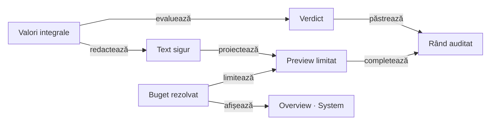

<details>
<summary><strong>Legendă — redactare înaintea plafonului</strong></summary>

- Diagrama descrie datele la runtime, nu dependențe Maven.
- Bugetul rezolvat configurează colectorul și rendererul; System arată valoarea
  aceleiași sesiuni, fără un implicit copiat în metadata consumerului.
- Colectorul primește o politică de afișare la composition root; JSON-ul complet
  este redactat înainte de tăiere, astfel încât un secret lung să nu piardă contextul cheii.
- Valoarea integrală decide verdictul; raportul primește numai text sigur și limitat,
  implicit 240 de caractere inclusiv `…`. Expandarea nu publică un dump nelimitat.
- Aserțiunile directe E2E și valorile acțiunilor folosesc același buget total
  în Extent și fallback, inclusiv Fails; marcajul `…` intră în limită.
- Fails prioritizează acțiunea eșuată și timpul măsurat înaintea headline-ului
  excepției; un stack multiline nu consumă contextul de triere.
- `AssertionPreviewBudgetTest` și `BoundedFailureEvidenceComponentTest` verifică
  limita decodată, redacția completă și absența dump-ului brut; proba contextului
  este în `UiSetupFailureEvidenceComponentTest`.
- `ReportingPreviewConfigurationComponentTest` verifică YAML implicit/configurat,
  System în ambele renderere, metadata contradictorie și refuzul valorilor nepozitive.
  Probele de scope ale consumerilor verifică 18/240/480 individual și prin suită.
- `LegacyPreviewBudgetComponentTest` verifică în browser porturile UI directe,
  limitele 240/18, secrete peste granița tăierii și verdictul diferit dincolo
  de preview. Fails și backlink-ul folosesc limita capturată de scenariu.
- `Component assertions` rămâne colapsat inițial în Extent și fallback; un diagnostic
  fără comparații nu inventează un pas sau un request HTTP.
- Întreruperea prin assumption păstrează `SKIP` și diagnosticul `Abort reason`;
  un eșec real al unei aserțiuni neconsumate păstrează `FAIL`.
- `AssertionAuditPublicationComponentTest` protejează redacția în ambele renderere;
  `ComponentAssertionStepReportTest` protejează interacțiunea, ultimul rând și Fails → Tests.

</details>

### Diagnostic fără comparație eșuată

O excepție apărută după verificări reușite sau înaintea primei comparații
produce un diagnostic de execuție. `Fails` păstrează cauza fazei și legătura
spre test; nu selectează un rând PASS drept comparație eșuată.

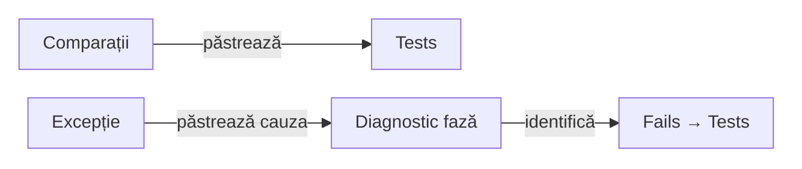

<details>
<summary><strong>Legendă — comparații și excepții cu dovezi distincte</strong></summary>

- `AssertionStep` identifică dovada componentă. Fără un pas de aserțiuni,
  diagnosticul fără transport rămâne `execution`; nu este dedus un owner API.
- Indexul omite `REQUEST` și durata HTTP când nu există un request asociat;
  nu publică `No response duration recorded` pentru o eroare de componentă.
- `failureValidationCandidate` selectează numai comparații eșuate; un tabel
  anterior cu PASS rămâne disponibil în Tests, fără a deveni cauza erorii.
- Clasificarea folosește metadata verdictului sau celula `RESULT`; un `❌`
  din expected/actual este o valoare auditată, nu o comparație eșuată.
- Fazele executate fără comparații păstrează durata, inclusiv zero măsurat.
  Metadatele interne nu creează un control de expandare fără conținut.
- `ComponentExecutionDiagnosticReportTest` verifică Extent/fallback, diagnosticul
  fără comparații, cele 42 de rânduri colapsabile, tastatura și plafonul de 240.

</details>

### Timing măsurat înaintea publicării

`AtfReportPorts.Phase.executionTiming(...)` acceptă o singură valoare tipizată
pentru fază. Extent și fallback o păstrează în snapshot-ul semantic; constructorii
și publisherii fără timing explicit își păstrează comportamentul existent.

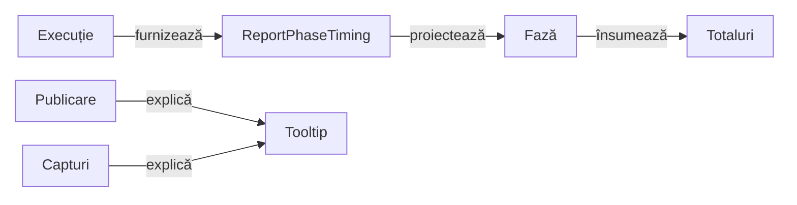

<details>
<summary><strong>Legendă — execuție, publicare și agregare</strong></summary>

- Badge-ul fazei folosește execuția, inclusiv comparațiile din callback.
  Tooltip-ul indică numărul callback-urilor și costul publicării snapshot-ului.
  Explicația provine din același formatter Java pentru Extent și fallback;
  JavaScript proiectează textul primit în metadate.
- Metadatele typed păstrează nanosecundele originale; afișarea rotunjește în sus
  la milisecundă, apoi aplică formatarea comună. Zero nu devine durată pozitivă.
- Scenariul însumează fazele directe, iar clasa scenariile directe. Timpul
  publicării și badge-ul tehnic al pasului `Component assertions` nu se adaugă
  peste execuția inclusivă a fazei. Expandarea nu schimbă sursa sau totalul.
- Aceste sume reprezintă timp executat cumulat, nu wall-clock al suitei;
  execuțiile paralele se pot suprapune. Fallback publică suma numai când toate
  fazele au timing cunoscut. Nu înlocuiește informația absentă cu zero.
- În Extent, metadatele interne sunt mutate în fază și rândul tehnic este eliminat;
  nu apare un eveniment public suplimentar sau request HTTP fictiv.
- Publicarea este măsurată separat la nivel de fază; nu include flush-ul final
  al sesiunii. Console lifecycle continuă să descrie scope-ul publicării.
- Capturile UI instrumentate au măsurare proprie; timpul lor nu se adaugă
  execuției și nu este folosit ca latență HTTP.
- `ReportPhaseTimingComponentTest` verifică paritatea semantică, Tests/Overview,
  valorile zero, totalurile fără dublare și redeschiderea cu tastatura.

</details>

### Date payment sintetice din fixture-ul demo

Pentru fixture-ul demo AutoEx, valorile sintetice `card_number` și `cvc` rămân
vizibile în body-ul HTTP și în cURL. Acesta este comportamentul acceptat al
probei, fără cerință deschisă de redactare pentru aceste date de test.

Mascarea existentă a acțiunilor UI și plafonul 240 al aserțiunilor se păstrează.

### Timing E2E la ownerul runtime

`UiPhase.executionTiming(...)` propagă o valoare deja măsurată;
`UiPhase.measureExecution()` deschide măsurarea explicită deținută de runtime.
Cele două opțiuni sunt exclusive pentru aceeași fază.

`UiExtentReportSession.adaptScenario(...)` compune aceeași fațadă UI peste
un port de scenariu Extent sau fallback. Hostul păstrează ownership-ul sesiunii
și al flush-ului; profilul și izolarea scenariilor rămân explicite.

| Interval | Ce măsoară și unde se închide |
|---|---|
| execuție | timp monoton între deschiderea fazei și completare, fără capturile/publicarea instrumentate |
| capturi | `UiPhaseExecution.capture(...)`; inclusiv captura eșuată, distinct de latența HTTP |
| publicarea dovezilor | publisherii UI, flow-ul amânat și proiecția fazei până la snapshot; nu se adaugă peste execuție |
| cleanup și resurse | runtime-ul oprește execuția înaintea cleanup-ului final și eliberării browserului |
| flush HTML | sesiunea îl finalizează separat; nu intră în execuție sau în costul publicării înainte de snapshot |
| sursă legacy fără timing | rămâne `aggregated`; timpul necunoscut nu devine zero măsurat |

AutoEx oprește TEST BODY înaintea lifecycle-ului final; Shop măsoară SETUP și
TEST BODY distinct și nu inventează un body pentru setup incomplet. Capturile
ambilor consumeri trec prin același boundary reutilizabil Reporting, fără JUnit
sau dependență Test Kit în runtime-ul main.

<details>
<summary><strong>Metadate, totaluri și probe</strong></summary>

- `ReportPhaseTiming` păstrează execuția, numărul intervalelor și opțional
  `ReportPhaseEvidenceTiming`; constructorul legacy cu două argumente rămâne compatibil.
- `data-atf-execution-duration-ms`, `data-atf-capture-duration-ms` și
  `data-atf-publication-duration-ms` descriu surse distincte; captura absentă ca
  măsurare nu este publicată ca zero cunoscut.
- Tests, Category și Overview folosesc execuția typed o singură dată. Expandarea,
  timestamp-urile native Extent și publicarea în faza terminală nu o înlocuiesc.
- `UiPhaseExecutionTest` păstrează cauza primară și probează ceasul controlat;
  `UiPhaseTimingLifecycleComponentTest` verifică succes/FAIL/SKIP, setup incomplet,
  teardown eșuat și flow unificat peste faze în Extent/fallback.
- Timing-ul componentelor rămâne la adaptorul Kit; durata HTTP necapturată
  rămâne necunoscută. Totalurile cumulative nu reprezintă wall-clock-ul suitei.

</details>

### Sesiunea comună a componentelor

`AssertionAuditRun` deține sesiunea, iar `open(identity)` întoarce un
`AssertionAuditReport` care împrumută sesiunea și deține numai scenariul său.
Constructorul public `AssertionAuditReport(session, ...)` păstrează ownership-ul
sesiunii pentru publisherii standalone și fixture-urile existente.

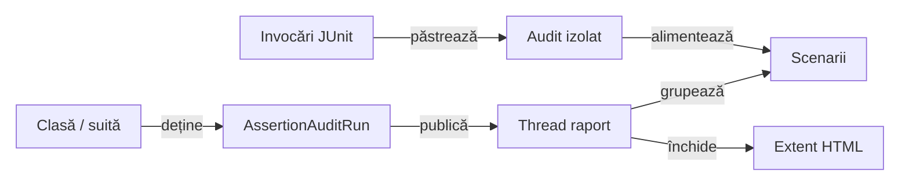

<details>
<summary><strong>Legendă — ownership și thread-ul real al sesiunii</strong></summary>

- `extent(...)` capturează configurația și creează sesiunea pe thread-ul de raport;
  operațiile de scenariu și close se execută sincron pe același thread.
- Testele și comparațiile JUnit rămân pe thread-urile lor. Publicarea nu reexecută
  business-ul și nu relaxează guard-ul de thread din `ExtentReportSession`.
- O invocare închide numai scenariul împrumutat; ownerul class/suite închide
  sesiunea și workerul, inclusiv după o eroare de publicare.
- Titlurile identice nu înlocuiesc identitatea scenariilor; fazele și aserțiunile
  unei invocări nu pot fi împrumutate de altă invocare.
- Lucrul deja trimis se finalizează o singură dată; un caller întrerupt își
  păstrează indicatorul de interrupt. Configurația căii și politica notificării
  sunt capturate înaintea publicării și notificarea urmează artifactul final existent.

</details>

`AssertionAuditRunComponentTest` verifică ownership-ul, cauzele și concurența;
probele consumerilor verifică scope-ul Jupiter și politica notificării finale.
Bugetul configurat al sesiunii și pasul `Component assertions` colapsat se păstrează.


### Lizibilitatea dovezilor în panouri înguste

Lățimea ferestrei și lățimea disponibilă tabelului sunt măsurători diferite.
Indentarea Extent poate lăsa un panou îngust chiar într-o fereastră desktop.
`table-viewport.css` păstrează tabelul, antetul vizibil și celulele pe coloane;
nu transformă rândurile în carduri la un breakpoint.

Același allocator măsoară antetul, valorile, fontul și padding-ul în Extent și
fallback, inclusiv majusculele/minusculele aplicate vizual prin CSS.
Tabelul ocupă întreaga lățime disponibilă; coloanele tehnice rămân
compacte, iar spațiul se distribuie întâi cererii de conținut nesatisfăcute,
apoi proporțional coloanelor flexibile.

Politica acoperă setup, assertions, Actions/Audit, dovezile API și tabelele
Overview/Category/System. Acestea din urmă își reutilizează containerul, iar
totalurile numerice rămân compacte; colgroup-urile existente urmează alocarea comună.
Tabelele de failure adăugate ulterior de runtime primesc aceeași politică,
inclusiv viewport-ul comun când markup-ul lor inițial nu are un container.

Tabelul scenariilor din Categories primește același viewport; `Status` și
`Timestamp` sunt coloane tehnice compacte. Adaptarea tabelelor structurale
`Status/Details` nu se aplică tabelelor de date, inclusiv în panouri înguste.
Pe ecran îngust, indexul și detaliile Fails încep după bara de navigare vizibilă;
absența overflow-ului documentului nu dovedește singură această accesibilitate.

În fallback, grila permite panoului de conținut să se restrângă fără a lărgi
documentul. Cardurile Fails împart mesajele lungi pe rânduri și folosesc lățimea
containerului pentru a așeza valoarea observată sub identificarea erorii.

| Situație | Prezentare |
|---|---|
| Date scurte în toate coloanele | tabel pe întreaga lățime, fără margine artificială la dreapta; surplusul revine coloanelor de conținut |
| Unele valori sunt lungi | coloanele respective primesc spațiul rămas; statusul și timpul păstrează lățimea măsurată |
| Panoul nu permite nici antetele și baza lizibilă | scroll orizontal local, cu antet și toate coloanele accesibile |
| Redimensionare, text nou sau redeschidere | invalidare incrementală și recalculare, fără reevaluarea aserțiunilor |

Antetul sticky, fontul comun și plafonul vertical se păstrează; un tabel scurt
ocupă numai înălțimea conținutului său. Nu există lățimi minime de tabel impuse
după numărul coloanelor.

Maximele textului în pixeli nu sunt plafonate: două mesaje lungi rămân
diferențiabile, inclusiv la același număr de caractere. Gutter-ul nu rezervă
spațiu gol la dreapta; numai scrollbar-ul cerut de conținut reduce lățimea utilă.

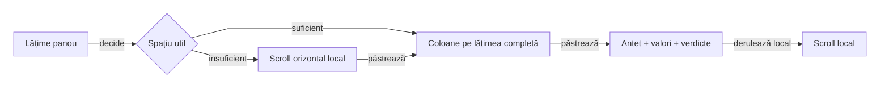

<details>
<summary><strong>Legendă — coloane păstrate, scroll local auditabil</strong></summary>

- Antetele publicate și ordinea coloanelor rămân aceleași în Extent/fallback;
  fiecare celulă se aliniază cu propriul antet, fără repetarea lui în body.
- Panourile înguste reduc indentarea rendererului; în fallback, lista și
  conținutul se așază vertical când containerul nu permite două coloane.
- Preview-ul aserțiunilor rămâne redactat înaintea plafonului de 240 de caractere;
  rearanjarea CSS nu modifică textul sau verdictul.
- `NarrowEvidenceReadabilityComponentTest` verifică viewport-uri 1803/1280/591/392 px
  și panouri 591/392/719/720/721 px într-un viewport desktop. Verifică
  lățimea utilă, fontul, antetul, ultima coloană, rândul final și redeschiderea cu tastatura,
  alături de proiecția negativă și backlink-ul Fails → Tests.
- `TableViewportBrowserComponentTest` respinge antetul ascuns, celulele verticale
  și scroll-ul orizontal blocat, pe lângă probele existente pentru plafon și clipping.
- `EvidenceColumnSizingComponentTest` compară geometria cu lățimea fizică
  disponibilă, inclusiv setup, dashboard, colgroup, texte concurente și gutter gol;
  un marker de layout prezent nu certifică singur randarea.
- `PublishedEvidenceTableComponentTest` verifică publicații UI/API/UI+API în
  ambele renderere, cu inventar și valori independente, 12/40 de rânduri și
  proiecțiile Tests/Overview/Categories/Fails. Controalele negative acoperă și
  suprapunerea navigării peste Fails și ruperea antetelor tehnice pe litere;
  procentele unei coloane nu sunt oracol estetic.

</details>

</details>

## Verificare rapidă

| Decizie | Sursă și limită |
|---|---|
| Snapshot semantic și verdict coerent standalone | [sursa ownerului](src/main/java/atf/reporting/extent/session/ExtentReportSession.java); probă: [ReportingStandaloneVerdictComponentTest](src/test/java/atf/reporting/standalone/ReportingStandaloneVerdictComponentTest.java) |
| Dependențe și source-set-uri | [POM](pom.xml); scope-ul declarat este autoritatea pentru integrare |
| Ce nu demonstrează această probă | Proba locală nu demonstrează randarea în browser; aceasta aparține Reporting Tests. |

<details>
<summary><strong>Comandă pentru proba locală</strong></summary>

Rulați din rădăcina unui [staging extern](../docs/ATF_Build_And_Execution_Safety.md), cu JDK 21 și Maven.

```powershell
mvn -B -pl atf-reporting -am "-Dtest=ReportingStandaloneVerdictComponentTest" "-Dsurefire.failIfNoSpecifiedTests=false" test
```

Comanda selectează proba numită și construiește dependențele; nu declară
trecerea întregului modul. Proba locală nu demonstrează randarea în browser; aceasta aparține Reporting Tests.

</details>
