<a id="atf-reporting--independent-extent-artifact-library"></a>
<a id="atf-reporting--bibliotecă-autonomă-pentru-artefacte-extent"></a>
# ATF Reporting — independent Extent artifact library

`atf-reporting` turns typed models into semantic reporting and verifiable
Extent/HTML artifacts. The library does not execute APIs, start a browser or
read application mocks and fixtures.

<a id="at-a-glance"></a>
<a id="pe-scurt"></a>
## At a glance

- **Binary adoption:** the [minimal consumer](docs/README.md#minimal-binary-consumer) runs against the physical JAR and its declared runtime dependencies, without Core, Kit or producer source directories.

**Quick links:** [JAR adoption](#consumarea-bibliotecii-ca-jar) · [Tree and ownership](#contractul-raportului) · [Assertions and budget](#proiecția-sigură-a-aserțiunilor) · [Timing](#timing-e2e-la-ownerul-runtime) · [Tables](#lizibilitatea-dovezilor-în-panouri-înguste) · [Prohibitions and limits](#verificare-rapidă)

- **production** — typed contracts, semantic models, renderers, assets and
  publication, without dependencies on other ATF modules;
- **tests** — standalone boundaries and native contracts, without mock
  transport, Playwright or application fixtures;
- **composition** - `atf-reporting-tests` is the canonical consumer for
  API / integration and UI / E2E reporting;
- **output** — Extent/HTML with bundled CSS and JavaScript, preserving
  consumer verdicts rather than inventing them;
- **adoption** — the consumer supplies typed input, status, evidence and
  output policy through the public API.

[Contracts and feedback](#contracte-și-feedback) routes semantic and display rules to their owners. [Reporting Tests](../atf-reporting-tests/README.md) owns the harness; the [code atlas](src/main/java/atf/reporting/README.md) maps inputs, invariants, native sources and probes by responsibility.

<a id="consular-use-of-the-library-as-jar"></a>
<a id="consumarea-bibliotecii-ca-jar"></a>
## Consuming the library as a JAR

The [portable library contract](docs/README.md) links entry points, boundaries and extraction probes using destinations inside this module. It supports isolated-source adoption; release qualification remains separate.

The library targets **Java 21** and is distributed as a thin Maven JAR:

- the application resolves the runtime dependencies declared in the POM;
- JAR, compiler and Surefire plugins have explicit versions; the output
  timestamp is normalized for reproducible builds;
- FreeMarker is a direct dependency of the pinned Spark adapter;
- Jsoup 1.23.2 parses local artifacts for inspection; it neither executes
  JavaScript nor accesses the network;
- `atf-reporting-tests` remains internal verification support, outside the
  application’s runtime dependencies.

```xml
<dependency>
    <groupId>atf.api</groupId>
    <artifactId>atf-reporting</artifactId>
    <version>1.0.0-SNAPSHOT</version>
</dependency>
```

| Input | Responsibility |
|---|---|
| `AtfReportPorts` and Typed Models | the consumer provides the observations and the verdict; the library preserves and publishes the evidence |
| `ExtentReportSession` | Extent renderer and final publication at `close()` |
| `HtmlReportSession` | the fallback renderer; has its own publication lifecycle |
| `UiExtentReportOptions` / `UiExtentReportSession` | evidence profile and checkpoint composition, without a browser or HTTP executor |

<details>
<summary><strong>Example Java - observation report provided by the application</strong></summary>

```java
import atf.reporting.configuration.ReportingSettings;
import atf.reporting.contract.AtfAssertion;
import atf.reporting.contract.AtfReportStatus;
import atf.reporting.extent.session.ExtentReportSession;
import java.nio.file.Path;
import java.util.List;

public final class ReportExample {
    public static void main(String[] args) {
        if (args.length != 2) throw new IllegalArgumentException("Expected: output.html observed-state");
        String expected = "ready";
        String actual = args[1];
        boolean passed = expected.equals(actual);
        var status = passed ? AtfReportStatus.PASS : AtfReportStatus.FAIL;
        try (var session = new ExtentReportSession(Path.of(args[0]), ReportingSettings.defaults());
             var scenario = session.startScenario("ConsumerExample", "the observed state is ready", List.of("component"));
             var phase = scenario.startPhase("TEST BODY");
             var checks = phase.startAssertionStep("Component assertions")) {
            checks.assertions(List.of(new AtfAssertion("Observed state", expected, actual, passed)));
            checks.complete(status);
            phase.complete(status);
            scenario.complete(status);
        }
        if (!passed) throw new AssertionError("Observed state differs; inspect the generated report");
    }
}
```

- The application supplies observation and comparison; the example does not
  execute business tests inside the library or require other ATF modules.
- Close scopes from child to parent; the final Extent artifact is published
  when the session closes, and `flush()` does not replace `close()`.
- The example uses the development POM coordinate; release publication and
  compatibility guarantees require the qualification criteria below.

</details>

The JAR can be consumed outside this reactor. [Release criteria](../docs/feedback/ATF_Reporting_Feedback.md) still govern the supported public API, qualification gate and portable distribution documentation; [Reporting Tests](../docs/feedback/ATF_Reporting_Tests_Feedback.md) owns independent JAR/browser oracles.

<a id="choose-adoption-route"></a>
<a id="alege-traseul-de-adopție"></a>
## Choose adoption route

| Reader | Input | Proof to be followed |
|---|---|---|
| application that consumes JAR | [context portable](docs/README.md) → [minimum example](#consumarea-bibliotecii-ca-jar) | input typed, verdict and artifact available after close |
| Semantics maintainer | [models and projections](#modelele-semantice-și-proiecția-comună) | same population in Tests, Fails and Overview |
| publication maintainer | [lifecycle](#publicare-și-ieșire) and [atlas local](src/main/java/atf/reporting/README.md) | Ownership, primary cause and previously protected output |
| probe author | [Reporting Tests](../atf-reporting-tests/README.md) | Isolated source, physical JAR and browser have distinct gates |

Links to `../docs` and neighboring modules describe ATF reactor integration. The portable entry uses library-local destinations; complete documentation portability and distribution delivery remain release criteria.

Isolated compilation, physical JAR consumption and rendering prove different boundaries. The example demonstrates its ports without declaring the whole API release-stable; [API scope and compatibility](../docs/feedback/ATF_Reporting_Feedback.md) remain explicit criteria even when a candidate JAR is consumable.

<a id="limits-of-the-autonomous-library-and-the-canonical-consumer"></a>
<a id="limitele-librăriei-autonome-și-consumatorul-canonic"></a>
## Limits of the autonomous library and the canonical consumer

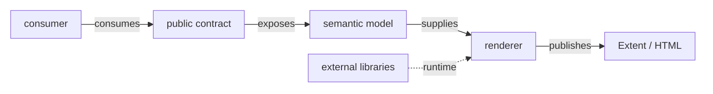

<details>
<summary><strong>Legend - the standalone boundary</strong></summary>

- `atf-reporting` receives input typed and publishes the artifact; does not orchestrate tests;
- `Contract → Model → Renderer → Artifact` route is inside the library;
- `consumer` is canonically `atf-reporting-tests`, but can be replaced by
  any application using API publicly;
- `atf-reporting-tests` is the only canonical consumer for the composition ATF;
- Jackson, ExtentReports, FreeMarker and Jsoup are external dependencies declared in POM standalone;
- mock behavior, browser, JUnit orchestration and fixtures do not enter the library's production.
</details>

| Surface | Responsibility | Boundary |
|---|---|---|
| `src/main` | production library and published artifact | undependent to ATF modules, browser or business fixture |
| `src/test` | guarantees, standalone contracts and audit of Java source | without mock, Playwright or live endpoint; composition is at Reporting Tests |
| `atf-reporting-tests` | canonical consumer for component / integration API and UI / E2E | does not enter JAR reporting |
| Other modules | can consume API publicly for normalization of models at their own boundary; do not replace the composition of the canon root | The policy remains in the consumer, and test-scope couplings are followed separately in feedback |

<details>
<summary><strong>Standalone proof, adoption and cut-off limit</strong></summary>

- `atf-reporting/pom.xml` is parentless and does not declare dependence on modules
  ATF in production;
- `src/test` can check the standalone boundary without contaminating JAR;
- `atf-reporting` publishes HTML by typed contracts, immutable records, ports,
  records, snapshot and renderer. `atf.reporting.*` Namespace also includes technical public implementation; the external supported API inventory has [separate criterion](../docs/feedback/ATF_Reporting_Feedback.md#report-public-api-43--suprafață-susținută-și-ownership);
- `ReportModelAdapters` is the generic public adapter based solely on reflection for the request,
  execution / retry / provenance, assertions, UI actions and statuses; URI decoding is owned by `ReportQueryParameters`. These API do not contain application rules and do not add compile-time dependence to `atf-core`;
- `CoreReportPortsAdapter` remains exclusively in test / composition scope and uses
  the same adapters, without maintaining a second map;
- These adapters can be used by consumers in production code only at
  normalisation / interoperability boundary; does not implement policy and become a business layer: execution decides HTTP exchange, validation decides verdict, UI produces action, reporting preserves and publishes the evidence. The consumer keeps only its own context - for example, the tracer and the identity of Shop;
- Track test-scope dependencies outside canonical composition in [active feedback](../docs/feedback/README.md), without duplicating TODOs here.
- POM and runtime do not require parent of reactor or artifact ATF.
  The guard starts from CodeSourceX of its own tests and inspections the modules liaison of the name of the director or working director;
- `ReportingLibraryDistributionIntegrationTest` copies only module in one
  TMP new, runs the pack with local tests, then consumes JAR / POM real from another Maven project. Check the loaded hash, runtime transistors and refusal of both renderers when the JAR copy loses a resource;
- the complete composition and browser oracles remain in `atf-reporting-tests`.

</details>

<a id="the-reliability-of-the-query-contract"></a>
<a id="fidelitatea-contractului-query"></a>
## Query contract fidelity

`ReportQueryParameters` keeps the pairs and number of appearances. The conversion of an external model reads the `values()` collection prior to the legacy view `asMap()`; a defective user is explicitly refused. `asMap()` only retains the last value by name and is intended for compatibility, not validation.

- `ReportRequest.queryParameters()` and the typed builder retain all pairs through `toBuilder()` and the Core/reflection adapter; `query()` remains the legacy last-value view, and existing constructors stay available.
- The signature shall sort the name, keep the order of the occurrence of the same name, and
  Mask sensitive values according to existing policy. It is identity by grouping reliable evidence without authority for business selection or replay.
- When UI removes all query values, capture retains only an opaque fingerprint. `ReportRequest.queryFingerprint()` preserves it through mapper, `toBuilder()` and trace; HTML hides the digest and declares the query uncaptured without fabricating a `redacted-query` parameter. Legacy input that already lost this identity cannot be reconstructed.

- Match is a subset with multiplication: `tag=red&tag=blue` requires both
  pairs, and two identical appearances require two observed appearances.
- Additional parameters and permutations are accepted. URI Decoding maintains
  Empty values, Unicode and encoded delimiters; empty separators are ignored.
- The auditor checks the query without the mated metadata. A retained candidate
  The choice after status does not eliminate this violation.
- Contracts without query keep the URL-ul compatible. Label
  `key()` is readable; adapters keep the combination with the source separately.

The samples are in [Reporting Tests](../atf-reporting-tests/README.md#fidelitatea-query-ului-și-asocierea-mock), including FAIL projection in Extent and fallback. This contract does not change the report layout.

<a id="typed-model"></a>
<a id="modelul-tipizat"></a>
## Typed model

The permanent rule is:

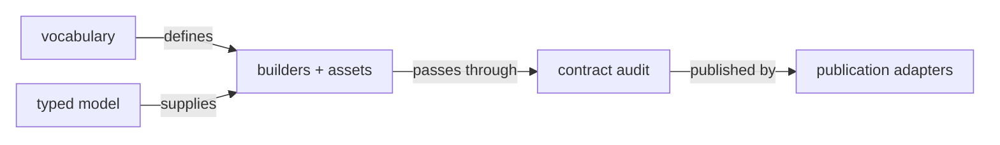

<details>
<summary><strong>Legend - vocabulary, models and renderer</strong></summary>

- the lists and constants have the finished vocabulary: tag, class, attributes, view, status and token;
- `AtfReportHtmlVocabulary.element(...)` and `voidElement(...)` compose the elements without any
  re-enter raw tags into views; `HtmlReportShell` exclusively holds the fallback shellum (`html/head/body/meta/title/style/script`);
- Immutable POJOs/records hold runtime data: requests, JSON, evidence and checks;
- builders and renderers transform the model into HTML/CSS/JavaScript;
- Validators check the output and adapters publish it; dynamic values do not become artificial enumerations.
</details>

| Information type | Owner | Rule |
|---|---|---|
| tag, class, attribute, element, view, status | `AtfReportHtmlVocabulary`, `HtmlReportShell`, `AtfReportAsset`, `ExtentReportRuntimeVocabulary`, `AtfReportStatus` | enum / unique constant; `element(...)` / `voidElement(...)` retains the form HTML; `displayValue()` produces the lowercase value for CSS / filter; without the literal distributions |
| Colours and geometry | `AtfReportColors`, `AtfReportCssSelectors`, theme tokens | stable token; output CSS determinist |
| CSS evidence | `AtfUiEvidenceCss` and theme / evidence providence | The selects and tokens are typed; the stylesheet is native to the CSS asset, and the dynamic values are only composition placeholders |
| module JavaScript | `HtmlReportScriptModule`, Builders and Runtime Section Modules | explicit orders and ownership |
| fields, body JSON, screenshot, checks | `ReportField`, `ReportJsonBody`, `ReportScreenshot`, `ReportCheck` | records / POJO immutable; legacy serializer is boundary |
| scenarios and phases | `ReportExecutionModel`, `AtfReportSemanticSnapshot` | Semantic tree, not markup |
| sentences, URL-uri, payloads, test values | input runtime | does not artificially convert into enumerations |

<details>
<summary><strong>Tags and annotations policy</strong></summary>

- **normalisation** - `trim` → elimination of empty values / null → lowercase with
  `Locale.ROOT` → deductions in order of first occurrence;
- **projection** - the canonical list reaches the categories Extent, snapshots
  Semantic and JavaScript legacy filters;
- **publisher** - passes through `ReportTagNormalizer`; does not call directly
  `assignCategory` with raw input;
- **statusuri** - `PASS`, `FAIL`, `WARNING`, `SKIP` and `INFO` are verdicts
  Typed in `AtfReportStatus`; `CLEAR` remains the UI filter separately;
- **proof** - component / integration tests of this policy belong to
  [specialised consumption](../atf-reporting-tests/README.md), are not duplicated in README library.

</details>

<a id="semantic-models-and-common-projection"></a>
<a id="modelele-semantice-și-proiecția-comună"></a>
## Semantic models and common projection

<details>
<summary><strong>Details - semantic models and common projection</strong></summary>

The code keeps two models of immutable with distinct local responsibilities linked to a common projection. Thus, there is no need to force the Extent renderer and the fallback to share the same internal structure:

| Model | Role |
|---|---|
| `AtfReportSemanticSnapshot` | Extent lifecycle population: class → scenario → phase → node |
| `ReportExecutionModel` | Fallback tree: scenario → phase → request / validation and `Overview`, `Categories`, `Failures` projections |

`AtfReportSemanticSnapshot.from(ReportExecutionModel)` is the common adapter:

- Fallback uses it for `semanticSnapshot()`;
- Session fails before render if the snapshots derived from the tree differ
  Lifecycle recorder;
- Projections keep package, metadata request / response JSON, validations and
  number of actions / screenshots;
- Semantic test compares Extent and fallback on the tree
  `class → scenario → phase → request → validation`;
- the models remain separate: `Overview/Categories/Fails` are specific to fallback,
  And the snapshots are the common renderer-neutral contract.

`ReportExecutionModel.projections()` collects the same population in a single renderer-neutral crossing and returns `ReportExecutionProjections`.

- `overview()`, `categories()` and `failures()` facades remain for
  compatibility;
- The aggregate may be used for the production of the aggregate.
  choose projections from different sources;
- The aggregate is pure: does not own lifecycle states or alter the IMMUTABLE tree;
- The removable recorder and projection remain separate responsibilities.

<a id="time-displayed-and-file-timestamp"></a>
<a id="ora-afișată-și-timestamp-ul-fișierului"></a>
### Time displayed and file timestamp

- The visible time uses `HH:mm:ss`, without `AM/PM`, in the navbar, Overview, Tests,
  Logs and Categories; the full date / time uses `yyyy-MM-dd HH:mm:ss`.
- `ExtentReportTimestampReporter` only adapts the presentation of Spark, including
  The expression categories of the vendor, in memory. Do not change JAR, courts, time zones, durations or payloads.
- `ReportingTimestampComponentTest` in `atf-reporting-tests`,
  checks midnight, lunch, after-lunch hours and canonical session. It is `@AtfComponentTest` sample; the standalone library remains independent of Test Kit; the browser sample does not enter the final inventory of standalone tests.
- The file name policy is separate from the time displayed; its options are in
  [Output contract](../docs/ATF_Reporting_Contract.md#numele-raportului-și-diferențierea-rulărilor).

<a id="zoom-for-overview--system"></a>
<a id="instantaneu-tipizat-pentru-overviewsystem"></a>
### Zoom for Overview / System

The relevant configuration of a run is published by a snapshot allowlisted-uit, not by the arbitrary dumping of YAML:

```java
var environment = ReportEnvironmentSnapshot.builder()
        .put(ReportEnvironmentField.ENVIRONMENT, "LOCAL")
        .put(ReportEnvironmentField.PROFILE, "users-posts")
        .put(ReportEnvironmentField.UI_TIMEOUT, "20 s")
        .build();
```

`ReportUiEnvironment` in `configuration.ui` forms common operational fields AutoEx / Shop: browser, target, timeouts and effective record policies. The consumer provides resolved values and adds only its API semantics; the formatter does not read YAML, JVM, Playwright or JUnit annotations.

The rules of the typed snapshots are explicit:

- `ReportEnvironmentField` holds the vocabulary and semantic classification:
  `Run`, `Targets`, `Browser`, `Time`, `Flow`, `Auth`, `Network`, `Evidence` and `Reporting`. The groups are metadata, not visual headers.
- `Overview/System` displays a flat list of label / value pairs. `Client` is
  The operational metadata of the `Browser` group; `Suite` and other contextual details do not reach this section.
- The generic FALD for `Client` is `Configured per execution`; Reporting
  do not assume that any run uses ApiTransport. The robot declares the concrete value (e.g. UI browser) only when it knows the actual channel.
- `ReportEnvironmentSnapshot` is immutable, ignores empty values and separates
  `displayValues()` (context typed) by `systemDisplayValues()` (operational allowlist for `Overview/System`). `ReportEnvironment` applies the editorial to Extent boundary.
- For a shared session, the robot compositions
  `includeScenarioEnvironment(snapshot)` with the solved data of each scenario. `ReportEnvironmentSnapshot.common(...)` maintains common values; differences or fields absent in a brother become `Mixed — varies by scenario`. The first scenario does not implicitly represent the entire suite.
- `ReportEvidenceProfile.actionDetailsMode` is transmitted to the scope of the
  publish the actions, including setup, unified flow and failure. The brothers can independently choose `included-collapsed` and `summary-only`; the validation fallback models keep the same policy. The selection of the summary does not delete the registered actions and does not remove the allowed screenshot.
- The old overloads with `Map<String,String>` remain for compatibility and
  migration. The new code prefers the typed snapshots, avoiding arbitrary keys, duplicates and non-actionable technical values in `System/Environment`.
- Snapshots do not replace the observed evidence: demand / response, retry,
  Screenshot and verdict remain in `TEST BODY`; `Overview/System` describes only the actual operational configuration of the run.
- `Suite`, `Test package`, `Flow`, `Fixture`, `Checkout` and business payload
  does not publish in `Overview/System`.

`ReportGherkinSequence` is an optional primitive composition on the scenario. It converts a repeated anchor into `AND`, keeps `AND` / `BUT` explicit and lets the consumer declare business groups; the renderer does not rewrite the narrative. AutoEx transmits the unique result to both checkpoint and its correlation.

A new consumer uses public contracts at the level of data:

| Data provided by the consumer | Contract typed | Publication |
|---|---|---|
| operational configuration per run | `ReportEnvironmentSnapshot` | `ExtentReportSession` or `UiExtentReportOptions.environment(...)`; System receives only the allowlist fields - look and redacted |
| cauzalitate per exchange | `ReportTraceMetadata` in `ReportExecutionEvidence` | `AtfReportPorts.Request.execution(...)`; request / response / execution remain together in the step that caused them |

The consumer builds the values at the composition root; the renderer does not deduct business facts from the title or YAML. The two contracts are not brought together in a session provider: the trace can vary at each exchange, while the snack system is stable during the report. The combined contract is checked with a synthetic consumer in `ReportTraceMetadataRenderingTest`.

</details>

<a id="atomic-start-of-scenarios-and-phases"></a>
<a id="pornirea-atomică-a-scenariilor-și-fazelor"></a>
## Atomic start of scenarios and phases

- The call-owned tags and scenario profile are validated prior to
  creating nodes; an invalid argument does not leave a node without usable handle.
- If semantic start fails after Extent node creation, compensation
  Withdraw the scenario / phase and the remaining new-class root. The original cause remains primary; a secondary compensation failure is maintained as `suppressed`.
- The Console sink provides best-effort diagnostics: runtime notification exceptions do not interrupt lifecycle or invent verdicts or HTTP exchanges.
- `TestRunInitialization` only closes the resources for which it received the handle;
  Reporting internal atomicity is not delegated to the consumer or Test Kit.

`ExtentReportSessionLifecycleTest` and `ReportEvidenceProfileIntegrationTest` protect invalid arguments, failure injected after Extent mutation, secondary compensation and re-use of the session. The samples are local and deterministic; do not require external endpoint or product journey.

<a id="the-commission-shall-adopt-implementing-acts-laying-down-the-rules-for-the-application-of-this-regulation"></a>
<a id="cauza-publicării-și-scope-urile-deținute"></a>
## Publication causes and owned scopes

Direct publication and `UiFailureEvidencePublisher` share the `ReportPublicationScope` protocol: the original cause remains primary if evidence closure fails. The internal `ApiEvidencePublisher` owns exchange projection; consumer facades, models and APIs stay unchanged.

| Situation | Propagated cause | Closing |
|---|---|---|
| body or complete fails | the same original instance, including `Error` | each acquired scope closes once |
| body/complete and close fail | the original cause, with the close failure suppressed | no publication replay |
| only close fails | the same close failure | no additional complete |
| close throws the same instance as body | the original cause, without self-suppression | one close attempt |
| child acquisition fails | the same acquisition failure | close the owned parent, never the unacquired child |

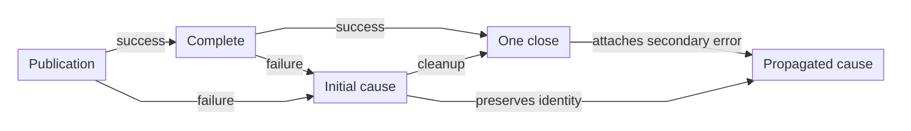

<details>
<summary><strong>Legend - ownership, order and projection API</strong></summary>

- The common publication protocol closes created requests and validations, including standard/media UI validation and API assertions.
- The diagram describes common closure; the failure publisher separately owns its request and validation, closing child before parent even after assertions or complete fails.
- A failed child closes before its parent; body and complete are never replayed to compensate for close failure.
- The API collaborator receives `UiApiValidationEvidence` and Reporting ports, retaining API ownership, exchanges and consumer-evaluated assertions.
- These collaborators remain internal, without extending the consumer facade, adding browser/JUnit dependencies or modules, or relaxing package type limits.
- Flow grouping, screenshot policies, timing and configured previews retain their contracts; cleanup does not reevaluate comparisons.

</details>

`UiPublicationFailureComponentTest` injects failures through the public facade in outcome, setup, checkpoint, media, API trace, unified flow within/across phases and delegated failure. The matrix also checks child acquisition, identical `Error` instances and multiple cleanup failures, with child-before-parent closure.

`UiFailurePublicationComponentTest` independently probes the failure publisher directly and through the facade: ports without cascading cleanup, partial acquisition, body/complete/close and identical `RuntimeException`/`Error` instances. The reported business cause remains separate from publication failure; comparisons are not reevaluated.

The common rule of verification is in [test guide](../docs/ATF_Testing_Guide.md#proba-fiecărui-owner-de-resurse).

<a id="contract-of-the-report"></a>
<a id="contractul-raportului"></a>
## Report contract

<details>
<summary><strong>Details - report contract</strong></summary>

The [display and layout contract](../docs/ATF_Reporting_Display_Contract.md) owns visible hierarchy, inline glyphs, disclosures, viewport behavior, responsive layout and browser verification. This section owns semantic behavior and implementation-specific library boundaries.

```text
TestCase
├── SETUP (opțional; precondiții / dobândire și verificare fixture)
├── TEST BODY (acțiunea și validarea)
│   ├── Request
│   │   ├── Request details + body (JSON / form / text / absent)
│   │   ├── Response details + body (numai pentru response capturat)
│   │   ├── Execution evidence
│   │   └── Contract validation (când este evaluat un contract al răspunsului)
│   │       └── aggregate assertion table
└── TEARDOWN (opțional; cleanup / read-back)
```

| Rule | Contract |
|---|---|
| direct API ownership | Response contract validation is a child of the request that owns the exchange, and its assertion table belongs to that validation. Extent collapses the validation node; fallback wraps a nonempty table in the standard `Assertions · n` disclosure, initially closed. Click, Enter/Space and Fails backlinks preserve ownership, rows and PASS/FAIL/WARNING; empty validation creates neither a table nor a disclosure. |
| setup evidence | the `CHECK / EXPECTED / ACTUAL / RESULT` table summarizes the precondition; actual exchanges remain distinct `API validation` evidence under the same `SETUP` checkpoint |
| body format | request/response retain their captured format (JSON, form or text); the consumer validator requires a JSON contract explicitly, rather than inferring it from the HTTP method |
| absent body | Request/Response details remain present; `ABSENT` and `NOT_CAPTURED` have distinct explanations without fabricated payloads. A captured JSON literal `null` remains a JSON document. |
| phase without child evidence | a phase with no published content is a leaf: no `＋/−`, no focus target and no invented steps from JUnit assertions; actual published child content retains interactive disclosure |
| component assertions | `Phase.startAssertionStep` publishes a typed child in its owning phase (`SETUP`, `TEST BODY` or `TEARDOWN`) without requiring HTTP. `AtfAssertion` rows share table, redaction and status rules in Extent/fallback; the step exists only when the test publishes evaluated assertions. |
| flow context | SETUP retains its setup role; in TEST BODY, actions, observations, assertions and the UI verdict belong to one UI validation node, whose default title is `UI validation` |
| UI-flow assertions | Extent and fallback retain an initially collapsed `Assertions · n` disclosure for both per-phase unified flow and compact cross-phase presentation. [Reporting Tests](../atf-reporting-tests/README.md#regresia-permanentă-a-fiecărui-defect-reporting) covers original rows, configured preview, Enter/Space and reload. |
| the context of the flower | `UI flow context · n fields` presents the aggregation metadata per phase. `UI flow provenance · n checkpoints` keeps the origin of checkpoints over phases. Typed identity decides the section; fields HTTP / custom and actual exchanges keep their request / response / execution evidence. |
| UI `UNIFIED_FLOW` on one or more phases | The consumer calls `UiScenario.unifyAcrossPhases()` before the first phase and `UiPhase.completeFinal(status)` at the terminal phase. Exactly one `TEST BODY` body is eligible, including preparation declared inside that body. On UI-only success, Reporting publishes one UI validation with a ACTION table, a OBSERVE table when observations exist and an assertion table when checks exist, retaining every row in order. An allowed `FINAL` capture appears under Playwright, before the audit. `UI flow provenance` retains phases/checkpoints and verdicts separately from HTTP responses. UI+API, failed setup and explicit multiple-capture policies retain per-checkpoint validations. `completeFinal(FAIL)` in `SETUP` creates neither `TEST BODY` nor a final capture. Without opt-in, existing phase behavior remains. |
| layout | `＋/−` precedes the sentence inline; Request details, Response details and Execution evidence are sibling disclosures within their request, whose child is Contract validation. UI/API validations are sibling children of one Gherkin checkpoint. |
| responsive evidence | headers and columns remain semantically visible and aligned at any panel width; insufficient space produces local horizontal scrolling without page overflow, vertical cells or font shrinking |
| scrollable tables | containers use `height:auto` and `max-height:var(--atf-table-scroll-height)`, derived from `AtfReportThemeTokens.TABLE_SCROLL_HEIGHT` (`500px` currently); short content reserves no empty height, and long content scrolls under a sticky header with its final row/column reachable. JSON/code panels have a separate contract. |
| shared viewport policy | `ReportTableViewport` and `table-viewport.css` are shared by Extent/fallback; builders wrap all data tables, including setup, execution and future families, independently of title, count, phase or `validation` parent. The wrapper accepts keyboard focus for scrolling. |
| viewport boundaries | one wrapper per data table; layout tables (`Status / Details`), child content and screenshots are excluded. Legacy normalization examines only the candidate table’s direct parent and reuses an existing wrapper. |
| local input scrolling | `table-viewport.js` isolates wheel and keyboard navigation from the host panel while preserving inputs, links, summaries and code panels; one delegated binding avoids rescanning on each gesture |
| `TECHNICAL TRACE` | every `helm-trace-table` uses the shared `atf-trace-table-wrap` markup: `height:auto`, `max-height:var(--atf-table-scroll-height)`, vertical scrolling and a sticky header. This applies to the table in Extent/fallback, separately from the outer disclosure and JSON. |
| Request details / retry history | the `helm-request-table` metadata table and `retry-history-table` use `atf-api-table-wrap`, the shared height cap and a sticky header in Extent/fallback. Request JSON stays outside that wrapper; the outer disclosure does not own table scrolling. |
| cardinality labels | `AtfReportLabels` supplies shared Extent/fallback cardinality labels: `1 field/check/attempt/entry`, with plural forms for zero and multiple items; publishers do not create local variants |
| action number | each action displays `#n` in a dedicated token, `atf-ui-action-number`, compact (`inline-block` / `max-content`); do not reuse the `atf-ui-action-sequence` extensible class |
| screenshot | inline link with the current emoji; Base64 payload for the first occurrence or a bounded local reference (`screenshot-n`) for deduplicated state. Fingerprints stay internal rather than replacing the visible link. |
| action table | relevant actions include `getText`/text extraction; duration is attached only to actions |
| failures | `Setup`, `UI action`, `Audit observation` and `Assertion` have distinct causes and `Open in Tests` |
| navigation | Tests, Category, Fails and Overview have accessible names; navigation retains exactly one `active` link and `aria-current="page"`, aligned with the visible view |

This API hierarchy should not be confused with the UI reporting: `UI validation` and `API validation` are semantic copies of the same checkpoint Gherkin, and each `API validation` has its exchanges.The verdict of a JUnit method is not a API demand and should not be introduced as method `ASSERT` / Synthetic route.

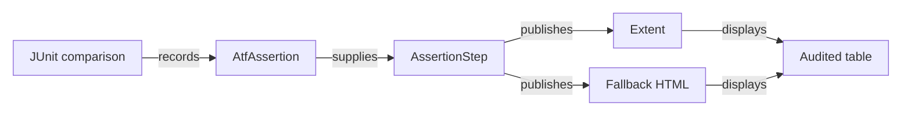

<details>
<summary><strong>Legend - proof of component</strong></summary>

- JUnit decides the method's verdict; reported row describes the same comparison.
- `AssertionStep` belongs to the phase and does not fall into the number of API quests.
- The two yields shall retain the same proof and status.

</details>

`AssertionStep` is a type of node distinct from `Request` and `Validation`.

- His status enters the status of the phase and scenario, and a FAIL row appears
  in `Fails` with the owner `component` and field `STEP`.
- Comparison values remain accurate, including numbers resembling statuses
  HTTP; no demand or duration of response invented.
- UI / API validations remain under their checkpoint or exchange.

- Compaction is a presentation projection for a successful UI-only flow with one or more declared phases; the model retains original action/assertion objects, provenance and verdict. Technical API request details remain in their channel; [narrow panels](#lizibilitatea-dovezilor-în-panouri-înguste) defines adaptive presentation.

<a id="phase-context-and-execution-diagnosis"></a>
<a id="context-de-fază-și-diagnostic-de-execuție"></a>
### Phase context and execution diagnostics

[ReportFailureDescription](src/main/java/atf/reporting/evidence/diagnostic/ReportFailureDescription.java) summarizes an existing exception safely: at most four distinct objects, with cause and suppressed links visited breadth-first and cycles tracked by identity. Redaction precedes the total 240-character limit, including ellipsis; neither the original graph nor verdict changes, and the summary is not request evidence.

AutoEx and Shop associate that summary with their own phase and exchange. [Reporting Tests](../atf-reporting-tests/README.md#diagnosticul-neutru-al-excepțiilor) owns generic graph and Extent/fallback publication probes; application modules retain composition and business-rule acceptance.

| Input | Owner and projection |
|---|---|
| `Phase.detail` | internal context; it creates no Audit details, log table or empty phase wrapper |
| `Phase.diagnostic(Kind, message)` | explicit, redacted scenario diagnostics; no fabricated request or business assertion |
| Request / validation | retains HTTP evidence and actually evaluated contracts |

`ReportPhaseDiagnostic` provides compatibility boundaries for `Failure cause`, `JUnit failure` and `API contract association`; other phase details are not inferred to be diagnostics. `ReportPhaseDiagnosticMarkup` supplies the shared Extent/fallback projection, while Fails retains the real cause of failed phases.

- In Extent, `extent-scenarios.js` places diagnostics inside the scenario panel and removes the vendor wrapper; closing the scenario hides them, and repeated normalization does not duplicate them.
- Without exchanges, neither HTTP evidence nor contractual PASS is fabricated; an association diagnostic alone cannot change the JUnit verdict.
- The model retains the source phase status; Fails does not attribute notes from a successful phase to another phase’s failure.
- `Setup evidence` and the aggregated inspector remain distinct channels.

<a id="api-evidence-attached-to-a-ui-step"></a>
<a id="dovezi-api-atașate-unui-pas-ui"></a>
### API evidence attached to a UI step

A consumer can attach one or more `ReportExecutionEvidence` objects to a UI checkpoint through `UiExtentReportSession.step(...)`. Reporting projects them into the existing request contract without creating a synthetic test or reevaluating the verdict:

```text
UI checkpoint
├── UI validation → actions, observations, assertions și screenshot inline
└── API validation (numai când există exchange-uri selectate)
    └── HTTP exchange
        ├── Request details → method/path/url/auth/headers/transport/replay + REQUEST JSON
        ├── Response details → status/content-type + RESPONSE JSON (numai pentru response capturat)
        └── Execution evidence → attempts/retries/duration/outcome
```

- `request.action`, `request.target`, `evidence.type` and `evidence.policy` are internal checkpoint context, retained in the model/configured diagnostics rather than request/response tables. `EvidenceTableFormatter` applies the same Extent/fallback/legacy projection with exact key matching, independent of case;
- `ui-validation` bounds policy filtering; explicit `api-trace`/`unified-ui-flow` contracts and `ui-failure` screenshot diagnostics are unchanged;
- UI checkpoints receive no Request details, Response details or introductory Status/Details/Info identity-policy table; no empty log is created when public fields/payload are absent;
- Playwright action targets, screenshots and UI assertions remain in UI validation; actual HTTP fields belong to the API exchange;
- disclosures start closed and belong to their API exchange;
- the UI consumer hierarchy is `one Gherkin step → UI validation + API validation → exchange disclosures`; both validation nodes are semantic children of that step with their own statuses;
- `UiApiValidationEvidence` is the sole API input for checkpoints, setup, final capture, trace and unified-flow buffering; raw exchange-list entry points have no overload/fallback. UI-only uses `UiApiValidationEvidence.empty()` explicitly; an exchange observation without checks does not inherit the UI verdict;
- typed `UiApiValidationEvidence` publication separates UI from API assertions: correlation belongs to API validation, and each exchange retains its own assertions/status. Checkpoint aggregation propagates upward without recoloring siblings; business verdicts are explicit assertions rather than HTTP-status inference;
- `apiTrace(...)` must not create another visible card with the checkpoint’s Gherkin title; API evidence for the same sentence attaches to its existing node or equivalent composition without duplication;
- `Exchange n` identifies an exchange locally within API validation; flat `API n · ...` fields and repeated Gherkin sentences are not substitutes;
- a repeated `Execution evidence · 1 attempt` title needs context from its parent disclosure or a semantic exchange label;
- API network inspector accepts HTTP exchanges and their causal checkpoints, rather than generic console/page diagnostics;
- Technical diagnostics derives only from failed HTTP exchanges and remains transport evidence, separate from Gherkin steps and business validation;
- technical nodes share visual accents without fabricating an exchange verdict or status;
- their technical children share that visual family without creating another verdict or Gherkin card;
- UI projection uses the same semantics and redaction policy as direct API reporting: browser headers and volatile response headers are filtered, while stable response headers are optional;
- body preview uses the consumer’s `reporting.bodyMaxDisplayCharacters`;
- redaction precedes rendering; the default is `100`, and `0` removes only the body-preview limit;
- the renderer does not introduce a hardcoded limit;
- the consumer supplies typed facts; `atf-reporting` publishes their semantic contract and verifiable layout independently of mock transport, browser and application.

Execution and validation supply the business verdict; Reporting aggregates the supplied statuses without substituting a business decision.

<a id="api-execution-completed-unanswered"></a>
<a id="execuție-api-terminată-fără-răspuns"></a>
### API execution without a terminal response

`ReportExecutionEvidence` can contain an absent response and typed `Termination` metadata, which describes execution separately from HTTP. `ApiExchangeEvidence.publish` preserves the known request, history and diagnostics even without a response; `publishFailure` also accepts a caller-known resolved URL. Neither entry point decides the consumer verdict.

`UiApiValidationEvidence.Exchange` requires a captured request. Without a response, an explicit non-INFO status or evaluated assertions must supply the verdict; otherwise publication is rejected with `IllegalArgumentException`. INFO alone is observation, while an empty API channel remains valid and INFO.

A terminal FAIL request is indexed in Fails through `ReportExecutionFailure`, even without assertions. Its context, request and available timing come from that same execution evidence; neighboring PASS entries cannot supply identity fallbacks.

- Backlinks open the original Execution evidence, including after reload. Extent retains its `execution` type and ordinal; fallback follows shared projection order, with distinct navigation identities for distinct evidence kinds.
- Expected transport failure evaluated as PASS is not indexed. A terminal cause and an independent failed business comparison remain distinct, each once; truncated text is never a deduplication key.
- Fails labels assertion and execution-diagnostic entries separately. One diagnostic entry per scenario holds the ordered cause chain; Tests retains the original rows, and its backlink opens the source diagnostic row.

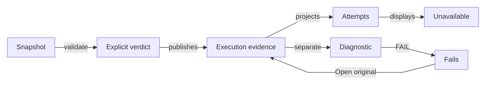

<details>
<summary><strong>Legend - Extent parity / fallback and compatibility</strong></summary>

- The legacy `ReportModelAdapters.partialExecution` seam requires explicit Optional availability while retaining existing Reporting constructors; Core model classes remain outside the standalone library classpath.
- The missing-response sentinel is displayed as Unavailable in history; no HTTP status, body or response duration is fabricated for a terminal attempt.
- Termination and diagnostics belong in Execution evidence; an absent response does not create a synthetic Response details disclosure.
- Valid exchanges remain API children in setup, checkpoints, final validation, trace and unified cross-phase flow; absent responses neither drop exchanges nor renumber neighbors. Assertion FAIL/SKIP dominates caller PASS; expected failure requires its explicit PASS verdict.
- An unknown resolved URL stays empty; a route does not become an invented URL/replay command, and absent termination metadata does not acquire a presumed cause.
- Zero dispatches retain the selected transport without claiming network execution or verified manual replay.
- Redact full text before the total 240-character budget including ellipsis; custom budgets apply at projection.
- `TerminalExecutionProjectionTest` and `TerminalApiExecutionReportTest` cover model, Extent/fallback, redaction, keyboard interaction and final-row access.
- `ReportingStandaloneVerdictComponentTest` protects the standalone boundary; `UiTerminalExchangeReportComponentTest` checks the UI/API tree, diagnostics, attempts, totals and disclosures in Extent/fallback with default/custom budgets. These use local snapshots without HTTP dispatch.
- Overview’s pass-like total is PASS + WARNING in both renderers; WARNING remains distinct in the tree and does not become a Fails entry.

The short labels shall be kept as follows:

| In the scheme | Full meaning |
|---|---|
| Snapshot | Snapshot consumer |
| Verdict explicit | a non-INFO caller status or evaluated assertions for the response-free exchange |
| Execution evidence | Execution evidence + Termination |
| Tests | In order tests |
| Diagnostic | Performing Diagnosis |
| Unavailable | Uavailable, without HTTP invented |
| Fails | typed cause index linking to original evidence while retaining navigation identity |
| display | display absence |

</details>

<a id="be-decisions-without-default-success-verdict"></a>
<a id="decizii-be-fără-verdict-de-succes-implicit"></a>
### BE decisions without default success verdict

AutoEx/Shop adapters publish recovery decisions as INFO observations: policy/budget in Expected, decision/reason/timing in Observed. Receipt, policy source, operation, attempt and probe/backoff/total timings are auditable observations, excluding HTTP bodies and credentials. They neither represent repeated clicks nor rewrite an existing FAIL.

The projection retains disclosures and configured limits after full-text redaction. [Recovery audit feedback](../docs/feedback/ATF_Reporting_Feedback.md#ui-recovery-audit-01--încercări-inspectabile-în-extent) distinguishes consumer-specific acceptance and remaining shared criteria; INFO publication alone does not establish the complete UI/UI_API matrix.

<a id="background-to-error-prior-to-technical-diagnosis"></a>
<a id="contextul-erorii-înaintea-diagnosticului-tehnic"></a>
### Failure context before technical diagnostics

`UiFailureContext` projects the first captured FAIL in `sequence` order: exception type, operation/ordinal, target, measured timing and expectation. Failure cause, Observed and Fails share that projection; a prior PASS action cannot become a later exception’s cause. Missing failed action/exception is explicit, and OBSERVE retains its observation role.

- A native timeout message belongs to separate Tests diagnostics.
- `elapsed` is captured action timing, not a deadline inferred from exception text.

`UiFailureEvidencePublisher` publishes this evidence through neutral Reporting ports. `UiEvidencePublisher` delegates failure-path publication without JUnit, browser dependencies or business-verdict reevaluation.

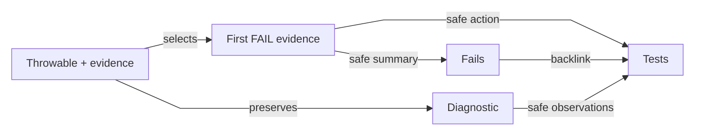

<details>
<summary><strong>Legend - context, relationships and boundaries</strong></summary>

- Context uses captured evidence only; parsing a stack must not fabricate dispatch, an HTTP response, confirmed navigation or recovery.
- INFO Audit observations retain primary exception type/message, causes, suppressed errors and numbered relations. Shared references and cycles remain finite; original Throwable objects and rows are preserved.
- Each full diagnostic is redacted before its configured budget, default 240 including ellipsis; expansion does not expose unbounded raw text.
- Diagram edges labeled safe include redaction and bounds; separating surfaces never creates another raw-value publication channel.
- Fails prioritizes UI assertion context over technical phase diagnostics, which remain in Tests; API retains its own cause chain and owner.
- FAIL verdict, identity correlation and no-replay policy remain responsibilities separate from this projection.

</details>

| Surface | Observed contract |
|---|---|
| Tests → UI action sequence | operation, target, measured duration and context of the first captured FAIL |
| Tests → Audit observations | distinct INFO diagnostics: primary type/message, causes, suppressed errors and original observation; each respects its budget |
| Fails → Cause | compact context; native messages and redaction markers are not mandatory in this summary |
| Open in Tests | scenario and failed-comparison ordinal open the original Extent path; phase, request/step, validation and disclosure become visible without Expand all |

`UiFailureReportContractTest` checks these surfaces through the real UI facade. `UiTimeoutReportComponentTest` covers Extent/fallback at 240 and 18, whole-HTML redaction, diagnostic relations, isolation and backlinks; negative controls detect missing native diagnostics and a credential exposed in DOM.

<a id="capture-at-the-fault"></a>
<a id="captura-la-failure"></a>
### Failure capture

- The adapter throws `UiCheckpointFailure(message, assertions)` with the exact FAIL assertion instances published in the current UI scenario.
- Fails retains the original assertion; propagation diagnostics and final capture stay in Tests’ Failure evidence, including unified flow.
- Correlation does not compare titles/messages; ordinary exceptions, equal-content distinct instances, API failures and independent cleanup/actions retain separate identities.

Failure evidence retains executed actions and the original cause. `UiFailureScreenshotState` evaluates policy before examining payload:

| Status | Condition | Image link |
|---|---|---|
| `DISABLED_BY_POLICY` | policy excludes failure capture | absent |
| `UNAVAILABLE` | null, empty or whitespace payload | absent |
| `INVALID` | invalid Base64 or a non-PNG signature | absent |
| `CAPTURED` | capture permitted, Base64 accepted and PNG signature present | inline with emoji |

- `ReportScreenshot.hasPngSignature(...)` checks encoding/signature, not decoded pixels or complete image integrity.
- The Screenshot observation has OBSERVE source and INFO status; it creates neither a business assertion nor another checkpoint.
- Extent/fallback preserve published actions and captures, rather than just counts; UI steps receive no fictitious HTTP metadata.

<a id="terminal-audit-in-ui-validation"></a>
<a id="audit-terminal-în-ui-validation"></a>
### Terminal audit in UI validation

- Terminal contract validation publishes exactly one `Audit screen contract` observation in `Audit observations`, in the same validation as actions, assertions and capture; it does not create a second Gherkin checkpoint.
- Its OBSERVE source creates neither a Playwright action nor a duplicate assertion; record it before draining the sequence for publication.
- The observation identifies subject, contract verdict, assertion count, capture state and safe URL without copying bodies or secrets.
- The screenshot sits outside the action-table viewport, immediately afterward according to the effective profile; absent capture is explicit, and invalid payload is never presented as valid PNG.
- Assertions supply the verdict; a screenshot alone does not establish PASS. FINAL_ONLY does not invent final state after failed setup.

`ExtentReportUiEvidenceRenderingTest` checks generic DOM and ACTION/OBSERVE separation; Shop/AutoEx terminal probes check local mapping, uniqueness and record-before-drain order. Browser verification of changed layout remains a separate proof.

`UiAuditLifecycleTest` separately checks failure with empty payload, disabled policy or no executed actions. Visible state is a Failure evidence observation; internal metadata remains excluded from HTTP.

<a id="aggregated-ui--api-flow-inspector"></a>
<a id="inspector-agregat-pentru-flux-uiapi"></a>
### Aggregated UI / API flow inspector

`ReportNetworkInspector.JourneyAggregate` is a semantic journey summary, not a second trace or a replacement for canonical exchange evidence.

When the consumer requests this summary, the publication contract is:

- Publish it once, after UI/API checkpoints and failure evidence, immediately before closing the phase.
- It is the last technical node in TEST BODY; no Gherkin step or failure evidence follows it.
- An explicitly requested summary with no exchanges shows `0 exchanges`; a UI-only consumer can omit it by not requesting one.
- The summary is informational (`PASS`); checkpoints and the scenario retain their own verdicts.

The `networkInspector(..., ReportNetworkCaptureStatus)` overload adds Capture coverage: scope, accepted/retained/excluded/dropped counts, pending exchanges, capacity and the causal split from setup. Complete within scope requires no loss or pending exchanges at the snapshot; it promises no future traffic, and legacy calls without this metadata do not imply completeness.

| Situation | What the report expresses | What it does not infer |
|---|---|---|
| zero exchanges, complete capture | there is no causal traffic in the scope at snapshot | absence of all browser traffic |
| overflow or pending capture | `Incomplete within scope`, with explicit totals | FAIL business verdict or manufactured requests |
| Setup + causative traffic | The aggregate shall be counted on a causal basis. | doubling precondition in the causative total |

The `uiValidation(..., apiEvidence, capturePoint, status)` overload places terminal exchanges beside the final screen, as siblings under the UI checkpoint without duplicating Gherkin. `NetworkCaptureEvidenceTest` checks the artifact and local browser projection.

`NetworkInspectorSummaryRoleTest` protects this order in both modes.

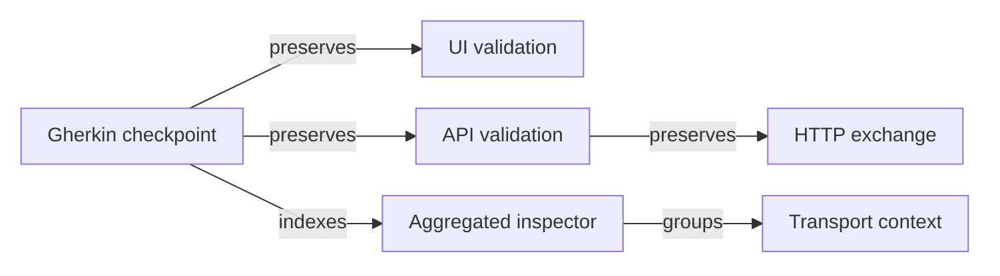

<details>
<summary><strong>Legend - what enters the aggregates and what remains local</strong></summary>

- Authentication reports only observed method, source, status and counts; it does not validate tokens, issuers, claims or cookie identity.
- Correlation associates checkpoints with causal exchanges.
- Transport reports observations, successes/failures, attempts/retries and live/mock/unknown provenance.
- Signatures group safe facts and counts into one compact card: method, route, authentication evidence, source and phase.
- Diagnostics deduplicate failed HTTP observations by method/route/status/reason and include transport-source counts; unattached browser messages are excluded.
- JSON bodies, sensitive headers and execution details remain in canonical exchange evidence rather than being copied into the summary.
- The request-attached index contains only three bounded facts: canonical exchange count, Gherkin step count and unique signature count. Full steps remain in Scenario correlation and requests in Unique request signatures.
- Request signatures and body digests are internal grouping/retry identities; HTML shows only `body=present|absent` and the bounded marker `internal digest hidden`.
- The consumer selects evidence before publication; the renderer does not choose the input.
- Overview System does not own traces, authentication, diagnostics or bodies.

</details>

The Thracian contract shall be read as follows:

- The generic bridge publishes one collapsed TRACE with nested authentication, correlation, transport, signatures and diagnostics.
- A multi-exchange checkpoint uses `API validation → Exchange → request → response → execution`; JSON is not duplicated, and retries stay within their exchange.
- API validation attaches to the same Gherkin node as UI validation; transport diagnostics do not create extra Gherkin steps.

[`keepsUiAndApiValidationUnderOneGherkinCheckpoint`](../atf-reporting-tests/src/test/java/atf/reporting/ui/ExtentReportUiEvidencePublishingTest.java) protects a single Gherkin title with UI/API validation and exchange evidence beneath it; a duplicated Gherkin card violates this hierarchy.

</details>

<a id="production-structure"></a>
<a id="structura-producției"></a>
## Production structure

<details>
<summary><strong>Maintainer inventory — packages, resources and ownership</strong></summary>

[Package Atlas](src/main/java/atf/reporting/README.md) is the entry for local revision; the inventory below then allows to find concrete details.

<details>
<summary><strong>Details - production structure</strong></summary>

| Boundary | Primary owner | Verifiable output |
|---|---|---|
| semantic/model | `semantic`, `model`, `contract` | Snapshot, execution tree, status and assertions |
| markup/render | `markup`, `html`, `extent` | Extent nodes and Fallback HTML |
| asset/theme | `asset`, `theme`, `runtime` | native CSS/JavaScript, vocabulary and manifest |
| audit/publication | `ui/audit`, `artifact`, `publication` | contracts, inspector, workspace and final artifact |
| input/config | `api`, `configuration`, `evidence` | request / response / evidence typed and policy of output |

<details>
<summary><strong>Details - internal map and split CSS / JavaScript</strong></summary>

```text
atf.reporting
├── semantic/       snapshot, recorder facade, lifecycle orchestrator și state aggregate mutation intern
├── model/          execution tree și evidence POJO
├── markup/         Extent nodes, assets și vocabulary bridge
├── html/            fallback document și script builder
├── theme/           tokens, CSS selectors, theme/evidence providers
├── runtime/         JavaScript Extent split pe responsabilități
├── ui/              contracte, audit și UI lifecycle
│   └── model/       evidence rows tipizate pentru acțiuni UI
├── api/             acceptance/report contract și JSON evidence audit
├── artifact/        inspector și contracte ale artifactului
├── publication/     workspace, coordinator, finalizer
├── configuration/   reporting settings și environment
└── evidence/        transport/UI evidence și style contract
```

CSS/JavaScript boundaries follow responsibility. `ExtentReportRuntimeBehaviour` composes core/tests/overview/evidence/navigation/duration/failure, while theme/evidence providers own their CSS; classes are not added merely to reduce line counts.

`ExtentReportRuntimeNavigation` composes three native JavaScript assets—DOM contract, disclosure and controller—through `ReportAssetComposer`; Java facades retain semantic ownership, tokens and composition order rather than inline function bodies, with component checks for functions and manifest. `Scenarios`, `Categories`, evidence, `AtfReportOverviewCss` layout/tag-audit/category-tables/category-status, Extent responsive/base/category/category-status/Fails layout/status/navigation/scenario/detail CSS, evidence interaction/table/disclosure/stack and fallback theme use the same boundary. Published navigation has no inline `onclick`; hash links are the static contract, activated by the native controller.

Disclosure geometry is shared by Extent/fallback: ordinary API/UI summaries use `34px`, `9px 12px` padding and common line-height. Network Inspector `Unique request signatures` and `Technical diagnostics` retain compact `34px` rows, initially collapsed without double-summary styling or empty height when titles fit; narrow viewports allow natural wrapping without changing the ordinary default height.

`TABLE_SCROLL_HEIGHT` (`500px`), published as `--atf-table-scroll-height`, caps table viewports with `height:auto` and shared `max-height`: short content reserves no empty space, long content scrolls locally and headers stay fixed. The contract covers Overview, audit, UI evidence, API aggregates, `TECHNICAL TRACE` inside `Response details`, request metadata and retry history in `atf-api-table-wrap`; shared trace markup/viewport CSS serves both renderers, with browser probes for direct API and causal API evidence beside UI checkpoints.

</details>

<details>
<summary><strong>Details - runtime Overview, Scenarios, Categories and Fails</strong></summary>

Fallback navigation and Extent boot use native `fallback-navigation.js` and `runtime-boot.js`; `HtmlReportNavigationScript` and `ExtentReportRuntimeBehaviour` remain typed publication facades. Extent JavaScript modules are injected into the boot placeholder without Java reconstructing executable functions or expressions.

`ExtentReportRuntimeOverview` uses separate native `Audit`, `Labels`, `Charts` and `Cleanup` assets, with `Fragment` defining composition order. Java exposes them through testable facades and `ReportAssetComposer` rather than containing function bodies.

`ExtentReportRuntimeScenarios` and `ExtentReportRuntimeCategories` delegate browser functions to `extent-scenarios.js` and `extent-categories.js`, retaining public facades and typed vocabulary. Component tests cover filters, scenario annotations and Category deep links without embedding JavaScript literals in runtime classes.

Evidence follows the same separation: `ExtentReportRuntimeEvidenceDisclosure`, `ExtentReportRuntimeEvidenceFailures` and `ExtentReportRuntimeEvidenceTableLayout` wrap `extent-evidence-disclosure.js`, `extent-evidence-failures.js` and `extent-evidence-table-layout.js`. They respectively normalize request/response/JSON/assertion disclosures, project UI failure evidence and measure real values for deterministic column widths; layout stays separate from evidence semantics, with one owner per function.

`table-viewport.js` handles keys only while the viewport is focused, preserving nested controls, and captures wheel events before vendor handlers to retain local scrolling; evidence disclosure reuses canonical media links and captures nonbubbling `toggle`, with JSON ownership separate from adjacent trace. Scenario normalization moves only explicit diagnostics into the panel and removes the vendor log wrapper; shared allocation retains measured technical-column widths and distributes unmet flexible-content demand. The legacy adapter checks each table’s immediate parent, while Java markup owns new viewports.

`appendUiFailureEvidence` runs on typed `request`/`validation` nodes: requests own API failures, and UI validations own Playwright/audit/assertion failures. The `Fail` leaf attaches to that owner’s event table with its concrete UI cause; UI-only evidence receives no fabricated Request/Response disclosures, and `ExtentReportRuntimeEvidenceLifecycle` owns normalization order.

`ReportEvidenceDisclosure` models collapsible areas and `ReportEvidenceMarkup` supplies their shared shell/status badge; `AtfReportMarkup.tableHtml` builds canonical key/value tables, while `ReportEvidenceJsonFormatter` owns label → redaction → pretty print → display-limit. Extent/fallback receive the same typed `ReportField` list and JSON display policy, differing only in publication adapter; component/unit tests protect parity without another E2E.

`AtfReportStatus` is also the unique owner for the inline marker, human label and compact result; renderers do not define local switches for emoji or status text, and the HTML fallback uses the same typed presentation as the UI highlight.

Fails separates detection, context, cause-chain and projection into native JS assets with Java facades. `ExtentReportFailureRuntime` composes stable order without function bodies; lower-level tests check cause/context/projection, and E2E checks the exact test deep link.

Component contracts and fresh standard/responsive browser verification protect CSS vocabulary/builders and publication seams; changes require the same evidence. `AtfUiEvidenceCss` wraps `ui-evidence.css`, `Duration`/`RuntimeCore` compose native JavaScript, `ScenarioCss` wraps `theme-scenario.css`, and `ExtentReportNavigationView` publishes markup/hash links without executable inline JavaScript. `ExtentReportCategoryMarkup` uses typed tags/classes/attributes/empty-state and retains vendor `atf-fails-view` only as its documented insertion boundary; `ExtentReportCategoryMarkupTest` checks idempotence, DOM order and CSS/accessibility. `HtmlReportFailsView` shares semantic status, scenario deep links and empty-state; `HtmlReportTestsView`/`ExtentReportPublicationPipeline` share the boundary for scenarios, phase/request nodes, themes and view identifiers. `ExtentReportScreenshotDeduplicator` keeps fingerprints internal and visible inline links unchanged; `HtmlReportScriptBuilder` remains generic infrastructure for typed/custom ports and tests rather than production navigation/boot. Classpath `.js`/`.css` stays readable and multiline; `ReportAssetCompactor` compacts only the HTML copy.

</details>

<details>
<summary><strong>Details - function ownership and duration</strong></summary>

Further migration is incremental and requires an equivalent component contract, live reconciliation and a fresh report; do not mechanically convert every Java constant into a token if that would hide the contract or complicate debugging.

Each published JavaScript function has one runtime owner and one authoritative definition; later strings do not rebind orchestration functions. DOM reading, data derivation and DOM projection use separate, named helpers; `ExtentReportFailureRuntime` keeps one `failureContext` and one `renderFails`.

Single-owner seams emit durations, composed by public facade `ExtentReportDurationRuntime`:

| Seam | Responsibility | Component proof |
|---|---|---|
| `ExtentReportDurationParsing` | read, normalize and formatting durations | Parsing functions declared once only |
| `ExtentReportDurationDom` | crossing DOM, selects and identity of node | The selectors / attributes are not literally scattered |
| `ExtentReportDurationMemory` | Remembrance of measurements and lasting lookup | precedent between marker, path and node id |
| `ExtentReportDurationAggregation` | copies, evidence of transport and aggregation of nodes | direct duration vs. aggregate |
| `ExtentReportDurationProjectionLookup` | resolution of the scenario card | separate look-up rendering |
| `ExtentReportDurationProjectionViews` | Categories, Overview, Fails and projections | each view keeps its owner |
| `ExtentReportDurationProjectionPublication` | badges, summa-ness and publication of class duration | consistent output in all tables |
| `ExtentReportDurationScheduling` / `Lifecycle` | scheduling, click hooks, observer and boot | Idempotent activation and ready marker |
| `ExtentReportDurationVocabulary` | Typed contract for attributes, selectors and functions | Static verified cardinality and uniqueness |

- Overview projects the canonical durations of the classes in total, model and bars
  Timeline; does not use the total native of a class already completed during the suite.
- `OverviewDurationProjectionComponentTest` performs the actual asset and checks
  Zero, fallback, identical names, refresh and isolation of status charts.

Navigation also owns native `extent-navigation-performance.js`, composed through `ExtentReportRuntimeNavigationPerformance`; its optional `window.__atfReportPerformance` snapshot contains normalization counts/durations, relevant bursts, toggles, readiness, loading, first toggle and available browser long tasks, without business content or verdicts. Mirrored `html` attributes `data-atf-performance-*` expose the same facts to MCP/component adapters, while `atfPerformanceStart/End`, `atfPerformanceBeginReadiness`, `atfPerformanceMarkReady` and `atfPerformanceRecordDisclosureToggle` separate controller calls for ownership/order checks and fresh-artifact browser measurement. `ReportRuntimePerformanceSnapshot` reads the browser map, and fixture-configured `ReportRuntimePerformanceBudget` returns technical violations only; native source stays formatted and publication compacts its HTML copy.

`ReportArtifactInspectorTest` and runtime contracts check these seams for uniqueness/presence in published HTML. Dynamic strings use small local fragments and `String.join`; enums type the browser protocol rather than runtime data, and mixed responsibilities require a concrete semantic rationale in feedback.

</details>

<details>
<summary><strong>Details - composition root and component contracts</strong></summary>

The `ExtentReportRuntimeModule` registry is the single composition root of the injected runtime. It maps each controller to one `HtmlReportScriptModule` and publishes it in `CORE → TESTS → OVERVIEW → EVIDENCE → NAVIGATION → DURATION → FAILURES → FAILURE_CAUSE` semantic order. `ExtentReportRuntimeBehaviour` orchestrates boot/ready and iterates the registry instead of repeating the class list. `Duration`, `Evidence`, `Overview`, `Navigation`, `Tests` and failure projection can therefore be tested independently; integration checks composition and ordering.

| Controller | Owned boundary | Main component contract |
|---|---|---|
| `ExtentReportRuntimeCore` | DOM vocabulary, query, identity and status | typed primitives and unique declarations |
| `ExtentReportRuntimeTests` | Test / Categories filters and scenario projection | status/tag filters, category links |
| `ExtentReportRuntimeOverview` | audit, summary, chart and percentages | Overview projection without false evidence |
| `ExtentReportRuntimeEvidence` | roles, disclosure and evidence of failure | request/response/assertion/UI evidence |
| `ExtentReportRuntimeNavigation` | hash, tab, collapse and Deeplink | navigation and `＋/−` inline |
| `ExtentReportDurationRuntime` | parsing, measuring, aggregation and publication | duration precedence and clone parity |
| `ExtentReportFailureRuntime` | failure states, rows and cause chain | an owner for Fails and Diagnostic |

`ExtentReportRuntimeModuleTest` checks non-empty source, the publication owner, the order of modules and the fact that a JavaScript function is not declared by two modules. It is a cohesion contract, not a cosmetic check of the number of lines; browser behaviour remains checked separately by ATF Debug and Playwright MCP.

</details>

<details>
<summary><strong>Runtime Vocabulary</strong></summary>

- **Single owner** — `ExtentReportRuntimeVocabulary` owns injected function names, DOM selectors, `data-atf-*` attributes, semantic CSS classes and finite status values.
- **Emission** — `ExtentReportRuntimeCore` publishes primitives in stable order through small emitters, without reconstructing the protocol through concatenated strings.
- **Composition** — `ExtentReportRuntimeModule` retains semantic order and maps each controller to one asset/module.
- **boundary** - vocabulary, model and assets remain responsibilities of
  the library; fixtures and browsers belong to the consumer;
- **External verification** — the component/integration/E2E matrix, test contracts and cohesion limit belong to [Reporting Tests](../atf-reporting-tests/README.md).

</details>

<details>
<summary><strong>Composition consumption</strong></summary>

`atf-reporting-tests` composes reporting with mock transport, execution, validation, API fixtures, Playwright and ATF Debug. These details stay outside the `atf-reporting` package and are documented in [`atf-reporting-tests/README.md`](../atf-reporting-tests/README.md) and the Extent test README ([`ui/tests/extent/README.md`](../atf-reporting-tests/src/test/java/atf/ui/tests/extent/README.md)).

Reporting only shows contracts; it does not have the structure of the test- kit, locators, fixtures, API setup or composition roots. A consumer test can use the contracts reporting without the library importing the test code backwards.

The structure of the packages, annotations, mock YAML, Playwright locators and the unitary / component / integration / E2E division are consumer details and are only followed in dedicated README, do not duplicate in this library.

</details>

</details>

</details>

<a id="input-and-configuration-in-the-library"></a>
<a id="intrări-și-configurare-în-bibliotecă"></a>
## Input and configuration in the library

<details>
<summary><strong>Details - entries and configuration in the library</strong></summary>

Production `atf-reporting` owns only publication configuration: `ReportingSettings`, `ExtentReportConfiguration`, startup context and YAML loader. The consumer supplies configuration; Reporting validates limits, output directory, filename, timestamp policy and typed capture policy before publication.

YAML empty / null and absent / null sections keep defaults. The root and sections `reporting` / `reporting.extent` when contained must be objects. Budgets require full numbers in the range `int`: strictly positive, non-egative body assertions; zero only disables the body ceiling. The breaks and numerical strings are rejected, without conversion or implicit truncation.

The other root sections and the `reporting.console` content belong to other owners. `extent.enabled` is loaded in configuration; the caller decides whether to open the session. The direct builder of the explicit public renderer, regardless of this flag.

```mermaid
%%{init: {"themeVariables":{"fontSize":"15px"},"themeCSS":".nodeLabel, .nodeLabel p { font-size: 15px !important; line-height: 1.35 !important; } .edgeLabel, .edgeLabel p { font-size: 12px !important; font-weight: 400 !important; line-height: 1.2 !important; } .edgeLabel .labelBkg, .edgeLabel p { background: transparent !important; } .edgeLabel foreignObject { transform: translateY(-18px); overflow: visible; } .node rect { rx: 6px; ry: 6px; }","flowchart":{"curve":"linear","nodeSpacing":24,"rankSpacing":40,"padding":10,"diagramPadding":16}}}%%
flowchart LR
    Input[typed input] -->|supplies| Model[semantic model]
    Model -->|enters| Render[renderer]
    Render -->|uses| Assets[CSS + JavaScript]
    Assets -->|forms| Output[configured artifact]
```

<details>
<summary><strong>Legend - what config the reporter and what not</strong></summary>

- the reporter can read the output configuration and display limits;
- Screenshot policy is browser-neutral and can be set through
  `reporting.extent.screenshotPolicy`; mock behavior, endpoint and browser belong to the consumer;
- the output is configurable and the documentation does not keep names or runways;
- a status is received semantically from execution / validation and only published.
</details>

`null` remains different from the empty string; the editor applies before the render, and the limits are typed and configurable. `POST` and `PUT` can have required / replied JSON; `GET`, `204` and `304` explicitly retain the absence of the body.

<a id="policy-typed-for-catch-evidence"></a>
<a id="politică-tipizată-pentru-dovezile-de-captură"></a>
### Typed screenshot evidence policy

`ReportScreenshotPolicy` is the public UI screenshot publication policy. Publishers receive an enum rather than arbitrary booleans/strings; a flow declaring a final state supplies an explicit capture point:

The [cross-module capture contract](../docs/ATF_Evidence_Capture_Contract.md) distinguishes flow mode, screenshot policy, capture source and publisher. This README owns the publication-policy enum, target validation and artifact projection.

| YAML / API value | `CapturePoint` published | Use |
|---|---|---|
| `each-checkpoint` | checkpoint, final, failure | compatible with the default; retains evidence for each state |
| `final-only` | final | a long flow publishes only its explicitly declared final state |
| `failure-only` | failure | compact diagnostic-oriented ratio |
| `final-and-failure` | final, failure | retains successful state and regression evidence |
| `none` | niciunul | a screenshot-free flow retaining actions and assertions |

- `UiExtentReportSession` exposes the `ReportScreenshotPolicy` overload;
- `UiPhase` exposes the `ReportScreenshotPolicy.CapturePoint.FINAL` overload;
- `UiEvidencePublisher` checks the target only when the payload will be published;
- a missing target cannot produce an orphan screenshot;
- unit/integration tests in `atf-reporting-tests` verify local HTML without a browser or Practice Shop;
- the typed sign for extended configuration is `ReportEvidenceProfile`;
- the profile composes `ReportEvidenceFlowMode`, `ReportScreenshotPolicy`,
  `ReportEvidenceCaptureSource` and `ReportUiActionDetailsMode`;
- `ReportUiActionDetailsMode` selects `INCLUDED_COLLAPSED` or `SUMMARY_ONLY`; it changes only Playwright action disclosure, not capture, assertions or verdict;
- `ReportEvidenceCaptureProvider` is the public seam for browsers or mocks; `ReportEvidenceProfile.capture(...)` applies policy before invoking the provider, checks the source and validates encoding/signature through `ReportScreenshot.hasPngSignature(...)` when capture is allowed;
- `flowMode` is applied by the reporting lifecycle, not just kept as metadata;
- `SCREEN_CHECKPOINTS` publishes each sentence of Gherkin independently, as before;
- `UNIFIED_FLOW` publishes one Gherkin request per phase, preferring the last `THEN` checkpoint (otherwise the last checkpoint); the scenario title remains separate metadata, without duplicated Gherkin or `Checkpoint N`;
- UI actions/assertions aggregate into one UI validation; selected API exchanges form one sibling API validation beneath the same Gherkin checkpoint, in execution order;
- screenshot policy is independent of flow mode: allowed captures appear in the shared UI validation, and `FINAL_ONLY` includes only the `FINAL` capture;
- The profile is built by built or `fromConfig(...)` and passed to
  `UiExtentReportSession.openConfigured(..., profile)`;
- the profile describes policy/provenance and never drives a browser; mocks and Playwright stay in consumer/test scope;
- entry the preferred point for UI session is
  `UiExtentReportOptions.builder(outputDirectory)`;
- the builder groups `fileName`, `AtfConsoleSink`, `ReportEvidenceProfile` and
  `timestampEnabled` and historical overloads remain compatibility delegations;
- configuration loads once; `openConfiguredResolved` can disable timestamps without reconstructing a second configuration.

<a id="json-evidence-and-ui-rendering-components"></a>
<a id="dovezi-json-și-componentele-de-randare-ui"></a>
### JSON evidence and UI rendering components

HTTP's contract separates the direction of the format, including for non-JSON external traffic:

- `ReportJsonBody` keeps payload, `Direction.REQUEST/RESPONSE` and
  `Format.JSON/FORM/TEXT`; historical name does not require JSON format;
- `AtfReportPorts.Request.body(...)` is the typed channel; Extent and fallback
  group by direction, not by the label text;
- the two-argument manufacturer and the port `json(label, body)` retain
  the historical JSON convention; the legacy direction is deducted only once at entry from the prefix `REQUEST`, otherwise it is `RESPONSE`;
- Legacy adaptors that implement `json(...)` only remain compatible by
  the implicit delegation of `body(...)`; to preserve typed metadata explicitly implements the new channel;
- `ApiExchangeEvidence` classifies the urlencoded / multipart form as `FORM`, document
  JSON valid as `JSON` even if MIME- is `text/html` and the rest as `TEXT`; MIME-ul upstream is not rewritten;
- Labels are `REQUEST/RESPONSE JSON`, `REQUEST/RESPONSE FORM BODY` or `REQUEST/RESPONSE BODY` only for `AVAILABLE` bodies. `ABSENT` explains confirmed absence and `NOT_CAPTURED` explains missing evidence; neither publishes a JSON document, while captured `null` remains available JSON.

<a id="fidelity-of-the-request-and-the-assertion-owner"></a>
<a id="fidelitatea-request-ului-și-ownerul-aserțiunilor"></a>
#### Fidelity of the request and the assertion owner

| Typed input | Publication |
|---|---|
| `ReportRequestHeaders.observed(captured)` | observed headers are authoritative; browser-noise filtering and redaction add neither `Accept` nor `Content-Type` |
| `ReportRequestHeaders.configured(defaults, overrides)` | the composition root declares effective defaults; overrides replace keys case-insensitively |
| `ReportRequest.builder(method, path)` | observation without default headers; `body(text, availability)` keeps content and availability separately |
| `ReportRequest.toBuilder()` | immutable copying with the source of the headers, authentication and availability kept |
| existing `ReportRequest(...)` constructors | compatibility for the ATF JSON API client, not browser captures |

Request details and manual replay use the same header projection. Response MIME does not supply request MIME; legacy `json(...)` may explicitly receive JSON `null`, which proves no captured HTTP body and does not replace `ReportBodyAvailability`.

| Owner / case | Contract Fails |
|---|---|
| `ReportEvidenceOwner.UI/API` | is a valid and snapshots; `data-atf-evidence-owner` takes priority over the heuristic legacy, is not deducted from the free title |
| UI FAIL | `STEP`, without propagating status to API PASS |
| API FAIL | `REQUEST`, validation, cause and checkpoint of Gherkin owner; UI PASS remains independent |
| API FAIL correlation, PASS exchanges | `API correlation`, not the sibling PASS request or its duration |

<a id="fidelitatea-json"></a>

The JSON projection preserves public numeric tokens and all duplicate-field occurrences during redaction and pretty-print. Every sensitive value is masked in full. Projection precedes the configured preview without rewriting the raw body or captured verdict.

The common training shall not alter the execution requirement:

- the editor applies first; only `Format.JSON` uses the prettyprint
  `ReportJsonBodyFormatter` joint determinist;
- form / text keeps the content redacted without conversion to JSON; limit
  `bodyMaxDisplayCharacters` is applied after display formatting;
- The marker shows the prefix and total length; `0` publishes the body
  complete;
- the objects, arrays, scalar and `null` are kept;
- invalid payload remains unchanged for diagnosis and is not converted
  artificial JSON; HTML escapes also protects sequences such as `</textarea>`;
- `ApiBodyMediaComponentTest` of `atf-reporting-tests` checks average / capture,
  Extent, Fallback and UI + API, plus direction independent of visible label.

Common protection for bodywork already implemented:

- `MultipartEvidenceRedactor` redacts sensitive values prior to display,
  Replicay and consoles, including multiline, incomplete delimitations and aliases; public data and delimitations remain audible.
- `AVAILABLE` whitespace remains text captured and appears in reply; it is not
  confused with `ABSENT`, literal JSON `null` or `NOT_CAPTURED`.
- Text body signature keeps the whitespace; canonicalization JSON and
  JSON legacy port has a separate contract.
- `ApiMultipartBodyComponentTest` and `ApiWhitespaceBodyComponentTest` check
  Extent, fallback and UI + API with synthetic data; the sample does not require any account or actual site.

`ExtentUiEvidenceRenderer` is orchestration- only:

- The marker is divided into `ExtentUiActionRenderer`,
  `ExtentUiObservationRenderer` and `ExtentUiAssertionRenderer`;
- Escaping / status / publication are primitive common in `ExtentUiEvidenceMarkup`;
- each fragment can be tested in a component and the session tests check
  actual composition and inline screenshot;
- Extent and fallback HTML reuse the semantic disclosure shell through `ReportEvidenceMarkup`;
- opening markup, accessible title, glyph and closing markup are not copied into each renderer;
- the concrete renderer owns the body: Extent can publish vendor-specific markup, while fallback retains `<pre>`.

<a id="normalization-of-evidence-in-the-artifact"></a>
<a id="normalizarea-dovezilor-în-artefact"></a>
### Evidence normalization in the artifact

Normalization is a publication boundary, not a second evidence source:

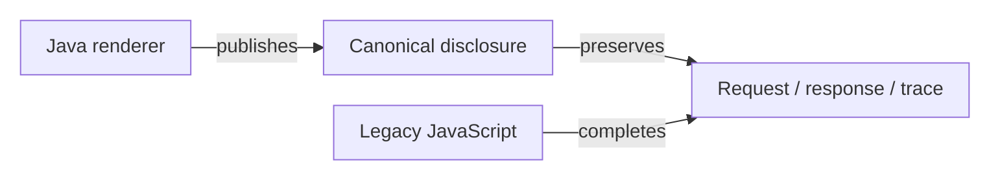

<details>
<summary><strong>Legend - who writes and who just completes</strong></summary>

- The Java renderer publishes the canonical disclosure and typed metadata.
- JavaScript fills only missing legacy vendor rows.
- An existing disclosure is neither replaced nor needlessly reserialized.
- Request JSON, response JSON and execution trace remain together in the DOM.
- `atf-reporting-tests` verifies idempotence, including the published HTML artifact.

</details>

</details>

<a id="publication-and-output"></a>
<a id="publicare-și-ieșire"></a>
## Publication and output

Output is configured through `reporting.extent.outputDirectory` and `fileName`; the UI runtime separately uses the test’s configured UI directory. Documentation describes output policy and patterns, not concrete generated report names.

`ExtentReportSession.close()` owns finalization and publication confirmation:

Constructor arguments and metadata are validated before acquisition. If renderer initialization or asset loading fails after acquisition, the session releases its workspace and preserves the primary cause, including `Error`.

| Lifecycle | Extent | HTML fallback |
|---|---|---|
| `flush()` | updates staged state; the previous report remains public | writes the current snapshot to the destination |
| `close()` | finalizes and publishes; releases the workspace | publishes the final snapshot |
| thread | confined to its creating thread | no guard; the consumer serializes access |
| path | absolute and normalized at opening | retains the supplied path; prefer an absolute path |

The common port does not promise that `flush()` commits publication. Close scopes child → parent before closing the session.

Failure after finalization starts leaves the session closed; another close does not retry publication. Extent rejects a wrong thread before finalization without closing the session; the caller checks the result before announcing the artifact.

- Finalize nodes, flush, publish the staged artifact and confirm that the final file exists.
- Only after confirmation, send `REPORT_PUBLISHED` to the sink with the normalized absolute path.
- Repeated closure emits no duplicate, and failed publication announces no success.
- The sink is diagnostic; its failure does not change the test verdict.
- Console presentation and opt-in belong to [ATF Console](../atf-console/README.md); the event does not automatically enable every consumer.

Spark asset cleanup retries both `AccessDeniedException` and other `FileSystemException` failures at most four times, with 50 ms between attempts. Other I/O failures are not retried; exhaustion propagates, and interruption stops cleanup while preserving the thread’s interrupt flag.

<a id="delayed-navigation-and-explicit-interaction"></a>
<a id="navigare-amânată-și-interacțiune-explicită"></a>
### Deferred navigation and explicit interaction

- `atfOpenTest` associates deferred opening with the current navigation generation.
- A new jump or explicit Tests interaction invalidates the previous callback; closure by mouse, Enter or Space remains in effect.
- Each transition resets tab state and gives the visible destination `active` and `aria-current="page"`; deep links follow the same path.
- Icon links include their label in the accessible name.

<a id="return-to-failed-comparison"></a>
<a id="revenirea-la-comparația-eșuată"></a>
#### Return to the failed comparison

In Extent, Fails retains evidence type and ordinal within the original scenario, alongside class and scenario index. The hash preserves this identity across reloads; truncated text is never used as an identifier.

The audit distinguishes causes from their owning scenarios:

| Fact | Meaning and expected behavior |
|---|---|
| `failureCount` | atomic Fails rows; one scenario may have several causes |
| `failedScenarioCount` | distinct owner + scenario-index identities; compared with independent manifest statuses |
| legacy four-argument constructor | retains one summary row per scenario; atomic extraction also supplies the scenario count explicitly |
| Java record pattern | deconstruction uses all five components; retaining the legacy constructor does not preserve pattern arity on recompilation |

The document starts collapsed. The backlink reveals the exact evidence and all its ancestors; the rest of the tree stays closed.

- The ordinal counts only original comparisons; a derived visual summary adds no cause and cannot shift the destination after HTML normalization.
- Groups with identical labels retain their own comparison and cause; reverse navigation and reload use the same typed identity.

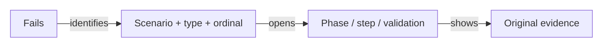

<details>
<summary><strong>Legend — exact path and independent proof</strong></summary>

- `openScenarioFailurePath` resolves the indexed row and opens only its ancestors, including assertion-step and native disclosures. SETUP, TEST BODY and TEARDOWN use the same path; a later checkpoint does not open the first step.
- `PublishedFailureNavigationComponentTest` checks UI/API/component evidence, narrow/desktop panels, keyboard, reload and repeated navigation; repeated labels and identical previews cannot replace comparison identity.
- The oracle checks visibility before assisted expansion and rejects a closed phase beneath a visible scenario; the PASS neighbor stays collapsed, and the original verdict and comparison columns remain intact.
- A FAIL without comparisons indexes existing phase execution diagnostics with an explicit type. Fails shows DIAGNOSTIC and EVIDENCE without inventing expected/actual, contract validations or HTTP identity; Extent aggregates the chain into one Fails entry while Tests retains each phase disclosure, and fallback keeps a navigable entry per phase. Causes respect the configured budget.
- Fallback retains semantic projection order: phase diagnostics, then child comparisons in tree order. The backlink opens the original disclosure and preserves its reload route, including interleaved diagnostics; that route owns scroll restoration after document initialization and column layout, without competing automatic browser restoration.
- `PublishedFailureNavigationEdgeComponentTest` separately covers these edges, configured previews, keyboard, scrolling and a hidden-ancestor negative control; legacy and exact opening reuse the same reveal function.

</details>

<a id="prosperity-of-visual-evidence"></a>
<a id="prospețimea-dovezii-vizuale"></a>
### Fresh visual evidence

HTML generated before reporting classes or resources were rebuilt is historical, not evidence for current code. For a visual audit:

- regenerate the report after the build containing the change;
- check component/integration tests first, then the fresh report;
- do not reopen a ToDo from an old artifact when the current renderer already has the corresponding contract and test;
- mark an artifact stale if it contradicts the current contract; do not copy it into feedback or a README.

Internal grouping digests are not human evidence; public HTML shows only bounded state (`body=present|absent`, `internal digest hidden`).

`ReportPublicationCoordinator` has the following responsibilities:

- protects the publication path, lock and concurrency;
- can use internal identity/hashes for ownership and deduplication without showing them in HTML as a substitute for human evidence;
- applies bounded retries after the atomic attempt on filesystems that may temporarily retain an open file;
- permits nonatomic fallback only for `AtomicMoveNotSupportedException`;
- propagates persistent failure after the last attempt;
- keeps retries in the production publication boundary, not in Test Kit or the browser.

<a id="verification-for-contributions"></a>
<a id="verificare-pentru-contribuții"></a>
## Verification for contributions

The native `mvn -f atf-reporting/pom.xml test` gate explicitly selects `atf.reporting.standalone` and fails by default if no tests are discovered. `BUILD SUCCESS` with no executed classes/cases proves no library contract.

| Control | Contract to be kept |
|---|---|
| [Release Reporting Tests](../atf-reporting-tests/README.md) | the `reporting-release` profile runs the full unit suite and source/JAR browser probes with recorded CodeSource; the native gate stays separate |
| Negative controls | the correct request and phase duration, single initialization and original PNG |
| Host Fails | a dedicated class, separate from native `.detail-body`; hash/reload and Tests selection retain diagnostics, and the backlink opens the full ancestor path |

[ReportingStandaloneVerdictComponentTest](src/test/java/atf/reporting/standalone/ReportingStandaloneVerdictComponentTest.java) is the native component sample for lifecycle, status and snapshot, with JUnit `@Tag("component")`, without external ATF imports or browser. The browser projection is checked separately in [ReportingVerdictProjectionComponentTest](../atf-reporting-tests/src/test/java/atf/ui/tests/extent/component/verdict/ReportingVerdictProjectionComponentTest.java).

The selection of the reactor may omit the module by the documented `-Dsurefire.failIfNoSpecifiedTests=false` option; omitting a module without the required test is not a native cooking.

```text
cod live curent
  → staging extern nou (target/artifacts excluse)
  → test focalizat
  → gate unit/component/integration
  → gate E2E dacă se schimbă DOM/layout/interacțiunea
  → ATF Debug + Playwright/Chromium headless
  → reconciliere live ↔ staging
  → sync selectiv și README owner actualizat
```

The checklist here is just a quick map. The regulatory checklist, with mandatory / conditional rules and manual exploration steps, is in [`../atf-reporting-tests/src/test/java/atf/ui/tests/extent/README.md`](../atf-reporting-tests/src/test/java/atf/ui/tests/extent/README.md).

<details>
<summary><strong>Checklist browser - consumer responsibility</strong></summary>

- ✅ `Tests`, `Overview`, `Categories`, `Fails` and deep-link navigation;
- • Disputes that are collapsed by default where the contract does not require otherwise;
- ✅ inline `＋/−`, inline screenshot, actions, audit observations and assertions;
- ✅ `scrollWidth <= clientWidth`, wrapping and computed style;
- ✅ no decorative `<hr>`, console/page errors or broken assets;
- ✅ request/response JSON, status and mock provenance reconciled when they are
  published;
- ATF Debug + Chromium / Playwright MCP without Windows browser
  actual and without stopping active runes.

</details>

<a id="contracts-and-feedback"></a>
<a id="contracte-și-feedback"></a>
## Contracts and feedback

- contract semantic: [`docs/ATF_Reporting_Contract.md`](../docs/ATF_Reporting_Contract.md);
- contract display/layout: [`docs/ATF_Reporting_Display_Contract.md`](../docs/ATF_Reporting_Display_Contract.md);
- Architecture: [`docs/ATF_Architecture.md`](../docs/ATF_Architecture.md);
- Good practices: [`docs/README_Atf_BestPractices.md`](../docs/README_Atf_BestPractices.md);
- feedback activ: [`docs/feedback/README.md`](../docs/feedback/README.md).

README maintains validated contracts, limits and test criteria; the condition of the gaping remains in [feedback registry](../docs/feedback/README.md). A rule enters here only after it is confirmed by the code and live tests; until then there is auditable feedback, not stable documentation.

<details>
<summary><strong>Details — native browser assets and Java governance</strong></summary>

The CSS- and JavaScript shipped in HTML remain in `src/main/resources`, in small files grouped by responsibility (`theme`, `overview`, `evidence`, `navigation`, `filters`, `runtime-core`, `duration`). Overview separately uses `overview-layout.css`, `overview-tag-audit.css`, `overview-category-tables.css` and `overview-category-status.css`; scenarios use `theme-scenario.css`, with no duplicated CSS rule in the Java facade. `ReportAsset` is the single asset vocabulary; `ReportAssetManifest.production()` is the validated, ordered publication-boundary inventory. The manifest rejects duplicate assets/paths/owners, resources outside the reporting namespace, incompatible extensions and missing assets. `ReportAssetLoader` reads the classpath resource. `ReportAssetComposer` resolves Java tokens, including finite colors, and produces the final body while retaining typed asset identity. Runtime facades retain explicit composition order. The same boundary serves nine `duration-*.js` assets and three `runtime-core-*.js` assets; JavaScript fragments retain semantic ownership and Java facades retain only composition order.

Native `.css` and `.js` resources remain formatted across multiple lines for review, debugging and component tests. `ReportAssetLoader.load(...)` and `render(...)` expose readable source, while `loadForPublication(...)` and `renderForPublication(...)` pass only the HTML copy through `ReportAssetCompactor`; it removes safe whitespace/comments outside quoted values, preserves significant text/selectors/expressions and leaves native files unchanged.

`ReportAssetSizeInventory` measures bytes separately for native sources and published copies, grouped by format and owner. `ReportAssetSizeBudget` applies consumer-supplied total/format/owner limits with no hardcoded baseline; HTML/evidence bundle budgeting belongs to the consumer that owns the complete artifact, without making an artifact name or hash part of the API.

Native JavaScript/CSS uses LF under the module’s `.gitattributes`, keeping Windows/Linux budgets comparable; compaction changes only the published copy.

Java facades (`AtfFallbackTheme`, `AtfReportOverviewCss`, theme/evidence CSS facades, `HtmlReportNavigationScript`, `ExtentReportRuntimeEvidenceRoles` and `ExtentReportRuntimeTestFilters`) retain integration ownership for assets, tokens and composition order, without large script concatenations. `ExtentReportRuntimeTestsVocabulary.Template` governs placeholders, and shared functions (`aggregateClassDurations`, `captureDomContract`) come from the central runtime vocabulary; asset, component and browser E2E tests check their respective contracts.

</details>

<a id="consistency-of-the-status-transmitted-by-the-caller"></a>
<a id="consistența-statusului-transmis-de-caller"></a>
## Consistency of the status transmitted by the caller

<details>
<summary><strong>Details - consistency of the status transmitted by the caller</strong></summary>

`ReportStatusAggregator.resolve(...)` reconciles caller status with actual child-row and scope results. The consumer retains business evaluation; Reporting does not compare expected and actual again.

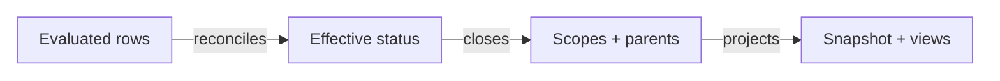

<details>
<summary><strong>Legend - same policy in Extent, fallback and recorder</strong></summary>

- The effective severity cannot be reduced by `complete(PASS)` or
  `complete(SKIP)` when there is a row or child FAIL.
- `AtfAssertion.resultStatus` retains the evaluated policy; `passed=false` with `resultStatus=PASS` is rejected before publication. Explicit SKIP is valid.
- An absent completion status contributes INFO; an INFO observation supplies no business verdict. An expected exception is evaluated before reporting and can produce PASS.
- Console, Tests, Categories, Fails and Overview receive the reconciled verdict; a SKIP comparison does not become the failure cause of a nested request.
- Repeated `assertions(...)` calls replace the unpublished set, including its name and recorder verdict. Snapshots retain nested requests without storing full comparison values in the semantic population.
- The UI buffer retains checkpoint verdicts before UNIFIED_FLOW publication, including across phases. Each sibling scenario keeps its own result.
- The redacted preview defaults to 240 characters including ellipsis; status is never calculated from preview text, badges or HTML.

</details>

<a id="evidence-ui-and-setup-in-fallback"></a>
<a id="evidence-ui-și-setup-în-fallback"></a>
### UI evidence and setup in fallback

`ReportRequestUiEvidence` retains actions, screenshots and disclosure mode in fallback snapshots; counters do not replace auditable content. `ReportSetupEvidenceMarkup` projects the same setup comparisons in both renderers.

- Expected/actual values are fully redacted before the configured limit, which defaults to 240 characters including ellipsis; a failure beyond the preview remains FAIL.
- `publishSetup` maintains the status of the already assessed assertions, even if
  the caller provides PASS; Reporting does not reassess the comparison in the text displayed.
- A request containing ACTION entries accepts at most one distinct inline screenshot. Action-free galleries and media validations retain their behavior; incompatible input is rejected before mutation, leaving valid state recoverable.
- `UiSetupFallbackParityComponentTest` checks limits 240/18, inspectable screenshots, Enter/Space, verdict and the absence of fabricated HTTP in Extent/fallback.

<a id="the-astronomical-nature-of-the-scope-transitions"></a>
<a id="atomicitatea-tranzițiilor-de-scope"></a>
### Atomic scope transitions

The semantic recorder validates transitions before changing the model, nodes, counters or notifications. Extent and fallback use the same decision; rejected calls preserve the snapshot and allow valid state to be published.

| Operation | Contract |
|---|---|
| `complete(status)` valid | one transition; child evidence retains its FAIL/SKIP/INFO/WARNING policy |
| repeated completion, or parent completion with open children | rejected without effects; close the children, then complete the parent normally |
| `close()` after completion | idempotent; no notifications or duplicate publication |
| `close()` before completion, with no open children | complete FAIL; does not invent a PASS business result |
| `close()` with open children | rejected without abandoning the parent or decrementing counters |
| writes after completion/session closure | refusal before mutation; snapshots remain inspectable |
| error in closing / publishing the session | the cause propagates; the session closes, and a second close does not retry publication |

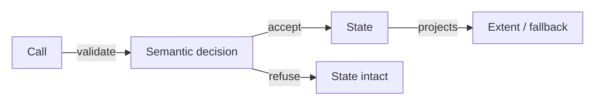

<details>
<summary><strong>Legend - validated lifecycle prior to effects</strong></summary>

- Protocol rejection creates no nodes, evidence, statuses or partial events.
- Default FAIL closure preserves a safe verdict for an incomplete scope; child closure is explicit, with no hidden renderer rollback or retry.
- Console output is best effort in both renderers; a diagnostic failure does not interrupt the transition or change the verdict. The UI composer has its own [publication protocol](#cauza-publicării-și-scope-urile-deținute): the original cause remains primary and secondary close failures are suppressed.
- Assertion collections are captured once before model and recorder updates; a null element does not erase previous valid rows.
- The network aggregate occupies one semantic slot, regardless of replacement or details added later; null is a no-op on an open request.
- `ReportingScopeAtomicityComponentTest` covers invalid payloads, changing inputs, aggregate replacement and publication failures without business comparisons.
- `ReportScopeAtomicityComponentTest` checks public ports, late mutations, nested requests, recoverable rejection, closed sessions and single notification.

</details>

</details>

<a id="safe-projection-of-assertions"></a>
<a id="proiecția-sigură-a-aserțiunilor"></a>
## Safe projection of assertions

<details>
<summary><strong>Details - safe projection of assertions</strong></summary>

`AssertionAuditReport` publishes assertion phases and steps through `AtfReportPorts.Session`, without JUnit, Test Kit or Validation dependencies. The consumer supplies identity, evaluated rows, phase status and diagnostics.

`AssertionAuditReport.publishStep` publishes a non-HTTP group inside a caller-owned phase without closing it. It reuses typed status aggregation: an evaluated FAIL cannot be weakened by a requested PASS, and an empty group creates no step.

`ReportAssertionSummary` supplies neutral expected/failure summaries for consumers. It redacts by field name before applying its own default 240-character limit, including ellipsis; full rows and business decisions remain with the caller.

Valid JSON is semantically redacted before formatting: Unicode keys, sensitive scalar/array/object values and duplicate fields are handled without losing nonsensitive fields. An explicit JSON channel omits an invalid document; free text and locator syntax retain textual redaction without forced parsing.

This publisher opens phases after evaluation. Its `ReportPhaseTiming` overload receives the measured execution duration and callback count separately; snapshot publication time does not replace method time.

The budget is configured in Reporting YAML and captured when the session opens. It defaults to 240 and accepts only positive integers:

```yaml
reporting:
  assertionMaxDisplayCharacters: 240
```

`Overview → System` shows `Assertion preview = N characters` from the renderer’s actual setting, including fallback. Consumer metadata and scenario aggregation cannot override this fact; a shared session keeps the same budget throughout its lifetime, and a configuration change requires a new session.

`AssertionAuditRun.assertionMaxDisplayCharacters()` supplies the same budget to AutoEx/Shop component adapters before collection, so values configured above 240 are not prematurely cut to the default. `bodyMaxDisplayCharacters` and HTTP capture limits are separate policies.

<details>
<summary><strong>Budget map — session setting or diagnostic helper</strong></summary>

| Surface | Source | Meaning |
|---|---|---|
| assertion rows and the System value | [ReportingSettings](src/main/java/atf/reporting/configuration/ReportingSettings.java) | positive `assertionMaxDisplayCharacters`, default 240; captured per session |
| body display | same configuration | independent `bodyMaxDisplayCharacters`, default 100; 0 disables only the body display limit |
| diagnostic summary of the exception | [ReportFailureDescription](src/main/java/atf/reporting/evidence/diagnostic/ReportFailureDescription.java) | the helper redacts and caps at its own default constant of 240; it does not read session settings |
| diagnostic summary of comparisons | [ReportAssertionSummary](src/main/java/atf/reporting/evidence/diagnostic/ReportAssertionSummary.java) | the same separate default limit; the summary does not recalculate the verdict |

Increasing a row limit does not automatically enlarge diagnostic summaries or HTTP capture. Helper probes belong to [Reporting Tests](../atf-reporting-tests/README.md#diagnosticul-neutru-al-excepțiilor); a display limit never authorizes secret or raw-value publication.

</details>

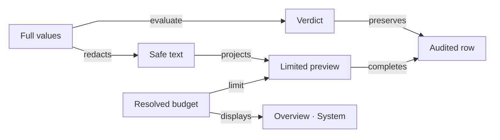

<details>
<summary><strong>Legend - text before ceiling</strong></summary>

- The diagram describes data to runtime, not Maven dependencies.
- The resolved budget configures both collector and renderer; System shows that session’s value, without a default copied into consumer metadata.
- The composition root supplies the collector’s display policy; full JSON is redacted before truncation so a long secret cannot lose its key context.
- Full values determine the verdict; the report receives only safe, bounded text, defaulting to 240 characters including `…`. Expansion does not expose an unlimited raw dump.
- Direct E2E assertions and action values use the same total budget in Extent/fallback, including Fails; `…` counts toward the limit.
- Fails prioritizes the failed action and measured time before the exception headline; a multiline stack does not consume the initial triage context.
- `AssertionPreviewBudgetTest` and `BoundedFailureEvidenceComponentTest` check the decoded limit, full redaction and absence of raw dumps; `UiSetupFailureEvidenceComponentTest` protects context.
- `ReportingPreviewConfigurationComponentTest` checks default/configured YAML, System in both renderers, contradictory metadata and rejection of nonpositive values. Consumer scope probes check 18/240/480 individually and through a suite.
- `LegacyPreviewBudgetComponentTest` checks direct UI ports in a real browser, limits 240/18, secrets across the truncation boundary and verdict differences beyond the preview. Fails and its backlink use the budget captured by the scenario.
- `Component assertions` starts collapsed in Extent/fallback; a diagnostic without comparisons creates neither an assertion step nor an HTTP request.
- Assumption aborts retain `SKIP` and `Abort reason`; a real unconsumed assertion failure retains `FAIL`.
- `AssertionAuditPublicationComponentTest` protects redaction in both renderers; `ComponentAssertionStepReportTest` protects interaction, the last row and Fails → Tests.

</details>

<a id="diagnosis-without-failed-comparison"></a>
<a id="diagnostic-fără-comparație-eșuată"></a>
### Diagnostics without a failed comparison

An exception after successful checks or before the first comparison produces an execution diagnostic. `Fails` retains the phase cause and test link; it does not select a PASS row as a failed comparison.

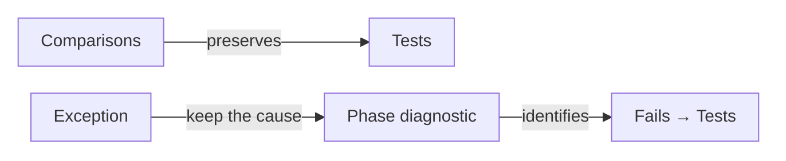

<details>
<summary><strong>Legend - comparisons and exceptions with separate evidence</strong></summary>

- `AssertionStep` identifies component evidence. Without an assertion step, a nontransport diagnostic remains `execution`; no API owner is inferred.
- The index omits `REQUEST` and HTTP duration when no associated request exists; it does not show `No response duration recorded` for a component failure.
- `failureValidationCandidate` selects only failed comparisons; an earlier PASS table remains available in Tests without becoming the failure cause.
- Classification uses verdict metadata or the `RESULT` cell; `❌` in expected/actual is an audited value, not a failed comparison.
- Executed phases without comparisons retain their timing, including measured zero; metadata alone creates no control.
- `ComponentExecutionDiagnosticReportTest` checks Extent/fallback, 42 collapsible rows, keyboard access and the 240-character limit.

</details>

<a id="timing-measured-prior-to-publication"></a>
<a id="timing-măsurat-înaintea-publicării"></a>
### Timing measured prior to publication

`AtfReportPorts.Phase.executionTiming(...)` accepts one typed timing value per phase. Extent/fallback retain it in the semantic snapshot; constructors and publishers without explicit timing keep their existing behavior.

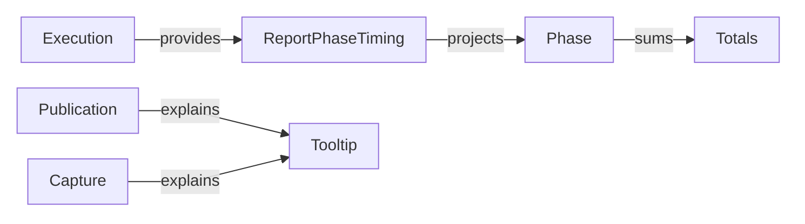

<details>
<summary><strong>Legend - execution, publication and aggregation</strong></summary>

- The phase badge shows execution time, including callback comparisons; the tooltip gives callback count and snapshot publication cost. A shared Java formatter supplies the explanation for Extent/fallback, and JavaScript projects that metadata text.
- Typed metadata retains original nanoseconds; display rounds up to milliseconds before common formatting, without turning zero into a positive duration.
- A scenario sums its direct phases and a class its direct scenarios; publication time and the technical `Component assertions` step badge are not added over inclusive phase execution. Expansion changes neither source nor total.
- These sums are cumulative execution time, not suite wall-clock time; parallel runs can overlap. Fallback publishes a sum only when every phase has known timing, without substituting zero for missing data.
- Extent moves internal metadata into the phase and removes the technical row; no extra public event or fabricated HTTP request appears.
- Phase publication is measured separately, excluding final session flush; console lifecycle still describes the publication scope.
- Instrumented UI capture has its own measurement, which is neither added to execution nor used as HTTP latency.
- `ReportPhaseTimingComponentTest` checks semantic parity, Tests / Overview,
  zero values, totals without doubling and reopening with keyboard.

</details>

<a id="synthetic-payment-data-from-the-demo-fixture"></a>
<a id="date-payment-sintetice-din-fixture-ul-demo"></a>
### Synthetic payment data from the demo fixture

For the AutoEx demo fixture, the synthetic `card_number` and `cvc` values remain visible in the HTTP body and in the cURL. This is the accepted behaviour of the sample without open requirement for editing for these test data.

Masking of UI shares and the configured budget of assertions, implicitly 240, is maintained.

<a id="timing-e2e-at-runtime-owner"></a>
<a id="timing-e2e-la-ownerul-runtime"></a>
### E2E timing at the runtime owner

`UiPhase.executionTiming(...)` is already measured; `UiPhase.measureExecution()` opens the explicit measurement held by runtime. The two options are exclusive for the same phase.

`UiExtentReportSession.adaptScenario(...)` composes the same UI facade over a Extent script port or fallback. The host keeps the session and flush- ownership; the profile and isolation of the scenarios remain explicit.

| Interval | What it measures and where it closes |
|---|---|
| execution | monotonic time from phase opening to completion, excluding instrumented capture/publication |
| capture | `UiPhaseExecution.capture(...)`, including failed capture; distinct from HTTP latency |
| publication of evidence | UI publishers, delayed flower and phase projection to snapshot; do not add over execution |
| cleanup and resources | runtime stops execution before final cleanup and browser release |
| flush HTML | finalized separately by the session; excluded from execution and publication cost before snapshot |
| Legacy source without timing | remains `aggregated`; unknown time does not become zero measured |

AutoEx stops TEST BODY before final lifecycle work; Shop measures SETUP/TEST BODY separately and creates no body for incomplete setup. Both consumers use the same reusable Reporting capture boundary, without JUnit or Test Kit dependencies in main runtime.

<details>
<summary><strong>Metadata, totals and samples</strong></summary>

- `ReportPhaseTiming` maintains execution, number of intervals and optional
  `ReportPhaseEvidenceTiming`; the two-argument legacy manufacturer remains compatible.
- `data-atf-execution-duration-ms`, `data-atf-capture-duration-ms` and `data-atf-publication-duration-ms` identify separate sources; unmeasured capture is not published as known zero.
- Tests, Category and Overview use typed execution once. Expanding,
  Extent native timestamps and publication in the terminal phase do not replace it.
- `UiPhaseExecutionTest` maintains the primary cause and tests the controlled clock;
  `UiPhaseTimingLifecycleComponentTest` checks success / FAIL / SKIP, incomplete setup, failed teardown and unified flow over phases in Extent / fallback.
- Component Timin remains on Kit Adapter; HTTP duration unattached
  The cumulative totals are not the suite's wall clock.

</details>

<a id="common-session-of-components"></a>
<a id="sesiunea-comună-a-componentelor"></a>
### Common session of components

`AssertionAuditRun` holds the session, and `open(identity)` returns a `AssertionAuditReport` that only borrows the session and holds its script. `AssertionAuditReport(session, ...)` public builder keeps the session owner for the standalone publishers and the existing fixtures.

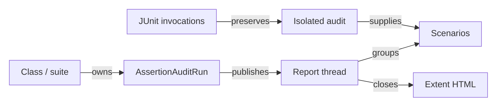

<details>
<summary><strong>Legend - ownership and actual thread of the session</strong></summary>

- `extent(...)` captures configuration and creates the session on the report thread; scenario operations and close run synchronously on that thread.
- JUnit tests and comparisons stay on their own threads; publication neither reruns business logic nor relaxes the `ExtentReportSession` thread guard.
- An invocation closes only its borrowed scenario; the class/suite owner closes the session and worker, including after publication failure.
- Identical titles do not replace scenario identity; one invocation cannot borrow another’s phases or assertions.
- Submitted work completes once, and an interrupted caller retains its interrupt flag; path configuration and notification policy are captured before publication, with notification following the existing final artifact.

</details>

`AssertionAuditRunComponentTest` checks ownership, causes and concurrency; consumer probes check Jupiter scope and final notification policy. The configured session budget and initially collapsed `Component assertions` step remain intact.

<a id="lizability-of-evidence-in-narrow-panels"></a>
<a id="lizibilitatea-dovezilor-în-panouri-înguste"></a>
### Readable evidence in narrow panels

Window width and available table width are different measurements; Extent indentation can create a narrow panel inside a desktop window. `table-viewport.css` preserves the table, visible header and aligned columns rather than turning rows into cards at a breakpoint.

The shared allocator measures headers, values, font and padding in Extent/fallback, including CSS text transformations. Tables fill available width; technical columns stay compact, and remaining space first satisfies unmet content demand, then is shared proportionally among flexible columns.

This policy covers setup, assertions, Actions/Audit, API evidence and Overview/Category/System tables. Dashboard tables reuse their container and retain compact numeric totals; existing colgroups and later runtime failure tables use the same allocation, with a shared viewport added when missing.

The Categories scenario table uses the same viewport, with compact `Status` and `Timestamp` columns; structural `Status/Details` adaptation never applies to data tables. On narrow screens, the Fails index/details start after the visible navigation bar; absence of document overflow alone does not prove accessibility.

Fallback allows the content panel to shrink without widening the document. Fails cards wrap long messages and use container width to place observed values below failure identity.

| Situation | Presentation |
|---|---|
| Article 429 (1) (b) of CRR | full-width table without an artificial right margin; surplus goes to content columns |
| Some values are long | those columns receive remaining space; status/time retain their measured width |
| the panel cannot fit headers and a readable minimum | local horizontal scroll keeps the header and every column accessible |
| Resize, new text or reopening | incremental invalidation and recalculation without reassessment of assertions |

Sticky headers, the shared font and vertical cap remain intact; short tables use only their content height. Table minimum widths are not imposed by column count.

Measured text widths are not capped; two long messages remain distinguishable even with equal character counts. The gutter reserves no empty right-hand space; only a required scrollbar reduces usable width.

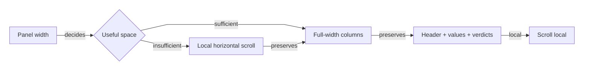

<details>
<summary><strong>Legend - Stolen columns, local auditable scroll</strong></summary>

- Published Headings and order of columns remain the same in Extent / fallback;
  Each cell aligns with its own header without repeating it in the body.
- Narrow panels reduce renderer indentation; in fallback, the list and
  the contents shall be placed vertically when the container does not allow two columns.
- The preview of the assertions is drawn up before the configured ceiling, implicitly 240 characters;
  rearranging CSS does not alter text or verdict.
- `NarrowEvidenceReadabilityComponentTest` checks 1803/1280/591/392 px viewports and 591/392/719/720/721 px panels inside a desktop viewport: usable width, font, header, last column/row, keyboard reopening, negative projection and Fails → Tests.
- `TableViewportBrowserComponentTest` rejects hidden header, vertical cells
  and the horizontal scroll locked, in addition to existing samples for the ceiling and clipping.
- `EvidenceColumnSizingComponentTest` compares geometry with physically available width, including setup, dashboard, colgroups, competing text and empty gutters; a layout marker alone does not certify rendering.
- `PublishedEvidenceTableComponentTest` checks UI/API/UI+API publications in both renderers with independent inventories/values, 12/40 rows and Tests/Overview/Categories/Fails projections; negative controls include navigation overlapping Fails and technical headers broken into letters. A column percentage is not an aesthetic oracle.

</details>

</details>

<a id="quick-check"></a>
<a id="verificare-rapidă"></a>
## Quick check

| Decision | Source and limit |
|---|---|
| Semantic snapshot and standalone coherent verdict | [source of the host](src/main/java/atf/reporting/extent/session/ExtentReportSession.java); sample [ReportingStandaloneVerdictComponentTest](src/test/java/atf/reporting/standalone/ReportingStandaloneVerdictComponentTest.java) |
| Dependencies and source- sets | [POM](pom.xml); declared scope authority for integration |
| What this probe does not prove | The local sample does not show rendering in the browser; it belongs to Reporting Tests. |

<details>
<summary><strong>Command for local sample</strong></summary>

Run from the root of a [external staging](../docs/ATF_Build_And_Execution_Safety.md), with JDK 21 and Maven.

```powershell
mvn -B -pl atf-reporting -am "-Dtest=ReportingStandaloneVerdictComponentTest" "-Dsurefire.failIfNoSpecifiedTests=false" test
```

The command selects the sample called and builds the dependencies; does not declare the entire module to be passed. The local sample does not demonstrate the rendering in the browser; it belongs to Reporting Tests.

</details>

<a id="inspection-timing-and-distribution-boundaries"></a>
<a id="limitele-inspecției-timing-ului-și-distribuției"></a>
## Inspection, timing and distribution boundaries

| Surface | Limit and owner |
|---|---|
| generic inspector | the caller declares artifact profile and renderer through [inspection intent](#inspecția-artifactului-cu-intenție-explicită); a legacy HTTP default cannot certify every report structure |
| captured/publication timing | [recorded timing](#originea-duratelor-sub-o-fază-capturată) separates execution, transport and publication; a correct verdict does not certify duration attribution |
| API and distribution | [release criteria](../docs/feedback/ATF_Reporting_Feedback.md) remains distinct from compilation or consumption of JAR candidate |

The contracts delivered are described in the sections of the owners. The gaps remain in feedback, with [permanent regression](../atf-reporting-tests/README.md#regresia-permanentă-a-fiecărui-defect-reporting) before correction and a new JAR.
<a id="public-comments-without-transport"></a>
<a id="observații-publice-fără-transport"></a>
## Public observations without transport

Typed observations publish non-transport facts through a shared Extent/fallback projection.

`AssertionAuditReport.phase(..., observations)` publishes caller-supplied facts as independent INFO nodes beside `Component assertions`. Observations are optional and supply no assertion, request or verdict; an adapter without observation support rejects publication, while the phase retains its owner-resolved status.

| Boundary | Contract |
|---|---|
| Port and model | `Phase.supportsObservations()`, `Phase.observation(ReportObservation)`; title-based model, fields, bodies TEXT / JSON and references |
| Verdict | INFO without fabricated requests/validations; cannot weaken FAIL/SKIP; an unsupported adapter rejects publication |
| Context | `Phase.detail` remains internal; semantic snapshots keep labels, without values / bodies or artefacts |
| Projection | before booking / preview, collapse discourse and accessible body with keyboard up to the end |
| Bugete | fields/assertions default to 240; standalone bodies default to 100, independently configured by each consumer; evaluation receives full input |
| URI | filet / http / https are references without fetch; credential / query / fragment and active schemes refused; the location redacted does not persist in href |
| Compatibility | `ObservationStep` / `ObservationSnapshot` extend the sealed trees; supported binary symbols and source- exhaustive switches request separate compatibility checks when sealed trees evolve |
| Return | the glyph follows its own summary/open state; End/Home/PageUp/PageDown use shared `atf-observation-body` scrolling, and bulk expansion preserves local evidence state |
| Owner | complete raw to call; native regressions, composition / browser and JAR physical gate at J0 |


<details>
<summary><strong>Legend - information and verdict</strong></summary>

- The field observed is not assertion and does not invent transport.
- Renderers share escaping, editorial, preview and discourse.
- The caller keeps the assessment, raw and retention policy.

</details>

<a id="local-state-of-expansion"></a>
<a id="starea-locală-a-expandărilor"></a>
## Local disclosure state

| Action | Contract |
|---|---|
| click / Enter / Space on Extent script | changes only the selected scenario; its phases reset according to the local contract |
| Open Neighbor Screen | its phases, requests, validations and evidence retain state and visibility |
| Expand all / Collapse all | explicit action on the active owner’s tree; evidence disclosures remain local controls |
| fallback | each native disclosure stays independent for mouse and keyboard |
| assertion | original value/verdict, default preview 240; hidden DOM does not establish visible evidence |

<a id="binary-tags-and-compatibility"></a>
<a id="taguri-și-compatibilitate-binară"></a>
## Binary tags and compatibility

Normalisation has semantic owner in ReportTags: remove null / blank, apply trim and Locale.ROOT, maintain the order of first appearance and return an immutable list.

| Surface | Maintenance rule |
|---|---|
| atf.reporting.semantic.tags.ReportTags | Single implementation; renderers and snapshots use this owner |
| atf.reporting.model.ReportTagNormalizer | façade deprecated without a disposal commitment; keeps exactly the old public signature |
| model | eight active contracts plus the only binary deck, nine physically explicitly inventoried files |
| Governance | General threshold 8 remains; a tenth class or substitution of a contract is refused, even with the same physical number |
| ABI | customer compiled separately against old signature, then executed with actual implementation; the student does not enter the classloader |

Normalization does not hold business rules or renderer status. The deck is not an allowlist for the growth of the package and does not add a module.

<a id="background-system-and-fallback-index"></a>
<a id="context-system-și-index-fallback"></a>
## System context and fallback index

Both renderers publish Environment, Runtime, OS, Client, Reporting and Assertion preview. Host facts are captured at session opening; missing values invent no client, endpoint or transport, and the default Client is Configured per execution.

| Surface | Contract |
|---|---|
| HtmlReportSession.updateEnvironment | typed update through the allowlist and redaction; null/after-close updates are rejected before mutation |
| overrides | Environment, Client and explicit optional fields are kept; the snapshots of the caller remain immutable |
| computed facts | Fallback publishes its own identity; the actual preview is ReportingSettings, implicitly 240 |
| index fallback | title and class in neutral colors; Pass / Fail / Skip in separate badge with the same href and original ID |
| access | Wrapping without hiding / truncation, visible focus and Enter to original scenario |

Permanent probes inspect the visible System table, text contrast of at least 4.5:1 and absence of overflow at 1280/392 px. Mutants removing one fact or applying the badge to the whole link are rejected.

<a id="inspection-of-the-explicit-intent-artifact"></a>
<a id="inspecția-artifactului-cu-intenție-explicită"></a>
## Inspection of the explicit-intent artifact

Declare a [ReportArtifactProfile](src/main/java/atf/reporting/artifact/ReportArtifactProfile.java) with renderer, scenarios, phases and mandatory evidence. `ReportArtifactInspector.inspect(path, profile)` and the `inspectFresh` overload retain it in `ProfileInspection`; profile-free inspection keeps the strict legacy Extent/HTTP contract, so legitimate non-HTTP reports use the explicit overload.

| Responsibility | Contract |
|---|---|
| the intention of the caller | identity of class / scenario, phases, statuses, observation fields / bodies, assertion rows or exchange and mandatory HTTP channels |
| Inspector | DOM original, exact inventory and verdict; same policy of operational resources for Extent / fallback and declared profile |
| public outcome | complete inventory with unique, consistent diagnostics; empty, partial or contradictory results are noncompliant |
| business comparison | Expected / current and full evaluation belong to the caller; profile does not recalculate business values from the preview |
| browser | visibility, keyboard, geometry and Deeplink remain separate from static inspection |

- Without fictional HTTP; the elimination of a mandatory request is non-compliant.
- Verdicts and API legacy are maintained; reconstruction uses `ProfileInspection`.
- External operational resources/evidence are rejected with owner/attribute/reference diagnostics; text paths and documentation links remain valid. Deduplicated PNGs require one unique inline target.

<a id="titles-and-profile-labels"></a>
<a id="titluri-și-etichete-ale-profilului"></a>
### Titles and profile labels

| Input | Extent contract and fallback |
|---|---|
| Titles and labels | Literal text in HTML. Spark encodes the keys in the Timeline script separately. |
| Multiline tags | The profile accepts original text; `ReportArtifactProfile.visibleLabel` projects LF, CRLF, tabs, NBSP and repeated spaces into DOM-comparable text. |
| Values and bodies | Assertions retain fully evaluated verdicts and default preview 240; bodies follow their own budget and retain captured whitespace. |

[Permanent probes](../atf-reporting-tests/README.md#probe-inspector-timing-și-indicator-assertions) check both renderers and reject titles converted into markup even when visible text matches.

<a id="origin-of-durations-under-a-captured-phase"></a>
<a id="originea-duratelor-sub-o-fază-capturată"></a>
### Origin of durations under a captured phase

| Level | value and label |
|---|---|
| the phase with explicit timing | execution provided, tagged Execution; children are not added over it |
| request with typed executions | total transport provided, tagged Transport, including real zero |
| Extent scope created at publication | Time of publication, tagged Publication; not representing transport or business execution |
| assertion-step fallback below captured phase | Publication label not numerically invented |
| timing absent | Legacy behavior is preserved; unknown does not become zero |

A fallback validation without its own clock receives no fabricated numeric duration.

Assertions reuse the shared disclosure with a visible plus/minus indicator, ARIA state and mouse/Enter/Space access. The table starts collapsed, retaining four columns and default preview 240; permanent regressions belong to [Reporting Tests](../atf-reporting-tests/README.md#probe-inspector-timing-și-indicator-assertions).

<a id="publication-of-png-at-large-volume"></a>
<a id="publicarea-png-la-volum-mare"></a>
## Publication of PNG at large volume

Large PNG Payloads remain in the private session spooler until atomic publication.

| Stage | Contract |
|---|---|
| internal capture | PNG complete on disk; same identity for identical payload |
| transformation | Assets / navigation operates on the compact HTML structure without UTF-16 copies of PNG |
| restoration | fixed buffers stream complete Base64 into the atomic file; final HTML is self-contained |
| cleanup | spool closed/deleted on success or failure; destination replaced only after complete restoration |
| limit | Extent/Spark models and text still use heap proportional to evidence; no universal ceiling |

The captured timing contract separates publication duration, allocations and observed memory from the captured execution interval.

<a id="action--observe---preview-and-complete-values"></a>
<a id="actionobserve--preview-și-valori-complete"></a>
## ACTION / OBSERVE - preview and complete values

INCLUDED_COLLAPSED retains complete expected/observed values in the same cell, after redaction and HTML escaping.

| Surface | Policy |
|---|---|
| preview | 240 default; summary compact in a visual row with text available in DOM |
| full value | initially closed disclosure; newlines, Unicode, order and final scalar preserved |
| security and verdict | redaction precedes both projections; the captured verdict is not reevaluated |
| keyboard | Enter/Space on each disclosure; End/Home and scrolling in the existing focusable viewport |
| SUMMARY_ONLY | keep explicit omission of ACTION details |
| body display limit | control the bodies, independent of these cells |
| phase observations | UiPhase.observation(ReportObservation) delegates to the neutral port; supportsObservations() exposes the capability |
| lifecycle | rejected after completion; publication excluded from measured timing; no fabricated requests/assertions |

Assertions values have separate contracts: the already reduced text of the caller cannot be rebuilt. [The remaining criterion](../docs/feedback/ATF_Android_UI_Reporting_Feedback.md) delimits that family.

<a id="fitness-of-the-ui-line-and-drafting-policy"></a>
<a id="fidelitatea-rândului-ui-și-politica-de-redactare"></a>
<a id="fitness-of-the-ui-line-and-redaction-policy"></a>
## UI row fidelity and redaction policy

| Boundary | Contract |
|---|---|
| AtfUiActionRecord | operation / target are normalized metadata; expected / observed keep the captured whitespace, including LF / CRLF / CR; null remains empty |
| joint projection | UiEvidenceRowMarkup holds the identity and cells ACTION / OBSERVE; the renderer adds only the TIME column and source specific structure |
| fallback | transmit the original records and the same SensitiveDataRedactor instance without reconstruction or second default policy |
| Published metadata | operation, target and title PNG inline are redacted prior to HTML escaping |
| complete values | 240 plus disclosure; CR is encoded as a numerical reference and LF is initially protected by HTML parser rule for pre |
| invariants | Normal, status, bytes PNG, screen shot policy and SUMMARY_ONLY are kept; comparisons are not reassessed |

A custom replacement is checked precisely, including when it is not idempotent. The caller remains responsible for the text captured before the Reporting model; the library does not rebuild the information already removed by an adapter.

<a id="full-evidence-in-the-same-html"></a>
<a id="dovezi-complete-în-același-html"></a>
### Full evidence in the same HTML

[Inline contract](../docs/ATF_Inline_Audit_Contract.md) separates the captured data, the evaluated comparisons and the rendering.

| Composition | Publication rule |
|---|---|
| without external files | empty artifacts; the context required for the decision is published by fields / bodies |
| component | standard assertions and full status; optional PNG |
| UI | Same structure plus PNG original to checkpoint |
| text PRE | LF initial, CR / LF and the final whitespace preserved after the editorial / limitation |

The 240-character preview and body budget remain separate. Callers do not replace comparisons with XML-derived statuses or ask the renderer to infer verdicts.

<a id="screenshot-viewer-and-independent-readers"></a>
<a id="viewer-de-capturi-și-cititori-independenți"></a>
## Screenshot viewer and independent readers

A shared Extent/fallback viewer displays PNG evidence within the available viewport, preserving the complete image and aspect ratio; original size is an explicit mode. Closing it or pressing Escape restores checkpoint, focus, disclosure and reading position.

- Deduplicated screenshots resolve original bytes without clicking/selecting the canonical owner; the local caption stays attached to the clicked checkpoint.
- Mouse, Enter and Space open the same viewer; resizing recalculates fit, and controls remain keyboard-accessible without browser/OS fullscreen.
- The producer supplies test purpose, effective setup/inputs, independent expectations and clear evidence limits; hashes and raw dumps establish no business correctness.

The [inline contract](../docs/ATF_Inline_Audit_Contract.md) separates primary audit content from optional technical provenance. Permanent neutral [reference contracts](../atf-reporting-tests/src/test/java/atf/reporting/observation/ScreenshotReferenceComponentTest.java) and [browser paths](../atf-reporting-tests/src/test/java/atf/ui/tests/extent/component/screenshot/ScreenshotViewerBrowserComponentTest.java) cover viewport and return behavior; Android capture/oracles stay with the consumer.

<a id="large-report-navigation"></a>
<a id="navigarea-rapoartelor-mari"></a>
## Large-report navigation

[The incremental navigation contract](../docs/ATF_Large_Report_Navigation.md) keeps all assertions and original PNG with preview 240. The processing of hidden tables is delayed, DOM updates are aggregated, and the search for execution markers is cache- only for a aggregation pass.

[navigation contract](../docs/ATF_Large_Report_Navigation.md) distinguishes browser acceptance from fresh business/device execution; neutral permanent regressions remain in Reporting Tests.

Tests, Category, Fails and Overview share one navigation contract: the selected view, the sole accessible current link and the URL fragment identify the same pane. `NavigationSelectionBrowserComponentTest` exercises all four transitions in Chromium.

<a id="cold-startup-and-readiness"></a>
<a id="pornire-la-rece-și-readiness"></a>
## Cold startup and readiness

The navigation bootstrap honors the requested view once across DOMContentLoaded and load. Load timing updates independently; successful normalization publishes readiness, while an error leaves the cycle unready. Dynamic-content observers and explicit view switches remain active.

[The cold-start contract](../docs/ATF_Large_Report_Navigation.md) retains fresh-browser 10 s readiness/action and 45 s navigation bounds, canonical PNG payloads, comparisons and preview 240. Bulk acceptance selects at most two source owners.

<a id="native-timeline-labels"></a>
<a id="etichete-native-pentru-timeline"></a>
## Native timeline labels

The Spark presentation adapter encodes timeline keys as JSON strings while preserving full caller labels and captured duration values. The pinned vendor expression is checked before publication; a changed template fails explicitly.

The [native timeline contract](../docs/ATF_Large_Report_Navigation.md#native-timeline-labels) covers quoted and multiline JSON, backslashes and Unicode, alongside the unchanged 24-hour clock.

<a id="neutral-ui-attribution-and-failure-ownership"></a>
<a id="atribuire-ui-neutră-și-ownership-ul-eșecurilor"></a>
## Neutral UI attribution and failure ownership

`AtfUiActionRecord` captures an operation, target, observed result and duration. Its ACTION/OBSERVE channel identifies the evidence kind.

- Default publication uses **UI action sequence** and **UI action**, without inferring a driver.
- Captured tool names remain intact; Android, web and mock callers share the neutral contract.

| Evidence | Audit boundary |
|---|---|
| ACTION | actual dispatched operation, captured result and original sequence; a successful dispatch does not certify the resulting UI state |
| OBSERVE | captured read-only observation; an observation-only checkpoint does not fabricate an ACTION table |
| comparison | independently evaluated expected/actual/result; UI records do not inflate the assertion population |
| Fails | captured failed ACTION, OBSERVE, comparison or execution diagnostic; navigation addresses the original owner and row |
| screenshot | original complete PNG and checkpoint ownership; deduplication preserves each source link |

Fallback projects request-owned and validation-owned UI failures in rendered ACTION/OBSERVE/comparison order. Native Fails preserves separate UI and assertion ordinals; its source links reveal the original ACTION/OBSERVE row without a second user expansion or a synthetic comparison.

- A terminal exception contributes one index entry through its original failed row. Tests also keeps its diagnostic context.
- If the terminal row is absent or hidden by action summary-only mode, the exception supplies its own navigable cause.
- Independent comparisons retain their own entries even when their label matches a diagnostic.

- Preview remains 240 characters; publication performs no business evaluation or driver inference.
- Failure labels and causes share the original evidence redaction boundary.
- Legacy public constants and contract check keys remain compatible; published headings use neutral wording.

Permanent source and physical-JAR contracts belong to Reporting Tests. Android dispatch, hierarchy extraction and independent application oracles remain in J4.
