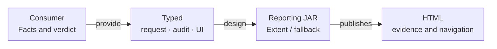

<a id="atf-reporting---portable-context-of-the-library"></a>
<a id="atf-reporting--context-portabil-al-bibliotecii"></a>
# ATF Reporting - portable context of the library

<a id="at-a-glance"></a>
<a id="pe-scurt"></a>
## At a glance

This is the entry point that can accompany Reporting source outside the ATF reactor. The links here remain in the mode; the complete orientation in the code is in [Atlas of production](../src/main/java/atf/reporting/README.md). Adoption contracts are in [README module](../README.md).

- The library receives facts and verdicts and publishes Extent or Fallback HTML;
  HTTP, the browser and business comparisons are owned by the caller.
- JAR is thin and requires the runtime dependencies declared in [POM](../pom.xml),
  Java 21. Independence from ATF modules does not remove external dependencies.

<a id="library-limit"></a>
<a id="limita-bibliotecii"></a>
## Library limit



<details>
<summary><strong>Legend - data enters, execution remains at the caller</strong></summary>

| Element | Meaning and limit |
|---|---|
| Consumer | perform the operation, hold the bill and decide the verdict; it can be any Java application |
| Typed ports | reporting contracts without Core, Playwright, Kit or JUnit objects |
| Reporting JAR | models, projections and renderers; uses Jackson YAML, ExtentReports, FreeMarker and Jsoup via Maven |
| HTML | artifact with the resources needed for visualization; HTML autonomy does not transform JAR into a JAR face |

The edges represent the flow of evidence, not Maven dependencies between ATF modules. The observation, catch identity, presentation signature and business selection key have distinct roles; a summary does not allow replicas.

</details>

<a id="inflows-consumed-and-minimum-context"></a>
<a id="intrări-consumate-și-context-minim"></a>
## Inflows consumed and minimum context

These are existing entries in the code, not a promise that any public class is API stable for releases. The delimitation of compatibility and adaptor capabilities must be completed before distribution of a supported version.

| Purpose | Read first | What the caller provides |
|---|---|---|
| execution session and tree | [AtfReportPorts](../src/main/java/atf/reporting/contract/AtfReportPorts.java) | scenario, phases, evidence and explicit verdict |
| Extent rendering | [ExtentReportSession](../src/main/java/atf/reporting/extent/session/ExtentReportSession.java) | path, settings, editor and optional sink |
| Fallback rendering | [HtmlReportSession](../src/main/java/atf/reporting/html/HtmlReportSession.java) | Same facts; Flush / path / thread contract is read when implementing |
| component assertions | [AssertionAuditReport](../src/main/java/atf/reporting/audit/AssertionAuditReport.java) | identity and lines assessed independently of the renderer |
| Profiles and vocabulary of evidence | [ReportEvidenceProfile](../src/main/java/atf/reporting/evidence/profile/ReportEvidenceProfile.java), [AtfGherkinKeyword](../src/main/java/atf/reporting/contract/AtfGherkinKeyword.java) | profile and step intent; business selection remains external |
| lifecycle and checkpoint UI | [UiExtentReportSession](../src/main/java/atf/reporting/ui/UiExtentReportSession.java) | actions and catches already observed, not subject to Playwright |
| API exchange | [ReportExecutionEvidence](../src/main/java/atf/reporting/model/ReportExecutionEvidence.java), [ReportRequest](../src/main/java/atf/reporting/api/ReportRequest.java) | demand, answer available or absent, attempts, provenance and termination |
| existing legacy adapter | [ReportModelAdapters](../src/main/java/atf/reporting/api/ReportModelAdapters.java) | verifiable external accessors; prefer typed DTOs for new adoption |
| artifact inspection | [ReportArtifactInspector](../src/main/java/atf/reporting/artifact/ReportArtifactInspector.java), [ReportArtifactProfile](../src/main/java/atf/reporting/artifact/ReportArtifactProfile.java) | the renderer and the explicit mandatory inventory; the legacy version keeps Extent / HTTP |
| Semantic verification | [AtfReportSemanticSnapshot](../src/main/java/atf/reporting/semantic/AtfReportSemanticSnapshot.java) | comparison of population and statuses, separate from inspection DOM |

[ReportingSettings](../src/main/java/atf/reporting/configuration/ReportingSettings.java) and [loaderul YAML](../src/main/java/atf/reporting/configuration/AtfReportConfigurationLoader.java) are read for configuration. The default budget of the assertions is 240; the safe projection does not recalculate the verdict from the shortened text. The editor applies before the display budget; the coverage of each sensitive format requires own proof without universal guarantee.

<a id="four-distinct-samples-of-extraction"></a>
<a id="patru-probe-distincte-ale-extracției"></a>
## Four distinct samples of extraction

| Test | Acceptance conditions | What it does not prove alone |
|---|---|---|
| reactor source | compile / package and relevant owner tests | the autonomy of filesystem or distribution |
| source module only | Copy includes POM, main, resources and local tests; running from TMP with arbitrary name without parent ATF | the compatibility of the consumption of Maven and the release contract |
| external Maven consumer | depends on JAR and actual POM with transitives solved by Maven; check hash and CodeSource loaded | success of source's gear or stability of all public API |
| artifact and negative control | nominal and FAIL controlled in both renderers; a missing runtime resource from copy JAR refuses publication | browsing full browser or publishing a supported version |

<details>
<summary><strong>Current limit of the gate and isolation of external sample</strong></summary>

The local coat is [ReportingStandaloneDependencyTest](../src/test/java/atf/reporting/standalone/ReportingStandaloneDependencyTest.java). It starts with CodeSource tests and inspections its own modules; the name of the director and the presence of the reactor are not successful conditions. [Negative evidence](../src/test/java/atf/reporting/standalone/StandaloneBoundaryRulesTest.java) external protects imports ATF, Maven dependencies and the banned parent.

`ReportingLibraryDistributionIntegrationTest` automates the sample in the internal test project. In the reactor it isolates the source and performs native tests; in a binary consumer starts from JAR loaded and POM included therein. Both forms are consumed by an external Maven project with the same samples.

[Java source audit](../src/test/java/atf/reporting/standalone/source/ReportingSourceArchitectureTest.java) is native to the manufacturer; façade and delegation contracts are not eliminated. Runtime consumption does not need those Java files and does not replace them by deactivated checks.

In the external consumer, the application's top-up contains JAR Reporting and its transistors, without ATF classes in `target/classes`, Core, UI, Kit, JUnit or Playwright. The consumer's example is compiled separately. JAR in cache does not mean that they are runtime dependencies of the library.

Negative control only modifies TMP's JAR copy; eliminates a [Asset manifesto](../src/main/java/atf/reporting/asset/ReportAsset.java) resource and verifies the [loader](../src/main/java/atf/reporting/asset/ReportAssetLoader.java) refusal. Do not change the source, Maven workpiece or published artifact. The manufacturer or refused publication shall keep the previous report and release the workspace; the external sample also checks this rollback.

</details>

<a id="preparation-for-a-supported-release"></a>
<a id="pregătire-pentru-un-release-susținut"></a>
## Preparation for a supported release

- Keep the contract and local evidence in the mode.
  Runner, browser or composition ATF remains in the internal test project and do not become dependencies of the distributed JAR.
- Declare API sustained, optional compatibility and capabilities forward
  to hide or move public classes. Inventory actual consumer calls.
- Define version policy, distributed POM, resources, licenses and
  documents accompanying the artifact. A local package is not a release.
- Check semantics and then DOM: FAIL after difference beyond 240,
  editorial, expansion, navigation to proof and indexing the terminal cause. Semantic snapshots alone do not certify interactions in HTML.
- Keep caller measurements distinct from the time of publication. Do not invent
  durations for missing responses and do not change the default flush / close protocol.
- This atlas is source document. Inclusion in the distributed package and
  Portable for all README in the module remain separate criteria; local links here do not automatically repair outputs from other documents.

<a id="local-maintenance-and-samples"></a>
<a id="întreținere-și-probe-locale"></a>
## Local maintenance and samples

[Standalone contracts](../src/test/java/atf/reporting/standalone/ReportingStandaloneContractTest.java) verifies the basic values and the redaction covered by fixtures. [Verdicts of the component](../src/test/java/atf/reporting/standalone/ReportingStandaloneVerdictComponentTest.java) verifies the propagation of the statuses and refusal of the unjudged terminal input. These samples do not replace the analysis of the editorial boundaries or browser oracles.

An entry change, invariant or owner updates this map and README package in the same increment. The runs, hashes and dated results remain in TMP; documentation retains the contract and its current limits.

<a id="publication-and-full-evidence"></a>
<a id="publicare-și-dovezi-complete"></a>
## Publication and full evidence

| Contract portable | Input |
|---|---|
| memory and cleanup PNG | [publication of the module](../README.md#publicarea-png-la-volum-mare) |
| ACTION / OBSERVE complete preview and cell | [joint projection](../README.md#actionobserve--preview-și-valori-complete) |
| lifecycle observations UI | [UI atlas](../src/main/java/atf/reporting/ui/README.md#observații-neutre-pe-uiphase) |

The library receives evidence and verdicts captured; it does not execute the application or comparisons.

## Minimal binary consumer

Declare `atf.api:atf-reporting` with the version installed from the distributed POM, then let Maven resolve that POM's runtime dependencies. Core, Kit, JUnit, Playwright and producer implementation directories are unnecessary for this example; the JAR is thin rather than a bundled runtime.

Place this class in a consumer's main source set and compile with its normal Maven build. Pass an owned TMP output path and the observed state; the caller compares it independently before publishing, closes the report on both outcomes and fails the process when the state differs.

```java
import atf.reporting.contract.AtfAssertion;
import atf.reporting.contract.AtfReportStatus;
import atf.reporting.html.HtmlReportSession;
import java.nio.file.Path;
import java.util.List;

public final class MinimalBinaryReport {
    public static void main(String[] args) {
        if (args.length != 2) throw new IllegalArgumentException("output.html and observed state are required");
        boolean passed = "READY".equals(args[1]);
        var status = passed ? AtfReportStatus.PASS : AtfReportStatus.FAIL;
        try (var session = new HtmlReportSession(Path.of(args[0]))) {
            var scenario = session.startScenario("MinimalBinaryReport", "Observed state", List.of("component"));
            var phase = scenario.startPhase("TEST BODY");
            var step = phase.startAssertionStep("State contract");
            step.assertions(List.of(new AtfAssertion("state", "READY", args[1], passed)));
            step.complete(status);
            phase.complete(status);
            scenario.complete(status);
        }
        if (!passed) throw new AssertionError("Expected READY");
    }
}
```

- `READY` produces a passing comparison and a successful process result.
- `BROKEN` retains the failing comparison in the completed HTML and raises AssertionError.
- This demonstrates existing API consumption; supported API classification, complete companion-document distribution and the full release gate remain separate contracts.
