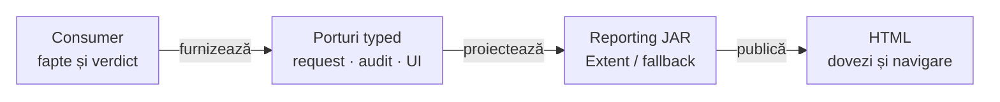

# ATF Reporting — context portabil al bibliotecii

## Pe scurt

Acesta este punctul de intrare care poate însoți sursa Reporting în afara
reactorului ATF. Linkurile de aici rămân în modul; orientarea completă în cod
este în [atlasul producției](../src/main/java/atf/reporting/README.md).
Contractele de adopție sunt în [README-ul modulului](../README.md).

- Biblioteca primește fapte și verdicte și publică Extent sau fallback HTML;
  HTTP-ul, browserul și comparațiile business sunt deținute de caller.
- JAR-ul este thin și necesită dependențele runtime declarate în [POM](../pom.xml),
  pe Java 21. Independența de modulele ATF nu elimină dependențele externe.

## Limita bibliotecii

<strong>Legendă — datele intră, execuția rămâne la caller</strong>

| Element | Sens și limită |
|---|---|
| Consumer | execută operația, deține expected-ul și decide verdictul; poate fi orice aplicație Java |
| Porturi typed | contracte de raportare, fără obiecte Core, Playwright, Kit ori JUnit obligatorii |
| Reporting JAR | modele, proiecții și renderere; folosește Jackson YAML, ExtentReports, FreeMarker și Jsoup prin Maven |
| HTML | artifact cu resursele necesare vizualizării; autonomia HTML nu îl transformă pe JAR într-un fat JAR |

Muchiile reprezintă fluxul dovezii, nu dependențe Maven între module ATF.
Observația, identitatea de captură, semnătura de prezentare și cheia selecției
business au roluri distincte; un sumar nu autorizează replay.

## Intrări consumate și context minim

Acestea sunt intrări existente în cod, nu o promisiune că orice clasă publică
este API stabil pentru release. Delimitarea compatibilității și a capabilităților
adaptoarelor trebuie încheiată înaintea distribuirii unei versiuni susținute.

| Scop | Citește întâi | Ce furnizează callerul |
|---|---|---|
| sesiune și arbore de execuție | [AtfReportPorts](../src/main/java/atf/reporting/contract/AtfReportPorts.java) | scenariu, faze, dovezi și verdict explicit |
| randare Extent | [ExtentReportSession](../src/main/java/atf/reporting/extent/session/ExtentReportSession.java) | path, settings, redactor și sink opțional |
| randare fallback | [HtmlReportSession](../src/main/java/atf/reporting/html/HtmlReportSession.java) | aceleași fapte; contractul flush/path/threading se citește la implementare |
| component assertions | [AssertionAuditReport](../src/main/java/atf/reporting/audit/AssertionAuditReport.java) | identitate și rânduri evaluate independent de renderer |
| profile și vocabular de evidence | [ReportEvidenceProfile](../src/main/java/atf/reporting/evidence/profile/ReportEvidenceProfile.java), [AtfGherkinKeyword](../src/main/java/atf/reporting/contract/AtfGherkinKeyword.java) | intenția profilului și pasului; selecția business rămâne externă |
| lifecycle și checkpoint UI | [UiExtentReportSession](../src/main/java/atf/reporting/ui/UiExtentReportSession.java) | acțiuni și capturi deja observate, fără obiect Playwright |
| exchange API | [ReportExecutionEvidence](../src/main/java/atf/reporting/model/ReportExecutionEvidence.java), [ReportRequest](../src/main/java/atf/reporting/api/ReportRequest.java) | request, response disponibil sau absent, attempts, provenance și termination |
| adaptor legacy existent | [ReportModelAdapters](../src/main/java/atf/reporting/api/ReportModelAdapters.java) | accessori externi verificabili; preferați DTO-urile typed pentru adopții noi |
| inspecție artifact | [ReportArtifactInspector](../src/main/java/atf/reporting/artifact/ReportArtifactInspector.java), [ReportArtifactProfile](../src/main/java/atf/reporting/artifact/ReportArtifactProfile.java) | renderer și inventarul obligatoriu explicit; varianta legacy păstrează Extent/HTTP |
| verificare semantică | [AtfReportSemanticSnapshot](../src/main/java/atf/reporting/semantic/AtfReportSemanticSnapshot.java) | comparație a populației și statusurilor, separat de inspecția DOM |

Pentru configurație se citesc [ReportingSettings](../src/main/java/atf/reporting/configuration/ReportingSettings.java)
și [loaderul YAML](../src/main/java/atf/reporting/configuration/AtfReportConfigurationLoader.java).
Bugetul implicit al assertion-urilor este 240; proiecția sigură nu recalculează
verdictul din textul scurtat. Redactorul se aplică înaintea bugetului de display;
acoperirea fiecărui format sensibil cere probă proprie, fără garanție universală.

## Patru probe distincte ale extracției

| Probă | Condiția de acceptare | Ce nu demonstrează singură |
|---|---|---|
| sursa în reactor | compile/package și testele relevante la owner | autonomia filesystem-ului sau a distribuției |
| numai modulul sursă | copia include POM, main, resurse și testele locale; rulează din TMP cu nume arbitrar, fără părintele ATF | compatibilitatea consumului Maven și contractul de release |
| consumer Maven extern | depinde de JAR-ul și POM-ul reale, cu tranzitive rezolvate de Maven; verifică hash-ul și CodeSource-ul încărcat | succesul gate-ului sursei ori stabilitatea întregului API public |
| artifactul și controlul negativ | nominal și FAIL controlat în ambele renderere; o resursă runtime lipsă din copia JAR-ului refuză publicarea | navigarea browser completă ori publicarea unei versiuni susținute |

<strong>Limita actuală a gate-ului și izolarea probei externe</strong>

Gate-ul local este [ReportingStandaloneDependencyTest](../src/test/java/atf/reporting/standalone/ReportingStandaloneDependencyTest.java).
Pornește de la CodeSource-ul testelor și inspectează propriul modul; numele
directorului și prezența reactorului nu sunt condiții de succes.
[Probele negative](../src/test/java/atf/reporting/standalone/StandaloneBoundaryRulesTest.java)
protejează importurile externe ATF, dependențele Maven și parent-ul interzis.

`ReportingLibraryDistributionIntegrationTest` automatizează proba în proiectul
intern de testare. În reactor izolează sursa și execută testele native;
într-un consumer binar pornește de la JAR-ul încărcat și POM-ul inclus în acesta.
Ambele forme sunt consumate de un proiect Maven extern, cu aceleași probe.

[Auditul sursei Java](../src/test/java/atf/reporting/standalone/source/ReportingSourceArchitectureTest.java)
este nativ la producător; contractele de fațadă și delegare nu sunt eliminate.
Consumerul runtime nu are nevoie de acele fișiere Java și nu le înlocuiește
prin verificări dezactivate.

În consumerul extern, classpath-ul aplicației conține JAR-ul Reporting și
tranzitivele sale, fără clase ATF din `target/classes`, Core, UI, Kit, JUnit sau
Playwright. Exemplul consumerului se compilează separat. Prezența unor JAR-uri
în cache nu înseamnă că ele sunt dependențe runtime ale bibliotecii.

Controlul negativ modifică numai o copie TMP a JAR-ului; elimină o resursă din
[manifestul de assets](../src/main/java/atf/reporting/asset/ReportAsset.java)
și verifică refuzul [loaderului](../src/main/java/atf/reporting/asset/ReportAssetLoader.java).
Nu schimbă sursa, cache-ul Maven de lucru ori artifactul publicat.
Constructorul sau publicarea refuzată păstrează raportul anterior și eliberează
workspace-ul; proba externă verifică și acest rollback.

## Pregătire pentru un release susținut

- Păstrați contractul și probele locale în modul. Verificările care necesită
  runner, browser sau compoziție ATF rămân în proiectul intern de testare și
  nu devin dependențe ale JAR-ului distribuit.
- Declarați API-ul susținut, compatibilitatea și capabilitățile opționale înainte
  de a ascunde sau muta clase publice. Inventariați apelurile reale ale consumerilor.
- Definiți politica versiunilor, POM-ul distribuit, resursele, licențele și
  documentele care însoțesc artifactul. Un package local nu este un release.
- Verificați semantica și apoi DOM-ul: FAIL după diferență dincolo de 240,
  redacție, expandare, navigare către dovadă și indexarea cauzei terminale.
  Snapshot-ul semantic singur nu certifică interacțiunile din HTML.
- Păstrați măsurătorile callerului distincte de timpul publicării. Nu inventați
  durate pentru răspunsuri lipsă și nu schimbați protocolul de flush/close implicit.
- Acest atlas este document sursă. Includerea în pachetul distribuit și
  portabilitatea tuturor README-urilor din modul rămân criterii separate;
  linkurile locale de aici nu repară automat ieșirile din celelalte documente.

## Întreținere și probe locale

[Contractele standalone](../src/test/java/atf/reporting/standalone/ReportingStandaloneContractTest.java)
verifică valorile de bază și redactarea acoperită de fixture-uri.
[Verdictele componentei](../src/test/java/atf/reporting/standalone/ReportingStandaloneVerdictComponentTest.java)
verifică propagarea statusurilor și refuzul inputului terminal nejudecat.
Aceste probe nu înlocuiesc analiza limitelor redacției ori oracolele browser.

O schimbare de intrare, invariantă sau owner actualizează această hartă și
README-ul pachetului în același increment. Rulările, hash-urile și rezultatele
datate rămân în TMP; documentația păstrează contractul și limitele sale actuale.

## Publicare și dovezi complete

| Contract portabil | Intrare |
|---|---|
| memorie și cleanup PNG | [publicarea modulului](../README.md#publicarea-png-la-volum-mare) |
| preview și celulă completă ACTION/OBSERVE | [proiecția comună](../README.md#actionobserve--preview-și-valori-complete) |
| lifecycle observații UI | [atlasul UI](../src/main/java/atf/reporting/ui/README.md#observații-neutre-pe-uiphase) |

Biblioteca primește dovezi și verdicturi capturate; nu execută aplicația sau comparațiile.
