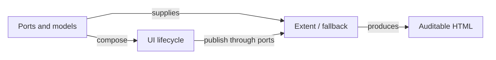

# ATF Reporting - Atlas of the production code

## At a glance

The library receives comments and typed verdicts and publishes them through Extent or Fallback HTML. The atlas link responsibilities to entries, evidence and contracts; reading an area begins with README them, then with the sources of concrete change.

[Adoption and contract of the module](../../../../../README.md) · [Context portable JAR](../../../../../docs/README.md) · [Atlas ATF](../../../../../../docs/ATF_Context_Atlas.md) · [Active consolidation criteria](../../../../../../docs/feedback/ATF_Reporting_Feedback.md)

| Change to investigate | Local contract | Entry point |
|---|---|---|
| lifecycle UI, checkpoint, Given/When/Then, flow compact | [UI](ui/README.md) | `UiExtentReportSession` → lifecycle → publisher |
| Request/response, query, legacy adapters and API audit | [API](api/README.md) | typed DTOs and explicit adapter boundaries |
| model, status, timing and semantic parity | [Models](model/README.md) | shared snapshots and projections |
| Extent, flush, offline assets and publication | [Extent](extent/README.md) | `ExtentReportSession` and the finalization pipeline |
| tree and views fallback | [HTML](html/README.md) | `HtmlReportSession` and the immutable model |
| tables, JSON, screenshot and disclosure | [Evidence](evidence/README.md) | formatting and markup; capture belongs to the browser owner |
| Semantic and credential redaction | [Security](security/README.md) | Safe projection before formatting and budget |
| JS interactions, DOM vocabulary and assets | [Runtime](runtime/README.md) | Java facade → native resource → HTML |

## Two rendering entry points

<strong>Legend - what remains of every owner</strong>

- Direct consumers use `AtfReportPorts`; the UI facade adds checkpoints,
  profiles and grouping over renderer ports.
- The consumer executes HTTP/browser actions and evaluates comparisons.
  Reporting preserves those facts, aggregates statuses and publishes the artifact.
- A shared snapshot supports parity checks; each renderer owns its publication
  differences and visual probes. Semantic parity does not imply identical presentation.

## Minimum context for a change

- For a semantic change, inspect the port or DTO, its publishing mapper and
  the snapshot oracle; a screenshot alone does not establish the correct status.
- For a terminal exchange, inspect the [verdict boundary](ui/validation/UiApiValidationEvidence.java), [shared projection](api/evidence/ApiExchangeEvidence.java) and UI adapter. [ReportingStandaloneVerdictComponentTest](../../../../test/java/atf/reporting/standalone/ReportingStandaloneVerdictComponentTest.java) and [UiTerminalExchangeReportComponentTest](../../../../../../atf-reporting-tests/src/test/java/atf/ui/tests/extent/component/execution/UiTerminalExchangeReportComponentTest.java) reject a response-free exchange without a caller verdict or evaluated assertions and preserve evidence in both renderers.
- For a visual change, inspect markup, DOM vocabulary, CSS/JS resources and
  the browser probe; `runtime/tests` implements the Tests tab, rather than JUnit tests.
- For extraction, inspect the [POM](../../../../../pom.xml), physical JAR and
  [portable contract](../../../../../docs/README.md#patru-probe-distincte-ale-extracției). A checkout build does not replace isolated-module verification.
- [AtfReportConfigurationContext](configuration/AtfReportConfigurationContext.java) captures configuration;
  the [loader](configuration/AtfReportConfigurationLoader.java) resolves it. [ReportPublicationCoordinator](publication/ReportPublicationCoordinator.java) owns coordinated publication.

## Maintenance of the atlas

Update the package README whenever an entry point, owner, invariant or probe changes. This atlas owns relationships and navigation; code and tests own the complete inventory and executable behavior.

- The module README or linked normative document owns the stable contract.
- Each unresolved finding has one definition in feedback, linked from its owner.
- Native probes stay in `atf-reporting/src/test`; browser composition and rendering
  probes belong to [Reporting Tests](../../../../../../atf-reporting-tests/README.md).

