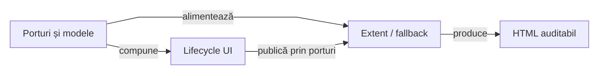

# ATF Reporting — atlas al codului de producție

## Pe scurt

Biblioteca primește observații și verdicte typed și le publică prin Extent sau
fallback HTML. Atlasul leagă responsabilitățile de intrări, probe și contracte;
citirea unei zone începe cu README-ul ei, apoi cu sursele schimbării concrete.

[Adopție și contractul modulului](../../../../../README.md) ·
[Context portabil JAR](../../../../../docs/README.md) ·
[Atlas ATF](../../../../../../docs/ATF_Context_Atlas.md) ·
[Criterii active de consolidare](../../../../../../docs/feedback/ATF_Reporting_Feedback.md)

| Schimbare urmărită | Context local | Intrarea principală |
|---|---|---|
| lifecycle UI, checkpoint, Given/When/Then, flow compact | [UI](ui/README.md) | `UiExtentReportSession` → lifecycle → publisher |
| request/response, query, legacy și audit API | [API](api/README.md) | DTO-uri typed și adaptoare delimitate |
| model, status, timing și paritate semantică | [Modele](model/README.md) | snapshot-uri și proiecții comune |
| scope-uri Extent, flush, assets offline și publicare | [Extent](extent/README.md) | `ExtentReportSession` și pipeline-ul final |
| arbore și views fallback | [HTML](html/README.md) | `HtmlReportSession` și modelul imutabil |
| tabele, JSON, screenshot și disclosure | [Evidence](evidence/README.md) | formatare și markup, fără captură browser |
| redactare semantică și credentiale | [Security](security/README.md) | proiecție sigură înaintea formatării și bugetului |
| interacțiuni JS, vocabular DOM și asset-uri | [Runtime](runtime/README.md) | facade Java → resursă nativă → HTML |

## Cele două intrări către randare

<strong>Legendă — ce rămâne la fiecare owner</strong>

- Intrarea directă folosește `AtfReportPorts`; fațada UI adaugă checkpoint-uri,
  profil și grupare peste porturile rendererului.
- Consumerul execută HTTP/browser și decide comparațiile. Reporting conservă
  aceste fapte, agregă statusurile și construiește artifactul.
- Snapshot-ul comun permite verificarea parității; diferențele de publicare și
  de controale vizuale sunt documentate la renderer, nu presupuse echivalente.

## Contextul minim al unei revizii

- Pentru o schimbare semantică: portul sau DTO-ul, mapperul care îl publică și
  oracolul de snapshot; un screenshot singur nu dovedește statusul corect.
- Pentru exchange terminal: [boundary-ul verdictului](ui/validation/UiApiValidationEvidence.java),
  [proiecția comună](api/evidence/ApiExchangeEvidence.java) și publisherul UI.
  [ReportingStandaloneVerdictComponentTest](../../../../test/java/atf/reporting/standalone/ReportingStandaloneVerdictComponentTest.java) și [UiTerminalExchangeReportComponentTest](../../../../../../atf-reporting-tests/src/test/java/atf/ui/tests/extent/component/execution/UiTerminalExchangeReportComponentTest.java) verifică
  refuzul inputului nejudecat și păstrarea dovezii în ambele renderere.
- Pentru o schimbare vizuală: markup-ul, vocabularul, resursa CSS/JS și proba
  browser; `runtime/tests` este codul filei Tests, nu un pachet de teste JUnit.
- Pentru extragere: [POM-ul](../../../../../pom.xml), classpath-ul JAR-ului și
  [contextul portabil](../../../../../docs/README.md#patru-probe-distincte-ale-extracției).
  Un build în checkout nu înlocuiește copia izolată a modulului.
- Configurația este capturată la [contextul procesului](configuration/AtfReportConfigurationContext.java)
  și interpretată de [loader](configuration/AtfReportConfigurationLoader.java).
  Publicarea coordonată este deținută de [publication](publication/ReportPublicationCoordinator.java).

## Întreținerea atlasului

O schimbare de intrare, ownership, invariantă sau probă actualizează README-ul
pachetului în aceeași revizie. Atlasul păstrează relațiile și punctele de
orientare; inventarul complet și comportamentul efectiv rămân în cod și teste.

- Contractul stabil are owner în README-ul modulului sau documentul normativ legat.
- Problemele încă deschise au o singură definiție în feedback, accesibilă din zona afectată.
- Probele locale sunt în `atf-reporting/src/test`; compoziția și randarea browser
  sunt în [Reporting Tests](../../../../../../atf-reporting-tests/README.md).

