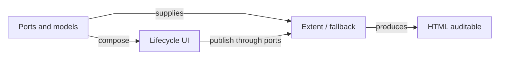

# ATF Reporting - Atlas of the production code

## At a glance

The library receives comments and typed verdicts and publishes them through Extent or Fallback HTML. The atlas link responsibilities to entries, evidence and contracts; reading an area begins with README them, then with the sources of concrete change.

[Adoption and contract of the module](../../../../../README.md) · [Context portable JAR](../../../../../docs/README.md) · [Atlas ATF](../../../../../../docs/ATF_Context_Atlas.md) · [Active consolidation criteria](../../../../../../docs/feedback/ATF_Reporting_Feedback.md)

| Followed Change | Context local | Main entrance |
|---|---|---|
| lifecycle UI, checkpoint, Given/When/Then, flow compact | [UI](ui/README.md) | `UiExtentReportSession` → lifecycle → publisher |
| Require / response, query, legacy and audit API | [API](api/README.md) | DTO-uri typed and demarcated adapters |
| model, status, timing and semantic parity | [Models](model/README.md) | joint snapshots and projections |
| Extent, Flush, Offline Assets and Publication | [Extent](extent/README.md) | `ExtentReportSession` and final pipeline in |
| tree and views fallback | [HTML](html/README.md) | `HtmlReportSession` and the immutable model |
| tables, JSON, screenshot and disclosure | [Evidence](evidence/README.md) | formatting and markup, without browser catch |
| Semantic and credit-based redaction | [Security](security/README.md) | Safe projection before formatting and budget |
| JS interactions, DOM vocabulary and assets' | [Runtime](runtime/README.md) | Java facade → native resource → HTML |

## The two entries to the rendering

<strong>Legend - what remains of every owner</strong>

- Direct entry uses `AtfReportPorts`; UI facade adds checkpoints,
  profile and grouping over the ports of the renderer.
- The consumer executes HTTP / browser and decides the comparisons. Reporting preserves
  These facts, aggregate the statuses and build the artifact.
- The joint snack allows for the verification of parity; the differences in publication; and
  visual checks are documented at the renderer, not presumed equivalent.

## Minimum context of a revision

- For a semantic change: the port or DTO-ul, the mapper that publishes it, and
  Snapshot oracle; a screen shot alone does not prove the correct status.
- For terminal exchange: [boundary of the verdict](ui/validation/UiApiValidationEvidence.java),
  [joint projection](api/evidence/ApiExchangeEvidence.java) and UI. [ReportingStandaloneVerdictComponentTest](../../../../test/java/atf/reporting/standalone/ReportingStandaloneVerdictComponentTest.java) and [UiTerminalExchangeReportComponentTest](../../../../../../atf-reporting-tests/src/test/java/atf/ui/tests/extent/component/execution/UiTerminalExchangeReportComponentTest.java) check the refusal of the untried defendant and the preservation of evidence in both renderers.
- For a visual change: Marp, vocabulary, CSS / JS resource and sample
  browser; `runtime/tests` is the Tes tab code, not a JUnit test pack.
- For extraction: [POM-ul](../../../../../pom.xml), the JAR and
  [portable context](../../../../../docs/README.md#patru-probe-distincte-ale-extracției). A building in checkout does not replace the isolated copy of the module.
- Configuration captured at [context of the process](configuration/AtfReportConfigurationContext.java)
  and performed by [loader](configuration/AtfReportConfigurationLoader.java). Coordinated publication is held by [publication](publication/ReportPublicationCoordinator.java).

## Maintenance of the atlas

A change of entry, ownership, invariant or evidence updates README package in the same revision. The atlas retain relationships and orientation points; the complete inventory and actual behaviour remain in code and tests.

- The stable contract has owner in README module or the tied normative document.
- The problems still open have one definition in feedback, accessible from the affected area.
- Local samples are in `atf-reporting/src/test`; browser composition and rendering
  I'm in [Reporting Tests](../../../../../../atf-reporting-tests/README.md).

