# Reporting security — proiecția sigură a dovezilor

## Pe scurt

Pachetul redactează valori pentru publicare. Observația integrală și verdictul
aparțin callerului; parsarea pentru display nu execută cereri și nu reevaluează
comparațiile. Contextul bibliotecii este în [atlasul local](../README.md).

| Intrare | Contract | Limită |
|---|---|---|
| `SensitiveDataRedactor.redactJson` | citește cheile semantice și maschează valoarea sensibilă completă | JSON explicit invalid care începe ca obiect/array este omis |
| `SensitiveDataRedactor.redactText` | recunoaște JSON valid și aplică regulile textuale existente celorlalte valori | nu este parser universal de protocoale ori encodări |
| `SensitiveDataRedactor.redactField` | numele sensibil maschează întreaga valoare, indiferent de tipul textului | clasificarea este neutră; politica personal-field Shop rămâne la consumer |
| `JsonEvidenceRedactor` | streaming, inclusiv nesting, Unicode și câmpuri duplicate | nu rescrie inputul callerului sau datele folosite la asociere |
| `MultipartEvidenceRedactor` | protejează câmpurile multipart și variantele lor de credentiale | structura și politica formatului rămân explicite |

## Ordinea proiecției

```mermaid
%%{init: {"themeVariables":{"fontSize":"15px"},"themeCSS":".nodeLabel, .nodeLabel p { font-size: 15px !important; line-height: 1.35 !important; } .edgeLabel, .edgeLabel p { font-size: 12px !important; font-weight: 400 !important; line-height: 1.2 !important; } .edgeLabel .labelBkg, .edgeLabel p { background: transparent !important; } .edgeLabel foreignObject { transform: translateY(-18px); overflow: visible; } .node rect { rx: 6px; ry: 6px; }","flowchart":{"curve":"linear","nodeSpacing":24,"rankSpacing":40,"padding":10,"diagramPadding":16}}}%%
flowchart LR
    Input["Dovadă"] -->|interpretează| Key["Cheie semantică"]
    Key -->|maschează| Safe["Valoare sigură"]
    Safe -->|proiectează| Budget["Buget de display"]
    Budget -->|publică| HTML["Extent / fallback"]
```

<strong>Legendă — siguranță fără schimbarea verdictului</strong>

- Cheia JSON este decodată înainte de clasificare; o cheie Unicode sensibilă
  nu devine vizibilă abia după mascarea bazată pe un nume literal.
- O valoare sensibilă string, numerică, boolean, null, array sau obiect este
  înlocuită integral. Câmpurile duplicate sunt păstrate; cele nesensibile rămân inspectabile.
- Bugetul este aplicat ulterior de formatterul de evidence. Verdictul primit
  rămâne independent de expected/actual scurtate identic în HTML.
- Textul liber păstrează sintaxa locatorilor și regulile textuale. Canalul JSON
  explicit are fallback diagnostic sigur pentru documente invalide.

## Probe și context minim

- `JsonEvidenceRedactionComponentTest` verifică întregul artifact Extent/fallback
  cu canary-uri sintetice, inclusiv când plafonul body-ului este dezactivat.
- `JsonEvidenceRedactorTest` verifică nesting, valori non-string, chei duplicate,
  replacement configurat, input invalid și păstrarea textului fără JSON.
- Identitatea query-ului și ascunderea amprentelor aparțin
  [ReportRequestSignature](../api/ReportRequestSignature.java); plafonul și
  formatarea aparțin [evidence](../evidence/README.md).

Probele de compoziție rămân în proiectul intern Reporting Tests. Pachetul de
producție și această hartă nu aduc JUnit, Core, UI ori Kit în JAR-ul bibliotecii.
