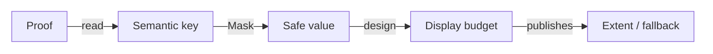

# Reporting security - secure projection of evidence

## At a glance

The package redacts values for publication. The full observation and verdict belong to the caller; parsing for display does not execute requests and reevaluate comparisons. The context of the library is in [local atlas](../README.md).

| Input | Contract | Boundary |
|---|---|---|
| `SensitiveDataRedactor.redactJson` | read semantic keys and mask the full sensitive value | JSON explicitly invalid starting as object / array is omitted |
| `SensitiveDataRedactor.redactText` | recognises the valid JSON and applies the existing textual rules to other values | is not universal parser of protocols or encoding |
| `SensitiveDataRedactor.redactField` | sensitive name masks the full value, regardless of text type | classification is neutral; personal policy-field Shop remains at consumer |
| `JsonEvidenceRedactor` | streaming including nesting, Unicode and duplicate fields | do not rewrite the caller input or the data used in combination |
| `MultipartEvidenceRedactor` | protect multipart fields and their variants of credentials | the structure and policy of the format remain explicit |

## Projection order

<strong>Legend - Safety without change of verdict</strong>

- JSON key is decoded prior to classification; a sensitive Unicode key
  It doesn't become visible until after the mask is based on a literal name.
- A sensitive string value, numeric, boolean, null, array or object is
  The duplicate fields are kept; the non-sensitive fields remain inspectable.
- The budget is subsequently applied by the evidence formatter.
  remains independent of the expected / current shortened identical in HTML.
- Free text keeps the syntax of locators and textual rules. JSON Channel
  explicit has safe diagnostic fallback for invalid documents.

## Minimum evidence and context

- `JsonEvidenceRedactionComponentTest` checks the entire artifact Extent / fallback
  with synthetic canaries, including when the body's ceiling is disabled.
- `JsonEvidenceRedactorTest` checks nesting, non-string values, duplicate keys,
  Replacement configured, invalid input and text retention without JSON.
- The identity of the query and the hiding of fingerprints belong to
  [ReportRequestSignature](../api/ReportRequestSignature.java); the ceiling and formatting belong to [evidence](../evidence/README.md).

The composition samples remain in the Reporting Tests internal project. The production package and this map do not bring JUnit, Core, UI or Kit to JAR library.
