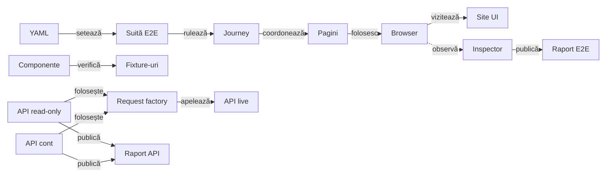
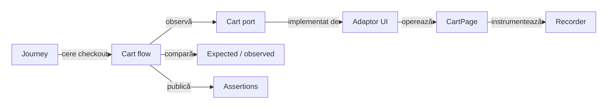
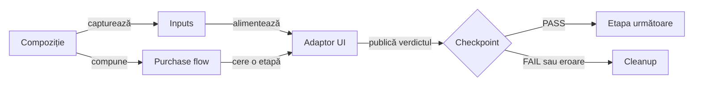
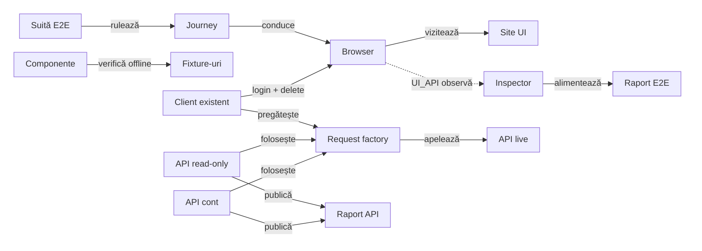
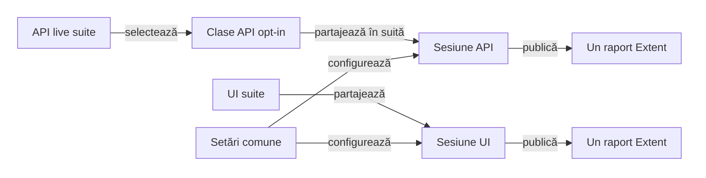
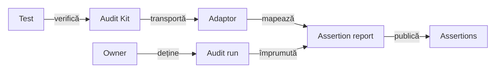
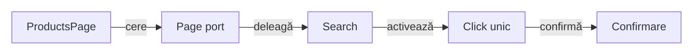
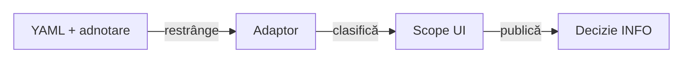

# ATF Automation Exercise — consumer UI E2E

`atf-test-auto-ex` verifică un journey de cumpărare pe site-ul public
[Automation Exercise](https://automationexercise.com/). Configurația, rutele,
selectorii, page objects și regulile business rămân specifice acestui consumer;
browserul și raportarea sunt furnizate de modulele ATF.

## Pe scurt

- Acest modul deține journey-ul E2E și suportul specific site-ului AutoEx.
- Gate-ul uzual selectează direct `AutoExPurchaseUiE2eTest` și execută cumpărarea o singură dată.
  Profilele de evidence sunt opțiuni de execuție ale aceluiași business, nu
  obiective suplimentare de acoperire.
- `atf-ui` deține execuția browserului; `atf-reporting` deține modelarea și
  publicarea evidence-ului.
- `@AtfUiEvidence(flow = UNIFIED_FLOW, screenshots = FINAL_AND_FAILURE)` produce o
  secvență unificată de acțiuni și o captură
  terminală la succes și captură la failure; `UI validation` include observația `Audit screen contract`,
  înregistrată înainte de drenarea secvenței. Aceasta declară separat numărul
  aserțiunilor și starea capturii, fără să devină acțiune Playwright sau sursă
  de verdict.



<details>
<summary><strong>Legendă — scope-ul consumerului</strong></summary>

AutoEx deține datele și interacțiunile site-ului. `UI_API` observă request-urile
produse de journey-ul din browser; suitele API live folosesc separat
`AutoExApiRequestFactory`, iar testele componente rămân offline. `atf-ui`
execută browserul și `atf-reporting` publică artifactele; niciunul nu primește
reguli business Automation Exercise.
Etichetele scurte păstrează următorul sens:

| În schemă | Sens complet |
|---|---|
| YAML | atf-auto-ex.yaml |
| Suită E2E | AutoExE2eSuite |
| Journey | Purchase journey |
| Pagini | page objects AutoEx |
| Browser | sesiunea Playwright ATF |
| Inspector | network inspector |
| Raport E2E | raport E2E partajat |
| Componente | AutoExComponentSuite |
| Fixture-uri | reguli business și adaptoare offline |
| API read-only | API live read-only |
| API cont | API live cu cont |
| API live | Automation Exercise API |
| Raport API | raport API Extent |
| setează | configurează |
| observă | UI_API observă |

</details>

## Boundary-ul AutoEx

| Zonă | Conținut specific acestui consumer |
|---|---|
| `src/main` | Configurația site-ului, catalogul de rute/selectori, page objects, purchase journey și cleanup-ul contului sintetic |
| `src/test` | Gate business E2E, selecții manuale de evidence, contracte componente AutoEx și adaptorul JUnit |
| Rulare | Site-ul public; E2E-ul este opt-in în Maven, iar rularea directă din IntelliJ este suportată |

Configurația implicită este [`atf-auto-ex.yaml`](src/test/resources/atf-auto-ex.yaml)
și aparține profilului de test, nu unei biblioteci publicate:

- `AutoExConfigurationLoader` o citește din classpath, cu fallback la fișierul
  modulului pentru lansările IDE;
- un YAML alternativ se selectează prin `-Datf.autoex.config=<path>`; căile
  relative se rezolvă față de working directory-ul procesului;
- URL-ul, browserul, timeout-urile, produsul demo, identitatea sintetică, plata
  demo și directorul raportului sunt configurate acolo;
- YAML-ul dezactivează E2E-ul implicit pentru rulările Maven obișnuite; extensia
  recunoaște markerul IntelliJ și îl poate activa chiar dacă `e2eEnabled: false`.
- `AutoExE2eExtension` extrage semnalele specifice AutoEx (proprietate JVM,
  `e2eEnabled` din YAML și marker IntelliJ) și le transmite resolverului neutru
  `AtfE2eActivationPolicy` din `atf-test-kit`.
- Precedența comună este override JVM explicit → opt-in configurat → fallback
  IDE → dezactivat; `false` explicit oprește testul în orice runner, iar valorile
  invalide eșuează închis. Test Kit probează politica, iar guvernanța whole-ATF
  protejează wiring-ul consumatorilor.

Profilul conține numai date sintetice și date de plată demonstrative; nu introduce
în YAML date personale reale, parole sau instrumente de plată reale. Modelul
redactează câmpurile de înregistrare și plată din reprezentarea textuală.

- `AutoExPurchaseJourney` folosește `AutoExPurchaseSession` pentru achiziția care
  poate avea precondiție API; aceasta rămâne înaintea căutării UI. `AutoExCartJourney`
  primește `AutoExCartJourneyPort`, fără operații de checkout sau inspector API.
  Catalogul UI comun este expus separat prin `AutoExCatalogSearchPort`.
- `HomePage`, `CheckoutPage` și `AccountPage` primesc porturile lor de capabilități
  (`AutoExHomePagePort`, `AutoExCheckoutPagePort`, `AutoExAccountPagePort`), iar
  căutarea de produs din page object folosește numai `AutoExUiActions` și numele
  așteptat explicit. `AutoExPagePortsComponentTest` verifică ordinea checkpoint-urilor,
  căutarea UI fără capabilități API și oprirea la eșec fără runtime complet.
- Citirea unui heading absent, un rezultat de căutare care nu apare la timp sau
  identitatea de sesiune ori confirmarea plății absente opresc tranziția înaintea
  acțiunii următoare; page objects nu repetă automat operația. Heading-ul paginii
  de plată este verificat înainte de completarea cardului. Dacă heading-ul de
  rezultat al înregistrării lipsește, cauza se propagă, identitatea rămâne marcată
  pentru cleanup și checkpoint-ul/Continue nu rulează. Probele fail-fast sunt în
  aceeași componentă.
- `AutoExE2eRun` îl implementează în pachetul `runtime` din `src/main/java`,
  fără JUnit sau Test Kit.
- `AutoExRunFactory` și `AutoExE2eExtension` din `src/test/java`, pachetul `extension`, rezolvă
  declarațiile JUnit și dețin achiziția resurselor.
- `AutoExConsoleBridge` transmite câmpurile Reporting fabricii neutre
  `AtfConsoleEvent.fromExternalEnums(...)` din Core; Console rămâne independent
  de Reporting, iar compatibilitatea lor este probată în Reporting Tests.
- Separarea păstrează suportul specific site-ului testabil, fără ca sursele de
  producție să depindă de runner sau de Test Kit.
- La eșec, inspectorul și captura `Failure evidence` sunt publicate cât pagina
  Playwright este încă disponibilă; browserul se închide apoi, iar faza și
  scenariul se finalizează independent.
- `FailureAwareCleanupTest` verifică ordinea generică a capturii, cleanup-ului,
  diagnosticului și close-ului; `AutoExE2eRun` furnizează numai callback-urile
  business/UI ale consumerului.

- Dacă testul a eșuat înainte de teardown, `AutoExE2eRun.finish` capturează
  viewport-ul și redactează câmpurile sensibile înainte ca cleanup-ul contului
  să poată naviga pagina.
- Apoi rulează cleanup-ul și publică inspectorul de rețea. Dacă primul eșec apare
  chiar în teardown, captura se face după diagnostic și înainte de browser close.
- Faza și scenariul se finalizează independent; cauza inițială rămâne primară, iar
  erorile ulterioare sunt atașate ca `suppressed`.
- `FailureEvidenceCleanup` din Test Kit deține orchestrarea generică. Testele
  componente AutoEx verifică profilul și wiring-ul adaptorului, fără să dubleze
  primitivele generice.

`AutoExRunFactory` folosește `TestRunInitialization` din Test Kit pentru
achiziția cu factory-uri injectabile. Runtime-ul primește portul
`AutoExRunLifecycle`; `AutoExRunLifecycleAdapter` îl leagă în test de cleanup-ul
neutru din Kit. `TestRunInitializationTest` protejează ordinea și cauza:

- eșec după fiecare handle dobândit: doar faza/scenariul disponibile sunt
  marcate FAIL, apoi browserul este închis;
- toate etapele de rollback sunt încercate; eroarea setup rămâne primară, iar
  eșecurile rollback sunt `suppressed`;
- nodurile Extent create intern înainte ca un factory să returneze handle-ul
  țin de atomicitatea contractului `atf-reporting`, nu de consumer.

**Decizie de boundary:** `AutoExPurchaseSession` rămâne în `src/main` ca API
intern al runtime-ului consumer, deoarece journey-ul de producție îl folosește.
Nu este API generic ATF; JUnit și rezolvarea adnotărilor rămân în `src/test`,
iar browserul și publicarea sunt în runtime-ul main. Reevaluați decizia dacă
se schimbă apelanții runtime sau dacă
testul de arhitectură nu mai confirmă acest ownership; orice extracție generică
trebuie demonstrată comportamental în ambii consumatori.

## Contractul testelor AutoEx

- `@AtfE2eTest` și `@AtfTestChannel(UI/UI_API)` clasifică testele după
  boundary și canal; varianta UI este selecția uzuală de business.
- Contractul comun `@AtfUiEvidence` din Test Kit declară separat forma flow-ului
  și politica de captură; adaptorul AutoEx îl mapează în profilul Reporting.
  Varianta cu o captură la succes folosește `FINAL_AND_FAILURE`: nu adaugă
  capturi la checkpoint-uri, dar păstrează captura terminală și una la failure.
  `CONFIGURED` moștenește axa reală din `reports.evidence`; capturile absente
  acolo moștenesc politica Reporting. Declarațiile directe și compuse sunt
  rezolvate înainte de resurse, cu diagnostic de conflict; metadata nu pornește
  singură browserul sau lifecycle-ul.
- `@UiReportSubdirectory("auto-ex")` și `@AtfConsoleMessages(DETAILS)` păstrează
  output-ul și diagnosticul consumerului în locația/politica stabilite.
- `AutoExE2eExtension` compune sesiunea per test; `AutoExE2eSuite` rulează
  clasele secvențial și partajează raportul.

### Configurarea evidence-ului

| Cheie sub `automationExercise.reports.evidence` | Default | Efect |
|---|---|---|
| `flowMode` | `screen-checkpoints` | `screen-checkpoints` sau `unified-flow` |
| `screenshotPolicy` | moștenește Reporting | `each-checkpoint`, `final-only`, `failure-only`, `final-and-failure`, `none` |
| `actionDetailsMode` | `included-collapsed` | `included-collapsed` sau `summary-only` |

Precedența este configurație → axă explicită din `@AtfUiEvidence`, directă ori
compusă. Alegerea canalului rămâne separată; configurația evidence-ului nu
activează API-ul, nu alege pași business și nu permite replay-ul unei mutații.
Cheile și valorile necunoscute sunt respinse înaintea browserului.

### Gate-ul coșului și ownerul contului



<details>
<summary><strong>Legendă — gate și lifecycle fără ownership în pagini</strong></summary>

- `AutoExCartFlow` nu importă browser, JUnit, configurație sau Reporting.
  Citește un snapshot, compară produs/preț/cantitate/total și permite checkout-ul
  numai după gate PASS și publicarea rezultatului. Lipsa observației eșuează.
- `AutoExCartUiFlow` implementează portul prin `CartPage`; mapperul de evidence
  păstrează cele patru aserțiuni și checkpoint-ul existent. Timeout-ul ori
  publicarea eșuată nu autorizează continuarea sau repetarea mutației.
- `AutoExAccountLifecycle` aparține `AutoExE2eRun`. Toate instanțele
  `AccountPage` și cleanup-ul văd aceeași identitate și aceeași stare de ștergere.
  O creare incertă rămâne urmărită; altă identitate sau un cont împrumutat nu
  primește drept de ștergere. O ștergere începută fără confirmare nu se repetă.
- Pilotul privește review-ul coșului. Restul separării business/UI este urmărit
  în feedback; mutarea stării nu pretinde migrarea întregului journey.
Etichetele scurte păstrează următorul sens:

| În schemă | Sens complet |
|---|---|
| Journey | Purchase journey |
| Cart port | AutoExCartPort |
| Recorder | PlaywrightActionSequence |
| Expected / observed | Expected + observed order line |
| Assertions | AutoExCheckoutAssertions |
| operează | citește și acționează |
| publică | publică rezultatul |

</details>

| Probă locală | Ce demonstrează |
|---|---|
| `AutoExCartFlowComponentTest` | ordinea observație/gate/publicare/checkout; câmp greșit, lipsă, timeout și cauză primară păstrată |
| `AutoExCartDomComponentTest` | portul folosește pagina și recorderul real; prețul greșit blochează click-ul și produce un singur failure corelat în Extent |
| `AutoExRuntimeBoundaryComponentTest` | răspunsul 2xx, 503, `requestFailed` și lipsa schimbului; vecini de rută/metodă/resursă, un click și corelarea transport/modal sub `CART_ADD` |
| `AutoExAccountLifecycleComponentTest` | owner comun paginilor, create incert, identitate diferită și delete început fără confirmare |

Raportul componentei DOM conține intenționat un scenariu PASS și unul FAIL.
Testul trece numai dacă ambele rezultate și blocarea checkout-ului sunt corecte;
aceasta este o probă controlată, distinctă de raportul E2E al magazinului public.

### Etapele purchase și adaptorul UI

`AutoExPurchaseJourney.execute` este composition root-ul: capturează catalogul,
profilul, plata demo și destinația cleanup în `AutoExPurchaseInputs`, păstrează
căutarea și precondiția API, apoi compune coordinatorul cu adaptorul per purchase.
`AutoExPurchaseFlow` cunoaște nouă etape semantice, fără browser, configurație,
JUnit sau Reporting. `AutoExPurchaseUiFlow` deține paginile și observațiile UI;
`AutoExPurchaseAssertions` proiectează regulile existente în rândurile raportului.



<details>
<summary><strong>Legendă — gate-uri înaintea mutației următoare</strong></summary>

- Ordinea rămâne product → add → cart → registration → review → payment → order → invoice → cleanup.
- Cart păstrează `AutoExCartFlow` și excepția sa business, inclusiv cauza de publicare.
- UI/API păstrează același checkpoint, observația pasivă după add și confirmarea UI:
  răspunsul respins/neobservat nu așteaptă modalul de succes; timeout-ul modalului
  după 2xx produce comparația UI eșuată la checkpoint.
- `AutoExPurchaseFlowComponentTest` verifică oprirea fără retry la fiecare etapă;
  `AutoExPurchaseUiAdapterComponentTest` probează paginile/adaptorul reale cu port
  instrumentat, inclusiv valori absente și transport fără confirmare.
- Nicio extracție nu demonstrează singură echivalența tuturor profilelor remote.
Etichetele scurte păstrează următorul sens:

| În schemă | Sens complet |
|---|---|
| Compoziție | Journey · composition root |
| Inputs | Purchase inputs · expected independente |
| Purchase flow | Purchase flow · ordinea etapelor |
| Adaptor UI | UI adapter · pagini + observații |
| Etapa următoare | etapa următoare |
| Cleanup | oprire + lifecycle cleanup |

</details>
## Suite și variante de evidence

Rularea uzuală selectează `AutoExPurchaseUiE2eTest`: un cont, o comandă demo,
o factură și cleanup.

Adnotarea locală `@AutoExE2eTest` compune infrastructura identică a celor opt
clase: marker E2E, extensiile de consolă și runtime, directorul `auto-ex`,
publicarea căii raportului și execuția secvențială. Canalul `UI`/`UI_API`,
`@Order` și orice `@AtfUiEvidence` rămân pe clasa concretă; compoziția nu
selectează scenariul, nu schimbă activarea IntelliJ și nu ascunde politica
specifică testului. `AutoExEvidenceProfileComponentTest` verifică adnotarea
reală și lista exactă a suitei.

Celelalte clase se aleg explicit din IntelliJ sau prin `-Dtest=<clasă>` atunci
când este necesară altă politică de evidence:

| Clasă | Canal și evidence | Contribuție |
|---|---|---|
| `AutoExPurchaseUiE2eTest` | UI; checkpoint-uri și capturi standard | journey business pe UI |
| `AutoExPurchaseUiApiE2eTest` | UI + trafic first-party observat | precondiție API de catalog și integrarea traficului cu journey-ul real |
| `AutoExPurchaseUiFinalScreenshotE2eTest` | UI; flow consolidat, captură finală și la failure | profil de evidence pentru același journey UI |

Self-service-ul contului poate fi selectat separat, fără plată sau factură:

| Clasă | Starea inițială | Business verificat |
|---|---|---|
| `AutoExAccountUiE2eTest` | vizitator neînregistrat | înregistrare UI, ștergerea propriei identități, întoarcere în magazin |
| `AutoExExistingCustomerUiApiE2eTest` | cont sintetic pregătit prin API-ul real | login UI, ștergerea propriei identități, întoarcere în magazin |

Ambele clase sunt incluse în `AutoExE2eSuite` și pot fi lansate individual.
Nu sunt teste de reclamă: verifică self-service-ul clientului și tratează vignette-ul numai dacă
site-ul îl afișează natural. Nu îl solicită, nu îl fabrică și nu întârzie flow-ul
pentru a-l provoca.

- Varianta final-screenshot nu adaugă altă regulă business; reducerea repetării
  live cere proba locală a adnotării până la publicare.
- Clasa este folosită de `AutoExEvidenceProfileComponentTest`, iar selecția
  suitei este protejată de guvernanță; criteriile sunt în
  [feedback-ul profilelor E2E](../docs/feedback/ATF_Consumer_Business_Test_Focus_Feedback.md#consumer-e2e-profiles-01--variantele-de-evidence-și-acoperirea-business).

Aceste trei selecții consumă aceeași implementare `AutoExPurchaseJourney`.
Nu se rulează toate pentru a demonstra mai mult business și nu se adaugă o
variantă de purchase pentru fiecare combinație de captură sau layout. Testele
formatării, navigării și redării raportului aparțin `atf-reporting-tests`.

`AutoExE2eSuite` este unicul gate UI complet: include cele opt clase E2E,
cu poveștile de cont nou/existent, coș/sesiune și cele trei profile de purchase păstrate.
Clasele concrete rămân selecția pentru un singur flow, fără suite suprapuse.

`AutoExComponentSuite` verifică local fără a deschide site-ul public:

Aplică [regula comună de ownership](../docs/ATF_Testing_Guide.md#owner-ul-testului-business-adaptor-sau-infrastructură);
punctele următoare descriu numai ce afirmă testele specifice Automation Exercise.

- selectează testele componente din `atf.autoex.tests.component`;
- acestea acoperă decizii și adaptoare specifice consumerului;
- testele de catalog, contract API, cleanup de cont, răspunsuri și traffic window
  rămân aici chiar dacă folosesc fixture-uri, fiindcă afirmă reguli Automation
  Exercise, nu comportament generic ATF;
- `AutoExApiContractReportPublisherComponentTest` verifică adaptorul AutoEx:
  contractul `responseCode`/mesaj, titlul API și diagnosticarea eșecului JUnit.
  Cazurile negative resping JSON invalid, cod/mesaj diferit și HTTP nereușit
  chiar când body-ul declară succes; DTO-ul păstrează form-encoding și MIME-ul
  upstream. Artifactele Extent și fallback sunt verificate pentru lipsa parolei,
  iar formatarea și redactarea comune se probează în
  [`atf-reporting-tests`](../atf-reporting-tests/README.md);
- replay-ul form-encoded fără adaptor este probat prin
  `ApiManualReplayProjectionTest` în Reporting Tests; aici rămâne verificarea
  că artifactul efectiv AutoEx nu expune parola;
- directorul default și override-ul raportului API sunt specifice consumerului;
  validarea reutilizabilă a unui path relativ sub rădăcina proiectului, inclusiv
  prevenirea ieșirii prin traversal/reparse-point, aparține
  [`atf-test-kit`](../atf-test-kit/README.md#regula-de-promovare-a-testelor-reutilizabile);
- `AutoExEvidenceProfileComponentTest` verifică numai cum consumerul aplică
  adnotarea `@AtfUiEvidence` peste configurația lui. Test Kit deține declarația
  neutră și Reporting deține profilele/lifecycle-ul generic; nu se introduce o
  dependență Test Kit → Reporting pentru a elimina un adaptor al consumerului;
- factory-urile și rollback-ul neutru sunt implementate și probate în Test Kit;
  AutoEx păstrează alegerea browserului, crearea scenariului și marcarea FAIL.
  Guvernanța verifică folosirea primitivei comune și absența copiei locale;
- ownership-ul cross-consumer este definit în [arhitectura ATF](../docs/ATF_Architecture.md)
  și în [ghidul de testare](../docs/ATF_Testing_Guide.md);
- limita de opt clase per pachet este definită în
  [bunele practici de cod](../docs/README_Atf_CodeBestPractices.md#coeziunea-pachetelor--pragul-de-opt-clase).
Contractele generice pentru browser și renderer sunt descrise în
[README-ul `atf-ui`](../atf-ui/README.md) și
[README-ul `atf-reporting`](../atf-reporting/README.md).

## Coeziunea suportului AutoEx

Codul din `src/main` este suport de producție specific site-ului, nu cod de
runner. Suportul este separat pe motive de schimbare, iar fiecare pachet rămâne
sub pragul comun de opt clase:

| Pachet | Responsabilitate |
|---|---|
| `runtime`, `runtime.config`, `runtime.account` în main | sesiunea raportului, run-ul, maparea observațiilor și capabilitățile specifice aplicației; fără JUnit/Kit |
| `extension` în test | Store, activare, achiziție prin Kit și adaptarea adnotărilor; nu dublează rendererul sau cleanup-ul generic |
| `support.journey` | coordonarea purchase-ului, trace și precondiția API read-only a catalogului |
| `support.account` | cont sintetic și cleanup |
| `support.catalog` | snapshot și aserțiuni de catalog |
| `support.checkout` | observații de adresă/comandă și mapping-ul rezultatelor business în aserțiuni |
| `business.cart` / `business.invoice` / `business.purchase` | snapshot-uri, gate-uri și ordinea purchase, fără UI, Reporting sau JUnit |
| `flow.cart` / `flow.checkout` / `flow.purchase` | adaptoarele UI, intrările purchase și citirea artifactului facturii |
| `ui.AutoExUiActions` | port local de operații UI instrumentate |
| `support.browser` | consimțământ și tratarea vignette-ului |
| `api` | rute, request factory și cont API typed; folosit de probele API directe |

`ConsumerModuleArchitectureGovernanceTest` din `atf-tests` protejează boundary-ul
source-set-ului și compoziția entry-point-urilor Shop/AutoEx; nu verifică
inventory-ul exact al claselor de producție. Inventarul este verificat separat
de guvernanța whole-ATF, iar
`AutoExCatalogApiPrecondition` și proba sa sunt acum incluse în package-urile
owner corespunzătoare. Testele componente sunt împărțite pe subpachete tematice;
pragul de coeziune este regula ATF comună din
[bunele practici de cod](../docs/README_Atf_CodeBestPractices.md#coeziunea-pachetelor--pragul-de-opt-clase),
nu un număr de clase duplicat aici.

Rutele, payload-urile, browser handlers, trace-ul și purchase journey-ul rămân
specifice AutoEx. Primitivele comune se promovează numai după demonstrarea
aceluiași contract în consumatorii relevanți și păstrarea unui API neutru;
boundary-ul Test Kit este descris în [README-ul ownerului](../atf-test-kit/README.md)
și în [arhitectura ATF](../docs/ATF_Architecture.md).

### Limita disponibilității serviciului public

Mesajul vizibil exact `This website is under heavy load (queue full)` indică
indisponibilitatea documentului, nu schimbarea locatorilor.

| Control | Contract |
|---|---|
| Recunoaștere | mesajul vizibil, independent de tag-ul HTML; fără catch general de timeout |
| Document | navigare observată în frame-ul principal: GET, același origin și același path/query |
| Rute eligibile | Home, Products/search și un detaliu de produs |
| Excluderi | POST, cont, logout, checkout, adăugare în coș, origin diferit sau metodă necunoscută |
| Buget YAML | `browser.storeAvailability.maxAttempts` include prima încărcare; modulul configurează 3 și backoff PT2S |
| Opt-in | secțiune absentă sau `maxAttempts: 1`: diagnostic explicit, fără repetare |
| Evidence | fiecare recuperare: Navigate și observație Store availability; UI-only nu activează inspectorul API |
| Epuizare | `AutoExStoreUnavailableException`, FAIL și captura reală; fără PASS/SKIP fabricat |

- Politica tipizată `UiRetryPolicy` este separată de retry-ul acțiunilor obișnuite;
  nu reexecută click-uri, căutarea, testul, crearea contului ori plata.
- Add-to-cart refuzat cu `503` nu confirmă modificarea coșului. În UI+API,
  inspectorul păstrează răspunsul; o mutație incertă nu se repetă automat.
- `AutoExStoreAvailabilityComponentTest` folosește documente interceptate în
  browser: recuperare, epuizare, GET cu efect lateral, POST, origin străin și
  element absent. Proba live rămâne în suita E2E.

## Journey-ul de cumpărare

Scenariul combină [Test Case 14 — Place Order: Register while Checkout](https://automationexercise.com/test_cases#collapse14)
cu [Test Case 24 — Download Invoice after purchase](https://automationexercise.com/test_cases#collapse24):

1. deschide magazinul și caută produsul configurat;
2. verifică produsul, prețul, disponibilitatea și cantitatea în detalii/coș;
3. înregistrează un cont sintetic în checkout și verifică adresele și comanda;
4. finalizează plata demo, verifică confirmarea și descarcă factura;
5. șterge contul sintetic și verifică starea terminală.

`CheckoutPage.downloadInvoice()` transmite numele și calea artifactului către
`AutoExInvoiceReader`, care citește conținutul observat fără browser sau verdict.
`AutoExInvoiceValidator` compară numele, clientul, suma și disponibilitatea;
`AutoExInvoiceAssertions` doar convertește rezultatele pentru Reporting.

| Limită | Probă componentă |
|---|---|
| Citire UTF-8, artifact absent și eroare IO păstrată | `AutoExInvoiceComponentTest` |
| Identitate/sumă/fișier greșit, fără completarea observației din expected | `AutoExInvoiceComponentTest`, `AutoExPurchaseBusinessComponentTest` |
| Comanda și factura remote | journey-ul E2E; componentele nu certifică serviciul public |

| Etapă | Așteptare business | Sursa așteptării |
|---|---|---|
| Căutare și produs | identitate, preț exact și disponibilitate | catalogul YAML |
| Coș | produs, preț unitar, cantitate și total de linie | catalog + calculul cantității |
| Checkout | destinatar, companie, ambele linii de adresă, localitate/stat/cod poștal, țară și telefon, în ambele adrese | profilul de înregistrare YAML |
| Review order | aceeași linie din coș și totalul general | catalog + totalul calculat |
| Plată demo | formular și confirmarea comenzii | contractul UI al site-ului |
| Factură | fișier descărcat, clientul și suma acestei comenzi | identitatea și totalul curente |
| Cleanup | cont șters și revenire la magazin | identitatea creată în această execuție |

`AutoExCheckoutAssertions` compară liniile adreselor după normalizarea
spațiilor de prezentare și folosește aceeași regulă pentru rândul din coș și
checkout. Un nume corect nu poate ascunde un cod poștal, telefon, preț sau
cantitate greșite.

`AutoExInvoiceValidator` verifică textul facturii; mapperul păstrează rezultatul.
Un fișier existent, dar gol ori al altei comenzi, produce FAIL. Aceste reguli sunt probate
cu date business pozitive și negative în `AutoExPurchaseBusinessComponentTest`.

- Catalogul, identitatea și plata folosesc valori demo din YAML; emailul și
  parola sunt unice pentru fiecare execuție.
- Cleanup-ul contului este armat înainte de submit-ul înregistrării, iar o eroare
  de cleanup nu maschează cauza primară.
- Capturile redactează câmpurile de formular. Valoarea returnată de `Get text`
  este folosită numai în aserțiunea din memorie; recorderul `atf-ui` păstrează
  `[REDACTED]` în raport și trace, fără să împiedice validarea textului real.

- Înainte de citirea fiecărei adrese, `AccountPage` așteaptă numele sintetic
  configurat în containerul de delivery, respectiv invoice.
- Journey-ul validează apoi adresa completă și order review-ul folosind
  condiția semantică `waitForText`, nu un `sleep` fix.
- `AutoExCheckoutAddressComponentTest` verifică ordinea așteptare → citire pentru
  ambii locatori; acțiunea generică rămâne deținută de `atf-ui`.

- Dialogul CMP este tratat prin interfața vizibilă, cu alegerea minimă pentru
  scopurile opționale.
- Dacă apare vignette-ul Google, handler-ul consumerului activează explicit
  controlul vizibil „Close” și verifică dispariția fragmentului din URL.
- Handler-ul nu ascunde/șterge overlay-ul, nu fabrică hash-uri și nu folosește
  click forțat; mecanismul opt-in este delimitat mai jos.
- În cleanup, o pagină rămasă pe `#google_vignette` este înlocuită prin navigare
  explicită la magazin înaintea ștergerii contului. Navigarea este înregistrată
  de ATF și nu reexecută plata; failure evidence este capturat înainte de
  recuperare și verdictul inițial rămâne FAIL.

### Vignette și activare JavaScript

AutoEx folosește `zoomPercent: 70`. Numai controlul Close al unei vignette reale
apelează `clickWithJavaScript(..., postcondition)` din `atf-ui`; restul acțiunilor
business rămân click-uri pointer Playwright. Configurația nu schimbă silențios
zoom-ul și nu activează fallback JavaScript general.

| Responsabilitate | Owner / contract |
|---|---|
| Controlul reclamei | `AutoExVignetteHandler`: fragment vignette prezent și un Close vizibil în frame |
| Încărcare asincronă | numai după observarea fragmentului, așteaptă read-only un Close vizibil/activ în iframe, în timeout-ul browserului; fără `sleep` sau pauză pentru provocarea reclamei |
| Reclama lipsește | `dismissIfPresent` întoarce imediat `false`; dacă fragmentul dispare singur în timpul așteptării, nu inventează un click Close |
| Observație pasivă | înaintea activării, `Observed Google vignette` păstrează URL-ul real și zoom-ul CSS calculat; nu solicită și nu modifică reclama |
| Activare | `atf-ui`: țintă unică/activă, un singur `HTMLElement.click()`, fără retry automat |
| Rezultat | callback read-only așteaptă eliminarea fragmentului; acțiunea trece numai după acesta |
| Raport | rând distinct `JavaScript click`, selector real, durată și observație explicită „not a trusted pointer click” |
| Limită | activarea DOM nu certifică geometria pointerului la 70% sau succesul pasului business următor |

Probele generice ale API-ului aparțin `atf-ui`; AutoEx verifică reclama apărută
natural în flow-urile reale UI/UI_API, fără teste artificiale de reclamă.
Problema pointerului rămâne în [feedback-ul de geometrie](../docs/feedback/ATF_UI_Browser_Geometry_Feedback.md).

- Vignette-ul este opțional și controlat de site/AdSense. Setarea efectivă de
  eligibilitate/frecvență a acestui magazin nu este cunoscută de ATF.
- O reclamă în catalog nu demonstrează întreruperea ștergerii. Nu resetăm
  frecvența prin cookies/storage și nu lungim artificial flow-ul ca să obținem
  încă o reclamă; acceptanța tranziției rămâne distinctă de regresia nominală.

### Contul creat și cleanup-ul sub vignette

Cleanup-ul tratează și documentul vizibil `queue full` rămas după payment.
Păstrează eșecul inițial și revine printr-un GET la Home înaintea verificării identității.

```mermaid
%%{init: {"themeVariables":{"fontSize":"15px"},"themeCSS":".nodeLabel, .nodeLabel p { font-size: 15px !important; line-height: 1.35 !important; } .edgeLabel, .edgeLabel p { font-size: 12px !important; font-weight: 400 !important; line-height: 1.2 !important; } .edgeLabel .labelBkg, .edgeLabel p { background: transparent !important; } .edgeLabel foreignObject { transform: translateY(-18px); overflow: visible; } .node rect { rx: 6px; ry: 6px; }","flowchart":{"curve":"linear","nodeSpacing":24,"rankSpacing":40,"padding":10,"diagramPadding":16}}}%%
flowchart LR
    Failure["Eșec"] -->|păstrează cauza| Evidence["Dovezi"]
    Evidence -->|document întrerupt| Home[GET Home]
    Home -->|verifică| Identity["Identitate"]
    Identity -->|o singură dată| Delete[Delete account]
```



<details>
<summary><strong>Legendă — recuperare fără replay de payment</strong></summary>

- Triggerul este documentul din afara hostului configurat sau mesajul vizibil exact
  `queue full`; ruta POST nu este reîncărcată.
- Home folosește politica GET bounded existentă. Eșecul recuperării este secundar
  față de cauza business; nu autorizează o a doua înregistrare sau plată.
- O altă identitate ori o ștergere deja pornită blochează mutația. Confirmarea cere
  URL-ul, heading-ul și o singură navigare de ștergere, ca în flow-ul nominal.
- `AutoExAccountCleanupRecoveryComponentTest` verifică documente reale în browser
  cu răspunsuri locale controlate; nu certifică disponibilitatea serviciului public.
Etichetele scurte păstrează următorul sens:

| În schemă | Sens complet |
|---|---|
| Eșec | Eșec business |
| Dovezi | Failure evidence |
| Identitate | Identitate deținută |
| o singură dată | permite o singură dată |

</details>

| Situație observată | Comportament | Limită de siguranță |
|---|---|---|
| Crearea este confirmată | `AccountPage` reține confirmarea înaintea checkpoint-ului și a navigării Continue | schimbarea paginii nu transformă contul creat într-un cleanup `NO_OP` |
| Submit-ul creării este întrerupt | păstrează și faptul că încercarea a început; dacă documentul magazinului s-a pierdut, îl redeschide și încearcă login-ul identității curente | nu presupune că lipsa confirmării înseamnă cont inexistent; eșecul rămâne primar |
| Cleanup începe sau este întrerupt pe vignette | navighează la Home și publică triggerul și destinația observate | cel mult o reluare după o întrerupere nouă; fără DOM injectat, hash fabricat sau retry de plată |
| Clientul este delogat | reautentifică numai contul sintetic deja confirmat | numele din header trebuie să coincidă exact cu identitatea rulării înainte de Delete account |
| Ștergerea este confirmată | dezarmează imediat callback-ul, înaintea capturii și a Continue | o eroare ulterioară nu repetă ștergerea unui cont deja eliminat |

Ordinea generică a capturii, conservarea cauzei primare și a erorilor
`suppressed` sunt probate în Test Kit. Recuperarea și ștergerea reușite nu
promovează failure-ul inițial la PASS; eșecul cleanup-ului rămâne secundar.
Activarea reclamei și recuperarea business sunt mecanisme distincte: închiderea
overlay-ului nu este acceptată drept confirmare a creării sau ștergerii contului.

### Delete account — navigare întreruptă

Ștergerea este legată de contul sintetic al rulării, nu de un heading generic.
`AutoExAccountDeletionAttempt` observă pasiv request-urile către endpoint-ul
configurat, dinaintea click-ului până la confirmare; nu schimbă traficul și nu
depinde de activarea inspectorului UI_API.

| Stare observată | Decizie business |
|---|---|
| Request de ștergere deja pornit | așteaptă destinația; fără replay, inclusiv la failure cleanup |
| Vignette închisă, zero request-uri, destinație neatinsă | permite cel mult o continuare a navigării, nu retry de ștergere executată |
| Înaintea continuării | reîncarcă Home; cere aceeași identitate exactă, Delete account vizibil și încă zero request-uri |
| Altă identitate sau stare ambiguă | FAIL; nu șterge alt cont și nu repetă plata, înregistrarea sau login-ul arbitrar |
| Confirmare | URL exact `/delete_account`, heading `account-deleted` vizibil și exact o navigare GET de tip document, într-un snapshot complet; apoi dezarmează cleanup-ul |
| A doua întrerupere fără confirmare | FAIL cu evidence înainte de recuperare; fără buclă de continuări |
| Trafic suplimentar fără navigare | nu devine o a doua navigare; ACTUAL păstrează numărul total și fiecare observație: metodă, resursă, navigare și calea redirectului, fără query sau credențiale |
| Zero/două navigări, metodă/resursă neașteptată ori diagnostic incomplet | FAIL; nu relaxează condiția la „cel puțin una” |

`Traffic.singleDeletionNavigation()` verifică navigarea business, în timp ce
`startedRequests()` protejează separat orice request observat împotriva
replay-ului. Două evenimente browser nu certifică două click-uri sau două
execuții HTTP pe server; raportul nu pretinde măsurarea efectelor server-side.

- Continuarea observată publică un pas Gherkin separat, numărul de request-uri
  de dinaintea continuării și identitatea revalidată; două click-uri UI nu sunt
  prezentate drept două request-uri de ștergere.
- `AutoExAccountDeletionProgress` este regula pură de siguranță; proba de
  componentă verifică inclusiv refuzul după orice request pornit și absența
  permisiunii când nu există întrerupere observată.
- Probele E2E folosesc numai flow-uri business reale la 70%; nu injectează
  overlay-uri, hash-uri, răspunsuri sau navigări de reclamă fabricate.
- Intermitența reclamei se tratează prin `dismissIfPresent`, nu prin retry-ul
  întregului test. Un Close absent după timeout sau o țintă ambiguă rămân erori;
  nu există `catch` general care transformă ștergerea neconfirmată în succes.

`AutoExAccountUiE2eTest` verifică direct self-service-ul contului: deschide
magazinul, înregistrează un client sintetic, verifică identitatea, șterge contul
și confirmă revenirea pe Home. Se selectează manual ca regresie focalizată
sau prin gate-ul UI complet, independent de checkout/plată.

`AutoExExistingCustomerUiApiE2eTest` pregătește un client prin API-ul public
în setup, apoi verifică login-ul și ștergerea prin UI. Setup-ul și traficul
cauzal al browserului rămân distincte; cele două căi reutilizează transportul
`AutoExLiveApi`, fără retry automat al mutațiilor.

## Coș și continuitatea sesiunii

`AutoExCartUiE2eTest` delegă două povești independente către `AutoExCartJourney`.
Fiecare metodă primește o sesiune de browser izolată prin aceeași extensie ATF.

| Poveste | Interacțiuni business | Rezultat verificat |
|---|---|---|
| Recalculare și eliminare | adaugă o unitate, apoi cantitatea configurată a aceluiași produs, apoi elimină rândul | preț unitar, cantitate cumulată, total calculat și mesajul coșului gol |
| Guest cart după login | creează un cont sintetic, face logout, adaugă produsul ca guest și se autentifică din nou | aceeași identitate și aceeași linie de coș înainte/după login; apoi ștergere explicită |

- Cantitate: site-ul nu permite editarea directă în rând; testul adaugă din nou
  același produs, fără mutații DOM sau endpoint inventat.
- Așteptări: `Catalog.withQuantity(...)` calculează totalul; rezultatul
  căutării este așteptat înainte de deschiderea produsului.
- Coș gol: se citește `#empty_cart` vizibil, nu elementul omonim ascuns.
- Vignette: activarea Close este singurul opt-in JavaScript; contractul și
  limita pointerului sunt descrise [mai sus](#vignette-și-activare-javascript).
- Audit: Overview/System publică engine-ul, headless, viewport-ul și zoom-ul
  CSS rezolvat pentru sesiune; închiderea reclamei nu modifică verdictul business.
- Ownership: `support.cart` deține journey-urile, `support.trace` propozițiile
  Gherkin și portul `AutoExTraceStep`; purchase rămâne separat, iar Reporting
  acceptă ambele vocabulare.

## Rute și locatori ai site-ului

### Vocabular și adrese

| Valoare | Owner | Utilizare |
|---|---|---|
| Identitatea site-ului public | `AutoExSite.PUBLIC_BASE_URI` | referință canonică în Java; endpoint-ul efectiv rămâne `baseUrl` din YAML/override |
| Endpoint fictiv pentru componente | `AutoExApiFixture.BASE_URI`, numai în `src/test` | transport determinist și evidence offline; fără apel la site-ul public |
| Rute API | `AutoExApiRoute` | factory-ul API și aliasul `AutoExRoutes.PRODUCTS_API` folosesc aceeași definiție |
| Câmpuri form/query și JSON | `AutoExApiFormField`, `AutoExApiJsonField` | cont typed, autentificare, căutare și citirea catalogului |
| Rezultate API business | `AutoExApiOutcome` | perechi `responseCode`/`message`; HTTP transport rămâne un contract distinct |
| Texte și verdicturi UI | `AutoExUiText`, `AutoExStoreAssertions` | reguli pure comune paginilor și journey-urilor de cont, coș și comandă |
| Destinația căutării | `AutoExCatalogAssertions.searchLocation` | origin și path configurate, un singur parametru `AutoExRoutes.SEARCH_PARAMETER`, cu valoarea decodată exactă |
| Faze reporting | `ReportUiContract.Phase` din Reporting | nume de fază comune, fără un catalog AutoEx duplicat |
| Metode, headers și MIME | `HttpMethod`, `HttpHeader`, `MediaTypes` din Core | protocol comun, inclusiv `APPLICATION_FORM_URLENCODED` |

Vocabularul site-ului rămâne separat de primitivele reutilizabile:

- constanta site-ului nu este fallback ascuns; proba de configurație verifică
  propagarea altui URL până la browser;
- fixture-urile wire rămân oracol independent de serializer pentru numele
  câmpurilor, encoding și omiterea parametrilor lipsă, inclusiv în cazuri negative;
- componentele verifică mesaje parțiale și lipsă, query-uri duplicate, domenii
  diferite, encoding și prefixe de configurare; testele nu înlocuiesc expected-ul
  cu o valoare citită din același rezultat;
- `AutoExRoutes` deține rutele, `AutoExSelectors` selectorii, iar page objects
  consumă catalogul fără CSS inline; acestea sunt contracte AutoEx;
- `atf-ui` deține [regulile CSS reutilizabile](../atf-ui/README.md#convenții-pentru-locatori-ui)
  pentru `HtmlElement`, `HtmlAttribute` și escaping; AutoEx le exercită pe
  markup real, fără a dubla probele generice cu DOM sintetic.

Un selector Surefire de metodă (`Clasă#metodă`) se execută separat de clasele
`@Suite`: filtrul metodei poate ajunge și în discovery-ul suitelor și produce
`NoTestsDiscoveredException`. Pentru probele de mai sus rulează întâi
`AutoExComponentSuite`, apoi, separat, metoda business selectată sau suita live.

### Reutilizare după analiza Practice Shop

| Capabilitate deja comună | Owner reutilizat de AutoEx | Date care rămân locale |
|---|---|---|
| Clasificare, activare E2E, output, consolă și evidence | `atf-test-kit`: adnotări și `AtfE2eActivationPolicy` | YAML-ul site-ului și semnalele runnerului |
| Cleanup și conservarea cauzei inițiale | `FailureAwareCleanup`, `FailureEvidenceCleanup` | identificarea și ștergerea contului AutoEx |
| Browser, acțiuni, captură și redactare | `atf-ui` | rute, selectori, CMP și vignette AutoEx |
| Profil per scenariu, assertions și network inspector | `atf-reporting` | așteptările checkout-ului și asocierea observațiilor la pași |

- Independență: nu există dependență AutoEx → Practice Shop; validatoarele și
  jurnalul Shop includ selectorii, identitatea și contractul acelui site.
- Extracții: se mută doar un API neutru, cu același comportament probat în
  consumatorii relevanți; business-ul nu se transferă în infrastructură.
- Increment curent: se refolosesc primitivele comune existente; regulile de
  adresă rămân în `support.checkout`; coșul și factura au reguli pure în `business`.

## API direct și limita evidence-ului UI/API

Rutele publice sunt inventariate în [API List](https://automationexercise.com/api_list).

- Varianta purchase `UI_API` observă traficul produs de journey-ul din browser.
- Self-service-ul clientului existent pregătește separat contul prin
  `AutoExApiRequestFactory`, înainte de login UI.

Diagrama
separă fluxul browserului, contractele componente offline și cele două porți
API live; ele nu sunt variante ale aceluiași test.



<details>
<summary><strong>Legendă — alegerea traseului API/UI</strong></summary>

- `UI_API` observă traficul pe care îl produce browserul și îl leagă de
  checkpoint-uri; pregătirea directă a contului nu este atribuită acelor acțiuni;
- `AutoExComponentSuite` verifică modele și adaptoare cu fixture-uri locale,
  fără serviciul public;
- `AutoExApiReadOnlyLiveContractTest` trimite request-uri directe, inclusiv `POST`
  pentru căutare, dar nu creează și nu modifică un cont;
- `AutoExApiLiveSuite` este separat deoarece creează și actualizează un cont
  sintetic, apoi încearcă cleanup-ul;
- rapoartele UI și API au sesiuni și directoare distincte.
Etichetele scurte păstrează următorul sens:

| În schemă | Sens complet |
|---|---|
| Suită E2E | AutoExE2eSuite |
| Journey | Purchase journey |
| Browser | ATF Playwright |
| Site UI | Automation Exercise UI |
| Inspector | network inspector |
| Raport E2E | raport E2E partajat |
| Fixture-uri | contracte cu fixture |
| Client existent | Client existent E2E |
| Request factory | request factory |
| API read-only | API read-only live |
| API cont | API live cu cont |
| API live | Automation Exercise API |
| Raport API | raport API Extent |
| login + delete | login și ștergere UI |
| pregătește | pregătește separat |

</details>

| Suprafață | Comportament verificat | Limită / efect |
|---|---|---|
| Model request | `AutoExApiRoute`, `AutoExApiRequestFactory` și `AutoExApiAccount` descriu rutele și request-urile typed; reprezentarea contului redactează datele sensibile | verifică forma request-ului, nu comportamentul serviciului live |
| Contract component | fixture-ul verifică metoda, ruta, query/form, răspuns JSON reprezentativ și exchange-ul raportat | offline; nu certifică serviciul public și nici schema lui completă |
| API live read-only | `AutoExApiReadOnlyLiveContractTest`; `GET` products/brands și `POST` product search | cere `-Datf.autoex.api.readonly.live.enabled=true`; nu creează sau modifică conturi |
| API live cu cont | `AutoExApiLiveSuite`; contracte positive/negative și lifecycle-ul contului sintetic cu cleanup | cere `-Datf.autoex.api.live.enabled=true`; efect extern, opt-in |
| Raport API direct | `AutoExApiContractReportExtension` publică exchange-uri și assertions JSON; implicit `artifacts/reports/api/auto-ex`, override `atf.autoex.api.report-directory`; `@AtfReportPath` publică locația | publisher component verifică artifactul offline, dar nu substituie proba live |
| Traficul E2E `UI_API` | precondiția catalogului este publicată separat de fereastra cauzală | XHR/fetch first-party, inclusiv coșul fără prefix `/api/`; scope și completitudine în inspector |

### Eroare API cu istoric parțial

`AutoExApiFailureEvidence` din main convertește snapshot-ul Core în evidence
Reporting. Extensia JUnit îl cheamă la eșec și păstrează ownership-ul
clasă/suită, diagnosticul și închiderea raportului.

- Un 503 urmat de eroare de transport rămâne o singură operație cu două
  încercări în ordine; a doua are status indisponibil.
- Publicarea nu reexecută request-ul și nu extinde retry-ul API live,
  care păstrează politica single-attempt existentă.
- `AutoExTerminalExecutionComponentTest` verifică adaptorul pe transport
  controlat în Extent/fallback, fără a certifica serviciul public.
- Aserțiunile componente rămân în pasul standard colapsat; limita de 240 și
  redactarea textului complet înaintea plafonului rămân obligatorii.

Contractul producerului este la [Core](../atf-core/README.md#istoric-la-eroare-terminală),
iar proiecția la [Reporting](../atf-reporting/README.md#execuție-api-terminată-fără-răspuns).

### De ce raportul API nu arată ca raportul UI

Ambele suite publică Extent HTML și folosesc setările Extent comune; sesiunea și evidence-ul depind de canal:


<details>
<summary><strong>Legendă — sesiuni și evidence</strong></summary>

- sesiunea UI este partajată pe suită și publică evidence-ul browserului;
- suita API declară explicit scope `suite`; clasele active publică exchange-urile
  și aserțiunile JSON într-o singură sesiune, cu ownerii separați;
- o clasă API lansată individual păstrează scope `class` și raport propriu;
- ambele sesiuni citesc setările Reporting comune, dar API nu publică pași UI sau
  capturi de browser.

</details>

- `AutoExRunFactory` deține sesiunea UI; `AutoExApiContractReportExtension`
  deține raportul API direct;
- extensia API obține sesiunea în `BeforeAll` prin `TestRunScope`, finalizează
  faza/scenariul în `AfterEach`, iar Store-ul ownerului închide sesiunea o singură dată;
- read-only, mutativ și ambele păstrează opt-in-uri independente; un eșec într-o clasă
  rămâne în artifactul comun, fără să elimine evidence-ul celeilalte clase;
- agregatorul `AtfReportPathOptIn` include fiecare owner activ; execuțiile succesive
  nu reutilizează sesiunea închisă. `AutoExApiReportScopeComponentTest` probează
  selecțiile, lansarea individuală, failure-ul și izolarea între lansări;
- probele de lifecycle folosesc metadata `COMPONENT` și transport mock declarat;
  nu prezintă răspunsurile controlate ca execuții HTTP live;
- diagnosticul API redactează mesajul integral înaintea plafonului său; limita
  de afișare a aserțiunilor rămâne 240 de caractere;
- calea implicită este `artifacts/reports/api/auto-ex`, iar `@AtfReportPath`
  anunță locația.

Testele cu `@AutoExComponentTest` publică un raport Extent per owner:
clasa individuală are un raport, iar `AutoExComponentSuite` declară explicit
scope `suite` și grupează clasele într-un singur artifact.

- Auditul și scenariul rămân per metodă/invocare parametrizată; sesiunile nu
  se partajează între lansări și fixture-urile Reporting își păstrează artifactele proprii.
- Directorul implicit este `artifacts/reports/component/auto-ex`; override-ul
  `atf.autoex.component.report-directory` acceptă o cale relativă sub reactor,
  prin validarea comună Kit. Factory-ul de raport este în main la consumer.
- `@AtfReportPath` pe o clasă participantă poate activa notificarea unică după
  publicarea sesiunii comune; fără opt-in raportul se generează fără acea notificare.
- `AutoExComponentReportScopeComponentTest` probează metoda, clasa, suita,
  parametrizarea, lansările repetate, paralelismul și failure-urile de lifecycle.

Notificarea locației este independentă de generarea HTML.

| Owner | Politică și publicare |
|---|---|
| Clasă componentă | `@AtfReportPath` explicit; `AutoExExtentTestExtension` conectează evenimentul final, inclusiv FAIL/abort și eșec lifecycle |
| E2E | `@AutoExE2eTest` activează notificarea; declarația directă `@AtfReportPath(AtfReportPath.Policy.DISABLED)` permite opt-out |
| Raport E2E root | `AutoExRunFactory` include fiecare clasă; oricare owner activ cere o singură notificare, independent de ordine și mesaje lifecycle |
| YAML | `reporting.console.enabled: false` suprimă mesajul global |

- `AutoExReportPathComponentTest` probează politica, parametrizările și suita.
- Fixture-urile publicării folosesc directoare unice sub `target`; nu adaugă
  rapoarte de diagnostic lângă artifactul principal al suitei.
- `AutoExE2eReportPathComponentTest` probează resursa reală cu browser pe
  `about:blank`; această verificare nu certifică serviciul public.
- Politica rămâne pe clasa Jupiter la lansarea unei metode în IntelliJ;
  adnotarea pe launcherul `@Suite` nu se propagă claselor selectate.

| Caz | Dovadă în raport |
|---|---|
| Metodă componentă | comparații evaluate prin `AuditedAssertions` sau `RecordedAssertions`, cu operator/nume, sursă unde există, expected, actual și rezultat |
| Lifecycle JUnit | `Component assertions` în faza în care s-au evaluat verificările: `SETUP`, `TEST BODY` ori `TEARDOWN` |
| Timing componentă | badge-ul fazei arată suma callback-urilor executate, măsurată monoton; tooltip-ul separă publicarea snapshot-ului; totalurile nu dublează aserțiunile |
| Business API și E2E | exchange-uri și validări API, respectiv evidence de browser, în nodurile lor proprii |

- Pasul standard este închis inițial; redactarea precede trunchierea, iar
  textele păstrează plafonul implicit de 240 de caractere inclusiv `…`, și după expandare.
- O excepție așteptată produce verificarea așteptării; un FAIL neconsumat nu
  poate rămâne JUnit PASS. Abortul păstrează SKIP și motivul real, fără rânduri inventate.
- Guard-ul respinge un PASS fără verificări evaluate; un eșec anterior primei
  comparații păstrează diagnosticul. Testele unit rămân în afara obligației de raportare.



<details>
<summary><strong>Legendă — auditul componentelor AutoEx</strong></summary>

- Muchiile sunt flux de date și ownership, nu dependențe Maven: Kit nu importă Reporting.
- Un handler JUnit nu poate ascunde o eroare deja capturată de audit. FAIL/SKIP,
  cauza și timing-ul rămân aliniate cu raportul, individual și prin suită.
- Comparațiile PASS nu sunt prezentate drept cauză pentru o excepție ulterioară;
  diagnosticul fără transport nu fabrică request ori durată HTTP.
- Durata fazei include callback-urile moștenite și parametrizate ale invocării;
  achiziția resursei și publicarea sunt excluse. Expandarea păstrează timpul execuției.
- Sumele fazelor/scenariilor nu sunt wall-clock al suitei; zero măsurat rămâne valid.
  Fixture-urile de clasă reușite nu sunt distribuite între scenarii.
- `AssertionAuditRun` închide sesiunea comună la owner; fiecare invocare
  închide numai scenariul său. Două suite au owneri separați chiar în același launcher.
- [Kit](../atf-test-kit/README.md#comparații-junit-cu-dovadă-neutră) deține delegarea,
  colectarea pe invocare și reconcilierea rezultatului; consumerul injectează redacția și configurația.
- [Reporting](../atf-reporting/README.md#proiecția-sigură-a-aserțiunilor) deține
  nodul, lifecycle-ul publicării și randările Extent/fallback.
- Metodele moștenite, parametrizarea și lifecycle-ul folosesc aceeași politică;
  scope-ul nu se propagă implicit pe alte thread-uri.
Etichetele scurte păstrează următorul sens:

| În schemă | Sens complet |
|---|---|
| Test | Test componentă AutoEx |
| Adaptor | Adaptor AutoEx |
| Assertion report | AssertionAuditReport |
| Owner | Owner class / suite |
| Assertions | Component assertions |
| verifică | verifică integral |
| transportă | rânduri sigure + timing pe faze |
| împrumută | împrumută sesiunea |
| publică | publică colapsat |

</details>

`AutoExComponentPhaseTimingComponentTest` verifică legătura reală cu Kit/Reporting,
callback-urile moștenite, titlurile parametrizate identice și raportul unic,
atât prin suită, cât și la rularea unei metode individuale.

### Confirmarea căutării în catalog

`ProductsPage` cere activarea prin `AutoExCatalogPagePort`; portul nu expune
browserul sau jurnalul API. Runtime-ul main compune `AutoExCatalogSearch`.

- Căutarea face un singur click nativ și confirmă URL-ul cu query decodat,
  plus primul produs configurat vizibil, în bugetul comun al acțiunii.
- Catalogul fără query-ul cerut sau un prim produs greșit nu confirmă căutarea.
- Eșecul postcondiției păstrează FAIL; nu reia căutarea, coșul, contul ori plata.
- Confirmarea folosește commit-ul URL-ului și polling-ul nativ al primului
  produs exact și vizibil. Înlocuirea documentului nu reexecută pointerul.
- Diagnosticul păstrează gate-ul încă așteptat și ultimul URL confirmat în
  buget; ieșirea de eroare nu reinteroghează pagina pentru a schimba verdictul.
- `AutoExSearchReadinessComponentTest` probează documente înlocuite prin HTTP,
  prima și a doua căutare, produs întârziat, query diferit și produs greșit;
  probele UI neutre rămân la `atf-ui`.

Aceeași compoziție este folosită în UI și UI+API. Inspectorul rămâne pasiv;
postcondiția DOM nu inventează un răspuns HTTP și nu rescrie un FAIL deja publicat.



<details>
<summary><strong>Legendă — responsabilitățile căutării</strong></summary>

Page object-ul exprimă intenția, runtime-ul deține browserul și semantica
produsului, iar UI execută acțiunea instrumentată. Profilul UI+API observă
aceeași operație; nu implementează altă căutare.
Etichetele scurte păstrează următorul sens:

| În schemă | Sens complet |
|---|---|
| Page port | AutoExCatalogPagePort |
| Search | AutoExCatalogSearch |
| Click unic | Pointer strict |
| Confirmare | URL + query + produs vizibil |
| cere | cere prin port |
| deleagă | deleagă în main |
| activează | activează o dată |
| confirmă | confirmă în bugetul rămas |

</details>

### Boundary-ul cauzal pentru `UI_API`

Diagrama comună pentru captură, baseline și publicare este în
[arhitectura ATF](../docs/ATF_Architecture.md#capturarea-și-selecția-traficului-ui).

- `AutoExCatalogApiPrecondition` execută și publică o singură precondiție
  `GET /api/productsList` înainte să marcheze baseline-ul traficului browserului.
- Inspectorul agregă numai schimburile observate după baseline. Precondiția
  rămâne în checkpoint-ul ei `GIVEN`; nu este numărată din nou ca trafic UI/API
  cauzal.
- Politica implicită selectează XHR/FETCH first-party înainte de buget și body
  capture. `includingOtherRequests()` adaugă cererile first-party care nu sunt
  clasificate drept documente, XHR/FETCH sau asset-uri statice; body-ul `OTHER`
  rămâne exclus. XHR-ul real `GET /add_to_cart/1`, inclusiv răspunsul `text/html`,
  rămâne în checkpoint; selecția nu presupune prefixul `/api/`.
- Validarea API folosește exclusiv `UiApiValidationEvidence`, același contract
  ca Shop. Precondiția catalogului își publică checks sub exchange-ul propriu,
  nu în `UI validation`; verdictul UI nu este copiat pe request-uri.
- Numărul pașilor UI nu este un oracol pentru numărul de request-uri observate.
  `@AutoExNetworkDocuments({"/"})` selectează toate rutele DOCUMENT first-party
  pentru un profil UI+API, fără a activa documentele global pentru profilurile
  UI-only. Aceste profile păstrează separat setup-ul API de traficul browserului
  cauzal și publică doar observațiile reținute în fereastra fiecărui checkpoint.
- `UI_API` așteaptă pasiv, cu timeout bounded, schimbul GET XHR/FETCH exact
  pornit de click-ul unic pentru produs. Statusul 2xx, refuzul HTTP și
  `requestFailed` sunt atașate la checkpoint-ul `CART_ADD`; absența unui schimb
  în fereastra bounded este raportată ca lipsă de observație, niciodată ca 503.
- După 2xx, confirmarea vizibilă „Added!” este așteptată. Dacă transportul a
  eșuat ori nu s-a stabilizat, starea modalului este citită fără așteptare;
  absența confirmării este corelată cu verdictul transportului, iar un modal de
  succes prezentat după refuz rămâne contradicție UI/API. Timeout-ul modalului
  după 2xx este publicat în același checkpoint. Niciun caz nu reexecută click-ul
  sau request-ul pentru raport.
- Resursele statice și host-urile terțe rămân excluse. `Capture coverage` expune
  scope-ul, accepted/retained/excluded/dropped, plafonul și separarea setup/causal;
  capturarea este completă numai în acest scope, nu pentru tot traficul posibil
  al browserului. Un download cu răspuns 2xx și `Content-Disposition: attachment`
  poate raporta `requestfailed` cu `ERR_ABORTED` după ce serverul a trimis răspunsul;
  inspectorul păstrează statusul și headerele HTTP fără să citească bytes descărcați.
- Când există schimburi cauzale, acestea rămân legate de fereastra și
  checkpoint-ul observat; căutarea UI navighează la `/products?search=...` și
  nu este confundată cu endpoint-ul direct `POST /api/searchProduct`.

| YAML: `automationExercise.browser.networkInspection` | Implicit | Efect |
|---|---|---|
| `includeDocuments` | `false` | `true` include navigări/formulare, inclusiv checkout/payment; nu le numește automat API |
| `maxObservations` | `256` | plafon pentru traficul selectat; overflow-ul rămâne vizibil |
| `maxBodyPreviewCharacters` | `12000` | limita capturii; limita mai mică de afișare Reporting se aplică separat |

- Profilul UI-only păstrează inspectorul dezactivat; `UI_API` activează aceeași
  configurație validată, fără să-i înlocuiască limitele.
- Selecția adnotată adaugă rutele DOCUMENT declarate și păstrează XHR/FETCH/OTHER
  first-party pentru origin; asset-urile statice și terțe rămân excluse.
- Body-urile răspunsurilor DOCUMENT și OTHER nu sunt citite. Metoda, ruta, statusul,
  headerele și clasificarea auth rămân disponibile; request-urile form-urlencoded
  păstrează body-ul, cu parolele și tokenul CSRF mascate. Răspunsurile attachment cu
  `ERR_ABORTED` după un HTTP 2xx sunt înregistrate ca răspunsuri HTTP, fără bytes.
- Body-urile XHR/FETCH rămân disponibile în limita configurată. Headerele,
  autentificarea și proveniența observate sunt adaptate typed către Reporting.
- Capturile terminale pot publica și exchange-urile finale.
- În `POST /payment`, valorile sintetice `card_number` și `cvc` ale fixture-ului
  demo rămân vizibile în body/cURL, conform politicii acceptate pentru această
  probă; acțiunile UI păstrează mascarea existentă.

Probele de selecție/buget/cursor aparțin `atf-ui`; prezentarea și snapshot-ul
aparțin `atf-reporting-tests`. AutoEx verifică YAML-ul, ruta reală a coșului,
precondiția catalogului și journey-ul business, fără teste generice de renderer.

- `awaitCartExchange` așteaptă pasiv un GET XHR/FETCH pentru calea exactă a
  produsului. Query-ul de cantitate nu intră în egalitatea căii; produsul
  prefixat, altă metodă sau un document nu corespund.
- `cartAddCheckpoint` leagă acel status sau `requestFailed` de confirmarea UI în
  aceeași acțiune. Lipsa schimbului la expirarea așteptării rămâne explicit
  „neobservată”; nu se deduce un status HTTP și nu se repetă click-ul.

#### Profile UI+API și acoperirea Network Inspector

- `AutoExE2eSuite` include variante UI+API pentru Account, Cart, Existing
  customer și Purchase; acestea selectează documentele first-party cu
  `@AutoExNetworkDocuments({"/"})`.
- Profilele UI+API păstrează capturarea XHR/FETCH și includ request-urile
  first-party OTHER fără body.
- Variantele UI-only nu pornesc Network Inspector; asset-urile statice și
  host-urile terțe sunt excluse explicit.

| Poveste / prezentare | Intrare comună | Diferența dintre profile |
|---|---|---|
| Account UI și UI+API | `AutoExAccountJourney.registersAndDeletesOwnAccount` | canalul adaugă observațiile browserului în UI+API |
| Cart UI și UI+API | aceleași două metode `AutoExCartJourney` | canalul adaugă observațiile browserului în UI+API |
| Purchase UI, UI+API și final screenshot | `AutoExPurchaseJourney.execute` | canalul sau politica de screenshot schimbă evidence-ul, nu acțiunile business |
| Existing customer UI+API | `AutoExExistingCustomerUiApiE2eTest` | precondiția API creează clientul existent; nu este echivalentă cu înregistrarea UI |

Wrapper-ele E2E aleg canalul și evidence-ul; journey-urile comune de Account,
Cart și Purchase păstrează același traseu business. Scenariul Existing customer
rămâne separat deoarece începe cu o identitate creată prin API.

Completitudinea capturii se interpretează în scope-ul declarat și cu contoarele
efective ale execuției. `OTHER` nu promite captură globală: se aplică limita
first-party și bugetele configurate; un run reușit nu dovedește echivalența tuturor profilelor.

### Pregătirea clientului existent

`AutoExCustomerApiSetup` creează o singură identitate sintetică prin API-ul
public, înainte de Home/login UI. `AutoExLiveApi` furnizează transportul LIVE
comun cu suitele API, cu o singură încercare; nu există retry de creare ascuns.
Setup-ul folosește exact același origin configurat ca browserul.

- `AccountPage.trackDisposableAccountCreation` armează cleanup-ul înainte de
  request, inclusiv pentru rezultatul de creare incert; cleanup-ul păstrează
  verificarea identității și refuzul replay-ului unei ștergeri deja începute.
- `GIVEN` este un checkpoint API-only: HTTP 200, JSON `responseCode: 201` și
  mesajul sunt verificate sub exchange-ul real; nu publică validare UI sau
  un disclosure `Setup evidence` fără checks.
- Parola form-encoded este redactată de Reporting. Body-ul este form-urlencoded,
  conform API-ului public, nu convertit artificial în JSON; răspunsul JSON este
  validat independent de headerul MIME primit.
- Baseline-ul inspectorului este marcat după setup. Login și Delete account
  sunt request-uri DOCUMENT, nu endpoint-uri `/api/*` sau XHR/FETCH. Clasa
  declară `@AutoExNetworkDocuments({"/login", "/delete_account"})`, astfel
  raportul le leagă de checkpoint-urile de login și ștergere; pagina Home,
  asset-urile și celelalte documente rămân excluse. Răspunsurile HTML nu sunt
  citite. Login-ul form-urlencoded păstrează parola și `csrfmiddlewaretoken`
  redactate. `POST /api/createAccount` rămâne schimbul API explicit din GIVEN,
  separat de baseline-ul traficului browserului și de summary-ul cauzal.
- Confirmarea UI cere identitatea exactă, ruta de ștergere, heading-ul dedicat
  și un singur request; succesul API de creare nu certifică ștergerea UI.

### Acoperirea celor 14 cazuri publicate în API List

`AutoExApiContractComponentTest` modelează offline cazurile de mai jos. Valorile
din coloana a treia sunt câmpul JSON `responseCode` publicat de API List, nu
statusul HTTP al transportului. Componenta verifică aceste două dimensiuni
separat și folosește corpuri fixture; tabelul nu este dovadă a serviciului live.

| Caz | Request / condiție | `responseCode` publicat | Efect / izolare |
|---|---|---:|---|
| API 1 | `GET /api/productsList` | 200 | read-only |
| API 2 | `POST /api/productsList` | 405 | metodă neacceptată |
| API 3 | `GET /api/brandsList` | 200 | read-only |
| API 4 | `PUT /api/brandsList` | 405 | metodă neacceptată |
| API 5 | `POST /api/searchProduct`, `search_product` prezent | 200 | căutare fără mutație |
| API 6 | `POST /api/searchProduct`, parametru lipsă | 400 | validare input |
| API 7 | `POST /api/verifyLogin`, credențiale valide | 200 | cont sintetic creat de test |
| API 8 | `POST /api/verifyLogin`, email lipsă | 400 | validare input |
| API 9 | `DELETE /api/verifyLogin` | 405 | metodă neacceptată |
| API 10 | `POST /api/verifyLogin`, credențiale invalide | 404 | folosește contul sintetic al testului |
| API 11 | `POST /api/createAccount` | 201 | creează un cont sintetic unic |
| API 12 | `DELETE /api/deleteAccount` | 200 | cleanup numai pentru contul testului |
| API 13 | `PUT /api/updateAccount` | 200 | actualizează numai contul testului |
| API 14 | `GET /api/getUserDetailByEmail` | 200 | citește identitatea sintetică a testului |

- API 11 armează cleanup-ul înaintea încercării de creare; API 7, 13 și 14
  folosesc aceeași identitate sintetică în suita live mutabilă.
- Testele componente nu creează conturi și nu accesează serviciul public.
- `responseCode` din API List este un rezultat JSON al aplicației, nu statusul
  HTTP. Suitele live asertează separat ambele valori.
- Serviciul observat a răspuns cu HTTP 200 și pentru rezultate precum
  `responseCode: 405` sau `201`. Este comportamentul probat în execuția curentă,
  nu o garanție permanentă; rerulează suitele live după schimbări upstream.
- `AutoExApiLiveContractTest` armează `AutoExApiAccountCleanup` înainte de
  încercarea de create; scope-ul încearcă ștergerea și la eșec. Proba componentă
  verifică nearmarea, cleanup-ul după failure și păstrarea cauzei inițiale când
  ștergerea eșuează; suita live confirmă cleanup-ul după succes.
- Păstrează `Content-Type` ca header de transport în evidence și validează body-ul
  JSON independent. Upstream-ul observat returnează uneori JSON valid cu
  `text/html; charset=utf-8`; nu impune `application/json` până când contractul
  public nu îl cere explicit.

Precondiția E2E citește `/api/productsList` și este publicată în checkpoint-ul
propriu. După acel checkpoint, journey-ul marchează baseline-ul; căutarea din
pagina UI folosește `/products?search=...`, nu endpoint-ul direct
`POST /api/searchProduct`. Astfel raportul nu amestecă setup-ul API cu traficul
cauzal al interacțiunilor browserului.

## Politica BE a catalogului

`automationExercise.browser.recovery` este OFF implicit, cu allowlist gol și captură pasivă OFF.
Operația semantică inițială este numai `catalog-readiness`, mapată de
`AutoExBackendRecovery` din main la GET `/api/productsList`.



<details>
<summary><strong>Legendă — opt-in și folosire explicită</strong></summary>

- Blocul recovery aparține browserului AutoEx; politica storeAvailability rămâne separată.
- Extensia JUnit aplică `AtfUiRecoveryResolver` înaintea resurselor.
  Adnotarea poate restrânge, fără a activa YAML OFF sau a adăuga rute.
- `run.backendRecovery()` oferă controllerul;
  `begin(CATALOG_READINESS)` precedă acțiunea unică, apoi `await` primește numai
  o probă DOM read-only. Deschiderea run-ului nu introduce retry în journey-uri.
- Scope-ul și listener-ele se închid înaintea browserului, inclusiv pe eșec.
  Nu sunt reluate signup, cont, coș, checkout, payment sau cleanup.
- Semnalul BE este metadata-only, independent de prezentarea UI/UI_API;
  UI-only nu activează apeluri API suplimentare sau precondiții API.
- Deciziile publicate sunt INFO: politică, sursă, buget, încercare, motiv,
  receipt și timpi separați. Un FAIL deja publicat nu devine PASS.
Etichetele scurte păstrează următorul sens:

| În schemă | Sens complet |
|---|---|
| Adaptor | Adaptor AutoEx din main |
| Scope UI | Scope UI înaintea acțiunii |
| Decizie INFO | Observații INFO în secvența UI |
| clasifică | clasifică citirea |
| publică | înregistrează decizia |

</details>

<details>
<summary><strong>Exemplu de bloc recovery și verificare</strong></summary>

Exemplul se inserează la `automationExercise.browser.recovery`, fără schimbarea engine-ului.
Valorile de mai jos sunt un opt-in explicit pentru catalog în documentul curent.

```yaml
recovery:
  enabled: true
  profile: read-only
  operations: [catalog-readiness]
  maxAttempts: 4
  totalTimeout: PT5S
  backoff: PT0.1S
  captureBackendSignals: true
```

`AutoExBackendRecoveryComponentTest` verifică încărcarea, restricția adnotării,
catalogul întârziat, epuizarea și captura lipsă. Scrierile prin GET și operațiile
necunoscute sunt refuzate înaintea browserului.

Aserțiunile acestor componente rămân în pasul standard `Component assertions`,
colapsat implicit, cu redactare înaintea plafonului integral de 240 de caractere.
Unit și probele renderer din Reporting Tests își păstrează categoriile separate.

</details>

Deadline-ul, refuzurile și limitele sunt în [UI](../atf-ui/README.md#recuperare-be-prin-observație-pasivă);
indicatorul agregat de recuperare rămâne în [feedback-ul auditului](../docs/feedback/ATF_UI_Backend_Guided_Recovery_Feedback.md#ui-recovery-audit-01--încercări-inspectabile-în-extent).

## Rulare

Din root-ul reactorului, testele componente offline:

```powershell
mvn -pl atf-test-auto-ex -am "-Dtest=AutoExComponentSuite" "-Dsurefire.failIfNoSpecifiedTests=false" test
```

### Cele trei suite principale

| Suită | Nivel și perimetru | Activare / efect extern |
|---|---|---|
| `AutoExComponentSuite` | toate contractele locale de business și adaptoare | fără contact cu magazinul public |
| `AutoExE2eSuite` | povești UI și profilele de evidence păstrate | opt-in E2E; fiecare clasă intră o singură dată |
| `AutoExApiLiveSuite` | contracte read-only și lifecycle sintetic de cont | opt-in-uri independente; read-only nu activează mutațiile |

Nu se adaugă o suită unit goală pentru simetrie cu Shop. Componentele API
existente au acest nivel declarat; o suită unit separată se justifică numai
când apar teste unit reale. Suitele live nu selectează teste UI/E2E.

```powershell
mvn -pl atf-test-auto-ex -am "-Dtest=AutoExComponentSuite" "-Dsurefire.failIfNoSpecifiedTests=false" test
```

Proba API live read-only este separată și nu creează conturi:

```powershell
mvn -pl atf-test-auto-ex -am "-Dtest=AutoExApiReadOnlyLiveContractTest" "-Datf.autoex.api.readonly.live.enabled=true" "-Dsurefire.failIfNoSpecifiedTests=false" test
```

Contractele API live cu lifecycle de cont formează un gate distinct și explicit:

```powershell
mvn -pl atf-test-auto-ex -am "-Dtest=AutoExApiLiveSuite" "-Datf.autoex.api.live.enabled=true" "-Dsurefire.failIfNoSpecifiedTests=false" test
```

Ambele probe API folosesc configurarea `baseUrl` din `atf-auto-ex.yaml`; override-
urile opționale sunt `-Datf.autoex.api.base-url=<url>` și
`-Datf.autoex.api.timeout=PT20S`. Proprietățile lor de opt-in sunt independente
de `e2eEnabled`: read-only folosește
`atf.autoex.api.readonly.live.enabled`, iar proba cu cont folosește
`atf.autoex.api.live.enabled`. Numai a doua creează și șterge un cont sintetic
pe serviciul selectat.

Gate-ul business E2E live, cu o singură cumpărare și un raport:

```powershell
mvn -pl atf-test-auto-ex -am "-Dtest=AutoExPurchaseUiE2eTest" "-Datf.autoex.e2e.enabled=true" "-Dsurefire.failIfNoSpecifiedTests=false" test
```

Gate-ul UI complet, cu poveștile business și profilele de evidence păstrate:

```powershell
mvn -pl atf-test-auto-ex -am "-Dtest=AutoExE2eSuite" "-Datf.autoex.e2e.enabled=true" "-Dsurefire.failIfNoSpecifiedTests=false" test
```

Clasele și cele trei suite principale pot fi lansate direct din IntelliJ.

- În IntelliJ se poate rula direct `AutoExE2eSuite` sau o clasă E2E; markerul
  runner-ului activează implicit testul când proprietatea JVM lipsește, chiar
  dacă YAML-ul spune `e2eEnabled: false`. `-Datf.autoex.e2e.enabled=false` are
  precedență și îl dezactivează.
- În Maven, rularea obișnuită rămâne dezactivată de YAML-ul implicit. Opt-in-ul se
  face prin `e2eEnabled: true` sau `-Datf.autoex.e2e.enabled=true`; `false` explicit
  dezactivează în orice runner. Diagnosticul distinge YAML, proprietate JVM și
  detectarea IDE; markerul IDE nu este raportat ca opt-in explicit.
- Rapoartele sunt publicate sub `artifacts/reports/ui/auto-ex/`; execuția suitei
  finalizează sesiunea de raportare la închiderea root-ului JUnit.
  Overview/System declară `Client = Playwright browser`; fallback-ul generic
  Reporting rămâne neutru pentru consumerii care nu furnizează acest context.
- Durata E2E rămâne agregarea dovezilor UI/API; runtime-ul nu furnizează încă
  timing typed de fază prin `UiPhase`. Diferența față de durata totală a
  journey-ului este urmărită în [feedback-ul Reporting](../docs/feedback/ATF_Reporting_Feedback.md).

Contractele API și precondiția pentru `UI_API` sunt normate în acest README.
`AutoExPurchaseSession` rămâne boundary intern al runtime-ului consumer; nu
există un TODO activ de extracție generică. Adnotările și lifecycle-ul JUnit
rămân în adaptorul test-scoped; browserul și publicarea aparțin runtime-ului main.

### Suport partajat și source-set-uri

| Owner | Contract |
|---|---|
| AutoEx `src/main/java` | pagini, journey-uri, API și `runtime`: browser, raport, profil rezolvat, mapping network și pregătirea clientului; fără JUnit/Kit |
| AutoEx `src/test/java` | teste business și suite în `atf.autoex.tests`; adaptoarele JUnit sunt în `atf.autoex.tests.extension`; testele nu apelează alte clase de test |
| `atf-test-kit.lifecycle` | `TestRunInitialization`, cleanup și compensare; este pachet în Kit-ul existent, nu modul nou |
| `atf-ui` | `UiNetworkInspector.observationCursor()` / `observationsSince(...)` și `UiScreenAudit`: observație terminală și validare PNG comune; nu calculează verdictul aplicației |

### Runtime în main și granița JUnit

`atf.autoex.support` nu mai găzduiește clase în test. Capabilitățile
reutilizabile au inputuri explicite și sunt publicate în main:

| Pachet / clasă | Responsabilitate |
|---|---|
| `runtime.AutoExE2eRun` | fațada browser/checkpoint, fără context de runner |
| `runtime.AutoExReportSession` | sesiunea de raport și metadata mediului; callerul deține durata ei |
| `runtime.AutoExObservedExchangeMapper` | bridge explicit UI → Reporting, cu headere observate și disponibilitatea body-ului |
| `runtime.AutoExRunLifecycle` | port de finalizare cu callback-uri tipizate; păstrează runtime-ul independent de Kit |
| `runtime.config` | rădăcina proiectului și profilul cu enum-uri Reporting deja rezolvate |
| `runtime.account.AutoExCustomerApiSetup` | pregătirea API a clientului cu cleanup armat înaintea mutației |

`extension.AutoExE2eExtension` păstrează condiția, Store-ul și ParameterResolver-ul.
`AutoExRunFactory` rezolvă adnotările și folosește `TestRunInitialization`;
`AutoExRunLifecycleAdapter` deleagă ordinea captură/cleanup/close către Kit.
`AutoExEvidenceProfileAdapter` convertește declarațiile Kit înainte de main.

Dependențele Kit și Console rămân test-scoped; nu există JUnit/Kit în main.

`AutoExRunLifecycleAdapterComponentTest` verifică eroarea primară, toate erorile
suprimate și închiderea după eșec. `AutoExRuntimeBoundaryComponentTest` probează
mapperul și publică prin runtime un raport cu DOM local, acțiuni și captură reală;
aceasta nu este o execuție a site-ului remote.

- Journey-ul nu se copiază pentru alt profil; UI+API adaugă dovezi și precondiții
  explicite, nu înlocuiește confirmarea comenzii/facturii.
- `AutoExE2eSuite` păstrează selecția completă. Reducerea purchase-urilor
  repetate pentru evidence cere întâi probe de adaptor pe succes și failure.

Restul migrării urmează [ghidul de testare](../docs/ATF_Testing_Guide.md#separarea-flow-urilor-business-ui-și-a-validărilor),
păstrând confirmarea comenzii, factura și cleanup-ul contului.

### Readiness înainte de checkout

`CartPage.proceedToCheckout` așteaptă bounded vizibilitatea controlului prin
portul instrumentat `AutoExUiActions.waitForVisible`, apoi execută clickul
normal, cu verificarea de unicitate existentă. Nu condiționează sincronizarea
de textul butonului și nu repetă mutația. Absența permanentă ori două controale
opresc tranziția și rămân în secvența raportată.

- Așteptarea nu verifică din nou identitatea/coșul după înregistrare; restanța
  business și cazurile negative sunt la
  [feedback-ul consumerilor](../docs/feedback/ATF_Consumer_Business_Test_Focus_Feedback.md#ui-locator-readiness-01--identitate-și-coș-înaintea-checkout-ului).

`AutoExCheckoutReadinessComponentTest` probează un control inserat după
navigare, unul absent și unul ambiguu, prin browser și recorder reale. Oracolele
coșului rămân independente; această sincronizare locală nu implementează
[politica BE a catalogului](#politica-be-a-catalogului), care nu reexecută checkout-ul.
