<a id="atf-automation-exercise--uiapi-and-e2e-consumer"></a>
<a id="atf-automation-exercise--consumer-uiapi-și-e2e"></a>
# ATF Automation Exercise — UI/API and E2E Consumer

`atf-test-auto-ex` verifies Account, Cart, and Purchase on
[Automation Exercise](https://automationexercise.com/), together with that
site's API contracts. Data, routes, and business rules belong to the consumer;
the ATF infrastructure provides the browser and report publication.

<a id="at-a-glance"></a>
<a id="pe-scurt"></a>
## At a glance

**Quick links:** [Choose a run](#run-selection) · [Journey](#purchase-journey) ·
[API and UI_API](#direct-api-and-the-uiapi-evidence-boundary) ·
[Negative acceptance](#business-failure-acceptance) · [Local proof](#quick-verification).

| I want to verify | Entry point | Boundary |
|---|---|---|
| application rules and offline adapters | [components](#suites-and-evidence-variants) | controlled fixture; no public service |
| business outcome on the site | [E2E journey](#purchase-journey) | UI/UI_API and per-run owned account |
| direct API contract | [API suite](#the-three-main-suites) | separate opt-in for read-only access and a synthetic account |
| failure, cleanup, and healthy neighbor | [explicit acceptance](#business-failure-acceptance) | negative E2E fixtures, outside canonical selection |

**Local guide:** [runtime](src/main/java/atf/autoex/runtime/README.md). Run the commands below from an
[external staging area](../docs/ATF_Build_And_Execution_Safety.md), with JDK 21 and Maven.

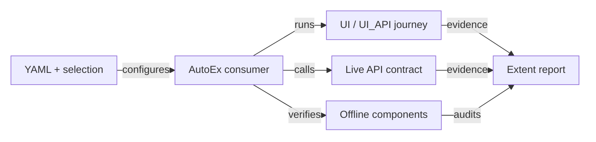

<details>
<summary><strong>Legend — consumer scope</strong></summary>

- `YAML + selection` fixes configuration and opt-in; read-only API access and
  API access with a synthetic account have separate selections.
- The `AutoEx consumer` owns site data and rules; UI provides the browser and
  Reporting provides publication.
- `UI / UI_API journey` preserves the same business behavior; UI_API adds
  browser observations and API preconditions explicitly declared by the journey.
- `Live API contract` uses the application's request factory and explicit live
  transport; `Offline components` use local fixtures.
- The `Extent report` is individual or shared by a suite; sharing a report does
  not implicitly share the browser or account identity.

</details>

<details>
<summary><strong>Composition and diagnostics — shared run boundaries</strong></summary>

Generic exception diagnostics use the
[Reporting formatter](../atf-reporting/README.md#revenirea-la-comparația-eșuată).
AutoEx retains API and phase correlation, together with proofs for the real
adapter. Cyclic-graph handling, redaction, and neutral rendering are described
by the selected [Reporting library contract](../atf-reporting/README.md);
local consumer tests verify only the behavior exercised by their scenarios.

- This module owns the E2E journey and support specific to the AutoEx site.
- The usual gate selects `AutoExPurchaseUiE2eTest` directly and runs the purchase once.
  Evidence profiles are run options for the same business behavior, not
  additional coverage objectives.
- `atf-ui` owns browser execution; `atf-reporting` owns evidence modeling and
  publication.
- The [evidence profile](#evidence-configuration) separates the flow, screenshots,
  and action details; `Audit screen contract` observes evidence without issuing its own verdict.

</details>

<a id="autoex-boundary"></a>
<a id="boundary-ul-autoex"></a>
## AutoEx boundary

<details>
<summary><strong>Contract, owners, and proofs — AutoEx boundary</strong></summary>

<details>
<summary><strong>Details — AutoEx boundary</strong></summary>

| Area | Content specific to this consumer |
|---|---|
| `src/main` | Site configuration, route/selector catalog, page objects, purchase journey, and synthetic-account cleanup |
| `src/test` | Business E2E gate, manual evidence selections, AutoEx component contracts, and JUnit adapter |
| Execution | Public site; E2E is opt-in in Maven, and direct IntelliJ runs are supported |

The default configuration is [`atf-auto-ex.yaml`](src/test/resources/atf-auto-ex.yaml)
and belongs to the test profile, not a published library:

- `AutoExConfigurationLoader` reads it from the classpath, falling back to the
  module file for IDE launches;
- select an alternate YAML with `-Datf.autoex.config=<path>`; relative paths
  resolve against the process working directory;
- configure the URL, browser, timeouts, demo product, synthetic identity, demo
  payment, and report directory there;
- YAML disables E2E by default for ordinary Maven runs; the extension recognizes
  the IntelliJ marker and can enable it even when `e2eEnabled: false`.
- `AutoExE2eExtension` extracts AutoEx-specific signals (JVM property,
  `e2eEnabled` from YAML, and IntelliJ marker) and passes them to the neutral resolver
  `AtfE2eActivationPolicy` from `atf-test-kit`.
- Shared precedence is explicit JVM override → configured opt-in → IDE fallback
  → disabled; explicit `false` stops the test in any runner, and invalid values
  fail closed. Test Kit proves the policy, and whole-ATF governance protects
  consumer wiring.

The profile contains only synthetic data and demo payment details; it does not
put real personal data, passwords, or real payment instruments in YAML. The
model redacts registration and payment fields from its text representation.

- `AutoExPurchaseJourney` uses `AutoExPurchaseSession` for the purchase that

  may have an API precondition; it remains before UI search. `AutoExCartJourney`

  receives `AutoExCartJourneyPort`, without checkout operations or an API inspector.

  The shared UI catalog is exposed separately through `AutoExCatalogSearchPort`.

- `AutoExAccountJourneyPort` composes only account, Home, and terminal capture
  capabilities. Account receives no catalog, checkout, or API inspector;
  Cart explicitly adds search, and Purchase adds checkout.
- `HomePage`, `CheckoutPage`, and `AccountPage` receive their capability ports

  (`AutoExHomePagePort`, `AutoExCheckoutPagePort`, `AutoExAccountPagePort`), while

  search and product opening use `AutoExCatalogPagePort` and the explicitly

  expected name. `AutoExPagePortsComponentTest` checks checkpoint order,

  UI search without API capabilities, and stopping on failure without a full runtime.

- Reading a missing heading, a search result that does not appear in time, or

  missing session identity or payment confirmation stops the transition before

  the next action; page objects do not automatically repeat the operation. The

  payment page heading is checked before filling the card. If the registration

  result heading is missing, the cause propagates, the identity remains marked

  for cleanup, and the checkpoint/Continue does not run. Fail-fast proofs are in

  the same component.

- `AutoExE2eRun` implements it in the `runtime` package under `src/main/java`,

  without JUnit or Test Kit.

- `AutoExRunFactory` and `AutoExE2eExtension` in the `extension` package under `src/test/java` resolve

  JUnit declarations and own resource acquisition.

- `AutoExConsoleBridge` maps Reporting fields through
  `AtfConsoleEvent.fromExternalEnums(...)`; the adapter uses the selected
  library contracts without adding a source-level library test module here.

- This separation keeps site-specific support testable, without production

  sources depending on the runner or Test Kit.

- On failure, the inspector and `Failure evidence` capture are published while

  the Playwright page is still available; the browser then closes, and the phase and

  scenario are finalized independently.

- `FailureAwareCleanupTest` checks the generic order of capture, cleanup,

  diagnostics, and close; `AutoExE2eRun` supplies only the consumer's

  business/UI callbacks.

- If the test failed before teardown, `AutoExE2eRun.finish` captures the
  viewport and redacts sensitive fields before account cleanup can navigate the page.
- It then runs cleanup and publishes the network inspector. If the first failure
  occurs during teardown, capture happens after diagnosis and before browser close.
- The phase and scenario are finalized independently; the original cause remains
  primary, and later errors are attached as `suppressed`.
- `FailureEvidenceCleanup` in Test Kit owns generic orchestration. AutoEx
  component tests verify the adapter profile and wiring without duplicating
  generic primitives.

`AutoExRunFactory` uses `TestRunInitialization` from Test Kit for acquisition
with injectable factories. The runtime receives the `AutoExRunLifecycle` port;
`AutoExRunLifecycleAdapter` connects it in test to neutral cleanup in Kit.
`TestRunInitializationTest` protects ordering and cause:

- failure after each acquired handle: only available phase/scenario nodes are
  marked FAIL, then the browser is closed;
- every rollback stage is attempted; setup error remains primary, and rollback
  failures are `suppressed`;
- Extent nodes created internally before a factory returns its handle belong to
  the atomicity of the `atf-reporting` contract, not the consumer.

**Boundary decision:** `AutoExPurchaseSession` remains in `src/main` as an
internal API for the consumer runtime because the production journey uses it.
It is not a generic ATF API; JUnit and annotation resolution remain in `src/test`,
while the browser and publication are in the main runtime. Revisit this decision
if runtime callers change or if the architecture test no longer confirms this
ownership; any generic extraction must be behaviorally proven in both consumers.

</details>

</details>

<a id="autoex-test-contract"></a>
<a id="contractul-testelor-autoex"></a>
## AutoEx test contract

<details>
<summary><strong>Contract, owners, and proofs — AutoEx test contract</strong></summary>

<details>
<summary><strong>Details — AutoEx test contract</strong></summary>

- `@AtfE2eTest` and `@AtfTestChannel(UI/UI_API)` classify tests by boundary and
  channel; UI is the usual business selection.
- The shared `@AtfUiEvidence` contract in Test Kit declares flow form and
  capture policy separately; the AutoEx adapter maps it to a Reporting profile.
  The variant with one success capture uses `FINAL_AND_FAILURE`: it adds no
  checkpoint captures but retains the terminal capture and one on failure.
  `CONFIGURED` inherits the actual axis from `reports.evidence`; missing capture
  configuration there inherits Reporting policy. Direct and composed
  declarations are resolved before resources, with a conflict diagnostic;
  metadata alone does not start the browser or lifecycle.
- `@UiReportSubdirectory("auto-ex")` and `@AtfConsoleMessages(DETAILS)` keep
  consumer output and diagnostics in the specified location/policy.
- `AutoExE2eExtension` composes a per-test session; `AutoExE2eSuite` runs
  classes sequentially and shares the report.

<a id="evidence-configuration"></a>
<a id="configurarea-evidence-ului"></a>
### Evidence configuration

| Key under `automationExercise.reports.evidence` | Default | Effect |
|---|---|---|
| `flowMode` | `screen-checkpoints` | `screen-checkpoints` or `unified-flow` |
| `screenshotPolicy` | inherits Reporting | `each-checkpoint`, `final-only`, `failure-only`, `final-and-failure`, `none` |
| `actionDetailsMode` | `included-collapsed` | `included-collapsed` or `summary-only` |

Precedence is configuration → explicit axis from `@AtfUiEvidence`, direct or
composed. Channel selection remains separate; evidence configuration does not
enable the API, select business steps, or allow mutation replay. Unknown keys
and values are rejected before the browser starts.

<a id="cart-gate-and-account-owner"></a>
<a id="gate-ul-coșului-și-ownerul-contului"></a>
### Cart gate and account owner

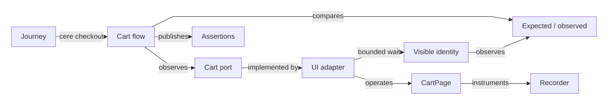

<details>
<summary><strong>Legend — gate and lifecycle without page ownership</strong></summary>

- `AutoExCartFlow` does not import browser, JUnit, configuration, or Reporting.
  It reads a snapshot, compares product/price/quantity/total, and allows checkout
  only after a PASS gate and result publication. Missing observation fails.
- `AutoExCartUiFlow` implements the port through `CartPage`; the evidence mapper
  retains the four assertions and existing checkpoint. Timeout or failed
  publication does not authorize continuation or repeating the mutation.
- `AutoExAccountLifecycle` belongs to `AutoExE2eRun`. All `AccountPage`
  instances and cleanup see the same identity and deletion state. Uncertain
  creation remains tracked; a different identity or borrowed account is not
  eligible for deletion. A deletion started without confirmation is not repeated.
- After registration, `AutoExCheckoutFlow` rereads the current identity and
  cart before checkout. The expected identity is `signupName()` of the account
  created by this test; the expected cart comes from product configuration.
  `AutoExCheckoutAccess` publishes five comparisons in `CHECKOUT_PRECONDITIONS`:
  customer, product, price, quantity, and total. A missing/foreign account, a
  difference, or failed publication blocks the single activation; the
  account/cart are not recreated.
- The business gate does not import browser, configuration, or Reporting. The
  `AutoExCheckoutUiFlow` adapter observes pages, while the mapper retains full
  comparisons before the configured preview. Business failure remains the
  primary cause even if publication fails; the publication cause is suppressed.
- `AutoExCheckoutAccessComponentTest` and `AutoExCheckoutUiGateComponentTest`
  probe the model and real public review stage, including rejections; purchase
  vocabulary retains all 14 distinct checkpoints.
- `AccountPage.awaitLoggedInName()` uses `AutoExCustomerIdentityObservation`:
  a read-only observation of one visible identity with non-empty text, within
  the existing native budget. The locator waits for non-empty text through
  Playwright, including after document replacement; it does not poll with
  `count()` reads during the transition. Expected customer identity remains
  exclusively in the business gate.
- Permanent absence, empty text, or an ambiguous selector stops observation;
  diagnostics retain URL, cardinality, visibility, last text, and native cause.
  A visible foreign customer is rejected by the gate, without checkout.
- `loggedInNameIfPresent()` remains an immediate observation for its callers;
  checkout review uses the bounded capability. The local browser proof
  `AutoExCustomerIdentityObservationComponentTest` goes through the page and
  adapter; fixtures cover delayed, immediately/eventually foreign, absent,
  empty, ambiguous identity, delayed text, and replaced document. Visibility
  after the deadline does not extend the budget or allow checkout after rejection.

The short labels retain these meanings:

| In diagram | Full meaning |
|---|---|
| Journey | Purchase journey |
| Cart port | AutoExCartPort |
| Recorder | PlaywrightActionSequence |
| Expected / observed | Expected + observed order line |
| Assertions | AutoExCheckoutAssertions |
| operates | reads and acts |
| publishes | publishes the result |

</details>

| Local test | What it demonstrates |
|---|---|
| `AutoExCartFlowComponentTest` | observation/gate/publication/checkout order; wrong or missing field, timeout, and preserved primary cause |
| `AutoExCartDomComponentTest` | port uses the real page and recorder; incorrect price blocks the click and produces one correlated failure in Extent |
| `AutoExRuntimeBoundaryComponentTest` | 2xx response, 503, `requestFailed`, and missing exchange; neighboring route/method/resource, transport/modal correlation, and API assertion ownership |
| `AutoExAccountLifecycleComponentTest` | shared owner across pages, uncertain creation, different identity, and deletion started without confirmation |

The DOM component report intentionally contains one PASS and one FAIL scenario.
The test passes only if both results and checkout blocking are correct; this is
a controlled proof, distinct from the public shop's E2E report.

<a id="purchase-stages-and-ui-adapter"></a>
<a id="etapele-purchase-și-adaptorul-ui"></a>
### Purchase stages and UI adapter

`AutoExPurchaseJourney.execute` is the composition root: it captures catalog,
profile, demo payment, and cleanup destination in `AutoExPurchaseInputs`, keeps
search and API precondition, then composes the coordinator with the per-purchase
adapter. `AutoExPurchaseFlow` knows nine semantic stages, without browser,
configuration, JUnit, or Reporting. `AutoExPurchaseUiFlow` owns pages and UI
observations; `AutoExPurchaseAssertions` projects existing rules into report rows.

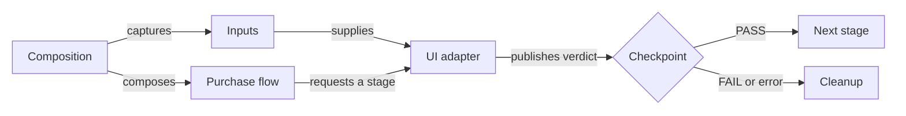

<details>
<summary><strong>Legend — gates before the next mutation</strong></summary>

- Order remains product → add → cart → registration → review → payment → order → invoice → cleanup.
- Cart retains `AutoExCartFlow` and its business exception, including publication cause.
- UI/API retain the same checkpoint, passive observation after add, and UI
  confirmation: a rejected/unobserved response does not wait for the success
  modal; modal timeout after 2xx produces a failed UI comparison at the checkpoint.
- `AutoExPurchaseFlowComponentTest` checks stopping without retry at every
  stage; `AutoExPurchaseUiAdapterComponentTest` probes real pages/adapter with
  an instrumented port, including missing values and transport without confirmation.
- No extraction alone proves equivalence of all remote profiles.
The short labels retain these meanings:

| In diagram | Full meaning |
|---|---|
| Composition | Journey · composition root |
| Inputs | Purchase inputs · independent expectations |
| Purchase flow | Purchase flow · stage order |
| UI adapter | UI adapter · pages + observations |
| Next stage | next stage |
| Cleanup | stop + lifecycle cleanup |

</details>

</details>

</details>

<a id="suites-and-evidence-variants"></a>
<a id="suite-și-variante-de-evidence"></a>
## Suites and evidence variants

The usual run selects `AutoExPurchaseUiE2eTest`: one account, one demo order,
one invoice, and cleanup.

The local `@AutoExE2eTest` annotation composes the same infrastructure for all
eight classes: E2E marker, console and runtime extensions, `auto-ex` directory,
report path publication, and sequential execution. The `UI`/`UI_API` channel,
`@Order`, and any `@AtfUiEvidence` remain on the concrete class; composition
does not select the scenario, change IntelliJ activation, or hide test-specific
policy. `AutoExEvidenceProfileComponentTest` checks the real annotation and
exact suite list.

Select the other classes explicitly in IntelliJ or with `-Dtest=<class>` when
another evidence policy is needed:

| Class | Channel and evidence | Contribution |
|---|---|---|
| `AutoExPurchaseUiE2eTest` | UI; standard checkpoints and captures | UI business journey |
| `AutoExPurchaseUiApiE2eTest` | UI + observed first-party traffic | catalog API precondition and traffic integration with the real journey |
| `AutoExPurchaseUiFinalScreenshotE2eTest` | UI; consolidated flow, final capture, and capture on failure | evidence profile for the same UI journey |

Account self-service can be selected separately, without payment or an invoice:

| Class | Initial state | Verified business behavior |
|---|---|---|
| `AutoExAccountUiE2eTest` | unregistered visitor | UI registration, delete own identity, return to the store |
| `AutoExExistingCustomerUiApiE2eTest` | synthetic account prepared through the real API | UI login, delete own identity, return to the store |

Both classes are included in `AutoExE2eSuite` and can be launched individually.
They are not promotional tests: they verify customer self-service and handle a
vignette only if the site displays it naturally. They do not request or fabricate
one, or delay the flow to provoke it.

- The final-screenshot variant adds no business rule; reducing live repetition
  requires a local proof of the annotation through publication.
- The class is used by `AutoExEvidenceProfileComponentTest`, and suite selection
  is protected by governance; criteria are in the
  [business acceptance contract](../docs/ATF_Testing_Guide.md#individual-and-suite-business-acceptance).

These three selections use the same `AutoExPurchaseJourney`; adding purchase
variants for capture or layout combinations would not demonstrate more business.
The selected Reporting library owns generic formatting, navigation, and
rendering, while AutoEx report-producing tests verify their local scenario
evidence.

`AutoExE2eSuite` includes:

- the site's eight E2E journeys;
- [UI audit of the local Extent report](src/test/java/atf/autoex/tests/e2e/reporting/AutoExCatalogReportPresentationE2eTest.java).

The report test opens only the artifact generated from controlled observations
and does not navigate to the public site. Stories for new/existing account,
cart/session, and purchase profiles remain the same. Concrete classes remain
single-flow selections, without overlapping suites.

`AutoExComponentSuite` verifies locally without opening the public site:

Apply the [shared ownership rule](../docs/ATF_Testing_Guide.md#test-owner-business-adapter-or-infrastructure);
the points below describe only what Automation Exercise-specific tests assert.

- selects component tests from `atf.autoex.tests.component`;
- these cover consumer-specific decisions and adapters;
- catalog, API contract, account cleanup, response, and traffic-window tests
  remain here even when they use fixtures, because they assert Automation
  Exercise rules, not generic ATF behavior;
- `AutoExApiContractReportPublisherComponentTest` checks the AutoEx adapter:
  `responseCode`/message contract, API title, and JUnit failure diagnostics.
  Negative cases reject invalid JSON, mismatched code/message, and failed HTTP
  even when the body declares success; the DTO retains form encoding and the
  upstream MIME type. Extent and fallback artifacts are checked for password
  absence; shared formatting and redaction behavior comes from the selected
  Reporting library;
- this consumer check is limited to password absence in the actual AutoEx
  artifact; it does not claim generic replay-projection coverage;
- the default directory and API report override are consumer-specific; reusable
  validation of a relative path under the project root, including prevention
  of traversal/reparse-point escape, belongs to
  [`atf-test-kit`](../lib/README.TestKit.md#scope-and-integration);
- `AutoExEvidenceProfileComponentTest` checks only how the consumer applies
  `@AtfUiEvidence` over its configuration. Test Kit owns the neutral declaration
  and Reporting owns generic profiles/lifecycle; no Test Kit → Reporting
  dependency is introduced just to remove a consumer adapter;
- neutral factories and rollback are implemented and tested in Test Kit;
  AutoEx retains browser selection, scenario creation, and FAIL marking.
  Governance checks use of the shared primitive and absence of a local copy;
- cross-consumer ownership is defined in [ATF architecture](../docs/ATF_Architecture.md#ui-traffic-capture-and-selection)
  and the [testing guide](../docs/ATF_Testing_Guide.md);
- the limit of eight classes per package is defined in
  [code best practices](../docs/README_Atf_CodeBestPractices.md#package-cohesion--eight-class-threshold).
Generic browser and renderer contracts are described in the
[`atf-ui` README](../atf-ui/README.md) and the
[Reporting integration atlas](../atf-reporting/README.md).

<a id="autoex-support-cohesion"></a>
<a id="coeziunea-suportului-autoex"></a>
## AutoEx support cohesion

<details>
<summary><strong>Contract, owners, and proofs — AutoEx support cohesion</strong></summary>

Code in `src/main` is production support specific to the site, not runner code.
Support is separated by reasons for change, and each package stays below the
shared threshold of eight classes:

| Package | Responsibility |
|---|---|
| `runtime`, `runtime.config`, `runtime.account` in main | report session, run, observation mapping, and application-specific capabilities; no JUnit/Kit |
| `extension` in test | Store, activation, acquisition through Kit, and annotation adaptation; does not duplicate renderer or generic cleanup |
| `support.journey` | purchase coordination, trace, and catalog read-only API precondition |
| `support.account` | synthetic account and cleanup |
| `support.catalog` | catalog snapshot and assertions |
| `support.checkout` | address/order observations and mapping business results to assertions |
| `business.cart` / `business.invoice` / `business.purchase` | snapshots, gates, and purchase ordering, without UI, Reporting, or JUnit |
| `flow.cart` / `flow.checkout` / `flow.purchase` | UI adapters, purchase inputs, and invoice artifact reading |
| `ui.AutoExUiActions` | local port for instrumented UI operations |
| `support.browser` | consent and vignette handling |
| `api` | routes, request factory, and typed API account; used by direct API tests |

`ConsumerModuleArchitectureGovernanceTest` in `atf-tests` protects the
source-set boundary and composition of Shop/AutoEx entry points; it does not
check the exact inventory of production classes. The inventory is checked
separately by whole-ATF governance, while `AutoExCatalogApiPrecondition` and
its test are now included in their respective owner packages. Component tests
are split into thematic subpackages; the cohesion threshold is the shared ATF
rule in
[bunele practici de cod](../docs/README_Atf_CodeBestPractices.md#package-cohesion--eight-class-threshold),
not a class count duplicated here.

Routes, payloads, browser handlers, trace, and purchase journey remain specific
to AutoEx. Shared primitives are promoted only after proving the same contract
in relevant consumers and retaining a neutral API; the Test Kit boundary is
described in the [owner README](../lib/README.TestKit.md#scope-and-integration)
and in [ATF architecture](../docs/ATF_Architecture.md).

<a id="public-service-availability-limit"></a>
<a id="limita-disponibilității-serviciului-public"></a>
### Public service availability limit

The exact visible message `This website is under heavy load (queue full)`
indicates that the document is unavailable, not that locators have changed.

| Control | Contract |
|---|---|
| Recognition | visible queue-full message or HTTP 520/525 from the observed main document; no general timeout catch |
| Document | observed navigation in the main frame: GET, same origin and same path/query |
| Eligible routes | Home, Products/search, and a product detail |
| Exclusions | POST, account, logout, checkout, add to cart, different origin, or unknown method |
| YAML budget | `browser.storeAvailability.maxAttempts` includes the first load; the module configures 3 and PT2S backoff |
| Opt-in | section absent or `maxAttempts: 1`: explicit diagnostic, no retry |
| Evidence | Store availability observation; within the bounded action, Store GET recovery and the single transition duration; UI-only does not enable the API inspector |
| Exhaustion | `AutoExStoreUnavailableException`, FAIL, and real capture; no fabricated PASS/SKIP |
| Search button | Separate one-click contract below: no recovery GET or pointer replay; its own HTTP/DOM result remains authoritative |

- Typed `UiRetryPolicy` is separate from retries for ordinary actions; it does
  not repeat clicks, search, the test, account creation, or payment.
- An add-to-cart rejected with `503` does not confirm the cart change. In UI+API,
  the inspector retains the response; an uncertain mutation is not retried automatically.
- `AutoExStoreAvailabilityComponentTest` uses browser-intercepted documents:
  recovery, exhaustion, GET with side effects, POST, foreign origin, and absent
  element. Live proof remains in the E2E suite.

</details>

<a id="product-transition-confirmation"></a>
<a id="confirmarea-tranziției-către-produs"></a>
## Product transition confirmation

`ProductsPage` passes the configured name through `AutoExCatalogPagePort` to
`AutoExProductTransition`. The consumer validates the numeric same-origin route
without query/fragment before the single native click.

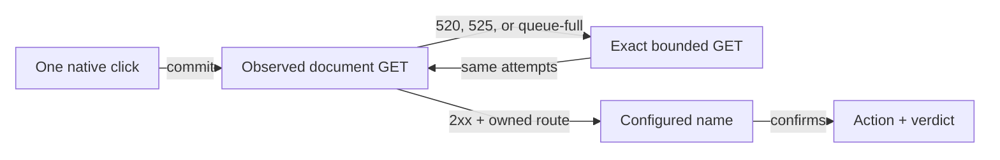

<details>
<summary><strong>Legend — deadline, rejection, and evidence</strong></summary>

- **Document** means the method, status, and URL of the main response;

  an apparently correct heading in a 403 response does not authorize continuation.

- If the vignette appears after the pointer action, the existing handler can activate

  the visible `Close` control once, within the same budget. Explicit DOM activation

  remains distinct from pointer input; the product click is not repeated, and the

  vignette is not bypassed by direct navigation. Missing or ambiguous Close retains FAIL.

- The child `Google vignette Close` fact is INFO and includes the observed duration;

  it is already included in `Click` and is not added to timing again.

- **Exact GET** reuses AutoEx policy and the same action budget;

  the scope retains the attempt count between observations. A backoff that does not

  fit is rejected; POST and a foreign origin are not recovered.

- **Configured name** is compared independently with the visible heading. A

  wrong name, incomplete or replaced document, and exhausted attempts retain FAIL.

- **Bounded observation** natively awaits the heading or queue-full message and
  reads DOM identity and the resolved locator's text in a single snapshot,
  without parsing the message or a separate visibility read.
  the already confirmed URL is not awaited again; the document GET is checked
  before observation and product acceptance, within the same deadline.
- Purchase adapter overloads implement the typed intent
  `openFirstProduct(expectedProduct)`, not the old lower-level click. Rejection
  of this transition preserves the same exception and stops both the later
  business checkpoint and add-to-cart.
- **Deterministic deadline** is tested through the real `clickAndAwait` owner, with
  a controlled clock in UI's `ObservationBudgetComponentTest`: pointer,
  observations, and final check consume the same 1100 ms budget.
  Exhaustion does not publish PASS or repeat the pointer action.
- **Browser fixture** prepares the document and render capture within the
  existing 3-second navigation budget, without activations or product requests.
  The functional action retains 1100 ms; the test no longer infers deadline
  compliance from browser wall-clock time or two slow GETs.
`AutoExReadOnlyBudgetBoundaryComponentTest` measures timeouts passed to the
browser adapter for two real GET recoveries: both borrow the remaining budget,
and the second receives less than the first. An independent counter confirms
one pointer and three GETs total; a renewed timeout is rejected.

- **Audit** includes the single activation and confirmation duration, original cause, and

  observed method/status/path. GET recovery does not double the duration with a

  second timed action and does not repeat the click, account, cart, or payment.

- `AutoExProductTransitionComponentTest` checks the nominal case, delayed heading,

  recoverable 520/525/queue-full, including delayed queue-full with whitespace
  normalized by the locator, persistent 520/525, POST 525, 403, wrong or ambiguous product, missing document,

  unsafe target, and POST. It also probes

  the post-click vignette: delayed/missing/ambiguous Close, no dismissal, and

  continuation to 520→200, with independent native counters.

</details>

<a id="purchase-journey"></a>
<a id="journey-ul-de-cumpărare"></a>
## Purchase journey

<details>
<summary><strong>Details — purchase journey</strong></summary>

The scenario combines [Test Case 14 — Place Order: Register while Checkout](https://automationexercise.com/test_cases#collapse14)
with [Test Case 24 — Download Invoice after purchase](https://automationexercise.com/test_cases#collapse24):

1. opens the store and searches for the configured product;
2. checks the product, price, availability, and quantity in details/cart;
3. registers a synthetic account at checkout and checks addresses and order;
4. completes demo payment, checks confirmation, and downloads the invoice;
5. deletes the synthetic account and checks the terminal state.

`CheckoutPage.downloadInvoice()` passes the artifact name and path to
`AutoExInvoiceReader`, which reads observed content without a browser or verdict.
`AutoExInvoiceValidator` compares name, customer, amount, and availability;
`AutoExInvoiceAssertions` only converts results for Reporting.

| Boundary | Component test |
|---|---|
| UTF-8 reading, missing artifact, and preserved IO error | `AutoExInvoiceComponentTest` |
| Wrong identity/amount/file, without filling observations from expected values | `AutoExInvoiceComponentTest`, `AutoExPurchaseBusinessComponentTest` |
| Remote order and invoice | E2E journey; components do not certify the public service |

| Stage | Business expectation | Expectation source |
|---|---|---|
| Search and product | identity, exact price, and availability | YAML catalog |
| Cart | product, unit price, quantity, and line total | catalog + quantity calculation |
| Checkout | recipient, company, both address lines, city/state/postal code, country, and phone in both addresses | YAML registration profile |
| Review order | same cart line and grand total | catalog + calculated total |
| Demo payment | form and order confirmation | site's UI contract |
| Invoice | downloaded file, customer, and this order's amount | current identity and total |
| Cleanup | account deleted and return to store | identity created in this run |

`AutoExCheckoutAssertions` compares address lines after normalizing
presentation spaces and applies the same rule to the cart and checkout rows. A
correct name cannot hide an incorrect postal code, phone, price, or quantity.

<a id="complete-invoice-amount-validation"></a>
<a id="validarea-completă-a-sumei-facturii"></a>
### Complete invoice amount validation

The validator extracts the clause after `total purchase amount is`, with an
optional case-insensitive `Rs.` prefix. The clause ends at the line/artifact
end or at a sentence period followed by horizontal whitespace or end of input;
decimal points and internal spaces remain part of the observation.

| Criterion | Contract |
|---|---|
| Syntax | ASCII digits, optional period and at least one fractional digit; no sign, exponent, suffix, or thousands separators |
| Value | `BigDecimal.compareTo` against the independent expected value; `1000`, `1000.0`, and `1000.0000` are equivalent |
| Diagnostic | full observed value, without currency prefix or sentence punctuation; no repair from expected or a numeric prefix |

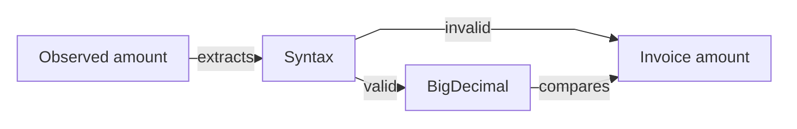

<details>
<summary><strong>Legend — observation, syntax, and verdict</strong></summary>

| In diagram | Full meaning |
|---|---|
| Observed amount | clause read from the artifact; not completed from expected |
| Syntax | validates the entire token, including spaces and unsupported suffixes |
| BigDecimal | compares only a syntactically valid observation with the expected total |
| Invoice amount | FAIL for invalid syntax or a different value; PASS only when both criteria are met |

</details>

`1000.00oops`, `1000.00.99`, `1000,99`, and `1000 99` remain FAIL with the
faithful actual value; `1000.00. Thank you.` retains the nominal form. Filename,
customer, and availability have independent checks. Both
`AutoExInvoiceAssertions` overloads retain the verdict and values; the adapter
and preview do not reevaluate the amount or change the configured display limit.

[AutoExInvoiceComponentTest](src/test/java/atf/autoex/tests/component/journey/AutoExInvoiceComponentTest.java)
tests the real UTF-8 file, invalid forms, equivalent scales, and both adapters
through audited assertions. Publication acceptance runs the same checkpoint on
local artifacts, individually and through a filtered suite: JUnit and Extent
retain FAIL, while the healthy case remains PASS in the shared report. This test
does not certify a faulty invoice from the public service or repeat the download.

<a id="causal-invoice-download"></a>
<a id="descărcarea-cauzală-a-facturii"></a>
### Causal invoice download

`CheckoutPage` requests the download through the checkout port; `AutoExE2eRun` composes
`AutoExInvoiceDownload`, and `PlaywrightActionSequence.download(...)` records
activation and event waiting in a single measured action.

| Observation | Decision within the initial budget |
|---|---|
| Download event received | reads the artifact; validator independently compares customer and amount |
| Queue-full main document, GET to exact same-origin invoice href | may retry only that GET, according to `storeAvailability`; the click is not repeated |
| POST, foreign document, or another route | rejects recovery; does not substitute the method or target |
| Event absent, attempts exhausted, or backoff does not fit | Download action FAIL, with duration and cause; no new deadline |

- Accepted route is `/download_invoice/` followed by the observed numeric suffix,
  without query or fragment. An invoice is not inferred from expected or an old file.
- Listeners are scoped to the operation and removed on success or failure. A
  distinct cleanup error is suppressed on the original cause, without self-suppression.
- `AutoExInvoiceDownloadComponentTest` probes download, queue-full, rejections,
  and the single click; `PlaywrightDownloadComponentTest` protects the generic recorder.

`AutoExInvoiceValidator` checks invoice text; the mapper retains the result.
An existing but empty file, or one for another order, produces FAIL. These rules
are tested with positive and negative business data in `AutoExPurchaseBusinessComponentTest`.

- Catalog, identity, and payment use demo values from YAML; email and password
  are unique per run.
- Account cleanup is armed before registration submit, and a cleanup error does
  not mask the primary cause.
- Captures redact form fields. The value returned by `Get text` is used only in
  the in-memory assertion; the `atf-ui` recorder retains `[REDACTED]` in the
  report and trace without preventing validation of the actual text.

- Before reading each address, `AccountPage` waits for the configured synthetic
  name in the delivery and invoice containers, respectively.
- The journey then validates the full address and order review using the
  semantic `waitForText` condition, not a fixed `sleep`.
- `AutoExCheckoutAddressComponentTest` checks wait → read ordering for both
  locators; the generic action remains owned by `atf-ui`.

- The CMP dialog is handled through its visible interface, choosing the
  minimum for optional purposes.
- If the Google vignette appears, the consumer handler explicitly activates
  the visible “Close” control and checks that the URL fragment disappears.
- The handler does not hide/remove the overlay, fabricate hashes, or use a
  forced click; the opt-in mechanism is bounded below.
- During cleanup, a page still on `#google_vignette` is replaced by explicit
  navigation to the store before account deletion. ATF records the navigation,
  and it does not rerun payment; failure evidence is captured before recovery,
  and the initial verdict remains FAIL.

<a id="vignette-and-javascript-activation"></a>
<a id="vignette-și-activare-javascript"></a>
### Vignette and JavaScript activation

AutoEx uses `zoomPercent: 70`. Only the Close control of a real vignette calls
`clickWithJavaScript(..., postcondition)` from `atf-ui`; other business actions
remain Playwright pointer clicks. Configuration does not silently change the
zoom or enable a general JavaScript fallback.

| Responsibility | Owner / contract |
|---|---|
| Ad handling | `AutoExVignetteHandler`: vignette fragment present and one visible Close control in the frame |
| Asynchronous loading | only after observing the fragment, read-only wait for a visible/active Close in the iframe within the browser timeout; no `sleep` or pause to provoke an ad |
| Ad absent | `dismissIfPresent` immediately returns `false`; if the fragment disappears on its own during the wait, it does not invent a Close click |
| Passive observation | before activation, `Observed Google vignette` retains the real URL and calculated CSS zoom; it does not request or modify the ad |
| Activation | `atf-ui`: one unique/active target, one `HTMLElement.click()`, no automatic retry |
| Result | read-only callback waits for fragment removal; the action passes only after that |
| Report | distinct `JavaScript click` row, real selector, duration, and explicit observation “not a trusted pointer click” |
| Limit | DOM activation does not certify pointer geometry at 70% or success of the next business step |

Generic API tests belong to `atf-ui`; AutoEx checks ads that appear naturally
in real UI/UI_API flows, without artificial ad tests. Pointer geometry at 70%
has a neutral contract and tests at the
[UI owner](../atf-ui/README.md#native-context-geometry).
The context uses native CSS viewport and DPR, without injected CSS zoom. CSS
observation of the vignette describes the page, separately from context scale;
the explicit Close policy and fragment check remain unchanged.

- The vignette is optional and controlled by the site/AdSense. ATF does not
  know this store's effective eligibility/frequency settings.
- An ad in the catalog does not prove interruption of account deletion. We do
  not reset frequency through cookies/storage or artificially extend the flow
  to obtain another ad; transition acceptance remains distinct from the nominal regression.

<a id="created-account-and-cleanup-under-vignette"></a>
<a id="contul-creat-și-cleanup-ul-sub-vignette"></a>
### Created account and cleanup under vignette

Cleanup also handles a visible `queue full` document remaining after payment.
It preserves the initial failure and returns to Home through a GET before
checking identity.

```mermaid
%%{init: {"themeVariables":{"fontSize":"15px"},"themeCSS":".nodeLabel, .nodeLabel p { font-size: 15px !important; line-height: 1.35 !important; } .edgeLabel, .edgeLabel p { font-size: 12px !important; font-weight: 400 !important; line-height: 1.2 !important; } .edgeLabel .labelBkg, .edgeLabel p { background: transparent !important; } .edgeLabel foreignObject { transform: translateY(-18px); overflow: visible; } .node rect { rx: 6px; ry: 6px; }","flowchart":{"curve":"linear","nodeSpacing":24,"rankSpacing":40,"padding":10,"diagramPadding":16}}}%%
flowchart LR
    Failure["Failure"] -->|preserves cause| Evidence["Evidence"]
    Evidence -->|interrupted document| Home[GET Home]
    Home -->|checks| Identity["Identity"]
    Identity -->|once only| Delete[Delete account]
```

<details>
<summary><strong>Legend — recovery without payment replay</strong></summary>

- The trigger is a document outside the configured host or the exact visible
  `queue full` message; the POST route is not reloaded.
- Home uses the existing bounded GET policy. Recovery failure is secondary to
  the business cause; it does not authorize another registration or payment.
- A different identity or deletion already started blocks the mutation.
  Confirmation requires the URL, heading, and one deletion navigation, as in
  the nominal flow.
- `AutoExAccountCleanupRecoveryComponentTest` checks real browser documents
  with controlled local responses; it does not certify public service availability.
The short labels retain these meanings:

| In diagram | Full meaning |
|---|---|
| Failure | Business failure |
| Evidence | Failure evidence |
| Identity | Owned identity |
| once only | allows once only |

</details>

| Observed situation | Behavior | Safety limit |
|---|---|---|
| Creation confirmed | `AccountPage` retains confirmation before the checkpoint and Continue navigation | page change does not turn the created account into cleanup `NO_OP` |
| Creation submit interrupted | retains that the attempt started; if the store document was lost, reopens it and attempts login with the current identity | does not assume missing confirmation means no account; failure remains primary |
| Cleanup starts or is interrupted by vignette | navigates to Home and publishes observed trigger and destination | at most one continuation after a new interruption; no injected DOM, fabricated hash, or payment retry |
| Customer logged out | reauthenticates only the already confirmed synthetic account | header name must exactly match the run identity before Delete account |
| Deletion confirmed | immediately disarms the callback, before capture and Continue | a later error does not repeat deletion of an already removed account |

Generic capture ordering and preservation of the primary cause and `suppressed`
errors are tested in Test Kit. Successful recovery and deletion do not promote
the initial failure to PASS; cleanup failure remains secondary. Ad activation
and business recovery are distinct mechanisms: closing the overlay is not
accepted as confirmation of account creation or deletion.

<a id="delete-account--interrupted-navigation"></a>
<a id="delete-account--navigare-întreruptă"></a>
### Delete account — interrupted navigation

Deletion is tied to the run's synthetic account, not a generic heading.
`AutoExAccountDeletionAttempt` passively observes requests to the configured
endpoint from before the click through confirmation; it does not change traffic
or depend on UI_API inspector activation.

| Observed state | Business decision |
|---|---|
| Deletion request already started | waits for destination; no replay, including during cleanup failure |
| Vignette closed, zero requests, destination not reached | allows at most one navigation continuation, not a retry of an executed deletion |
| Before continuing | reloads Home; requires the same exact identity, visible Delete account, and still zero requests |
| Different identity or ambiguous state | FAIL; does not delete another account or repeat payment, registration, or arbitrary login |
| Confirmation | exact URL `/delete_account`, visible `account-deleted` heading, and exactly one document-type GET navigation in a complete snapshot; then disarms cleanup |
| Second interruption without confirmation | FAIL with evidence before recovery; no continuation loop |
| Additional traffic without navigation | does not become a second navigation; ACTUAL retains the total count and each observation: method, resource, navigation, and redirect path, without query or credentials |
| Zero/two navigations, unexpected method/resource, or incomplete diagnostic | FAIL; does not relax the condition to “at least one” |

`Traffic.singleDeletionNavigation()` checks the business navigation, while

`startedRequests()` separately protects every observed request against

replay. Two browser events do not certify two clicks or two

HTTP executions on the server; the report does not claim to measure server-side effects.

The listener and redirect diagnostic remove the query and fragment before
parsing the address because they do not participate in matching. An external
font URL with `|` in its query does not interrupt cleanup; the owned request
retains the counter and typed diagnostic, without query or fragment.
`AutoExBusinessFaultComponentTest` probes both cases in the browser and the redirect path.

- Observed continuation publishes a separate Gherkin step, request count before
  continuation, and revalidated identity; two UI clicks are not presented as
  two deletion requests.
- `AutoExAccountDeletionProgress` is the pure safety rule; the component test
  also checks rejection after any request has started and absence of permission
  when no interruption was observed.
- E2E tests use only real business flows at 70%; they do not inject overlays,
  hashes, responses, or fabricated ad navigations.
- Ad intermittency is handled by `dismissIfPresent`, not by retrying the whole
  test. A missing Close after timeout or an ambiguous target remains an error;
  there is no general `catch` that turns unconfirmed deletion into success.

`AutoExAccountUiE2eTest` directly checks account self-service: opens the store,
registers a synthetic customer, checks identity, deletes the account, and
confirms return to Home. Select it manually as a focused regression or through
the full UI gate, independently of checkout/payment.

`AutoExExistingCustomerUiApiE2eTest` prepares a customer through the public API
during setup, then checks login and deletion through UI. Setup and causal
browser traffic remain distinct; both paths reuse the
`AutoExLiveApi`, without automatic mutation retries.

</details>

<a id="cart-and-session-continuity"></a>
<a id="coș-și-continuitatea-sesiunii"></a>
## Cart and session continuity

`AutoExCartUiE2eTest` delegates two independent stories to `AutoExCartJourney`.
Each method receives an isolated browser session through the same ATF extension.

| Story | Business interactions | Verified result |
|---|---|---|
| Recalculation and removal | adds one unit, then the configured quantity of the same product, then removes the row | unit price, combined quantity, calculated total, and empty cart message |
| Guest cart after login | creates a synthetic account, logs out, adds the product as a guest, and logs in again | same identity and cart line before/after login; then explicit deletion |

- Quantity: the site does not allow direct editing in a row; the test adds the
  same product again, without DOM mutations or an invented endpoint.
- Expectations: `Catalog.withQuantity(...)` calculates the total; the search
  result is awaited before opening the product.
- Empty cart: reads visible `#empty_cart`, not the hidden element with the same name.
- Vignette: Close activation is the only JavaScript opt-in; the contract and
  pointer limit are described [above](#vignette-and-javascript-activation).
- Audit: Overview/System publishes the engine, headless setting, and configured
  zoom. The `Viewport` row separates requested output from effective CSS
  viewport and DPR; closing the ad does not change the business verdict.
- Ownership: `support.cart` owns journeys, `support.trace` owns Gherkin
  statements and the `AutoExTraceStep` port; purchase remains separate, and
  Reporting accepts both vocabularies.

<a id="overview-and-e2e-narrative"></a>
<a id="overview-și-narațiune-e2e"></a>
## Overview and E2E narrative

AutoEx and Shop publish the same operational vocabulary in Overview/System.
`AutoExReportSystemMetadata` projects effective configuration in main, while
Reporting's `ReportUiEnvironment` retains shared formatting.

```mermaid
%%{init: {"themeVariables":{"fontSize":"15px"},"themeCSS":".nodeLabel, .nodeLabel p { font-size: 15px !important; line-height: 1.35 !important; } .edgeLabel, .edgeLabel p { font-size: 12px !important; font-weight: 400 !important; line-height: 1.2 !important; } .edgeLabel .labelBkg, .edgeLabel p { background: transparent !important; } .edgeLabel foreignObject { transform: translateY(-18px); overflow: visible; } .node rect { rx: 6px; ry: 6px; }","flowchart":{"curve":"linear","nodeSpacing":24,"rankSpacing":16,"padding":10,"diagramPadding":16}}}%%
flowchart LR
    Settings["YAML + annotations"] -->|resolves| Scenario["Scenario snapshot"]
    Scenario -->|aggregates| Common["Common values / Mixed"]
    Common -->|displays| System["Overview / System"]
```

<details>
<summary><strong>Legend — effective configuration, without treating the first scenario as the default</strong></summary>

- The kit resolves the channel and evidence declaration; the AutoEx adapter
  combines them with the YAML before resources are created. The snapshot receives
  the explicitly declared environment.
- `Client` is `Playwright browser`; `Browser` includes engine, headless/headed,
  viewport, and zoom in the same format as Shop.
- `Viewport` separately shows the requested output, CSS viewport, and DPR through
  the shared UI calculation. [AutoExPointerGeometryComponentTest](src/test/java/atf/autoex/tests/component/geometry/AutoExPointerGeometryComponentTest.java)
  verifies this projection and the trusted pointer in a local headless browser,
  without claiming that a headed profile or external journey was executed.
- The host, profile, UI/navigation timings, retry, and effective policies for
  capture, layout, and action details are published.
- UI_API adds the endpoint, transport, precondition, inspector, body capture,
  and observation limit. The browser handles the HTTP request; the observation
  wait is not presented as the request timeout.
- UI-only omits API fields. A shared report receives each scenario's snapshot
  through `includeScenarioEnvironment`; differences and fields missing from a
  sibling scenario become `Mixed — varies by scenario`.
- Origins omit user info, path, query, and fragment. System retains operational
  configuration; account, card, flow, and body data remain outside it.

</details>

Sentences use business anchors and `AND` continuations, as in Shop.
`ReportGherkinSequence` is owned by a single `AutoExE2eRun`; the same effective
form reaches the checkpoint and its row in Scenario correlation.

| Purchase group | Effective form | Meaning |
|---|---|---|
| Store opening and optional API precondition | `GIVEN`, then `AND` | initial state |
| Search, details, cart, account, checkout, and payment | `WHEN`, then `AND` | the same business action with intermediate checks |
| Order confirmation | `THEN` | purchase result |
| Invoice, account deletion, and terminal screen | `AND` | result continuation and declared cleanup |

Cart and account declare their own anchors; a new sequence starts for each
scenario. Explicit `AND`/`BUT` remain continuations, and an early failure does
not receive an invented success `THEN`.

- Sequencing changes only the connective, preserving the title, order, gate,
  assertions, captures, and execution timings.
- API-only preconditions keep their own exchange; the causal baseline excludes
  them from subsequent UI traffic without double-counting requests.
- `AutoExSystemMetadataComponentTest` verifies the resolved policies;
  `AutoExE2eOverviewNarrativeComponentTest` verifies the real JUnit wiring,
  shared UI/UI_API report, and effective sentences over HTTP loopback.

<a id="site-routes-and-locators"></a>
<a id="rute-și-locatori-ai-site-ului"></a>
## Site routes and locators

<details>
<summary><strong>Contract, owners, and evidence — Site routes and locators</strong></summary>

<a id="vocabulary-and-addresses"></a>
<a id="vocabular-și-adrese"></a>
### Vocabulary and addresses

| Value | Owner | Use |
|---|---|---|
| Public site identity | `AutoExSite.PUBLIC_BASE_URI` | canonical Java reference; the effective endpoint remains `baseUrl` from YAML/override |
| Fake component endpoint | `AutoExApiFixture.BASE_URI`, only in `src/test` | deterministic transport and offline evidence; no call to the public site |
| API routes | `AutoExApiRoute` | the API factory and `AutoExRoutes.PRODUCTS_API` alias use the same definition |
| Form/query and JSON fields | `AutoExApiFormField`, `AutoExApiJsonField` | typed account, authentication, search, and catalog reads |
| Business API outcomes | `AutoExApiOutcome` | `responseCode`/`message` pairs; HTTP transport remains a separate contract |
| UI text and verdicts | `AutoExUiText`, `AutoExStoreAssertions` | shared pure rules for account, cart, and order pages and journeys |
| Search destination | `AutoExCatalogAssertions.searchLocation` | configured origin and path, a single `AutoExRoutes.SEARCH_PARAMETER`, with its exact decoded value |
| Reporting phases | `ReportUiContract.Phase` from Reporting | shared phase names, without a duplicate AutoEx catalog |
| Methods, headers, and MIME | `HttpMethod`, `HttpHeader`, `MediaTypes` from Core | shared protocol, including `APPLICATION_FORM_URLENCODED` |

The site's vocabulary remains separate from reusable primitives:

- the site constant is not a hidden fallback; the configuration test verifies
  propagation of another URL to the browser;
- wire fixtures remain an independent oracle from the serializer for field
  names, encoding, and omission of missing parameters, including negative cases;
- component tests verify partial and missing messages, duplicate queries,
  different domains, encoding, and configuration prefixes; tests do not replace
  the expected value with a value read from the same result;
- `AutoExRoutes` owns routes, `AutoExSelectors` owns selectors, and page objects
  consume the catalog without inline CSS; these are AutoEx contracts;
- `atf-ui` owns the [reusable CSS rules](../atf-ui/README.md#ui-locator-conventions)
  for `HtmlElement`, `HtmlAttribute`, and escaping; AutoEx exercises them on
  real markup without duplicating generic evidence with a synthetic DOM.

Run a Surefire method selector (`Class#method`) separately from `@Suite` classes:
the method filter can also reach suite discovery and produce
`NoTestsDiscoveredException`. For the evidence above, run `AutoExComponentSuite`
first, then run the selected business method or live suite separately.

<a id="reuse-after-the-practice-shop-analysis"></a>
<a id="reutilizare-după-analiza-practice-shop"></a>
### Reuse after the Practice Shop analysis

| Existing shared capability | Owner reused by AutoEx | Data that remains local |
|---|---|---|
| Classification, E2E activation, output, console, and evidence | `atf-test-kit`: annotations and `AtfE2eActivationPolicy` | site YAML and runner signals |
| Cleanup and preservation of the initial cause | `FailureAwareCleanup`, `FailureEvidenceCleanup` | AutoEx account identification and deletion |
| Browser, actions, capture, and redaction | `atf-ui` | AutoEx routes, selectors, CMP, and vignette |
| Per-scenario profile, assertions, and network inspector | `atf-reporting` | checkout expectations and association of observations with steps |

- Independence: there is no AutoEx → Practice Shop dependency; the Shop
  validators and log include that site's selectors, identity, and contract.
- Extraction: only a neutral API is moved, with the same behavior verified in
  relevant consumers; business logic is not transferred into infrastructure.
- Current increment: existing shared primitives are reused; address rules
  remain in `support.checkout`; cart and invoice have pure rules in `business`.

</details>

<a id="direct-api-and-the-uiapi-evidence-boundary"></a>
<a id="api-direct-și-limita-evidence-ului-uiapi"></a>
## Direct API and the UI/API evidence boundary

<details>
<summary><strong>Contract, owners, and evidence — Direct API and the UI/API evidence boundary</strong></summary>

<details>
<summary><strong>Details — direct API and the UI/API evidence boundary</strong></summary>

The public routes are listed in [API List](https://automationexercise.com/api_list).

- The `UI_API` purchase variant observes traffic produced by the browser journey.
- Existing-client self-service prepares the account separately through
  `AutoExApiRequestFactory` before UI login.

The diagram separates the browser flow, offline component contracts, and the
two live API gates; they are not variants of the same test.

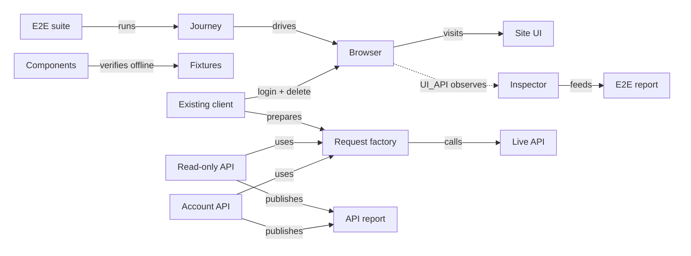

<details>
<summary><strong>Legend — choosing the API/UI path</strong></summary>

- `UI_API` observes browser-generated traffic and links it to checkpoints; direct
  account preparation is not attributed to those actions;
- `AutoExComponentSuite` verifies models and adapters using local fixtures,
  without the public service;
- `AutoExApiReadOnlyLiveContractTest` sends direct requests, including `POST`
  for search, but does not create or modify an account;
- `AutoExApiLiveSuite` is separate because it creates and updates a synthetic
  account, then attempts cleanup;
- UI and API reports have separate sessions and directories.
The short labels have the following meanings:

| Diagram label | Full meaning |
|---|---|
| E2E suite | AutoExE2eSuite |
| Journey | Purchase journey |
| Browser | ATF Playwright |
| Site UI | Automation Exercise UI |
| Inspector | network inspector |
| E2E report | shared E2E report |
| Fixtures | fixture contracts |
| Existing client | Existing client E2E |
| Request factory | request factory |
| Read-only API | live read-only API |
| Account API | live API with account |
| API live | Automation Exercise API |
| API report | Extent API report |
| login + delete | UI login and deletion |
| prepares | prepares separately |

</details>

| Surface | Verified behavior | Limit / effect |
|---|---|---|
| Request model | `AutoExApiRoute`, `AutoExApiRequestFactory`, and `AutoExApiAccount` describe routes and typed requests; the account representation redacts sensitive data | verifies request shape, not live service behavior |
| Component contract | the fixture verifies method, route, query/form, representative JSON response, and reported exchange | offline; does not certify the public service or its complete schema |
| Live read-only API | `AutoExApiReadOnlyLiveContractTest`; `GET` products/brands and `POST` product search | requires `-Datf.autoex.api.readonly.live.enabled=true`; does not create or modify accounts |
| Live API with account | `AutoExApiLiveSuite`; positive/negative contracts and synthetic account lifecycle with cleanup | requires `-Datf.autoex.api.live.enabled=true`; external effect, opt-in |
| Direct API report | `AutoExApiContractReportExtension` publishes exchanges and JSON assertions; default `artifacts/reports/api/auto-ex`, override `atf.autoex.api.report-directory`; `@AtfReportPath` publishes the location | component publisher verifies the artifact offline but does not replace live evidence |
| `UI_API` E2E traffic | the catalog precondition is reported separately from the causal window | first-party XHR/fetch, including cart traffic without the `/api/` prefix; scope and completeness are shown in the inspector |

<a id="api-failure-with-partial-history"></a>
<a id="eroare-api-cu-istoric-parțial"></a>
### API failure with partial history

`AutoExApiFailureEvidence` in main converts the Core snapshot into Reporting
evidence. The JUnit extension calls it on failure and preserves class/suite
ownership, the diagnostic, and report closure.

- A 503 followed by a transport error remains one operation with two ordered
  attempts; the second has an unavailable status.
- Publishing does not retry the request or extend live API retries, which retain
  the existing single-attempt policy.
- `AutoExTerminalExecutionComponentTest` verifies the adapter with controlled
  transport in Extent/fallback, without certifying the public service.
- Component assertions remain in the standard collapsed step; the configured
  budget and redaction of the full text before truncation remain required.

The consumed [Core library contract](../lib/README.Core.md) defines the
request/response types; the [Reporting library contract](../atf-reporting/README.md#dovezi-api-atașate-unui-pas-ui)
describes their report projection.

<a id="why-the-api-report-differs-from-the-ui-report"></a>
<a id="de-ce-raportul-api-nu-arată-ca-raportul-ui"></a>
### Why the API report differs from the UI report

Both suites publish Extent HTML and use shared Extent settings; the session and
evidence depend on the channel:

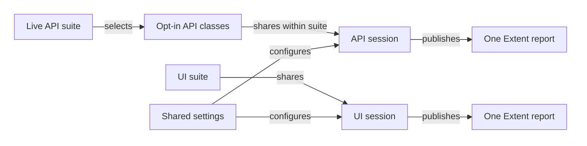
<details>
<summary><strong>Legend — sessions and evidence</strong></summary>

- the UI session is shared by the suite and publishes browser evidence;
- the API suite explicitly declares `suite` scope; active classes publish
  exchanges and JSON assertions in one session, with separate owners;
- an individually launched API class retains `class` scope and its own report;
- both sessions read shared Reporting settings, but the API does not publish UI
  steps or browser captures.

</details>

- `AutoExRunFactory` owns the UI session; `AutoExApiContractReportExtension`
  owns the direct API report;
- the API extension obtains the session in `BeforeAll` through `TestRunScope`,
  finalizes the phase/scenario in `AfterEach`, and the owner's Store closes the
  session exactly once;
- read-only, mutating, and both retain independent opt-ins; a failure in one class
  remains in the shared artifact without removing the other class's evidence;
- the `AtfReportPathOptIn` aggregator includes each active owner; successive runs
  do not reuse a closed session. `AutoExApiReportScopeComponentTest` verifies
  selection, individual launch, failure, and isolation between launches;
- lifecycle tests use `COMPONENT` metadata and declared mock transport; they do
  not present controlled responses as live HTTP executions;
- the API diagnostic redacts the full message before truncation; the assertion
  display limit is configurable and defaults to 240 characters;
- the default path is `artifacts/reports/api/auto-ex`, and `@AtfReportPath`
  announces the location.

Tests using `@AutoExComponentTest` publish one Extent report per owner:
an individual class has one report, while `AutoExComponentSuite` explicitly
declares `suite` scope and groups classes into a single artifact.

- Audit and scenario remain per method/parameterized invocation; sessions are
  not shared between launches, and Reporting fixtures retain their own artifacts.
- The default directory is `artifacts/reports/component/auto-ex`; the
  `atf.autoex.component.report-directory` override accepts a relative path under
  the reactor through shared Kit validation. The report factory is in the
  consumer's main source set.
- `@AtfReportPath` on a participating class can enable the single notification
  after the shared session is published; without opt-in, the report is generated
  without that notification.
- `AutoExComponentReportScopeComponentTest` verifies method, class, suite,
  parameterization, repeated launches, parallelism, and lifecycle failures.

Location notification is independent of HTML generation.

| Owner | Policy and publishing |
|---|---|
| Component class | explicit `@AtfReportPath`; `AutoExExtentTestExtension` connects the final event, including FAIL/abort and lifecycle failure |
| E2E | `@AutoExE2eTest` enables notification; direct declaration `@AtfReportPath(AtfReportPath.Policy.DISABLED)` allows opt-out |
| Root E2E report | `AutoExRunFactory` includes every class; any active owner requests a single notification, regardless of order and lifecycle messages |
| YAML | `reporting.console.enabled: false` suppresses the global message |

- `AutoExReportPathComponentTest` verifies the policy, parameterizations, and suite.
- Publishing fixtures use unique directories under `target`; they do not add
  diagnostic reports beside the suite's main artifact.
- `AutoExE2eReportPathComponentTest` verifies the real resource with a browser on
  `about:blank`; this check does not certify the public service.
- The policy remains on the Jupiter class when launching a method in IntelliJ;
  the annotation on the `@Suite` launcher does not propagate to selected classes.

| Case | Evidence in the report |
|---|---|
| Component method | comparisons evaluated through `AuditedAssertions` or `RecordedAssertions`, with operator/name, source where available, expected, actual, and result |
| JUnit lifecycle | `Component assertions` in the phase where checks were evaluated: `SETUP`, `TEST BODY`, or `TEARDOWN` |
| Component timing | the phase badge shows the sum of executed callbacks, measured monotonically; the tooltip separates snapshot publishing; totals do not double-count assertions |
| Business API and E2E | exchanges and API validations, and browser evidence, in their respective nodes |

- The standard step is initially collapsed; redaction precedes truncation, and
  text retains the default 240-character limit, including `…`, when expanded.
- Comparisons that display only numbers or booleans have declarative messages in
  English. `AutoExCheckoutUiGateComponentTest` explains the number of checks,
  registered owner, and checkout activation/order without changing the expected value.
- An expected exception produces the expected-exception check; an unconsumed
  FAIL cannot remain JUnit PASS. Abort preserves SKIP and its actual reason,
  without invented rows.
- The guard rejects a PASS without evaluated checks; a failure before the first
  comparison preserves its diagnostic. Unit tests are outside the reporting requirement.

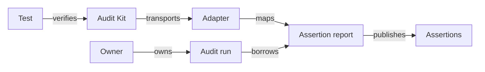

<details>
<summary><strong>Legend — AutoEx component audit</strong></summary>

- Edges show data flow and ownership, not Maven dependencies: Kit does not import Reporting.
- A JUnit handler cannot hide an error already captured by the audit. FAIL/SKIP,
  cause, and timing stay aligned with the report, both individually and in the suite.
- PASS comparisons are not presented as the cause of a later exception;
  diagnostics without transport do not fabricate a request or HTTP duration.
- Phase duration includes inherited and parameterized callbacks for the
  invocation; resource acquisition and publishing are excluded. Expansion
  preserves execution time.
- Phase/scenario sums are not suite wall-clock time; a measured zero remains
  valid. Successful class fixtures are not distributed across scenarios.
- `AssertionAuditRun` closes the shared session at the owner; each invocation
  receives the configured `reporting.assertionMaxDisplayCharacters` budget from
  that owner before collection, including values above the default of 240. The effective
  value appears in `Overview → System`, under `Assertion preview`.
- Each invocation closes only its own scenario. Two suites have separate owners,
  even in the same launcher.
- [Kit](../lib/README.TestKit.md#scope-and-integration) owns delegation,
  per-invocation collection, and result reconciliation; the consumer injects
  redaction and configuration.
- [Reporting](../atf-reporting/README.md#proiecția-sigură-a-aserțiunilor) owns
  the node, publishing lifecycle, and Extent/fallback rendering.
- Inherited methods, parameterization, and lifecycle use the same policy; scope
  is not implicitly propagated to other threads.
The short labels have the following meanings:

| Diagram label | Full meaning |
|---|---|
| Test | AutoEx component test |
| Adapter | AutoEx adapter |
| Assertion report | AssertionAuditReport |
| Owner | Owner class / suite |
| Assertions | Component assertions |
| verifies | verifies completely |
| transports | safe rows + phase timing |
| borrows | borrows the session |
| publishes | publishes collapsed |

</details>

`AutoExComponentPhaseTimingComponentTest` verifies the real connection to
Kit/Reporting, inherited callbacks, identical parameterized titles, and the
single report, both through the suite and when an individual method is run.

<a id="catalog-search-confirmation"></a>
<a id="confirmarea-căutării-în-catalog"></a>
### Catalog search confirmation

`ProductsPage` requests activation through `AutoExCatalogPagePort`; the port does
not expose the browser or API log. The main runtime composes `AutoExCatalogSearch`.

- One native click owns one main-frame GET response. Its origin, path and
  single decoded search parameter must match the configured term; HTTP must be 2xx.
- A fresh parsed document must show the configured first product, with native
  polling inside the original shared action budget. URL-only history changes,
  stale DOM and a separately healthy JSON API cannot certify that click.
- A visible exact queue-full message or unsuccessful HTTP response fails
  explicitly, without spending the remaining budget waiting for a product.
  There is no search replay, recovery GET or timeout increase.
- `Catalog search response` is an INFO action carrying owned method/status/URL,
  navigation count, the awaited gate and observed DOM state. The timed Click
  retains PASS/FAIL; response metadata does not fabricate a business assertion.
- The passive observer uses `UiListenerScope` and detaches on success or failure.
  It ignores XHR/subframes and rejects a second main-frame request in its scope.
- `AutoExSearchReadinessComponentTest` retains delayed product, replaced
  document, wrong-query/product and one-click oracles at the original 700 ms.
  `AutoExSearchResponseComponentTest` adds terminal HTTP/DOM, stale-DOM,
  independent API and transport-failure regressions.
- Both browser fixtures explicitly prepare their initial native viewport in
  the existing 5 s navigation budget before starting the 700 ms action. Decoded
  PNG dimensions, fixture URL and trusted activation remain auditable comparisons.
- Preparation does not grant time to the document produced by Search; that
  transition still shares the original action deadline. The runner inherits the
  SDK-selected Node runtime by default; the [build and execution contract](../docs/ATF_Build_And_Execution_Safety.md)
  owns runtime selection and explicit override rules.

The same composition is used in UI and UI+API. The inspector remains passive;
the DOM postcondition does not invent an HTTP response or rewrite a FAIL already published.

```mermaid
%%{init: {"themeVariables":{"fontSize":"15px"},"themeCSS":".nodeLabel, .nodeLabel p { font-size: 15px !important; line-height: 1.35 !important; } .edgeLabel, .edgeLabel p { font-size: 12px !important; font-weight: 400 !important; line-height: 1.2 !important; } .edgeLabel .labelBkg, .edgeLabel p { background: transparent !important; } .edgeLabel foreignObject { transform: translateY(-18px); overflow: visible; } .node rect { rx: 6px; ry: 6px; }","flowchart":{"curve":"linear","nodeSpacing":24,"rankSpacing":40,"padding":10,"diagramPadding":16}}}%%
flowchart LR
    Page["ProductsPage"] -->|requests| Port["Page port"]
    Port -->|delegates| Search["Search"]
    Search -->|activates| Click["Single click"]
    Click -->|confirms| Ready["Confirmation"]
```

<details>
<summary><strong>Legend — search responsibilities</strong></summary>

The page object expresses intent, the runtime owns the browser and product
semantics, and UI performs the instrumented action. The UI+API profile observes
the same operation; it does not implement a different search.
The short labels have the following meanings:

| Diagram label | Full meaning |
|---|---|
| Page port | AutoExCatalogPagePort |
| Search | AutoExCatalogSearch |
| Single click | Strict pointer |
| Confirmare | Owned GET 2xx + exact query + fresh DOM + configured first product |
| requests | requests through the port |
| delegates | delegates to main |
| activates | activates once |
| confirms | confirms within the remaining budget |

</details>

<a id="causal-boundary-for-ui_api"></a>
<a id="boundary-ul-cauzal-pentru-ui_api"></a>
### Causal boundary for `UI_API`

The shared diagram for capture, baseline, and publishing is in
[ATF Architecture](../docs/ATF_Architecture.md#ui-traffic-capture-and-selection).

- `AutoExCatalogApiPrecondition` executes and publishes a single
  `GET /api/productsList` precondition before marking the browser-traffic baseline.
- The inspector aggregates only exchanges observed after the baseline. The
  precondition remains in its own precondition checkpoint; it is not counted
  again as causal UI/API traffic.
- The default policy selects first-party XHR/FETCH before applying the budget
  and body capture. `includingOtherRequests()` adds first-party requests that
  are not classified as documents, XHR/FETCH, or static assets; `OTHER` bodies
  remain excluded. The real `GET /add_to_cart/1` XHR, including its `text/html`
  response, remains in the checkpoint; selection does not assume an `/api/` prefix.
- API validation uses only `UiApiValidationEvidence`, the same contract as Shop.
  The catalog precondition publishes its checks under its own exchange, not in
  `UI validation`; the UI verdict is not copied onto requests.
- `apiCheckpoint` links assertions to the selected GET exchange by capture
  sequence, method, and path. A neighboring POST or second GET on the same path
  does not receive the comparison; if the selected exchange is not captured
  uniquely, the report publishes a failed correlation check in API validation.
- In Extent, the AutoEx step contains a collapsible `API validation` node, and
  the selected GET has its own collapsible `API assertions` group. The component
  [AutoExRuntimeBoundaryComponentTest](src/test/java/atf/autoex/tests/component/lifecycle/AutoExRuntimeBoundaryComponentTest.java)
  verifies ownership, cardinality, and the absence of a synthetic exchange.
  [AutoExCatalogReportPresentationE2eTest](src/test/java/atf/autoex/tests/e2e/reporting/AutoExCatalogReportPresentationE2eTest.java)
  opens the local HTML in Playwright and verifies expansion of the assertions
  and the selected request.
- The number of UI steps is not an oracle for the number of observed requests.
  `@AutoExNetworkDocuments({"/"})` selects all first-party DOCUMENT routes for
  a UI+API profile without enabling documents globally for UI-only profiles.
  These profiles keep API setup separate from causal browser traffic and publish
  only observations retained in each checkpoint window.
- `UI_API` passively waits, with a bounded timeout, for the exact GET XHR/FETCH
  exchange started by the single product click. The 2xx status, HTTP rejection,
  and `requestFailed` are attached to the `CART_ADD` checkpoint; no exchange in
  the bounded window is reported as a missing observation, never as a 503.
- After a 2xx, the visible “Added!” confirmation is awaited. If transport failed
  or did not stabilize, the modal state is read without waiting; a missing
  confirmation is correlated with the transport verdict, while a success modal
  shown after a rejection remains a UI/API contradiction. A modal timeout after
  2xx is published in the same checkpoint. No case replays the click or request
  for the report.
- Static resources and third-party hosts remain excluded. `Capture coverage`
  exposes scope, accepted/retained/excluded/dropped counts, the limit, and setup/
  causal separation; capture is complete only within this scope, not for all
  possible browser traffic. A download with a 2xx response and
  `Content-Disposition: attachment` may report `requestfailed` with `ERR_ABORTED`
  after the server has sent the response; the inspector retains HTTP status and
  headers without reading downloaded bytes.
- When causal exchanges exist, they remain linked to the observed window and
  checkpoint; UI search navigates to `/products?search=...` and is not confused
  with the direct `POST /api/searchProduct` endpoint.

| YAML: `automationExercise.browser.networkInspection` | Default | Effect |
|---|---|---|
| `includeDocuments` | `false` | `true` includes navigations/forms, including checkout/payment; they are not automatically called API |
| `maxObservations` | `256` | limit for selected traffic; overflow remains visible |
| `maxBodyPreviewCharacters` | `12000` | capture limit; the smaller Reporting display limit applies separately |

- The UI-only profile keeps the inspector disabled; `UI_API` enables the same
  validated configuration without replacing its limits.
- Annotated selection adds the declared DOCUMENT routes and retains first-party
  XHR/FETCH/OTHER for the origin; static and third-party assets remain excluded.
- DOCUMENT and OTHER response bodies are not read. Method, route, status,
  headers, and auth classification remain available; form-urlencoded requests
  retain the body with passwords and the CSRF token masked. Attachment responses
  with `ERR_ABORTED` after HTTP 2xx are recorded as HTTP responses without bytes.
- XHR/FETCH bodies remain available within the configured limit. Observed
  headers, authentication, and provenance are adapted as typed values for Reporting.
- Terminal captures can also publish final exchanges.
- In `POST /payment`, the demo fixture's synthetic `card_number` and `cvc`
  values remain visible in the body/cURL, according to the policy accepted for
  this evidence; UI actions retain the existing masking.

Selection, budget, and cursor evidence belongs to the local `atf-ui` adapter.
The selected Reporting library supplies report presentation and snapshots;
AutoEx verifies its YAML, real cart route, catalog precondition, and business
journey through local consumer tests.

- `awaitCartExchange` passively waits for a GET XHR/FETCH on the product's exact
  path. The quantity query is not part of path equality; a prefixed product,
  another method, or a document does not match.
- `cartAddCheckpoint` links that status or `requestFailed` to the UI confirmation
  in the same action. If the wait expires without an exchange, it remains
  explicitly “unobserved”; no HTTP status is inferred and the click is not repeated.

<a id="uiapi-profiles-and-network-inspector-coverage"></a>
<a id="profile-uiapi-și-acoperirea-network-inspector"></a>
#### UI+API profiles and Network Inspector coverage

Adapter isolation is verified by the [component test with a real browser](src/test/java/atf/autoex/tests/component/reporting/AutoExEvidenceProfileIsolationComponentTest.java).
A loopback GET returns 500 for failure and 200 for the next scenario; the real
E2E extension preserves the cause, capture, and one HTML report per launch.

Verdict markers are checked in markup, without scripts/styles, according to the
[shared testing rule](../docs/ATF_Testing_Guide.md#consumer-component-audit).
The presence of the FAIL selector at runtime does not replace published evidence.

| Evidence | Contract and limit |
|---|---|
| Individual UI and UI_API failure | the original result remains FAIL; UI_API publishes the inspector, UI does not inherit it |
| failure → success in the opposite profile, both orders | fresh browser/context and localStorage; System aggregates effective configurations without verdict contamination |
| independent HTTP counter | one observed GET per invocation, with no retransmission of the failed operation |
| live business suites | accounts, orders, and invoices are verified separately; loopback does not certify public site availability or stability |

- `AutoExE2eSuite` includes UI+API variants for Account, Cart, Existing
  customer, and Purchase; these select first-party documents with
  `@AutoExNetworkDocuments({"/"})`.
- UI+API profiles retain XHR/FETCH capture and include first-party OTHER
  requests without bodies.
- UI-only variants do not start the Network Inspector; static assets and
  third-party hosts are explicitly excluded.

| Story / presentation | Shared entry point | Difference between profiles |
|---|---|---|
| Account UI and UI+API | `AutoExAccountJourney.registersAndDeletesOwnAccount` | the channel adds browser observations in UI+API |
| Cart UI and UI+API | the same two `AutoExCartJourney` methods | the channel adds browser observations in UI+API |
| Purchase UI, UI+API, and final screenshot | `AutoExPurchaseJourney.execute` | the channel or screenshot policy changes evidence, not business actions |
| Existing customer UI+API | `AutoExExistingCustomerUiApiE2eTest` | the API precondition creates the existing customer; this is not equivalent to UI registration |

E2E wrappers choose the channel and evidence; shared Account, Cart, and Purchase
journeys retain the same business path. The Existing customer scenario remains
separate because it starts with an identity created through the API.

Capture completeness is interpreted within the declared scope and using the
execution's effective counters. `OTHER` does not promise global capture: the
first-party limit and configured budgets apply; a successful run does not prove
that all profiles are equivalent.

<a id="business-failure-acceptance"></a>
<a id="acceptanța-failure-urilor-business"></a>
### Business failure acceptance

[AutoExBusinessFailureAcceptance](src/test/java/atf/autoex/tests/e2e/failures/AutoExBusinessFailureAcceptance.java)
is an explicit CLI entry point with nested JUnit E2E fixtures. It is not part of
the canonical gate and does not intentionally turn the business suites red.

| Area | Observation altered by the fixture | Real expected result and cleanup |
|---|---|---|
| Account | name read after registration | independent synthetic identity; deletion only after re-confirming ownership |
| Cart | quantity read after relogin | configured quantity; one add and the same account identity |
| Purchase | order heading after payment | existing business confirmation; one payment and cleanup of the owned account |

The `individual`, `suite`, and `all` modes separately require
`-Datf.business.failures.live.enabled=true` and `-Datf.autoex.e2e.enabled=true`.
The read-only/mutating API flags belong to the direct API suites; they are not a
third gate for this CLI. The journey's explicit API request uses the
`ApiTransportPolicy.explicitLive()` programmatic policy from `AutoExLiveApi`.
`-Datf.business.probe.root=<reactor TMP>` sets the evidence directory; an
individual case can be selected with `-Datf.business.probe.case=AccountUi` or
`AccountApi`, `CartUi`, `CartApi`, `PurchaseUi`, `PurchaseApi`.

- Each UI/UI_API fault retains FAIL in JUnit and Extent; the CLI accepts only the
  exact checkpoint cause, counted mutations, and confirmed cleanup.
- For an individual run, the fault is followed by the same healthy story in the
  opposite profile. The fixture suite retains a fresh browser per invocation
  and one shared HTML report.
- The original capture contains the fixture's visual marker before cleanup.
  DOM restoration precedes the original deletion callback, without its own navigation.
- The creation counter distinguishes the full form from the initial name/email
  submit, although both use `POST /signup`. Deletion requires exactly one GET
  DOCUMENT navigation; additional OTHER events remain separate diagnostics,
  without an invented replay verdict.
- The acceptance result does not measure stability across many repetitions and
  does not automatically authorize removing protected business selections.

The CLI verifies each invocation in Tests/Fails/Overview: exact owner and
scenario, phase, verdict, checkpoint, original cause, and capture with its own
color marker. `UiCheckpointFailure` preserves the comparison already
published; the evidence requires an original capture, including for the final
empty-cart failure. The healthy neighbor does not inherit the cause or FAIL evidence.

The oracle mutates only the report DOM loaded in the audit browser: it removes a
capture, reassigns one, changes the verdict, removes the cause, and inserts a
foreign cause in the healthy neighbor. Each rejection identifies the invocation
and field; the saved artifact and application are not changed. HTML is served
through a locally intercepted route, without the Windows path-length limit and
without an external request.

`artifact-expectations.json` is written from execution observations before HTML
verification. `audit <artifact-expectations.json>` rechecks that report and its
mutants without live opt-in, a new account, or replay. Neutral launch and
collection use [ScopedAcceptanceRun](../lib/README.TestKit.md#scope-and-integration);
the launcher, account policy, and AutoEx oracle remain in the consumer's test
scope. TAB audit and local components remain separate evidence.

Local components verify only injection and restoration without the public
service. The browser fixture remains in test support; the journey port is in main.

<a id="existing-customer-setup"></a>
<a id="pregătirea-clientului-existent"></a>
### Existing customer setup

`AutoExCustomerApiSetup` creates a single synthetic identity through the public
API before Home/UI login. `AutoExLiveApi` provides the LIVE transport shared with
the API suites, with one attempt; there is no hidden creation retry. Setup uses
exactly the same configured origin as the browser.

- `AccountPage.trackDisposableAccountCreation` arms cleanup before the request,
  including when the creation result is uncertain; cleanup retains the identity
  check and rejects replay of a deletion already started.
- `GIVEN` is an API-only checkpoint: HTTP 200, JSON `responseCode: 201`, and the
  message are verified under the real exchange; it does not publish UI
  validation or a `Setup evidence` disclosure without checks.
- Reporting redacts the form-encoded password. The body is form-urlencoded,
  according to the public API, not artificially converted to JSON; the JSON
  response is validated independently of the received MIME header.
- The inspector baseline is marked after setup. Login and Delete account are
  DOCUMENT requests, not `/api/*` endpoints or XHR/FETCH. The class declares
  `@AutoExNetworkDocuments({"/login", "/delete_account"})`, so the report links
  them to the login and deletion checkpoints; the Home page, assets, and other
  documents remain excluded. HTML responses are not read. The form-urlencoded
  login keeps the password and `csrfmiddlewaretoken` redacted.
  `POST /api/createAccount` remains the explicit API exchange in GIVEN, separate
  from the browser-traffic baseline and causal summary.
- UI confirmation requires the exact identity, deletion route, dedicated heading,
  and a single request; successful API creation does not certify UI deletion.

<a id="coverage-of-the-14-cases-listed-in-api-list"></a>
<a id="acoperirea-celor-14-cazuri-publicate-în-api-list"></a>
### Coverage of the 14 cases listed in API List

`AutoExApiContractComponentTest` models the cases below offline. The values in
the third column are the JSON `responseCode` field published by API List, not
the transport's HTTP status. The component verifies these two dimensions
separately and uses fixture bodies; the table is not evidence about the live service.

| Case | Request / condition | Published `responseCode` | Effect / isolation |
|---|---|---:|---|
| API 1 | `GET /api/productsList` | 200 | read-only |
| API 2 | `POST /api/productsList` | 405 | method not allowed |
| API 3 | `GET /api/brandsList` | 200 | read-only |
| API 4 | `PUT /api/brandsList` | 405 | method not allowed |
| API 5 | `POST /api/searchProduct`, `search_product` present | 200 | non-mutating search |
| API 6 | `POST /api/searchProduct`, missing parameter | 400 | input validation |
| API 7 | `POST /api/verifyLogin`, valid credentials | 200 | synthetic account created by the test |
| API 8 | `POST /api/verifyLogin`, missing email | 400 | input validation |
| API 9 | `DELETE /api/verifyLogin` | 405 | method not allowed |
| API 10 | `POST /api/verifyLogin`, invalid credentials | 404 | uses the test's synthetic account |
| API 11 | `POST /api/createAccount` | 201 | creates a unique synthetic account |
| API 12 | `DELETE /api/deleteAccount` | 200 | cleanup only for the test account |
| API 13 | `PUT /api/updateAccount` | 200 | updates only the test account |
| API 14 | `GET /api/getUserDetailByEmail` | 200 | reads the test's synthetic identity |

- API 11 arms cleanup before attempting creation; API 7, 13, and 14 use the
  same synthetic identity in the mutating live suite.
- Component tests do not create accounts or access the public service.
- `responseCode` in API List is an application JSON result, not the HTTP status.
  Live suites assert both values separately.
- The observed service also returned HTTP 200 for results such as
  `responseCode: 405` or `201`. This is the behavior observed in the current
  run, not a permanent guarantee; rerun live suites after upstream changes.
- `AutoExApiLiveContractTest` arms `AutoExApiAccountCleanup` before attempting
  creation; the scope attempts deletion even on failure. The component test
  verifies the unarmed state, cleanup after failure, and preservation of the
  initial cause when deletion fails; the live suite confirms cleanup after success.
- Retain `Content-Type` as a transport header in evidence and validate the JSON
  body independently. The observed upstream sometimes returns valid JSON with
  `text/html; charset=utf-8`; do not require `application/json` unless the public
  contract explicitly requires it.

The E2E precondition reads `/api/productsList` and is published in its own
checkpoint. After that checkpoint, the journey marks the baseline; search on
the UI page uses `/products?search=...`, not the direct
`POST /api/searchProduct` endpoint. This keeps API setup separate from causal
traffic generated by browser interactions in the report.

</details>

</details>

<a id="credentials-in-api-component-assertions"></a>
<a id="credentiale-în-aserțiunile-componente-api"></a>
### Credentials in API component assertions

The form oracle compares the original maps in full, including the value,
presence, and casing of the `password` key. The report receives a projection of
non-sensitive fields and the boolean result of the full equality check; it does
not receive the fixture password, even when the comparison fails.

[AutoExApiContractComponentTest](src/test/java/atf/autoex/tests/component/api/AutoExApiContractComponentTest.java)
retains the round trip for reserved characters and Unicode. Negative cases
reject mismatches, a missing field, an unexpected empty field, and a key with
incorrect casing; the JUnit diagnostic and standard collapsed step remain free
of raw credentials.

<a id="catalog-be-policy"></a>
<a id="politica-be-a-catalogului"></a>
## Catalog BE policy

`automationExercise.browser.recovery` is OFF by default, with an empty allowlist
and passive capture OFF. The only initial semantic operation is
`catalog-readiness`, mapped by `AutoExBackendRecovery` in main to GET
`/api/productsList`.

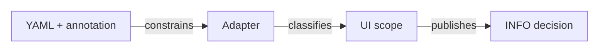

<details>
<summary><strong>Legend — opt-in and explicit use</strong></summary>

- The recovery block belongs to the AutoEx browser; the storeAvailability policy
  remains separate.
- The JUnit extension applies `AtfUiRecoveryResolver` before resources are
  created. The annotation can narrow the policy without enabling YAML OFF or
  adding routes.
- `run.backendRecovery()` provides the controller;
  `begin(CATALOG_READINESS)` precedes the single action, then `await` receives
  only read-only DOM evidence. Opening the run does not add retries to journeys.
- Scope and listeners close before the browser, including on failure. Signup,
  account, cart, checkout, payment, and cleanup are not replayed.
- The BE signal is metadata-only and independent of UI/UI_API presentation;
  UI-only does not activate extra API calls or API preconditions.
- Published decisions are INFO: policy, source, budget, attempt, reason,
  receipt, and separate timings. A published FAIL does not become PASS.
The short labels have the following meanings:

| Diagram label | Full meaning |
|---|---|
| Adapter | AutoEx adapter in main |
| UI scope | UI scope before the action |
| INFO decision | INFO observations in the UI sequence |
| classifies | classifies the read |
| publishes | records the decision |

</details>

<details>
<summary><strong>Example recovery block and verification</strong></summary>

Insert the example under `automationExercise.browser.recovery`, without changing
the engine. The values below are an explicit opt-in for the catalog in this document.

```yaml
recovery:
  enabled: true
  profile: read-only
  operations: [catalog-readiness]
  maxAttempts: 4
  totalTimeout: PT5S
  backoff: PT0.1S
  captureBackendSignals: true
```

`AutoExBackendRecoveryComponentTest` verifies loading, annotation restriction,
delayed catalog readiness, exhaustion, and missing capture. Writes through GET
and unknown operations are rejected before the browser starts.

Assertions from these components remain in the standard `Component assertions`
step, collapsed by default, with redaction before the configured limit, which
defaults to 240 characters. The consumer-owned
[AutoExRecoveryReportObservation](src/test/java/atf/autoex/tests/support/reporting/AutoExRecoveryReportObservation.java)
projects each typed `UiRecoveryTrace` beside its matching INFO action record.
`Operation` shows `catalog-readiness`; `Event` separately shows
`Backend observation #N`. Decision, reason, signal, three measured `Duration`
values, policy, and INFO result stay in attempt order. Timing uses the typed
values and does not parse the action's display text.

`AutoExExtentTestExtension` publishes this observation through Test Kit K3
phase observations and Reporting J26. In the rendered component result,
`TEST BODY` contains separate expandable `Component assertions` and INFO
recovery-trace steps. The normal assertions, verdict, and test count remain
intact.
The synthetic Playwright probe checks the action-table target and its
collapsed local disclosure. The opt-in
`AutoExRecoveryActualReportAcceptanceTest` opens an actual suite report and
checks its owner, expands the component result and `TEST BODY`, expands the
standard assertion step, and independently checks the recovery disclosure
after `Expand all nodes`. It verifies complete recovered and exhausted traces,
semantic operation, event label, ISO-8601 timings, INFO results, and body/URL
redaction. It saves a viewport capture under `target`. The acceptance contract is in
[AutoExRecoveryActualReportAcceptanceTest](src/test/java/atf/autoex/tests/component/recovery/AutoExRecoveryActualReportAcceptanceTest.java).

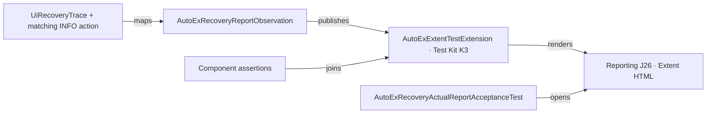
<details>
<summary><strong>Legend — recovery-report flow</strong></summary>

The consumer maps typed attempts locally; K3 publishes the separate assertion
and trace steps in `TEST BODY`, Reporting renders HTML, and opt-in acceptance
opens that artifact.

</details>

Generate a suite report and run actual-report acceptance in separate fresh
staging areas, as required by the [build procedure](../docs/ATF_Build_And_Execution_Safety.md):

```powershell
mvn -B -ntp -pl atf-test-auto-ex -am "-Dtest=AutoExBackendRecoveryComponentTest" "-Datf.autoex.component.report-directory=target/recovery-suite-report" "-Dsurefire.failIfNoSpecifiedTests=false" test
mvn -B -ntp -pl atf-test-auto-ex -am "-Dtest=AutoExRecoveryActualReportAcceptanceTest" "-Datf.autoex.recovery.actual-report=<configured-report-file>" "-Datf.autoex.component.report-directory=target/recovery-report-acceptance" "-Dsurefire.failIfNoSpecifiedTests=false" test
```

The acceptance test is inactive when `atf.autoex.recovery.actual-report` is not
set. This verifies a Maven-generated component report; it does not claim an
IntelliJ-launched report check or public-site E2E acceptance.

</details>

The deadline, rejections, and limits are in [UI](../atf-ui/README.md#backend-recovery-through-passive-observation).

<a id="junit-launch-identity"></a>
<a id="identitatea-lansării-junit"></a>
## JUnit launch identity

A collapsed INFO `Launch context` phase records the canonical class/method and
outermost suite exposed by JUnit ancestry. `AutoExLaunchMetadata` projects the
immutable `TestLaunchContext.capture(context)` snapshot supplied by Test Kit K4.
It publishes the actual launcher selectors, filtered discovered-test inventory,
and exact discovery count through Reporting's existing observation boundary.

The count is measured at plan start, includes disabled tests, and excludes later
dynamic registrations. Their count at capture is a separate field. Neither value
is reconstructed from completed or successful tests.

A plan executed in another session retains its inventory/count and explicitly identifies missing request
provenance; disabling the SPI observer yields unavailable metadata.

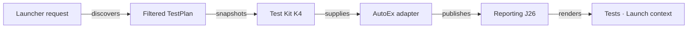

<details>
<summary><strong>Legend — module interaction and count semantics</strong></summary>

- Kit observes public launcher callbacks; it starts no tests, browser, or report.
- The consumer owns the immutable report projection and its selector facade.
- Launcher selectors retain source identity; display titles and filenames do not define selection.
- `AutoExLaunchMetadataComponentTest` verifies direct class/method and canonical
  or tag-filtered suites, duplicate titles, repeated launches, exact counts,
  original selectors, selected sources, and browser expansion of every field.

</details>

<a id="run-selection"></a>
<a id="rulare"></a>
## Run selection

<details>
<summary><strong>Details — running</strong></summary>

From the reactor root, run the offline component tests:

```powershell
mvn -pl atf-test-auto-ex -am "-Dtest=AutoExComponentSuite" "-Dsurefire.failIfNoSpecifiedTests=false" test
```

<a id="the-three-main-suites"></a>
<a id="cele-trei-suite-principale"></a>
### The three main suites

| Suite | Level and scope | Activation / external effect |
|---|---|---|
| `AutoExComponentSuite` | all local business contracts and adapters | no contact with the public store |
| `AutoExE2eSuite` | UI journeys and retained evidence profiles | E2E opt-in; each class is included only once |
| `AutoExApiLiveSuite` | read-only contracts and synthetic account lifecycle | independent opt-ins; read-only does not enable mutations |

Do not add an empty unit suite for symmetry with Shop. Existing API components
have this declared level; a separate unit suite is justified only when actual
unit tests exist. Live suites do not select UI/E2E tests.

```powershell
mvn -pl atf-test-auto-ex -am "-Dtest=AutoExComponentSuite" "-Dsurefire.failIfNoSpecifiedTests=false" test
```

The live read-only API test is separate and does not create accounts:

```powershell
mvn -pl atf-test-auto-ex -am "-Dtest=AutoExApiReadOnlyLiveContractTest" "-Datf.autoex.api.readonly.live.enabled=true" "-Dsurefire.failIfNoSpecifiedTests=false" test
```

Live API contracts with an account lifecycle form a separate, explicit gate:

```powershell
mvn -pl atf-test-auto-ex -am "-Dtest=AutoExApiLiveSuite" "-Datf.autoex.api.live.enabled=true" "-Dsurefire.failIfNoSpecifiedTests=false" test
```

Both API tests use the `baseUrl` configuration from `atf-auto-ex.yaml`; optional
overrides are `-Datf.autoex.api.base-url=<url>` and
`-Datf.autoex.api.timeout=PT20S`. Their opt-in properties are independent of
`e2eEnabled`: read-only uses
`atf.autoex.api.readonly.live.enabled`, while the account test uses
`atf.autoex.api.live.enabled`. Only the second creates and deletes a synthetic
account on the selected service.

The live business E2E gate, with one purchase and one report:

```powershell
mvn -pl atf-test-auto-ex -am "-Dtest=AutoExPurchaseUiE2eTest" "-Datf.autoex.e2e.enabled=true" "-Dsurefire.failIfNoSpecifiedTests=false" test
```

The full UI gate, with business journeys and retained evidence profiles:

```powershell
mvn -pl atf-test-auto-ex -am "-Dtest=AutoExE2eSuite" "-Datf.autoex.e2e.enabled=true" "-Dsurefire.failIfNoSpecifiedTests=false" test
```

Classes and the three main suites can be launched directly from IntelliJ.

- In IntelliJ, `AutoExE2eSuite` or an E2E class can be run directly; the
  runner marker enables the test by default when the JVM property is absent,
  even if YAML sets `e2eEnabled: false`. `-Datf.autoex.e2e.enabled=false` takes
  precedence and disables it.
- In Maven, ordinary execution remains disabled by the default YAML. Opt in
  with `e2eEnabled: true` or `-Datf.autoex.e2e.enabled=true`; explicit `false`
  disables it in any runner. Diagnostics distinguish YAML, JVM property, and
  IDE detection; the IDE marker is not reported as an explicit opt-in.
- Reports are published under `artifacts/reports/ui/auto-ex/`; suite execution
  finalizes the report session when the JUnit root closes.
  Overview/System declares `Client = Playwright browser`; the generic Reporting
  fallback remains neutral for consumers that do not provide this context.
- TEST BODY uses explicit monotonic timing through `UiPhase.measureExecution()`.
  Captures and evidence publishing are separate; execution stops before final
  cleanup and browser release. Session flushing remains separate, according to
  the [Reporting contract](../atf-reporting/README.md#timing-măsurat-înaintea-publicării).

API contracts and the `UI_API` precondition are documented in this README.
`AutoExPurchaseSession` remains an internal boundary of the consumer runtime;
there is no active TODO for generic extraction. Annotations and JUnit lifecycle
remain in the test-scoped adapter; the browser and publishing belong to the main runtime.

<a id="shared-support-and-source-sets"></a>
<a id="suport-partajat-și-source-set-uri"></a>
### Shared support and source sets

| Owner | Contract |
|---|---|
| AutoEx `src/main/java` | pages, journeys, API, and `runtime`: browser, report, resolved profile, network mapping, and customer setup; no JUnit/Kit |
| AutoEx `src/test/java` | business tests and suites in `atf.autoex.tests`; JUnit adapters in `atf.autoex.tests.extension`; tests do not call other test classes |
| `atf-test-kit.lifecycle` | `TestRunInitialization`, cleanup, and compensation; a package in the existing Kit, not a new module |
| `atf-ui` | `UiNetworkInspector.observationCursor()` / `observationsSince(...)` and `UiScreenAudit`: shared terminal observation and PNG validation; does not calculate the application verdict |

<a id="runtime-in-main-and-the-junit-boundary"></a>
<a id="runtime-în-main-și-granița-junit"></a>
### Runtime in main and the JUnit boundary

`atf.autoex.support` no longer hosts classes in test. Reusable capabilities have
explicit inputs and are published in main:

| Package / class | Responsibility |
|---|---|
| `runtime.AutoExE2eRun` | browser/checkpoint facade, without runner context |
| `runtime.AutoExReportSession` | report session and environment metadata; the caller owns its duration |
| `runtime.AutoExObservedExchangeMapper` | explicit UI → Reporting bridge, with observed headers and body availability |
| `runtime.AutoExRunLifecycle` | completion port with typed callbacks; keeps the runtime independent of Kit |
| `runtime.config` | project root and profile with Reporting enums already resolved |
| `runtime.account.AutoExCustomerApiSetup` | API customer setup with cleanup armed before mutation |

`extension.AutoExE2eExtension` retains the condition, Store, and ParameterResolver.
`AutoExRunFactory` resolves annotations and uses `TestRunInitialization`;
`AutoExRunLifecycleAdapter` delegates capture/cleanup/close ordering to Kit.
`AutoExEvidenceProfileAdapter` converts Kit declarations before main.

Kit and Console dependencies remain test-scoped; main has no JUnit/Kit.

`AutoExRunLifecycleAdapterComponentTest` verifies the primary error, all
suppressed errors, and closure after failure. `AutoExRuntimeBoundaryComponentTest`
tests the mapper and publishes a report through the runtime with local DOM,
actions, and a real capture; this is not execution of the remote site.

- The journey is not copied for another profile; UI+API adds evidence and

  explicit preconditions; it does not replace order/invoice confirmation.

- `AutoExAccountCleanupRecoveryComponentTest` locally verifies rejected order

  confirmation in UI/UI_API: the real validator and checkpoint preserve

  the expected value, single POST, original capture before cleanup, and deletion

  of the owned account. The next invocation receives an independent browser context.

  The fixture arms account ownership; it does not certify remote registration

  or failures at other journey points.
- [UI/UI_API cart test](src/test/java/atf/autoex/tests/component/navigation/AutoExAccountCleanupRecoveryComponentTest.java)
  passes through the real `CartPage`, `AutoExCartUiFlow`, and `AutoExCartFlow.checkout`.
  An incorrect DOM price preserves `AutoExCartValidationException` and the checkpoint cause;
  checkout is not activated and the local POST is not replayed. The cart capture
  precedes owned cleanup; the next invocation validates a correct cart and enters
  checkout once in a fresh context. The fixture does not certify remote
  registration, public catalog addition, or every Cart branch.

- [Failure after account setup](src/test/java/atf/autoex/tests/component/navigation/AutoExAccountCleanupRecoveryComponentTest.java)
  uses native registration through `AccountPage`, without manually arming the fixture.
  The same controlled error after Continue remains primary in UI/UI_API; signup and
  creation happen once. Cleanup deletes only the owned identity; a foreign identity
  rejects deletion and adds a secondary diagnostic. The initial capture, FAIL
  verdict, and fresh context for the healthy neighbor are preserved.
  Routes/forms are local: the test does not certify remote registration or the
  complete alternation of E2E profiles. Successful setup does not imply a PASS scenario.
- `AutoExE2eSuite` retains the complete selection. Reducing repeated purchases

  for evidence first requires adapter tests for success and failure.

The rest of the migration follows the [testing guide](../docs/ATF_Testing_Guide.md#separating-business-flows-ui-flows-and-validations),
preserving order confirmation, invoice, and account cleanup.

<a id="readiness-before-checkout"></a>
<a id="readiness-înainte-de-checkout"></a>
### Readiness before checkout

`CartPage.proceedToCheckout` waits, with a bounded timeout, for the control to
become visible through the instrumented `AutoExUiActions.waitForVisible` port,
then performs the normal click with the existing uniqueness check. It does not
condition synchronization on button text and does not repeat the mutation.
Permanent absence or two controls stop the transition and remain in the reported sequence.

- The post-registration identity/cart are read again by the business gate before
  this action, according to the [explicit contract](#cart-gate-and-account-owner).
  Locator synchronization and business comparisons have separate owners and evidence.

`AutoExCheckoutReadinessComponentTest` tests a control inserted after
navigation, one that is absent, and an ambiguous one using the real browser and
recorder. Cart oracles remain independent; this local synchronization does not
implement the [catalog BE policy](#catalog-be-policy), which does not replay checkout.

</details>

<a id="shipped-yaml-geometry"></a>
<a id="geometria-yaml-livrată"></a>
## Shipped YAML geometry

The table describes the shipped configuration, without process or test overrides.
The source is the [consumer YAML](src/test/resources/atf-auto-ex.yaml); the pure
calculation belongs to [UI](../atf-ui/README.md#native-context-geometry).

| Source | Requested output | Zoom | CSS viewport | DPR |
|---|---|---|---|---|
| Delivered YAML | `1440 × 1000` | `70` | `2057 × 1429` | `0.70` |

`DocumentedUiGeometryContractTest` compares the declaration with the live YAML
and executable UI model; mutants change only the document. It does not measure
capture pixels: browser geometry has its native test in the UI owner, while
System publishes the run's effective configuration, including when it differs
from this table.

<a id="quick-verification"></a>
<a id="verificare-rapidă"></a>
## Quick verification

| Decision | Source and limit |
|---|---|
| Purchase rules with an independent expected value | [owner source](src/main/java/atf/autoex/flow/purchase/AutoExPurchaseUiFlow.java); test: [AutoExPurchaseBusinessComponentTest](src/test/java/atf/autoex/tests/component/journey/AutoExPurchaseBusinessComponentTest.java) |
| Dependencies and source sets | [POM](pom.xml); the declared scope is authoritative for integration |
| What this test does not demonstrate | The component contract does not confirm the public site or the identity/cart after registration. |

<details>
<summary><strong>Command for the local test</strong></summary>

Run from the root of an [external staging area](../docs/ATF_Build_And_Execution_Safety.md), with JDK 21 and Maven.

```powershell
mvn -B -pl atf-test-auto-ex -am "-Dtest=AutoExPurchaseBusinessComponentTest" "-Dsurefire.failIfNoSpecifiedTests=false" test
```

The command selects the named test and builds its dependencies; it does not
claim that the whole module passed. The component contract does not confirm the
public site or the identity/cart after registration.

</details>

<a id="screenshot-evidence"></a>
<a id="dovezile-capturilor-de-ecran"></a>
<a id="catalog-evidence-association-boundary"></a>
## Screenshot evidence

Screenshot evidence uses the whole browser viewport at the configured 70% zoom,
retaining the page around the current action. Region close-ups supplement the
complete frame; the report fits the full image with its aspect ratio and all edges.

The [shared capture contract](../atf-ui/README.md#full-context-screenshots) and
[native pixel regression](../atf-ui/src/test/java/atf/ui/playwright/geometry/PlaywrightPointerGeometryComponentTest.java)
protect context independently of the screenshot publication policy.
