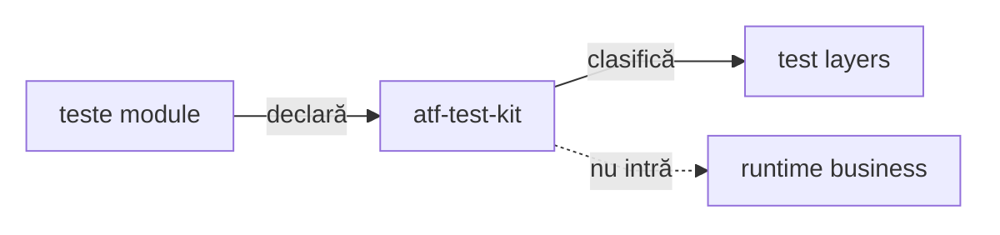
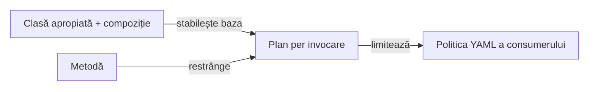
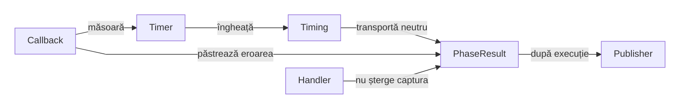

# ATF Test Kit

`atf-test-kit` deține contractele transversale ale infrastructurii de test ATF.
Nu conține renderer, mock transport, browser sau logică business.
Consumerii îl declară în test scope; adaptorul JUnit din `atf-console` are
excepția explicită `optional compile`, pentru adnotări și resolvere neutre.

Rezoluția canalului și a declarațiilor UI evidence rămâne în Kit.
Proiecția System și secvențierea vocabularului de raportare folosesc
[primitivele Reporting](../atf-reporting/README.md#instantaneu-tipizat-pentru-overviewsystem),
iar configurația concretă se proiectează în main la consumer.

## Pe scurt

**Trasee rapide:** [Layer și ownership](#clasificare) · [Assert auditabil](#comparații-junit-cu-dovadă-neutră) · [Scope Maven](#dependențe) · [Probă locală](#verificare-rapidă)



<details>
<summary><strong>Legendă — contractul transversal al testelor</strong></summary>

- modulele declară stratul prin adnotare, iar kit-ul îl verifică;
- cele patru straturi sunt executable test layers: unit, component, integration și E2E;
- support este cod auxiliar, nu al cincilea strat executabil;
- muchia punctată exclude Test Kit din runtime-ul business al consumerilor;
- adaptorul JUnit Console păstrează excepția `optional compile`, fără propagare
  tranzitivă implicită; [arhitectura](../docs/ATF_Architecture.md#harta-modulelor-platformă-și-consumatori)
  și POM-ul Console documentează această limită.
</details>

| Conține | Nu conține | Gate |
|---|---|---|
| adnotări de nivel/canal/console/output/setup/docs/UI evidence, resolvere neutre | renderer, mock, browser | teste Test Kit; clasificarea globală în `atf-tests` |
| clasificare test | business flow | fiecare clasă are un singur nivel |
| reguli transversale | business runtime dependency | fail-closed la drift |

## Clasificare

Fiecare clasă executabilă declară exact un nivel:

```text
@AtfUnitTest        → @Tag("unit")
@AtfComponentTest   → @Tag("component")
@AtfIntegrationTest → @Tag("integration")
@AtfE2eTest         → @Tag("e2e")
```

### Ce verifică guvernanța

- `AtfTestLayerArchitectureTest`, din `atf-tests` și suita whole-ATF, folosește
  inventarul comun `AtfJavaSourceInventory`: rădăcina Maven implicită sau
  `testSourceDirectory` declarat în POM, inclusiv layout-ul `src/test` Shop;
- verifică adnotarea, package-ul, importurile interzise și izolarea `support`;
- rezolvă din surse și adnotările compuse, prin import sau același package,
  inclusiv compoziția imbricată; ciclurile nu inventează un nivel;
- regula este fail-closed: o clasă fără nivel sau cu mai multe niveluri oprește
  build-ul, inclusiv când nivelurile provin din adnotări compuse.
- Nivelul aparține clasei executabile, nu numelui fișierului sau profilului
  raportului; fixture-urile de meta-adnotări sunt separate de ownerul executabil.
- Probele Reporting care folosesc direct Playwright rămân la ownerul component UI,
  în `atf.ui.tests.extent.component`; un contract API randat nu justifică o excepție.

### Verificări de compoziție

- `AtfModuleTest`/`AtfModuleTestCondition` rămân specifice suitei
  `atf-reporting-tests`, în `atf.reporting.test`;
- un modul lipsă poate produce `SKIPPED` prin gate-ul dedicat;
- kit-ul nu introduce o booleană UI paralelă.

### Adnotări de infrastructură implementate

| Package | API | Aplicare |
|---|---|---|
| `atf.testkit.channel` | `AtfTestChannel`, `TestChannelPlan`, resolver | canal UI/API/UI_API, separat de tag-ul JUnit al nivelului |
| `atf.testkit` + `.console` | `AtfConsoleMessages`, `AtfConsoleMessagePolicyResolver` | politică typed de consolă; `atf-console` o aplică fără sink/formatter duplicat |
| `atf.testkit.reporting` | `AtfReportPath`, `AtfReportPathPolicyResolver` | opt-in separat pentru calea raportului publicat |
| `atf.testkit.output` | adnotările de director și `ReportOutputDirectory` | ancoră UI prin adnotare sau path project-relative validat pentru un artifact |
| `atf.testkit.setup.api` | `ApiScenarioSetup`, `ApiTestRef` | declarații; catalogul și executarea rămân la consumator |
| `atf.testkit.documentation` | `DocumentationTarget` repeatable | selecție de documente; validatorii rămân în ATF Tests |
| `atf.testkit.evidence` | `AtfUiEvidence`, `AtfUiEvidencePlan`, `AtfUiEvidenceResolver` și enum-urile axelor | rezolvă independent flow-ul, capturile și detaliile acțiunilor; adaptorii consumer le mapează în profilul Reporting |
| `atf.testkit.lifecycle` | `TestRunInitialization`, `CloseOnceResource`, `ArmedCleanup`, `FailureAwareCleanup`, `FailureEvidenceCleanup`, `AtfE2eActivationPolicy`, `ScopedAcceptanceRun` | achiziție/rollback, cleanup, activare E2E și lansare scoped; fără API UI/Reporting |
| `atf.testkit.scope` | `TestRunScope`, `ScopedTestValue<T>`, `ScopedTestResource<T>` | ownership explicit în Store-ul JUnit, fără cache static sau resurse UI |
| `atf.testkit.assertions` | fațadă/recorder, display injectat și protocol componentă | comparații JUnit cu dovadă neutră pe faze și invocări; fără renderer sau reguli business |
| `atf.testkit.timing` | `InvocationTimer` | intervale monotone per owner, snapshot imutabil și acumulare fără renderer sau JUnit |
| `atf.testkit.recovery` | `AtfUiRecovery`, plan și resolver | restricție per invocare pentru politica BE; fără YAML, browser sau renderer |

`atf.testkit.lifecycle` este un pachet al modulului existent
`atf-test-kit`, nu un modul nou. Nu introduce dependențe către UI sau Reporting.

| Contract | Comportament și probă |
|---|---|
| Inițializare | `TestRunInitialization.create(...)` primește factory-uri pentru resursă → scenariu → fază → run; la eșec execută callback-urile inverse pentru handle-urile returnate. `TestRunInitializationTest` verifică succesul, fiecare punct de eșec, `Error` și erorile `suppressed`. |
| Închidere unică | `CloseOnceResource` păstrează handle-ul și încearcă close o singură dată, inclusiv dacă acesta eșuează; `closeAfter(primary)` păstrează cauza inițială fără self-suppression. |
| Compensare | `ArmedCleanup.arm()` se apelează înainte de mutație; succesul dezarmează, iar eșecul păstrează posibilitatea unui retry explicit. Nu reprezintă cleanup automat retry și nu știe ce este un cont. |
| Cleanup | `FailureAwareCleanup` încearcă toate etapele, păstrează prima eroare și atașează restul ca `suppressed`; resursele se închid invers. |
| Failure evidence | `FailureEvidenceCleanup` capturează înaintea cleanup-ului care poate schimba pagina; consumerul deține callback-urile. Ambele primitive sunt probate în `FailureAwareCleanupTest`. |
| Activare | `AtfE2eActivationPolicy`: override JVM → opt-in configurat → fallback IDE → dezactivare; extensiile citesc semnalele, iar `AtfE2eActivationPolicyTest` verifică precedența și respingerea valorilor invalide. |
| Acceptanță scoped | `ScopedAcceptanceRun` aplică override-ul numai callback-ului sincron, restaurează valoarea anterioară inclusiv la `Error`, apoi colectează fișierele selectate de caller; `ScopedAcceptanceRunTest` probează cauza identică, filtrul și eroarea colectării. |
| Integrare | Guvernanța whole-ATF verifică limitele Shop/AutoEx; kit-ul nu citește YAML și nu pornește browserul. |

- API, precedență și probe: [adnotările de infrastructură](../docs/ATF_Test_Infrastructure_Annotations.md).
- Verificarea manuală IntelliJ pentru output project-relative:
  [ghidul suitei Extent](../atf-reporting-tests/src/test/java/atf/ui/tests/extent/README.md#rulare-directă-din-intellij).

### Lansarea scoped a acceptanței

[ScopedAcceptanceRun](src/main/java/atf/testkit/lifecycle/ScopedAcceptanceRun.java)
este partea neutră folosită de CLI-urile Shop și AutoEx: override temporar,
callback sincron și colecție imutabilă de artifacte. Serializează apelurile
cooperante; nu oferă izolare față de scriitori externi ai proprietății JVM.

Consumerul furnizează launcherul, configurația, filtrul fișierelor și
oracolele business. Kit nu importă launcherul JUnit, Reporting ori Playwright,
nu creează directorul și nu interpretează HTML-ul. Testul
[ScopedAcceptanceRunTest](src/test/java/atf/testkit/lifecycle/ScopedAcceptanceRunTest.java)
rămâne unitar; contractul Extent aparține acceptanței consumerului.

### Declarația neutră pentru recuperare BE

`atf.testkit.recovery.AtfUiRecovery` și resolverul ei nu cunosc YAML,
Playwright, operații business sau renderer. Extensia consumerului rezolvă planul
per invocare înaintea resurselor, apoi restrânge politica UI încărcată din YAML.

| Mod | Efect |
|---|---|
| CONFIGURED | păstrează plafoanele și allowlist-ul YAML |
| DISABLED | interzice recuperarea pentru owner |
| READ_ONLY | declară intenția; YAML OFF rămâne OFF |

Clasa cea mai apropiată cu declarație directă sau compusă stabilește baza.
Metoda poate restrânge; READ_ONLY nu redeschide o clasă DISABLED, iar CONFIGURED
pe metodă păstrează restricția clasei.

Un CONFIGURED explicit pe clasa apropiată reia baza YAML în locul clasei părinte.
Conflictele READ_ONLY/DISABLED la același nivel sunt respinse; ciclurile
meta-adnotărilor nu inventează o politică.



<details>
<summary><strong>Legendă — declarație fără resurse</strong></summary>

- `AtfUiRecoveryResolver.resolve(owner, method)` întoarce mod și sursă;
  nu deschide browserul și nu extinde bugete sau operații.
- Metoda moștenită folosește declarația metodei efective; un Method străin
  ownerului este respins.
- `AtfUiRecoveryResolverTest` probează precedența, compoziția, conflictele și
  izolarea rezolvărilor paralele.

</details>

Contractul runtime este la [UI](../atf-ui/README.md#recuperare-be-prin-observație-pasivă);
exemplele sunt în [ghidul adnotărilor](../docs/ATF_Test_Infrastructure_Annotations.md#recuperare-be-declarată).

### Comparații JUnit cu dovadă neutră

`AuditedAssertions` și `RecordedAssertions`, în `src/main/java`, deleagă o singură
dată comparația JUnit. Rândul `Check(name, expected, actual, passed)` este păstrat
înainte ca eroarea originală să ajungă la apelant; preview-ul nu decide verdictul.

- `AssertionValueDisplay` primește politica de redactare a consumerului și o
  aplică pe textul complet, apoi limitează afișarea la 240 de caractere inclusiv
  `…` implicit. Limita pozitivă este configurabilă, iar expandarea nu o anulează.
- Adaptorul consumerului primește bugetul efectiv de la ownerul raportului,
  înaintea colectării; Kit nu citește YAML și nu depinde de Reporting.
  [Contractul Reporting](../atf-reporting/README.md#proiecția-sigură-a-aserțiunilor)
  definește configurarea și valoarea afișată în System.
- Proiecția defectă folosește `<display unavailable>`; nu reapelăm `toString()`
  în handler și nu înlocuim eroarea originală a comparației. Mesajele JUnit
  furnizate leneș rămân leneșe.
- `assertThrows` și `assertDoesNotThrow` suprimă verificările interne atât ale
  fațadei, cât și ale recorderului explicit; raportul păstrează verificarea
  așteptării, nu un FAIL business artificial.
- Un recorder creat explicit în scope alimentează și colectorul invocării;
  fiecare colector își aplică propria politică de afișare pe valoarea integrală.
  `checks()` returnează snapshot-uri imutabile.

`ComponentAuditExtension` implementează protocolul JUnit comun, iar
`ComponentAuditAdapter` permite compoziția cu factory-ul consumerului.
`ComponentAssertionAudit` deține numai faze, comparații și politica rezultatului.

| Caz | Contract |
|---|---|
| `@BeforeEach` / metoda testului / `@AfterEach` | recorder distinct în `SETUP` / `TEST BODY` / `TEARDOWN`; moștenirea și invocările template păstrează izolarea |
| FAIL capturat printr-un `catch` simplu | eroarea auditată neconsumată este propagată la final; JUnit și raportul rămân FAIL |
| Handler JUnit care înghite o excepție | eroarea capturată la ieșirea callback-ului rămâne FAIL; un abort rămâne SKIP, iar traducerea unei erori în abort nu ascunde eroarea inițială |
| PASS fără verificări evaluate | guard explicit; nu se inventează rânduri |
| assumption respinsă | rezultat `ABORTED`, proiectat de consumer ca SKIP cu motiv real |
| eșec de publicare/close | toate etapele sunt încercate; cauza inițială rămâne primară și celelalte sunt `suppressed` |

Factory-ul și mapping-ul sunt ale consumerului; Kit nu importă Reporting,
Validation, Core sau Playwright și nu alege pași ori capturi.

- `ComponentAuditExtension.scoped(...)` partajează numai resursa de publicare;
  colectorul, fazele și publication-ul rămân per invocare.
- Erorile `@BeforeAll` / `@AfterAll` primesc diagnostic de clasă, fără comparații inventate.

`AssertionProjectionTest` și `ComponentAuditExtensionComponentTest` probează aceste
limite; Extent/fallback sunt verificate în Reporting Tests.

### Timpul execuției pe faze componente

`InvocationTimer`, în `src/main/java/atf/testkit/timing`, măsoară intervale
monotone în nanosecunde. `ComponentAuditExtension` înconjoară fiecare callback
JUnit executat; `PhaseResult.timing()` transportă snapshot-ul imutabil și numărul
intervalelor. Mai multe metode moștenite din aceeași fază se cumulează fără golurile dintre ele.



<details>
<summary><strong>Legendă — interval măsurat și limite</strong></summary>

- Sunt măsurate `@BeforeEach`, metoda simplă/template și `@AfterEach`, inclusiv
  ieșirile FAIL/SKIP; un callback neexecutat nu produce durată.
- Achiziția resursei, crearea instanței, rezolvarea parametrilor și
  publicarea/închiderea raportului sunt în afara intervalului.
- Intervalul înconjoară `Invocation.proceed()`; include eventualii interceptori
  interiori. Callback-urile de extensie din afara acestui apel sunt excluse.
- `@BeforeAll` / `@AfterAll` alimentează timing-ul diagnosticului când eșuează;
  fixture-urile de clasă reușite nu sunt distribuite artificial între scenarii.
- Zero măsurat este valid; absența timing-ului rămâne necunoscută.
  Ceasul injectabil folosește nanosecunde și nu este ceas calendaristic.
- `InvocationTimerTest` și `ComponentPhaseTimingExtensionComponentTest` probează
  acumularea, izolarea, erorile de lifecycle și excluderea costurilor publicării.
  Kit nu cunoaște Extent și nu modifică plafonul valorilor sau verdictul JUnit.
- `HandledComponentFailureComponentTest` verifică reconcilierea după handler,
  cauza inițială și timing-ul fiecărei faze. Runnerul reunește excepțiile la
  propagare; auditul nu atașează încă o copie a abortului la aceeași cauză.
- O comparație reușită rămâne PASS dacă un callback eșuează ulterior.
  Excepția primește diagnostic separat; nu se inventează o comparație FAIL.
Etichetele scurte păstrează următorul sens:

| În schemă | Sens complet |
|---|---|
| Callback | Callback JUnit |
| Timer | Timer per fază / invocare |
| Timing | Durată + număr intervale |
| Publisher | Publicare consumer |
| Handler | Handler JUnit |
| măsoară | măsoară în finally |

</details>

<details>
<summary><strong>Limita invocării JUnit</strong></summary>

- Scope-ul este explicit pe thread-ul invocării; nu se propagă implicit în worker threads.
- Sunt acoperite metodele și invocările template, inclusiv parametrizarea consumerilor;
  o fabrică de teste dinamice necesită un adaptor propriu per test dinamic.
- O selecție dezactivată înaintea invocării nu fabrică o execuție sau aserțiuni.
- Erorile originale JUnit sunt păstrate; redactarea se aplică dovezii ATF,
  nu rescrie obiectul excepției deținut de runner.

</details>

### Politica pentru calea raportului publicat

`@AtfReportPath` controlează notificarea după publicare; Kit nu creează raportul.

- Absență: `DISABLED`; adnotarea fără valoare: `ENABLED`.
- La cel mai apropiat nivel de clasă, declarația directă suprascrie meta-politicile,
  inclusiv `DISABLED` peste markerul E2E.
- Fără declarație directă, meta-politicile opuse eșuează fail-fast; fără politică
  locală se caută superclass-ul, apoi se aplică default-ul.
- Agregatorul Console primește fiecare owner prin `AtfReportPathOptIn.include(owner)`;
  cel puțin un owner activ cere notificarea artifactului comun.
- Politica aparține clasei Jupiter, inclusiv la lansarea unei metode; adnotarea
  pe `@Suite` nu se moștenește de către clasele selectate.

Precedența de mai sus este specifică `AtfReportPath`. Contractul complet este în
[ghidul adnotărilor](../docs/ATF_Test_Infrastructure_Annotations.md#opt-in-pentru-calea-raportului).

### Valori cu ownership per clasă sau execuție

`TestRunScope.selected(context)` citește parametrul JUnit
`atf.test.run.scope`; valorile invalide opresc configurarea.

| Valoare | Owner | Utilizare |
|---|---|---|
| `class` implicit | Store-ul clasei concrete | metodele clasei împart valoarea; alte clase au valori distincte |
| `suite` explicit | Store-ul root al execuției | clasele aceleiași execuții pot reutiliza valoarea |

- Suita declară `@ConfigurationParameter(key = "atf.test.run.scope", value = "suite")`;
  ordinea și paralelismul sunt decizii separate ale consumerului.
- `value(context, owner, name, type)` izolează cheile și scope-urile.
  Două lansări în aceeași JVM nu împart valori, chiar cu ID-uri JUnit identice.
- `ScopedTestValue.getOrCreate(...)` execută factory-ul o dată și întoarce
  valoarea plus indicatorul `created`; o achiziție eșuată blochează retry-ul
  implicit și păstrează cauza inițială.
- `close()` este idempotent și uită referința, inclusiv după un eșec;
  nu închide obiectul stocat și nu șterge resursa remote împrumutată.
- Reprezentările `toString()` nu includ valoarea. Consumerul deține politica
  de redactare și orice operație externă de cleanup.
- `resource(context, owner, name, type)` folosește un `ScopedTestResource<T>`
  distinct de `value(...)`: închide obiectul achiziționat la ownerul class/suite,
  o singură dată, inclusiv când close eșuează. Nu reia factory-ul eșuat.

`ScopedTestValueTest` verifică stările și concurența;
`TestRunScopeComponentTest` lansează Jupiter real pentru metode, clase,
execuții repetate, setup/body eșuat și eliberare la închiderea Store-ului.
Launcher-ul și engine-ul Jupiter sunt dependențe numai de test ale Kit.
`ScopedTestResourceTest` și `ScopedComponentAuditExtensionComponentTest` verifică
disposal-ul, izolarea invocărilor, failure-ul de clasă și publicarea eșuată după abort.

### Limite de responsabilitate

- `AtfUiEvidence` deține numai vocabularul declarat: `CONFIGURED` lasă fiecare
  axă la configurația consumerului, iar o valoare explicită este intenția clasei;
  kit-ul nu citește YAML și nu creează profil Reporting;
- fiecare consumer aplică precedența și mapează valorile în profilul său:
  configurația furnizează baza, iar valoarea explicită din adnotare suprascrie
  numai axa declarată. AutoEx și Shop aplică toate cele trei axe; izolarea
  profilelor între scenarii dintr-un raport partajat rămâne responsabilitatea
  lifecycle-ului consumerului, nu a Test Kit;
- `AtfUiEvidenceResolver` analizează declarațiile directe și compuse ale celei
  mai apropiate clase din ierarhie. Axele explicite complementare se combină;
  valori explicite diferite pentru aceeași axă eșuează cu owner și numele axei.
  O declarație locală complet `CONFIGURED` revine la configurație, fără să
  moștenească override-urile părintelui. Resolverul nu compune automat harness-uri;
- capture source, publisherul, lifecycle-ul browserului și flow-urile Practice
  Shop rămân la ownerii lor; Test Kit nu depinde de `atf-reporting` sau Playwright;
- resolverul `AtfReportPathPolicyResolver` gestionează separat meta-adnotările,
  ierarhia claselor și conflictele politicii de output.

### Limita suportului E2E comun

Nu se creează un modul UI nou și nu se mută harness-urile consumerilor ca atare.

| Contract | Owner / limită |
|---|---|
| `FailureAwareCleanup`: închiderea inversă a resurselor dobândite și agregarea eșecurilor | implementat în `atf-test-kit`; probat direct și prin adaptoarele Shop/AutoEx, fără API UI/Reporting |
| Store, adnotări, extensie JUnit și wiring către primitivele Kit | adaptorul `src/test` al consumerului |
| Runtime-ul browser/report specific aplicației | poate fi în main cu inputuri/porturi explicite, fără JUnit/Kit; nu intră în Test Kit |
| Configurație, captură și mapping specifice aplicației fără JUnit/Kit | runtime-ul `src/main` al consumerului; browserul generic rămâne în UI, rendererul în Reporting |
| Lifecycle-ul sau extensia JUnit UI | rămân locale până când ambele consumatoare demonstrează același contract; `atf-ui` consumă deja Test Kit în test scope, deci dependența inversă ar crea ciclu |
| Scope-ul Shop pentru Test Kit | importurile și dependența Maven sunt în `test` scope; verificat de `ConsumerModuleArchitectureGovernanceTest` din `atf-tests` |
| Clasificare, evidence și instalare | `@AtfE2eTest` și `@AtfTestChannel` clasifică testul; `@AtfUiEvidence` declară forma dovezii; extensia și resursele rămân la consumer. Contractul adnotărilor este în [documentația infrastructurii de test](../docs/ATF_Test_Infrastructure_Annotations.md), iar alegerea layer-ului în [ghidul de testare](../docs/ATF_Testing_Guide.md). |
| Activare E2E | `AtfE2eActivationPolicy` rezolvă semnalele deja colectate de extensia consumerului; nu citește YAML sau proprietăți de sistem și nu pornește browserul |

### Reutilizare fără un nou modul de suport

Ținta este eliminarea infrastructurii duplicate din consumeri, nu mutarea
browserului sau raportului în Kit. Primitivele din `lifecycle` există deja.

- Scope-ul neutru există în `atf.testkit.scope`; Shop îl consumă pentru
  referința contului, păstrând înregistrarea și autentificarea la ownerul aplicației.
  Un adaptor JUnit suplimentar cere un contract comun demonstrat.
- Runtime-ul specific aplicației se separă în consumer; fixture-urile și
  oracolele artificiale nu devin API-uri main numai pentru a goli `src/test`.
- AutoEx folosește `AutoExRunFactory` și `AutoExRunLifecycleAdapter` în test
  pentru a lega runtime-ul main de inițializarea și cleanup-ul Kit. Shop
  păstrează deocamdată contextul browser/report în test; nu impunem o mutare
  mecanică pentru simetrie.
- Nu introducem dependențe Playwright/Reporting sau un modul UI nou;
  configurația și declarațiile sunt rezolvate înainte de achiziția resurselor.
- `@AtfUiEvidence` declară intenția, nu garantează că adaptorul citește o cheie
  YAML pentru fiecare axă; starea efectivă este documentată de consumer.

Deciziile despre primitivele existente și ownership sunt în
[atlas](../docs/ATF_Context_Atlas.md#reutilizare-fără-mutarea-politicii-aplicației);
[acceptanța business a consumerilor](../docs/ATF_Testing_Guide.md#acceptanța-business-individual-și-prin-suită)
descrie probele business și limitele interpretării lor.

## Dependențe

```text
module tests → atf-test-kit (test scope)
atf-test-kit -X-> production
atf-console --optional--> atf-test-kit (JUnit policy bridge only)
reporting composition test scope → atf.reporting.test
atf-reporting-tests --test--> atf-reporting production
```

Modulele rămân ownerii semantic ai testelor lor. Kit-ul doar normalizează
vocabularul și enforce-uiește ierarhia; nu preia aserțiuni business, fixtures, locators,
CSS, JavaScript sau flow-uri între module. Săgeata `--test-->` este intenționată:
compoziția poate consuma librăria reporting în test scope, în timp ce
`atf-reporting/src/main` rămâne fără dependențe ATF.

### Regula de promovare a testelor reutilizabile

Se aplică [regula comună de ownership a testelor](../docs/ATF_Testing_Guide.md#owner-ul-testului-business-adaptor-sau-infrastructură);
această secțiune delimitează API-urile și probele specifice Test Kit.

| Contractul testat | Owner | Rămâne în afara ownerului |
|---|---|---|
| Adnotări, clasificare și primitive neutre de lifecycle/path | `atf-test-kit` | teste de business și harness-uri UI ale consumerilor |
| Model, publisher, markup, CSS/JS, disclosure și randare | `atf-reporting-tests` | maparea semantică specifică Shop/AutoEx |
| Maparea unui contract de aplicație către porturile ATF | consumerul respectiv | reguli de renderer generic |

Test Kit deține și probele componentă pentru primitivele sale; nu este un
depozit pentru teste extrase din Shop/AutoEx doar pentru a elimina dubluri.
Nu primește dependențe de `atf-reporting`, `atf-ui` sau modulele consumerilor.

AutoEx avea o validare locală a directoarelor API raport, fără verificare a
reparse-point-urilor. Criteriul generic a fost promovat în
`ReportOutputDirectory.resolveProjectRelative(...)` și este probat aici; AutoEx
păstrează numai alegerea default-ului și path-ului său configurat. Nu a rezultat
o bibliotecă de harness UI: `AtfE2eActivationPolicy`, cleanup-ul și
adnotările evidence sunt comune, iar profilele Reporting, captura browserului,
corelarea traficului și redactarea identității au proprietari diferiți sau reguli
dependente de consumer.

- `FailureAwareCleanupTest.partiallyAcquiredResourcesCloseInReverseAndKeepAcquisitionFailurePrimary`
  este proba neutră pentru închiderea inversă și păstrarea cauzei primare.
- Handle-urile lipsă, mai multe erori de close și repropagarea cauzei primare
  fără self-suppression sunt probate în aceeași clasă neutră.
- Copia directă Shop a fost eliminată; `ShopE2eFailureBoundaryTest` păstrează
  publicarea failure-ului prin adaptorul propriu.
- Inițializarea cu factory-uri și probele sale neutre sunt aici, nu în AutoEx.
  Consumerul furnizează callback-urile browser/report; Kit-ul nu le implementează.
- Factory-ul rămâne responsabil pentru resursele dobândite intern înainte de
  returnarea unui handle; succesul transferă cleanup-ul normal către run.
- `ConsumerModuleArchitectureGovernanceTest` respinge recrearea copiei AutoEx,
  dependențele Kit către UI/Reporting și importurile consumer în probele neutre.

## Verificare rapidă

| Decizie | Sursă și limită |
|---|---|
| Comparație JUnit și dovadă neutră per invocare | [sursa ownerului](src/main/java/atf/testkit/assertions/ComponentAuditExtension.java); probă: [ComponentAuditExtensionComponentTest](src/test/java/atf/testkit/assertions/ComponentAuditExtensionComponentTest.java) |
| Dependențe și source-set-uri | [POM](pom.xml); scope-ul declarat este autoritatea pentru integrare |
| Ce nu demonstrează această probă | Rendererul, browserul și regula business aparțin ownerilor consumatori. |

<details>
<summary><strong>Comandă pentru proba locală</strong></summary>

Rulați din rădăcina unui [staging extern](../docs/ATF_Build_And_Execution_Safety.md), cu JDK 21 și Maven.

```powershell
mvn -B -pl atf-test-kit -am "-Dtest=ComponentAuditExtensionComponentTest" "-Dsurefire.failIfNoSpecifiedTests=false" test
```

Comanda selectează proba numită și construiește dependențele; nu declară
trecerea întregului modul. Rendererul, browserul și regula business aparțin ownerilor consumatori.

</details>

### Toleranță numerică auditată

`AuditedAssertions.assertEquals(expected, actual, delta, message)` pentru
`double` execută JUnit o singură dată și publică expected ± delta, actual
și mesajul în assertion-step-ul standard. Nu reduce comparația la true/true;
preview-ul rămâne 240, iar verdictul și cauza JUnit sunt păstrate.

## Audit obligatoriu în corpul testului

`ComponentAssertionAudit.AssertionRequirement` este politică neutră, fără
Reporting ori reguli de domeniu. Constructorii existenți și publicațiile
existente păstrează `ANY_PHASE`; consumerul poate alege explicit `TEST_BODY`
prin `ComponentAuditExtension.Publication.assertionRequirement()`.

| Situație cu TEST_BODY | Rezultat |
|---|---|
| Setup/teardown au checks, corpul nu are | FAIL; setup-ul nu înlocuiește dovada corpului |
| JUnit direct ori numai observație în corp | FAIL dacă nu există comparație Kit evaluată |
| Corp cu o comparație Kit reală | verdictul evaluat, fără reevaluare de renderer |
| Failure original sau abort | cauza și FAIL/SKIP rămân primare; fără corp inventat după setup abort |
| Handler JUnit consumă eroarea sau comparația e prinsă | failure-ul auditat rămâne FAIL |

Un succes fără comparație publică rândul structural
`Audited assertion coverage / TEST BODY`: expected `at least 1 evaluated assertion`,
actual `0`, verdict FAIL. Acesta diagnostichează lipsa dovezii, nu inventează
o verificare business. Preview-ul rămâne 240; evaluarea folosește valorile complete.

Probele permanente `TestBodyAssertionRequirementTest` și
`TestBodyAssertionRequirementComponentTest` verifică politica, lifecycle-ul
JUnit real și izolarea invocărilor template. Adoptarea strictă se decide în
adaptorul fiecărui consumer; unit-urile obișnuite nu primesc această cerință.

### Regresii assertion requirement

| Responsabilitate | Owner al probei |
|---|---|
| politica neutră ANY_PHASE / TEST_BODY | src/test/java/atf/testkit/assertions/requirement; aceleași zece cazuri, prin API-ul public |
| eșecul controlat al fixture-urilor | Launcher explicit; nested fixtures nu sunt selectate independent prin wildcard |
| coeziune | cele opt clase generale rămân în assertions, iar cele două probe de requirement au subpachet propriu |
