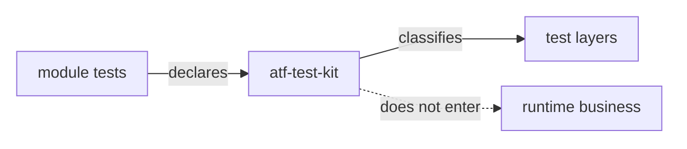
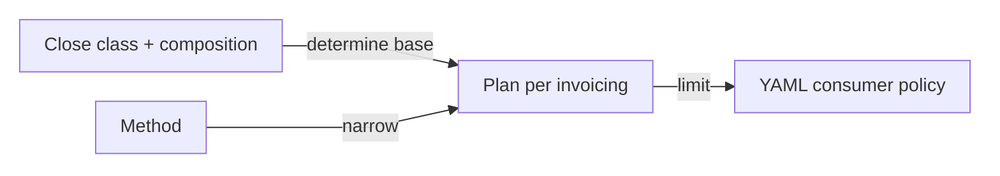
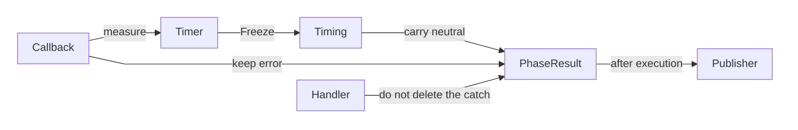

# ATF Test Kit

`atf-test-kit` provides neutral JUnit classification, lifecycle and comparisons, without a renderer, transport or business rules. J0 owns its code and feedback; J1–J6 consume the JAR/POM pair in lib, without parallel Kit source or native tests.

The product uses Kit in `test`; the test medium in the main requires justified `compile` and Console keeps `optional compile`. The consumer holds the oracle and publication. [Library contract](../../atf_j0/docs/ATF_Test_Kit_Library.md) delimits migration and acceptances.

<a id="at-a-glance"></a>
<a id="pe-scurt"></a>
## At a glance

**Quick trails:** [Layer and ownership](#clasificare) · [Auditable Assert](#comparații-junit-cu-dovadă-neutră) · [Scope Maven](#dependențe) · [Local sample](#verificare-rapidă)



<details>
<summary><strong>Legend - transversal contract of tests</strong></summary>

- the modules declare the layer by annotation, and the kit checks it;
- the four layers are executable test layers: unit, component, integration and E2E;
- support is an auxiliary code, not the fifth executable layer;
- the pointed edge excludes Test Kit from the business runtime of the consumption;
- JUnit Console adapter keeps the `optional compile` exception, without propagation
  Default transitive; [architecture](../docs/ATF_Architecture.md#harta-modulelor-platformă-și-consumatori) and POM Console document this limit.
</details>

| Contains | Not containing | Gate |
|---|---|---|
| level / channel / console / output / setup / docs / UI records, neutral resolvers | renderer, mock, browser | Test Kit tests; global classification in `atf-tests` |
| JUnit comparisons and observation facts scoured by phase | Fact-derived verdict, business rules, publication Extent | Test Kit tests; adapters to the consumer's owner |
| test classification | business flow | each class has a single level |
| cross-cutting rules | business runtime dependency | fail-closed la drift |

<a id="real-junit-launch-plan"></a>
<a id="planul-real-al-lansării-junit"></a>
## Real JUnit launch plan

The `atf.testkit.launch` package observes launcher sessions through the public `LauncherSessionListener` SPI. It neither executes tests nor opens consumer resources. `TestLaunchContext.capture(context)` returns an immutable `Optional<TestLaunchSnapshot>` for the current invocation: request selectors, filtered `TestPlan` inventory, initially discovered count and dynamic registrations observed at capture time.

- Request association uses plan configuration identity; a foreign or unavailable
  request does not replace provenance of the executed plan.
- Suites pass outer context only to actual descendants. Independent, repeated
  and concurrent launches retain their own scope and cleanup.
- The discovered count includes disabled tests and excludes later dynamic
  registrations; it does not represent the number of passed or executed tests.
- Capture is absent when the SPI observer is disabled. For a plan discovered
  in another session, inventory and count remain available; selector provenance explicitly reports the unavailable request.
- `junit-platform-launcher` is optional; the consumer launching tests provides
  it. The library has no dependency on Reporting, UI or consumers.

`TestLaunchPlanComponentTest` probes direct/filtered selection, nested/concurrent scopes, plans executed later, disabled tests, dynamic registrations and absence of the bridge.

<a id="classification"></a>
<a id="clasificare"></a>
## Classification

Each executable class declares exactly one level:

```text
@AtfUnitTest        → @Tag("unit")
@AtfComponentTest   → @Tag("component")
@AtfIntegrationTest → @Tag("integration")
@AtfE2eTest         → @Tag("e2e")
```

<a id="what-checks-governance"></a>
<a id="ce-verifică-guvernanța"></a>
### What checks governance

- `AtfTestLayerArchitectureTest`, `atf-tests` and the whole- ATF suite, uses
  `AtfJavaSourceInventory` joint inventory: default Maven root or `testSourceDirectory` declared in POM, including `src/test` root Shop;
- verify annotation, package, prohibited imports and `support` isolation;
- solves from compound sources and annotations, by import or the same packaging,
  including the ingot composition; cycles do not invent a level;
- The rule is fail- closed: a class without level or with multiple levels stops
  The building, including when levels come from compound annotations.
- Level belongs to the executable class, not the file name or profile
  the report; the metaphoric-annotations fixtures are separated from the executable owner.
- Reporting samples using Playwright directly remain at the UI component owner,
  in `atf.ui.tests.extent.component`; a contract API rendered does not justify an exception.

<a id="composition-checks"></a>
<a id="verificări-de-compoziție"></a>
### Composition checks

- `AtfModuleTest` / `AtfModuleTestCondition` remains suitcase specific
  `atf-reporting-tests` in `atf.reporting.test`;
- a missing module can produce `SKIPPED` through the dedicated neck;
- The kit does not introduce a parallel UI boolean.

<a id="infrastructure-annotations-implemented"></a>
<a id="adnotări-de-infrastructură-implementate"></a>
### Infrastructure annotations implemented

| Package | API | Application |
|---|---|---|
| `atf.testkit.channel` | `AtfTestChannel`, `TestChannelPlan`, resolver | UI / API / UI_API channel, separate from JUnit level |
| `atf.testkit` + `.console` | `AtfConsoleMessages`, `AtfConsoleMessagePolicyResolver` | Tipped console policy; `atf-console` applies it without a double sink / formatter |
| `atf.testkit.reporting` | `AtfReportPath`, `AtfReportPathPolicyResolver` | i-in separately for the published report path |
| `atf.testkit.output` | directory annotations and `ReportOutputDirectory` | Anchor UI by annotation or path project-related validated for an artifact |
| `atf.testkit.setup.api` | `ApiScenarioSetup`, `ApiTestRef` | statements; catalogue and execution remain with the consumer |
| `atf.testkit.documentation` | `DocumentationTarget`, JAR guides | selection and compilation isolated; oracles to the owner |
| `atf.testkit.evidence` | `AtfUiEvidence`, `AtfUiEvidencePlan`, `AtfUiEvidenceResolver` and axis enumerations | independently solves the float, catches and stock details; consumer adapters mapped them in the Reporting profile |
| `atf.testkit.lifecycle` | `TestRunInitialization`, `CloseOnceResource`, `ArmedCleanup`, `FailureAwareCleanup`, `FailureEvidenceCleanup`, `AtfE2eActivationPolicy`, `ScopedAcceptanceRun` | purchase / rollback, cleanup, activation E2E and launch scoped; without API UI / Reporting |
| `atf.testkit.scope` | `TestRunScope`, `ScopedTestValue<T>`, `ScopedTestResource<T>` | explicit ownership in the JUnit Storeul, without static cache or UI resources |
| `atf.testkit.assertions` | facade / recorder, injected display and component protocol | comparisons JUnit with neutral evidence on phases and invoicing; no renderer or business rules |
| `atf.testkit.timing` | `InvocationTimer` | Monotone intervals per owner, immutable snapshot and accumulation without renderer or JUnit |
| `atf.testkit.recovery` | `AtfUiRecovery`, plan and Resolver | restriction per invoicing for BE policy; without YAML, browser or renderer |

`atf.testkit.lifecycle` is a package of the existing `atf-test-kit` module, not a new module. It does not introduce dependencies to UI or Reporting.

| Contract | Behavior and evidence |
|---|---|
| Initialization | `TestRunInitialization.create(...)` receives resource factories → scenario → phase → run; on failure perform reverse callbacks for returned handles.`TestRunInitializationTest` checks success, each failure point, `Error` and `suppressed` errors. |
| Single Closure | `CloseOnceResource` keeps the handler and tries close once, including if it fails; `closeAfter(primary)` retains the original cause without self-pressure. |
| Compensare | `ArmedCleanup.arm()` is called before the mutation; success disarms, and failure retains the possibility of explicit retry. It does not represent automatic cleanup retry and does not know what an account is. |
| Cleanup | `FailureAwareCleanup` tries all stages, keeps the first error and attaches the rest as `suppressed`; the resources close backwards. |
| Failure evidence | `FailureEvidenceCleanup` captures before the cleanup that can change the page; the consumer holds the callbacks. Both primitive are tested in `FailureAwareCleanupTest`. |
| Activation | `AtfE2eActivationPolicy`: override JVM → oci- in configured → Fallback IDE → deactivation; extensions read signals, and `AtfE2eActivationPolicyTest` checks the precedence and rejection of invalid values. |
| Scoped acceptance | `ScopedAcceptanceRun` applies only synchronous callback override, restore the previous value including `Error`, then collect selected caller files; `ScopedAcceptanceRunTest` proposes the same cause, filter and collection error. |
| Integration | The whole- ATF governance checks Shop / AutoEx limits; the kit does not read YAML and does not start the browser. |

- API, precedent and evidence: [infrastructure annotations](../docs/ATF_Test_Infrastructure_Annotations.md).
- Manual IntelliJ check for output project-relative:
  [Extent Suite Guide](../atf-reporting-tests/src/test/java/atf/ui/tests/extent/README.md#rulare-directă-din-intellij).

<a id="scoped-launch-of-acceptance"></a>
<a id="lansarea-scoped-a-acceptanței"></a>
### Scoped launch of acceptance

[ScopedAcceptanceRun](src/main/java/atf/testkit/lifecycle/ScopedAcceptanceRun.java) is the neutral primitive used by the Shop and AutoEx CLI- routes: temporary override, synchronous callback and immutable artifact collection. It serializes cooperating calls; it does not isolate the JVM property from external writers.

The consumer provides the laser, configuration, file filter and business oracles. ScopedAcceptanceRun does not import JUnit, Reporting or Playwright, does not create the directory and does not interpret HTML. [ScopedAcceptanceRunTest](src/test/java/atf/testkit/lifecycle/ScopedAcceptanceRunTest.java) test remains unitary; Extent contract belongs to the acceptance of the consumer.

<a id="neutral-declaration-for-recovery-be"></a>
<a id="declarația-neutră-pentru-recuperare-be"></a>
### Neutral declaration for recovery BE

`atf.testkit.recovery.AtfUiRecovery` and its resolver do not know YAML, Playwright, business operations or renderer. The consumer's extension solves the plan per invoicing before resources, then narrows the UI policy loaded from YAML.

| Mode | Effect |
|---|---|
| CONFIGURED | keep the ceilings and the YAML allowlist |
| DISABLED | prohibit recovery for owner |
| READ_ONLY | declares intent; YAML OFF remains OFF |

The nearest class with direct or compound declaration establishes the basis. The method may narrow down; READ_ONLY does not reopen a DISABLED class and CONFIGURED per method retains class restriction.

A CONFIGURED explicitly on the next class resumes YAML base instead of the parent class. READ_ONLY / DISABLED conflicts at the same level are rejected; the math cycles do not invent a policy.



<details>
<summary><strong>Legend - declaration without resources</strong></summary>

- `AtfUiRecoveryResolver.resolve(owner, method)` returns mode and source;
  do not open the browser or extend budgets or operations.
- The inherited method uses the actual method statement; a foreign method
  The owner is rejected.
- `AtfUiRecoveryResolverTest` proposes precedence, composition, conflicts and
  Isolation of parallel solutions.

</details>

The runtime contract is at [UI](../atf-ui/README.md#recuperare-be-prin-observație-pasivă); the examples are in [annotation guide](../docs/ATF_Test_Infrastructure_Annotations.md#recuperare-be-declarată).

<a id="comparison-junit-with-neutral-evidence"></a>
<a id="comparații-junit-cu-dovadă-neutră"></a>
### Comparison JUnit with neutral evidence

`AuditedAssertions` and `RecordedAssertions`, in `src/main/java`, delegate the JUnit comparison once. `Check(name, expected, actual, passed)` row is retained before the original error reaches the caller; the preview is not deciding the verdict.

`RecordedAssertions.observe(ComponentAuditObservation)` records typed facts for the current phase, separate from the `Check` list and the requested cover. A single fact does not meet the `ComponentAssertionAudit` Assertion requirement; the consumer adaptor decides how to map it into `ReportObservation`, and the Kiti does not import Reporting and does not publish a renderer.

- `AssertionValueDisplay` receives consumer redaction policy and
  apply to the complete text, then limit the display to 240 characters including `…` by default. The positive limit is configurable and expansion does not cancel it.
- The consumer adaptor receives the actual budget from the report owner,
  prior to collection; Kit does not read YAML and does not depend on Reporting. [Reporting contract](../atf-reporting/README.md#proiecția-sigură-a-aserțiunilor) defines the configuration and value displayed in the System.
- Defective projection uses `<display unavailable>`; we do not redial `toString()`
  in the handler and do not replace the original error of comparison. JUnit messages provided lazy remain lazy.
- `assertThrows` and `assertDoesNotThrow` suppress both internal checks of
  façade and explicit recorder; the report keeps checking the wait, not an artificial FAIL business.
- A recorder explicitly created in the scope also feeds the collector of the invocation;
  Each collector applies its own display policy to the full value. `checks()` returns the immutable snapshots.

`ComponentAuditExtension` implements the common JUnit protocol, and `ComponentAuditAdapter` allows composition with the consumer factory. `ComponentAssertionAudit` holds only phases, comparisons and outcome policy.

| Case | Contract |
|---|---|
| `@BeforeEach` / Test Method / `@AfterEach` | Distinguished recorder in `SETUP` / `TEST BODY` / `TEARDOWN`; legacy and temples keep isolation |
| FAIL captured by a simple `catch` | uncompleted audited error is spread at the end; JUnit and the ratio remains FAIL |
| JUnit Handler swallowing an exception | the error caught at the callback output remains FAIL; an abort remains SKIP, and the translation of an error into the abort does not hide the original error |
| PASS without assessed checks | explicit guard; no lines are invented |
| assessment rejected | `ABORTED` result, designed by the consumer as SKIP for real reason |
| publication / close failure | all stages are tested; the original cause remains primary and the rest are `suppressed` |

The factor and mappings are consumer; Kit does not import Reporting, Validation, Core or Playwright and does not choose steps or catches.

- `ComponentAuditExtension.scoped(...)` shares only the publication resource;
  The collector, phases and publication remain per invoicing.
- `@BeforeAll` / `@AfterAll` errors receive class diagnosis without invented comparisons.

`AssertionProjectionTest` and `ComponentAuditExtensionComponentTest` are tested in Extent / fallback in Reporting Tests.

<a id="time-of-execution-by-component-phases"></a>
<a id="timpul-execuției-pe-faze-componente"></a>
### Time of execution by component phases

`InvocationTimer`, in `src/main/java/atf/testkit/timing`, measures monotone intervals in nanoseconds. `ComponentAuditExtension` surrounds each executed JUnit callback; `PhaseResult.timing()` carries the immobile snapshots and the number of intervals. several methods inherited from the same phase are combined without the gaps between them.



<details>
<summary><strong>Legend - measured range and limits</strong></summary>

- `@BeforeEach`, simple / template method and `@AfterEach` are measured, including
  FAIL / SKIP outputs; an unexecuted callback does not produce duration.
- Purchase of resource, creation of court, resolution of parameters, and
  publication / closure of the report is out of range.
- The range surrounds `Invocation.proceed()`; includes possible interceptors
  extension callbacks outside this call are excluded.
- `@BeforeAll` / `@AfterAll` feeds the diagnostic timer when it fails;
  Successful class fixtures are not artificially distributed between scenarios.
- Zero measured is valid; the absence of timeout remains unknown.
  The injectable clock uses nanoseconds and is not a calendar clock.
- `InvocationTimerTest` and `ComponentPhaseTimingExtensionComponentTest` probes
  accumulation, isolation, lifecycle errors and exclusion of publication costs. Kit does not know Extent and does not alter the value ceiling or JUnit verdict.
- `HandledComponentFailureComponentTest` checks reconciliation after the handler,
  The Runner brings together the exceptions to propagation; the audit does not attach a copy of the same case to the same account yet.
- A successful comparison remains PASS if a callback fails later.
  The exception is diagnosed separately; no comparison of FAIL is invented. Short labels shall keep the following meaning:

| In the scheme | Full meaning |
|---|---|
| Callback | Callback JUnit |
| Timer | Timer per phase / invoicing |
| Timing | Duration + number of intervals |
| Publisher | Consumer publication |
| Handler | Handler JUnit |
| measure | measure in final |

</details>

<details>
<summary><strong>JUnit Invoice limit</strong></summary>

- The scope is explicit on the thread of the claim; it does not propel implicitly into the worker threads.
- Template methods and invoicing, including parameterization of consumption, are covered;
  a dynamic test factory requires an adaptor of its own per dynamic test.
- A pre-invoicing disabled selection shall not produce an execution or assertion.
- The original JUnit errors are retained; the wording applies to ATF proof,
  does not rewrite the object of the exception held by the runner.

</details>

<a id="policy-for-the-path-of-the-published-report"></a>
<a id="politica-pentru-calea-raportului-publicat"></a>
### Policy for the path of the published report

`@AtfReportPath` controls the notification after publication; Kit does not create the report.

- Absence: `DISABLED`; value-free annotation: `ENABLED`.
- At the nearest level of class, direct declaration overrides meta- policies,
  including `DISABLED` over E2E marker.
- Without direct declaration, the opposite meta-policies fail failfast; without policy
  local search for the superclass, then apply the default.
- Console Agregator receives each owner via `AtfReportPathOptIn.include(owner)`;
  at least one active owner shall request notification of the common artifact.
- Policy belongs to Jupiter class, including when launching a method; annotation
  `@Suite` is not inherited by the selected classes.

The above precedence is `AtfReportPath` specific. The full contract is in [annotation guide](../docs/ATF_Test_Infrastructure_Annotations.md#opt-in-pentru-calea-raportului).

<a id="wealth-values-per-class-or-execution"></a>
<a id="valori-cu-ownership-per-clasă-sau-execuție"></a>
### Wealth values per class or execution

`TestRunScope.selected(context)` reads JUnit `atf.test.run.scope` parameter; invalid values stop configuration.

| Value | Owner | Use |
|---|---|---|
| `class` implicit | Actual class store | class methods divide the value; other classes have distinct values |
| `suite` explicit | The root stores of the execution | the classes of the same execution may reuse the value |

- The suite declares `@ConfigurationParameter(key = "atf.test.run.scope", value = "suite")`;
  order and parallelism are separate decisions of consumption.
- `value(context, owner, name, type)` isolates the keys and scopes.
  Two launches in the same JVM do not share values, even with the same ID-uri JUnit.
- `ScopedTestValue.getOrCreate(...)` performs the factory once and returns
  value plus indicator `created`; a failed purchase blocks the default retry and retains the original cause.
- `close()` is idempotent and forgets the reference, including after a failure;
  do not close the stored object and do not delete the borrowed remote resource.
- `toString()` representation does not include value. Consumer holds policy
  drawing up and any external operation of cleanup.
- `resource(context, owner, name, type)` uses `ScopedTestResource<T>`
  Distinguished from `value(...)`: Close the purchased object to the class / suite owner, once, including when close fails. Do not resume failed factory.

`ScopedTestValueTest` checks the status and competition; `TestRunScopeComponentTest` launches real Jupiter for methods, classes, repeated executions, setup / body failed and release upon closure of Store.Launcher and engineer Jupiter are only dependent on Kit test. `ScopedTestResourceTest` and `ScopedComponentAuditExtensionComponentTest` check the dispersal, isolation The claims, the class failure and the failed publication after the contract.

<a id="liability-limits"></a>
<a id="limite-de-responsabilitate"></a>
### Liability limits

- `AtfUiEvidence` holds only the declared vocabulary: `CONFIGURED` leaves each
  axis to the condominium configuration, and an explicit value is the class's intention; the kit does not read YAML and does not create Reporting profile;
- each consumer applies the precedence and mapped the values in its profile:
  The configuration provides the base, and the explicit value of annotation only overrides the declared axis. AutoEx and Shop apply all three axes; the isolation of profiles between scenarios from a shared ratio remains the responsibility of the consumer lifecycle, not Test Kit;
- `AtfUiEvidenceResolver` analyses direct and compound statements of the
  The complementary explicit axes combine; different explicit values for the same axis fail with the owner and the name of the axis. A complete local declaration `CONFIGURED` returns to configuration without inheriting the parent's overrides. Resolver does not automatically compose harness;
- capture source, the publisher, the browser lifecycle and the practical flows
  Shop remains with their owners; Test Kit does not depend on `atf-reporting` or Playwright;
- `AtfReportPathPolicyResolver`'s solver manages the metaphorical annotations separately,
  class hierarchy and output policy conflicts.

<a id="e2e-common-support-limit"></a>
<a id="limita-suportului-e2e-comun"></a>
### E2E Common Support Limit

No new UI module is created and no consumption harnesses are moved as such.

| Contract | Owner / limit |
|---|---|
| `FailureAwareCleanup`: reverse closure of acquired resources and aggregation of failures | implemented in `atf-test-kit`; tested directly and via Shop / AutoEx adapters without API UI / Reporting |
| Store, annotations, extension JUnit and wiring to the primitive Kit | `src/test` consumer adapter |
| Application specific browser / report router | can be in the main with explicit inputs / ports without JUnit / Kit; does not enter Test Kit |
| Application specific configuration, catch and mapping without JUnit / Kit | `src/main` consumer runtime; generic browser remains in UI, renderer in Reporting |
| Lifecycle or JUnit UI extension | continue to be local until both consumers demonstrate the same contract; `atf-ui` already consumes Test Kit in the scope test, so reverse dependence would create cycle |
| Shop scope for Test Kit | Maven imports and dependence are in `test` scopes; verified by `ConsumerModuleArchitectureGovernanceTest` of `atf-tests` |
| Classification, record and installation | `@AtfE2eTest` and `@AtfTestChannel` classify the test; `@AtfUiEvidence` declares the form of proof; extension and resources remain in the consumer. The contract of annotations is in [documentation of the test infrastructure](../docs/ATF_Test_Infrastructure_Annotations.md) and the choice of layer in [test guide](../docs/ATF_Testing_Guide.md). |
| E2E activation | `AtfE2eActivationPolicy` solves signals already collected by the consumer extension; does not read YAML or system properties and does not start the browser |

<a id="re-use-without-a-new-support-module"></a>
<a id="reutilizare-fără-un-nou-modul-de-suport"></a>
### Re-use without a new support module

The target is to remove the infrastructure duplicated from the consumers, not to move the browser or report to Kit. The primitives of `lifecycle` already exist.

- Neutral scope exists in `atf.testkit.scope`; Shop consumes it for
  account reference, keeping registration and authentication to the application's owner. An additional JUnit adapter requires a shared contract.
- The application-specific runtime shall be separated into the consumer; fixtures and
  artificial oracles do not become API main only to empty `src/test`.
- AutoEx uses `AutoExRunFactory` and `AutoExRunLifecycleAdapter` in the test
  Shop keeps the browser / report context in the test for the moment; we do not require a mechanical movement for the symmetry.
- We do not introduce Playwright / Reporting dependencies or a new UI module;
  the configuration and declarations are resolved prior to the acquisition of resources.
- `@AtfUiEvidence` declares intent, does not guarantee that the adapter reads a key
  YAML per axle; actual status is documented by the consumer.

The decisions about existing primitives and ownership are in [atlas](../docs/ATF_Context_Atlas.md#reutilizare-fără-mutarea-politicii-aplicației); [business acceptance of consumers](../docs/ATF_Testing_Guide.md#acceptanța-business-individual-și-prin-suită) describes business evidence and the limits of their interpretation.

<a id="dependencies"></a>
<a id="dependențe"></a>
## Dependencies

```text
module tests → atf-test-kit (test scope)
atf-test-kit -X-> production
atf-console --optional--> atf-test-kit (JUnit policy bridge only)
reporting composition test scope → atf.reporting.test
atf-reporting-tests --test--> atf-reporting production
```

Modules remain the semantic owners of their tests. The Kitten only normalizes vocabulary and forces the hierarchy; does not take over business assertions, fixtures, locators, CSS, JavaScript or flows between modules. `--test-->` arrow is intended: the composition can consume the library reporting in the scope test, while `atf-reporting/src/main` remains ATF dependencies.

<a id="rule-for-promoting-reusable-tests"></a>
<a id="regula-de-promovare-a-testelor-reutilizabile"></a>
### Rule for promoting reusable tests

[Common rule of ownership of tests](../docs/ATF_Testing_Guide.md#owner-ul-testului-business-adaptor-sau-infrastructură) applies; this section delimits API and specific samples Test Kit.

| Test contract | Owner | Stays outside the host |
|---|---|---|
| Lifecycle / path neutral annotations, classification and primates | `atf-test-kit` | UI consumer business tests and harness |
| Model, publisher, markup, CSS / JS, disclosure and rendering | `atf-reporting-tests` | Shop / AutoEx specific semantic mapping |
| Mapping an application contract to ATF ports | the consumption concerned | generic renderer rules |

Test Kit also holds the component samples for its primitives; it is not a repository for tests extracted from Shop / AutoEx only to remove doubles. It does not receive `atf-reporting`, `atf-ui` or consumption modules.

AutoEx previously validated API report directories locally without checking reparse points. The generic criterion now belongs to `ReportOutputDirectory.resolveProjectRelative(...)` and is tested here; AutoEx keeps its default and configured path. This does not create a UI harness library: `AtfE2eActivationPolicy`, cleanup and evidence annotations are shared, while Reporting profiles, browser capture, traffic correlation and identity redaction have separate owners or consumer-specific rules.

- `FailureAwareCleanupTest.partiallyAcquiredResourcesCloseInReverseAndKeepAcquisitionFailurePrimary`
  is the neutral sample for reverse closure and maintenance of the primary cause.
- Missing handlebars, multiple close errors and repropagation of the primary cause
  without self-pressure are tested in the same neutral class.
- Direct copy Shop has been removed; `ShopE2eFailureBoundaryTest` retains
  publication of the fault by its own adaptor.
- Initialization with factories and its neutral evidence are here, not in AutoEx.
  The consumer provides browser / report callbacks; the Kit does not implement them.
- Factoryremains responsible for the resources gained internally prior to
  return of a handle; success transfers normal cleanup to run.
- `ConsumerModuleArchitectureGovernanceTest` rejects the recreation of AutoEx,
  Kit's dependencies to UI / Reporting and consumer imports in neutral samples.

<a id="quick-check"></a>
<a id="verificare-rapidă"></a>
## Quick check

| Decision | Source and limit |
|---|---|
| Comparison JUnit and neutral evidence per invoicing | [source of the host](src/main/java/atf/testkit/assertions/ComponentAuditExtension.java); sample [ComponentAuditExtensionComponentTest](src/test/java/atf/testkit/assertions/ComponentAuditExtensionComponentTest.java) |
| Dependencies and source- sets | [POM](pom.xml); declared scope authority for integration |
| What this probe does not prove | The Renderer, browser and business rule belong to consumer owners. |

<details>
<summary><strong>Command for local sample</strong></summary>

Run from the root of a [external staging](../docs/ATF_Build_And_Execution_Safety.md), with JDK 21 and Maven.

```powershell
mvn -B -pl atf-test-kit -am "-Dtest=ComponentAuditExtensionComponentTest" "-Dsurefire.failIfNoSpecifiedTests=false" test
```

The command selects the sample called and builds the dependencies; does not declare the passage of the entire module. The Renderer, browser and business rule belong to the consumer owners.

</details>

<a id="audited-numerical-tolerance"></a>
<a id="toleranță-numerică-auditată"></a>
### Audited numerical tolerance

`AuditedAssertions.assertEquals(expected, actual, delta, message)` for `double` performs JUnit once and publishes the current expected ± delta and message in the standard step assertion- steppe. Do not reduce the comparison to true / true; the preview- remains 240, and the verdict and cause of JUnit are preserved.

<a id="optional-full-projection"></a>
<a id="proiecția-integrală-opțională"></a>
### Optional full projection

AssertionValueDisplay can receive an observer Projection for expected / current after redaction and before preview. The catch does not reevaluate the comparison; the consumer holds the retention and publication of values and the default limit remains 240.

<a id="required-audit-in-test-body"></a>
<a id="audit-obligatoriu-în-corpul-testului"></a>
## Required audit in test body

`ComponentAssertionAudit.AssertionRequirement` is neutral policy without Reporting or domain rules. Existing builders and existing publications keep `ANY_PHASE`; the consumer can explicitly choose `TEST_BODY` via `ComponentAuditExtension.Publication.assertionRequirement()`.

| Situation with TEST_BODY | Result |
|---|---|
| Setup / teardown au checks, body does not have | FAIL; setup does not replace body proof |
| JUnit directly or only observation in the body | FAIL if no comparison Kit assessed |
| Body with actual Kit comparison | the verdict assessed without renderer reassessment |
| Original fault or abort | the cause and FAIL/SKIP remain primary; no invented body after setup aborts |
| JUnit Handler consumes error or comparison is caught | audited rail remains FAIL |

A successful result without comparisons publishes the structural `Audited assertion coverage / TEST BODY` row: expected `at least 1 evaluated assertion`, actual `0` and verdict FAIL. It diagnoses missing evidence without inventing a business check. Preview remains 240; evaluation uses complete values.

`TestBodyAssertionRequirementTest` and `TestBodyAssertionRequirementComponentTest` permanent samples check the policy, real JUnit lifecycle and isolation of the temples. Strict adoption is decided in the adaptor of each consumer; ordinary units do not receive this requirement.

<a id="regressions"></a>
<a id="regresii-assertion-requirement"></a>
### Regressions

| Responsibility | Probe owner |
|---|---|
| neutral policy ANY_PHASE / TEST_BODY | src / test / java / atf / testkit / assertions / request; same ten cases, via public API |
| controlled failure of fixtures | Explicit launcher; nested fixtures are not independently selected by wildcard |
| cohesion | the eight general classes remaining in the assertions, and the two requested samples have their own sub-package |

<a id="fitness-of-displayed-values"></a>
<a id="fidelitatea-valorilor-afișate"></a>
## Fitness of displayed values

`RecordedAssertions` compares the original inputs and stores the prepared preview, which is limited to 240 by UTF-16 units.

- Trunkierre keeps the pairs of the entire deaf and does not exceed the budget.
- Expected / current values stored are limited projections, not full copies.
- A post-preview-only mismatch keeps FAIL; full proof
  be captured prior to truncation in order to be published later.
- Sanitization precedes the preview, the comparison is only performed once, and
  JUnit case remains owned by the assertion border.

Unicode regression is in [AssertionProjectionTest](src/test/java/atf/testkit/assertions/AssertionProjectionTest.java).
