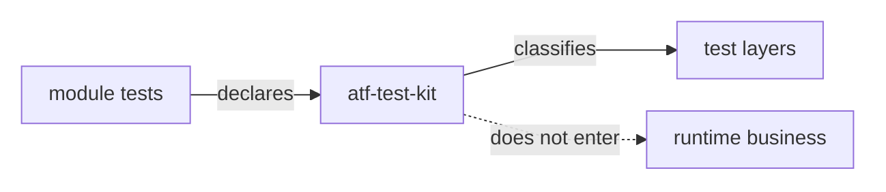
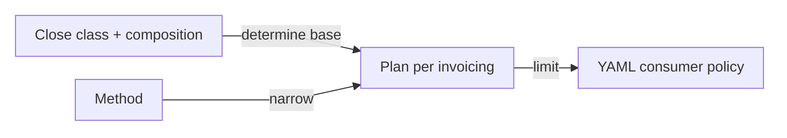
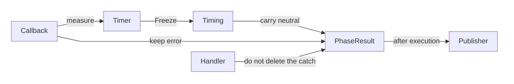

# ATF Test Kit

`atf-test-kit` provides neutral JUnit classification, lifecycle and comparisons, without a renderer, transport or business rules. J0 owns implementation and native tests; J1–J7 consume the JAR/POM pair in lib without parallel Kit source.

Production projects use Kit in `test` scope; main-scope support in a test module requires justified `compile`, and Console retains `optional compile`. The consumer owns its oracle and publication; the [library contract](../docs/ATF_Test_Kit_Library.md) defines distribution and independent acceptance.

<a id="at-a-glance"></a>
<a id="pe-scurt"></a>
## At a glance

**Quick links:** [Classification](#clasificare) · [Auditable assertions](#comparații-junit-cu-dovadă-neutră) · [Dependency scopes](#dependențe) · [Local verification](#verificare-rapidă)



<details>
<summary><strong>Legend - transversal contract of tests</strong></summary>

- the modules declare the layer by annotation, and the kit checks it;
- the four layers are executable test layers: unit, component, integration and E2E;
- support is an auxiliary code, not the fifth executable layer;
- the dotted edge keeps Test Kit outside the consumer’s business runtime;
- The JUnit Console adapter retains `optional compile`, without default
  transitive propagation; [architecture](../docs/ATF_Architecture.md#harta-modulelor-platformă-și-consumatori) and the Console POM own this exception.
</details>

| Contains | Not containing | Gate |
|---|---|---|
| level / channel / console / output / setup / docs / UI records, neutral resolvers | renderer, mock, browser | Test Kit tests; global classification in `atf-tests` |
| JUnit comparisons and observation facts scoped by phase | verdicts inferred from observations, business rules, Extent publication | Test Kit tests; adapters to the consumer's owner |
| test classification | business flow | each class has a single level |
| cross-cutting rules | business runtime dependency | rejects drift |

<a id="real-junit-launch-plan"></a>
<a id="planul-real-al-lansării-junit"></a>
## Real JUnit launch plan

The `atf.testkit.launch` package observes launcher sessions through the public `LauncherSessionListener` SPI. It neither executes tests nor opens consumer resources. `TestLaunchContext.capture(context)` returns an immutable `Optional<TestLaunchSnapshot>` for the current invocation: request selectors, filtered `TestPlan` inventory, initially discovered count and dynamic registrations observed at capture time.

- Request association uses plan configuration identity; a foreign or unavailable
  request does not replace provenance of the executed plan.
- Suites pass outer context only to actual descendants. Independent, repeated
  and concurrent launches retain their own scope and cleanup.
- The discovered count includes disabled tests and excludes later dynamic
  registrations; it does not represent the number of passed or executed tests.
- Capture is absent when the SPI observer is disabled. For a plan discovered
  in another session, inventory and count remain available; selector provenance explicitly reports the unavailable request.
- `junit-platform-launcher` is optional; the consumer launching tests provides
  it. The library has no dependency on Reporting, UI or consumers.

`TestLaunchPlanComponentTest` probes direct/filtered selection, nested/concurrent scopes, plans executed later, disabled tests, dynamic registrations and absence of the bridge.

<a id="classification"></a>
<a id="clasificare"></a>
## Classification

Each executable class declares exactly one level:

```text
@AtfUnitTest        → @Tag("unit")
@AtfComponentTest   → @Tag("component")
@AtfIntegrationTest → @Tag("integration")
@AtfE2eTest         → @Tag("e2e")
```

<a id="what-checks-governance"></a>
<a id="ce-verifică-guvernanța"></a>
### What governance checks

- `AtfTestLayerArchitectureTest` in the whole-ATF suite uses shared
  `AtfJavaSourceInventory` discovery: Maven’s default root or declared `testSourceDirectory`, including Shop’s `src/test` layout;
- it checks annotations, packages, prohibited imports and `support` isolation;
- it resolves source and composed annotations through imports or the same package,
  including nested composition; cycles cannot invent a level;
- the rule rejects missing or multiple levels, including levels inherited
  through composed annotations;
- the executable class owns its level, independently of filename or report profile;
  meta-annotation fixtures remain separate from executable test owners.
- Reporting samples using Playwright directly remain at the UI component owner,
  in `atf.ui.tests.extent.component`; a contract API rendered does not justify an exception.

<a id="composition-checks"></a>
<a id="verificări-de-compoziție"></a>
### Composition checks

- `AtfModuleTest` / `AtfModuleTestCondition` remain suite-specific support
  in `atf-reporting-tests`, under `atf.reporting.test`;
- the dedicated condition can report a missing module as `SKIPPED`;
- The kit does not introduce a parallel UI boolean.

<a id="infrastructure-annotations-implemented"></a>
<a id="adnotări-de-infrastructură-implementate"></a>
### Infrastructure annotations implemented

| Package | API | Application |
|---|---|---|
| `atf.testkit.channel` | `AtfTestChannel`, `TestChannelPlan`, resolver | UI / API / UI_API channel, separate from JUnit level |
| `atf.testkit` + `.console` | `AtfConsoleMessages`, `AtfConsoleMessagePolicyResolver` | typed console policy; `atf-console` applies it without a duplicate sink or formatter |
| `atf.testkit.reporting` | `AtfReportPath`, `AtfReportPathPolicyResolver` | separate opt-in for the published report path |
| `atf.testkit.output` | directory annotations and `ReportOutputDirectory` | UI root selected by annotation, or a validated project-relative artifact directory |
| `atf.testkit.setup.api` | `ApiScenarioSetup`, `ApiTestRef` | statements; catalogue and execution remain with the consumer |
| `atf.testkit.documentation` | `DocumentationTarget`, JAR guides | selection and compilation isolated; oracles to the owner |
| `atf.testkit.evidence` | `AtfUiEvidence`, `AtfUiEvidencePlan`, `AtfUiEvidenceResolver` and axis enumerations | resolves flow, capture and detail axes independently; consumer adapters map them to a Reporting profile |
| `atf.testkit.lifecycle` | `TestRunInitialization`, `CloseOnceResource`, `ArmedCleanup`, `FailureAwareCleanup`, `FailureEvidenceCleanup`, `AtfE2eActivationPolicy`, `ScopedAcceptanceRun` | acquisition/rollback, cleanup, E2E activation and scoped launch; no UI/Reporting API |
| `atf.testkit.scope` | `TestRunScope`, `ScopedTestValue<T>`, `ScopedTestResource<T>` | explicit JUnit Store ownership without static caching or UI resources |
| `atf.testkit.assertions` | facade / recorder, injected display and component protocol | JUnit comparisons with neutral evidence per phase and invocation; no renderer or business rules |
| `atf.testkit.timing` | `InvocationTimer` | Monotone intervals per owner, immutable snapshot and accumulation without renderer or JUnit |
| `atf.testkit.recovery` | `AtfUiRecovery`, plan and Resolver | per-invocation BE policy restriction; no YAML, browser or renderer |
| `atf.testkit.governance` | `AtfSourceLanguageScanner` | deterministic Java/JS lexical guard for developer identifiers, comments and recognized diagnostics; no file discovery or project policy |

The scanner supplies lexical checks; each consumer owns the inventory and gate.

- Findings identify the source file, line, construct, and matched token.
- Localized product text and ordinary fixture literals are excluded.
- Exception, log, console, and JUnit assertion messages are inspected.
- The reviewed Romanian lexicon is a high-confidence guard, not an English classifier.

`atf.testkit.lifecycle` is a package of the existing `atf-test-kit` module, not a new module. It does not introduce dependencies to UI or Reporting.

| Contract | Behavior and evidence |
|---|---|
| Initialization | `TestRunInitialization.create(...)` acquires factories → scenario → phase → run; failure invokes reverse cleanup for successfully returned handles. `TestRunInitializationTest` checks success, every acquisition failure, `Error` and suppressed cleanup errors. |
| Single Closure | `CloseOnceResource` retains the handle and attempts close once, even if close fails; `closeAfter(primary)` preserves the original cause without self-suppression. |
| Compensation | `ArmedCleanup.arm()` is called before the mutation; success disarms, and failure retains the possibility of explicit retry. It does not represent automatic cleanup retry and does not know what an account is. |
| Cleanup | `FailureAwareCleanup` tries all stages, keeps the first error and attaches the rest as `suppressed`; the resources close backwards. |
| Failure evidence | `FailureEvidenceCleanup` captures before cleanup can change the page; the consumer provides callbacks. `FailureAwareCleanupTest` checks both primitives. |
| Activation | `AtfE2eActivationPolicy`: JVM override → configured opt-in → IDE fallback → disabled; extensions supply resolved signals, and `AtfE2eActivationPolicyTest` checks precedence and invalid-value rejection. |
| Scoped acceptance | `ScopedAcceptanceRun` applies an override only around a synchronous callback, restores the prior value even after `Error`, then collects caller-selected files; `ScopedAcceptanceRunTest` verifies the original cause, filter and collection failure. |
| Integration | The whole- ATF governance checks Shop / AutoEx limits; the kit does not read YAML and does not start the browser. |

- API, precedent and evidence: [infrastructure annotations](../docs/ATF_Test_Infrastructure_Annotations.md).
- Manual IntelliJ check for output project-relative:
  [Extent Suite Guide](../atf-reporting-tests/src/test/java/atf/ui/tests/extent/README.md#rulare-directă-din-intellij).

<a id="scoped-launch-of-acceptance"></a>
<a id="lansarea-scoped-a-acceptanței"></a>
### Scoped launch of acceptance

[ScopedAcceptanceRun](src/main/java/atf/testkit/lifecycle/ScopedAcceptanceRun.java) is the neutral primitive used by the Shop and AutoEx CLI- routes: temporary override, synchronous callback and immutable artifact collection. It serializes cooperating calls; it does not isolate the JVM property from external writers.

The consumer provides the launcher, configuration, file filter and business oracles. `ScopedAcceptanceRun` imports neither JUnit, Reporting nor Playwright and neither creates directories nor interprets HTML. [ScopedAcceptanceRunTest](src/test/java/atf/testkit/lifecycle/ScopedAcceptanceRunTest.java) remains a unit test; the consumer owns Extent acceptance.

<a id="neutral-declaration-for-recovery-be"></a>
<a id="declarația-neutră-pentru-recuperare-be"></a>
### Neutral declaration for recovery BE

`atf.testkit.recovery.AtfUiRecovery` and its resolver do not know YAML, Playwright, business operations or renderers. The consumer extension resolves the plan before acquiring invocation resources, then restricts the UI policy loaded from YAML.

| Mode | Effect |
|---|---|
| CONFIGURED | keep the ceilings and the YAML allowlist |
| DISABLED | prohibit recovery for owner |
| READ_ONLY | declares intent; YAML OFF remains OFF |

The nearest class with direct or compound declaration establishes the basis. The method may narrow down; READ_ONLY does not reopen a DISABLED class and CONFIGURED per method retains class restriction.

Explicit CONFIGURED on the nearest declaring class resets to the YAML baseline instead of inheriting the parent’s restriction. Conflicting READ_ONLY/DISABLED declarations at one level are rejected; meta-annotation cycles cannot invent policy.



<details>
<summary><strong>Legend - declaration without resources</strong></summary>

- `AtfUiRecoveryResolver.resolve(owner, method)` returns mode and source;
  do not open the browser or extend budgets or operations.
- The inherited method uses the actual method statement; a foreign method
  The owner is rejected.
- `AtfUiRecoveryResolverTest` proposes precedence, composition, conflicts and
  Isolation of parallel solutions.

</details>

The runtime contract is at [UI](../atf-ui/README.md#recuperare-be-prin-observație-pasivă); the examples are in [annotation guide](../docs/ATF_Test_Infrastructure_Annotations.md#recuperare-be-declarată).

<a id="comparison-junit-with-neutral-evidence"></a>
<a id="comparații-junit-cu-dovadă-neutră"></a>
### JUnit comparisons with neutral evidence

`AuditedAssertions` and `RecordedAssertions` in `src/main/java` delegate each JUnit comparison once. They retain a `Check(name, expected, actual, passed)` before propagating the original assertion failure; preview never decides the verdict.

`RecordedAssertions.observe(ComponentAuditObservation)` records typed facts in the current phase, separately from checks and the requested outcome. An observation does not satisfy `ComponentAssertionAudit`’s assertion requirement; the consumer maps it to `ReportObservation`, while Kit remains independent of Reporting and rendering.

- `AssertionValueDisplay` applies the consumer’s redaction policy to full text,
  then limits display to 240 characters including `…` by default; the positive limit is configurable and expansion does not remove it.
- The consumer adaptor receives the actual budget from the report owner,
  prior to collection; Kit does not read YAML and does not depend on Reporting. [Reporting contract](../atf-reporting/README.md#proiecția-sigură-a-aserțiunilor) defines the configuration and value displayed in the System.
- Failed projection yields `<display unavailable>`; handling does not retry
  `toString()` or replace the original comparison failure, and lazy JUnit messages stay lazy.
- `assertThrows` and `assertDoesNotThrow` suppress internal facade and recorder
  checks; the report retains the exception expectation rather than inventing a business FAIL.
- A recorder explicitly created in the scope also feeds the collector of the invocation;
  Each collector applies its own display policy to the full value. `checks()` returns the immutable snapshots.

`ComponentAuditExtension` implements the common JUnit protocol, and `ComponentAuditAdapter` allows composition with the consumer factory. `ComponentAssertionAudit` holds only phases, comparisons and outcome policy.

| Case | Contract |
|---|---|
| `@BeforeEach` / test method / `@AfterEach` | separate recorder in `SETUP` / `TEST BODY` / `TEARDOWN`; legacy and template invocations remain isolated |
| FAIL captured by a simple `catch` | an unhandled audited failure is rethrown at completion; JUnit and the report remain FAIL |
| JUnit handler swallowing an exception | a failure captured at callback exit remains FAIL; an abort remains SKIP, and translating failure into abort cannot hide the original cause |
| PASS without assessed checks | explicit guard; no lines are invented |
| aborted execution | `ABORTED`, projected by the consumer as SKIP with the actual reason |
| publication / close failure | all stages are tested; the original cause remains primary and the rest are `suppressed` |

The consumer owns the factory and mappings. Kit imports neither Reporting, Validation, Core nor Playwright, and it does not choose business steps or captures.

- `ComponentAuditExtension.scoped(...)` shares only the publication resource;
  collectors, phases and publication remain per invocation.
- `@BeforeAll` / `@AfterAll` errors receive class diagnosis without invented comparisons.

`AssertionProjectionTest` and `ComponentAuditExtensionComponentTest` are tested in Extent / fallback in Reporting Tests.

<a id="time-of-execution-by-component-phases"></a>
<a id="timpul-execuției-pe-faze-componente"></a>
### Time of execution by component phases

`InvocationTimer` in `src/main/java/atf/testkit/timing` measures monotonic nanosecond intervals. `ComponentAuditExtension` surrounds each executed JUnit callback; `PhaseResult.timing()` retains an immutable snapshot and interval count. Multiple inherited callbacks in one phase accumulate their intervals without the gaps between them.



<details>
<summary><strong>Legend - measured range and limits</strong></summary>

- `@BeforeEach`, simple / template method and `@AfterEach` are measured, including
  FAIL / SKIP outputs; an unexecuted callback does not produce duration.
- Purchase of resource, creation of court, resolution of parameters, and
  publication / closure of the report is out of range.
- The range surrounds `Invocation.proceed()`; includes possible interceptors
  extension callbacks outside this call are excluded.
- `@BeforeAll` / `@AfterAll` feeds the diagnostic timer when it fails;
  Successful class fixtures are not artificially distributed between scenarios.
- Zero measured is valid; the absence of timeout remains unknown.
  The injectable clock uses nanoseconds and is not a calendar clock.
- `InvocationTimerTest` and `ComponentPhaseTimingExtensionComponentTest` probes
  accumulation, isolation, lifecycle errors and exclusion of publication costs. Kit does not know Extent and does not alter the value ceiling or JUnit verdict.
- `HandledComponentFailureComponentTest` checks reconciliation after the handler,
  The Runner brings together the exceptions to propagation; the audit does not attach a copy of the same case to the same account yet.
- A successful comparison remains PASS if a callback fails later.
  The exception is diagnosed separately; no comparison of FAIL is invented. Short labels shall keep the following meaning:

| In the scheme | Full meaning |
|---|---|
| Callback | Callback JUnit |
| Timer | Timer per phase / invoicing |
| Timing | Duration + number of intervals |
| Publisher | Consumer publication |
| Handler | Handler JUnit |
| measure | measure in final |

</details>

<details>
<summary><strong>JUnit invocation boundary</strong></summary>

- Scope is explicit on the assertion thread and does not propagate implicitly to workers.
- Template methods and invocations, including consumer parameterization, are covered;
  a dynamic test factory needs a separate adapter for each dynamic test.
- Selection disabled before invocation produces neither execution nor assertions.
- Original JUnit failures are retained; redaction applies to ATF evidence,
  without rewriting the exception owned by the runner.

</details>

<a id="policy-for-the-path-of-the-published-report"></a>
<a id="politica-pentru-calea-raportului-publicat"></a>
### Policy for the path of the published report

`@AtfReportPath` controls the notification after publication; Kit does not create the report.

- Absence: `DISABLED`; value-free annotation: `ENABLED`.
- On the nearest declaring class, a direct policy overrides meta-policies,
  including DISABLED over an E2E marker.
- Without a direct declaration, conflicting meta-policies fail immediately;
  without a local policy, resolution continues through superclasses, then uses the default.
- The Console aggregator includes each owner through `AtfReportPathOptIn.include(owner)`;
  one enabled owner is enough to request notification for the shared artifact.
- Policy belongs to Jupiter class, including when launching a method; annotation
  `@Suite` is not inherited by the selected classes.

The above precedence is `AtfReportPath` specific. The full contract is in [annotation guide](../docs/ATF_Test_Infrastructure_Annotations.md#opt-in-pentru-calea-raportului).

<a id="wealth-values-per-class-or-execution"></a>
<a id="valori-cu-ownership-per-clasă-sau-execuție"></a>
### Values owned by a class or execution

`TestRunScope.selected(context)` reads JUnit `atf.test.run.scope` parameter; invalid values stop configuration.

| Value | Owner | Use |
|---|---|---|
| `class` default | current class Store | methods in one class share the value; other classes have independent values |
| `suite` explicit | execution root Store | the classes of the same execution may reuse the value |

- The suite declares `@ConfigurationParameter(key = "atf.test.run.scope", value = "suite")`;
  order and parallelism are separate decisions of consumption.
- `value(context, owner, name, type)` isolates keys and scopes; two launches in
  the same JVM never share values merely because their JUnit IDs match.
- `ScopedTestValue.getOrCreate(...)` invokes the factory once and returns the
  value with a `created` flag; failed acquisition prevents implicit retry and retains the original cause.
- `close()` is idempotent and releases the reference even after failure;
  it neither closes the stored value nor deletes a borrowed remote resource.
- `toString()` excludes the value; the consumer owns redaction policy and
  any external cleanup operation.
- `resource(context, owner, name, type)` uses `ScopedTestResource<T>`, separately
  from `value(...)`: the class/suite owner attempts close once, even when close fails, and never retries a failed factory.

`ScopedTestValueTest` covers state and concurrency; `TestRunScopeComponentTest` uses real Jupiter for methods, classes, repeated runs, setup/body failures and Store cleanup. Launcher and Jupiter engine remain test dependencies. `ScopedTestResourceTest` and `ScopedComponentAuditExtensionComponentTest` check disposal, invocation isolation, class failure and publication failure.

<a id="liability-limits"></a>
<a id="limite-de-responsabilitate"></a>
### Responsibility boundaries

- `AtfUiEvidence` owns declarative vocabulary: CONFIGURED leaves an axis to
  consumer configuration, and an explicit value declares class intent; Kit neither reads YAML nor creates a Reporting profile;
- each consumer applies the precedence and mapped the values in its profile:
  The configuration provides the base, and the explicit value of annotation only overrides the declared axis. AutoEx and Shop apply all three axes; the isolation of profiles between scenarios from a shared ratio remains the responsibility of the consumer lifecycle, not Test Kit;
- `AtfUiEvidenceResolver` resolves direct and composed declarations.
  Explicit values on complementary axes combine; conflicting values for one axis fail with owner/axis diagnostics. A wholly CONFIGURED local declaration resets to configuration rather than inheriting parent overrides; the resolver does not compose a harness.
- capture source, the publisher, the browser lifecycle and the practical flows
  Shop remains with their owners; Test Kit does not depend on `atf-reporting` or Playwright;
- `AtfReportPathPolicyResolver` separately resolves meta-annotations,
  class inheritance and report-path policy conflicts.

<a id="e2e-common-support-limit"></a>
<a id="limita-suportului-e2e-comun"></a>
### E2E Common Support Limit

No new UI module is created and no consumption harnesses are moved as such.

| Contract | Owner / limit |
|---|---|
| `FailureAwareCleanup`: reverse closure of acquired resources and aggregation of failures | implemented in `atf-test-kit`; tested directly and via Shop / AutoEx adapters without API UI / Reporting |
| Store, annotations, extension JUnit and wiring to the primitive Kit | `src/test` consumer adapter |
| Application specific browser / report router | can be in the main with explicit inputs / ports without JUnit / Kit; does not enter Test Kit |
| Application specific configuration, catch and mapping without JUnit / Kit | `src/main` consumer runtime; generic browser remains in UI, renderer in Reporting |
| Lifecycle or JUnit UI extension | continue to be local until both consumers demonstrate the same contract; `atf-ui` already consumes Test Kit in the scope test, so reverse dependence would create cycle |
| Shop scope for Test Kit | Maven imports and dependence are in `test` scopes; verified by `ConsumerModuleArchitectureGovernanceTest` of `atf-tests` |
| Classification, record and installation | `@AtfE2eTest` and `@AtfTestChannel` classify the test; `@AtfUiEvidence` declares the form of proof; extension and resources remain in the consumer. The contract of annotations is in [documentation of the test infrastructure](../docs/ATF_Test_Infrastructure_Annotations.md) and the choice of layer in [test guide](../docs/ATF_Testing_Guide.md). |
| E2E activation | `AtfE2eActivationPolicy` solves signals already collected by the consumer extension; does not read YAML or system properties and does not start the browser |

<a id="re-use-without-a-new-support-module"></a>
<a id="reutilizare-fără-un-nou-modul-de-suport"></a>
### Re-use without a new support module

The target is to remove the infrastructure duplicated from the consumers, not to move the browser or report to Kit. The primitives of `lifecycle` already exist.

- Neutral scope exists in `atf.testkit.scope`; Shop consumes it for
  account reference, keeping registration and authentication to the application's owner. An additional JUnit adapter requires a shared contract.
- The application-specific runtime shall be separated into the consumer; fixtures and
  artificial oracles do not become API main only to empty `src/test`.
- AutoEx uses `AutoExRunFactory` and `AutoExRunLifecycleAdapter` in the test
  Shop keeps the browser / report context in the test for the moment; we do not require a mechanical movement for the symmetry.
- We do not introduce Playwright / Reporting dependencies or a new UI module;
  the configuration and declarations are resolved prior to the acquisition of resources.
- `@AtfUiEvidence` declares intent, does not guarantee that the adapter reads a key
  YAML per axle; actual status is documented by the consumer.

The decisions about existing primitives and ownership are in [atlas](../docs/ATF_Context_Atlas.md#reutilizare-fără-mutarea-politicii-aplicației); [business acceptance of consumers](../docs/ATF_Testing_Guide.md#acceptanța-business-individual-și-prin-suită) describes business evidence and the limits of their interpretation.

<a id="dependencies"></a>
<a id="dependențe"></a>
## Dependencies

```text
module tests → atf-test-kit (test scope)
atf-test-kit -X-> production
atf-console --optional--> atf-test-kit (JUnit policy bridge only)
reporting composition test scope → atf.reporting.test
atf-reporting-tests --test--> atf-reporting production
```

Modules remain the semantic owners of their tests. The Kitten only normalizes vocabulary and forces the hierarchy; does not take over business assertions, fixtures, locators, CSS, JavaScript or flows between modules. `--test-->` arrow is intended: the composition can consume the library reporting in the scope test, while `atf-reporting/src/main` remains ATF dependencies.

<a id="rule-for-promoting-reusable-tests"></a>
<a id="regula-de-promovare-a-testelor-reutilizabile"></a>
### Rule for promoting reusable tests

[Common rule of ownership of tests](../docs/ATF_Testing_Guide.md#owner-ul-testului-business-adaptor-sau-infrastructură) applies; this section delimits API and specific samples Test Kit.

| Test contract | Owner | Stays outside the host |
|---|---|---|
| Lifecycle / path neutral annotations, classification and primates | `atf-test-kit` | UI consumer business tests and harness |
| Model, publisher, markup, CSS / JS, disclosure and rendering | `atf-reporting-tests` | Shop / AutoEx specific semantic mapping |
| Mapping an application contract to ATF ports | the consumption concerned | generic renderer rules |

Test Kit also holds the component samples for its primitives; it is not a repository for tests extracted from Shop / AutoEx only to remove doubles. It does not receive `atf-reporting`, `atf-ui` or consumption modules.

AutoEx previously validated API report directories locally without checking reparse points. The generic criterion now belongs to `ReportOutputDirectory.resolveProjectRelative(...)` and is tested here; AutoEx keeps its default and configured path. This does not create a UI harness library: `AtfE2eActivationPolicy`, cleanup and evidence annotations are shared, while Reporting profiles, browser capture, traffic correlation and identity redaction have separate owners or consumer-specific rules.

- `FailureAwareCleanupTest.partiallyAcquiredResourcesCloseInReverseAndKeepAcquisitionFailurePrimary`
  is the neutral sample for reverse closure and maintenance of the primary cause.
- Missing handlebars, multiple close errors and repropagation of the primary cause
  without self-pressure are tested in the same neutral class.
- Direct copy Shop has been removed; `ShopE2eFailureBoundaryTest` retains
  publication of the fault by its own adaptor.
- Initialization with factories and its neutral evidence are here, not in AutoEx.
  The consumer provides browser / report callbacks; the Kit does not implement them.
- Factoryremains responsible for the resources gained internally prior to
  return of a handle; success transfers normal cleanup to run.
- `ConsumerModuleArchitectureGovernanceTest` rejects the recreation of AutoEx,
  Kit's dependencies to UI / Reporting and consumer imports in neutral samples.

<a id="quick-check"></a>
<a id="verificare-rapidă"></a>
## Quick check

| Decision | Source and limit |
|---|---|
| Comparison JUnit and neutral evidence per invoicing | [source of the host](src/main/java/atf/testkit/assertions/ComponentAuditExtension.java); sample [ComponentAuditExtensionComponentTest](src/test/java/atf/testkit/assertions/ComponentAuditExtensionComponentTest.java) |
| Dependencies and source- sets | [POM](pom.xml); declared scope authority for integration |
| What this probe does not prove | The Renderer, browser and business rule belong to consumer owners. |

<details>
<summary><strong>Command for local sample</strong></summary>

Run from the root of a [external staging](../docs/ATF_Build_And_Execution_Safety.md), with JDK 21 and Maven.

```powershell
mvn -B -pl atf-test-kit -am "-Dtest=ComponentAuditExtensionComponentTest" "-Dsurefire.failIfNoSpecifiedTests=false" test
```

The command selects the sample called and builds the dependencies; does not declare the passage of the entire module. The Renderer, browser and business rule belong to the consumer owners.

</details>

<a id="audited-numerical-tolerance"></a>
<a id="toleranță-numerică-auditată"></a>
### Audited numerical tolerance

`AuditedAssertions.assertEquals(expected, actual, delta, message)` for `double` performs JUnit once and publishes the current expected ± delta and message in the standard step assertion- steppe. Do not reduce the comparison to true / true; the preview- remains 240, and the verdict and cause of JUnit are preserved.

<a id="optional-full-projection"></a>
<a id="proiecția-integrală-opțională"></a>
### Optional full projection

AssertionValueDisplay can receive an observer Projection for expected / current after redaction and before preview. The catch does not reevaluate the comparison; the consumer holds the retention and publication of values and the default limit remains 240.

<a id="required-audit-in-test-body"></a>
<a id="audit-obligatoriu-în-corpul-testului"></a>
## Required audit in test body

`ComponentAssertionAudit.AssertionRequirement` is neutral policy without Reporting or domain rules. Existing builders and existing publications keep `ANY_PHASE`; the consumer can explicitly choose `TEST_BODY` via `ComponentAuditExtension.Publication.assertionRequirement()`.

| Situation with TEST_BODY | Result |
|---|---|
| Setup / teardown au checks, body does not have | FAIL; setup does not replace body proof |
| JUnit directly or only observation in the body | FAIL if no comparison Kit assessed |
| Body with actual Kit comparison | the verdict assessed without renderer reassessment |
| Original fault or abort | the cause and FAIL/SKIP remain primary; no invented body after setup aborts |
| JUnit Handler consumes error or comparison is caught | audited rail remains FAIL |

A successful result without comparisons publishes the structural `Audited assertion coverage / TEST BODY` row: expected `at least 1 evaluated assertion`, actual `0` and verdict FAIL. It diagnoses missing evidence without inventing a business check. Preview remains 240; evaluation uses complete values.

`TestBodyAssertionRequirementTest` and `TestBodyAssertionRequirementComponentTest` permanent samples check the policy, real JUnit lifecycle and isolation of the temples. Strict adoption is decided in the adaptor of each consumer; ordinary units do not receive this requirement.

<a id="regressions"></a>
<a id="regresii-assertion-requirement"></a>
### Regressions

| Responsibility | Probe owner |
|---|---|
| neutral policy ANY_PHASE / TEST_BODY | src / test / java / atf / testkit / assertions / request; same ten cases, via public API |
| controlled failure of fixtures | Explicit launcher; nested fixtures are not independently selected by wildcard |
| cohesion | the eight general classes remaining in the assertions, and the two requested samples have their own sub-package |

<a id="fitness-of-displayed-values"></a>
<a id="fidelitatea-valorilor-afișate"></a>
## Fitness of displayed values

`RecordedAssertions` compares the original inputs and stores the prepared preview, which is limited to 240 by UTF-16 units.

- Trunkierre keeps the pairs of the entire deaf and does not exceed the budget.
- Expected / current values stored are limited projections, not full copies.
- A post-preview-only mismatch keeps FAIL; full proof
  be captured prior to truncation in order to be published later.
- Sanitization precedes the preview, the comparison is only performed once, and
  JUnit case remains owned by the assertion border.

Unicode regression is in [AssertionProjectionTest](src/test/java/atf/testkit/assertions/AssertionProjectionTest.java).
