<a id="atf-test-practice-shop--uiapi-consumer"></a>
<a id="atf-test-practice-shop--consumer-uiapi"></a>
# ATF Test Practice Shop — UI/API Consumer

<a id="at-a-glance"></a>
<a id="pe-scurt"></a>
## At a glance

**Local guide:** [support](src/main/atf/shop/support/README.md).

`ShopApiRunReport` owns the lifecycle and business verdict. Safe exception
summarization is delegated to
[Reporting](../atf-reporting/README.md#revenirea-la-comparația-eșuată),
with [Reporting library contract](../atf-reporting/README.md).
Shop proofs continue to verify configuration, exchange selection, and the real adapter.

**Quick links:** [Purchase journey](#purchase-journey) · [Fixture and billing](#module-configuration) · [Order proof](#current-order-proof) · [Suite report](#shared-report--consumer-state) · [Component or E2E](#quick-verification)

`atf-test-practice-shop` is the consumer module that verifies the real UI and
API of Practice Software Testing. It owns the application fixture,
configuration, page objects, flows, and consumer proofs; it does not own the
generic Playwright, Extent, or JUnit implementations.

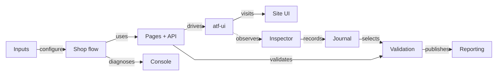

<details>
<summary><strong>Legend — module boundary</strong></summary>

- `YAML + fixture` contains application-specific values and profiles;
- `Shop flow` composes pages and checkpoints; pages know Practice Shop routes
  and controls;
- the dotted arrow is optional `UI_API` observation only; UI-only continues to
  send normal application traffic but does not publish API evidence;
- the journal retains observed traffic, and the mapper promotes only the
  exchanges selected for checkpoints;
- `atf-reporting` and `atf-console` remain the generic output owners; Shop owns
  the mapping and business semantics.
Short labels carry the following meanings:

| In the diagram | Full meaning |
|---|---|
| Pages + API | pages + API client |
| Inspector | network inspector |
| Journal | Shop network journal |
| Validation | Shop validation |
| configure | configures |
| observes | UI_API observes |
| records | records |
| selects | selects |
| validates | validates UI |

</details>

<details>
<summary><strong>Reading map</strong></summary>

- [ownership and source roots](#module-ownership) — what stays in Shop;
- [journey and vocabulary](#purchase-journey) — checkpoints, Gherkin, and locators;
- [E2E variants](#e2e-variants) and [configuration](#module-configuration);
- [evidence](#evidence-and-visible-behavior),
  [verification](#quick-verification), and maintenance.

</details>

<a id="choose-the-proof-and-owner"></a>
<a id="alege-proba-și-ownerul"></a>
## Choose the proof and owner

| Question | Entry point | Boundary |
|---|---|---|
| why did the catalog or cart stop? | [gates](#checkout-gates) and [local support](src/main/atf/shop/support/README.md) | expected values and evidence selection remain in Shop |
| what can I run offline? | [component or E2E](#quick-verification) | local fixture; does not certify site availability |
| what can I run on the site? | [E2E variants](#e2e-variants) | account, profile, and browser follow the annotations |
| how do I verify failure → success? | [business acceptance](#business-failure-acceptance) | explicit negative case and opposite-profile neighbor |

Run commands from [external staging](../docs/ATF_Build_And_Execution_Safety.md),
with JDK 21 and Maven. The [shared guide](../docs/ATF_Testing_Guide.md#individual-and-suite-business-acceptance)
defines acceptance; this README retains only application policy.

<a id="module-ownership"></a>
<a id="ce-deține-modulul"></a>
## Module ownership

<details>
<summary><strong>Details — module ownership</strong></summary>

| Surface | Module owner | Boundary |
|---|---|---|
| Configuration | `src/test/resources/atf-practice-shop.yaml`, `ShopConfigurationLoader` | Practice Shop values and fixtures, not global ATF configuration |
| UI | `routes`, `locators`, `pages`, `flow` in `src/main/atf/shop` | application semantics; generic browser remains in `atf-ui` |
| API | `api` and `support/api` in the same source root | wire contracts and mapping to Shop evidence; generic transport remains in `atf-core` |
| Evidence runtime | `src/main/.../{runtime,evidence,reporting}` | browser/journal acquisition, screenshots, report factory, and Shop metadata projection, without JUnit/Kit |
| Consumer harness | `src/test/.../support/{lifecycle,reporting}` | ownership of acquired resources, composition root, and JUnit integration; renderer remains in Reporting |
| Tests | `src/test/atf/shop/tests` | compose and verify Shop; reusable ATF tests belong to the module that owns the generic contract |

Shop behavior uses `atf-core`, `atf-console`, `atf-reporting`, and `atf-ui`;
`atf-test-kit` is declared in `test` scope for annotations and contracts used
only by consumer tests. No generic ATF module depends on Practice Shop.

<details>
<summary><strong>Source roots and local responsibilities</strong></summary>

```text
POM source roots: src/main, src/test

src/main/atf/shop
├── config/       YAML, typed models, and profiles
├── api/          request factory, operations, routes, and screen APIs
├── routes/       relative UI routes
├── locators/     CSS selectors and exact product selection
├── pages/        page objects, including account flows
├── flow/         semantic journey and its stages
├── evidence/     capture provider with masking of sensitive Shop fields
├── reporting/    screenshot policy and metadata projection from Shop configuration
├── runtime/      browser and report-session acquisition, with explicit inputs
└── support/      checkpoint, validation, API report mapping, and Shop network journal

src/test/atf/shop/tests
├── e2e/          composition roots for real journeys
├── suites/       suite selection and ordering
├── component/    config, catalog, evidence, purchase, and Shop adapters
├── api/
│   ├── component/{contract,exchange,lifecycle,reporting}
│   ├── unit/{auth,contract,exchange,reporting}
│   ├── integration/  API live opt-in
│   ├── network/      UI observation and controlled settlement
│   ├── reporting/    component exchange audit
│   └── support/      fixtures and local test-only transports
└── support/
    ├── lifecycle/  browser/report context per scenario and its probes
    ├── reporting/ JUnit reporting adapter; metadata mapping remains in main
    └── ...         fixtures, extension, and E2E probes
```

`src/main` keeps the application model, locators, pages, flows, and Shop
contracts that can be reused by the consumer, including pure capture factories
and the screenshot policy. `runtime.ShopBrowserRuntime`, `ShopRunReportFactory`,
and `reporting.environment.ShopReportSystemMetadata` own acquisition and
configuration projection in main, with explicit sink and environment inputs.
The store, extensions, and JUnit resolution remain in test, and `atf-test-kit`
remains test-scoped.

`ShopE2eContext` resolves `AtfConsoleTestContext` only at the test boundary and
delegates to the two main-source factories. The harness owns the returned
resources; acquisition failure closes the browser already opened and preserves
the primary cause. The per-scenario context composes Kit cleanup and the
publication protocol; it does not export JUnit/Kit into the runtime artifact.
The consumer suite remains focused on `e2e`, `component`, and `api`; `support`
is test infrastructure, not a third test type.

`ShopE2eTestSupport` composes the tests, while
[`ShopE2eContext`](src/test/atf/shop/tests/support/lifecycle/ShopE2eContext.java)
owns browser/report resources only for E2E runs. Whole-ATF governance checks
the harness and adapter source sets, locator boundaries, suites, and consumer
dependencies; pages, flows, and locators remain in `src/main`.

Generic failure-aware cleanup is provided by `atf-test-kit` and consumed only
from test scope; the context, browser, reporting, and ownership remain local
Shop adapters. `ShopE2eActivationExtension` retains IntelliJ detection and
passes the JVM override to `AtfE2eActivationPolicy` in `atf-test-kit`. The
generic resolver applies this precedence: explicit override → configured
opt-in → IDE fallback → disabled; `false` takes precedence over the IDE, and
an invalid value fails closed. Test Kit probes the policy, while whole-ATF
governance verifies Shop wiring.

The remaining local tests verify Shop-specific contracts: its reporting,
capture, profiles, API mapping, and business rules. Neutral primitives are not
duplicated here: selector escaping belongs to `atf-ui`, and generic diagnostics
for an unavailable API body belong to `atf-core`.

`reporting.environment.ShopReportSystemMetadata` in main projects run
configuration into the System allowlist. `ReportUiEnvironment` in Reporting
formats the fields shared by AutoEx/Shop, and the consumer adds its API policy.

- `atf.shop.reporting.ShopScreenshotPolicy` converts YAML policy into
  `ReportEvidenceProfile`; `evidence.ShopBrowserCaptureProvider` applies Shop
  masking before generic UI capture. These runtime adapters do not import JUnit/Kit.
- The context uses `ReportModelAdapters.uiActions(...)` directly, without a
  local bridge that only forwards the call.
- The shared screen audit belongs to `UiScreenAudit` in `atf-ui`, and resource
  closing belongs to Kit's `CloseOnceResource`.

The test-scoped composition passes Reporting event fields to
`AtfConsoleEvent.fromExternalEnums(...)` in Core, then publishes to the
configured sink; Console does not depend on Reporting. The selected library
contracts define the shared event vocabulary, while browser and Shop rules
remain local.

</details>

</details>

<a id="purchase-journey"></a>
<a id="traseul-de-achiziție"></a>
## Purchase journey

<details>
<summary><strong>Details — purchase journey</strong></summary>

The guest journey uses the product and data declared in YAML:

```text
catalog → product → cart → guest checkout → billing → payment → confirmation
```

`ShopPurchaseFlow` composes the screens and checkpoints. The E2E test asserts
the observed result; it does not duplicate selectors, the request factory, or
the report lifecycle.

<a id="checkout-gates"></a>
<a id="gate-uri-de-checkout"></a>
### Checkout gates

`ShopCheckoutFlow` coordinates the phases without Playwright; the Shop adapter
owns UI reads and API evidence.

```text
observe screen → publish checkpoint → PASS gate → grouped transition
                                      └─ FAIL → stop before next transition
payment check → PASS gate → explicit Confirm → order confirmation + INV number
```

`ShopCheckoutFlowComponentTest`, `ShopPurchaseCheckpointPublisherTest`, and
`ShopPurchaseStageInputsComponentTest` probe ordering, the gate, error
propagation, and stage boundaries without a browser.

- `ShopPurchaseCheckpointPublisher` builds and publishes checkpoints.
- `ShopConfiguration.CatalogSelection` and `ShopCheckoutConfiguration` provide
  only the data required by each stage; Home/Product/Cart receive a URI, name,
  and quantity, while Login/Registration receive the URI resolved at the
  composition root, not global configuration. `ShopCatalogFlow` consumes the
  same Catalog projection.
- The per-journey context provides separate immutable inputs; checkout does not
  receive the home validator.
- The coordinator keeps the PASS/FAIL gate separate from UI/API observation.
- `POST /payment/check` verifies the demo payment method. Explicit confirmation
  places the order.
- The `THEN` checkpoint links the confirmation message to the `INV-` number;
  the `UI_API` profile correlates the API response with the displayed number.

<a id="initial-catalog-loading"></a>
<a id="încărcarea-inițială-a-catalogului"></a>
### Initial catalog loading

The journey projects only the collection endpoint from API configuration into
`CatalogInputs`. `ShopHomePage.open(homeUrl, catalogEndpoint)` explicitly links
this read to `ShopCatalogReadiness`; the single-URI compatibility overload
preserves the existing native wait.

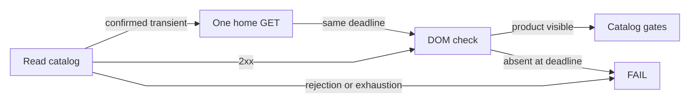

<details>
<summary><strong>Legend — bounded repeated read and original evidence</strong></summary>

- `Await visible` retains the configured 20 s grid budget: the `Retry-After`
  pause, document GET, and final observation consume the same remaining time.
  Initial navigation and search waiting retain their existing contracts.
- Only the current request's response, from the main frame and the exact
  `/products` endpoint, can authorize a reload. Eligible conditions are 429/502/503/504
  and a Chromium-confirmed connection reset/close, network change, or transport
  timeout. An absent response or unknown error does not authorize a retry.
- The reload is a GET of the home page. The application performs its native
  `GET`/`QUERY` read again, with the original method and body; no substitute API
  GET is sent. The business search, product click, cart, checkout, and order are
  not retried.
- HTTP 200 does not replace product visibility. A permanent rejection, second
  error, `Retry-After` beyond the budget, or different document stops loading.
  An external reload at the same URL is still a different document; the scope
  cannot receive a new deadline.
- `Catalog response`, `Retry catalog home GET`, and terminal diagnostics are
  INFO observations. The final verdict belongs to the DOM check; the original
  cause and FAIL are preserved. Diagnostics include the URL, document, product
  count, observed requests, and last response, without the body or authentication
  headers. With no HTTP response, the status is `unavailable`, separate from
  the transport error.
- Listeners close before the business gates. This explicit home-loading
  protocol is separate from the passive BE controller below; it does not change
  its opt-in or enable global retry or an API client in UI-only mode.

`ShopCatalogReadinessComponentTest` verifies GET and QUERY over real loopback
HTTP: delayed success, 503→200, reset connection, exhaustion, 200 with no
products, 403, `Retry-After`, shared budget, replaced document, and ineligible
routes/methods. Comparisons use the standard `Component assertions` step,
collapsed by default, with the configured budget, 240 by default. The artificial
fixture and test-owned server remain in test.

Live verification compares the same class individually and through a filtered
`ShopE2eSuite`, with one HTML report per launch. A sampled PASS does not prove
continuous availability and does not retrospectively attribute the old
incident to a 503; that artifact did not contain the required classification.
The new diagnostics let the owner make this distinction without increasing the
timeout or fabricating a PASS verdict.

</details>

<a id="catalog-gates"></a>
<a id="gate-urile-catalogului"></a>
### Catalog gates

`ShopCatalogPurchaseFlow` coordinates home, filters, product grid, and the
selected product through a semantic port. The per-journey adapter
`ShopCatalogPurchaseStage` reads the browser using immutable `CatalogInputs`;
the coordinator publishes each `ShopPurchaseCheckpoint` before the gate and
allows add-to-cart only after all four PASS verdicts.

Checkout receives `CheckoutInputs`, including the address lookup endpoint,
without `ShopConfiguration`, `CatalogSelection`, or `ShopHomeScreenValidator`.
[The capability proof](src/test/atf/shop/flow/ShopPurchaseStageInputsComponentTest.java)
checks the input set and forbidden types, independently of reflection order.

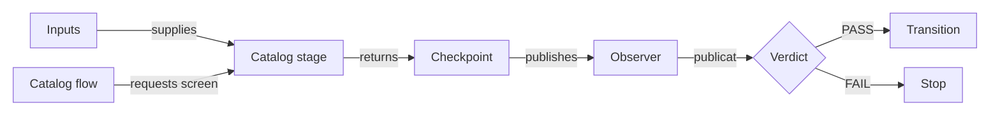

<details>
<summary><strong>Legend — observation, publication, and transition</strong></summary>

`ShopCatalogPurchaseFlowComponentTest` checks each screen with an incorrect or
missing value, timeout, and publication failure: no retry, add-to-cart, or next
observation occurs after an error. The checkpoint keeps UI and API separate;
validators, configured expectations, and traffic ordering are not reconstructed
in the coordinator. A timeout before observation does not invent a checkpoint
with nonexistent data. The short labels have these meanings:

| In diagram | Full meaning |
|---|---|
| Inputs | CatalogInputs · selection + capabilities |
| Catalog stage | Catalog stage · UI/API observations |
| Checkpoint | immutable checkpoint |
| Observer | report observer |
| Transition | next screen / add |
| Stop | stop before mutation |
| published | successful publication |

</details>
<a id="screen-and-locator-contracts"></a>
<a id="contracte-de-ecran-și-locatori"></a>
### Screen and locator contracts

`ShopScreen` defines the semantic identities, while `@ShopPageContract` binds
page objects to routes and required controls. Checkout screens share the same
application route; the distinction among cart, guest identity, billing,
payment, and confirmation comes from the observed contract, not the URL.

| Screen | UI route | Observed contract |
|---|---|---|
| `HOME` | `/` | navigation, banner, filters, grid, pagination, and footer |
| `PRODUCT` | `/product/*` | product, price, description, quantity, and add-to-cart |
| `CART` | `/checkout` | selected product, quantity, and checkout continuation |
| `GUEST_CHECKOUT` / `BILLING` | `/checkout` | guest identity, address, and form continuation |
| `AUTHENTICATED_CHECKOUT` | `/checkout` | continuation action for the authenticated session |
| `PAYMENT` / `CONFIRMATION` | `/checkout` | demo method, payment check, and order confirmation |
| `LOGIN` / `ACCOUNT` / `REGISTRATION` | `/auth/login`, `/account`, `/auth/register` | authentication controls, account identity, and registration form |

`ShopLocators` owns the selectors used by page objects. In the catalog,
`ShopProductSelector` identifies the product by its full name within its card
and escapes the dynamic value; this keeps the test independent of the product's
rotating ID and partial matches. Stable hooks (`data-test`, `id`, `name`, `href`)
are preferred over visual classes or ambiguous selectors; the generic CSS
convention is in [`atf-ui`](../atf-ui/README.md).

<a id="gherkin-vocabulary-and-journey-cardinality"></a>
<a id="vocabularul-gherkin-și-cardinalitatea-journey-ului"></a>
### Gherkin vocabulary and journey cardinality

`ShopPurchaseTraceStep` is the local dictionary of static statements. It does
not store the product, quantity, URL, or exchanges in the enum; these are
runtime observations/evidence. For guest checkout, the published vocabulary is:

| Order | Keyword | Checkpoint |
|---:|---|---|
| 1 | `GIVEN` | catalog home |
| 2–4 | `AND` | filters, product grid, and product page |
| 5 | `WHEN` | cart contains the configured product and quantity |
| 6–9 | `AND` | guest checkout, billing, payment method, and payment check |
| 10 | `THEN` | order confirmation |

The details that define the consumer contract are:

- `SETUP` for authentication remains outside the ten guest checkpoints;
- the authenticated branch uses `AUTHENTICATED_CHECKOUT` instead of guest checkout;
- `ShopPurchaseTraceStepTest` protects the vocabulary, while
  `ShopPurchaseCheckpoint` separates UI assertions from `UiApiValidationEvidence`;
- when both forms of evidence exist, they appear under the same Gherkin
  statement, without a second step with a duplicate title.

The generic visual form is in the
[Reporting contract](../docs/ATF_Reporting_Contract.md#request-evidence).

</details>

<a id="e2e-variants"></a>
<a id="variantele-e2e"></a>
## E2E variants

<details>
<summary><strong>Details — E2E variants</strong></summary>

`ShopE2eSuite` declares `suite` scope through `@ConfigurationParameter`,
Jupiter engine ordering through `ClassOrderer.OrderAnnotation`, and disabled
parallel execution. Classes run in the `@Order` shown below. Running the suite
creates external effects in the Practice Shop demo; use component tests for
variations that do not need a browser or server.

| Order | Class | Specific contract |
|---:|---|---|
| 1 | `ShopNewAccountPurchaseE2eTest` | registers a synthetic account and confirms login in `SETUP`, then completes the authenticated purchase |
| 2 | `ShopAuthenticatedPurchaseE2eTest` | logs in with an existing account in `SETUP`, then makes an authenticated purchase; in the suite, reuses the account created in step 1 |
| 3 | `ShopPurchaseE2eTest` | guest purchase with UI validations and selected API evidence |
| 4 | `ShopUiOnlyPurchaseE2eTest` | the same guest business journey, without publishing API evidence |
| 5 | `ShopUiOnlySingleFlowPurchaseE2eTest` | UI-only, declares `UNIFIED_FLOW`; with the current YAML configuration, aggregates the flow and keeps the successful capture at the end |

<a id="flow-separation-baseline"></a>
<a id="baseline-pentru-separarea-flow-ului"></a>
### Flow separation baseline

All five selections keep the same business order in
`ShopPurchaseTraceStep`; only account identity/setup and the evidence policy
differ. This map is the baseline for incremental migration of observation,
gates, and publication:

| Phase | Operations and observations | Gate before continuing | Ownership variation |
|---|---|---|---|
| Setup | guest configuration or authenticated fixture; UI login is confirmed separately | valid fixture and confirmed identity before purchase | existing fixture is borrowed; a new synthetic account is used only in `ShopNewAccountPurchaseE2eTest` |
| Catalog | home, filters, grid, selected product, and effective route | structure, controls, and product/route match the configuration | API evidence is observed passively only when the channel and binding require it |
| Cart and identity | cart product and quantity; guest checkout or authenticated continuation action | product/quantity and checkout form are validated before billing | `ShopPurchaseFlow` drives the UI; `ShopApiNetworkJournal` correlates observed exchanges without replay |
| Billing and payment | configured address or postal lookup; demo method and payment-check confirmation | observed fields and business response are validated before order confirmation | billing strategy is business configuration, independent of the evidence channel |
| Order | final confirmation and order number | the page and order confirmation are validated | placing the order remains a real UI mutation; it is not compensated by resubmission |

`ShopNewAccountPurchaseE2eTest` adds a remote registration mutation before the
flow; `ShopAuthenticatedPurchaseE2eTest` borrows the existing identity. The
three guest tests keep the same story and differ only in channel or report
presentation. No selections are removed until each variant's adapter and the
equivalent Reporting contracts have been proven.

Profiles are composed along distinct axes, without changing the journey:

| Axis | Owner / live value | Effect |
|---|---|---|
| Channel | `@AtfTestChannel(UI)` or `UI_API` on the class | `UI` does not publish API evidence; `UI_API` requires an allowlisted inspector and selected checkpoints before the browser opens |
| Form | `reporting.flowMode` supplies the base; `@AtfUiEvidence(flow = UNIFIED_FLOW)` can override it | changes evidence grouping, not business steps or verdict; `CONFIGURED` inherits the actual base |
| Screenshots | YAML `reporting.screenshotPolicy: each-checkpoint`; `@AtfUiEvidence(screenshots = ...)` can explicitly override the value for its scenario | the effective policy determines allowed screenshots, without leakage between sibling scenarios |
| Action details | `reporting.actionDetailsMode`, then an explicit override from the harness or `@AtfUiEvidence` | conflicting explicit values fail before resources are acquired; the choice does not stop action capture |

`UI_ONLY` stops API evidence capture/publication, not browser requests.
`@AtfUiEvidence` declares class intent; the consumer resolves axes left as
`CONFIGURED`. The generic annotation model is in
[`atf-test-kit`](../lib/README.TestKit.md#scope-and-integration).

<a id="authenticated-accounts"></a>
<a id="conturile-autentificate"></a>
### Authenticated accounts

`ShopAuthenticatedPurchaseE2eTest` can be launched individually from IntelliJ.
The class annotation selects an existing local fixture; VM options are not
required.

```text
atf-test-practice-shop/src/test/resources/
└── practice-software-testing-account.local.properties
```

Format of the local fixture ignored by Git:

```properties
email=<registered-test-account-email>
password=<registered-test-account-password>
firstName=<test-first-name>
lastName=<test-last-name>
```

Preflight requires a complete, registered fixture with an unreserved email,
located under `src/test/resources`. Credentials are excluded from assertions,
console output, Overview/System, and skip messages. Guest tests do not inspect
or require the local account fixture; it is loaded only by profiles that choose
authentication.

| Account mode | Current code usage | Local rules |
|---|---|---|
| `REUSE_FIXTURE` | `ShopAuthenticatedPurchaseE2eTest`; in the suite, reuses the account created by the previous test | uses `practice-software-testing-account.local.properties` |
| `REGISTER_PER_RUN + SYNTHETIC` | `ShopNewAccountPurchaseE2eTest` | `@AllowsRegistrationPerRun`; generated `atf.invalid` email and password |
| `REGISTER_PER_RUN + LOCAL` | supported by `@AuthenticatedE2e`, but unused by the current suite | copy the example to `practice-software-testing-registration.local.properties`; `{runId}` appears exactly once and the domain is controlled by the owner |

- Registration is a remote mutation; it is not retried automatically.
- The remote policy retains the created account: teardown does not execute DELETE.
- An existing fixture is borrowed and is not deleted.
- Preflight does not display values.

| Ownership | Behavior |
|---|---|
| Individually launched class | implicit `class` scope; the class Store owns the reference. `REUSE_FIXTURE` requires its own fixture; `REGISTER_PER_RUN` prepares one account per class. |
| `ShopE2eSuite` | explicit `suite` scope; the root Store owns the account created and reused by authenticated classes. The mode is not inferred from the suite name or ID. |
| Browser session | UI login is confirmed in `SETUP` for each method; sharing the account does not share the browser. |
| Uncertain setup | failed state blocks re-registration and automatic fallback; dependent consumers report the failed setup. |
| Closing | the reference is released even if report publication fails; losing the reference does not mean deleting the remote account. |

In `SETUP`, the new account, existing fixture, and reused account are distinct;
credentials remain redacted. The neutral primitive is
[`TestRunScope`](../lib/README.TestKit.md#scope-and-integration).
`ShopAccountScopeComponentTest` probes the adapter with real Jupiter, including
failed publication and two successive launches; these local probes do not
replace registration and purchase through the real application.

<a id="shared-report--consumer-state"></a>
<a id="raport-partajat--starea-consumerului"></a>
### Shared report — consumer state

| Contract part | State and owner |
|---|---|
| Scenario profile | `ShopE2eContext` passes the resolved profile when publishing to the shared session; config supplies the base, and the annotation can override declared axes. |
| Sibling scenario isolation | `ShopE2eContextEvidenceProfileTest` publishes siblings with different profiles on success and failure; the selected Reporting contract describes projection and screenshots. |
| Overview/System | Each scenario contributes its resolved snapshot. Shared values remain exact; a field that differs or is absent in a sibling becomes `Mixed — varies by scenario`. The mapper receives the environment captured by the composition root explicitly and does not read JVM state. |
| Phase aggregation | In the `UNIFIED_FLOW` profile, Shop enables per-scenario accumulation. Guest UI-only publishes configuration checks directly in `TEST BODY`, without a `SETUP` phase. Authenticated setup keeps its own phase and status; a single terminal Gherkin node renders checkpoints in order, with provenance, assertions, and API validation beside their checkpoint. Failed authenticated setup completes the flow in `SETUP`, with no `TEST BODY` or invented terminal capture. `SCREEN_CHECKPOINTS` profiles retain publication by phase. |

The generic lifecycle and rendering contract is owned by
[`atf-reporting`](../atf-reporting/README.md#politică-tipizată-pentru-dovezile-de-captură).

- Generic probes verify profile isolation; Shop probes verify mapping and
  integration. Lifecycle, phase order, and failed setup without `TEST BODY` are
  described by the [owner](../atf-reporting/README.md#cauza-publicării-și-scope-urile-deținute).
- `ShopUiOnlySingleFlowPurchaseE2eTest` keeps the same annotation and business
  flow. On UI-only success, the Reporting owner projects actions, observations,
  and cross-phase assertions into a shared UI validation, with one terminal
  capture permitted below the Playwright table. Phase provenance remains in a
  UI disclosure; failed setup and UI+API scenarios are not compacted.

</details>

<a id="catalog-be-policy"></a>
<a id="politica-be-a-catalogului"></a>
## Catalog BE policy

`practiceShop.recovery` is OFF by default, with an empty allowlist and passive
capture OFF. The only initial semantic operation is `catalog-readiness`, mapped
by `ShopBackendRecovery` in main to GET `/products`.

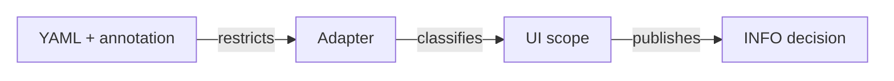

<details>
<summary><strong>Legend — opt-in and explicit use</strong></summary>

- The Shop schema remains flat: `practiceShop.browser` is the engine name, and recovery is a separate block.
- The JUnit extension applies `AtfUiRecoveryResolver` before resources are acquired.
  The annotation can narrow the policy without enabling YAML OFF or adding routes.
- `context.backendRecovery(actions)` provides the controller;
  `begin(CATALOG_READINESS)` precedes the single action, then `await` receives only
  a read-only DOM proof. Opening the run does not add retries to journeys.
- The scope and listeners close before the browser, including on failure.
  Signup, account creation, cart, checkout, payment, and cleanup are not retried.
- The context keeps one controller and the same recorder; a second acquisition
  cannot create another deadline owner for the same invocation.
- The BE signal contains metadata only, independent of UI/UI_API presentation;
  UI-only does not enable extra API calls or API preconditions.
- Published decisions are INFO: policy, source, budget, attempt, reason,
  receipt, and separate timings. A published FAIL does not become PASS.
The short labels have these meanings:

| In diagram | Full meaning |
|---|---|
| Adapter | Shop adapter in main |
| UI scope | UI scope before the action |
| INFO decision | INFO observations in the UI sequence |
| classifies | classifies the read |
| publishes | records the decision |

</details>

<details>
<summary><strong>Example recovery block and verification</strong></summary>

Insert the example under `practiceShop.recovery`, without changing the engine.
The values below are an explicit opt-in for the catalog in this document.

```yaml
recovery:
  enabled: true
  profile: read-only
  operations: [catalog-readiness]
  maxAttempts: 4
  totalTimeout: PT5S
  backoff: PT0.1S
  captureBackendSignals: true
```

`ShopBackendRecoveryComponentTest` checks loading, annotation restrictions,
delayed catalog response, exhaustion, and missing capture. Writes through GET
and unknown operations are rejected before the browser starts.

Assertions for these components remain in the standard `Component assertions`
step, collapsed by default, with redaction before the configured limit, 240
characters by default. The consumer-owned
[ShopRecoveryReportObservation](src/test/atf/shop/tests/support/reporting/ShopRecoveryReportObservation.java)
projects each typed `UiRecoveryTrace` beside its matching INFO action record.
`Operation` shows `catalog-readiness`; `Event` separately shows
`Backend observation #N`. Decision, reason, signal, three measured `Duration`
values, policy, and INFO result stay in attempt order. Timing uses the typed
values and does not parse the action's display text.

`ShopExtentTestExtension` publishes this observation through Test Kit K3
phase observations and Reporting J26. In the rendered component result,
`TEST BODY` contains separate expandable `Component assertions` and INFO
recovery-trace steps. The normal assertions, verdict, and test count remain
intact.
The synthetic Playwright probe checks the action-table target and its
collapsed local disclosure. The opt-in
`ShopRecoveryActualReportAcceptanceTest` opens an actual suite report and
checks its owner, expands the component result and `TEST BODY`, expands the
standard assertion step, and independently checks the recovery disclosure
after `Expand all nodes`. It verifies complete recovered and exhausted traces,
semantic operation, event label, ISO-8601 timings, INFO results, and body/URL
redaction. It saves a viewport capture under `target`. The acceptance contract is in
[ShopRecoveryActualReportAcceptanceTest](src/test/atf/shop/tests/component/recovery/ShopRecoveryActualReportAcceptanceTest.java).

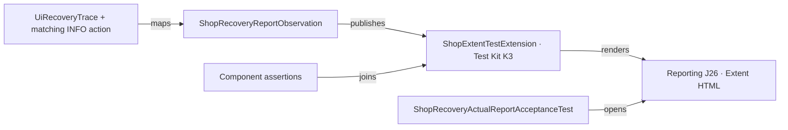
<details>
<summary><strong>Legend — recovery-report flow</strong></summary>

The consumer maps typed attempts locally; K3 publishes the separate assertion
and trace steps in `TEST BODY`, Reporting renders HTML, and opt-in acceptance
opens that artifact.

</details>

Generate a suite report and run actual-report acceptance in separate fresh
staging areas, as required by the [build procedure](../docs/ATF_Build_And_Execution_Safety.md):

```powershell
mvn -B -ntp -pl atf-test-practice-shop -am "-Dtest=ShopBackendRecoveryComponentTest" "-Datf.practice.api-report-directory=target/recovery-suite-report" "-Dsurefire.failIfNoSpecifiedTests=false" test
mvn -B -ntp -pl atf-test-practice-shop -am "-Dtest=ShopRecoveryActualReportAcceptanceTest" "-Datf.shop.recovery.actual-report=<configured-report-file>" "-Datf.practice.api-report-directory=target/recovery-report-acceptance" "-Dsurefire.failIfNoSpecifiedTests=false" test
```

The acceptance test is inactive when `atf.shop.recovery.actual-report` is not
set. This verifies a Maven-generated component report; it does not claim an
IntelliJ-launched report check or public-site E2E acceptance.

</details>

The deadline, rejections, and limits are in [UI](../atf-ui/README.md#backend-recovery-through-passive-observation).

<a id="junit-launch-identity"></a>
<a id="identitatea-lansării-junit"></a>
## JUnit launch identity

A collapsed INFO `Launch context` phase records the canonical class/method and
outermost suite exposed by JUnit ancestry. `ShopLaunchMetadata` projects the
immutable `TestLaunchContext.capture(context)` snapshot supplied by Test Kit K4.
It publishes the actual launcher selectors, filtered discovered-test inventory,
and exact discovery count through Reporting's existing observation boundary.

The count is measured at plan start, includes disabled tests, and excludes later
dynamic registrations. Their count at capture is a separate field. Neither value
is reconstructed from completed or successful tests.

A plan executed in another session retains its inventory/count and explicitly identifies missing request
provenance; disabling the SPI observer yields unavailable metadata.

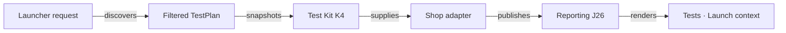

<details>
<summary><strong>Legend — module interaction and count semantics</strong></summary>

- Kit observes public launcher callbacks; it starts no tests, browser, or report.
- The consumer owns the immutable report projection and its selector facade.
- Launcher selectors retain source identity; display titles and filenames do not define selection.
- `ShopLaunchMetadataComponentTest` verifies direct class/method and canonical
  or tag-filtered suites, duplicate titles, repeated launches, exact counts,
  original selectors, selected sources, and browser expansion of every field.

</details>

<a id="module-configuration"></a>
<a id="configurația-modulului"></a>
## Module configuration

<details>
<summary><strong>Details — module configuration</strong></summary>

The canonical source is
[`atf-practice-shop.yaml`](src/test/resources/atf-practice-shop.yaml). The loader
reads it from the classpath, with a fallback for launches from
IntelliJ or the module checkout.

| YAML key | Relevant default | Effect in this consumer |
|---|---|---|
| `baseUrl` | `https://practicesoftwaretesting.com` | the only base host for UI routes |
| `browser`, `headless`, `timeout`, `navigationTimeout`, `viewport`, `zoomPercent` | Chromium, headed, 20 s, 45 s, requested output 1440×1000, 70% | native context with CSS viewport 2057×1429 and DPR 0.70 |
| `validation.profile` | `ui-api` | the base profile; the E2E's `@AtfTestChannel` annotation explicitly selects `UI` or `UI_API` |
| `validation.apiEvidence` | `product`, `registration`, `login`, `cart`, `payment`, `order` | checkpoints that can receive API evidence |
| `networkInspector` | enabled; allowlist `api.practicesoftwaretesting.com` | observes relevant real traffic; does not resend requests |
| `retry` | `maxAttempts: 1`, no eligible operations | does not retry mutating browser actions |
| `api.endpoint`, `api.mode`, `api.precondition`, `api.timeout` | Practice Shop API, `live`, `authenticated`, 20 s | standalone API configuration; this precondition does not authenticate the UI session |
| `reports.ui`, `reports.api` | `artifacts/reports/ui`, `artifacts/reports/api` | separate destinations, relative to the reactor root |
| `reporting.systemBodyPreviewCharacters` | `100` | limit for the preview Shop provides for Overview/System |
| `reporting.screenshotPolicy` | `each-checkpoint` | base capture profile; class-level profile limits in the shared report are described above |
| `reporting.flowMode` | `screen-checkpoints` | base for `CONFIGURED`; alternatively `unified-flow` |
| `reporting.actionDetailsMode` | `included-collapsed` | base for `CONFIGURED`; alternatively `summary-only` |
| `checkout.billingStrategy` | `configured-fields` | `configured-fields` or `postal-lookup`; business choice independent of the channel |
| `authenticatedE2eEnabled` | `false` | the YAML default remains guest; the `@AuthenticatedE2e` profile explicitly enables the authenticated class |
| `productName`, `productPath`, `checkout` | `Pliers`, `auto`, quantity 2, Cash on Delivery | the demo's business fixture; the product is found by name, not by rotating ID |

The `Viewport` row in Overview/System uses the same calculation as the session:
requested output, effective CSS viewport, and DPR. Screenshot rounding and
full-page semantics are covered by the [UI owner contract](../atf-ui/README.md#native-context-geometry).
[ShopPointerGeometryComponentTest](src/test/atf/shop/tests/component/geometry/ShopPointerGeometryComponentTest.java)
checks Shop configuration, the trusted pointer, and overlay rejection with a
local headless browser and auditable assertions; it does not simulate a public checkout.

The inspector is bounded by the consumer's YAML settings: at most `256`
observations, a body preview of at most `12000` characters, and compaction of
consecutive signatures only in the presentation stream. Post-action settlement
is disabled by default (`10 s` timeout, `100 ms` polling if enabled). The
observation cursor allows a later read-back after a mutation; it does not rerun
the action or turn a timeout into success.

<a id="product-availability-and-quantity"></a>
<a id="disponibilitatea-produsului-și-cantitatea"></a>
### Product availability and quantity

Demo stock can vary between launches. Selection retains the configured
name/route; it does not substitute the product or modify stock through the API
to obtain PASS.

| Observed state | Behavior | Evidence |
|---|---|---|
| Quantity still disabled, no stock verdict | waits for quantity to become enabled or the visible `out-of-stock` marker, within the existing timeout | native read-only action, with no mutating retry |
| `out-of-stock` marker visible | publishes the product checkpoint as FAIL before quantity/cart | `Product availability` comparison, expected/actual, and screenshot |
| Quantity and Add to cart enabled, no marker | applies the configured value and checks `inputValue` before the single click | `Fill`, `Expect value`, `Click` in the same sequence |
| Value adjusted by the application or stock lost | stops before Add to cart; stock is reread before Fill as well | original cause and failure evidence |
| State unresolved by deadline | keeps the native timeout; does not invent an “out of stock” verdict | infrastructure/loading FAIL, distinct from stock state |

`ShopProductAvailability` is the immutable snapshot shared by the screen
validator and the pre-mutation guard. `ShopLocators` owns the selectors, and
`ShopProductPage` composes the existing UI actions; Reporting and timeouts are unchanged.

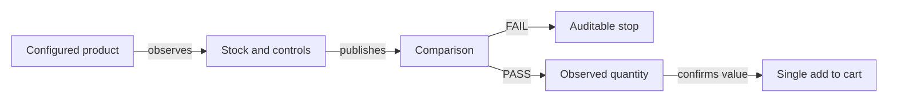

<details>
<summary><strong>Legend — availability and quantity before mutation</strong></summary>

- Settled UI supplies the verdict; a disabled input alone does not prove out-of-stock status.
- The product checkpoint is published before the continuation decision; FAIL retains standard collapsible comparisons.
- Between the checkpoint and Fill, the snapshot is reread; a stock change stops the mutation.
- Checking the observed value stops the click if the application adjusts the quantity.
- `ShopProductQuantityComponentTest` probes delayed loading, exhausted stock, deadline, adjusted value, and lost stock.
- Components use `ShopComponentTest` and `AuditedAssertions`; the selected Reporting library supplies shared rendering.

</details>

<a id="supported-overrides"></a>
<a id="override-uri-suportate"></a>
### Supported overrides

The loader exposes only the overrides below; other values are changed in the
module YAML. Process properties do not replace the channel annotations on E2E
classes.

<details>
<summary>Accepted system properties and environment variables</summary>

| System property | Environment variable | Controlled value |
|---|---|---|
| `atf.practice.base-url` | — | UI host |
| `atf.practice.account-file` | `ATF_PRACTICE_ACCOUNT_FILE` | local account fixture, restricted to `src/test/resources` |
| `atf.practice.product-name` | — | product selected by name |
| `atf.practice.product-path` | — | exact route or `auto` |
| `atf.practice.validation-profile` | — | `ui-only` or `ui-api` for the configured harness |
| `atf.practice.config` | module YAML | explicit alternate YAML file; missing file fails, with no fallback to the default fixture |
| `atf.practice.api-evidence-checkpoints` | — | CSV list of API checkpoints |
| `atf.practice.api-endpoint` | — | API host |
| `atf.practice.api-mode` | — | API transport mode |
| `atf.practice.api-precondition` | — | standalone API precondition |
| `atf.practice.ui-report-directory` | — | UI report directory |
| `atf.practice.api-report-directory` | — | API report directory |
| `atf.practice.authenticated-e2e` | — | explicit activation of the authenticated fixture for consumers that require it |

</details>

</details>

<a id="causal-confirmation-of-add-to-cart"></a>
<a id="confirmarea-cauzală-a-adăugării-în-coș"></a>
### Causal confirmation of add-to-cart

`ShopProductPage` composes `ShopCartAdditionConfirmation` with the API origin
from journey configuration. The observer is armed before the single click;
the request owns confirmation, while the toast is diagnostic only.

| Criterion | Required evidence |
|---|---|
| Ownership | POST started after arming, to the `/carts/{id}` resource on the configured origin |
| Intent | `product_id` from the opened product and the observed/configured quantity match the payload |
| Acceptance | 2xx response from the same Request object, within the click and postcondition deadline |
| Rejection | stale/unrelated response, mismatched payload, HTTP/network error, or missing response does not confirm the mutation |

- `clickAndAwait` records activation and confirmation within the same budget;
  it does not repeat the click or POST, even when read-only retry is enabled.
- After acceptance, the cart is read: product, quantity, and totals are
  validated independently before checkout. An accepted response does not replace this gate.
- `ShopCartAcknowledgementComponentTest` covers normal/short/absent toasts,
  ownership, and rejections. Existing quantity probes retain their assertions.

<a id="evidence-and-visible-behavior"></a>
<a id="dovezi-și-comportament-vizibil"></a>
## Evidence and visible behavior

- `UI` retains browser validations and actions but does not publish API
  validation or a network aggregate; browser traffic continues normally.
- `UI_API` binds captured exchanges to checkpoints declared in
  `validation.apiEvidence`; the network aggregate is a summary, not a second
  copy of the canonical exchanges.
- The journal retains ordered HTTP observations, but only exchanges associated
  with a configured checkpoint reach API validation. A response without a
  checkpoint owner is not automatically promoted to business evidence; a
  failed request without a response remains explicitly `Unavailable`, with no
  invented JSON.
- Body previews are limited and subject to data redaction; local fixture and
  checkout data are not copied into Overview/System.
- Before journaling/publication, `ShopJsonEvidence` redacts sensitive fields
  and personal data; malformed/non-JSON bodies are omitted fail-closed, not
  published as raw text. Consecutive compaction changes presentation only, not
  the complete audit retained by the journal.
- System metadata comes from a Shop allowlist and describes the relevant
  environment/configuration, not suites, test classes, or business steps.
- The terminal `UI validation` capture includes the `Audit screen contract`
  observation recorded before evidence is drained; it remains `OBSERVE`, not a
  Playwright action or verdict. The fallback without a screenshot does not
  claim visual evidence.
- `ShopBrowserCaptureProvider` masks `input`, `textarea`, `select`, and
  `[contenteditable]` controls in screenshots; do not disable this mask to get
  a more legible capture of entered data.
- `checkout.billingStrategy` selects address completion. `configured-fields`
  enters and checks fixture values; `postal-lookup` enters the country, postal
  code, and house number, then validates fields populated by the application.
  The same strategy is retained in UI and UI_API; evidence does not choose the
  path. For `postal-lookup`, observation is armed before inputs and correlates
  the origin/route from `api.endpoint`, wire country, postal code, and house
  number. Only a complete response from a new request can confirm the DOM
  fields; old non-empty values, ambiguous queries, and transport without a
  response do not yield PASS. A current result equal to the old address is
  accepted after completion; we do not require an artificial value change.
  `configured-fields` retains comparisons against the independent fixture: it
  waits for possible autofill to finish without requiring or inventing a lookup
  if the application does not emit one.
- The `@WithE2eHarness` meta-annotation includes `@AtfConsoleMessages(DETAILS)`
  and `@AtfReportPath`; after publication, the absolute Extent path is sent to
  the console when output is enabled. `reporting.console.enabled: false`
  remains authoritative. Generic details belong to `atf-console` and `atf-test-kit`.

<details>
<summary><strong>API operations owned by the consumer</strong></summary>

Stable routes and intents are centralized in `ShopApiRoutes` and
`ShopApiOperation`; IDs remain dynamic. Operations relevant to journeys are:

| Seam | Operations and routes |
|---|---|
| Account | `POST /users/register` for a new account; `POST /users/login` for a session |
| Catalog | `GET /products/search`; `GET /products/{productId}` |
| Cart | `POST /carts`; `POST /carts/{cartId}`; `GET /carts/{cartId}` |
| Billing API | `GET /postcode-lookup` in API flows that verify the lookup |
| Payment | `POST /payment/check` verifies the selected method; it does not create the order |
| Order | `POST /invoices/guest` or `POST /invoices` after explicit confirmation |

Component API tests separately verify routes and typed methods, guest/authenticated
variants, payloads, and exchange semantics through controlled transports. They
do not certify the live service; `ShopStandaloneApiReportTest` is a separate
opt-in proof, while generic renderer and markup tests belong to
[Reporting library contract](../atf-reporting/README.md).

`PUT` for quantity updates and `DELETE` for removing a product are module API
contracts, not steps in the current E2E purchase. Billing completion is chosen
by `checkout.billingStrategy`, independently of the UI/UI_API channel; changing
the channel does not change the checkout fixture.

</details>

Rendering contracts, tables, disclosures, screenshots, and the Extent model
are owned by [`atf-reporting`](../atf-reporting/README.md) and the
[reporting contract](../docs/ATF_Reporting_Contract.md). The inspector, CSS
locators, and generic browser lifecycle are owned by [`atf-ui`](../atf-ui/README.md).
This README covers only how the consumer configures them and binds them to
Practice Shop checkpoints.

<a id="address-lookup-confirmation"></a>
<a id="confirmarea-lookup-ului-de-adresă"></a>
## Address lookup confirmation

`ShopBillingPage` receives the explicit endpoint from the checkout context.
`ShopPostalLookup` observes browser traffic only and compares the response with
independently read street/city/state; it sends no extra HTTP request and does
not repeat inputs.

| Signal | Result |
|---|---|
| Request started before arming, another frame/origin, or different parameters | does not confirm the current lookup |
| Current 2xx response, non-empty address, and matching DOM, with no owned lookup requests pending | confirmed within the observation budget |
| HTTP failure, invalid JSON, incomplete address, or interrupted transport | FAIL; private data from invalid JSON is not included in textual diagnostics |
| No correlated completion, changed document, or divergent DOM | rejected or deadline exhausted; no PASS based on pre-existing fields |

Observation uses the [UI scope](../atf-ui/README.md#observation-listener-scope)
and the existing `awaitVisible` budget; it receives no additional timeout.
`ShopPostalLookupComponentTest` checks the real page method, while
`ShopBillingLookupTest` separately retains the address record contract.
`ShopBillingSynchronizationComponentTest` measures settlement after
`inputsApplied`, separately from browser startup and fixture navigation, and
keeps successful settlement within its configured 1.1-second budget.

<a id="input-synchronization"></a>
<a id="sincronizarea-input-urilor"></a>
### Input synchronization

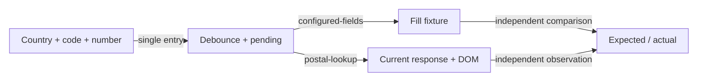

<details>
<summary><strong>Legend — two strategies, same scope</strong></summary>

- **Debounce + pending** consumes the application's 300 ms protocol and
  completion of owned requests within the existing deadline; it adds no timeout.
- `configured-fields` also waits for the loading indicator to disappear, then
  enters street/city/state once; no lookup is legitimate.
- `postal-lookup` requires the complete current response and matching DOM. Old
  identical values are accepted only after that proof, without typing over autofill.
- Callbacks capture metadata; the body is read outside them. The native
  predicate is monotonic, then the scope checks pending requests and response
  identity again before returning.
- `ShopBillingSynchronizationComponentTest` also reproduces the race that
  duplicated state on the old source, duplicate/delayed requests, document
  replacement, and manual entry without lookup. Do not relax the expected value
  or replay input.

</details>

<a id="quick-verification"></a>
<a id="cum-se-verifică-modulul"></a>
## Quick verification

<details>
<summary><strong>Details — quick verification</strong></summary>

The commands below run the suites defined in `src/test`; `-am` also builds the
ATF modules on which the consumer depends.

`ShopComponentSuite` is the fast aggregate gate: it includes consumer support,
`unit` and `component` API contracts, and evidence, but excludes E2E journeys
and live integration. Capture and HTTP fidelity contracts are in
`atf.shop.tests.api.network`, already selected by the suite. Focused diagnosis
selects concrete classes without parallel suites.

| Source set / package | Responsibility |
|---|---|
| main `atf.shop.support.api` | journal, selection, validations, and mapping used by the UI+API runtime and publisher |
| test `atf.shop.tests.api.network` | journal and method fidelity contracts; local fixtures are separate from tests |

- Capture: observations enter through `UiNetworkInspector.capture` and the
  public subscription; the recorder and internal service alias remain encapsulated.
- Conversion: `ShopApiEvidenceMapper` accepts observed values and Core
  executions without owning capture or selection.
- Query: the inspector redacts it before subscription; the converter test
  separately retains the path and decoding of the received value.
- Fixtures: no network; reports declare the controlled provenance.

Consumer architecture governance runs separately in `atf-tests`, through
`ConsumerModuleArchitectureGovernanceTest`; it is no longer a business test
selected by `ShopComponentSuite`. `ConsumerSuiteCoverageGovernanceTest` requires
each executable class to belong to exactly one primary suite.

API unit contracts, without a client or transport:

```text
mvn -pl atf-test-practice-shop -am "-Dtest=ShopApiRoutesTest,ShopApiRequestFactoryTest" "-Dsurefire.failIfNoSpecifiedTests=false" test
```

Component/API contracts without live journeys:

```text
mvn -pl atf-test-practice-shop -am "-Dtest=ShopComponentSuite" "-Dsurefire.failIfNoSpecifiedTests=false" test
```

<a id="api-test-boundary"></a>
<a id="boundary-ul-probelor-api"></a>
### API test boundary

The table describes the selection and exercised contract; behavioral proof
comes from the actual run, with the sources and profile used at that time.

| Test | Exercised contract | Does not prove |
|---|---|---|
| `ShopComponentSuite` | all local business and adapter contracts, including unit/component and package-private support | behavior of the real service |
| `ShopE2eSuite` | all retained UI variants, with purchase through order and invoice confirmation | does not replace direct API contracts |
| `ShopApiLiveSuite` | `ShopStandaloneApiReportTest`, with the existing authenticated opt-in | does not enter the local gate |
| `ShopStandaloneApiReportTest` | login, catalog, response filtering/sorting, mutations/read-back on an isolated cart, address/payment over live HTTP | final invoice, permanent fixture validity, or UI session authentication |

`ShopUiNetworkSettlementComponentTest` checks only Shop read-back selection
after the cursor, observed quantity/product, and missing evidence at timeout.
The fixture supplies observations; it does not execute a mutation or prove no-replay.

Generic compaction has a [UI test](../atf-ui/src/test/java/atf/ui/network/UiNetworkPresentationStreamComponentTest.java).
Single activation is checked at the [real Shop port](src/test/atf/shop/tests/component/cart/ShopCartAcknowledgementComponentTest.java),
using browser/request counters and rejection of stale, foreign, or failed responses.

<a id="correlating-payment-and-cart-with-the-current-observation"></a>
<a id="corelarea-payment-și-coș-cu-observația-curentă"></a>
### Correlating payment and cart with the current observation

The journey captures `sequenceMarker()` before the payment check and before
adding the product to the cart. The journal selects the latest eligible capture
after the marker, then `ShopApiAssertions` evaluates the status and JSON. A
400/500 response remains the current evidence, even when the body resembles success.

```mermaid
%%{init: {"themeVariables":{"fontSize":"15px"},"themeCSS":".nodeLabel, .nodeLabel p { font-size: 15px !important; line-height: 1.35 !important; } .edgeLabel, .edgeLabel p { font-size: 12px !important; font-weight: 400 !important; line-height: 1.2 !important; } .edgeLabel .labelBkg, .edgeLabel p { background: transparent !important; } .edgeLabel foreignObject { transform: translateY(-18px); overflow: visible; } .node rect { rx: 6px; ry: 6px; }","flowchart":{"curve":"linear","nodeSpacing":24,"rankSpacing":16,"padding":10,"diagramPadding":16}}}%%
flowchart LR
    Marker["Capture marker"] -->|precedes| Action["One UI click"]
    Action -->|produces| Observed["Observed response"]
    Observed -->|selects| Current["Method + route + order"]
    Current -->|evaluates| Verdict["API validation"]
    Verdict -->|publishes| Report["Auditable checkpoint"]
```

<details>
<summary><strong>Legend — selection, validation, and missing responses</strong></summary>

- Correlation uses capture order in the same browser session. Payment requires
  `POST /payment/check` after the marker and retains the selected sequence in
  `API trace`, together with the event ID from the evidence.
- Payment passes only with the expected method, HTTP 200, success JSON, and the
  correct content type. An already visible UI message is evaluated separately
  from the API.
- In the active API checkpoint, payment capture is awaited passively within the
  page timeout, even when old UI text is already visible. Expiry produces FAIL
  comparisons for missing current evidence.
- For the cart, the marker is passed explicitly from the catalog stage to the
  checkout stage. The add must contain exactly the selected product; the read
  belongs to the same resource and must be captured after the latest selected add.
- The add and read HTTP statuses are checked after selection. A read before the
  latest add or one for a different cart does not confirm the operation.
- Missing current capture clears the checkpoint's old selection. Missing
  comparisons appear as FAIL in API validation; only observed exchanges are
  published, retaining the add when only the read is missing.
- Overloads without a marker remain for compatibility with existing callers.
  The journey uses the explicit-marker variants; `UI_ONLY` keeps API
  checkpoints disabled.
- The existing UI action runs once. Selection, validation, and publication are
  passive and do not repeat payment, add, or read.
- Assertion values retain full redaction before the configured limit, 240
  characters by default including the ellipsis, in Tests, Fails, and after expansion.

</details>

`ShopCurrentOperationEvidenceComponentTest` checks the journal through the
inspector's public subscription. `ShopCheckoutPaymentCorrelationComponentTest`
exercises the checkout adapter, a real click, and loopback HTTP, including old
successful UI, a 500 response, and no new request; the negative report retains
the FAIL verdict.

<a id="independent-total-and-invoice-validation"></a>
<a id="validarea-independentă-a-totalului-și-facturii"></a>
### Independent total and invoice validation

`ShopOrderExpectation` retains the unit price read from the product page and
the configured quantity before adding the item to the cart. The same immutable
snapshot reaches checkout and order response validation.

- Calculation is exact: `BigDecimal`, price × quantity, with no `double`,
  tolerance, implicit rounding, assumed taxes, or currency conversion. The
  current UI displays `$`; the `unit-price` element separately exposes the decimal value.
- The cart compares unit price, line total, and cart total with the snapshot,
  alongside product/quantity. A difference is published and stops checkout.
- The API requires a numeric `total` equal to the expected sum, and textual ID
  and invoice values. UI confirmation must contain exactly one complete invoice
  token equal to the one created by the server; `INV-12` does not match `INV-123`,
  a suffix, or multiple invoices.

Expected/actual rows retain the configured budget after redaction. UI-only
checks cart amounts without fabricating API evidence; UI+API adds the same
comparison for guest or authenticated orders and retains the existing causal window.

`ShopOrderValidationComponentTest` covers monetary and identity differences,
invalid types/fields, and differences after preview.
`ShopCheckoutOrderCorrelationComponentTest` uses a browser and loopback HTTP:
snapshot before payment, rejection before checkout, a single Confirm, and the
API verdict projected into the checkpoint.

<a id="current-order-proof"></a>
<a id="dovada-comenzii-curente"></a>
### Current order proof

`ShopApiNetworkJournal.orderCreated()` selects the latest `ORDER_CREATE` observation
whose request started after the marker before Confirm, in the same scope,
for `POST /invoices/guest` or `POST /invoices`.
Status and body are evaluated after selection; they do not filter out the
current candidate.

| Current window | Selection and verdict | Publication |
|---|---|---|
| 201 followed by 500 | latest 500, including a success-shaped body; FAIL | status, body, and trace from the same capture |
| Checkpoint evaluated earlier, then 500 | new capture replaces the old selection | current event ID, without borrowing a 201 |
| No capture after marker | empty selection; all five comparisons remain FAIL | API correlations without a fabricated request/response |
| Observed request fails before response | capture remains selected, with `Unavailable` and the transport cause | does not invent HTTP 0/200 or JSON |
| Different method/route or capture before marker | does not replace the current eligible operation | traffic remains in the journal, not attributed to the order |

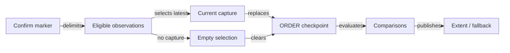

<details>
<summary><strong>Legend — current selection before evaluation</strong></summary>

- The journal reuses the operation selector and `storeObserved`; an empty list clears only the ORDER selection.
- `requestMarker()` delimits request starts; an old request that completes later remains only in raw history.
- Missing identity or identity from another scope does not satisfy ORDER. Both Page and inspector adapters keep the same rule.
- `sequenceMarker()` reads the receipt counter after the passive barrier and
  saves the typed fence under the same returned key; pending captures enter the snapshot.
  Raw receipt, registration, and payment retain their numeric semantics.
- Two reads with the same receipt and fence are idempotent. If a request with
  no response starts between them, the same number cannot represent two
  windows: the numeric association becomes ambiguous and ORDER rejects it without silent overwrite.
- The Confirm flow uses typed `requestMarker()`, independent of legacy
  collisions. `ShopLegacyMarkerComponentTest` probes the snapshot, idempotence,
  and collision rejection through the Page and inspector adapters.
- Trace, order, and capture identity are retained; raw history and sibling checkpoints are not deleted.
- `ShopApiAssertions` evaluates the same capture; `ShopApiValidationResult.order` retains missing checks as assertions, without an invented exchange.
- Correlation without an API invoice retains an explicit expected value and
  separates missing API evidence from the UI value; total uses the independent oracle.
- UI may display an old successful invoice; this does not turn a 500 or missing API evidence into PASS.
- `awaitOrderCreated` passively awaits capture within the Page timeout, even when UI already shows the old confirmation.
- If UI throws, an already observed capture is bound before propagating the
  same cause; secondary errors remain suppressed.
- Selection and publication do not resend Confirm, retrieve the order through
  another transport, or change the timeout.
- `UI_ONLY` keeps the API channel disabled; report values are subject to the redaction and 240-character preview limits.

</details>

- `ShopOrderEvidenceComponentTest`: selection and missing capture;
- `ShopOrderEvidenceSelectionComponentTest`: success-shaped body with status
  500, prior cache, missing capture, transport, and scenario isolation;
- `ShopCheckoutOrderCorrelationComponentTest`: one Confirm in the browser,
  loopback HTTP, and checkpoint projection into Extent/fallback, including Fails and backlink.

The 201→500 window uses controlled observations; it does not claim two HTTP
responses for one POST. The adapter test seeds the old capture in the fixture
before the marker and executes one current request; a pre-HTTP failure does not
reach the server.

`ShopRequestStartComponentTest` keeps a prior POST in flight and probes the
current request as absent/201/500 for both routes and adapters, with one Confirm
and no additional dispatch. The old response does not prove the current order;
unknown or foreign identity is explicitly rejected.

<a id="api-failure-with-partial-history"></a>
<a id="eroare-api-cu-istoric-parțial"></a>
### API failure with partial history

`ShopApiRunReport` consumes the Core snapshot through `ShopApiEvidenceMapper`
in main. The failed request receives typed history before report finalization,
preserving the primary cause and other observed exchanges.

- The last response from another attempt does not become the terminal response.
  A timeout or failed transport does not receive HTTP 0 or an invented body.
- Cancellation during backoff retains completed calls and the planned retry,
  without another dispatch. Publication does not rerun the business operation.
- `ShopTerminalExecutionComponentTest` checks the adapter in Extent/fallback;
  `ShopApiBusinessRunComponentTest` retains success/FAIL and cleanup probes.
- Component assertions remain in the standard collapsed step, with redaction
  before the 240-character limit. Controlled transport remains distinct from a live verdict.

The producer and availability are in [Core library guide](../docs/ATF_Core_Consumer.md),
and rendering is in [Reporting](../atf-reporting/README.md#dovezi-api-atașate-unui-pas-ui).

<a id="why-the-api-report-differs-from-the-ui-report"></a>
<a id="de-ce-raportul-api-nu-arată-ca-raportul-ui"></a>
### Why the API report differs from the UI report

API and UI use the same Extent settings and redaction; evidence and resource
ownership differ. `ShopApiBusinessRun` in main receives typed inputs, the client
factory, and the audit factory.

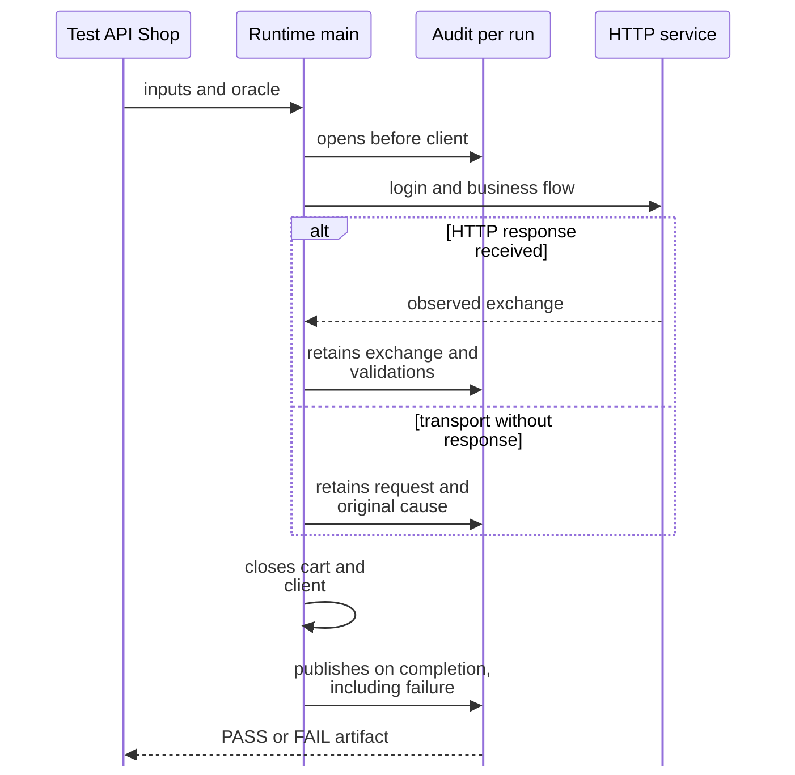

<details>
<summary><strong>Legend — publication after success or failure</strong></summary>

- The audit exists before the client, credential loading, and first request;
  it also retains exchanges received before a catalog/cart/checkout failure.
- Rejected HTTP login produces an exchange and FAIL validation; no response
  produces the known request and a diagnostic, without an invented response
  status or body.
- The business observation of login distinguishes an empty body, uncaptured
  body, and received JSON; it does not automatically attribute a Playwright
  limitation to a rejected HTTP response.
- Collection performs no reporting I/O during cleanup; publication occurs
  after API resources close, and secondary errors remain `suppressed`.
- Report initialization/publication failure remains an infrastructure error;
  no valid artifact is declared if atomic publication fails.
- `ShopApiBusinessRunComponentTest` probes success, 401 with/without a body,
  login/cart timeout, invalid catalog, business contract FAIL, cleanup, and
  publication errors.

</details>

- UI: `ShopE2eTestSupport` shares `UiExtentReportSession`, including actions and screenshots.
- SETUP and TEST BODY use explicit monotonic timing through
  `UiPhase.measureExecution()`; screenshots and evidence publication remain
  separate. Incomplete setup does not create a TEST BODY; HTML flush and browser
  release remain outside execution, according to the
  [Reporting contract](../atf-reporting/README.md#timing-măsurat-înaintea-publicării).
- API: `ShopApiLiveSuite` selects `ShopStandaloneApiReportTest`; the test keeps
  the oracle and opt-in, while the main runtime owns execution and the artifact.
- `reports.api` sets the directory; the filename uses prefix
  `api-atf-practice-shop-standalone_`. Individually launched classes retain the same lifecycle.
- Controlled transport is classified as component/acceptance; it does not certify a live PASS.

Tests marked `@ShopComponentTest` publish one Extent report per owner in the
`component` subdirectory of `reports.api`. An individual class has one report;
`ShopComponentSuite` declares `suite` scope and groups classes in one artifact.

- Audit, scenario, and verdict remain per invocation; parameterized cases with
  the same display name are not deduplicated. Two launches do not reuse a closed session.
- The configuration and metadata factory is in main; Kit owns the scope, while
  Reporting owns the session and publication on its thread.
- `@AtfReportPath` on a participant can enable one notification after the
  shared artifact is published; the policy neither enables nor disables audit.
- `ShopComponentReportScopeComponentTest` probes method, class, suite,
  parameterization, repeated launches, parallelism, and lifecycle failures.

The location notification is independent of HTML generation.

| Owner | Policy and publication |
|---|---|
| Component class | explicit `@AtfReportPath`; `ShopExtentTestExtension` connects the final event, including FAIL/abort and lifecycle failure |
| E2E | direct declaration `@AtfReportPath(AtfReportPath.Policy.DISABLED)` overrides the `@WithE2eHarness` default, retaining the infrastructure |
| Shared report | any active owner requests one final notification |
| YAML | `reporting.console.enabled: false` suppresses the global message |

- `ShopReportPathComponentTest` probes policy, publication before the message,
  parameterized cases, and suite launch.
- Publication fixtures use unique directories under `target`; they do not add
  diagnostic reports beside the suite's primary artifact.
- The declaration belongs to the Jupiter class, including when launching a
  method in IntelliJ; an annotation on `@Suite` does not propagate to selected classes.
- Lifecycle details and the configurable assertion budget, 240 by default,
  remain separate policies.

[Audit observations](src/test/atf/shop/tests/component/evidence/ShopAuditObservationsTest.java)
receive a captured request and an explicit verdict when the HTTP response is
missing. FAIL and terminal evidence remain in the checkpoint; the `Audit API
exchange` row is not invented. A valid screen does not promote failed transport
to PASS. These local probes use no browser or real external service.

- `ShopCartAcknowledgementFixture` prepares the first bounded render, then
  measures the 600 ms action. The DOM counter and transport cause distinguish a
  postcondition rejection from a timeout before injection; pointer use and zero
  replay remain required.
- `ShopQuantityFixture` separates navigation/document setup from product
  availability, whose native timeout remains 500 ms. Delayed states are armed
  after preparation; initialization rejection closes resources and preserves the cause.

| Case | Evidence in report |
|---|---|
| Component method | comparisons evaluated through `AuditedAssertions` or `RecordedAssertions`, with operator/name, source where available, expected, actual, and result |
| JUnit lifecycle | `Component assertions` in the phase where checks were evaluated: `SETUP`, `TEST BODY`, or `TEARDOWN` |
| Component timing | phase badge shows the sum of executed callbacks, measured monotonically; tooltip separates snapshot publication; totals do not double-count assertions |
| Business API and E2E | exchanges and API validations, and browser evidence, in their respective nodes |

- The standard step is initially collapsed; redaction precedes truncation, and
  text retains the default 240-character limit including `…`, even after expansion.
- Numeric and boolean comparisons explain the invariant in English.
  `ShopOrderRequestStartComponentTest` distinguishes the old request, single
  activation, and current exchange, including the failed HTTP status, without
  changing the oracle.
- An expected exception produces the expected check; an unconsumed FAIL cannot
  remain JUnit PASS. Abort retains SKIP and the actual reason, with no invented rows.
- The guard rejects PASS without evaluated checks; a failure before the first
  comparison retains its diagnostic. Unit tests remain outside the reporting requirement.

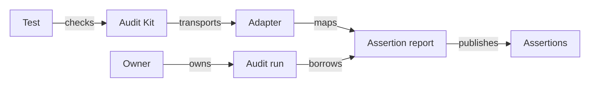

<details>
<summary><strong>Legend — Shop component audit</strong></summary>

- Edges show data flow and ownership, not Maven dependencies: Kit does not import Reporting.
- A JUnit handler cannot hide an error already captured by the audit. FAIL/SKIP,
  cause, and timing remain aligned with the report, individually and through the suite.
- PASS comparisons are not presented as the cause of a later exception; a
  diagnostic without transport does not fabricate a request or HTTP duration.
- Phase duration includes inherited and parameterized callbacks for the
  invocation; resource acquisition and publication are excluded. Expansion
  retains execution time.
- Phase/scenario totals are not the suite wall-clock time; a measured zero is
  valid. Successful class fixtures are not distributed across scenarios.
- `AssertionAuditRun` closes the shared session at the owner; each invocation
  receives the configured `reporting.assertionMaxDisplayCharacters` budget
  from that owner before collection, including values above the default 240.
  The effective value appears in `Overview → System` under `Assertion preview`.
- Each invocation closes only its own scenario. Two suites have separate owners,
  even in the same launcher.
- [Kit](../lib/README.TestKit.md#scope-and-integration) owns delegation,
  per-invocation collection, and result reconciliation; the consumer injects
  redaction and configuration.
- [Reporting](../atf-reporting/README.md#proiecția-sigură-a-aserțiunilor) owns
  the node, publication lifecycle, and Extent/fallback rendering.
- The final message follows closure by the shared owner; changing the assertion
  preview does not change the artifact count or path opt-in policy.
- Inherited methods, parameterization, and lifecycle use the same policy;
  scope is not implicitly propagated to other threads.
The short labels have these meanings:

| In diagram | Full meaning |
|---|---|
| Test | Shop component test |
| Adapter | Shop adapter |
| Assertion report | AssertionAuditReport |
| Owner | Owner class / suite |
| Assertions | Component assertions |
| checks | checks in full |
| transports | safe rows + phase timing |
| borrows | borrows the session |
| publishes | publishes collapsed |

</details>

`ShopComponentPhaseTimingComponentTest` checks the real link to Kit/Reporting,
inherited callbacks, identical parameterized titles, and the single report,
both through the suite and when running an individual method.

In the component suite, `ShopApiEndpointMatrixTest` checks shared transport
invariants; `ShopApiContractVariantTest` and `ShopApiScreenFlowTest` add distinct
semantic assertions for payload and data propagation. Route overlap is
intentional when the evidence differs; the matrix does not replace the semantic
test, and no mock fixture is presented as proof of live behavior.

The live contract retains these safeguards:

- filtering checks that each product belongs to the requested category, and
  sorting compares prices numerically, not lexicographically;
- `ShopApiCartScope` in main owns the isolated cart, checks read-back after update and
  remove, and confirms the cart is empty during cleanup; DELETE is not repeated;
- mutating operations have one attempt; cleanup after success and interruption
  has deterministic probes, without fabricating a remote error;
- the authenticated fixture is a precondition, not a permanent guarantee; a
  401 stops the flow, and credentials do not enter documentation or reports.

Interactive audit uses the new artifact produced by the Shop adapter with
controlled transport, without repeating remote mutations to check the renderer.
Compare the UI+API `Request → Response → Execution` schema,
`AUTH PROFILE`/`AUTH TYPE`, redacted JSON, and disclosure state.

Local scrolling, glyph/ARIA, reopening parents, and Fails → Tests are checked
in MCP/ATF Debug. Readability at narrow widths is a Reporting layout contract,
separate from HTTP success and Shop mapping.

<a id="boundary-between-shop-tests-and-the-reporting-library"></a>
<a id="limita-dintre-testele-shop-și-biblioteca-reporting"></a>
### Boundary between Shop tests and the Reporting library

Apply the [shared ownership rule](../docs/ATF_Testing_Guide.md#test-owner-business-adapter-or-infrastructure);
the section below defines only Shop-specific examples and boundaries. The owner
is determined by the asserted invariant, not by whether the test publishes a report.

| Invariant | Owner and example | Does not move here |
|---|---|---|
| Shop business intent, routes, order, and redaction | Shop; `ShopApiContractReportComponentTest` and `ShopApiCallAuditReportComponentTest` check adapter semantics and exchange association | Extent markup or renderer implementation |
| selected Reporting contract: HTML hierarchy, tables, disclosure, and rendering | library guide describes the contract; Shop verifies its local report adapter | Shop-specific registration/address policy |
| Generic test-only annotations, resolvers, and cleanup utilities | selected Test Kit library JAR | screenshot policy, Shop profile, or browser harness |

Each consumer verifies its request ownership and business mapping against the selected
Reporting library. Shop retains its assertions about intent and distinct `/users/login` calls.

<details>
<summary><strong>Boundary between local and reusable tests</strong></summary>

| Current test | Contract retained by Shop | Shared library contract consumed by J1 |
|---|---|---|
| `ShopApiAuthenticationSchemaTest` | profile/mechanism through the mapper and browser journal; credentials absent from both artifacts | selected Reporting contract describes canonical labels and projection; Shop verifies its local mapping |
| `ShopApiCallAuditReportComponentTest` | intent/status association with the exchange, missing explicit contract, and audit diagnosis | selected Reporting contract describes retry rendering and diagnostic projection |
| `ShopApiBodyRedactionReportTest` | Shop policy for registration/address, malformed body, and actual adapter output | selected Reporting contract describes generic redaction; Shop verifies its actual output |
| `ShopE2eFailureBoundaryTest` | business error remains primary when evidence publication and close fail; secondary errors are suppressed in order | reverse-order closing through `FailureAwareCleanup` is tested directly in Test Kit |
| `ShopScreenshotPolicyTest` | policy mapping and YAML precedence over the legacy option | selected Reporting contract describes provider filtering before capture |

The local retry test checks attempts/history/provenance through the mapper and
Shop's published model, including the initial login contract. The selected
Reporting contract describes the pipeline across Extent, fallback, and UI+API,
including exhausted retry. Cleanup lifecycle and capture filtering are
described by the selected library contract rather than duplicated in Shop.

Tests for intent/status association, JUnit failure, and personal data remain
local: they check adapter invocation and Shop policy, not layout. A neutral
gate cannot replace the safety of the artifact produced by the application.

</details>

Focused diagnosis of components with API exchanges over controlled transport:

```text
mvn -pl atf-test-practice-shop -am "-Dtest=ShopApiClientContractTest,ShopApiContractVariantTest" "-Dsurefire.failIfNoSpecifiedTests=false" test
```

One guest UI + API journey:

```text
mvn -pl atf-test-practice-shop -am "-Dtest=ShopPurchaseE2eTest" "-Dsurefire.failIfNoSpecifiedTests=false" "-Datf.practice.shop.e2e.enabled=true" test
```

All five E2E variants in suite order, with authenticated setup and associated
remote effects:

```text
mvn -pl atf-test-practice-shop -am "-Dtest=ShopE2eSuite" "-Dsurefire.failIfNoSpecifiedTests=false" "-Datf.practice.shop.e2e.enabled=true" test
```

- `ShopUiOnlySingleFlowPurchaseE2eTest` repeats the guest UI-only journey with a
  different evidence grouping; it is not a new business case.
- The suite retains this variant for now; criteria for reducing its live run are in the
  [business acceptance contract](../docs/ATF_Testing_Guide.md#individual-and-suite-business-acceptance).

Authenticated E2E with an existing account requires the local fixture
described above. `ShopNewAccountPurchaseE2eTest` and `ShopE2eSuite` can create
accounts in the external demo; run them only when you accept that remote effect.

Launching an E2E class or suite from IntelliJ opens a browser to the live
application; there is no property opt-in for this execution. For checks without
a browser or mutations to the demo service, launch one of the component suites.
Running `ShopAuthenticatedPurchaseE2eTest` alone requires a local fixture,
while `ShopNewAccountPurchaseE2eTest` performs synthetic remote registration.

To run individually from Maven with an existing account:

```text
mvn -pl atf-test-practice-shop -am "-Dtest=ShopAuthenticatedPurchaseE2eTest" "-Dsurefire.failIfNoSpecifiedTests=false" test
```

| Test | Boundary and effect | Verification criterion |
|---|---|---|
| `ShopStandaloneApiReportTest` | Opt-in through `atf.practice.authenticated-e2e=true` and authenticated fixture in `src/test/resources`; checks sort/filter, update/remove with read-back on an isolated cart and checkout/payment, without a final invoice. | Authenticated `LIVE / HTTP` run, business contracts passed, and cleanup confirmed; a failed login publishes a diagnostic and does not validate later mutations. |
| Unit/component suites | Request, validator, and lifecycle variants with controlled neighbors; no account and no traffic to the external service. | Deterministic; not presented as proof of server semantics. |

Component tests check the runtime, contracts, and artifacts for success,
rejected HTTP, transport without a response, and failed cleanup. The live
authenticated run checks server behavior separately; an auditable 401 report
does not certify a successful flow.

Generic report interaction is tested in
[Reporting library contract](../atf-reporting/README.md); business mapping remains in Shop.
API login does not automatically prove UI authentication for the same account.

</details>

<a id="changes-and-maintenance"></a>
<a id="modificări-și-întreținere"></a>
## Changes and maintenance

- Product or checkout changes start in Shop configuration/fixtures; route,
  selector, or screen contract changes start with the dedicated owner in `src/main`.
- Add deterministic variations to component/API component tests; live API stays
  opt-in, and E2E remains for wiring and the real browser effect.
- `ShopApiEndpointMatrixTest` retains shared transport invariants, while
  `ShopApiContractVariantTest` checks distinct semantic forms and results; unit/component
  ownership and suites are documented above.
- Generic Playwright, reporting, console, or TestKit changes belong in the
  respective ATF owner, not in a local Practice Shop fork.
- A stable contract belongs here; the feedback register keeps only open gaps
  and their closure criteria.

For cross-cutting test and code conventions, see the
[ATF code best practices](../docs/README_Atf_CodeBestPractices.md); they are
not copied here as parallel rules.

<a id="owner-documentation"></a>
<a id="documentație-owner"></a>
## Owner documentation

- [ATF architecture](../docs/ATF_Architecture.md) — module boundaries and ownership;
- [ATF testing guide](../docs/ATF_Testing_Guide.md) — verification levels and canonical path;
- [Annotation contract](../docs/ATF_Test_Infrastructure_Annotations.md) — declarations for level, channel, fixture, and output;
- [Capture contract](../docs/ATF_Evidence_Capture_Contract.md) — generic axes for flow, actions, and screenshots;
- [Core library guide](../docs/ATF_Core_Consumer.md) — neutral contracts and transport;
- [Console library guide](../lib/README.Console.md) — diagnostic policy and report path display;
- [`atf-ui`](../atf-ui/README.md) — browser, locator, and inspector contracts;
- [`atf-reporting`](../atf-reporting/README.md) — report model and rendering;
- [`atf-test-kit`](../lib/README.TestKit.md#scope-and-integration) — annotations and test selection;
- [Documentation best practices](../docs/README_Atf_DocumentationBestPractices.md) — structure and README governance;
- [Feedback register](../docs/feedback/README.md) — active gaps only.

<a id="business-failure-acceptance"></a>
<a id="acceptanța-failure-urilor-business"></a>
### Business failure acceptance

[ShopBusinessFailureAcceptance](src/test/atf/shop/tests/e2e/failures/ShopBusinessFailureAcceptance.java)
explicitly launches JUnit E2E fixtures for Account, Cart, and Purchase in UI
and UI_API. Canonical business suites retain their selections and expectations.

| Area | Fault after real setup | Verified stop |
|---|---|---|
| Account | account heading becomes invisible | page contract fails; add or checkout does not start |
| Cart | observed line total becomes `0.01` | quantity and product remain real; the total gate stops order placement |
| Purchase | invoice token is replaced after confirmation | terminal message remains visible; the invoice oracle rejects incomplete success |

CLI requires `-Datf.business.failures.live.enabled=true` and Shop E2E opt-in.
The `individual`, `suite`, and `all` modes use
`-Datf.business.probe.root=<reactor TMP>` for evidence; optional selection
`-Datf.business.probe.case=AccountUi` also accepts `AccountApi`, `CartUi`,
`CartApi`, `PurchaseUi`, `PurchaseApi`; the filter affects individual launches,
while the suite remains complete.

- Negative cases remain FAIL in JUnit/Extent; acceptance requires the exact
  cause, single injection, counted requests, and the original capture with the fixture marker.
- The next healthy story runs in the opposite profile and a fresh context.
  The fixture suite shares the report and scoped account reference, not the browser.
- Shop releases account references when the owner closes; it does not delete
  borrowed accounts. This policy is not replaced by deleting the AutoEx account.
- Local components probe injection only; external execution and report audit
  remain distinct tests, without mutation retry or an increased timeout.

The CLI associates each invocation with its owner, scenario, and phase in the
HTML, then checks the verdict, checkpoint, cause, and each original capture.

| Evidence | Criterion |
|---|---|
| Captures | Cart/Purchase: rejected checkpoint and later diagnostic; Account/AfterSetup: failure without intervening business actions |
| Ownership | distinct color marker; a sibling's capture is rejected |
| Consistency | Tests/Fails/Overview retain JUnit totals and the healthy neighbor without an inherited cause |

<details>
<summary><strong>Details — controlled degradations and audit without the application</strong></summary>

Negative controls remove or reassign one capture, change a verdict, remove the
cause, and contaminate the healthy neighbor. They mutate only the DOM in the
audit browser, preserving the saved artifact and business requests. The report
is loaded through a locally intercepted route, with no external request.

`artifact-expectations.json` retains execution observations before the HTML
audit. `audit <artifact-expectations.json>` mode rechecks the existing report
without E2E opt-in and without new registration. The neutral launch/collection
part uses [ScopedAcceptanceRun](../lib/README.TestKit.md#scope-and-integration);
the launcher and oracle remain with the consumer, in test scope.

</details>

<a id="shared-support-boundary"></a>
<a id="limita-suportului-partajat"></a>
### Shared support boundary

UI/UI_API isolation has a [proof through the real E2E harness](src/test/atf/shop/tests/component/reporting/ShopEvidenceProfileIsolationComponentTest.java),
with loopback HTTP 500/200 and a real browser. Individual failure and failure
followed by success in the opposite profile retain the cause, capture, and one
HTML report per launch.
Verdict markers are checked in markup, without scripts/styles, according to the
  [shared test rule](../docs/ATF_Testing_Guide.md#consumer-component-audit).

| Axis | Verified contract |
|---|---|
| browser and state | each invocation starts on `about:blank`; localStorage from the previous scenario is absent |
| evidence and result | UI_API retains the inspector; UI does not inherit it, and the healthy scenario remains PASS after its neighbor fails |
| executed operations | server counter records one GET per invocation; failure does not authorize replay |
| configurable capture | main factory passes the configured API origin to response capture; UI_API requires the real exchange, while UI requires zero journal exchanges; delivery required by gates is not automatically moved to request-finished |
| shared report | selected scenarios appear in one HTML report, with aggregated System configurations and inspectable failed comparison |

This test checks the adapter's local boundary. Registration, billing, payment,
and business suite isolation still require execution of real scenarios; the
canonical selection is not reduced based on similarity between the two profiles.

`ShopBrowserRuntime.open` keeps acquisition in main and transfers resources
only after full assembly. On failure after opening the browser, it is closed
once; the original cause remains primary, and a distinct cleanup error is suppressed.

- The factory seam is package-private, for inducing failures at different stages;
  the public API, configuration, and sink remain the same.
- [ShopBrowserAcquisitionComponentTest](src/test/atf/shop/runtime/ShopBrowserAcquisitionComponentTest.java)
  uses the real browser and native close event, including failure after the journal is attached.

- On success, the caller owns the browser; the factory does not close it implicitly.
- Repeating the same throwable does not cause self-suppression, and an `Error`
  is not replaced by a later cleanup error.

| Owner | Contains |
|---|---|
| Shop `src/main` | pages, flows, payloads, Shop capture/policy, and terminal `ShopPurchaseConfirmation` validation; no JUnit/Test Kit |
| Shop `src/test` | Shop-specific business tests, fixtures, and JUnit/report adapters |
| `atf-test-kit` | neutral lifecycle; receives no browser, Reporting, or business logic |
| atf-ui / Shop and AutoEx consumer tests | neutral screen audit / local report integration checks |

<a id="shop-support-refactoring-target"></a>
<a id="ținta-refactorizării-suportului-shop"></a>
### Shop support refactoring target

The goal is less auxiliary test code, not moving the entire harness into
main. The source sets in the table above describe the current implementation.

- Account scope and the two runtime factories have the owners described above;
  we do not widen the Kit dependency as a shortcut for other moves.
- Checkpoint publisher and stage inputs are separate; each Catalog/Checkout
  observation becomes an immutable checkpoint, published before the gate. The
  context retains composition of shared Page/action/API/locator/validation
  resources; we do not extract per-click wrappers.
- One complete journey remains shared for step-based UI, compact UI with a
  final screenshot, and UI+API; YAML configuration now supplies flow and action
  details separately.
- The three gates remain complete until equivalence tests are proven; screenshot
  policy does not justify a second business story.

The [business acceptance contract](../docs/ATF_Testing_Guide.md#individual-and-suite-business-acceptance)
describes the required evidence and separate review before reducing the selection.

The catalog/checkout stages in `ShopPurchaseFlow` are implemented; separating
business → UI flow → composed actions → Playwright remains a design target.
The [testing guide](../docs/ATF_Testing_Guide.md#separating-business-flows-ui-flows-and-validations)
defines the boundaries and component proof for the first increment.

<a id="report-directory-root"></a>
<a id="rădăcina-directoarelor-de-raportare"></a>
## Report directory root

`reports.ui`, `reports.api`, and their relative overrides resolve against the
parent of the Shop module identified by its own POM. Reporting may be a source
module or JAR; the presence of a Reporting checkout does not determine the destination.

| Launch | Resolution |
|---|---|
| reactor, Shop module, or module subdirectory | same base for UI/API and components; no default output under the module |
| configured absolute path | retained in normalized form, without changing the base |
| standalone with no Shop module in its ancestors | falls back to working directory, without using a foreign Reporting marker |

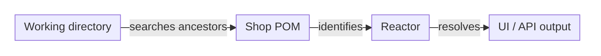

<details>
<summary><strong>Legend — root for relative output paths</strong></summary>

| In diagram | Full meaning |
|---|---|
| Working directory | reactor, module, or subdirectory captured when configuration is loaded |
| Shop POM | consumer module marker found through Core |
| Reactor | parent of the Shop module; Reporting's source/JAR form does not affect the choice |
| UI / API output | configured relative path, resolved against the same base |

An absolute path is retained; when the module is absent from the ancestors, the
standalone fallback in the table is used. Configuration resolution does not
create directories.

</details>

`ShopConfigurationLoader` reuses Core's file search, without a runtime
dependency on Kit. [ShopConfigurationTest](src/test/atf/shop/tests/component/configuration/ShopConfigurationTest.java)
checks the public API in both layouts and retains `user.dir` isolation. The
component report publishes each invocation's checks in the collapsed
`Component assertions`.

<a id="shipped-yaml-geometry"></a>
<a id="geometria-yaml-livrată"></a>
## Shipped YAML geometry

The table describes the shipped configuration, without process or test
overrides. The source is the [consumer YAML](src/test/resources/atf-practice-shop.yaml);
the pure calculation belongs to [UI](../atf-ui/README.md#native-context-geometry).

| Source | Requested output | Zoom | CSS viewport | DPR |
|---|---|---|---|---|
| Delivered YAML | `1440 × 1000` | `70` | `2057 × 1429` | `0.70` |

`DocumentedUiGeometryContractTest` compares the declaration with live YAML and
the executable UI model; mutants change only the document. It does not measure
screenshot pixels: browser geometry has its native proof at the UI owner, while
System publishes the effective run configuration, including when it differs
from this table.

<a id="quick-check"></a>
<a id="verificare-rapidă"></a>
## Quick check

| Decision | Source and limit |
|---|---|
| Selection and verification of order evidence | [owner source](src/main/atf/shop/support/api/ShopApiNetworkJournal.java); test: [ShopOrderEvidenceComponentTest](src/test/atf/shop/tests/component/api/ShopOrderEvidenceComponentTest.java) |
| Dependencies and source sets | [POM](pom.xml); declared scope is authoritative for integration |
| What this test does not prove | A capture received after the marker alone does not prove that the current request started after it. |

<details>
<summary><strong>Command for the local test</strong></summary>

Run from the root of an [external staging area](../docs/ATF_Build_And_Execution_Safety.md), with JDK 21 and Maven.

```powershell
mvn -B -pl atf-test-practice-shop -am "-Dtest=ShopOrderEvidenceComponentTest" "-Dsurefire.failIfNoSpecifiedTests=false" test
```

The command selects the named test and builds its dependencies; it does not
claim that the entire module passed. A capture received after the marker alone
does not prove that the current request started after it.

</details>

<a id="locale-independent-configuration-and-projection"></a>
<a id="configurare-și-proiecție-independente-de-locale"></a>
## Locale-independent configuration and projection

UI/UI_API profiles, checkpoint aliases, HTTP method identity, and Overview/System
precondition vocabulary use `Locale.ROOT`. The JVM locale does not change
evidence selection or the profile obtained by loading YAML.

[ShopLocaleConfigurationComponentTest](src/test/atf/shop/tests/component/configuration/ShopLocaleConfigurationComponentTest.java)
checks aliases, YAML without overrides, and precondition projection in `tr-TR`,
`en-US`, and `lt-LT`. The test restores all locale categories and keeps its
assertions in the standard collapsed `Component assertions` step.

<a id="screenshot-evidence"></a>
<a id="dovezile-capturilor-de-ecran"></a>
## Screenshot evidence

Screenshot evidence uses the whole browser viewport at the configured 70% zoom,
retaining the page around the current action. Region close-ups supplement the
complete frame; the report fits the full image with its aspect ratio and all edges.

The [shared capture contract](../atf-ui/README.md#full-context-screenshots) and
[native pixel regression](../atf-ui/src/test/java/atf/ui/playwright/geometry/PlaywrightPointerGeometryComponentTest.java)
protect context independently of the screenshot publication policy.
