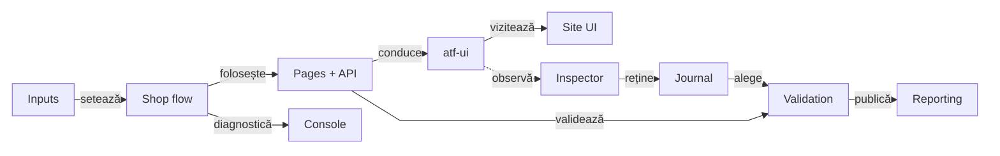
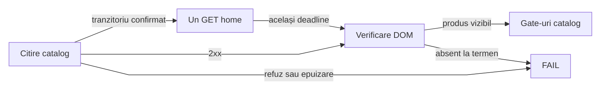
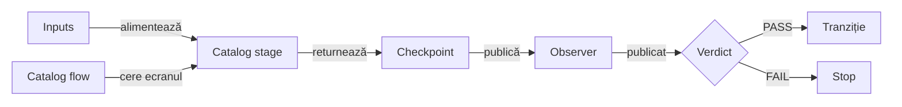
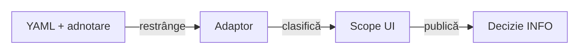
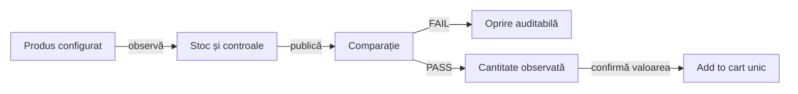
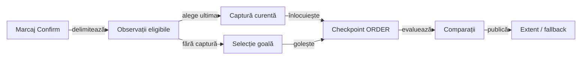
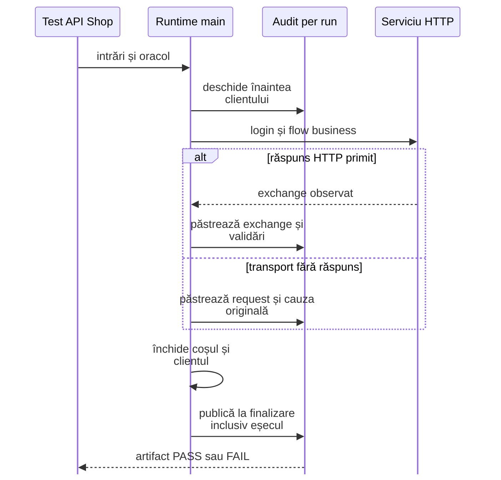
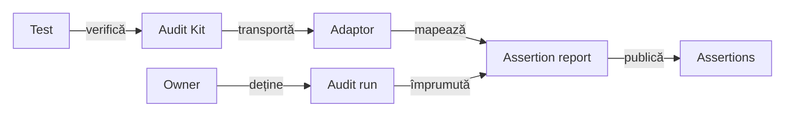

# ATF Test Practice Shop — consumer UI/API

## Pe scurt

**Trasee rapide:** [Journey](#traseul-de-achiziție) · [Fixture și billing](#configurația-modulului) · [Dovada order](#dovada-comenzii-curente) · [Raport per suită](#raport-partajat--starea-consumerului) · [Componentă sau E2E](#verificare-rapidă)

`atf-test-practice-shop` este modulul consumer care verifică UI-ul și API-ul
real al aplicației Practice Software Testing. El deține fixture-ul aplicației,
configurația, page objects, flow-urile și probele consumer; nu deține
implementarea generică Playwright, Extent sau JUnit.



<details>
<summary><strong>Legendă — boundary-ul modulului</strong></summary>

- `YAML + fixture` conține valori și profile specifice aplicației;
- `Shop flow` compune paginile și checkpoint-urile; paginile cunosc rutele și
  controalele Practice Shop;
- săgeata punctată este numai observarea opțională `UI_API`; UI-only continuă să
  trimită traficul normal al aplicației, dar nu publică API evidence;
- journal-ul păstrează traficul observat, iar mapper-ul promovează doar
  exchange-urile selectate pentru checkpoint-uri;
- `atf-reporting` și `atf-console` rămân ownerii generici ai output-ului; Shop
  deține mapping-ul și semantica business.
Etichetele scurte păstrează următorul sens:

| În schemă | Sens complet |
|---|---|
| Pages + API | pages + API client |
| Inspector | network inspector |
| Journal | Shop network journal |
| Validation | Shop validation |
| setează | configurează |
| observă | UI_API observă |
| reține | înregistrează |
| alege | selectează |
| validează | validează UI |

</details>

<details>
<summary><strong>Harta de lectură</strong></summary>

- [ownership și source roots](#ce-deține-modulul) — ce rămâne în Shop;
- [journey și vocabular](#traseul-de-achiziție) — checkpoint-uri, Gherkin și locatori;
- [variante E2E](#variantele-e2e) și [configurație](#configurația-modulului);
- [evidence](#dovezi-și-comportament-vizibil),
  [verificare](#cum-se-verifică-modulul) și întreținere.

</details>

## Ce deține modulul

<details>
<summary><strong>Detalii — ce deține modulul</strong></summary>

| Suprafață | Owner în modul | Limită |
|---|---|---|
| Configurație | `src/test/resources/atf-practice-shop.yaml`, `ShopConfigurationLoader` | valori și fixture-uri Practice Shop, nu configurare globală ATF |
| UI | `routes`, `locators`, `pages`, `flow` în `src/main/atf/shop` | semantică a aplicației; browserul generic rămâne în `atf-ui` |
| API | `api` și `support/api` în același source root | contractele wire și maparea către dovezile Shop; transportul generic rămâne în `atf-core` |
| Evidence runtime | `src/main/.../{evidence,reporting}` | factory-uri de captură și politică Shop, fără JUnit/Kit; rendererul rămâne în Reporting |
| Harness consumer | `src/test/.../support/{lifecycle,reporting}` | ownership browser/report, metadata de rulare și integrare JUnit |
| Teste | `src/test/atf/shop/tests` | compun și verifică Shop; testele reutilizabile ATF aparțin modulului care deține contractul generic |

Comportamentele Shop folosesc `atf-core`, `atf-console`, `atf-reporting` și
`atf-ui`; `atf-test-kit` este declarat în `test` scope pentru adnotările și
contractele folosite numai de testele consumerului. Niciun modul generic ATF nu
depinde de Practice Shop.

<details>
<summary><strong>Harta source roots și a responsabilităților locale</strong></summary>

```text
POM source roots: src/main, src/test

src/main/atf/shop
├── config/       YAML, modele typed și profile
├── api/          request factory, operații, rute și screen APIs
├── routes/       rute UI relative
├── locators/     CSS selectors și selecția exactă a produsului
├── pages/        page objects, inclusiv account flows
├── flow/         journey-ul semantic și stage-urile lui
├── evidence/     capture provider cu mascarea câmpurilor sensibile Shop
├── reporting/    politica de screenshot din configurația Shop
├── runtime/      achiziția browserului și a sesiunii de raport, cu intrări explicite
└── support/      checkpoint, validation, API report mapping și network journal Shop

src/test/atf/shop/tests
├── e2e/          composition roots pentru journey-uri reale
├── suites/       selecția și ordinea suitei
├── component/    config, catalog, evidence, purchase și adaptoare Shop
├── api/
│   ├── component/{contract,exchange,lifecycle,reporting}
│   ├── unit/{auth,contract,exchange,reporting}
│   ├── integration/  API live opt-in
│   ├── network/      observație UI și settlement controlat
│   ├── reporting/    auditul exchange-urilor de componentă
│   └── support/      fixture-uri și transporturi locale test-only
└── support/
    ├── lifecycle/  context browser/report per scenariu și probele sale
    ├── reporting/ metadata de rulare și probele adaptorului
    └── ...         fixture-uri, extension și probe E2E
```

`src/main` păstrează modelul de aplicație, locatoarele, paginile, flow-urile și
contractele Shop care pot fi reutilizate de consumer, inclusiv factory-urile
pure pentru captură și politica de screenshot. `runtime.ShopBrowserRuntime`,
`ShopRunReportFactory` și `reporting.environment.ShopReportSystemMetadata` dețin achiziția și proiecția
configurației în main, cu sink și environment explicite.
Store-ul, extensiile și rezolvarea JUnit rămân în test,
iar `atf-test-kit` păstrează scope de test.

`ShopE2eContext` rezolvă `AtfConsoleTestContext` numai la boundary-ul de test și
deleagă celor două factory-uri main. Resursele returnate aparțin harness-ului;
eșecul achiziției închide browserul deja deschis și păstrează cauza primară.
Contextul per scenariu compune cleanup-ul Kit și protocolul de publicare;
nu exportă JUnit/Kit în artifactul runtime.
Suita consumatorului rămâne concentrată pe `e2e`, `component` și `api`; `support`
este infrastructură de test, nu un al treilea tip de test.

`ShopE2eTestSupport` compune testele, iar
[`ShopE2eContext`](src/test/atf/shop/tests/support/lifecycle/ShopE2eContext.java)
deține resursele browser/report doar pentru rulări E2E. Guvernanța whole-ATF
verifică source-set-ul harness-ului și al adaptoarelor, limitele locatorilor,
suitele și dependențele consumerului; paginile, flow-urile și locatoarele rămân
în `src/main`.

Cleanup-ul generic failure-aware este furnizat de `atf-test-kit` și consumat
numai din test scope; contextul, browserul, raportarea și ownership-ul rămân
adaptoare locale Shop. `ShopE2eActivationExtension` păstrează detecția IntelliJ
și transmite override-ul JVM către `AtfE2eActivationPolicy` din `atf-test-kit`.
Resolverul generic aplică precedența override explicit → opt-in configurat →
fallback IDE → dezactivat; `false` prevalează asupra IDE, iar o valoare invalidă
eșuează închis. Test Kit probează politica, iar guvernanța whole-ATF verifică
wiring-ul Shop.

Testele locale rămase verifică contracte specifice Shop: raportarea proprie,
captura, profilele, maparea API și regulile de business. Primitivele neutre nu
se dublează aici: escaping-ul selectorilor este în `atf-ui`, iar diagnosticul
generic pentru body API indisponibil este în `atf-core`.

`reporting.environment.ShopReportSystemMetadata` din main proiectează
configurația rulării în allowlist-ul System. `ReportUiEnvironment` din Reporting
formatează câmpurile comune AutoEx/Shop, iar consumerul adaugă politica sa API.

- `atf.shop.reporting.ShopScreenshotPolicy` transformă politica YAML în
  `ReportEvidenceProfile`; `evidence.ShopBrowserCaptureProvider` aplică mascarea
  Shop înaintea capturii generice UI. Aceste adaptoare runtime nu importă JUnit/Kit.
- Contextul folosește direct `ReportModelAdapters.uiActions(...)`, fără un
  bridge local care doar retransmite apelul.
- Auditul comun al ecranului aparține `UiScreenAudit` din `atf-ui`, iar
  închiderea resursei aparține `CloseOnceResource` din Kit.

Compoziția test-scoped transmite câmpurile evenimentului Reporting către
`AtfConsoleEvent.fromExternalEnums(...)` din Core, apoi publică în sink-ul
configurat; Console nu depinde de Reporting. Compatibilitatea vocabularelor
este probată în Reporting Tests, iar browserul și regulile Shop rămân locale.

</details>

</details>

## Traseul de achiziție

<details>
<summary><strong>Detalii — traseul de achiziție</strong></summary>

Journey-ul guest folosește produsul și datele declarate în YAML:

```text
catalog → product → cart → guest checkout → billing → payment → confirmation
```

`ShopPurchaseFlow` compune ecranele și checkpoint-urile. Testul E2E afirmă
rezultatul observat; nu duplică selectorii, request factory-ul sau lifecycle-ul
raportului.

### Gate-uri de checkout

`ShopCheckoutFlow` coordonează fazele fără Playwright; adaptorul Shop deține
citirile UI și API evidence.

```text
observe screen → publish checkpoint → PASS gate → grouped transition
                                      └─ FAIL → stop before next transition
payment check → PASS gate → explicit Confirm → order confirmation + INV number
```

`ShopCheckoutFlowComponentTest`, `ShopPurchaseCheckpointPublisherTest` și
`ShopPurchaseStageInputsComponentTest` probează ordinea, gate-ul, propagarea
erorilor și granițele stage-urilor fără browser.

- `ShopPurchaseCheckpointPublisher` construiește și publică checkpoint-urile.
- `ShopConfiguration.CatalogSelection` și `ShopCheckoutConfiguration` furnizează
  datele strict necesare fiecărui stage; Home/Product/Cart primesc URI, nume și
  cantitate, iar Login/Registration primesc URI-ul rezolvat la composition root,
  nu configurația globală. `ShopCatalogFlow` consumă aceeași proiecție Catalog.
- Contextul per journey oferă intrări imutabile separate; checkout-ul nu primește
  validatorul de home.
- Coordinatorul păstrează gate-ul PASS/FAIL, separat de observația UI/API.
- `POST /payment/check` verifică metoda demo. Confirmarea explicită plasează comanda.
- Checkpoint-ul `THEN` leagă mesajul de confirmare de numărul `INV-`; profilul `UI_API`
  corelează răspunsul API cu numărul afișat.

### Încărcarea inițială a catalogului

Journey-ul proiectează către `CatalogInputs` numai endpointul colecției din
configurația API. `ShopHomePage.open(homeUrl, catalogEndpoint)` leagă explicit
această citire de `ShopCatalogReadiness`; overload-ul de compatibilitate cu un
singur URI păstrează așteptarea nativă existentă.



<details>
<summary><strong>Legendă — citire repetată bounded și dovadă originală</strong></summary>

- `Await visible` păstrează bugetul configurat de 20 s pentru grilă: pauza
  `Retry-After`, GET-ul documentului și observația finală consumă același rest.
  Navigarea inițială și așteptarea search-ului își păstrează contractele existente.
- Numai răspunsul cererii curente, din frame-ul principal și de la endpointul
  exact `/products`, poate autoriza o reîncărcare. Sunt eligibile 429/502/503/504
  și resetarea/închiderea conexiunii, schimbarea rețelei ori timeout-ul de transport
  confirmate de Chromium. Un răspuns absent sau o eroare necunoscută nu autorizează retry.
- Reîncărcarea este un GET al paginii home. Aplicația reface citirea sa nativă
  `GET`/`QUERY`, cu metoda și corpul originale; nu se trimite un GET API substitut.
  Nu se reiau search-ul business, clickul produsului, coșul, checkout-ul sau comanda.
- HTTP 200 nu înlocuiește produsul vizibil. Un refuz permanent, a doua eroare,
  `Retry-After` peste buget sau alt document opresc încărcarea. Un reload extern
  la același URL este tot alt document; scope-ul nu poate primi un nou deadline.
- `Catalog response`, `Retry catalog home GET` și diagnosticul terminal sunt
  observații INFO. Verdictul final aparține verificării DOM; cauza și FAIL-ul
  original sunt păstrate. Diagnosticul include URL, document, număr de produse,
  cereri observate și ultimul răspuns, fără corpul ori headerele de autentificare.
  Fără răspuns HTTP, statusul este `unavailable`, separat de eroarea de transport.
- Listener-ele se închid înainte de gate-urile de business. Acest protocol
  explicit al încărcării home este separat de controllerul BE pasiv de mai jos;
  nu îi schimbă opt-in-ul și nu activează retry global ori un client API în UI-only.

`ShopCatalogReadinessComponentTest` verifică GET și QUERY pe HTTP loopback real:
succes întârziat, 503→200, conexiune resetată, epuizare, 200 fără produse,
403, `Retry-After`, buget comun, document înlocuit și rute/metode neeligibile.
Comparațiile folosesc pasul standard `Component assertions`, colapsat implicit,
cu limita 240. Fixture-ul artificial și serverul deținute de probă rămân în test.

Verificarea live compară aceeași clasă individual și prin `ShopE2eSuite`
filtrată, cu un singur HTML pe lansare. Un PASS eșantionat nu demonstrează
disponibilitate continuă și nu atribuie retrospectiv incidentul vechi unui 503;
acel artifact nu conținea clasificarea necesară. Noile diagnostice permit această
distincție la owner, fără creșterea timeout-ului sau verdict PASS fabricat.

</details>

### Gate-urile catalogului

`ShopCatalogPurchaseFlow` coordonează home, filters, product grid și produsul
selectat printr-un port semantic. Adaptorul per journey
`ShopCatalogPurchaseStage` citește browserul folosind `CatalogInputs` imutabil;
coordinatorul publică fiecare `ShopPurchaseCheckpoint` înaintea gate-ului și
permite add-to-cart numai după toate cele patru verdicte PASS.



<details>
<summary><strong>Legendă — observație, publicare și tranziție</strong></summary>

`ShopCatalogPurchaseFlowComponentTest` verifică fiecare ecran cu valoare greșită
sau absentă, timeout și eșec de publicare: fără retry, add-to-cart ori o observație
următoare după eroare. Checkpoint-ul păstrează separat UI și API; validatorii,
așteptările din configurație și ordinea traficului nu se reconstruiesc în coordinator.
Un timeout înaintea observației nu inventează un checkpoint cu date inexistente.
Etichetele scurte păstrează următorul sens:

| În schemă | Sens complet |
|---|---|
| Inputs | CatalogInputs · selecție + capabilități |
| Catalog stage | Catalog stage · observații UI/API |
| Checkpoint | checkpoint imutabil |
| Observer | observer raport |
| Tranziție | următorul ecran / add |
| Stop | oprire înaintea mutației |
| publicat | publicare reușită |

</details>
### Contracte de ecran și locatori

`ShopScreen` stabilește identitățile semantice, iar `@ShopPageContract` leagă
page objects de rute și controale obligatorii. Ecranele de checkout au rute
identice în aplicație; diferența dintre cart, guest identity, billing, payment
și confirmation este dată de contractul observat, nu de URL.

| Ecran | Rută UI | Contract observat |
|---|---|---|
| `HOME` | `/` | navigare, banner, filtre, grilă, paginare și footer |
| `PRODUCT` | `/product/*` | produs, preț, descriere, cantitate și add-to-cart |
| `CART` | `/checkout` | produsul selectat, cantitate și continuarea checkout-ului |
| `GUEST_CHECKOUT` / `BILLING` | `/checkout` | identitate guest, adresă și continuarea formularului |
| `AUTHENTICATED_CHECKOUT` | `/checkout` | acțiunea de continuare pentru sesiunea autentificată |
| `PAYMENT` / `CONFIRMATION` | `/checkout` | metoda demo, verificarea plății și confirmarea comenzii |
| `LOGIN` / `ACCOUNT` / `REGISTRATION` | `/auth/login`, `/account`, `/auth/register` | controale de autentificare, identitatea contului și formularul de înregistrare |

`ShopLocators` este ownerul selectorilor folosiți de page objects. Pentru
catalog, `ShopProductSelector` identifică produsul după numele complet, în
cardul lui, și escape-uiește valoarea dinamică; astfel testul nu depinde de ID-ul
rotativ al produsului sau de potrivire parțială. Hook-urile stabile (`data-test`,
`id`, `name`, `href`) sunt preferate claselor vizuale sau selectorilor ambigui;
convenția CSS generică este în [`atf-ui`](../atf-ui/README.md).

### Vocabularul Gherkin și cardinalitatea journey-ului

`ShopPurchaseTraceStep` este dicționarul local al propozițiilor statice. El nu
ține produsul, cantitatea, URL-ul ori exchange-urile în enum; acestea sunt
observații/evidence runtime. Pentru guest, vocabularul publicat este:

| Ordine | Keyword | Checkpoint |
|---:|---|---|
| 1 | `GIVEN` | catalog home |
| 2–4 | `AND` | filtre, product grid și product page |
| 5 | `WHEN` | cart-ul conține produsul și cantitatea configurată |
| 6–9 | `AND` | guest checkout, billing, payment method și payment check |
| 10 | `THEN` | confirmarea comenzii |

Detaliile care definesc contractul consumerului sunt:

- `SETUP` pentru autentificare rămâne în afara celor zece checkpoint-uri guest;
- ramura autentificată folosește `AUTHENTICATED_CHECKOUT` în loc de guest checkout;
- `ShopPurchaseTraceStepTest` protejează vocabularul, iar
  `ShopPurchaseCheckpoint` separă aserțiunile UI de `UiApiValidationEvidence`;
- când există ambele dovezi, ele apar sub aceeași propoziție Gherkin, fără un al
  doilea pas cu titlu duplicat.

Forma vizuală generică este în
[contractul Reporting](../docs/ATF_Reporting_Contract.md#dovezile-unei-cereri).

</details>

## Variantele E2E

<details>
<summary><strong>Detalii — variantele e2e</strong></summary>

`ShopE2eSuite` declară prin `@ConfigurationParameter` scope-ul `suite`,
ordonarea engine-ului Jupiter prin `ClassOrderer.OrderAnnotation` și dezactivarea
paralelismului. Clasele rulează în ordinea `@Order` de mai jos. Rularea suitei
creează efecte externe în demo-ul Practice Shop; folosește testele component
pentru variații care nu au nevoie de browser sau de server.

| Ordine | Clasă | Contract specific |
|---:|---|---|
| 1 | `ShopNewAccountPurchaseE2eTest` | înregistrează un cont sintetic și confirmă login-ul în `SETUP`, apoi finalizează achiziția autentificată |
| 2 | `ShopAuthenticatedPurchaseE2eTest` | login cu un cont existent în `SETUP`, apoi achiziție autentificată; în suită reutilizează contul creat la pasul 1 |
| 3 | `ShopPurchaseE2eTest` | achiziție guest cu validări UI și API evidence selectată |
| 4 | `ShopUiOnlyPurchaseE2eTest` | același business journey guest, fără publicarea API evidence |
| 5 | `ShopUiOnlySingleFlowPurchaseE2eTest` | UI-only, declară `UNIFIED_FLOW`; la configurația YAML curentă agregă flow-ul și păstrează captura reușită la final |

### Baseline pentru separarea flow-ului

Toate cele cinci selecții păstrează aceeași ordine business în
`ShopPurchaseTraceStep`; diferă numai identitatea/setup-ul contului și politica
de evidence. Această hartă este baseline-ul pentru migrarea incrementală a
observației, gate-urilor și publicării:

| Fază | Operații și observații | Gate înainte de continuare | Variație de ownership |
|---|---|---|---|
| Setup | configurația guest sau fixture-ul autentificat; login-ul UI este confirmat separat | fixture valid și identitate confirmată înainte de purchase | fixture existent împrumutat; cont sintetic nou doar în `ShopNewAccountPurchaseE2eTest` |
| Catalog | home, filtre, grid, produs selectat și ruta efectivă | structură, controale și produs/rută corespund configurației | API evidence este observată pasiv doar când canalul și binding-ul o cer |
| Coș și identitate | produsul și cantitatea din coș; checkout guest sau acțiunea de continuare autentificată | produs/cantitate și forma checkout-ului sunt validate înainte de billing | `ShopPurchaseFlow` conduce UI; `ShopApiNetworkJournal` corelează schimburile observate, fără replay |
| Billing și payment | adresa configurată sau lookup-ul postal; metoda demo și confirmarea payment check | câmpurile observate și răspunsul business sunt validate înainte de order confirmation | strategia billing este configurație business, independentă de canalul evidence |
| Order | confirmarea finală și numărul comenzii | pagina și confirmarea order-ului sunt validate | emiterea comenzii rămâne mutație UI reală; nu se compensează prin retrimitere |

`ShopNewAccountPurchaseE2eTest` adaugă o mutație remote de registration înaintea
flow-ului; `ShopAuthenticatedPurchaseE2eTest` împrumută identitatea existentă.
Cele trei teste guest păstrează aceeași poveste și diferă doar canalul sau
prezentarea raportului. Nu se elimină selecții până când adaptorul de fiecare
variantă și contractele Reporting echivalente sunt probate.

Profilele sunt compuse pe axe distincte, nu prin schimbarea journey-ului:

| Axă | Owner / valoare live | Efect |
|---|---|---|
| Canal | `@AtfTestChannel(UI)` sau `UI_API` pe clasă | `UI` nu publică API evidence; `UI_API` cere inspector allowlisted și checkpoint-uri selectate înainte de deschiderea browserului |
| Formă | `reporting.flowMode` furnizează baza; `@AtfUiEvidence(flow = UNIFIED_FLOW)` o poate suprascrie | schimbă gruparea evidence-ului, nu pașii business sau verdictul; `CONFIGURED` moștenește baza reală |
| Capturi | YAML `reporting.screenshotPolicy: each-checkpoint`; `@AtfUiEvidence(screenshots = ...)` poate suprascrie explicit valoarea pentru scenariul propriu | politica efectivă determină capturile admise, fără scurgere între scenarii-surori |
| Detalii acțiuni | `reporting.actionDetailsMode`, apoi override explicit din harness ori `@AtfUiEvidence` | valorile explicite contradictorii eșuează înainte de resurse; alegerea nu oprește capturarea acțiunilor |

`UI_ONLY` oprește capturarea/publicarea API evidence, nu request-urile browserului.
`@AtfUiEvidence` declară intenția clasei; consumerul rezolvă axele lăsate
`CONFIGURED`. Modelul generic al adnotărilor este în
[`atf-test-kit`](../atf-test-kit/README.md).

### Conturile autentificate

`ShopAuthenticatedPurchaseE2eTest` poate fi pornit individual din IntelliJ.
Adnotarea clasei selectează un fixture local existent; VM options nu sunt
necesare.

```text
atf-test-practice-shop/src/test/resources/
└── practice-software-testing-account.local.properties
```

Formatul fixture-ului local ignorat de Git:

```properties
email=<registered-test-account-email>
password=<registered-test-account-password>
firstName=<test-first-name>
lastName=<test-last-name>
```

Preflight-ul cere fixture complet, înregistrat, cu email ne-rezervat și aflat
sub `src/test/resources`. Credențialele nu sunt incluse în aserțiuni, consolă,
Overview/System sau mesajele de skip. Testele guest nu inspectează și nu cer
fixture-ul local de cont; acesta este încărcat numai de profilurile care aleg
autentificare.

| Mod de cont | Utilizare în codul curent | Reguli locale |
|---|---|---|
| `REUSE_FIXTURE` | `ShopAuthenticatedPurchaseE2eTest`; în suită reutilizează contul creat de testul anterior | folosește `practice-software-testing-account.local.properties` |
| `REGISTER_PER_RUN + SYNTHETIC` | `ShopNewAccountPurchaseE2eTest` | `@AllowsRegistrationPerRun`; email `atf.invalid` și parolă generate |
| `REGISTER_PER_RUN + LOCAL` | suportat de `@AuthenticatedE2e`, dar nefolosit de suita curentă | copiază exemplul în `practice-software-testing-registration.local.properties`; `{runId}` apare exact o dată și domeniul este controlat de owner |

- Registration este o mutație remote; nu se reîncearcă automat.
- Politica remote este păstrarea contului creat: teardown-ul nu execută DELETE.
- Un fixture existent este împrumutat și nu se șterge.
- Preflight-ul nu afișează valorile.

| Ownership | Comportament |
|---|---|
| Clasă lansată separat | scope `class` implicit; Store-ul clasei deține referința. `REUSE_FIXTURE` cere fixture propriu; `REGISTER_PER_RUN` pregătește un cont o dată în clasă. |
| `ShopE2eSuite` | scope `suite` explicit; Store-ul root deține contul creat și reutilizat de clasele autentificate. Nu se deduce modul din numele sau ID-ul suitei. |
| Sesiune browser | login UI confirmat în `SETUP` pentru fiecare metodă; partajarea contului nu partajează browserul. |
| Setup incert | starea eșuată blochează reînregistrarea și fallback-ul automat; consumerul dependent indică setup-ul nereușit. |
| Închidere | referința este eliberată și când publicarea raportului eșuează; uitarea referinței nu înseamnă ștergerea contului remote. |

În `SETUP` sunt distincte contul nou, fixture-ul existent și contul reutilizat;
credențialele rămân redactate. Primitiva neutră este
[`TestRunScope`](../atf-test-kit/README.md#valori-cu-ownership-per-clasă-sau-execuție).
`ShopAccountScopeComponentTest` probează adaptorul cu Jupiter real, inclusiv
publicare eșuată și două lansări succesive; aceste probe locale nu înlocuiesc
înregistrarea și purchase-ul prin aplicația reală.

### Raport partajat — starea consumerului

| Parte a contractului | Stare și owner |
|---|---|
| Profilul scenariului | `ShopE2eContext` transmite profilul rezolvat la publicarea în sesiunea comună; config-ul furnizează baza, iar adnotarea poate suprascrie axele declarate. |
| Izolarea scenariilor-surori | `ShopE2eContextEvidenceProfileTest` publică frați cu profile diferite pe succes și failure; probele neutre Reporting protejează proiecția și capturile. |
| Overview/System | Fiecare scenariu contribuie cu snapshot-ul rezolvat. Valorile comune rămân exacte; un câmp diferit ori absent la un frate devine `Mixed — varies by scenario`. Mapperul primește explicit environment-ul capturat de composition root și nu citește starea JVM. |
| Agregarea fazelor | În profilul `UNIFIED_FLOW`, Shop activează acumularea pe scenariu: `SETUP` și `TEST BODY` păstrează statusurile de fază, iar un singur nod Gherkin din faza terminală redă checkpoint-urile în ordine, cu provenance, assertions și API validation lângă checkpoint-ul lor. Un setup eșuat finalizează flow-ul în `SETUP`, fără `TEST BODY` sau captură terminală inventată. Profilurile `SCREEN_CHECKPOINTS` păstrează publicarea pe faze. |

Contractul generic de lifecycle și randare este deținut de
[`atf-reporting`](../atf-reporting/README.md#politică-tipizată-pentru-dovezile-de-captură).

- Probele generice verifică izolarea profilurilor; probele Shop verifică
  mapping-ul și integrarea. Lifecycle-ul, ordinea fazelor și setup-ul eșuat
  fără `TEST BODY` sunt descrise la [owner](../atf-reporting/README.md#contractul-raportului).
- `ShopUiOnlySingleFlowPurchaseE2eTest` păstrează aceeași adnotare și același
  flow business. La succes UI-only, ownerul Reporting proiectează acțiunile,
  observațiile și aserțiunile cross-phase într-o validare UI comună, cu o
  captură terminală permisă sub tabelul Playwright. Proveniența fazelor rămâne
  într-un disclosure UI; eșecul de setup și scenariile UI+API nu sunt compactate.

</details>

## Politica BE a catalogului

`practiceShop.recovery` este OFF implicit, cu allowlist gol și captură pasivă OFF.
Operația semantică inițială este numai `catalog-readiness`, mapată de
`ShopBackendRecovery` din main la GET `/products`.



<details>
<summary><strong>Legendă — opt-in și folosire explicită</strong></summary>

- Schema Shop rămâne flat: `practiceShop.browser` este numele engine-ului, iar recovery este un bloc separat.
- Extensia JUnit aplică `AtfUiRecoveryResolver` înaintea resurselor.
  Adnotarea poate restrânge, fără a activa YAML OFF sau a adăuga rute.
- `context.backendRecovery(actions)` oferă controllerul;
  `begin(CATALOG_READINESS)` precedă acțiunea unică, apoi `await` primește numai
  o probă DOM read-only. Deschiderea run-ului nu introduce retry în journey-uri.
- Scope-ul și listener-ele se închid înaintea browserului, inclusiv pe eșec.
  Nu sunt reluate signup, cont, coș, checkout, payment sau cleanup.
- Contextul păstrează un controller și același recorder; o a doua achiziție
  nu poate crea alt owner de deadline pentru aceeași invocare.
- Semnalul BE este metadata-only, independent de prezentarea UI/UI_API;
  UI-only nu activează apeluri API suplimentare sau precondiții API.
- Deciziile publicate sunt INFO: politică, sursă, buget, încercare, motiv,
  receipt și timpi separați. Un FAIL deja publicat nu devine PASS.
Etichetele scurte păstrează următorul sens:

| În schemă | Sens complet |
|---|---|
| Adaptor | Adaptor Shop din main |
| Scope UI | Scope UI înaintea acțiunii |
| Decizie INFO | Observații INFO în secvența UI |
| clasifică | clasifică citirea |
| publică | înregistrează decizia |

</details>

<details>
<summary><strong>Exemplu de bloc recovery și verificare</strong></summary>

Exemplul se inserează la `practiceShop.recovery`, fără schimbarea engine-ului.
Valorile de mai jos sunt un opt-in explicit pentru catalog în documentul curent.

```yaml
recovery:
  enabled: true
  profile: read-only
  operations: [catalog-readiness]
  maxAttempts: 4
  totalTimeout: PT5S
  backoff: PT0.1S
  captureBackendSignals: true
```

`ShopBackendRecoveryComponentTest` verifică încărcarea, restricția adnotării,
catalogul întârziat, epuizarea și captura lipsă. Scrierile prin GET și operațiile
necunoscute sunt refuzate înaintea browserului.

Aserțiunile acestor componente rămân în pasul standard `Component assertions`,
colapsat implicit, cu redactare înaintea plafonului integral de 240 de caractere.
Unit și probele renderer din Reporting Tests își păstrează categoriile separate.

</details>

Deadline-ul, refuzurile și limitele sunt în [UI](../atf-ui/README.md#recuperare-be-prin-observație-pasivă);
indicatorul agregat de recuperare rămâne în [feedback-ul auditului](../docs/feedback/ATF_UI_Backend_Guided_Recovery_Feedback.md#ui-recovery-audit-01--încercări-inspectabile-în-extent).

## Configurația modulului

<details>
<summary><strong>Detalii — configurația modulului</strong></summary>

Sursa canonică este
[`atf-practice-shop.yaml`](src/test/resources/atf-practice-shop.yaml). Loaderul
o citește din classpath și are fallback pentru lansarea din IntelliJ sau din
checkout-ul modulului.

| Cheie YAML | Valoare implicită relevantă | Efect în acest consumer |
|---|---|---|
| `baseUrl` | `https://practicesoftwaretesting.com` | singurul host de bază pentru rutele UI |
| `browser`, `headless`, `timeout`, `navigationTimeout`, `viewport`, `zoomPercent` | Chromium, headed, 20 s, 45 s, 1440×1000, 70% | configurează browserul de test |
| `validation.profile` | `ui-api` | profilul de bază; adnotarea `@AtfTestChannel` a E2E-ului selectează explicit `UI` sau `UI_API` |
| `validation.apiEvidence` | `product`, `registration`, `login`, `cart`, `payment`, `order` | checkpoint-urile cărora li se poate atașa API evidence |
| `networkInspector` | enabled; allowlist `api.practicesoftwaretesting.com` | observă traficul real relevant; nu retrimite request-uri |
| `retry` | `maxAttempts: 1`, fără operații eligibile | nu reia acțiunile mutative ale browserului |
| `api.endpoint`, `api.mode`, `api.precondition`, `api.timeout` | API Practice Shop, `live`, `authenticated`, 20 s | configurarea API standalone; precondiția aceasta nu autentifică sesiunea UI |
| `reports.ui`, `reports.api` | `artifacts/reports/ui`, `artifacts/reports/api` | destinații distincte, relative la rădăcina reactorului |
| `reporting.systemBodyPreviewCharacters` | `100` | limita preview-ului furnizat de Shop pentru Overview/System |
| `reporting.screenshotPolicy` | `each-checkpoint` | profilul de captură de bază; limita profilurilor class-level în raportul partajat este descrisă mai sus |
| `reporting.flowMode` | `screen-checkpoints` | baza pentru `CONFIGURED`; alternativ `unified-flow` |
| `reporting.actionDetailsMode` | `included-collapsed` | baza pentru `CONFIGURED`; alternativ `summary-only` |
| `checkout.billingStrategy` | `configured-fields` | `configured-fields` sau `postal-lookup`; alegere business independentă de canal |
| `authenticatedE2eEnabled` | `false` | default-ul YAML rămâne guest; profilul `@AuthenticatedE2e` activează explicit clasa autentificată |
| `productName`, `productPath`, `checkout` | `Pliers`, `auto`, cantitate 2, Cash on Delivery | fixture-ul business al demo-ului; produsul este căutat după nume, nu după ID rotativ |

Inspectorul este bounded de setările consumerului din YAML: maximum `256`
observații, preview de body de maximum `12000` caractere și compactarea numai a
semnăturilor consecutive în stream-ul de prezentare. Settlement-ul după acțiune
este dezactivat implicit (`10 s` timeout, `100 ms` polling dacă este activat).
Cursorul de observație permite un read-back ulterior unei mutații; nu reexecută
acțiunea și nu transformă timeout-ul în succes.

### Disponibilitatea produsului și cantitatea

Stocul demo poate varia între lansări. Selecția păstrează numele/ruta configurate;
nu substituie produsul și nu modifică stocul prin API pentru a obține PASS.

| Stare observată | Comportament | Dovadă |
|---|---|---|
| Quantity încă dezactivat, fără verdict de stoc | așteaptă quantity activ ori markerul vizibil `out-of-stock`, în timeout-ul existent | acțiune native read-only, fără retry mutativ |
| Marker `out-of-stock` vizibil | publică checkpoint-ul produsului FAIL înainte de quantity/cart | comparația `Product availability`, expected/actual și captura |
| Quantity și Add to cart active, fără marker | aplică valoarea configurată și verifică `inputValue` înaintea clickului unic | `Fill`, `Expect value`, `Click` în aceeași secvență |
| Valoare ajustată de aplicație ori stoc pierdut | oprește înainte de Add to cart; stocul este recitit și înainte de Fill | cauza originală și failure evidence |
| Stare nesoluționată până la deadline | păstrează timeout-ul nativ; nu inventează verdictul „out of stock” | FAIL de infrastructură/încărcare distinct de stoc |

`ShopProductAvailability` este snapshot-ul imutabil comun validatorului ecranului
și guard-ului anterior mutației. `ShopLocators` deține selectorii, iar
`ShopProductPage` compune acțiunile UI existente; Reporting și timeout-urile nu se modifică.



<details>
<summary><strong>Legendă — disponibilitate și cantitate înaintea mutației</strong></summary>

- UI-ul stabilit furnizează verdictul; un input dezactivat singur nu dovedește lipsa stocului.
- Checkpoint-ul produsului se publică înaintea deciziei de continuare; FAIL păstrează comparațiile colapsabile standard.
- Între checkpoint și Fill, snapshot-ul se recitește; o schimbare de stoc oprește mutația.
- Verificarea valorii observate oprește clickul dacă aplicația ajustează cantitatea.
- `ShopProductQuantityComponentTest` probează încărcarea întârziată, stocul epuizat, deadline-ul, valoarea ajustată și pierderea stocului.
- Componentele folosesc `ShopComponentTest` și `AuditedAssertions`; probele renderer rămân în Reporting Tests.

</details>

### Override-uri suportate

Loaderul expune numai override-urile de mai jos; celelalte valori se schimbă
în YAML-ul modulului. Proprietățile de proces nu înlocuiesc adnotările de canal
ale claselor E2E.

<details>
<summary>System properties și variabila de mediu acceptate</summary>

| System property | Variabilă de mediu | Valoare controlată |
|---|---|---|
| `atf.practice.base-url` | — | host UI |
| `atf.practice.account-file` | `ATF_PRACTICE_ACCOUNT_FILE` | fixture local de cont, restricționat la `src/test/resources` |
| `atf.practice.product-name` | — | produsul selectat după nume |
| `atf.practice.product-path` | — | rută exactă sau `auto` |
| `atf.practice.validation-profile` | — | `ui-only` sau `ui-api` pentru harness-ul configurat |
| `atf.practice.config` | YAML-ul modulului | fișier YAML alternativ explicit; lipsa lui eșuează, fără fallback la fixture-ul implicit |
| `atf.practice.api-evidence-checkpoints` | — | listă CSV de checkpoint-uri API |
| `atf.practice.api-endpoint` | — | host API |
| `atf.practice.api-mode` | — | modul de transport API |
| `atf.practice.api-precondition` | — | precondiția API standalone |
| `atf.practice.ui-report-directory` | — | director raport UI |
| `atf.practice.api-report-directory` | — | director raport API |
| `atf.practice.authenticated-e2e` | — | activarea explicită a fixture-ului autentificat pentru consumatorii care o cer |

</details>

</details>

## Dovezi și comportament vizibil

- `UI` păstrează validările și acțiunile browserului, dar nu publică API
  validation sau network aggregate; traficul browserului continuă normal.
- `UI_API` leagă exchange-urile capturate de checkpoint-urile declarate în
  `validation.apiEvidence`; aggregate-ul de rețea este un sumar, nu o a doua
  copie a exchange-urilor canonice.
- Journal-ul păstrează observațiile HTTP ordonate, însă numai exchange-urile
  asociate unui checkpoint configurat ajung la validarea API. Un răspuns fără
  owner de checkpoint nu este promovat automat la dovadă business; un request
  eșuat fără response rămâne explicit `Unavailable`, fără JSON inventat.
- Body preview-urile sunt limitate și sensibile la redactarea datelor; datele
  din fixture-urile locale și checkout nu sunt copiate în Overview/System.
- Înainte de journal/publicare, `ShopJsonEvidence` redactează câmpurile sensibile
  și datele personale; body-urile malformed/non-JSON sunt omise fail-closed,
  nu publicate ca text brut. Colapsarea consecutivă schimbă numai prezentarea,
  nu auditul complet ținut de journal.
- Metadatele System provin dintr-o allowlist Shop și descriu mediul/configurația
  relevantă, nu suite, clase de test sau pași de business.
- Captura terminală `UI validation` include observația `Audit screen contract`
  înregistrată înainte de drenarea evidence-ului; aceasta rămâne `OBSERVE`, nu
  acțiune Playwright sau verdict. Fallback-ul fără screenshot nu pretinde
  evidence vizuală.
- `ShopBrowserCaptureProvider` maschează în screenshot controalele `input`,
  `textarea`, `select` și `[contenteditable]`; nu dezactiva această mască pentru
  a obține o captură mai lizibilă a datelor introduse.
- `checkout.billingStrategy` alege completarea adreselor. `configured-fields`
  introduce și verifică valorile fixture-ului; `postal-lookup` introduce țara,
  codul poștal și numărul casei și validează câmpurile completate de aplicație.
  Aceeași strategie este păstrată în UI și UI_API; evidence-ul nu alege traseul.
  La `postal-lookup`, strada, orașul și state sunt raportate și cerute non-empty;
  aceasta probează completarea, nu egalitatea lor cu fixture-ul. La
  `configured-fields`, aceleași câmpuri au comparații cu expected independent.
- Meta-adnotarea `@WithE2eHarness` include `@AtfConsoleMessages(DETAILS)` și
  `@AtfReportPath`; după publicare, calea absolută Extent este trimisă la consolă
  când output-ul este activ. `reporting.console.enabled: false` rămâne
  autoritar. Detaliile generice aparțin `atf-console` și `atf-test-kit`.

<details>
<summary><strong>Operații API deținute de consumer</strong></summary>

Rutele și intențiile stabile sunt centralizate în `ShopApiRoutes` și
`ShopApiOperation`; ID-urile rămân dinamice. Operațiile relevante pentru
journey-uri sunt:

| Seam | Operații și rute |
|---|---|
| Cont | `POST /users/register` pentru cont nou; `POST /users/login` pentru sesiune |
| Catalog | `GET /products/search`; `GET /products/{productId}` |
| Coș | `POST /carts`; `POST /carts/{cartId}`; `GET /carts/{cartId}` |
| Billing API | `GET /postcode-lookup` în flow-urile API care verifică lookup-ul |
| Payment | `POST /payment/check` verifică metoda selectată, nu creează comanda |
| Order | `POST /invoices/guest` sau `POST /invoices` după confirmarea explicită |

Testele API de componentă verifică separat rutele și metodele typed, variantele
guest/authenticated, payload-ul și semantica exchange-ului prin transporturi
controlate. Ele nu certifică serviciul live; `ShopStandaloneApiReportTest` este
proba opt-in separată, iar testele generice pentru renderer și markup aparțin
[`atf-reporting-tests`](../atf-reporting-tests/README.md).

`PUT` pentru actualizarea cantității și `DELETE` pentru eliminarea unui produs
sunt contracte API ale modulului, nu pași din purchase-ul E2E curent.
Completarea billing-ului este aleasă de `checkout.billingStrategy`, independent
de canalul UI/UI_API; schimbarea canalului nu schimbă fixture-ul checkout.

</details>

Contractele de randare, tabele, disclosure, capturi și modelul Extent sunt
deținute de [`atf-reporting`](../atf-reporting/README.md) și de
[contractul de raportare](../docs/ATF_Reporting_Contract.md). Inspectorul,
locatori CSS și lifecycle-ul browserului generic sunt deținute de
[`atf-ui`](../atf-ui/README.md). Acest README păstrează doar modul în care
consumerul le configurează și le leagă de checkpoint-urile Practice Shop.

## Cum se verifică modulul

<details>
<summary><strong>Detalii — cum se verifică modulul</strong></summary>

Comenzile de mai jos rulează suitele definite în `src/test`; `-am` construiește
și modulele ATF de care depinde consumerul.

`ShopComponentSuite` este gate-ul rapid agregat: include suportul consumer,
contractele API `unit` și `component` și evidence, dar exclude
journey-urile E2E și integrarea live. Contractele de captură și fidelitate HTTP
sunt în `atf.shop.tests.api.network`, deja selectat de suită.
Diagnoza punctuală selectează clase concrete, fără suite paralele.

| Source-set / pachet | Responsabilitate |
|---|---|
| main `atf.shop.support.api` | jurnal, selectare, validări și mapping folosite de runtime-ul UI+API și publisher |
| test `atf.shop.tests.api.network` | contractele jurnalului și fidelității metodei; fixture-uri locale separate de teste |

- Captură: observațiile intră prin `UiNetworkInspector.capture` și abonamentul
  public; recorderul și aliasul intern de serviciu rămân încapsulate.
- Conversie: `ShopApiEvidenceMapper` acceptă valori observate și execuții Core,
  fără să dețină captură sau selecție.
- Query: inspectorul îl redactează înainte de abonament; proba converterului
  păstrează separat path-ul și decodarea valorii primite.
- Fixture-uri: fără rețea; rapoartele declară proveniența controlată.

Guvernanța arhitecturii consumerului rulează separat în `atf-tests`, prin
`ConsumerModuleArchitectureGovernanceTest`; ea nu mai este un test de business
selectat de `ShopComponentSuite`. `ConsumerSuiteCoverageGovernanceTest` cere
ca fiecare clasă executabilă să aparțină exact unei suite principale.

API unit contracts, fără client sau transport:

```text
mvn -pl atf-test-practice-shop -am "-Dtest=ShopApiRoutesTest,ShopApiRequestFactoryTest" "-Dsurefire.failIfNoSpecifiedTests=false" test
```

Component/API contracts fără journey-uri live:

```text
mvn -pl atf-test-practice-shop -am "-Dtest=ShopComponentSuite" "-Dsurefire.failIfNoSpecifiedTests=false" test
```

### Boundary-ul probelor API

| Probă | Dovedește | Nu dovedește |
|---|---|---|
| `ShopComponentSuite` | toate contractele locale de business și adaptoare, inclusiv unit/component și suportul package-private | comportamentul serviciului real |
| `ShopE2eSuite` | toate variantele UI păstrate, cu purchase până la confirmarea comenzii și factură | nu înlocuiește contractele API directe |
| `ShopApiLiveSuite` | `ShopStandaloneApiReportTest`, cu opt-in-ul autentificat existent | nu intră în gate-ul local |
| `ShopStandaloneApiReportTest` | login, catalog, filtrare/sortare din răspuns și mutații/read-back pe un coș izolat, adresă/payment prin HTTP live | invoice final, validitatea permanentă a fixture-ului sau autentificarea sesiunii UI |

### Corelarea payment și coș cu observația curentă

Journey-ul capturează `sequenceMarker()` înaintea verificării payment și
înaintea adăugării produsului în coș. Journal-ul selectează ultima captură
eligibilă după marcaj, apoi `ShopApiAssertions` evaluează statusul și JSON-ul.
Un răspuns 400/500 rămâne dovada curentă, inclusiv când body-ul seamănă cu un succes.

```mermaid
%%{init: {"themeVariables":{"fontSize":"15px"},"themeCSS":".nodeLabel, .nodeLabel p { font-size: 15px !important; line-height: 1.35 !important; } .edgeLabel, .edgeLabel p { font-size: 12px !important; font-weight: 400 !important; line-height: 1.2 !important; } .edgeLabel .labelBkg, .edgeLabel p { background: transparent !important; } .edgeLabel foreignObject { transform: translateY(-18px); overflow: visible; } .node rect { rx: 6px; ry: 6px; }","flowchart":{"curve":"linear","nodeSpacing":24,"rankSpacing":16,"padding":10,"diagramPadding":16}}}%%
flowchart LR
    Marker["Marcaj captură"] -->|precedă| Action["Un click UI"]
    Action -->|produce| Observed["Răspuns observat"]
    Observed -->|selectează| Current["Metodă + rută + ordine"]
    Current -->|evaluează| Verdict["Validare API"]
    Verdict -->|publică| Report["Checkpoint auditabil"]
```



<details>
<summary><strong>Legendă — selecție, validare și lipsa răspunsului</strong></summary>

- Corelarea folosește ordinea capturilor aceleiași sesiuni browser.
  Payment cere `POST /payment/check` după marcaj și păstrează secvența selectată
  în `API trace`, împreună cu event ID-ul din evidence.
- Payment trece numai cu metoda așteptată, HTTP 200, JSON-ul de succes și
  content type-ul corect. Mesajul UI deja vizibil este evaluat separat de API.
- În checkpoint-ul API activ, capturarea payment se așteaptă pasiv în limita
  timeout-ului paginii, inclusiv când textul UI vechi este deja vizibil.
  Expirarea produce comparații FAIL pentru lipsa dovezii curente.
- Pentru coș, marcajul trece explicit din etapa catalog în etapa checkout.
  Add-ul trebuie să conțină exact produsul selectat; read-ul aparține aceleiași
  resurse și trebuie capturat după ultimul add selectat.
- Statusul HTTP al add-ului și al read-ului se verifică după selecție.
  Un read anterior ultimului add sau unul pentru alt coș nu confirmă operația.
- Lipsa capturii curente elimină selecția veche a checkpoint-ului.
  Comparațiile lipsă apar ca FAIL la validarea API; se publică numai exchange-urile
  observate, păstrând add-ul când lipsește doar read-ul.
- Suprasarcinile fără marcaj rămân pentru compatibilitatea apelanților existenți.
  Journey-ul folosește variantele cu marcaj explicit; `UI_ONLY` păstrează
  checkpoint-urile API dezactivate.
- Se execută acțiunea UI existentă o singură dată. Selecția, validarea și
  publicarea sunt pasive și nu repetă payment, add sau read.
- Valorile de aserțiune păstrează redactarea integrală înaintea plafonului
  de 240 de caractere, inclusiv elipsa, în Tests, Fails și după expandare.

</details>

`ShopCurrentOperationEvidenceComponentTest` verifică jurnalul prin subscripția
publică a inspectorului. `ShopCheckoutPaymentCorrelationComponentTest` exercită
adaptorul checkout, un click real și HTTP loopback, inclusiv UI vechi de succes,
răspuns 500 și lipsa unei cereri noi; raportul negativ păstrează verdictul FAIL.

### Validarea independentă a totalului și facturii

`ShopOrderExpectation` păstrează prețul unitar citit din pagina produsului și
cantitatea configurată, înaintea adăugării în coș. Același snapshot imutabil
ajunge la checkout și la validarea răspunsului comenzii.

- Calculul este exact: `BigDecimal`, preț × cantitate, fără `double`, toleranță,
  rotunjire implicită, taxe presupuse sau conversie valutară. UI-ul curent
  afișează `$`; elementul `unit-price` expune separat valoarea zecimală.
- Coșul compară prețul unitar, totalul liniei și totalul coșului cu snapshot-ul,
  alături de produs/cantitate. Diferența se publică și oprește checkout-ul.
- API-ul cere un `total` numeric egal cu suma așteptată, ID și factură textuale.
  Confirmarea UI trebuie să conțină exact un token complet de factură, egal cu
  cel creat de server; `INV-12` nu corespunde lui `INV-123`, unui sufix sau mai multor facturi.

Rândurile expected/actual păstrează bugetul redactat de 240. UI-only verifică
sumele coșului fără a fabrica evidence API; UI+API adaugă aceeași comparație
pentru comanda guest ori autentificată și păstrează fereastra cauzală existentă.

`ShopOrderValidationComponentTest` acoperă diferențe monetare și de identitate,
tipuri/câmpuri invalide și diferențe după preview.
`ShopCheckoutOrderCorrelationComponentTest` folosește browser și HTTP loopback:
snapshot anterior plății, refuz înaintea checkout-ului, un singur Confirm și
verdictul API proiectat în checkpoint.

### Dovada comenzii curente

`ShopApiNetworkJournal.orderCreated()` selectează ultima observație `ORDER_CREATE`
a cărei cerere a început după marcajul anterior lui Confirm, în același scope,
pentru `POST /invoices/guest` sau `POST /invoices`.
Statusul și body-ul sunt evaluate după selecție; nu filtrează candidatul curent.

| Fereastra curentă | Selecție și verdict | Publicare |
|---|---|---|
| 201 urmat de 500 | ultimul 500, inclusiv cu body de forma unui succes; FAIL | status, body și trace ale aceleiași capturi |
| Checkpoint evaluat anterior, apoi 500 | noua captură înlocuiește selecția veche | event ID-ul curent, fără împrumutarea unui 201 |
| Nicio captură după marcaj | selecție goală; cele cinci comparații rămân FAIL | corelări API fără request/response fabricat |
| Cerere observată eșuată înainte de răspuns | captura rămâne selectată, cu `Unavailable` și cauza transportului | nu inventează HTTP 0/200 ori JSON |
| Altă metodă/rută ori captură anterioară marcajului | nu înlocuiește operația eligibilă curentă | traficul rămâne în journal, fără a fi atribuit comenzii |



<details>
<summary><strong>Legendă — selecție curentă înaintea evaluării</strong></summary>

- Journal-ul reutilizează selectorul operației și `storeObserved`; lista goală elimină numai selecția ORDER.
- `requestMarker()` delimitează începutul cererilor; o cerere veche terminată ulterior rămâne numai în raw.
- Identitatea absentă sau din alt scope nu satisface ORDER. Ambele adaptoare, Page și inspector, păstrează aceeași regulă.
- `sequenceMarker()` păstrează API-ul numeric pentru apelanții legacy și salvează și marcajul typed; recepția brută și checkpoint-urile surori își păstrează secvența.
- Flow-ul Confirm folosește marcajul typed. În API-ul numeric, o captură procesată
  în bariera pasivă poate separa cheia salvată de valoarea returnată.
  [Compatibilitatea rămâne de corectat](../docs/feedback/ATF_Consumer_Business_Test_Focus_Feedback.md#consumer-shop-numeric-fence-34--snapshot-coerent-pentru-api-ul-legacy).
- Trace-ul, ordinea și identitatea capturii sunt păstrate; istoricul brut și checkpoint-urile surori nu se șterg.
- `ShopApiAssertions` evaluează aceeași captură; `ShopApiValidationResult.order` păstrează verificările lipsă ca aserțiuni, fără exchange inventat.
- Corelarea fără factură API păstrează un expected explicit și separă lipsa API de valoarea UI; totalul folosește oracolul independent.
- UI poate afișa o factură veche de succes; aceasta nu transformă 500-ul sau lipsa dovezii API în PASS.
- `awaitOrderCreated` așteaptă pasiv captura în timeout-ul Page, inclusiv când UI afișează deja confirmarea veche.
- Dacă UI aruncă, captura deja observată se leagă înaintea propagării aceleiași cauze; erorile secundare rămân suppressed.
- Selecția și publicarea nu retrimit Confirm, nu recuperează order-ul prin alt transport și nu modifică timeout-ul.
- `UI_ONLY` păstrează canalul API dezactivat; limitele de redactare și preview 240 se aplică valorilor din raport.

</details>

- `ShopOrderEvidenceComponentTest`: selecție și lipsa capturii;
- `ShopOrderEvidenceSelectionComponentTest`: body de succes cu status 500,
  cache precedent, lipsa capturii, transport și izolarea scenariilor;
- `ShopCheckoutOrderCorrelationComponentTest`: un Confirm în browser, HTTP
  loopback și proiecția checkpoint-ului în Extent/fallback, inclusiv Fails și backlink.

Fereastra 201→500 folosește observații controlate; nu afirmă două răspunsuri HTTP
la un singur POST. Proba adaptorului introduce captura veche în fixture înaintea
marcajului și execută o singură cerere curentă; eșecul pre-HTTP nu ajunge la server.

`ShopRequestStartComponentTest` menține un POST anterior în zbor și probează
cererea curentă absentă/201/500 pentru ambele rute și adaptoare, cu un singur
Confirm și fără dispatch suplimentar. Răspunsul vechi nu dovedește comanda
curentă; identitatea necunoscută sau străină este refuzată explicit.

### Eroare API cu istoric parțial

`ShopApiRunReport` consumă snapshot-ul Core prin `ShopApiEvidenceMapper`,
în main. Request-ul eșuat primește istoricul typed înaintea finalizării
raportului, păstrând cauza primară și celelalte exchange-uri observate.

- Ultimul răspuns din altă încercare nu devine răspuns terminal.
  Un timeout sau transport eșuat nu primește HTTP 0 ori un body inventat.
- Anularea în backoff păstrează apelurile efectuate și retry-ul planificat,
  fără încă un dispatch. Publicarea nu reexecută operația business.
- `ShopTerminalExecutionComponentTest` verifică adaptorul în Extent/fallback;
  `ShopApiBusinessRunComponentTest` păstrează probele succes/FAIL și cleanup.
- Aserțiunile componente rămân în pasul standard colapsat, cu redactare înaintea
  plafonului 240. Transportul controlat rămâne distinct de verdictul live.

Producerul și disponibilitatea sunt la [Core](../atf-core/README.md#istoric-la-eroare-terminală),
iar randarea este la [Reporting](../atf-reporting/README.md#execuție-api-terminată-fără-răspuns).

### De ce raportul API nu arată ca raportul UI

API și UI folosesc aceleași setări Extent și aceeași redactare; evidence-ul
și ownership-ul resurselor diferă. `ShopApiBusinessRun`, în main, primește
intrări tipizate, factory-ul clientului și factory-ul auditului.



<details>
<summary><strong>Legendă — publicare după succes sau eșec</strong></summary>

- Auditul există înaintea clientului, încărcării credentialelor și primei cereri;
  păstrează și schimburile primite înaintea unui eșec catalog/cart/checkout.
- Un login HTTP respins produce exchange și validare FAIL; absența răspunsului
  produce request-ul cunoscut și diagnostic, fără status sau body de response inventat.
- Observația business a login-ului distinge body gol, body necapturat și JSON primit;
  nu atribuie automat o limitare Playwright unui răspuns HTTP respins.
- Colectarea nu face I/O de raportare în mijlocul cleanup-ului; publicarea se face
  după închiderea resurselor API, iar erorile secundare rămân `suppressed`.
- Eșecul inițializării/publicării raportului rămâne eroare de infrastructură;
  nu este declarat un artifact valid dacă publicarea atomică nu reușește.
- `ShopApiBusinessRunComponentTest` probează succesul, 401 cu/fără body, timeout la login/cart,
  catalog invalid, contract business FAIL, cleanup și erori de publicare.

</details>

- UI: `ShopE2eTestSupport` partajează `UiExtentReportSession`, cu acțiuni și capturi.
- SETUP și TEST BODY folosesc timing monoton explicit prin `UiPhase.measureExecution()`;
  capturile și publicarea dovezilor rămân separate. Setup-ul incomplet nu creează
  TEST BODY; flush-ul HTML și eliberarea browserului rămân în afara execuției,
  conform [contractului Reporting](../atf-reporting/README.md#timing-e2e-la-ownerul-runtime).
- API: `ShopApiLiveSuite` selectează `ShopStandaloneApiReportTest`; testul păstrează
  oracolul și opt-in-ul, iar runtime-ul main deține execuția și artifactul.
- `reports.api` stabilește directorul; numele folosește prefixul
  `api-atf-practice-shop-standalone_`. Clasele lansate individual păstrează același lifecycle.
- Transportul controlat este declarat componentă/acceptance; nu certifică un PASS live.

Testele marcate `@ShopComponentTest` publică un raport Extent per owner, în
subdirectorul `component` din `reports.api`. Clasa individuală are un raport;
`ShopComponentSuite` declară scope `suite` și grupează clasele într-un singur artifact.

- Auditul, scenariul și verdictul rămân per invocare; parametrizările cu același
  display name nu sunt deduplicate. Două lansări nu reutilizează o sesiune închisă.
- Factory-ul de configurare și metadata este în main; Kit deține scope-ul,
  iar Reporting deține sesiunea și publicarea pe thread-ul ei.
- `@AtfReportPath` pe un participant poate activa o singură notificare după
  publicarea artifactului comun; politica nu activează și nu dezactivează auditul.
- `ShopComponentReportScopeComponentTest` probează metoda, clasa, suita,
  parametrizarea, lansările repetate, paralelismul și failure-urile de lifecycle.

Notificarea locației este independentă de generarea HTML.

| Owner | Politică și publicare |
|---|---|
| Clasă componentă | `@AtfReportPath` explicit; `ShopExtentTestExtension` conectează evenimentul final, inclusiv FAIL/abort și eșec lifecycle |
| E2E | declarația directă `@AtfReportPath(AtfReportPath.Policy.DISABLED)` suprascrie default-ul `@WithE2eHarness`, păstrând infrastructura |
| Raport comun | oricare owner activ cere o singură notificare finală |
| YAML | `reporting.console.enabled: false` suprimă mesajul global |

- `ShopReportPathComponentTest` probează politica, publicarea înaintea mesajului,
  parametrizările și lansarea prin suită.
- Fixture-urile publicării folosesc directoare unice sub `target`; nu adaugă
  rapoarte de diagnostic lângă artifactul principal al suitei.
- Declarația aparține clasei Jupiter, inclusiv la lansarea unei metode în IntelliJ;
  o adnotare pe `@Suite` nu se propagă claselor selectate.
- Detaliile lifecycle și preview-urile aserțiunilor de maximum 240 de caractere
  rămân politici separate.

| Caz | Dovadă în raport |
|---|---|
| Metodă componentă | comparații evaluate prin `AuditedAssertions` sau `RecordedAssertions`, cu operator/nume, sursă unde există, expected, actual și rezultat |
| Lifecycle JUnit | `Component assertions` în faza în care s-au evaluat verificările: `SETUP`, `TEST BODY` ori `TEARDOWN` |
| Timing componentă | badge-ul fazei arată suma callback-urilor executate, măsurată monoton; tooltip-ul separă publicarea snapshot-ului; totalurile nu dublează aserțiunile |
| Business API și E2E | exchange-uri și validări API, respectiv evidence de browser, în nodurile lor proprii |

- Pasul standard este închis inițial; redactarea precede trunchierea, iar
  textele păstrează plafonul implicit de 240 de caractere inclusiv `…`, și după expandare.
- O excepție așteptată produce verificarea așteptării; un FAIL neconsumat nu
  poate rămâne JUnit PASS. Abortul păstrează SKIP și motivul real, fără rânduri inventate.
- Guard-ul respinge un PASS fără verificări evaluate; un eșec anterior primei
  comparații păstrează diagnosticul. Testele unit rămân în afara obligației de raportare.



<details>
<summary><strong>Legendă — auditul componentelor Shop</strong></summary>

- Muchiile sunt flux de date și ownership, nu dependențe Maven: Kit nu importă Reporting.
- Un handler JUnit nu poate ascunde o eroare deja capturată de audit. FAIL/SKIP,
  cauza și timing-ul rămân aliniate cu raportul, individual și prin suită.
- Comparațiile PASS nu sunt prezentate drept cauză pentru o excepție ulterioară;
  diagnosticul fără transport nu fabrică request ori durată HTTP.
- Durata fazei include callback-urile moștenite și parametrizate ale invocării;
  achiziția resursei și publicarea sunt excluse. Expandarea păstrează timpul execuției.
- Sumele fazelor/scenariilor nu sunt wall-clock al suitei; zero măsurat rămâne valid.
  Fixture-urile de clasă reușite nu sunt distribuite între scenarii.
- `AssertionAuditRun` închide sesiunea comună la owner; fiecare invocare
  închide numai scenariul său. Două suite au owneri separați chiar în același launcher.
- [Kit](../atf-test-kit/README.md#comparații-junit-cu-dovadă-neutră) deține delegarea,
  colectarea pe invocare și reconcilierea rezultatului; consumerul injectează redacția și configurația.
- [Reporting](../atf-reporting/README.md#proiecția-sigură-a-aserțiunilor) deține
  nodul, lifecycle-ul publicării și randările Extent/fallback.
- Mesajul final urmează închiderea ownerului comun; schimbarea preview-ului
  aserțiunilor nu modifică numărul artifactelor sau politica opt-in a căii.
- Metodele moștenite, parametrizarea și lifecycle-ul folosesc aceeași politică;
  scope-ul nu se propagă implicit pe alte thread-uri.
Etichetele scurte păstrează următorul sens:

| În schemă | Sens complet |
|---|---|
| Test | Test componentă Shop |
| Adaptor | Adaptor Shop |
| Assertion report | AssertionAuditReport |
| Owner | Owner class / suite |
| Assertions | Component assertions |
| verifică | verifică integral |
| transportă | rânduri sigure + timing pe faze |
| împrumută | împrumută sesiunea |
| publică | publică colapsat |

</details>

`ShopComponentPhaseTimingComponentTest` verifică legătura reală cu Kit/Reporting,
callback-urile moștenite, titlurile parametrizate identice și raportul unic,
atât prin suită, cât și la rularea unei metode individuale.

În component suite, `ShopApiEndpointMatrixTest` verifică invariants comune de
transport; `ShopApiContractVariantTest` și `ShopApiScreenFlowTest` adaugă
aserțiunile semantice distincte pentru payload și propagarea datelor. Suprapunerea
unei rute este intenționată când dovada diferă; matricea nu substituie testul
semantic și niciun fixture mock nu este prezentat ca dovadă de comportament live.

Contractul live păstrează următoarele protecții:

- filtrarea verifică apartenența fiecărui produs la categoria cerută, iar
  sortarea compară prețurile numeric, nu lexicografic;
- `ShopApiCartScope`, în main, deține coșul izolat, verifică read-back după update și
  remove și confirmă coșul gol la cleanup; DELETE-ul nu este repetat;
- operațiile mutative au o singură încercare; cleanup-ul pe succes și după
  întrerupere are probe deterministe, fără a fabrica o eroare remote;
- fixture-ul autentificat este precondiție, nu garanție permanentă; un 401
  oprește flow-ul, iar credentialele nu ajung în documentație sau raport.

Auditul interactiv folosește artifactul nou produs de adaptorul Shop cu
transport controlat, fără a repeta mutații remote pentru a verifica rendererul.
Se compară cu UI+API schema `Request → Response → Execution`,
`AUTH PROFILE`/`AUTH TYPE`, JSON-ul redactat și starea disclosures.

Scroll-ul local, glyph/ARIA, redeschiderea părinților și Fails → Tests se verifică
în MCP/ATF Debug. Lizibilitatea la lățime mică este un contract al layout-ului
Reporting, separat de succesul HTTP și de mapping-ul Shop.

### Limita dintre testele Shop și testele Reporting

Aplicăm [regula comună de ownership](../docs/ATF_Testing_Guide.md#owner-ul-testului-business-adaptor-sau-infrastructură);
secțiunea de mai jos fixează numai exemplele și limitele specifice Shop. Owner-ul
se stabilește după invariantul afirmat, nu după faptul că testul publică un raport.

| Invariant | Owner și exemplu | Nu se mută aici |
|---|---|---|
| Intenție, rute, ordine și redactare business Shop | Shop; `ShopApiContractReportComponentTest` și `ShopApiCallAuditReportComponentTest` verifică semantica adaptorului și asocierea exchange-urilor | markup Extent sau implementarea rendererului |
| HTML, tabele, Request/Response/Execution, disclosure, retry rendering și izolare generică | `atf-reporting-tests`; fixture-uri neutre, fără site real | politica Shop pentru câmpuri de înregistrare/adresă |
| Adnotări, resolver-e și cleanup reutilizabil strict test-only | `atf-test-kit` | screenshot policy, profilul Shop sau browser harness |

Izolarea request-urilor identice între scenarii este probată generic în
Reporting; Shop păstrează aserțiunile sale asupra intențiilor și apelurilor
distincte `/users/login`.

<details>
<summary><strong>Delimitarea probelor locale și a celor reutilizabile</strong></summary>

| Probă curentă | Contract care rămâne Shop | Contract deținut în alt modul |
|---|---|---|
| `ShopApiAuthenticationSchemaTest` | profilul/mecanismul prin mapper și browser journal; lipsa credentialelor din ambele artifacte | etichetele HTML canonice și paritatea proiecțiilor: `ApiAuthenticationSchemaContractTest` |
| `ShopApiCallAuditReportComponentTest` | asocierea intenției/statusului la exchange, lipsa contractului explicit și diagnosticul auditului | retry rendering și proiecția diagnosticelor sunt probate generic în Reporting Tests |
| `ShopApiBodyRedactionReportTest` | politica Shop pentru înregistrare/adresă, body malformed și ieșirea efectivă a adaptorului | redactarea generică și manual replay sunt probate la ownerii lor |
| `ShopE2eFailureBoundaryTest` | eroarea business rămâne primară când publicarea dovezii și close eșuează; secundarele sunt suprimate în ordine | închiderea inversă prin `FailureAwareCleanup` este probată direct în Test Kit |
| `ShopScreenshotPolicyTest` | maparea politicii și precedența YAML față de opțiunea legacy | filtrarea providerului înainte de captură: `ReportEvidenceProfileTest` în Reporting Tests |

Proba retry locală verifică attempts/history/provenance prin mapper și modelul
publicat de Shop, inclusiv contractul login inițial; `ApiRetryProjectionContractTest`
verifică pipeline-ul unic în standalone Extent, fallback și UI+API, inclusiv
retry epuizat. Copia directă a testului
de cleanup și filtrarea generică a capturii nu mai sunt repetate aici.

Probele pentru asocierea intenției/statusului, eșecul JUnit și datele personale
rămân locale: verifică apelarea adaptorului și politica Shop, nu layout-ul.
Un gate neutru nu poate înlocui siguranța artifactului produs de aplicație.

</details>

Diagnoză punctuală a componentelor cu API exchanges prin transport controlat:

```text
mvn -pl atf-test-practice-shop -am "-Dtest=ShopApiClientContractTest,ShopApiContractVariantTest" "-Dsurefire.failIfNoSpecifiedTests=false" test
```

Un singur journey guest UI + API:

```text
mvn -pl atf-test-practice-shop -am "-Dtest=ShopPurchaseE2eTest" "-Dsurefire.failIfNoSpecifiedTests=false" "-Datf.practice.shop.e2e.enabled=true" test
```

Toate cele cinci variante E2E în ordinea suitei, cu setup-urile autentificate și
efectele remote aferente:

```text
mvn -pl atf-test-practice-shop -am "-Dtest=ShopE2eSuite" "-Dsurefire.failIfNoSpecifiedTests=false" "-Datf.practice.shop.e2e.enabled=true" test
```

- `ShopUiOnlySingleFlowPurchaseE2eTest` repetă journey-ul guest UI-only cu altă
  grupare a evidence-ului; nu reprezintă un caz business nou.
- Suita păstrează deocamdată această variantă; criteriile pentru reducerea
  rulării sale live sunt în
  [feedback-ul profilelor E2E](../docs/feedback/ATF_Consumer_Business_Test_Focus_Feedback.md#consumer-e2e-profiles-01--variantele-de-evidence-și-acoperirea-business).

E2E autentificat cu cont existent necesită fixture-ul local descris mai sus.
`ShopNewAccountPurchaseE2eTest` și `ShopE2eSuite` pot crea conturi în demo-ul
extern; rulează-le numai când accepți acel efect remote.

Pornirea unei clase sau suite E2E din IntelliJ deschide browserul către aplicația
live; nu există un opt-in prin property pentru această execuție. Pentru
verificări fără browser și fără mutații în serviciul demo, pornește una dintre
suitele component. `ShopAuthenticatedPurchaseE2eTest` rulat singur cere fixture-ul
local, în timp ce `ShopNewAccountPurchaseE2eTest` face înregistrarea sintetică
remote.

Pentru rulare individuală din Maven cu un cont existent:

```text
mvn -pl atf-test-practice-shop -am "-Dtest=ShopAuthenticatedPurchaseE2eTest" "-Dsurefire.failIfNoSpecifiedTests=false" test
```

| Proba | Boundary și efect | Criteriu de verificare |
|---|---|---|
| `ShopStandaloneApiReportTest` | Opt-in prin `atf.practice.authenticated-e2e=true` și fixture autentificat în `src/test/resources`; verifică sort/filter, update/remove cu read-back pe coș izolat și checkout/payment, fără invoice final. | Rulare autentificată `LIVE / HTTP`, contracte business trecute și cleanup confirmat; un login eșuat publică diagnosticul și nu validează mutațiile ulterioare. |
| Suitele unit/component | Variații de request, validator și lifecycle cu vecini controlați; fără cont și fără trafic către serviciul extern. | Deterministe; nu sunt prezentate ca dovadă a semanticii serverului. |

Probele componente verifică runtime-ul, contractele și artifactele pentru succes,
HTTP respins, transport fără răspuns și cleanup eșuat. Rularea autentificată live
verifică separat comportamentul serverului; un raport 401 auditabil nu certifică un flow reușit.

Interacțiunea generică a raportului este probată în
[Reporting Tests](../atf-reporting-tests/README.md); mapping-ul business rămâne Shop.
Login-ul API nu dovedește automat autentificarea UI a aceluiași cont.

</details>

## Modificări și întreținere

- Schimbarea de produs sau checkout începe în configurația/fixture-ul Shop;
  schimbarea rutei, selectorului sau contractului de ecran începe în ownerul
  dedicat din `src/main`.
- Variațiile deterministe se adaugă în component/API component; API live rămâne
  opt-in, iar E2E-ul se păstrează pentru wiring-ul și efectul real în browser.
- `ShopApiEndpointMatrixTest` păstrează invariants comune de transport, iar
  `ShopApiContractVariantTest` verifică forme și rezultate semantice distincte;
  unit/component ownership-ul și suitele sunt documentate mai sus.
- Schimbările generic Playwright, reporting, console sau TestKit se fac la
  ownerul ATF respectiv, nu prin fork local în Practice Shop.
- Un contract stabil intră aici; registrul de feedback păstrează doar gap-ul
  încă deschis și criteriul său de închidere.

Pentru convențiile transversale de test și cod vezi
[bunele practici de cod ATF](../docs/README_Atf_CodeBestPractices.md); nu sunt
copiate aici ca reguli paralele.

## Documentație owner

- [Arhitectura ATF](../docs/ATF_Architecture.md) — limite între module și ownership;
- [Ghidul de testare ATF](../docs/ATF_Testing_Guide.md) — niveluri de verificare și traseul canonic;
- [Contractul adnotărilor](../docs/ATF_Test_Infrastructure_Annotations.md) — declarațiile de nivel, canal, fixture și output;
- [Contractul de captură](../docs/ATF_Evidence_Capture_Contract.md) — axele generice pentru flow, acțiuni și screenshot;
- [`atf-core`](../atf-core/README.md) — contracte neutre și transport;
- [`atf-console`](../atf-console/README.md) — politica diagnosticelor și afișarea căii raportului;
- [`atf-ui`](../atf-ui/README.md) — contractul browserului, locatorilor și inspectorului;
- [`atf-reporting`](../atf-reporting/README.md) — modelul și randarea raportului;
- [`atf-test-kit`](../atf-test-kit/README.md) — adnotările și selecția testelor;
- [Bune practici de documentație](../docs/README_Atf_DocumentationBestPractices.md) — structură și guvernanța README-urilor;
- [Registrul feedback-ului](../docs/feedback/README.md) — numai gap-urile active.

### Limita suportului partajat

| Owner | Conține |
|---|---|
| Shop `src/main` | pagini, flow-uri, payload-uri, captură/politică Shop și validarea terminală `ShopPurchaseConfirmation`; fără JUnit/Test Kit |
| Shop `src/test` | teste business, fixture-uri și adaptoare JUnit/report specifice Shop |
| `atf-test-kit` | lifecycle neutru; nu primește browser, Reporting sau business |
| `atf-ui` / `atf-reporting-tests` | auditul neutru de ecran / contractele generice de randare |

### Ținta refactorizării suportului Shop

Ținta este mai puțin cod auxiliar în test, nu mutarea întregului harness în
main. Source-set-urile din tabelul de mai sus descriu implementarea curentă.

- Scope-ul contului și cele două factory-uri runtime au ownerii descriși mai
  sus; nu lărgim dependența Kit ca scurtătură pentru alte mutări.
- Publisherul checkpoint-urilor și intrările stage-urilor sunt separate; fiecare
  observație Catalog/Checkout devine checkpoint imutabil, publicat înaintea
  gate-ului. Contextul păstrează compoziția resurselor comune Page/acțiuni/API/
  locatori/validare; nu extragem wrapper-e per click.
- Un journey complet rămâne comun pentru UI pe pași, UI compact cu poză finală
  și UI+API; configurația YAML furnizează acum separat flow-ul și detaliile acțiunilor.
- Cele trei gate-uri rămân complete până la probele de echivalență; politica
  capturilor nu justifică o a doua poveste business.

Candidatele concrete, limitările guard-ului și acceptanța sunt în
[feedback-ul refactorizării](../docs/feedback/ATF_Consumer_Business_Test_Focus_Feedback.md).

Etapele catalog/checkout din `ShopPurchaseFlow` sunt implementate; separarea
business → flow UI → acțiuni compuse → Playwright este încă țintă de design.
[Ghidul de testare](../docs/ATF_Testing_Guide.md#separarea-flow-urilor-business-ui-și-a-validărilor)
definește boundary-urile și proba de componentă pentru primul increment.

## Verificare rapidă

| Decizie | Sursă și limită |
|---|---|
| Selecție și verificare a dovezii order | [sursa ownerului](src/main/atf/shop/support/api/ShopApiNetworkJournal.java); probă: [ShopOrderEvidenceComponentTest](src/test/atf/shop/tests/component/api/ShopOrderEvidenceComponentTest.java) |
| Dependențe și source-set-uri | [POM](pom.xml); scope-ul declarat este autoritatea pentru integrare |
| Ce nu demonstrează această probă | Captura recepționată după marcaj nu dovedește singură începutul cererii curente. |

<details>
<summary><strong>Comandă pentru proba locală</strong></summary>

Rulați din rădăcina unui [staging extern](../docs/ATF_Build_And_Execution_Safety.md), cu JDK 21 și Maven.

```powershell
mvn -B -pl atf-test-practice-shop -am "-Dtest=ShopOrderEvidenceComponentTest" "-Dsurefire.failIfNoSpecifiedTests=false" test
```

Comanda selectează proba numită și construiește dependențele; nu declară
trecerea întregului modul. Captura recepționată după marcaj nu dovedește singură începutul cererii curente.

</details>
