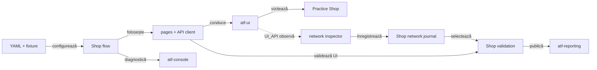
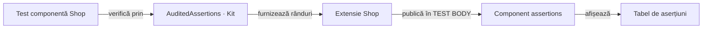

# ATF Test Practice Shop — consumer UI/API

## Pe scurt

`atf-test-practice-shop` este modulul consumer care verifică UI-ul și API-ul
real al aplicației Practice Software Testing. El deține fixture-ul aplicației,
configurația, page objects, flow-urile și probele consumer; nu deține
implementarea generică Playwright, Extent sau JUnit.



<details>
<summary><strong>Legendă — boundary-ul modulului</strong></summary>

- `YAML + fixture` conține valori și profile specifice aplicației;
- `Shop flow` compune paginile și checkpoint-urile; paginile cunosc rutele și
  controalele Practice Shop;
- săgeata punctată este numai observarea opțională `UI_API`; UI-only continuă să
  trimită traficul normal al aplicației, dar nu publică API evidence;
- journal-ul păstrează traficul observat, iar mapper-ul promovează doar
  exchange-urile selectate pentru checkpoint-uri;
- `atf-reporting` și `atf-console` rămân ownerii generici ai output-ului; Shop
  deține mapping-ul și semantica business.

</details>

<details>
<summary><strong>Harta de lectură</strong></summary>

- [ownership și source roots](#ce-deține-modulul) — ce rămâne în Shop;
- [journey și vocabular](#traseul-de-achiziție) — checkpoint-uri, Gherkin și locatori;
- [variante E2E](#variantele-e2e) și [configurație](#configurația-modulului);
- [evidence](#dovezi-și-comportament-vizibil),
  [verificare](#cum-se-verifică-modulul) și întreținere.

</details>

## Ce deține modulul

| Suprafață | Owner în modul | Limită |
|---|---|---|
| Configurație | `src/test/resources/atf-practice-shop.yaml`, `ShopConfigurationLoader` | valori și fixture-uri Practice Shop, nu configurare globală ATF |
| UI | `routes`, `locators`, `pages`, `flow` în `src/main/atf/shop` | semantică a aplicației; browserul generic rămâne în `atf-ui` |
| API | `api` și `support/api` în același source root | contractele wire și maparea către dovezile Shop; transportul generic rămâne în `atf-core` |
| Evidence runtime | `src/main/.../{evidence,reporting}` | factory-uri de captură și politică Shop, fără JUnit/Kit; rendererul rămâne în Reporting |
| Harness consumer | `src/test/.../support/{lifecycle,reporting}` | ownership browser/report, metadata de rulare și integrare JUnit |
| Teste | `src/test/atf/shop/tests` | compun și verifică Shop; testele reutilizabile ATF aparțin modulului care deține contractul generic |

Comportamentele Shop folosesc `atf-core`, `atf-console`, `atf-reporting` și
`atf-ui`; `atf-test-kit` este declarat în `test` scope pentru adnotările și
contractele folosite numai de testele consumerului. Niciun modul generic ATF nu
depinde de Practice Shop.

<details>
<summary><strong>Harta source roots și a responsabilităților locale</strong></summary>

```text
POM source roots: src/main, src/test

src/main/atf/shop
├── config/       YAML, modele typed și profile
├── api/          request factory, operații, rute și screen APIs
├── routes/       rute UI relative
├── locators/     CSS selectors și selecția exactă a produsului
├── pages/        page objects, inclusiv account flows
├── flow/         journey-ul semantic și stage-urile lui
├── evidence/     capture provider cu mascarea câmpurilor sensibile Shop
├── reporting/    politica de screenshot din configurația Shop
└── support/      checkpoint, validation, API report mapping și network journal Shop

src/test/atf/shop/tests
├── e2e/          composition roots pentru journey-uri reale
├── suites/       selecția și ordinea suitei
├── component/    config, catalog, evidence, purchase și adaptoare Shop
├── api/
│   ├── component/{contract,exchange,lifecycle,reporting}
│   ├── unit/{auth,contract,exchange,reporting}
│   ├── integration/  API live opt-in
│   ├── network/      observație UI și settlement controlat
│   ├── reporting/    auditul exchange-urilor de componentă
│   └── support/      fixture-uri și transporturi locale test-only
└── support/
    ├── lifecycle/  context browser/report per scenariu și probele sale
    ├── reporting/ metadata de rulare și probele adaptorului
    └── ...         fixture-uri, extension și probe E2E
```

`src/main` păstrează modelul de aplicație, locatoarele, paginile, flow-urile și
contractele Shop care pot fi reutilizate de consumer, inclusiv factory-urile
pure pentru captură și politica de screenshot. Contextul browser/report,
Store-ul și extensiile JUnit rămân în test; `atf-test-kit` are scope de test.
Suita consumatorului rămâne concentrată pe `e2e`, `component` și `api`; `support`
este infrastructură de test, nu un al treilea tip de test.

`ShopE2eTestSupport` compune testele, iar
[`ShopE2eContext`](src/test/atf/shop/tests/support/lifecycle/ShopE2eContext.java)
deține resursele browser/report doar pentru rulări E2E. Guvernanța whole-ATF
verifică source-set-ul harness-ului și al adaptoarelor, limitele locatorilor,
suitele și dependențele consumerului; paginile, flow-urile și locatoarele rămân
în `src/main`.

Cleanup-ul generic failure-aware este furnizat de `atf-test-kit` și consumat
numai din test scope; contextul, browserul, raportarea și ownership-ul rămân
adaptoare locale Shop. `ShopE2eActivationExtension` păstrează detecția IntelliJ
și transmite override-ul JVM către `AtfE2eActivationPolicy` din `atf-test-kit`.
Resolverul generic aplică precedența override explicit → opt-in configurat →
fallback IDE → dezactivat; `false` prevalează asupra IDE, iar o valoare invalidă
eșuează închis. Test Kit probează politica, iar guvernanța whole-ATF verifică
wiring-ul Shop.

Testele locale rămase verifică contracte specifice Shop: raportarea proprie,
captura, profilele, maparea API și regulile de business. Primitivele neutre nu
se dublează aici: escaping-ul selectorilor este în `atf-ui`, iar diagnosticul
generic pentru body API indisponibil este în `atf-core`.

`ShopReportSystemMetadata` rămâne în
`src/test/atf/shop/tests/support/reporting` și proiectează
configurația rulării în allowlist-ul System. În runtime,
`atf.shop.reporting.ShopScreenshotPolicy` transformă politica YAML
în `ReportEvidenceProfile`, iar `evidence.ShopBrowserCaptureProvider` aplică
mascarea Shop înaintea capturii generice UI. Niciunul nu importă JUnit/Kit.
Contextul folosește direct
`ReportModelAdapters.uiActions(...)`; nu mai există un bridge local care doar
retransmite apelul. Auditul comun al ecranului aparține `UiScreenAudit` din
`atf-ui`, iar închiderea resursei aparține `CloseOnceResource` din Kit.

Compoziția test-scoped transmite câmpurile evenimentului Reporting către
`AtfConsoleEvent.fromExternalEnums(...)` din Core, apoi publică în sink-ul
configurat; Console nu depinde de Reporting. Compatibilitatea vocabularelor
este probată în Reporting Tests, iar browserul și regulile Shop rămân locale.

</details>

## Traseul de achiziție

Journey-ul guest folosește produsul și datele declarate în YAML:

```text
catalog → product → cart → guest checkout → billing → payment → confirmation
```

`ShopPurchaseFlow` compune ecranele și checkpoint-urile. Testul E2E afirmă
rezultatul observat; nu duplică selectorii, request factory-ul sau lifecycle-ul
raportului.

### Gate-uri de checkout

`ShopCheckoutFlow` coordonează fazele fără Playwright; adaptorul Shop deține
citirile UI și API evidence.

```text
observe screen → publish checkpoint → PASS gate → grouped transition
                                      └─ FAIL → stop before next transition
payment check → PASS gate → explicit Confirm → order confirmation + INV number
```

`ShopCheckoutFlowComponentTest`, `ShopPurchaseCheckpointPublisherTest` și
`ShopPurchaseStageInputsComponentTest` probează ordinea, gate-ul, propagarea
erorilor și granițele stage-urilor fără browser.

- `ShopPurchaseCheckpointPublisher` construiește și publică checkpoint-urile.
- `ShopConfiguration.CatalogSelection` și `ShopCheckoutConfiguration` furnizează
  datele strict necesare fiecărui stage; Home/Product/Cart primesc URI, nume și
  cantitate, iar Login/Registration primesc URI-ul rezolvat la composition root,
  nu configurația globală. `ShopCatalogFlow` consumă aceeași proiecție Catalog.
- Contextul per journey oferă intrări imutabile separate; checkout-ul nu primește
  validatorul de home.
- Coordinatorul păstrează gate-ul PASS/FAIL, separat de observația UI/API.
- `POST /payment/check` verifică metoda demo. Confirmarea explicită plasează comanda.
- Checkpoint-ul `THEN` leagă mesajul de confirmare de numărul `INV-`; profilul `UI_API`
  corelează răspunsul API cu numărul afișat.

### Contracte de ecran și locatori

`ShopScreen` stabilește identitățile semantice, iar `@ShopPageContract` leagă
page objects de rute și controale obligatorii. Ecranele de checkout au rute
identice în aplicație; diferența dintre cart, guest identity, billing, payment
și confirmation este dată de contractul observat, nu de URL.

| Ecran | Rută UI | Contract observat |
|---|---|---|
| `HOME` | `/` | navigare, banner, filtre, grilă, paginare și footer |
| `PRODUCT` | `/product/*` | produs, preț, descriere, cantitate și add-to-cart |
| `CART` | `/checkout` | produsul selectat, cantitate și continuarea checkout-ului |
| `GUEST_CHECKOUT` / `BILLING` | `/checkout` | identitate guest, adresă și continuarea formularului |
| `AUTHENTICATED_CHECKOUT` | `/checkout` | acțiunea de continuare pentru sesiunea autentificată |
| `PAYMENT` / `CONFIRMATION` | `/checkout` | metoda demo, verificarea plății și confirmarea comenzii |
| `LOGIN` / `ACCOUNT` / `REGISTRATION` | `/auth/login`, `/account`, `/auth/register` | controale de autentificare, identitatea contului și formularul de înregistrare |

`ShopLocators` este ownerul selectorilor folosiți de page objects. Pentru
catalog, `ShopProductSelector` identifică produsul după numele complet, în
cardul lui, și escape-uiește valoarea dinamică; astfel testul nu depinde de ID-ul
rotativ al produsului sau de potrivire parțială. Hook-urile stabile (`data-test`,
`id`, `name`, `href`) sunt preferate claselor vizuale sau selectorilor ambigui;
convenția CSS generică este în [`atf-ui`](../atf-ui/README.md).

### Vocabularul Gherkin și cardinalitatea journey-ului

`ShopPurchaseTraceStep` este dicționarul local al propozițiilor statice. El nu
ține produsul, cantitatea, URL-ul ori exchange-urile în enum; acestea sunt
observații/evidence runtime. Pentru guest, vocabularul publicat este:

| Ordine | Keyword | Checkpoint |
|---:|---|---|
| 1 | `GIVEN` | catalog home |
| 2–4 | `AND` | filtre, product grid și product page |
| 5 | `WHEN` | cart-ul conține produsul și cantitatea configurată |
| 6–9 | `AND` | guest checkout, billing, payment method și payment check |
| 10 | `THEN` | confirmarea comenzii |

Detaliile care definesc contractul consumerului sunt:

- `SETUP` pentru autentificare rămâne în afara celor zece checkpoint-uri guest;
- ramura autentificată folosește `AUTHENTICATED_CHECKOUT` în loc de guest checkout;
- `ShopPurchaseTraceStepTest` protejează vocabularul, iar
  `ShopPurchaseCheckpoint` separă aserțiunile UI de `UiApiValidationEvidence`;
- când există ambele dovezi, ele apar sub aceeași propoziție Gherkin, fără un al
  doilea pas cu titlu duplicat.

Forma vizuală generică este în
[contractul Reporting](../docs/ATF_Reporting_Contract.md#dovezile-unei-cereri).

## Variantele E2E

`ShopE2eSuite` declară prin `@ConfigurationParameter` scope-ul `suite`,
ordonarea engine-ului Jupiter prin `ClassOrderer.OrderAnnotation` și dezactivarea
paralelismului. Clasele rulează în ordinea `@Order` de mai jos. Rularea suitei
creează efecte externe în demo-ul Practice Shop; folosește testele component
pentru variații care nu au nevoie de browser sau de server.

| Ordine | Clasă | Contract specific |
|---:|---|---|
| 1 | `ShopNewAccountPurchaseE2eTest` | înregistrează un cont sintetic și confirmă login-ul în `SETUP`, apoi finalizează achiziția autentificată |
| 2 | `ShopAuthenticatedPurchaseE2eTest` | login cu un cont existent în `SETUP`, apoi achiziție autentificată; în suită reutilizează contul creat la pasul 1 |
| 3 | `ShopPurchaseE2eTest` | achiziție guest cu validări UI și API evidence selectată |
| 4 | `ShopUiOnlyPurchaseE2eTest` | același business journey guest, fără publicarea API evidence |
| 5 | `ShopUiOnlySingleFlowPurchaseE2eTest` | UI-only, declară `UNIFIED_FLOW`; la configurația YAML curentă agregă flow-ul și păstrează captura reușită la final |

### Baseline pentru separarea flow-ului

Toate cele cinci selecții păstrează aceeași ordine business în
`ShopPurchaseTraceStep`; diferă numai identitatea/setup-ul contului și politica
de evidence. Această hartă este baseline-ul pentru migrarea incrementală a
observației, gate-urilor și publicării:

| Fază | Operații și observații | Gate înainte de continuare | Variație de ownership |
|---|---|---|---|
| Setup | configurația guest sau fixture-ul autentificat; login-ul UI este confirmat separat | fixture valid și identitate confirmată înainte de purchase | fixture existent împrumutat; cont sintetic nou doar în `ShopNewAccountPurchaseE2eTest` |
| Catalog | home, filtre, grid, produs selectat și ruta efectivă | structură, controale și produs/rută corespund configurației | API evidence este observată pasiv doar când canalul și binding-ul o cer |
| Coș și identitate | produsul și cantitatea din coș; checkout guest sau acțiunea de continuare autentificată | produs/cantitate și forma checkout-ului sunt validate înainte de billing | `ShopPurchaseFlow` conduce UI; `ShopApiNetworkJournal` corelează schimburile observate, fără replay |
| Billing și payment | adresa configurată sau lookup-ul postal; metoda demo și confirmarea payment check | câmpurile observate și răspunsul business sunt validate înainte de order confirmation | strategia billing este configurație business, independentă de canalul evidence |
| Order | confirmarea finală și numărul comenzii | pagina și confirmarea order-ului sunt validate | emiterea comenzii rămâne mutație UI reală; nu se compensează prin retrimitere |

`ShopNewAccountPurchaseE2eTest` adaugă o mutație remote de registration înaintea
flow-ului; `ShopAuthenticatedPurchaseE2eTest` împrumută identitatea existentă.
Cele trei teste guest păstrează aceeași poveste și diferă doar canalul sau
prezentarea raportului. Nu se elimină selecții până când adaptorul de fiecare
variantă și contractele Reporting echivalente sunt probate.

Profilele sunt compuse pe axe distincte, nu prin schimbarea journey-ului:

| Axă | Owner / valoare live | Efect |
|---|---|---|
| Canal | `@AtfTestChannel(UI)` sau `UI_API` pe clasă | `UI` nu publică API evidence; `UI_API` cere inspector allowlisted și checkpoint-uri selectate înainte de deschiderea browserului |
| Formă | `reporting.flowMode` furnizează baza; `@AtfUiEvidence(flow = UNIFIED_FLOW)` o poate suprascrie | schimbă gruparea evidence-ului, nu pașii business sau verdictul; `CONFIGURED` moștenește baza reală |
| Capturi | YAML `reporting.screenshotPolicy: each-checkpoint`; `@AtfUiEvidence(screenshots = ...)` poate suprascrie explicit valoarea pentru scenariul propriu | politica efectivă determină capturile admise, fără scurgere între scenarii-surori |
| Detalii acțiuni | `reporting.actionDetailsMode`, apoi override explicit din harness ori `@AtfUiEvidence` | valorile explicite contradictorii eșuează înainte de resurse; alegerea nu oprește capturarea acțiunilor |

`UI_ONLY` oprește capturarea/publicarea API evidence, nu request-urile browserului.
`@AtfUiEvidence` declară intenția clasei; consumerul rezolvă axele lăsate
`CONFIGURED`. Modelul generic al adnotărilor este în
[`atf-test-kit`](../atf-test-kit/README.md).

### Conturile autentificate

`ShopAuthenticatedPurchaseE2eTest` poate fi pornit individual din IntelliJ.
Adnotarea clasei selectează un fixture local existent; VM options nu sunt
necesare.

```text
atf-test-practice-shop/src/test/resources/
└── practice-software-testing-account.local.properties
```

Formatul fixture-ului local ignorat de Git:

```properties
email=<registered-test-account-email>
password=<registered-test-account-password>
firstName=<test-first-name>
lastName=<test-last-name>
```

Preflight-ul cere fixture complet, înregistrat, cu email ne-rezervat și aflat
sub `src/test/resources`. Credențialele nu sunt incluse în aserțiuni, consolă,
Overview/System sau mesajele de skip. Testele guest nu inspectează și nu cer
fixture-ul local de cont; acesta este încărcat numai de profilurile care aleg
autentificare.

| Mod de cont | Utilizare în codul curent | Reguli locale |
|---|---|---|
| `REUSE_FIXTURE` | `ShopAuthenticatedPurchaseE2eTest`; în suită reutilizează contul creat de testul anterior | folosește `practice-software-testing-account.local.properties` |
| `REGISTER_PER_RUN + SYNTHETIC` | `ShopNewAccountPurchaseE2eTest` | `@AllowsRegistrationPerRun`; email `atf.invalid` și parolă generate |
| `REGISTER_PER_RUN + LOCAL` | suportat de `@AuthenticatedE2e`, dar nefolosit de suita curentă | copiază exemplul în `practice-software-testing-registration.local.properties`; `{runId}` apare exact o dată și domeniul este controlat de owner |

- Registration este o mutație remote; nu se reîncearcă automat.
- Politica remote este păstrarea contului creat: teardown-ul nu execută DELETE.
- Un fixture existent este împrumutat și nu se șterge.
- Preflight-ul nu afișează valorile.

| Ownership | Comportament |
|---|---|
| Clasă lansată separat | scope `class` implicit; Store-ul clasei deține referința. `REUSE_FIXTURE` cere fixture propriu; `REGISTER_PER_RUN` pregătește un cont o dată în clasă. |
| `ShopE2eSuite` | scope `suite` explicit; Store-ul root deține contul creat și reutilizat de clasele autentificate. Nu se deduce modul din numele sau ID-ul suitei. |
| Sesiune browser | login UI confirmat în `SETUP` pentru fiecare metodă; partajarea contului nu partajează browserul. |
| Setup incert | starea eșuată blochează reînregistrarea și fallback-ul automat; consumerul dependent indică setup-ul nereușit. |
| Închidere | referința este eliberată și când publicarea raportului eșuează; uitarea referinței nu înseamnă ștergerea contului remote. |

În `SETUP` sunt distincte contul nou, fixture-ul existent și contul reutilizat;
credențialele rămân redactate. Primitiva neutră este
[`TestRunScope`](../atf-test-kit/README.md#valori-cu-ownership-per-clasă-sau-execuție).
`ShopAccountScopeComponentTest` probează adaptorul cu Jupiter real, inclusiv
publicare eșuată și două lansări succesive; aceste probe locale nu înlocuiesc
înregistrarea și purchase-ul prin aplicația reală.

### Raport partajat — starea consumerului

| Parte a contractului | Stare și owner |
|---|---|
| Profilul scenariului | `ShopE2eContext` transmite profilul rezolvat la publicarea în sesiunea comună; config-ul furnizează baza, iar adnotarea poate suprascrie axele declarate. |
| Izolarea scenariilor-surori | `ShopE2eContextEvidenceProfileTest` publică frați cu profile diferite pe succes și failure; probele neutre Reporting protejează proiecția și capturile. |
| Overview/System | Fiecare scenariu contribuie cu snapshot-ul rezolvat. Valorile comune rămân exacte; un câmp diferit ori absent la un frate devine `Mixed — varies by scenario`. Mapperul primește explicit environment-ul capturat de composition root și nu citește starea JVM. |
| Agregarea fazelor | În profilul `UNIFIED_FLOW`, Shop activează acumularea pe scenariu: `SETUP` și `TEST BODY` păstrează statusurile de fază, iar un singur nod Gherkin din faza terminală redă checkpoint-urile în ordine, cu provenance, assertions și API validation lângă checkpoint-ul lor. Un setup eșuat finalizează flow-ul în `SETUP`, fără `TEST BODY` sau captură terminală inventată. Profilurile `SCREEN_CHECKPOINTS` păstrează publicarea pe faze. |

Contractul generic de lifecycle și randare este deținut de
[`atf-reporting`](../atf-reporting/README.md#politică-tipizată-pentru-dovezile-de-captură).

- Probele generice verifică izolarea profilurilor; probele Shop verifică
  mapping-ul și integrarea. Lifecycle-ul, ordinea fazelor și setup-ul eșuat
  fără `TEST BODY` sunt descrise la [owner](../atf-reporting/README.md#contractul-raportului).
- `ShopUiOnlySingleFlowPurchaseE2eTest` păstrează aceeași adnotare și același
  flow business. La succes UI-only, ownerul Reporting proiectează acțiunile,
  observațiile și aserțiunile cross-phase într-o validare UI comună, cu o
  captură terminală permisă sub tabelul Playwright. Proveniența fazelor rămâne
  într-un disclosure UI; eșecul de setup și scenariile UI+API nu sunt compactate.

## Configurația modulului

Sursa canonică este
[`atf-practice-shop.yaml`](src/test/resources/atf-practice-shop.yaml). Loaderul
o citește din classpath și are fallback pentru lansarea din IntelliJ sau din
checkout-ul modulului.

| Cheie YAML | Valoare implicită relevantă | Efect în acest consumer |
|---|---|---|
| `baseUrl` | `https://practicesoftwaretesting.com` | singurul host de bază pentru rutele UI |
| `browser`, `headless`, `timeout`, `navigationTimeout`, `viewport`, `zoomPercent` | Chromium, headed, 20 s, 45 s, 1440×1000, 70% | configurează browserul de test |
| `validation.profile` | `ui-api` | profilul de bază; adnotarea `@AtfTestChannel` a E2E-ului selectează explicit `UI` sau `UI_API` |
| `validation.apiEvidence` | `product`, `registration`, `login`, `cart`, `payment`, `order` | checkpoint-urile cărora li se poate atașa API evidence |
| `networkInspector` | enabled; allowlist `api.practicesoftwaretesting.com` | observă traficul real relevant; nu retrimite request-uri |
| `retry` | `maxAttempts: 1`, fără operații eligibile | nu reia acțiunile mutative ale browserului |
| `api.endpoint`, `api.mode`, `api.precondition`, `api.timeout` | API Practice Shop, `live`, `authenticated`, 20 s | configurarea API standalone; precondiția aceasta nu autentifică sesiunea UI |
| `reports.ui`, `reports.api` | `artifacts/reports/ui`, `artifacts/reports/api` | destinații distincte, relative la rădăcina reactorului |
| `reporting.systemBodyPreviewCharacters` | `100` | limita preview-ului furnizat de Shop pentru Overview/System |
| `reporting.screenshotPolicy` | `each-checkpoint` | profilul de captură de bază; limita profilurilor class-level în raportul partajat este descrisă mai sus |
| `reporting.flowMode` | `screen-checkpoints` | baza pentru `CONFIGURED`; alternativ `unified-flow` |
| `reporting.actionDetailsMode` | `included-collapsed` | baza pentru `CONFIGURED`; alternativ `summary-only` |
| `checkout.billingStrategy` | `configured-fields` | `configured-fields` sau `postal-lookup`; alegere business independentă de canal |
| `authenticatedE2eEnabled` | `false` | default-ul YAML rămâne guest; profilul `@AuthenticatedE2e` activează explicit clasa autentificată |
| `productName`, `productPath`, `checkout` | `Pliers`, `auto`, cantitate 2, Cash on Delivery | fixture-ul business al demo-ului; produsul este căutat după nume, nu după ID rotativ |

Inspectorul este bounded de setările consumerului din YAML: maximum `256`
observații, preview de body de maximum `12000` caractere și compactarea numai a
semnăturilor consecutive în stream-ul de prezentare. Settlement-ul după acțiune
este dezactivat implicit (`10 s` timeout, `100 ms` polling dacă este activat).
Cursorul de observație permite un read-back ulterior unei mutații; nu reexecută
acțiunea și nu transformă timeout-ul în succes.

Produsul trebuie să fie disponibil pentru vânzare: un produs epuizat poate
dezactiva controlul cantității și este tratat ca precondiție eșuată. Înaintea
unui E2E live, verifică disponibilitatea produsului ales; nu fixa un ID de
catalog care se rotește.

### Override-uri suportate

Loaderul expune numai override-urile de mai jos; celelalte valori se schimbă
în YAML-ul modulului. Proprietățile de proces nu înlocuiesc adnotările de canal
ale claselor E2E.

<details>
<summary>System properties și variabila de mediu acceptate</summary>

| System property | Variabilă de mediu | Valoare controlată |
|---|---|---|
| `atf.practice.base-url` | — | host UI |
| `atf.practice.account-file` | `ATF_PRACTICE_ACCOUNT_FILE` | fixture local de cont, restricționat la `src/test/resources` |
| `atf.practice.product-name` | — | produsul selectat după nume |
| `atf.practice.product-path` | — | rută exactă sau `auto` |
| `atf.practice.validation-profile` | — | `ui-only` sau `ui-api` pentru harness-ul configurat |
| `atf.practice.config` | YAML-ul modulului | fișier YAML alternativ explicit; lipsa lui eșuează, fără fallback la fixture-ul implicit |
| `atf.practice.api-evidence-checkpoints` | — | listă CSV de checkpoint-uri API |
| `atf.practice.api-endpoint` | — | host API |
| `atf.practice.api-mode` | — | modul de transport API |
| `atf.practice.api-precondition` | — | precondiția API standalone |
| `atf.practice.ui-report-directory` | — | director raport UI |
| `atf.practice.api-report-directory` | — | director raport API |
| `atf.practice.authenticated-e2e` | — | activarea explicită a fixture-ului autentificat pentru consumatorii care o cer |

</details>

## Dovezi și comportament vizibil

- `UI` păstrează validările și acțiunile browserului, dar nu publică API
  validation sau network aggregate; traficul browserului continuă normal.
- `UI_API` leagă exchange-urile capturate de checkpoint-urile declarate în
  `validation.apiEvidence`; aggregate-ul de rețea este un sumar, nu o a doua
  copie a exchange-urilor canonice.
- Journal-ul păstrează observațiile HTTP ordonate, însă numai exchange-urile
  asociate unui checkpoint configurat ajung la validarea API. Un răspuns fără
  owner de checkpoint nu este promovat automat la dovadă business; un request
  eșuat fără response rămâne explicit `Unavailable`, fără JSON inventat.
- Body preview-urile sunt limitate și sensibile la redactarea datelor; datele
  din fixture-urile locale și checkout nu sunt copiate în Overview/System.
- Înainte de journal/publicare, `ShopJsonEvidence` redactează câmpurile sensibile
  și datele personale; body-urile malformed/non-JSON sunt omise fail-closed,
  nu publicate ca text brut. Colapsarea consecutivă schimbă numai prezentarea,
  nu auditul complet ținut de journal.
- Metadatele System provin dintr-o allowlist Shop și descriu mediul/configurația
  relevantă, nu suite, clase de test sau pași de business.
- Captura terminală `UI validation` include observația `Audit screen contract`
  înregistrată înainte de drenarea evidence-ului; aceasta rămâne `OBSERVE`, nu
  acțiune Playwright sau verdict. Fallback-ul fără screenshot nu pretinde
  evidence vizuală.
- `ShopBrowserCaptureProvider` maschează în screenshot controalele `input`,
  `textarea`, `select` și `[contenteditable]`; nu dezactiva această mască pentru
  a obține o captură mai lizibilă a datelor introduse.
- `checkout.billingStrategy` alege completarea adreselor. `configured-fields`
  introduce și verifică valorile fixture-ului; `postal-lookup` introduce țara,
  codul poștal și numărul casei și validează câmpurile completate de aplicație.
  Aceeași strategie este păstrată în UI și UI_API; evidence-ul nu alege traseul.
- Meta-adnotarea `@WithE2eHarness` include `@AtfConsoleMessages(DETAILS)` și
  `@AtfReportPath`; după publicare, calea absolută Extent este trimisă la consolă
  când output-ul este activ. `reporting.console.enabled: false` rămâne
  autoritar. Detaliile generice aparțin `atf-console` și `atf-test-kit`.

<details>
<summary><strong>Operații API deținute de consumer</strong></summary>

Rutele și intențiile stabile sunt centralizate în `ShopApiRoutes` și
`ShopApiOperation`; ID-urile rămân dinamice. Operațiile relevante pentru
journey-uri sunt:

| Seam | Operații și rute |
|---|---|
| Cont | `POST /users/register` pentru cont nou; `POST /users/login` pentru sesiune |
| Catalog | `GET /products/search`; `GET /products/{productId}` |
| Coș | `POST /carts`; `POST /carts/{cartId}`; `GET /carts/{cartId}` |
| Billing API | `GET /postcode-lookup` în flow-urile API care verifică lookup-ul |
| Payment | `POST /payment/check` verifică metoda selectată, nu creează comanda |
| Order | `POST /invoices/guest` sau `POST /invoices` după confirmarea explicită |

Testele API de componentă verifică separat rutele și metodele typed, variantele
guest/authenticated, payload-ul și semantica exchange-ului prin transporturi
controlate. Ele nu certifică serviciul live; `ShopStandaloneApiReportTest` este
proba opt-in separată, iar testele generice pentru renderer și markup aparțin
[`atf-reporting-tests`](../atf-reporting-tests/README.md).

`PUT` pentru actualizarea cantității și `DELETE` pentru eliminarea unui produs
sunt contracte API ale modulului, nu pași din purchase-ul E2E curent. În UI-only,
pagina folosește lookup-ul propriu de adresă; UI+API setează valorile billing
din fixture pentru validarea deterministă.

</details>

Contractele de randare, tabele, disclosure, capturi și modelul Extent sunt
deținute de [`atf-reporting`](../atf-reporting/README.md) și de
[contractul de raportare](../docs/ATF_Reporting_Contract.md). Inspectorul,
locatori CSS și lifecycle-ul browserului generic sunt deținute de
[`atf-ui`](../atf-ui/README.md). Acest README păstrează doar modul în care
consumerul le configurează și le leagă de checkpoint-urile Practice Shop.

## Cum se verifică modulul

Comenzile de mai jos rulează suitele definite în `src/test`; `-am` construiește
și modulele ATF de care depinde consumerul.

`ShopComponentSuite` este gate-ul rapid agregat: include suportul consumer,
contractele API `unit` și `component` și evidence, dar exclude
journey-urile E2E și integrarea live. Contractele de captură și fidelitate HTTP
sunt în `atf.shop.tests.api.network`, deja selectat de suită.
Diagnoza punctuală selectează clase concrete, fără suite paralele.

| Source-set / pachet | Responsabilitate |
|---|---|
| main `atf.shop.support.api` | jurnal, selectare, validări și mapping folosite de runtime-ul UI+API și publisher |
| test `atf.shop.tests.api.network` | contractele jurnalului și fidelității metodei; fixture-uri locale separate de teste |

- Captură: observațiile intră prin `UiNetworkInspector.capture` și abonamentul
  public; recorderul și aliasul intern de serviciu rămân încapsulate.
- Conversie: `ShopApiEvidenceMapper` acceptă valori observate și execuții Core,
  fără să dețină captură sau selecție.
- Query: inspectorul îl redactează înainte de abonament; proba converterului
  păstrează separat path-ul și decodarea valorii primite.
- Fixture-uri: fără rețea; rapoartele declară proveniența controlată.

Guvernanța arhitecturii consumerului rulează separat în `atf-tests`, prin
`ConsumerModuleArchitectureGovernanceTest`; ea nu mai este un test de business
selectat de `ShopComponentSuite`. `ConsumerSuiteCoverageGovernanceTest` cere
ca fiecare clasă executabilă să aparțină exact unei suite principale.

API unit contracts, fără client sau transport:

```text
mvn -pl atf-test-practice-shop -am "-Dtest=ShopApiRoutesTest,ShopApiRequestFactoryTest" "-Dsurefire.failIfNoSpecifiedTests=false" test
```

Component/API contracts fără journey-uri live:

```text
mvn -pl atf-test-practice-shop -am "-Dtest=ShopComponentSuite" "-Dsurefire.failIfNoSpecifiedTests=false" test
```

### Boundary-ul probelor API

| Probă | Dovedește | Nu dovedește |
|---|---|---|
| `ShopComponentSuite` | toate contractele locale de business și adaptoare, inclusiv unit/component și suportul package-private | comportamentul serviciului real |
| `ShopE2eSuite` | toate variantele UI păstrate, cu purchase până la confirmarea comenzii și factură | nu înlocuiește contractele API directe |
| `ShopApiLiveSuite` | `ShopStandaloneApiReportTest`, cu opt-in-ul autentificat existent | nu intră în gate-ul local |
| `ShopStandaloneApiReportTest` | login, catalog, filtrare/sortare din răspuns și mutații/read-back pe un coș izolat, adresă/payment prin HTTP live | invoice final, validitatea permanentă a fixture-ului sau autentificarea sesiunii UI |

### De ce raportul API nu arată ca raportul UI

Ambele suite publică Extent HTML și folosesc setările Extent comune și redactarea, dar lifecycle-ul și evidence diferă:

```mermaid
sequenceDiagram
    participant Test as Shop API test
    participant Service as Live API
    participant Report as Extent publisher
    Test->>Service: Send login request
    alt HTTP response returned
        Service-->>Test: Accepted or rejected response
        alt Login rejected
            Test->>Report: Publish login exchange and FAIL validation
        else Login accepted
            Test->>Service: Run business API flow
            Service-->>Test: Return HTTP exchanges
            Test->>Report: Publish exchanges and validations
        end
        Report-->>Test: Write Extent HTML
    else Transport exception before response
        Test->>Test: Transport throws before response
        Note over Test,Report: Publisher is not reached; no artifact is written
    end
```
<details>
<summary><strong>Legendă — condiția de publicare a raportului live</strong></summary>

- răspunsul HTTP de login, inclusiv unul respins, oferă exchange-ul necesar
  publicării unui raport;
- o excepție înaintea răspunsului nu produce un status sau body HTTP și, în
  implementarea curentă, întrerupe testul înaintea publisher-ului;
- raportul UI rămâne o sesiune separată, cu evidence de browser, acțiuni și
  capturi; ambele căi folosesc setările Extent comune și redactarea.

</details>

- UI: `ShopE2eTestSupport` partajează `UiExtentReportSession` între scenarii și
  publică evidence de browser, acțiuni și capturi;
- API: `ShopApiLiveSuite` selectează `ShopStandaloneApiReportTest`, care publică
  evidence HTTP și validări business Shop fără pașii sau capturile browserului;
- configurația `reports.api` stabilește directorul, iar testul live formează
  numele cu prefixul `api-atf-practice-shop-standalone_`;
- verifică separat directorul și fișierul API față de raportul UI; artifactul
  live nu este garantat pentru fiecare failure;
- un login HTTP respins publică evidence FAIL, dar o excepție de transport la
  login poate apărea înaintea publicării și nu produce încă artifact;
- lacuna este urmărită în [feedback-ul API Shop](../docs/feedback/ATF_Practice_Shop_API_Test_Design_Feedback.md);
- compară exchange-urile HTTP cu evidence-ul API așteptat, nu cu numărul de pași
  sau capturi UI.

Testele marcate `@ShopComponentTest` publică un raport Extent per metodă în
subdirectorul `component` din `reports.api` configurat în YAML, inclusiv la
lansarea clasei individuale.

| Caz | Dovadă în raport |
|---|---|
| Metodă componentă | Comparațiile `AuditedAssertions` apar în pasul standard `Component assertions`, cu operator, sursă, expected, actual și rezultat |
| `ShopConfigurationTest#yamlDefinesOwnedJourneyAndSyntheticFixtureInSourceResources` | Comparațiile evaluate de `RecordedAssertions` din Test Kit apar în `Component assertions` sub `TEST BODY`, în tabelul `ASSERTION / EXPECTED / ACTUAL / RESULT` |
| Business API și E2E | Exchange-uri și validări API, respectiv evidence de browser, în nodurile lor proprii |

- Pasul standard este închis inițial; textele respectă limita configurată,
  implicit 240 de caractere inclusiv `…`, și după expandare.
- Fațada păstrează verdictul JUnit, excepțiile așteptate și izolarea lansărilor
  imbricate; extensia mapează comparațiile în tabelul comun.
- O metodă care ar termina cu PASS fără aserțiuni înregistrate eșuează explicit.
  Eșecul anterior primei comparații păstrează diagnosticul real; testele unit
  selectate de suită nu au obligația raportării.



<details>
<summary><strong>Legendă — auditul componentelor Shop</strong></summary>

- Același apel verifică valoarea în JUnit și înregistrează rândul raportat.
- Recorderul neutru aparține [Test Kit](../atf-test-kit/README.md#comparații-junit-cu-dovadă-neutră);
  extensia locală deține mapping-ul către Reporting și lifecycle-ul JUnit.
- Extensia publică la finalul metodei toate rândurile evaluate.
- Disclosure-ul pasului păstrează tabelul ascuns până la expandare.

</details>

În component suite, `ShopApiEndpointMatrixTest` verifică invariants comune de
transport; `ShopApiContractVariantTest` și `ShopApiScreenFlowTest` adaugă
aserțiunile semantice distincte pentru payload și propagarea datelor. Suprapunerea
unei rute este intenționată când dovada diferă; matricea nu substituie testul
semantic și niciun fixture mock nu este prezentat ca dovadă de comportament live.

Contractul live păstrează următoarele protecții:

- filtrarea verifică apartenența fiecărui produs la categoria cerută, iar
  sortarea compară prețurile numeric, nu lexicografic;
- `ShopApiLiveCartScope` deține coșul izolat, verifică read-back după update și
  remove și confirmă coșul gol la cleanup; DELETE-ul nu este repetat;
- operațiile mutative au o singură încercare; cleanup-ul pe succes și după
  întrerupere are probe deterministe, fără a fabrica o eroare remote;
- fixture-ul autentificat este precondiție, nu garanție permanentă; un 401
  oprește flow-ul, iar credentialele nu ajung în documentație sau raport.

Auditul interactiv folosește artifactul nou produs de adaptorul Shop cu
transport controlat, fără a repeta mutații remote pentru a verifica rendererul.
Se compară cu UI+API schema `Request → Response → Execution`,
`AUTH PROFILE`/`AUTH TYPE`, JSON-ul redactat și starea disclosures.

Scroll-ul local, glyph/ARIA, redeschiderea părinților și Fails → Tests se verifică
în MCP/ATF Debug. Lizibilitatea la lățime mică este un contract al layout-ului
Reporting, separat de succesul HTTP și de mapping-ul Shop.

### Limita dintre testele Shop și testele Reporting

Aplicăm [regula comună de ownership](../docs/ATF_Testing_Guide.md#owner-ul-testului-business-adaptor-sau-infrastructură);
secțiunea de mai jos fixează numai exemplele și limitele specifice Shop. Owner-ul
se stabilește după invariantul afirmat, nu după faptul că testul publică un raport.

| Invariant | Owner și exemplu | Nu se mută aici |
|---|---|---|
| Intenție, rute, ordine și redactare business Shop | Shop; `ShopApiContractReportComponentTest` și `ShopApiCallAuditReportComponentTest` verifică semantica adaptorului și asocierea exchange-urilor | markup Extent sau implementarea rendererului |
| HTML, tabele, Request/Response/Execution, disclosure, retry rendering și izolare generică | `atf-reporting-tests`; fixture-uri neutre, fără site real | politica Shop pentru câmpuri de înregistrare/adresă |
| Adnotări, resolver-e și cleanup reutilizabil strict test-only | `atf-test-kit` | screenshot policy, profilul Shop sau browser harness |

Izolarea request-urilor identice între scenarii este probată generic în
Reporting; Shop păstrează aserțiunile sale asupra intențiilor și apelurilor
distincte `/users/login`.

<details>
<summary><strong>Delimitarea probelor locale și a celor reutilizabile</strong></summary>

| Probă curentă | Contract care rămâne Shop | Contract deținut în alt modul |
|---|---|---|
| `ShopApiAuthenticationSchemaTest` | profilul/mecanismul prin mapper și browser journal; lipsa credentialelor din ambele artifacte | etichetele HTML canonice și paritatea proiecțiilor: `ApiAuthenticationSchemaContractTest` |
| `ShopApiCallAuditReportComponentTest` | asocierea intenției/statusului la exchange, lipsa contractului explicit și diagnosticul auditului | retry rendering și proiecția diagnosticelor sunt probate generic în Reporting Tests |
| `ShopApiBodyRedactionReportTest` | politica Shop pentru înregistrare/adresă, body malformed și ieșirea efectivă a adaptorului | redactarea generică și manual replay sunt probate la ownerii lor |
| `ShopE2eFailureBoundaryTest` | eroarea business rămâne primară când publicarea dovezii și close eșuează; secundarele sunt suprimate în ordine | închiderea inversă prin `FailureAwareCleanup` este probată direct în Test Kit |
| `ShopScreenshotPolicyTest` | maparea politicii și precedența YAML față de opțiunea legacy | filtrarea providerului înainte de captură: `ReportEvidenceProfileTest` în Reporting Tests |

Proba retry locală verifică attempts/history/provenance prin mapper și modelul
publicat de Shop, inclusiv contractul login inițial; `ApiRetryProjectionContractTest`
verifică pipeline-ul unic în standalone Extent, fallback și UI+API, inclusiv
retry epuizat. Copia directă a testului
de cleanup și filtrarea generică a capturii nu mai sunt repetate aici.

Probele pentru asocierea intenției/statusului, eșecul JUnit și datele personale
rămân locale: verifică apelarea adaptorului și politica Shop, nu layout-ul.
Un gate neutru nu poate înlocui siguranța artifactului produs de aplicație.

</details>

Diagnoză punctuală a componentelor cu API exchanges prin transport controlat:

```text
mvn -pl atf-test-practice-shop -am "-Dtest=ShopApiClientContractTest,ShopApiContractVariantTest" "-Dsurefire.failIfNoSpecifiedTests=false" test
```

Un singur journey guest UI + API:

```text
mvn -pl atf-test-practice-shop -am "-Dtest=ShopPurchaseE2eTest" "-Dsurefire.failIfNoSpecifiedTests=false" "-Datf.practice.shop.e2e.enabled=true" test
```

Toate cele cinci variante E2E în ordinea suitei, cu setup-urile autentificate și
efectele remote aferente:

```text
mvn -pl atf-test-practice-shop -am "-Dtest=ShopE2eSuite" "-Dsurefire.failIfNoSpecifiedTests=false" "-Datf.practice.shop.e2e.enabled=true" test
```

- `ShopUiOnlySingleFlowPurchaseE2eTest` repetă journey-ul guest UI-only cu altă
  grupare a evidence-ului; nu reprezintă un caz business nou.
- Suita păstrează deocamdată această variantă; criteriile pentru reducerea
  rulării sale live sunt în
  [feedback-ul profilelor E2E](../docs/feedback/ATF_Consumer_Business_Test_Focus_Feedback.md#consumer-e2e-profiles-01--variantele-de-evidence-și-acoperirea-business).

E2E autentificat cu cont existent necesită fixture-ul local descris mai sus.
`ShopNewAccountPurchaseE2eTest` și `ShopE2eSuite` pot crea conturi în demo-ul
extern; rulează-le numai când accepți acel efect remote.

Pornirea unei clase sau suite E2E din IntelliJ deschide browserul către aplicația
live; nu există un opt-in prin property pentru această execuție. Pentru
verificări fără browser și fără mutații în serviciul demo, pornește una dintre
suitele component. `ShopAuthenticatedPurchaseE2eTest` rulat singur cere fixture-ul
local, în timp ce `ShopNewAccountPurchaseE2eTest` face înregistrarea sintetică
remote.

Pentru rulare individuală din Maven cu un cont existent:

```text
mvn -pl atf-test-practice-shop -am "-Dtest=ShopAuthenticatedPurchaseE2eTest" "-Dsurefire.failIfNoSpecifiedTests=false" test
```

| Proba | Boundary și efect | Criteriu de verificare |
|---|---|---|
| `ShopStandaloneApiReportTest` | Opt-in prin `atf.practice.authenticated-e2e=true` și fixture autentificat în `src/test/resources`; verifică sort/filter, update/remove cu read-back pe coș izolat și checkout/payment, fără invoice final. | Rulare autentificată `LIVE / HTTP`, contracte business trecute și cleanup confirmat; un login eșuat publică diagnosticul și nu validează mutațiile ulterioare. |
| Suitele unit/component | Variații de request, validator și lifecycle cu vecini controlați; fără cont și fără trafic către serviciul extern. | Deterministe; nu sunt prezentate ca dovadă a semanticii serverului. |

Contractele HTTP autentificate pentru sort/filter și mutațiile coșului sunt
probate; verificarea interactivă a raportului standalone rămâne în
[feedback-ul API](../docs/feedback/ATF_Practice_Shop_API_Test_Design_Feedback.md).
Login-ul API nu dovedește automat autentificarea UI a aceluiași cont.

## Modificări și întreținere

- Schimbarea de produs sau checkout începe în configurația/fixture-ul Shop;
  schimbarea rutei, selectorului sau contractului de ecran începe în ownerul
  dedicat din `src/main`.
- Variațiile deterministe se adaugă în component/API component; API live rămâne
  opt-in, iar E2E-ul se păstrează pentru wiring-ul și efectul real în browser.
- `ShopApiEndpointMatrixTest` păstrează invariants comune de transport, iar
  `ShopApiContractVariantTest` verifică forme și rezultate semantice distincte;
  unit/component ownership-ul și suitele sunt documentate mai sus.
- Schimbările generic Playwright, reporting, console sau TestKit se fac la
  ownerul ATF respectiv, nu prin fork local în Practice Shop.
- Un contract stabil intră aici; registrul de feedback păstrează doar gap-ul
  încă deschis și criteriul său de închidere.

Pentru convențiile transversale de test și cod vezi
[bunele practici de cod ATF](../docs/README_Atf_CodeBestPractices.md); nu sunt
copiate aici ca reguli paralele.

## Documentație owner

- [Arhitectura ATF](../docs/ATF_Architecture.md) — limite între module și ownership;
- [Ghidul de testare ATF](../docs/ATF_Testing_Guide.md) — niveluri de verificare și traseul canonic;
- [Contractul adnotărilor](../docs/ATF_Test_Infrastructure_Annotations.md) — declarațiile de nivel, canal, fixture și output;
- [Contractul de captură](../docs/ATF_Evidence_Capture_Contract.md) — axele generice pentru flow, acțiuni și screenshot;
- [`atf-core`](../atf-core/README.md) — contracte neutre și transport;
- [`atf-console`](../atf-console/README.md) — politica diagnosticelor și afișarea căii raportului;
- [`atf-ui`](../atf-ui/README.md) — contractul browserului, locatorilor și inspectorului;
- [`atf-reporting`](../atf-reporting/README.md) — modelul și randarea raportului;
- [`atf-test-kit`](../atf-test-kit/README.md) — adnotările și selecția testelor;
- [Bune practici de documentație](../docs/README_Atf_DocumentationBestPractices.md) — structură și guvernanța README-urilor;
- [Registrul feedback-ului](../docs/feedback/README.md) — numai gap-urile active.

### Limita suportului partajat

| Owner | Conține |
|---|---|
| Shop `src/main` | pagini, flow-uri, payload-uri, captură/politică Shop și validarea terminală `ShopPurchaseConfirmation`; fără JUnit/Test Kit |
| Shop `src/test` | teste business, fixture-uri și adaptoare JUnit/report specifice Shop |
| `atf-test-kit` | lifecycle neutru; nu primește browser, Reporting sau business |
| `atf-ui` / `atf-reporting-tests` | auditul neutru de ecran / contractele generice de randare |

### Ținta refactorizării suportului Shop

Ținta este mai puțin cod auxiliar în test, nu mutarea întregului harness în
main. Source-set-urile din tabelul de mai sus descriu implementarea curentă.

- Scope-ul contului și cele două factory-uri runtime au ownerii descriși mai
  sus; nu lărgim dependența Kit ca scurtătură pentru alte mutări.
- Publisherul checkpoint-urilor și intrările stage-urilor sunt separate; fiecare
  observație Catalog/Checkout devine checkpoint imutabil, publicat înaintea
  gate-ului. Contextul păstrează compoziția resurselor comune Page/acțiuni/API/
  locatori/validare; nu extragem wrapper-e per click.
- Un journey complet rămâne comun pentru UI pe pași, UI compact cu poză finală
  și UI+API; configurația YAML furnizează acum separat flow-ul și detaliile acțiunilor.
- Cele trei gate-uri rămân complete până la probele de echivalență; politica
  capturilor nu justifică o a doua poveste business.

Candidatele concrete, limitările guard-ului și acceptanța sunt în
[feedback-ul refactorizării](../docs/feedback/ATF_Consumer_Business_Test_Focus_Feedback.md).

Etapele catalog/checkout din `ShopPurchaseFlow` sunt implementate; separarea
business → flow UI → acțiuni compuse → Playwright este încă țintă de design.
[Ghidul de testare](../docs/ATF_Testing_Guide.md#separarea-flow-urilor-business-ui-și-a-validărilor)
definește boundary-urile și proba de componentă pentru primul increment.
