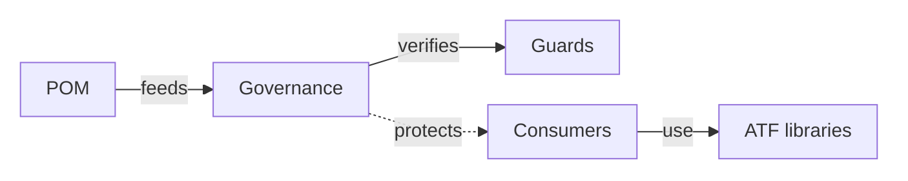
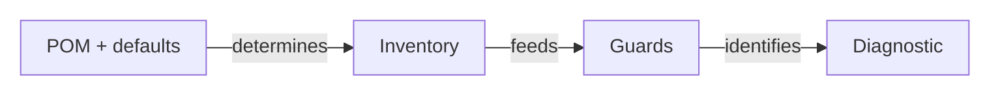

<a id="atf-tests--whole-reactor-governance"></a>
<a id="atf-tests--guvernanță-whole-reactor"></a>
# ATF Tests — Whole-Reactor Governance

<a id="at-a-glance"></a>
<a id="pe-scurt"></a>
## At a glance

**Quick trails:** [Whole-ATF](#suita-whole-atf-și-reziduul-de-compatibilitate) · [Maintenance J0 / J1](#mentenanța-perechii-j0j1) · [Java roots](#inventarul-comun-al-surselor-java) · [Git controls](#guvernanța-schimbării-testelor) · [Gates and limits](#verificare-rapidă)

- `atf-tests` is ATF's project-control module;
- it verifies the reactor, Maven/source boundaries, and architecture gates;
- it does not own product tests;
- it contains no locators, page objects, or application flows.



<details>
<summary><strong>Legend — what atf-tests governs</strong></summary>

- the root POM and module graph are included in the whole-reactor gate;
- atf-tests verifies boundaries; it does not implement application flows;
- Practical Shop and reporting composition remain separate consumers;
- `Checks` groups architecture, scope, and runtime-safety checks;
- the dotted edge shows a guard applied to consumers, not ownership transferred to governance;
- consumers use libraries through explicit dependencies, and governance verifies
  The short labels shall keep the following meaning:

| In the scheme | Full meaning |
|---|---|
| Guards | architecture + runtime guards |
| Consumers | consumer modules |
| ATF libraries | ATF libraries |

</details>

| Responsibility | Owner | Explicit exclusion |
|---|---|---|
| reactor, POM, and dependency direction | `atf-tests` | does not modify production code |
| source/package ownership and module placement | `ArchitectureModuleBoundaryTest`, `ArchitectureOwnershipBoundaryTest` | does not own application selectors |
| relocatable documentation and consistent sources | `governance.documentation.*`, `AtfSourceReadabilityGovernanceTest` | does not validate one consumer's content |
| constant ownership and package cohesion | `ConstantsOwnershipGovernanceTest`, `AtfPackageCohesionGovernanceTest` | maximum 8 classes per package in production and test source sets across all reactor modules; exceptions must be explicit |
| Practice Shop purchase journey | `atf-test-practice-shop` | is not copied here |
| reporting contract/API/UI composition | `atf-reporting-tests` | not moving to government |

<a id="choose-the-gate-for-the-change"></a>
<a id="alege-gate-ul-după-schimbare"></a>
## Choose the gate for the change

| Change | Entry point | What it confirms |
|---|---|---|
| README, map, or feedback | [documentation](#documents-and-responsibilities) | links, structure, diagrams, prose, and factual claims covered by the guard |
| protected test changed | [Git control](#test-change-governance) | one eligible owner per path and base; no oracle relaxation |
| dependency, package, or source set | [Whole-ATF](#whole-atf-suite-and-compatibility-residue) | the reactor's executable boundary |
| business outcome or rendering | the owning module's test | actual behavior, in addition to governance |

An intact structural gate certifies the rules it implements. A statement's accuracy, a report verdict, and an application outcome also require the owning proof; YAML `proof` commands are run separately.

For IntelliJ and Maven, use the same [staging with real Git](../docs/ATF_Build_And_Execution_Safety.md#staging-for-test-change-governance). The [Java source roots](#shared-java-source-inventory) map explains consumer layouts before moving any tests.

<a id="maintenance-of-the-j0--j1-pair"></a>
<a id="mentenanța-perechii-j0j1"></a>
## Maintenance of the J0 / J1 pair

`AtfWorkspaceMaintenanceSuite` is the center point combined: `WholeAtfGovernanceSuiteTest` runs in J0 and the read-only acceptance of the J0 / J1 pair. The host feedback remains the source of the criterion and behavioral sample; this collection adds the whole-reactor and boundary checks between workspaces without automatically marking the feedback as closed.

| Gate | What it checks | Role in feedback |
|---|---|---|
| `WholeAtfGovernanceSuiteTest` | architecture, layers, building and governance of all J0 documents | protect structural rules; functional criterion continues to require the owner's sample |
| `AtfMaintenanceWorkspacePairGovernanceTest` | Source / binary ownership, the five JAR / POM pairs and library catalogue without references to other workspaces | check the declared boundary for selected workspaces |
| `AtfWorkspaceMaintenanceSuite` | both gates above in an argument | common gate before reconciliation; does not replace native consumer tests when adopting a new JAR |

`ATF_MAINTENANCE_J0` and `ATF_MAINTENANCE_J1` roots must indicate verified pre-rolling checkouts. J0 and J1 roots are mandatory, explicit and absolute; the suite refuses missing or relative paths, discovers no projects in the vicinity and changes any workspace. J1 is read as an acceptance source; it is not updated by this suite.

```powershell
if (-not $env:ATF_MAINTENANCE_J0 -or -not $env:ATF_MAINTENANCE_J1) { throw 'Set both workspace root variables first.' }
$atfJ0Root = (Resolve-Path $env:ATF_MAINTENANCE_J0).Path
$atfJ1Root = (Resolve-Path $env:ATF_MAINTENANCE_J1).Path
mvn -B -pl atf-tests -am "-Dtest=AtfWorkspaceMaintenanceSuite" `
  "-Datf.maintenance.j0=$atfJ0Root" `
  "-Datf.maintenance.j1=$atfJ1Root" `
  "-Dsurefire.failIfNoSpecifiedTests=false" test
```

`AtfMaintenanceWorkspacePairSuite` only runs the second gate for the isolated repair of the workspace relationship. When changing a binary contract, it also runs the consumer's native suites for the actual behavior of the application. The flow and limits of the gates are in [workspace protocol](../docs/ATF_Workspace_Synchronization.md#protocolul-fiecărui-increment).

<a id="government-of-source-or-binary-deployment"></a>
<a id="guvernanța-deployment-ului-sursă-sau-binar"></a>
## Government of source or binary deployment

| Deployment | Module live | With the harness Reporting in TMP |
|---|---:|---:|
| canonical source | 12 | included |
| binary journeys, default | 10 | 11 |
| binary foundation, explicit | 8 | 9 |

A declared missing module is error; profiles are not deducted from the directory.

`WholeAtfGovernanceSuiteTest` keeps the same explicit selection in J1 and in the manufacturer. [Deploying package](src/test/java/atf/api/tests/governance/distribution/README.md) selects the proof after the Maven declaration without deducting exceptions from missing files.

| Rule | Reporting source | Reporting binary |
|---|---|---|
| reactor | canonical catalogue of 12 modules with existing POM | 10 modules, explicit version and JAR / POM directly into `lib`; external gear can explicitly add Reporting Tests to TMP, with 11 modules. Source shadow and unreported harness are denied. |
| documentation | README Reporting | atlas JAR and consumer guide; same structure / link / prose controls |
| ownership | Java file exactly and the bans of the pack | exact JAR class and absence of prohibited duplicates |
| independence | Source imports and POM standalone | POM without parent / dependencies ATF and bytecodes references via JDK `jdeps` |
| identity | local source module | version, JAR/POM, one provenance record, embedded POM and the CodeSource hash |
| test layer | native sources and their annotations | native catalogue included in the provenance; without it as local source execution |

The deleted, uncoordinated, undetected / misguided, altered artifact and hidden dependency module have negative controls. The factual mutant works for 8/9/10/11/12 modules; this does not authorise a reactor with modules removed from the catalogue.

Git control uses the actual review base of each project. Synchronization of common sources does not copy `.git`, POM reactor, JAR or controls with the basis of the other project; eligibility is checked separately.

<a id="whole-atf-suite-and-compatibility-residue"></a>
<a id="suita-whole-atf-și-reziduul-de-compatibilitate"></a>
## Whole-ATF suite and compatibility residue

[`ReportUiActionAdapters`](src/test/java/atf/ui/tests/support/reporting/ReportUiActionAdapters.java) is compatibility support in the test source set, not an executable test or production code. Its presence does not transfer UI test or reporting ownership to `atf-tests`; `ArchitectureOwnershipBoundaryTest` protects this boundary.

```text
src/test/java/atf/api/tests/governance/
├── changes/                    change-control, diferență Git și probe negative
├── console/                    default-uri și composition root-uri UI/API
├── consumers/                  graph-ul surselor și arhitectura modulelor consumer
├── distribution/               deployment sursă/binar și ownership-ul harness-ului
├── documentation/              structură, stil, proză, diagrame și linkuri
├── layers/                     clasificare și acoperirea suitelor consumer
├── maintenance/
│   ├── AtfMaintenanceWorkspacePairGovernanceTest.java
│   ├── AtfMaintenanceWorkspacePairSuite.java
│   ├── AtfMaintenanceProcessDocumentationGovernanceTest.java
│   └── AtfWorkspaceMaintenanceSuite.java
├── ArchitectureModuleBoundaryTest.java
├── ArchitectureOwnershipBoundaryTest.java
├── AtfGovernanceRules.java
├── AtfGovernanceTestSupport.java
├── AtfPackageCohesionGovernanceTest.java
├── AtfSourceReadabilityGovernanceTest.java
├── ConstantsOwnershipGovernanceTest.java
└── WholeAtfGovernanceSuiteTest.java
```

`WholeAtfGovernanceSuiteTest` is the explicit point for checking the entire reactor. It groups the checks without moving the responsibility of the reporting tests in this module:

- `ArchitectureModuleBoundaryTest` — reactor, POM, dependency direction,
 forbidden imports, process output, static state, and removal of `atf-execution`;
- `ArchitectureOwnershipBoundaryTest` — module placement, package roots,
 reporting/UI ownership, and absence of duplicates;
- `AtfPackageCohesionGovernanceTest` - cohesion of production packages
  governed and test-set sources in each reactor module, including `atf-test-practice-shop`, `atf-test-kit` and `atf-reporting-tests`; the threshold is up to eight classes, and the diagnosis identifies the module, packager and concrete classes for any new or exceptional hotspot;
- `AtfSourceReadabilityGovernanceTest` - duplicate imports into Maven main sources / test and ATF invocations fully qualified in reporting tests; comments and literature are excluded lexically;
- `layers.AtfTestLayerArchitectureTest` — inventories `sourceDirectory` and
 `testSourceDirectory` roots from the POM (using Maven defaults), then checks the level of every executable class; nested fixtures do not change the level of the enclosing class;
- `layers.ConsumerSuiteCoverageGovernanceTest` — exactly three primary suites
 per consumer, with no omitted classes, overlapping selections, or mixed local/E2E/live API coverage; reads the owner's declaration and executable selectors, without promoting comments or nested fixtures to gates. It also checks explicit scope for component reports;
- `consumers.ConsumerModuleArchitectureGovernanceTest` and
 `ConsumerAuditSourceGraphTest` — shared annotation resolver for audit/layer, aliases, inheritance, and imported helpers; comments, literals, and nested fixtures do not exclude the executable owner. Source analysis does not replace launcher/report evidence;
- `ConstantsOwnershipGovernanceTest` - protocol vocabulary, routes and
  boundary-ul reporting standalone;
- `governance.documentation.DynamicPathDocumentationArchitectureTest` — relocatable documentation,
 relocatable, without machine paths or concrete generated artifact names;
- `governance.documentation.DocumentationReadmeStructureGovernanceTest` - a title,
  mandatory executive overview in the root README, `Overview`/`Pe scurt` in local documents, balanced `<details>` and resolvable local links; also checks J0–J7 routes in the workspace table;
- `governance.documentation.DocumentationStyleGovernanceTest` — ATF semantic style:
 typed fences, headings without skipped levels, `-` bullets, and no font/CSS/HTML presentation markup in READMEs or the canonical architecture document;
- `governance.documentation.DocumentationProseGovernanceTest` — limits quick-scan
 prose to at most three sentences per paragraph and two consecutive dense paragraphs; dense responsibilities, boundaries, and relationships should move into bullets, tables, diagrams, or `<details>`;
- `governance.documentation.DocumentationTargetGovernanceTest` — plug-and-play example
 with `@DocumentationTarget("atf-test-practice-shop/README.md")`; the same class can validate any README across all documentation modules;
- `governance.documentation.DocumentationDiagramGovernanceTest` — `LR` orientation,
 immediate legend, balanced fences, and labeled relationships in non-root READMEs;
- `governance.documentation.DocumentationGovernanceSupport` — shared vocabulary for
 diagnostics: code, file, line, rule, and fix. It does not hide exceptions or turn feedback into “pass.”

Each documentation violation must dynamically identify the file and line, the rule that is violated, and the minimum change that can fix it. A README may intentionally remain red during reconciliation; the suite must make the gap reproducible, not bury it in an exception.

Governance tests are a protected contract: do not modify, disable, or weaken them to turn a red README into a pass. Change them only through direct feedback that changes the rule, owner, criterion, or required evidence; otherwise, fix the target document.

For a targeted check, change only the annotation value:

```java
@DocumentationTarget("atf-reporting/README.md")
class ReportingReadmeGovernanceTest {
}
```

The targeted test calls the same validators as the whole-ATF suite: structure, style, prose, diagrams, relocatability, and artifact names.

The repeatable `DocumentationTarget` declaration belongs to `atf.testkit.documentation`; the target list and validators remain here. The [annotation contract](../docs/ATF_Test_Infrastructure_Annotations.md) explains ownership and composition limits.

`atf-reporting-tests` no longer has checks that inspect the entire repository; it keeps only the API / UI boundary of its own reporting composition.

<details>
<summary><strong>Cleanup target tracked in feedback</strong></summary>

- `atf-tests` should retain the whole-reactor guard and only the support strictly
  required by it;
- reporting/UI adapters are moved or removed only after boundary evidence and
  verification of the canonical consumer;
- an existing test-scope dependency is not declared “removed” merely because
  the desired ownership is described in the table;
- every change is closed through the POM, import scan, and architecture test.

</details>

<a id="shared-java-source-inventory"></a>
<a id="inventarul-comun-al-surselor-java"></a>
## Shared Java source inventory

`layers.AtfJavaSourceInventory` is test support in `atf-tests`, used by layer and readability governance. It reads the same roots for each POM, including Shop's `src/main` and `src/test`.



<details>
<summary><strong>Legend — implemented source inventory</strong></summary>

- POM + defaults: direct `build/sourceDirectory` and
  `build/testSourceDirectory` declarations, with Maven defaults when absent.
- Inventory: distinct, ordered Java files, even when roots overlap.
- Guards: the same sources for architecture and duplicate-import checks.
- Diagnostic: the file/rule or POM that declares an invalid root.

</details>

- POM discovery stops traversal of `target`, `artifacts`, `.tmp`, and `.git`
 output directories. Declared Java roots are then traversed completely; a package's legal name does not exclude compilable source.
- An empty, out-of-module, unsafe, or unresolved Maven-expression root produces
 a diagnostic.
- The inventory reads literal paths from the POM; it does not replace the
 effective POM, inheritance, or Maven profile activation. XML comments do not declare roots.
- The guidance of expressions remains limited to reporting tests and keeps those
  three revised adapters. Detects current ATF namespaces and legacy, manufacturers and multiple line calls without examples from / literal comments.

<a id="two-inventories-with-distinct-responsibilities"></a>
<a id="două-inventare-cu-responsabilități-distincte"></a>
### Two inventories with distinct responsibilities

| Entry point | What it inspects | Evidence limit |
|---|---|---|
| `atf.api.tests.governance.layers.AtfJavaSourceInventory` | Maven main/test roots for layer and readability guards | literal selection and the exclusions described above |
| `atf.core.files.AtfJavaSourceInventory` | package declarations from an already selected root, for cohesion | does not resolve POMs or demonstrate Maven inventory coverage |

A passing Core grouping test does not close the Maven guard-selection gap. The [coverage criterion](README.md#shared-java-source-inventory) requires comparing compilable sources with those actually inspected.

The [inventory test](src/test/java/atf/api/tests/governance/AtfSourceReadabilityGovernanceTest.java) independently compiles sources in `target`/`artifacts` packages and requires the violation to be detected in each file; module output remains outside the selection.

<a id="test-change-governance"></a>
<a id="guvernanța-schimbării-testelor"></a>
## Test change governance

Tests in ATF modules are changed through structured technical controls tied to the owner's requirement. The only exception is `atf-test-practice-shop`; the cohesion limit and other architecture rules continue to apply to it.

| Control | Rule |
|---|---|
| Domain | all files under `<module>/src/test/`, including support, resources, and suites; the root `pom.xml` and module POMs, with only Shop excluded |
| Request/control | YAML `testChanges` block, unique ID, `ACTIVE` in owner feedback or `VERIFIED` in the baseline, reason, Maven proof command, expiry, and baseline SHA |
| Files | exact relative paths; no wildcard, traversal, or multiple owners for the same change |
| Deletion / rename | `allowDelete: true` for the old path; a rename is evaluated as a deletion plus an addition |
| Git diff | committed changes against the baseline, staged, unstaged, and new files; new tests ignored by Git are not exempt either |
| Infrastructure failure | invalid checkout or baseline, conflict, or invalid YAML produces FAIL, not skip |

`TestChangeGovernanceTest`, `TestChangePolicyTest`, and `GitTestChangesTest` are included in `WholeAtfGovernanceSuiteTest`. Negative checks cover missing, closed, expired, incomplete requests, requests with a foreign baseline, duplicates, and unauthorized deletions; the real Git fixture also checks names with spaces and renames.

For local runs, including IntelliJ, the default base is `HEAD`. For a complete branch, set `-Datf.governance.testChanges.baseRef=<review-base>`; CI requires this property or `ATF_TEST_CHANGE_BASE_REF` explicitly and rejects the literal value `HEAD`. The base must be an ancestor of the current commit; the request pins the resolved SHA, not a moving ref.

<a id="documents-and-responsibilities"></a>
<a id="documente-și-responsabilități"></a>
### Documents and responsibilities

[DocumentationLinkGovernanceTest](src/test/java/atf/api/tests/governance/documentation/links/DocumentationLinkGovernanceTest.java) checks local destinations and fragments in all README and Markdown documents under `docs`, including atlases, architecture and feedback. Generated outputs are excluded. [Anchor samples](src/test/java/atf/api/tests/governance/documentation/DocumentationAnchorGovernanceTest.java) also checks a renamed heading in a document not named README. Both run in the whole-ATF suite; `@DocumentationTarget` applies the same checks to explicitly selected documents. An existing target does not certify its link label's meaning.

[DocumentedBuildContractTest](src/test/java/atf/api/tests/governance/documentation/factual/DocumentedBuildContractTest.java) compares the modules and the Kit scope with actual POM. [DocumentedUiGeometryContractTest](src/test/java/atf/api/tests/governance/documentation/factual/DocumentedUiGeometryContractTest.java) extends the same factual limit to selected numerical geometry without Reporting sources. Both samples are explicitly selected by `WholeAtfGovernanceSuiteTest`.

| Bounded claim | Executable source | Observable rejection |
|---|---|---|
| module count in the architecture | direct `modules/module` declarations in the POM | different count, missing claim, or duplicate claim |
| Kit in the consumer matrix | direct POM dependency; omitted scope means `compile` | different scope, Kit absent, or Kit present in both columns |
| generic zoom versus configured example | `UiBrowserConfiguration.defaults()` | a specific example does not redefine the runtime default |
| CSS and DPR in the UI example | `UiViewportScale` for declared inputs | derived geometry does not match the executable model |
| output, zoom, CSS, and DPR in Shop/AutoEx | delivered YAML and the same UI model | each numeric field can be rejected independently; no parallel value registry |

Mutants change only the document; the YAML and POM remain intact. Missing, duplicate, and fence-hidden declarations are rejected with the document, line, declared/observed value, and executable source.

The numeric guard checks configured intent and the layout model, not screenshot pixels. [Native UI checks](../atf-ui/README.md#native-context-geometry) separately verify the pointer, viewport, DPR, and browser capture. Prose ambiguities and unselected claims remain subject to manual review.

| Information | Documentation owner | Content |
|---|---|---|
| Functional requirement | [owner feedback](../docs/feedback/README.md) | observable gap, owner, criterion, and missing evidence |
| Active technical control | owner's feedback document in [`docs/feedback`](../docs/feedback/README.md) | only `ACTIVE` entries for in-progress diffs, alongside the requirement they authorize |
| Verified technical control | [verified register](../docs/ATF_Test_Changes_Baseline.md) | business context, roles, lifecycle, and collapsed `VERIFIED` entries |
| Stable behavior | owner's README or contract | implemented and demonstrated rule |

The parser discovers YAML blocks in all Markdown documents under `docs/feedback` and in `docs/ATF_Test_Changes_Baseline.md`. Project procedure keeps `ACTIVE` controls with the owner's feedback and `VERIFIED` controls in the baseline; a separate active register is not needed.

<details>
<summary><strong>Control schema and field effects</strong></summary>

| Field | Executable contract |
|---|---|
| `id` | unique identifier across all read documents, including ineligible entries |
| `status` | `ACTIVE` and `VERIFIED` may be eligible; `DRAFT` and `CLOSED` do not authorize the change |
| `base` | immutable SHA, equal to the resolved base for the gate run |
| `expires` | ISO date; the control remains eligible on that date |
| `reason` | text of at least 20 characters explaining the change |
| `proof` | declared Maven `test` or `verify` command, run separately from the gate |
| `paths` | non-empty list of exact relative protected paths, distinct within the control |
| `allowDelete` | optional boolean, `false` by default; `true` for a deletion |

- The YAML block has one `testChanges` key and a non-empty list; unknown fields
  and duplicate keys are rejected.
- Do not copy an ID when transferring a control; among eligible controls, each
  changed path has one owner for the run's base and date.
- Governance also reads YAML inside `<details>` that are collapsed by default;
  Markdown visibility does not change eligibility.

</details>

<a id="reconciliation-and-closure"></a>
<a id="reconciliere-și-închidere"></a>
### Reconciliation and closure

1. Inspect live sources, the functional criterion, and the diff against the review base.
2. Record the `ACTIVE` control in the owner's feedback, with exact paths, before making the protected change.
3. Run the relevant proof and gate in [external staging with real Git](../docs/ATF_Build_And_Execution_Safety.md#staging-for-test-change-governance); the renderer also requires a rendering check.
4. Promote the demonstrated contract to its owner; remove only the fulfilled criterion from feedback.
5. Move the control to the `VERIFIED` baseline if the diff still requires it, retaining its ID and removing the `ACTIVE` block from feedback.
6. Remove the control when the base used by the gate no longer reports the covered changes; recheck the diff-to-control mapping.

`VERIFIED` attests to the verified increment, separately from acceptance of the entire requirement. The gate validates metadata and diff-to-control mapping; `proof` commands run separately, and approval of a rule change remains explicit.

At expiration or when the base changes, review the scope and evidence before updating the control. Active controls do not have a dedicated file: they stay in the owner's feedback only as long as needed; the procedure remains here, and the `docs/feedback/README.md` index is retained permanently.

<a id="console-detail-governance"></a>
<a id="guvernanța-detaliilor-la-consolă"></a>
## Console detail governance

`ConsoleDefaultsGovernanceTest` protects the default details and connection UI / API to Reporting and Shop. Behavioral tests in `atf-console` and `ReportingTestConsoleTest` check event formatting and delivery; YAML `false` override remains supported.

<a id="separate-consumer-modules"></a>
<a id="module-consumatoare-separate"></a>
## Separate consumer modules

Tests for `https://practicesoftwaretesting.com` are isolated in `atf-test-practice-shop`. Its YAML, checkout configuration, locators, page objects, flows, and component/E2E tests live there. The primary guest flow does not require a secret. `ShopNewAccountPurchaseE2eTest` creates a synthetic account; when run separately, `ShopAuthenticatedPurchaseE2eTest` uses the local fixture and reuses the newly created account in `ShopE2eSuite`.

```text
atf-test-practice-shop/src/
├── main/atf/shop/
│   ├── api/         client, request factory, and screen API flows
│   ├── config/      typed records loaded from YAML
│   ├── locators/    sole owner of application selectors
│   ├── pages/       page objects
│   ├── flow/        composed business steps
│   └── support/     context and evidence adapters
├── test/atf/shop/tests/
│   ├── component/       fast module tests
│   ├── api/component/   positive/negative fake variations
│   ├── api/integration/ live login precondition, opt-in
│   └── e2e/             purchase journey and report/browser lifecycle
└── test/resources/atf-practice-shop.yaml
```

`atf-tests` does not have business classes, locators, flows or fixtures Practical Shop / AutoEx. It can scan the sources of consumers for the rules of the whole- ATF and the architecture of the cross-modules without importing their test classes. Tests that check the external application remain on the consumer; those that check the model and generic rendering of the ratio remain in `atf-reporting-tests`.

<a id="running-and-staging"></a>
<a id="rulare-și-staging"></a>
## Running and staging

```text
mvn -pl atf-tests -am "-Dtest=WholeAtfGovernanceSuiteTest" "-Dsurefire.failIfNoSpecifiedTests=false" "-Datf.governance.testChanges.baseRef=<review-base>" test
mvn -pl atf-tests -am test
mvn -pl atf-tests -am "-Dtest=ConsumerModuleArchitectureGovernanceTest" "-Dsurefire.failIfNoSpecifiedTests=false" test
```

Business commands are in [Shop](../atf-test-practice-shop/README.md#quick-verification) and [AutoEx](../atf-test-auto-ex/README.md#run-selection), with their own opt-ins.

Builds run in external staging (`${ATF_STAGING_ROOT}/...`), without stopping active executions. Synchronize only approved files, after rereading live state and reconciling parallel changes; do not copy `target`, `artifacts`, or caches over live content. The normative procedure is [`docs/ATF_Build_And_Execution_Safety.md`](../docs/ATF_Build_And_Execution_Safety.md).

<a id="ownership-rule"></a>
<a id="regula-responsabilităților"></a>
## Ownership rule

```text
whole reactor / module graph / architecture gates → atf-tests
Practice Shop config / locators / pages / flows / E2E → atf-test-practice-shop
reporting contracts / Extent composition → atf-reporting-tests
renderer / HTML / CSS / public reporting API → atf-reporting
```

General OOP, locator boundary, and layering rules are in [`docs/README_Atf_BestPractices.md`](../docs/README_Atf_BestPractices.md), and the migration status is in [`docs/feedback/README.md`](../docs/feedback/README.md).

<a id="readme-links-to-sections"></a>
<a id="linkuri-readme-către-secțiuni"></a>
### README links to sections

The structure guard resolves Markdown paths and fragments, in the source file or across files. The index preserves Unicode, duplicate-heading suffixes, and explicit HTML anchors; it ignores examples in backtick/tilde fences and keeps the original line in the diagnostic. Percent-encoded paths and fragments are decoded without converting `+` to a space.

`DocumentationAnchorGovernanceTest` also checks heading deletion after a valid link: `DOC-README-ANCHOR` identifies the README, line, and fix even if the deleted heading still appears in a fenced example. The heading rule follows [GitHub's convention](https://docs.github.com/en/get-started/writing-on-github/getting-started-with-writing-and-formatting-on-github/basic-writing-and-formatting-syntax#section-links).

<a id="quick-check"></a>
<a id="quick-verification"></a>
<a id="verificare-rapidă"></a>
## Quick check

In the commands of the Hole-ATF, replace `<review-base>` with SHA-ul / actual reagent of the review, present in the status history and aligned with Git controls. [Base Resolver](src/test/java/atf/api/tests/governance/changes/GitTestChanges.java) accepts `HEAD` fallback only locally; CI explicitly requests the basis and refuses `HEAD`.

| Decision | Source and limit |
|---|---|
| whole-reactor boundaries, ownership, and documentation | [WholeAtfGovernanceSuiteTest](src/test/java/atf/api/tests/governance/WholeAtfGovernanceSuiteTest.java); [Anchor negative samples](src/test/java/atf/api/tests/governance/documentation/DocumentationAnchorGovernanceTest.java) |
| Dependencies and source- sets | [POM](pom.xml); declared scope authority for integration |
| What this check does not demonstrate | The gate does not prove a business journey or artifact rendering. |

<details>
<summary><strong>Command for local sample</strong></summary>

Run from the root of a [external staging](../docs/ATF_Build_And_Execution_Safety.md), with JDK 21 and Maven.

```powershell
mvn -B -pl atf-tests -am "-Dtest=WholeAtfGovernanceSuiteTest,DocumentationAnchorGovernanceTest" "-Dsurefire.failIfNoSpecifiedTests=false" "-Datf.governance.testChanges.baseRef=<review-base>" test
```

The command selects the sample called and builds the dependencies; does not declare the passage of the entire module. The gate does not prove a journey business or the rendering of the artifact.

</details>

<a id="binary-bridge-in-the-reporting-model"></a>
<a id="puntea-binară-din-modelul-reporting"></a>
### Binary bridge in the Reporting model

The general cohesion limit remains eight. The exact inventory for the model allows eight active contracts and the only deprecated facade, ReportTagNormalizer, whose implementation is in the semantic owner ReportTags.

- A tenth class is rejected.
- Replacing a contract with a different type at the same physical count is rejected.
- The legacy API remains executable; the bridge does not receive a new tag policy.
