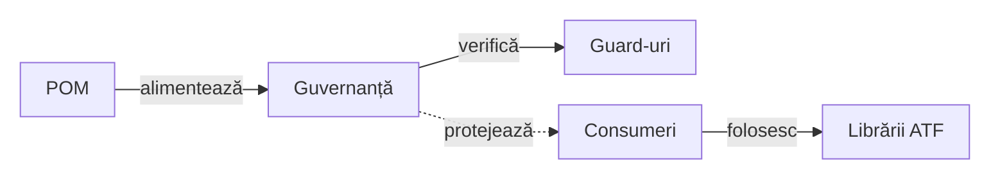
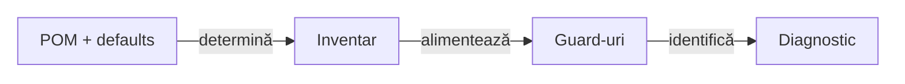

# ATF Tests — guvernanță whole-reactor

## Pe scurt

**Trasee rapide:** [Whole-ATF](#suita-whole-atf-și-reziduul-de-compatibilitate) · [Rădăcini Java](#inventarul-comun-al-surselor-java) · [Controale Git](#guvernanța-schimbării-testelor) · [Gate și limite](#verificare-rapidă)

- `atf-tests` este modulul de control al proiectului ATF;
- verifică reactorul, boundary-urile Maven/source și gate-urile de arhitectură;
- nu este owner pentru teste de produs;
- nu conține locatori, page objects sau flow-uri de aplicație.



<details>
<summary><strong>Legendă — ce guvernează atf-tests</strong></summary>

- root POM și graph-ul de module intră în gate-ul whole-reactor;
- atf-tests verifică limitele, nu implementează flow-uri de aplicație;
- Practice Shop și reporting composition rămân consumatori separați;
- `Checks` grupează verificările de arhitectură, scope și siguranță runtime;
- muchia punctată arată guard-ul aplicat consumatorilor, nu ownership transferat către governance;
- consumatorii folosesc bibliotecile prin dependințe explicite, iar governance-ul
  verifică această direcție fără să devină runtime.
Etichetele scurte păstrează următorul sens:

| În schemă | Sens complet |
|---|---|
| Guard-uri | architecture + runtime guards |
| Consumeri | consumer modules |
| Librării ATF | ATF libraries |

</details>

| Responsabilitate | Owner | Excludere explicită |
|---|---|---|
| reactor, POM și dependency direction | `atf-tests` | nu modifică production code |
| source/package ownership și module placement | `ArchitectureModuleBoundaryTest`, `ArchitectureOwnershipBoundaryTest` | nu deține selectorii unei aplicații |
| documentație relocabilă și surse coerente | `governance.documentation.*`, `AtfSourceReadabilityGovernanceTest` | nu validează conținutul unui singur consumer |
| ownership de constante și coeziune de package | `ConstantsOwnershipGovernanceTest`, `AtfPackageCohesionGovernanceTest` | maximum 8 clase/pachet în producție și în source-set-urile de test ale tuturor modulelor din reactor; excepțiile trebuie să fie explicite |
| Practice Shop purchase journey | `atf-test-practice-shop` | nu se copiază aici |
| reporting contract/API/UI composition | `atf-reporting-tests` | nu se mută în governance |

## Alege gate-ul după schimbare

| Schimbare | Intrare | Ce confirmă |
|---|---|---|
| README, hartă sau feedback | [documentație](#documente-și-responsabilități) | link, structură, diagramă, proză și afirmațiile factuale implementate de guard |
| test protejat modificat | [control Git](#guvernanța-schimbării-testelor) | un owner eligibil per path și bază; fără relaxarea oracolului |
| dependență, package ori source-set | [whole-ATF](#suita-whole-atf-și-reziduul-de-compatibilitate) | boundary-ul executabil al reactorului |
| rezultat business sau randare | testul modulului owner | comportamentul efectiv, suplimentar față de guvernanță |

Un gate structural verde certifică regulile pe care le implementează.
Fidelitatea unei propoziții, verdictul unui raport și rezultatul aplicației
cer și proba ownerului; comenzile `proof` din YAML se execută separat.

Pentru IntelliJ și Maven folosește același [staging cu Git real](../docs/ATF_Build_And_Execution_Safety.md#staging-pentru-guvernanța-schimbării-testelor).
Harta de [rădăcini Java](#inventarul-comun-al-surselor-java) explică layout-urile
consumerilor înaintea oricărei mutări de teste.

## Guvernanța deployment-ului sursă sau binar

`WholeAtfGovernanceSuiteTest` păstrează aceeași selecție explicită în J1 și în
producător. [Pachetul deployment](src/test/java/atf/api/tests/governance/distribution/README.md)
selectează dovada după declarația Maven, fără a deduce excepții din fișiere lipsă.

| Regulă | Reporting sursă | Reporting binar |
|---|---|---|
| reactor | catalogul canonic de 12 module, cu POM-uri existente | 10 module, versiune explicită și JAR/POM direct în `lib`; gate-ul extern poate adăuga explicit Reporting Tests în TMP, cu 11 module. Sursa shadow și harness-ul nedeclarat sunt refuzate. |
| documentație | README Reporting | atlas JAR, ghid J1 și README lib; aceleași controale de structură/link/proză |
| ownership | fișierul Java exact și interdicțiile de package | clasa exactă din JAR și absența duplicatelor interzise |
| independență | importuri sursă și POM standalone | POM fără parent/dependențe ATF și referințe de bytecode prin JDK `jdeps` |
| identitate | modul sursă local | versiune, JAR/POM/manifest, POM embedded și hash-ul CodeSource-ului |
| test layer | sursele native și adnotările lor | manifest native legat de proveniență; fără a-l prezenta drept execuție locală a sursei |

Modul șters, coordonată absentă/greșită, artifact alterat și dependență ascunsă
au controale negative. Mutantul factual funcționează pentru 10/11/12 module;
asta nu autorizează un reactor cu module eliminate din catalog.

Controlul Git folosește baza reală de review a fiecărui proiect. Sincronizarea
surselor comune nu copiază `.git`, POM-ul reactorului, JAR-ul sau controale
cu baza celuilalt proiect; eligibilitatea se verifică distinct.

## Suita whole-ATF și reziduul de compatibilitate

[`ReportUiActionAdapters`](src/test/java/atf/ui/tests/support/reporting/ReportUiActionAdapters.java)
este suport de compatibilitate în source-set-ul de test, nu test executabil sau
cod de producție. Prezența lui nu transferă ownership-ul testelor UI ori al
reportingului către `atf-tests`; `ArchitectureOwnershipBoundaryTest` protejează
această limită.

```text
src/test/java/atf/api/tests/governance/
├── ArchitectureModuleBoundaryTest.java
├── ArchitectureOwnershipBoundaryTest.java
├── AtfPackageCohesionGovernanceTest.java
├── AtfGovernanceRules.java
├── AtfGovernanceTestSupport.java
├── AtfSourceReadabilityGovernanceTest.java
├── ConstantsOwnershipGovernanceTest.java
├── changes/          change-control schema, diferență Git și probe negative
├── console/          default-uri și composition root-uri UI/API
├── layers/           clasificare globală și acoperirea disjunctă a suitelor consumer
├── documentation/
│   ├── DocumentationDiagramGovernanceTest.java
│   ├── DocumentationProseGovernanceTest.java
│   ├── DocumentationReadmeStructureGovernanceTest.java
│   ├── DocumentationAnchorGovernanceTest.java
│   ├── links/        indexul heading-urilor și al ancorelor HTML
│   ├── DocumentationStyleGovernanceTest.java
│   ├── DocumentationTargetGovernanceTest.java
│   ├── DocumentationGovernanceSupport.java
│   └── DynamicPathDocumentationArchitectureTest.java
└── WholeAtfGovernanceSuiteTest.java
```

`WholeAtfGovernanceSuiteTest` este entry point-ul explicit pentru verificarea
întregului reactor. El grupează verificările fără să mute responsabilitatea
testelor de reporting în acest modul:

- `ArchitectureModuleBoundaryTest` — reactor, POM, direcția dependențelor,
  importuri interzise, output de proces, stare statică și eliminarea
  `atf-execution`;
- `ArchitectureOwnershipBoundaryTest` — placement-ul modulelor, package roots,
  ownership-ul reporting/UI și absența duplicărilor;
- `AtfPackageCohesionGovernanceTest` — coeziunea package-urilor de producție
  guvernate și a source-set-urilor de test din fiecare modul al reactorului,
  inclusiv `atf-test-practice-shop`, `atf-test-kit` și `atf-reporting-tests`;
  pragul este de maximum opt clase, iar diagnosticul identifică modulul,
  package-ul și clasele concrete pentru orice hotspot nou sau excepție stale;
- `AtfSourceReadabilityGovernanceTest` — importuri duplicate în sursele Maven main/test și invocații ATF complet calificate în reporting tests; comentariile și literalii sunt excluși lexical;
- `layers.AtfTestLayerArchitectureTest` — inventariază rădăcinile `sourceDirectory` și `testSourceDirectory` din POM (cu default Maven), apoi verifică nivelul fiecărei clase executabile; fixture-urile imbricate nu schimbă nivelul clasei exterioare;
- `layers.ConsumerSuiteCoverageGovernanceTest` — exact trei suite principale per consumer, fără clase omise, selecții suprapuse sau amestec local/E2E/API live; citește declarația ownerului și selectorii executabili, fără comentarii ori fixture-uri nested promovate la gate. Probează și scope-ul explicit al rapoartelor componentelor;
- `consumers.ConsumerModuleArchitectureGovernanceTest` și `ConsumerAuditSourceGraphTest` — resolver comun de adnotări pentru audit/layer, alias-uri, moștenire și helperi importați; comentariile, literalii și fixture-urile nested nu exclud ownerul executabil. Analiza sursei nu înlocuiește proba launcher/raport;
- `ConstantsOwnershipGovernanceTest` — vocabularul de protocol, rute și
  boundary-ul reporting standalone;
- `governance.documentation.DynamicPathDocumentationArchitectureTest` — documentație
  relocabilă, fără căi de mașină sau nume de artifact generate concret;
- `governance.documentation.DocumentationReadmeStructureGovernanceTest` — un titlu,
  secțiune de orientare `Pe scurt`, `<details>` echilibrate și linkuri locale rezolvabile în
  toate README-urile și în `docs/ATF_Architecture.md`;
- `governance.documentation.DocumentationStyleGovernanceTest` — stil semantic ATF:
  fence-uri tipizate, headings fără salturi, bullets `-` și fără font/CSS/HTML
  prezentational în README-uri și în documentul arhitectural canonic;
- `governance.documentation.DocumentationProseGovernanceTest` — limitează proza
  rapid scan la cel mult trei propoziții pe paragraf și două paragrafe dense
  consecutive; responsabilitățile, limitele și relațiile dense trebuie mutate în
  bullets, tabele, diagrame sau `<details>`;
- `governance.documentation.DocumentationTargetGovernanceTest` — exemplu
  plug-and-play cu `@DocumentationTarget("atf-test-practice-shop/README.md")`; aceeași clasă
  poate valida orice README prin toate modulele de documentație;
- `governance.documentation.DocumentationDiagramGovernanceTest` — orientare `LR`,
  legendă imediată, fence-uri echilibrate și relații etichetate în README-urile
  non-root;
- `governance.documentation.DocumentationGovernanceSupport` — vocabular comun pentru
  diagnostice: cod, fișier, linie, regulă și remediere. Nu ascunde excepții și nu
  transformă un feedback în „pass”.

Fiecare abatere de documentație trebuie să indice dinamic: ce fișier și linie au
fost găsite, ce regulă este încălcată și ce modificare minimă o poate remedia.
Un README poate rămâne intenționat roșu în timpul reconcilierii; suita trebuie să
facă gap-ul reproductibil, nu să-l îngroape într-o excepție.

Testele de guvernanță sunt contract protejat: nu se modifică, dezactivează sau
relaxează pentru a transforma un README roșu în pass. Se schimbă numai pe baza
unui feedback direct care modifică regula, ownerul, criteriul sau dovada cerută;
în caz contrar se repară documentul țintă.

Pentru o verificare punctuală, se schimbă doar valoarea adnotării:

```java
@DocumentationTarget("atf-reporting/README.md")
class ReportingReadmeGovernanceTest {
}
```

Testul țintit apelează aceleași validatoare ca suita whole-ATF: structură,
stil, proză, diagrame, relocatabilitate și nume de artifacte.

Declarația repeatable `DocumentationTarget` aparține
`atf.testkit.documentation`; lista țintelor și validatorii rămân aici.
[Contractul adnotărilor](../docs/ATF_Test_Infrastructure_Annotations.md) explică
ownership-ul și limitele de compoziție.

Astfel, `atf-reporting-tests` nu mai deține verificări care inspectează întregul
repository; păstrează doar boundary-ul API/UI propriu compoziției reporting.

<details>
<summary><strong>Ținta de curățare urmărită în feedback</strong></summary>

- `atf-tests` trebuie să rămână cu guard-ul whole-reactor și suportul strict
  necesar acestuia;
- adaptoarele de reporting/UI se mută sau se elimină numai după dovadă de
  boundary și după verificarea consumerului canonical;
- o dependență test-scope existentă nu este declarată „eliminată” doar pentru
  că ownership-ul dorit este descris în tabel;
- orice schimbare se închide prin POM, import scan și testul de arhitectură.

</details>

## Inventarul comun al surselor Java

`layers.AtfJavaSourceInventory` este suport de test în `atf-tests`, folosit
de guvernanța nivelurilor și a lizibilității. Citește aceleași rădăcini pentru
fiecare POM, inclusiv `src/main` și `src/test` din Shop.



<details>
<summary><strong>Legendă — inventarul implementat al surselor</strong></summary>

- POM + defaults: declarațiile directe `build/sourceDirectory` și
  `build/testSourceDirectory`, cu valorile implicite Maven când lipsesc.
- Inventar: fișiere Java distincte și ordonate, chiar când rădăcinile se suprapun.
- Guard-uri: aceleași surse pentru arhitectură și importuri duplicate.
- Diagnostic: fișierul/regula ori POM-ul care declară o rădăcină invalidă.

</details>

- Inventarul exclude segmentele numite `target`, `artifacts`, `.tmp` și `.git`, inclusiv sub rădăcinile Java; aceasta este o limită de acoperire, nu dovada că fiecare clasă compilată a fost inspectată.
- O rădăcină goală, ieșită din modul, nesigură sau cu expresie Maven nerezolvată produce diagnostic.
- Inventarul citește căile literale din POM; nu înlocuiește effective POM,
  moștenirea ori activarea profilelor Maven. Comentariile XML nu declară rădăcini.
- Guard-ul expresiilor rămâne limitat la reporting tests și păstrează cele
  trei adaptoare revizuite. Detectează namespace-urile ATF actuale și legacy,
  constructori și apeluri pe mai multe linii, fără exemplele din comentarii/literale.

## Guvernanța schimbării testelor

Testele din modulele ATF se schimbă prin controale tehnice structurate, legate
de cerința ownerului. Singura
excepție este `atf-test-practice-shop`; limita
de coeziune și celelalte reguli de arhitectură continuă să i se aplice.

| Control | Regulă |
|---|---|
| Scope | toate fișierele din `<modul>/src/test/`, inclusiv suport, resurse și suite; `pom.xml` rădăcină și POM-urile modulelor, cu excepția exactă Shop |
| Cerere/control | bloc YAML `testChanges`, ID unic, `ACTIVE` în feedback-ul ownerului sau `VERIFIED` în baseline, motiv, comandă Maven de probă, expirare și SHA-ul baseline-ului |
| Fișiere | căi relative exacte; fără wildcard, traversal sau owneri multipli pentru aceeași schimbare |
| Ștergere / redenumire | `allowDelete: true` pentru vechea cale; redenumirea este evaluată ca ștergere + adăugare |
| Diferență Git | committed față de baseline, staged, unstaged și fișiere noi; nici testele noi ignorate de Git nu sunt exceptate |
| Eșec infrastructură | checkout sau baseline invalid, conflict ori YAML invalid produc FAIL, nu skip |

`TestChangeGovernanceTest`, `TestChangePolicyTest` și `GitTestChangesTest` sunt
incluse în `WholeAtfGovernanceSuiteTest`. Probe negative verifică cereri lipsă,
închise, expirate, incomplete, cu baseline străin, duplicate și ștergeri
neautorizate; fixture-ul Git real verifică și nume cu spații și redenumiri.

La lansare locală, inclusiv IntelliJ, baza implicită este `HEAD`. Pentru o
ramură completă se setează `-Datf.governance.testChanges.baseRef=<review-base>`;
CI cere explicit această proprietate sau `ATF_TEST_CHANGE_BASE_REF` și refuză
valoarea literală `HEAD`. Baza trebuie să fie un strămoș al commitului curent;
cererea fixează SHA-ul rezolvat, nu un ref mobil.

### Documente și responsabilități

[DocumentationLinkGovernanceTest](src/test/java/atf/api/tests/governance/documentation/links/DocumentationLinkGovernanceTest.java)
verifică destinațiile locale și fragmentele tuturor README-urilor și documentelor
Markdown din `docs`, inclusiv atlase, arhitectură și feedback. Output-urile
generate sunt excluse. [Probele ancorelor](src/test/java/atf/api/tests/governance/documentation/DocumentationAnchorGovernanceTest.java)
verifică inclusiv un titlu redenumit într-un document care nu se numește README.
Ambele intră în suita whole-ATF; `@DocumentationTarget` aplică aceeași verificare
și documentelor selectate explicit. Existența țintei nu certifică sensul etichetei.

[DocumentedBuildContractTest](src/test/java/atf/api/tests/governance/documentation/factual/DocumentedBuildContractTest.java)
compară modulele și scope-ul Kit cu POM-urile reale.
[DocumentedUiGeometryContractTest](src/test/java/atf/api/tests/governance/documentation/factual/DocumentedUiGeometryContractTest.java)
extinde aceeași limită factuală la geometria numerică selectată, fără surse Reporting.
Ambele probe sunt selectate explicit de `WholeAtfGovernanceSuiteTest`.

| Afirmație delimitată | Sursă executabilă | Refuz observabil |
|---|---|---|
| numărul modulelor din arhitectură | declarațiile directe `modules/module` din POM | număr diferit, afirmație absentă ori duplicată |
| Kit în matricea consumerului | dependența directă din POM; scope omis înseamnă `compile` | scope diferit, Kit absent ori prezent în ambele coloane |
| zoom generic versus exemplu configurat | `UiBrowserConfiguration.defaults()` | un exemplu particular nu redefinește implicitul runtime |
| CSS și DPR din exemplul UI | `UiViewportScale` pentru intrările declarate | geometria derivată nu concordă cu modelul executabil |
| ieșire, zoom, CSS și DPR în Shop/AutoEx | YAML-ul livrat și același model UI | fiecare câmp numeric poate fi refuzat independent; fără un registru paralel de valori |

Mutanții schimbă numai documentul; YAML-ul și POM-ul rămân intacte. Lipsa,
duplicarea și o declarație ascunsă într-un fence sunt refuzate cu document,
linie, valoare declarată/observată și sursa executabilă.

Guard-ul numeric verifică intenția configurată și modelul de layout, nu pixeli
de screenshot. [Probele native UI](../atf-ui/README.md#geometria-nativă-a-contextului)
verifică separat pointerul, viewport-ul, DPR și captura browserului.
Ambiguitățile prozei și afirmațiile neselectate păstrează review-ul manual.

| Informație | Owner documentar | Conținut |
|---|---|---|
| Cerință funcțională | [feedback-ul ownerului](../docs/feedback/README.md) | lacună observabilă, responsabil, criteriu și dovadă lipsă |
| Control tehnic activ | documentul feedback al ownerului din [`docs/feedback`](../docs/feedback/README.md) | numai intrări `ACTIVE` pentru diff-uri în lucru, alături de cerința pe care o autorizează |
| Control tehnic verificat | [Registrul verificat](../docs/ATF_Test_Changes_Baseline.md) | context business, roluri, lifecycle și intrări `VERIFIED` colapsate |
| Comportament stabil | README-ul sau contractul ownerului | regula implementată și demonstrată |

Parserul descoperă blocurile YAML în toate documentele Markdown din
`docs/feedback` și în `docs/ATF_Test_Changes_Baseline.md`. Procedura proiectului
ține controalele `ACTIVE` lângă feedback-ul ownerului și controalele `VERIFIED`
în baseline; nu este necesar un registru activ separat.

<details>
<summary><strong>Schema controlului și efectul câmpurilor</strong></summary>

| Câmp | Contract executabil |
|---|---|
| `id` | identificator unic între toate documentele citite, inclusiv intrările neeligibile |
| `status` | `ACTIVE` și `VERIFIED` pot fi eligibile; `DRAFT` și `CLOSED` nu autorizează schimbarea |
| `base` | SHA imutabil, egal cu baza rezolvată pentru rularea gate-ului |
| `expires` | dată ISO; controlul este eligibil inclusiv în acea zi |
| `reason` | text de minimum 20 de caractere care explică schimbarea |
| `proof` | comandă Maven `test` sau `verify` declarată, executată separat de gate |
| `paths` | listă nevidă de căi protejate, relative exacte și distincte în control |
| `allowDelete` | boolean opțional, implicit `false`; `true` pentru o ștergere |

- Blocul YAML are o singură cheie `testChanges` și o listă nevidă; câmpurile
  necunoscute și cheile duplicate sunt respinse.
- Un ID nu se copiază la transfer; între controalele eligibile, fiecare path
  schimbat are un singur owner pentru baza și data rulării.
- Guvernanța citește și YAML-ul din `<details>` închis implicit; vizibilitatea
  Markdown nu schimbă eligibilitatea.

</details>

### Reconciliere și închidere

1. Inspectează sursele live, criteriul funcțional și diferența față de baza revizuirii.
2. Înregistrează controlul `ACTIVE` în feedback-ul ownerului, cu path-uri exacte, înaintea modificării protejate.
3. Rulează proba relevantă și gate-ul în [staging extern cu Git real](../docs/ATF_Build_And_Execution_Safety.md#staging-pentru-guvernanța-schimbării-testelor); rendererul cere și verificarea randării.
4. Promovează contractul demonstrat la owner; elimină din feedback numai criteriul îndeplinit.
5. Mută controlul în baseline-ul `VERIFIED` dacă diff-ul încă îl cere, păstrând ID-ul și eliminând blocul `ACTIVE` din feedback.
6. Elimină controlul când baza folosită de gate nu mai raportează schimbările acoperite; verifică din nou corespondența diff–control.

`VERIFIED` atestă incrementul verificat, separat de acceptanța întregii cerințe.
Gate-ul validează metadatele și corespondența diff–control; comenzile `proof`
se execută separat, iar aprobarea unei schimbări de regulă rămâne explicită.

La expirare sau schimbarea bazei se revizuiesc perimetrul și dovada înaintea
actualizării controlului. Controalele active nu au un fișier dedicat: ele stau
în feedback-ul ownerului numai cât timp sunt necesare; procedura rămâne aici, iar
indexul `docs/feedback/README.md` se păstrează permanent.

## Guvernanța detaliilor la consolă

`ConsoleDefaultsGovernanceTest` protejează detaliile implicite și conectarea
UI/API în Reporting și Shop. Testele comportamentale din `atf-console` și
`ReportingTestConsoleTest` verifică formatarea și livrarea evenimentelor;
override-ul YAML `false` rămâne suportat.

## Module consumatoare separate

Testarea site-ului `https://practicesoftwaretesting.com` este izolată în
`atf-test-practice-shop`. Acolo sunt YAML-ul, configurația checkout-ului,
locators, page objects, flow-urile și testele component/E2E. Flow-ul principal
guest nu cere un secret. `ShopNewAccountPurchaseE2eTest` creează un cont
sintetic; `ShopAuthenticatedPurchaseE2eTest` folosește fixture-ul local când
rulează separat și reutilizează contul nou în `ShopE2eSuite`.

```text
atf-test-practice-shop/src/
├── main/atf/shop/
│   ├── api/         client, request factory și screen API flows
│   ├── config/      records typed încărcate din YAML
│   ├── locators/    singurul owner al selectorilor aplicației
│   ├── pages/       page objects
│   ├── flow/        pași de business compuși
│   └── support/     context și evidence adapters
├── test/atf/shop/tests/
│   ├── component/       teste rapide de module
│   ├── api/component/   variații fake pozitive/negative
│   ├── api/integration/ precondiție login live, opt-in
│   └── e2e/             purchase journey și lifecycle report/browser
└── test/resources/atf-practice-shop.yaml
```

`atf-tests` nu deține clase de business, locatoare, flow-uri sau fixture-uri
Practice Shop/AutoEx. Poate scana sursele consumerilor pentru reguli whole-ATF
și arhitectură cross-module, fără să importe clasele lor de test. Testele care
verifică aplicația externă rămân la consumer; cele care verifică modelul și
randarea generică a raportului rămân în `atf-reporting-tests`.

## Rulare și staging

```text
mvn -pl atf-tests -am "-Dtest=WholeAtfGovernanceSuiteTest" "-Dsurefire.failIfNoSpecifiedTests=false" "-Datf.governance.testChanges.baseRef=<review-base>" test
mvn -pl atf-tests -am test
mvn -pl atf-tests -am "-Dtest=ConsumerModuleArchitectureGovernanceTest" "-Dsurefire.failIfNoSpecifiedTests=false" test
```

Comenzile de business sunt la [Shop](../atf-test-practice-shop/README.md#cum-se-verifică-modulul)
și [AutoEx](../atf-test-auto-ex/README.md#rulare), cu opt-in-urile proprii.

Build-urile se fac într-un staging extern (`${ATF_STAGING_ROOT}/...`), fără a
opri execuții active. Se sincronizează numai fișierele aprobate, după recitirea
live și reconcilierea modificărilor paralele; nu se copiază `target`, `artifacts`
sau cache-uri peste live. Procedura normativă este
[`docs/ATF_Build_And_Execution_Safety.md`](../docs/ATF_Build_And_Execution_Safety.md).

## Regula responsabilităților

```text
whole reactor / module graph / architecture gates → atf-tests
Practice Shop config / locators / pages / flows / E2E → atf-test-practice-shop
reporting contracts / Extent composition → atf-reporting-tests
renderer / HTML / CSS / public reporting API → atf-reporting
```

Regulile generale OOP, locator boundary și layering sunt în
[`docs/README_Atf_BestPractices.md`](../docs/README_Atf_BestPractices.md), iar
statusul mutării este în [`docs/feedback/README.md`](../docs/feedback/README.md).

### Linkuri README către secțiuni

Guard-ul de structură rezolvă calea și fragmentul Markdown, pe fișierul sursă
sau cross-file. Indexul păstrează Unicode, sufixele heading-urilor duplicate și
ancorele HTML explicite; ignoră exemplele din fences backtick/tilde și păstrează
linia originală în diagnostic. Căile și fragmentele percent-encoded se decodează
fără a transforma `+` în spațiu.

`DocumentationAnchorGovernanceTest` probează și ștergerea heading-ului după un
link valid: `DOC-README-ANCHOR` identifică README-ul, linia și remedierea, chiar
dacă heading-ul dispărut mai apare într-un exemplu fenced. Regula de heading
urmează [convenția GitHub](https://docs.github.com/en/get-started/writing-on-github/getting-started-with-writing-and-formatting-on-github/basic-writing-and-formatting-syntax#section-links).

## Verificare rapidă

În comenzile whole-ATF, înlocuiți `<review-base>` cu SHA-ul/ref-ul real al
revizuirii, prezent în istoricul stage-ului și aliniat controalelor Git.
[Resolverul bazei](src/test/java/atf/api/tests/governance/changes/GitTestChanges.java)
acceptă fallback `HEAD` numai local; CI cere explicit baza și refuză `HEAD`.

| Decizie | Sursă și limită |
|---|---|
| Boundary, ownership și documentație în întregul reactor | [WholeAtfGovernanceSuiteTest](src/test/java/atf/api/tests/governance/WholeAtfGovernanceSuiteTest.java); [probe negative pentru ancore](src/test/java/atf/api/tests/governance/documentation/DocumentationAnchorGovernanceTest.java) |
| Dependențe și source-set-uri | [POM](pom.xml); scope-ul declarat este autoritatea pentru integrare |
| Ce nu demonstrează această probă | Gate-ul nu dovedește un journey business ori randarea artifactului. |

<details>
<summary><strong>Comandă pentru proba locală</strong></summary>

Rulați din rădăcina unui [staging extern](../docs/ATF_Build_And_Execution_Safety.md), cu JDK 21 și Maven.

```powershell
mvn -B -pl atf-tests -am "-Dtest=WholeAtfGovernanceSuiteTest,DocumentationAnchorGovernanceTest" "-Dsurefire.failIfNoSpecifiedTests=false" "-Datf.governance.testChanges.baseRef=<review-base>" test
```

Comanda selectează proba numită și construiește dependențele; nu declară
trecerea întregului modul. Gate-ul nu dovedește un journey business ori randarea artifactului.

</details>
