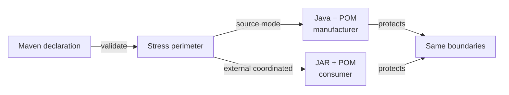

# ATF government - source or binary deployment

## At a glance

This package adapts the inspected area, keeping the rules and selection of the suite. The manufacturer checks Core / Reporting sources; the consumers checks the published and loaded library, without fictional sources or tests disabled.

## Catalogue declared

The catalogue is declared via Maven; a missing POM module times remains denied.

| Profile | Module live | Explicit Harness in TMP |
|---|---:|---:|
| Core / Reporting source | 12 | included |
| Journeys with Core binary | 9 | 10 |
| Core source foundation | 8 | 9 |
| Eventuate with Core in binary without UI | 7 | 8 |

`atf.consumer.profile=foundation` excludes Shop / AutoEx; the absence of directors does not select the profile and the unreported harness is not accepted.

Binary distribution reads JAR and POM directly from `lib`, with the same background check, POM included and CodeSource. A copy not imprinted substitutes for the required artifact on the declared path. `lib` has only JAR and POM; hashes and catalogue Native samples are in `library-provenance.json`, at the root.

| Input | Responsibility | Test |
|---|---|---|
| [GovernanceDeployment](GovernanceDeployment.java) | strict Maven catalogue and actual documents for each deployment | [plugins and targets](GovernanceDeploymentTest.java) |
| [CoreGovernanceSurface](core/CoreGovernanceSurface.java) | POM parent, Core JAR / POM pair, ownership bytecode and loaded identity | [Core mutants](core/CoreGovernanceSurfaceTest.java) |
| [ReportingGovernanceSurface](ReportingGovernanceSurface.java) | POM, ownership, source origin and dependency / JAR | [provenance and mutants](ReportingGovernanceSurfaceTest.java) |
| [DeploymentFixture](DeploymentFixture.java) / [BinaryReportingFixture](BinaryReportingFixture.java) | private fixtures with isolated mutations | without changing the source of the manufacturer, cache or JAR live |

## Elaboration of the surface

- A declared harness keeps all the sources audits and files required.
- An external harness requires the absence of the module and its namespaces from all
  local sources; examples in the literal are not confused with Java statements.
- Negative evidence refuses the declared missing fixture, source of shadow and copies in
  Core / AutoEx. Reporting contracts are performed separately on JAR in TMP.

<strong>Legend - Adaptation with explicit refusal</strong>

- Perimeter shall keep the canon catalogue; it shall not automatically remove missing modules.
- Reporting binary requires explicit version and rejects the source of the Shadow in the reactor.
- The source keeps the lexical samples and the Java layout; the binary checks the classes,
  POM, provenance, CodeSource and `jdeps` dependencies in JDK.
- The edges describe the choice of proof; there are no additional Maven dependencies.

## Invariants and limits

- The Foundation refuses unknown profiles, override on Reporting source, common missing modules and Shadow sources Shop / AutoEx, including namespaces hidden in other modules.
- Application guards- checks the declared source or explicit exclusion; negative fixtures remain active in both profiles. The missing geometry of the deployment is tested with YAML / README private TMP.

- Reporting target in the manufacturer remains its README; J1 validates the atlas
  binary and consumer guide, by the same validator.
- A requested file remains a regular file; a directory cannot satisfy it.
  The absence of an owner and the prohibition of a director remaining separate checks.
- Hashes from single-generation link JAR, POM and inputs of the manufacturer; POM embedded
  CodeSourceX refuses another charged binary.
- Clean POM does not justify the Core, Validation, Kit or JUnit dependent bytecode;
  The sample hides a Core reference in a JAR fixture and requires her detection.
- The native catalogue included in the provenance is a statement verified by hash, not the execution of tests
  Java in consumer. Source audit and native regressions remain with the manufacturer.
- Documentary mutant changes only the number declared; 10/11/12 fixtures
  keep POM and check the Kit scope and the duplicate / missing claims separately.
- `jdeps` is part of the JDK- necessary for verification; its absence is denied,
  No fallback to a weaker textual control.

## Maintenance

A change of packaging updates the catalogue, proof and both deployments in the same increment. Withdrawal Reporting Tests requires separate decision and acceptance; it is not activated by lack of a directory or by this adaptation.

## Core source or binary

`atf.core.version` explicit selects external Core; the simple disappearance of the director cannot narrow the catalogue. Consumers refuse any Core Shadow directory, including without POM, and any additional file in lib.

J0 continues checking the style and implementation of Core source. J1–J6 inspect POM and published classes, bytecode dependencies and the CodeSource hash; [Core contract](../../../../../../../../../docs/ATF_Core_Consumer.md) separates those checks.
