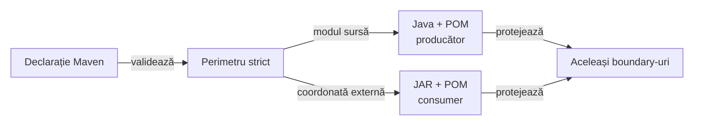

# Guvernanță ATF — deployment sursă sau binar

## Pe scurt

Acest pachet adaptează suprafața inspectată, păstrând regulile și selecția
suitei. Producătorul verifică sursa Reporting; consumerul verifică biblioteca
publicată și încărcată, fără surse fictive ori teste dezactivate.

## Catalogul declarat

Catalogul sursă păstrează toate cele 12 module. Consumerul binar are exact
10 module; acceptarea externă poate declara explicit și Reporting Tests,
numai în copia TMP, pentru un reactor de 11 module.
Un modul ori POM lipsă rămâne refuzat; un harness nedeclarat nu este acceptat.

Distribuția binară citește JAR-ul și POM-ul direct din `lib`, cu aceeași
verificare de proveniență, POM inclus și CodeSource. O copie imbricată nu
substituie artifactul cerut la calea declarată.

| Intrare | Responsabilitate | Probă |
|---|---|---|
| [GovernanceDeployment](GovernanceDeployment.java) | catalog Maven strict și documente reale pentru fiecare deployment | [module și ținte](GovernanceDeploymentTest.java) |
| [ReportingGovernanceSurface](ReportingGovernanceSurface.java) | POM, ownership, manifest și dependențe din sursă/JAR | [proveniență și mutanți](ReportingGovernanceSurfaceTest.java) |
| [DeploymentFixture](DeploymentFixture.java) / [BinaryReportingFixture](BinaryReportingFixture.java) | fixture-uri private, cu mutații izolate | fără schimbarea sursei producătorului, cache-ului ori JAR-ului live |

## Alegerea suprafeței

- Un harness declarat păstrează integral auditurile surselor și fișierele cerute.
- Un harness extern cere absența modulului și a namespace-urilor sale din toate
  sursele locale; exemplele din literali nu sunt confundate cu declarații Java.
- Probele negative refuză fixture-ul declarat lipsă, sursa shadow și copii în
  Core/AutoEx. Contractele Reporting se execută separat pe JAR în TMP.

<strong>Legendă — adaptare cu refuz explicit</strong>

- Perimetrul păstrează catalogul canonic; nu elimină automat module lipsă.
- Reporting binar cere versiune explicită și respinge sursa shadow din reactor.
- Sursa păstrează probele lexicale și layout-ul Java; binarul verifică clasele,
  POM-ul, proveniența, CodeSource-ul și dependențele prin `jdeps` din JDK.
- Muchiile descriu alegerea dovezii; nu sunt dependențe Maven suplimentare.

## Invariante și limite

- Ținta Reporting din producător rămâne README-ul său; J1 validează atlasul
  binar, ghidul consumerului și README-ul `lib`, prin aceleași validatoare.
- Un required file rămâne fișier regulat; un director nu îl poate satisface.
  Absența unui owner și interdicția unui director rămân verificări distincte.
- Hash-urile leagă JAR-ul, POM-ul și manifestul de proveniență; POM-ul embedded
  trebuie să coincidă cu cel distribuit. CodeSource-ul refuză alt binar încărcat.
- POM curat nu justifică bytecode dependent de Core, Validation, Kit ori JUnit;
  proba ascunde o referință Core într-un JAR fixture și cere detectarea ei.
- Manifestul native este o declarație verificată prin hash, nu execuția testelor
  Java în consumer. Auditul sursei și regresiile native rămân la producător.
- Mutantul documentar schimbă doar numărul declarat; fixture-urile 10/11/12
  păstrează POM-ul și verifică separat scope-ul Kit și afirmațiile duplicate/lipsă.
- `jdeps` este parte din JDK-ul necesar verificării; lipsa lui este refuz,
  fără fallback la un control textual mai slab.

## Întreținere

O schimbare de packaging actualizează catalogul, dovada și ambele deployment-uri
în același increment. Retragerea Reporting Tests cere decizie și acceptanță
separate; nu este activată prin absența unui director sau prin această adaptare.
