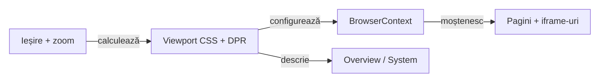
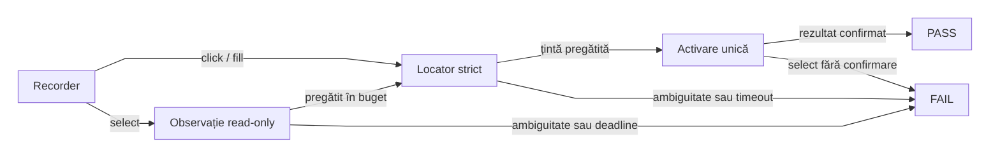
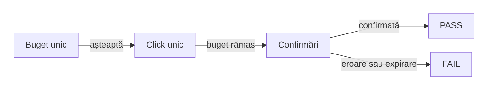
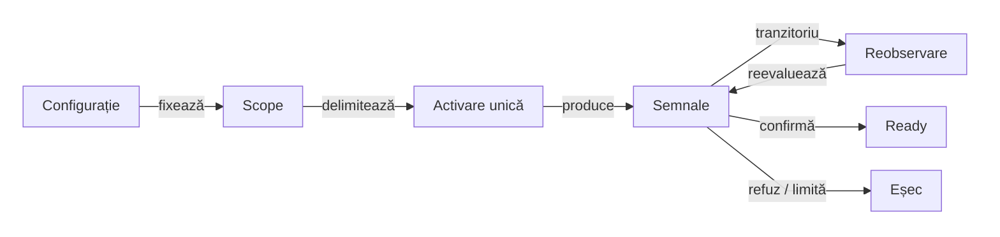
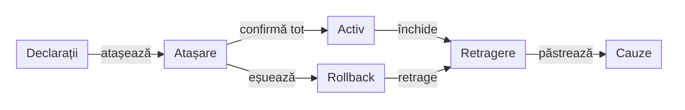
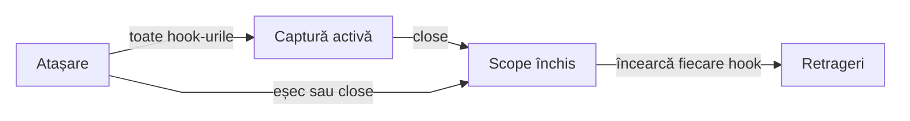

# ATF UI — browser, context și sesiune Playwright

`atf-ui` este infrastructura runtime pentru browserul Playwright. Configurează
browserul, contextul, pagina, timeout-urile, viewport-ul, screenshot-ul și
recorderul de acțiuni. Nu conține testele UI ale raportului, rendererul HTML,
publisherul Extent sau page objects de produs.

## Pe scurt

**Context local:** [playwright](src/main/java/atf/ui/playwright/README.md) · [network](src/main/java/atf/ui/network/README.md) · [atlas ATF](../docs/ATF_Context_Atlas.md).

**Trasee rapide:** [Acțiuni](#acțiuni-și-locatori) · [Politica BE](#recuperare-be-prin-observație-pasivă) · [Captură și limite](#inspectorul-de-rețea--limită-generică-de-responsabilitate) · [Probă locală](#verificare-rapidă)

| Input | Output | Boundary |
|---|---|---|
| YAML browser policy | browser/context/page | runtime generic |
| Playwright actions | neutral action records | fără Extent |
| captură și geometrie nativă | dovezi UI și dimensiuni măsurabile | adaptate către Reporting de consumer |

## Diagramă de bază

```mermaid
%%{init: {"themeVariables":{"fontSize":"15px"},"themeCSS":".nodeLabel, .nodeLabel p { font-size: 15px !important; line-height: 1.35 !important; } .edgeLabel, .edgeLabel p { font-size: 12px !important; font-weight: 400 !important; line-height: 1.2 !important; } .edgeLabel .labelBkg, .edgeLabel p { background: transparent !important; } .edgeLabel foreignObject { transform: translateY(-18px); overflow: visible; } .node rect { rx: 6px; ry: 6px; }","flowchart":{"curve":"linear","nodeSpacing":24,"rankSpacing":40,"padding":10,"diagramPadding":16}}}%%
flowchart LR
    Tests["Teste"] -->|selectează| Config["Policy"]
    Config -->|configurează| Session["Sesiune"]
    Session -->|deschide| Browser["Browser"]
    Browser -->|produce| Evidence["Dovezi"]
    Evidence -->|alimentează| Reporting["Reporting"]
```



<details>
<summary><strong>Legendă — runtime browser fără reporting</strong></summary>

- configurația descrie browserul și evidence-ul generic;
- sesiunea compune browser, context și page, apoi înregistrează acțiuni;
- atf-ui livrează payload-ul către consumer, nu decide verdictul și nu construiește HTML/CSS/Extent;
- publisherul HTML aparține Reporting; `UiScreenAudit` deține observația generică
  a ecranului în UI, iar probele browser ale artifactului aparțin Reporting Tests;
- scenariul concret și verdictul business rămân la consumer.
Etichetele scurte păstrează următorul sens:

| În schemă | Sens complet |
|---|---|
| Teste | consumer tests |
| Policy | browser policy |
| Sesiune | Playwright session |
| Browser | browser / page |
| Dovezi | action + screenshot |

</details>

<details>
<summary><strong>Harta de lectură</strong></summary>

- [runtime](#componentele-runtime) și [configurație](#configurație-generică-fără-flag-redundant);
- [acțiuni și locatori](#acțiuni-și-locatori), inclusiv regula CSS;
- [screen validation și capturi](#validarea-ecranului-și-capturi-de-ecran);
- [network inspector](#inspectorul-de-rețea--limită-generică-de-responsabilitate),
  limite și [verificare](#verificare).

</details>

| Responsabilitate | Owner |
|---|---|
| browser, context, page, viewport, timeout | `atf-ui` |
| acțiuni Playwright primitive și recorder neutru | `atf-ui` |
| page objects, flows și testele declarative | modulul consumer; `atf-reporting-tests` pentru propriul audit al rapoartelor |
| snapshot contract și validatori de browser | `atf-reporting` production + `atf-reporting-tests` test scope |
| HTML, CSS, Extent lifecycle și publisher | `atf-reporting` |
| mock, API scenarios și contract validation | `atf-reporting-tests` test scope + modulele API |

`atf-ui` nu importă executorul de audit și publisherul de secțiune: validarea
statică și proiecția raportului aparțin `atf-reporting`, iar scenariile E2E sunt
în [README-ul auditului browser](../atf-reporting-tests/src/test/java/atf/ui/tests/extent/README.md).
Modulul UI nu publică Extent și nu emite assertions de secțiune.

## Traseul de integrare

| Intenție | Owner și intrare | Dovadă |
|---|---|---|
| deschide browserul și contextul | [PlaywrightUiSession](src/main/java/atf/ui/playwright/PlaywrightUiSession.java) | [lifecycle, scală nativă și configurare](src/test/java/atf/ui/playwright/PlaywrightUiSessionTest.java) |
| activează un control o dată | [click cu postcondiție](#click-unic-cu-postcondiție-explicită) | deadline comun și refuzul replay-ului |
| verifică deadline-ul fără wall-clock fragil | [buget determinist](#deadline-determinist-al-clickului-cu-postcondiție) | [ObservationBudgetComponentTest](src/test/java/atf/ui/playwright/ObservationBudgetComponentTest.java) |
| observă backend-ul fără mutație | [recuperare BE](#recuperare-be-prin-observație-pasivă) | trace typed și operație read-only declarată |
| colectează trafic sau capturi | [inspector](#inspectorul-de-rețea--limită-generică-de-responsabilitate) / [audit ecran](#audit-comun-al-ecranului) | observație bounded, fără verdict business |

Rezultatul aplicației aparține consumerului, iar HTML-ul aparține Reporting.
Proba de scală verifică viewport-ul CSS și DPR native; snapshot-ul de metadata
descrie configurația și nu substituie măsurătoarea browserului.

### Lifecycle-ul sesiunii și limita probei

`PlaywrightUiSession` deține Playwright, browser, context, pagină și inspector.
Înregistrează release-ul imediat după dobândirea fiecărui owner. Pagina este
închisă de context; nu primește un al doilea close independent.

| Boundary | Contract verificat |
|---|---|
| achiziție parțială | `RuntimeException` și `Error` păstrează aceeași instanță; rollback-ul atinge numai resursele returnate cu succes |
| release | inspector → context → browser → driver; fiecare etapă este încercată, chiar dacă cea anterioară eșuează |
| cauze simultane | prima cauză rămâne primară; cauzele distincte urmează în `suppressed`, fără self-suppression |
| close repetat | ownership-ul este consumat inclusiv când primul close eșuează; secvența nu se reexecută |

[Proba lifecycle](src/test/java/atf/ui/playwright/PlaywrightUiSessionTest.java)
folosește dubluri ale interfețelor driverului și o seamă package-private, fără
hook public de fault. [Componenta nativă](src/test/java/atf/ui/playwright/PlaywrightUiSessionTest.java)
verifică separat browserul, scala și pointerul. Probele listener-elor rămân
distincte: ele nu substituie ownership-ul sesiunii ori politica contului consumer.

## Componentele runtime

- `UiBrowserConfiguration` — browser, headless, timeout, navigation timeout și
  viewport;
- `UiScreenValidationConfiguration` — politica generică de captură, fără
  cunoașterea raportului, a Extent sau a outputului;
- `PlaywrightUiSession` — lifecycle scoped al unui browser context și page;
- `PlaywrightBrowserActions` / `PlaywrightLocatorActions` — operații primitive;
- `PlaywrightActionSequence` / `UiActionRecorder` — model neutru al operațiilor;
- `UiScreenValidation` — capturează payload-ul PNG Base64 din page.

Sesiunea este idempotentă la close și nu deține serverul Debug UI. `atf-ui` nu
descoperă YAML de proiect, nu rezolvă outputuri și nu primește decizii de audit;
consumerul compune politicile generice și publică artifactul prin
`atf-reporting`.

## Configurație generică, fără flag redundant

`atf-ui` expune doar valori care descriu execuția browserului și capturarea
generică. Nu este owner pentru `report.directory`, `apiSetup`, `audit` sau
`filePrefix`; aceste valori sunt test-only și aparțin configurației interne a
modulului `atf-reporting`:

[`atf-reporting-tests/src/test/resources/atf-reporting-ui.yaml`](../atf-reporting-tests/src/test/resources/atf-reporting-ui.yaml)

```yaml
ui:
  browser: chromium
  baseUrl: about:blank
  headless: false
  timeout: PT10S
  navigationTimeout: PT45S
  viewport: { width: 1440, height: 900 }
  # Native context scale; output intent stays separate from the CSS layout.
  zoomPercent: 70
  screenshotOnFailure: true
  screenValidation:
    enabled: true
    fullPage: false
```

- nu există și nu se adaugă `ui.enabled`;
- runtime-ul se construiește când consumerul selectează un test;
- opțiunile concrete descriu browserul și evidence-ul;
- `ui.screenValidation.enabled` controlează numai capturarea screenshot-ului;
- cheia nu activează testele și nu publică raportul;
- `ui.zoomPercent` configurează geometria nativă a contextului; nu injectează
  `zoom`, `transform` sau un script în documente;
- `viewport.width` și `viewport.height` exprimă dimensiunea cerută a capturii;
  viewport-ul CSS efectiv se calculează separat;
- valoarea este validată în intervalul `25..200`, iar lipsa cheii păstrează `100`;
- YAML-ul auditului Extent, override-urile `-Datf.ui.config`/`-Datf.ui.report`
  și rezoluția raportului inspectat aparțin harness-ului din
  `atf-reporting-tests`, nu bibliotecii `atf-reporting` sau adaptorului `atf-ui`.
  Fiecare consumer deține separat configurația aplicației sale.

### Geometria nativă a contextului

Implicitul generic al `zoomPercent` este `100`; valorile configurate ale
consumerilor sunt citite separat din YAML. Exemplul de mai jos nu schimbă acest implicit.

[`UiViewportScale`](src/main/java/atf/ui/config/geometry/UiViewportScale.java)
deține calculul pur, fără Playwright sau Reporting. Sesiunea aplică viewport-ul
CSS și DPR înaintea primei pagini. Consumerii folosesc aceeași valoare pentru
rândul `Viewport` din Overview/System, fără să declare o captură nemăsurată.

| Configurație | Geometrie efectivă |
|---|---|
| ieșire cerută `1440 × 1000`, zoom `70` | viewport CSS `2057 × 1429`, DPR `0.70` |
| regulă generală | DPR = zoom / 100; fiecare dimensiune CSS = round(ieșire / DPR), minimum 1 |
| zoom `100` | viewport CSS egal cu dimensiunea cerută, DPR `1` |
| captură de viewport | dimensiunea nativă poate diferi cu un pixel prin rotunjirea motorului |



<details>
<summary><strong>Legendă — un calcul, două proiecții</strong></summary>

- Consumerul furnizează configurația; `UiViewportScale` rezolvă geometria.
- `PlaywrightUiSession` aplică valorile la context, înaintea paginilor.
- Adaptoarele Shop/AutoEx publică descrierea aceleiași geometrii în System;
  Reporting păstrează ownership-ul randării.
- Pagina și iframe-ul primesc input nativ în spațiul lor CSS; nu există un
  al doilea zoom aplicat copilului și nici o corecție manuală a coordonatelor.

</details>

<details>
<summary><strong>Contract și probe — pointer, layout și evidence</strong></summary>

- Aceeași geometrie se aplică paginilor noi, navigărilor și iframe-urilor;
  documentele copil nu primesc o a doua scalare.
- Este emulare a contextului, nu comanda de zoom din meniul browserului.
  Media queries și layout-ul folosesc viewport-ul CSS efectiv; DPR este vizibil
  aplicației. CSS-ul propriu al paginii rămâne nemodificat.
- `fullPage` păstrează semantica unei capturi a întregului document, iar măștile
  sunt rezolvate în aceeași geometrie. Dimensiunea de ieșire nu limitează o
  captură full-page la înălțimea viewport-ului.
- Overflow-ul dimensiunii CSS este refuzat înaintea achiziției browserului.
  Nu există `force`, coordonate corectate manual sau replay pentru a obține PASS.
- [UiViewportScaleTest](src/test/java/atf/ui/config/geometry/UiViewportScaleTest.java)
  protejează calculul la 25/70/100/125/200 și overflow-ul.
- [PlaywrightPointerGeometryComponentTest](src/test/java/atf/ui/playwright/geometry/PlaywrightPointerGeometryComponentTest.java)
  verifică iframe-uri HTTP same/cross-origin și imbricate, trusted pointer,
  focus/tastatură, scroll/fixed, navigări/popup, pixeli și măști. Overlay-ul,
  controlul disabled și frame-ul eliminat păstrează refuzul, fără activare.
- Proba cross-origin la 70% rulează în Chromium, Firefox și WebKit;
  fixture-ul neutru nu certifică un journey extern sau CSS zoom introdus de site.
- Activarea JavaScript explicită rămâne un contract separat; nu este fallback
  pentru geometrie și nu produce un eveniment trusted.

</details>

### Gate-ul fixture-ului de geometrie

Fixture-ul UI pregătește cele cinci documente, layout-ul și captura nativă
în bugetul existent de navigare, apoi testează pointerul cu limita nativă de
850 ms. Această pregătire aparține `src/test`, separat de runtime-ul aplicațiilor.

```mermaid
%%{init: {"themeVariables":{"fontSize":"15px"},"themeCSS":".nodeLabel, .nodeLabel p { font-size: 15px !important; line-height: 1.35 !important; } .edgeLabel, .edgeLabel p { font-size: 12px !important; font-weight: 400 !important; line-height: 1.2 !important; } .edgeLabel .labelBkg, .edgeLabel p { background: transparent !important; } .edgeLabel foreignObject { transform: translateY(-18px); overflow: visible; } .node rect { rx: 6px; ry: 6px; }","flowchart":{"curve":"linear","nodeSpacing":24,"rankSpacing":16,"padding":10,"diagramPadding":16}}}%%
flowchart LR
    Load["Navigare"] -->|același buget 5 s| Ready["Documente inițializate"]
    Ready -->|observă layout-ul| Layout["Cadre stabile"]
    Layout -->|fără input| Paint["Captură nativă"]
    Paint -->|o singură activare| Click["Pointer · 850 ms"]
    Click -->|observă| Facts["Contor + trusted"]
```



<details>
<summary><strong>Legendă — pregătire, deadline și oracole independente</strong></summary>

- [PointerGeometryFixture.openReady](src/test/java/atf/ui/tests/support/geometry/PointerGeometryFixture.java)
  consumă restul aceluiași buget monoton de 5 s pentru navigare, inițializarea
  documentelor, trei observații egale ale dreptunghiurilor iframe în ritmul
  `requestAnimationFrame` și captura PNG; fiecare etapă nu primește încă 5 s.
- Inițializarea fixture-ului este explicită și verificabilă. Pregătirea nu
  activează, nu focalizează și nu pre-derulează ținta; contorul browserului
  rămâne zero înaintea singurului click nativ.
- Clickul păstrează actionability, hit testing și auto-scroll native la 850 ms.
  Overlay-ul, controlul disabled și frame-ul eliminat rămân refuzuri; nu se
  folosesc trial click, activare DOM, force ori reluarea mutației pentru pregătire.
- [PointerGeometryPreparationComponentTest](src/test/java/atf/ui/playwright/geometry/PointerGeometryPreparationComponentTest.java)
  verifică inițializarea mai lungă decât plafonul pointerului la 70/100% și
  epuizarea comună a bugetului de navigare și layout-ul continuu în mișcare,
  cu zero activări la eșec, chiar dacă markerii documentelor sunt ready.
- Matricea existentă păstrează toate frame-urile, scalele și motoarele, pixelii
  independenți, măștile, tastatura și scroll-ul. PNG-ul pregătirii este dovadă
  a viewport-ului capturat, nu dovadă că un iframe în afara lui a fost deja afișat.
  Documentele originale standards/quirks mode sunt păstrate și verificate în browser.
- Un timeout nativ ulterior rămâne FAIL și nu autorizează replay. Investigația
  păstrează trace-ul primei activări și contoarele reale; o repetare verde nu
  stabilește singură cauza unui eșec anterior.

</details>

## Acțiuni și locatori

`atf-ui` poate executa o operație pe un `AtfLocator`, dar nu decide selectorul
și nu știe intenția business. Locator facade-urile sunt în `atf-reporting-tests`
test scope:

Vocabularul DOM reutilizabil este însă deținut aici, aproape de runtime-ul UI:

- `HtmlElement` definește tag-urile canonice (`input`, `textarea`, `select`,
  `option`, `button`, `a`, `img` și elementele structurale folosite frecvent);
- `HtmlAttribute` definește atribute HTML/automation stabile și compune selectori
  exacți ori prefixați cu escaping centralizat;
- `CssStringEscaper` escapează valori dinamice pentru contexte CSS între ghilimele;
- `CssPseudoClass` compune pseudo-clasele reutilizabile, de exemplu `:checked`;
- modulele consumatoare păstrează local doar valorile și semantica produsului,
  nu copii ale vocabularului fizic DOM.

Exemplu:

```java
HtmlElement.INPUT.attributeEquals(HtmlAttribute.ID, "email");
HtmlElement.ANCHOR.attributeStartsWith(HtmlAttribute.DATA_TEST, "product-");
CssPseudoClass.CHECKED.applyTo(HtmlElement.OPTION.selector());
```

```text
Report*Locators
    → AtfLocator(selector + Locator)
    → PlaywrightLocatorActions
    → PlaywrightActionSequence
    → flow / extractor / validator din atf-reporting
```

- testele nu scriu direct `page.locator(...)`, `getByRole(...)` sau
  `getByText(...)`;
- în `TARGET` se publică selectorul efectiv folosit, nu descrieri precum
  `"selected owner"` sau `"collapse node"`;
- operațiile suportate sunt `Navigate`, `Click`, `Get text`, `Find element`,
  `Expect text`, `Focus`, `Wait for visible`, `Expect visible` și `Wait`;
- `Get text` returnează textul observat apelantului pentru aserțiuni în memorie;
  pentru locatorii sensibili, action record-ul și trace-ul publică numai
  `[REDACTED]`. `Expect text` compară în runtime valoarea reală și păstrează
  aceeași redacție în evidence;
- stările asincrone folosesc așteptări Playwright cu timeout:
  `waitFor`, `waitForCondition`, `waitForURL`;
- `waitForTimeout` nu este API de stabilizare acceptat.

### Așteptare nativă și unicitate

`Click`, `Fill` și `Select option` păstrează operația strictă Playwright.
Selecția adaugă observație read-only înaintea primei activări native: locatorul
este rezolvat din nou la fiecare observație, iar controlul trebuie să fie vizibil,
enabled și să conțină opțiunea după proprietatea nativă `option.label`.
Recorderul publică o singură acțiune; `UiRetryPolicy` nu reia mutația.

O țintă absentă temporar poate deveni disponibilă; ambiguitatea rămâne eroare.
`Select option` cere și confirmarea unei valori selectate: un rezultat nativ
gol produce FAIL, cu selectorul păstrat, fără încercare suplimentară.

| Owner | Responsabilitate |
|---|---|
| `PlaywrightSelectAction` | pregătire read-only și unicul apel `selectOption`; `fieldset`, ARIA și frame/document prin locatorul strict |
| `PlaywrightLocatorActions` | redacție, record unic și context; cauza nativă pentru ținte nesensibile |
| `ObservationBudget` | un deadline din timeout-ul secvenței; observația consumă buget, selecția primește numai restul |

Adaptorul nu folosește sleep, force sau evenimente de selecție generate prin script.

| Situație | Rezultat cerut |
|---|---|
| select înlocuit înaintea activării | observă ținta curentă și selectează nativ o singură dată |
| țintă ambiguă, absentă sau nepregătită până la deadline | FAIL fără apel nativ de selecție |
| valoare nativă neconfirmată după apel | FAIL; nu reia apelul și nu deduce succesul numai din valoarea DOM |
| excepție după un eveniment deja produs | păstrează FAIL și diagnosticul permis de redacție; fără altă activare sau rollback |



<details>
<summary><strong>Legendă — rezolvare înaintea activării</strong></summary>

- Contractul delegat este [actionability Playwright](https://playwright.dev/java/docs/actionability),
  cu unicitate și verificările specifice fiecărei operații.
- `PlaywrightLocatorReadinessComponentTest` folosește browser și documente locale:
  țintă întârziată, lipsă permanentă, ambiguitate, document nou și țintă înlocuită.
- `PlaywrightSelectContinuityComponentTest` numără separat apelurile native,
  evenimentele input/change și activările controlului vechi. Acoperă înlocuire,
  opțiune întârziată, lipsă, ambiguitate, frame same-origin/cross-origin, document,
  label/multiple select, buget consumat, rezultat necunoscut și date sensibile.
- Browserul fixture-ului aparține clasei de test, iar fiecare caz primește context
  și pagină noi; startup-ul nu intră în deadline-ul selecției. Probele nu măresc
  bugetul când browserul sau aplicația răspund lent.
- Nicio observație nu schimbă valoarea ori dispatch-uiește evenimente. Driverul
  fixat rămâne același; o înlocuire în cursul apelului nativ poate rămâne FAIL
  neconfirmat, fără replay. Precondițiile business rămân la consumer.
- Acțiunile sensibile păstrează diagnosticul sigur al recorderului, fără cauza
  brută care ar putea divulga label-ul. Proba nesensibilă verifică identitatea
  cauzei native.
Etichetele scurte păstrează următorul sens:

| În schemă | Sens complet |
|---|---|
| Recorder | Recorder · o operație |
| Observație read-only | țintă și opțiune observate înaintea primei activări, în același deadline |
| Locator strict | Locator strict · un buget de așteptare |
| Activare unică | o activare |
| FAIL | FAIL auditabil |

</details>

### Click unic cu postcondiție explicită

`PlaywrightActionSequence.clickAndAwait` confirmă o postcondiție read-only
aleasă de consumer, în locul așteptării implicite a navigărilor pornite de click.

- Operația folosește pointerul nativ strict; nu activează prin JavaScript și nu folosește `force`.
- Clickul și postcondiția împart bugetul capturat al acțiunii, măsurat monotonic.
- Callback-ul folosește numai confirmări read-only. Fiecare așteptare nativă
  primește `ObservationBudget.remainingMilliseconds()`, fără buget nou sau replay.
- Așteptările native urmăresc înlocuirea documentului; un predicat Java care
  interoghează DOM-ul în timpul navigării nu este folosit ca mecanism de polling.
- Un eșec înaintea clickului păstrează eroarea nativă; după click, eroarea spune
  că activarea s-a încheiat și postcondiția nu a fost confirmată, păstrând cauza.



<details>
<summary><strong>Legendă — activare versus confirmarea stării</strong></summary>

Compoziția este explicită și nu schimbă `click` pentru celelalte acțiuni.
Adaptorul folosește opțiunea de navigare a driverului fixat, conform
[contractului Playwright](https://playwright.dev/java/docs/api/class-locator#locator-click-option-no-wait-after).
Nu interpretează loguri native ca dovadă de succes și nu acordă un al doilea
buget complet postcondiției. `PlaywrightClickPostconditionComponentTest`
probează un subframe necomis, postcondiția lipsă și ținte absente/ambigue.
Etichetele scurte păstrează următorul sens:

| În schemă | Sens complet |
|---|---|
| Buget unic | Un buget |
| Click unic | Pointer strict · o activare |
| Confirmări | Confirmări native read-only |
| PASS | PASS auditabil |
| FAIL | FAIL · fără replay |
| așteaptă | așteaptă actionability |

</details>

### Convenții pentru locatori UI

CSS este alegerea implicită pentru contractele DOM stabile. Preferă un selector
exact, ancorat pe element și atribut, de forma `element[atribut='valoare']`, de
exemplu `a[href='/products']` sau `input[data-qa='signup-email']`. Pentru
hook-uri stabile, folosește `data-qa`, `id` ori `name`; pentru navigare, un
`href` exact exprimă mai bine destinația decât poziția sau aspectul vizual.

- Refolosește `HtmlElement` și `HtmlAttribute` pentru tag-uri, atribute și
  escaping când rezultatul rămâne lizibil. `HtmlElement.attributeEquals(String
  name, String value)` acoperă și atribute valide fără enum dedicat, precum
  `data-qa`.
- Păstrează selectori compuși sau specifici aplicației expliciți și numiți în
  consumer; nu extinde vocabularul generic pentru o singură pagină.
- Evită selectori fragili de poziție (`nth`/`first` fără context unic demonstrat),
  clase pur vizuale și XPath. Folosește pseudo-selectori Playwright precum
  `:visible` sau `:has-text(...)` numai când vizibilitatea/textul este o
  precondiție reală și CSS-ul stabil nu poate exprima contractul.
- Nu extrage fiecare literal într-o constantă: centralizează valorile repetate
  sau contractuale și evită constante generice cu un singur consumator.
- Locator wrappers din test scope nu trebuie să ascundă ținta: secvența de
  acțiuni raportează selectorul efectiv folosit, nu o descriere precum
  `"selected owner"` sau `"collapse node"`.

Compoziția selectorilor și escaping-ul generic (`CssStringEscaper`) sunt verificate de testele
componente `atf-ui`; testele consumer verifică apoi selectorii față de markup-ul
aplicației reale.

În CI/ATF Debug, browserul headless provisionat poate fi selectat numai ca
override de bootstrap:

- JVM: `-Datf.ui.playwright.executablePath=<chromium-executable>`;
- environment: `ATF_UI_PLAYWRIGHT_EXECUTABLE_PATH`;
- nu este o cheie de business YAML;
- fără override, launcherul păstrează provisioning-ul Playwright standard și
  fail-closed dacă browserul nu este disponibil.

`PlaywrightActionSequence` este recorderul, nu auditorul:

- înregistrează ordinea, target-ul, expected, observed, durata și statusul;
- redactează valorile sensibile înainte să intre în records sau în trace-ul
  diagnostic. Selectorii uzuali pentru parole, date personale (inclusiv
  `mobile_number`, `postal_code` și `zipcode`) și card/CVC sunt recunoscuți
  automat; pentru un control cu nume opac, consumerul folosește
  `new AtfLocator(locator, selector).withSensitiveData()`. Acțiunea reală
  primește valoarea originală, însă report/replay/trace nu o păstrează, iar
  mesajele de eșec ale locatorului nu sunt propagate cu textul brut;
- ordinalul acțiunii este monoton pentru o secvență și continuă peste `drain()`;
  în E2E, aceeași secvență păstrează identificarea între setup și checkpoint-urile
  body-ului;
- validatorul pur din `atf-reporting` decide dacă snapshot-ul DOM corespunde
  proiecției așteptate.

### Readiness cu deadline comun

`awaitVisible(AtfLocator, Consumer<ObservationBudget>)` compune pregătirea
explicită a consumerului cu verificarea nativă finală a vizibilității. Ownerul
`PlaywrightBrowserActions` folosește același recorder și timeout al secvenței;
callback-ul primește numai restul bugetului, nu o metodă de resetare a lui.

- Consumerul limitează fiecare apel nativ cu `remainingMilliseconds()`.
  Un callback care termină după deadline este refuzat chiar dacă elementul este vizibil.
- Un callback reușit nu înlocuiește verificarea nativă. Eroarea originală este
  propagată, iar acțiunea finală rămâne FAIL dacă pregătirea sau vizibilitatea eșuează.
- `Await visible` nu intră în allowlist-ul retry-ului global; întregul callback
  nu este reluat automat. Politica unei citiri business rămâne la consumer.
- Datele sensibile folosesc aceeași clasificare și redactare a locatorului ca
  acțiunile existente; UI nu cunoaște rutele sau statusurile aplicației Shop.

`PlaywrightReadinessBudgetComponentTest` verifică deadline-ul unic, cauza
originală, lipsa replay-ului și obligația verificării native. Contractele
`clickAndAwait`, pointer/JavaScript și retry read-only își păstrează probele separate.

### Activare JavaScript explicită

`clickWithJavaScript(AtfLocator, String, Runnable)` este opt-in pentru un control
care permite activare DOM. Nu este fallback pentru `click(...)` și nu simulează
un eveniment de pointer trusted. Consumerul justifică alegerea și furnizează
o postcondiție read-only care aruncă eroare dacă efectul așteptat lipsește.

| Contract | Comportament |
|---|---|
| Precondiții | țintă unică, vizibilă și activă; postcondiție obligatorie |
| Execuție | `HTMLElement.click()` o singură dată, apoi postcondiția |
| Evidence | un singur rând `JavaScript click`; PASS numai după postcondiție, cu durată comună |
| Eșec | FAIL la activare sau postcondiție; eroarea propagată, datele sensibile redactate |
| Retry | fără reluare automată a mutației, inclusiv când sunt activate retry-uri read-only |
| Click normal | rămâne pointer Playwright, cu hit testing; nu trece automat pe JavaScript |

`PlaywrightJavaScriptClickComponentTest` verifică aceste reguli la 70%, în
documentul principal și în iframe-uri same-origin/izolate. Fixture-ul este HTML
neutru deținut de `atf-ui`, nu o reclamă sau o pagină business simulată.

### Download instrumentat fără replay

`PlaywrightActionSequence.download(...)` armează listener-ul înaintea clickului,
transmite bugetul rămas observației callerului și cere evenimentul Download real.
Întreaga operație are un singur record ACTION, cu status și timp măsurat.

- Callback-ul consumerului poate observa ori relua un GET deținut explicit;
  politica aplicației rămâne la consumer, fără endpoint-uri în UI.
- Operația Download nu este eligibilă pentru retry-ul automat al recorderului.
  Listener-ul se elimină și când înscrierea ori callback-ul eșuează.
- Cauza originală și cleanup-ul distinct rămân inspectabile. Proba generică este
  `PlaywrightDownloadComponentTest`; fixture-urile aplicației rămân la consumer.

## Validarea ecranului și capturi de ecran

`UiScreenValidation.capture(page, configuration, title)` returnează un payload
PNG Base64 și nu scrie fișier PNG extern. Publisherul din `atf-reporting` îl
expune o singură dată ca link inline `📷 base64 img` cu `data:image/png;base64,...`.
Alinierea pill-ului, separarea tabelului și disclosure-urile sunt contract de
reporting, nu CSS în `atf-ui`.

Separarea generică dintre flow mode, screenshot policy și capture source este
documentată în
[`docs/ATF_Evidence_Capture_Contract.md`](../docs/ATF_Evidence_Capture_Contract.md).
`atf-ui` este providerul browser, nu owner-ul policy-ului, al YAML-ului consumerului
sau al publisherului HTML.

Un pas `UI validation` trebuie să păstreze în aceeași stare vizuală:

```text
acțiuni reale Playwright
  → screenshotul acelei stări
  → observații
  → assertions
```

Nu se atașează aceeași imagine la fiecare assertion și nu se folosește un
assert Java care ascunde acțiunea din raport. Contractul complet de cardinalitate,
markup și randare este în
[`atf-reporting/README.md`](../atf-reporting/README.md).

### Audit comun al ecranului

- `atf.ui.audit.UiScreenAudit` înregistrează observația de ecran și poate
  transfera secvența de acțiuni printr-un singur `drain`.
- Primește numărul aserțiunilor și verdictul consumerului; nu cunoaște Shop,
  AutoEx, JUnit sau Reporting și nu calculează verdictul business.
- Reutilizează `UiScreenValidation.Evidence.hasScreenshotPayload()`; o captură
  cerută, dar absentă sau invalidă, nu consumă dovezile anterioare.

## Recuperare BE prin observație pasivă

`UiBackendRecovery` coordonează o singură operație semantică în documentul curent.
Scope-ul se deschide înaintea acțiunii; aplicația execută acțiunea o dată, iar
`await` primește numai proba DOM fără efecte laterale.

Proba trebuie să fie bounded: controllerul verifică termenul înainte și după
apel, dar nu întrerupe un callback blocant. Așteptările subordonate folosesc
`remaining()`, fără deadline nou.



<details>
<summary><strong>Legendă — deadline comun și limitele observației</strong></summary>

- `UiRecoveryConfiguration` este imutabilă; `enabled=false` și captura OFF sunt
  implicite, iar profilul acceptat este `read-only`.
- `begin(operation)` pornește deadline-ul monoton înaintea acțiunii.
  `remaining()` permite limitarea așteptării originale la restul acestui buget.
- Prima evaluare consumă o încercare; probele și backoff-ul consumă același
  deadline. Succesul venit după termen rămâne epuizare.
- Reobservarea nu primește callback de click, request sau journey; nu trimite
  apeluri BE. Nu adaugă retry global pentru setup, cleanup sau componente.
- `UiRetryPolicy` și settlement-ul existent păstrează contractele lor;
  nu se înlănțuie automat bugete noi sau replay prin acest controller.

Observația INFO are durata de rând zero; probe/backoff/total sunt măsurători
explicite în metadata, iar totalul cumulativ nu se însumează peste fiecare rând.
Durata explicită a fazei E2E rămâne distinctă de totalul scope-ului BE, conform
[contractului timing typed](../atf-reporting/README.md#timing-e2e-la-ownerul-runtime).
Etichetele scurte păstrează următorul sens:

| În schemă | Sens complet |
|---|---|
| Configurație | YAML + restricție neutră |
| Scope | Scope înaintea acțiunii |
| Activare unică | O singură activare |
| Semnale | Document + semnal BE + DOM |
| Reobservare | Reobservare în același buget |
| Ready | INITIAL_READY / RECOVERED |
| Eșec | Eșec cu motiv explicit |
| confirmă | 2xx corelat + stare validă |
| tranzitoriu | tranzitoriu permis |
| refuz / limită | refuz sau epuizare |

</details>

<details>
<summary><strong>Corelare, refuzuri și date capturate</strong></summary>

| Condiție | Decizie |
|---|---|
| Inițial READY, politica ori captura OFF | succes inițial; nicio recuperare |
| Operație READ_ONLY explicită, allowlist și captură opt-in | poate reobserva |
| 2xx corelat + DOM încă pending | așteaptă în buget; 2xx singur nu certifică business-ul |
| 429/502/503/504 corelat | reobservă fără retransmisie; Retry-After valid rămâne în deadline |
| Redirect, HTTP refuzat, request-failed, semnal absent | refuz distinct; fără status HTTP inventat |
| Document schimbat, alt frame, query schimbat, request concurent incompatibil | nu poate împrumuta semnalul |
| Business invalid, sesiune greșită, ambiguitate | refuz; expected-ul nu se normalizează |
| Eroare de probă/captură/publicare ori întrerupere | propagă/oprește; nu reexecută business-ul |

Observerul ascultă numai metadata pentru cereri începute după deschiderea
scope-ului, din main frame-ul deținut, pentru origin-ul paginii sau endpoint-ul
backend declarat explicit. Nu citește body, cookie ori autorizare.

Receipt-ul păstrează invocarea, operația, frame/document, sequence și
`capturedAt`; două URL-uri complete diferite nu sunt aceeași cerere.
Query-ul complet se compară numai privat în memorie și nu se publică.

Captura are opt-in `captureBackendSignals`, separat de prezentarea UI/UI_API.
Limita de 64 de cereri și scope-urile suprapuse sunt refuzate; răspunsurile
cererilor anterioare scope-ului nu îl pot autoriza.

În acest increment sunt clasificate numai GET/HEAD explicit read-only,
în același document. Un GET de mutație rămâne exclus, iar navigarea de recuperare
și idempotency pentru scrieri cer contracte separate.

</details>

`UiRecoveryConfigurationTest`, `UiRecoveryLoopTest` și
`UiBackendRecoveryComponentTest` verifică politica, deadline-ul și browserul.
Operațiile aplicației sunt în main la consumeri; declarația neutră este în
[Kit](../atf-test-kit/README.md#declarația-neutră-pentru-recuperare-be).

## Scope-ul listener-elor de observație

Contabilitatea `ObservationBudget` are [probă cu ticks controlați](src/test/java/atf/ui/playwright/ObservationBudgetComponentTest.java):
confirmările consumă același deadline, expirarea exactă este refuzată și o
fracțiune de milisecundă nu devine timeout nativ zero. [Integrarea browserului](src/test/java/atf/ui/playwright/PlaywrightReadinessBudgetComponentTest.java)
verifică separat observația nativă, cauza inițială și absența replay-ului.

`UiBackendRecovery.recording` compune controllerul și rândurile INFO folosite
de Shop și AutoEx, cu policy, operații și recorder explicite. Endpoint-ul,
metoda și clasificarea read-only rămân la consumer; nu se activează implicit BE.

| Protocol | Observație și decizie păstrate |
|---|---|
| BE pasiv UI | GET/HEAD allowlisted, stamp invocare/operație/document, conflicte și maximum 64 de semnale; nicio retrimitere |
| catalog Shop | ultimul GET/QUERY eligibil, request/frame/document curent; cel mult un GET home după tranzitoriu confirmat, în bugetul inițial |
| navigare AutoEx | document GET și rută/origine de aplicație; queue-full ori 520/525 observat, cu politica proprie |

Aceste protocoale nu se substituie. Shop separă observația de decizia de
refresh în main; observerul pasiv UI nu devine permisiv pentru QUERY ori cereri concurente.

- `Retry-After` în loop-ul pasiv ancorează delta la recepția semnalului și
  refuză inputul invalid.
- Parserul Core primește clock și fallback explicit; înlocuirea mecanică ar
  schimba gramatica ori bugetul rămas.

`UiListenerScope` deține atașarea și retragerea callback-urilor browserului.
Observerul pasiv UI, catalogul Shop și lookup-ul adresei îl compun în main;
politicile business și runnerul JUnit rămân la ownerii lor.



<details>
<summary><strong>Legendă — activare și retragere indivizibile pentru callback</strong></summary>

- Declarațiile fixează perechile attach/detach înaintea efectelor browserului.
- Atașarea incompletă nu este activă; rollback-ul și close-ul retrag toate
  perechile declarate, cu callback-urile deja inactive.
- Prima cauză rămâne primară, cauzele distincte ulterioare sunt suppressed;
  repetarea aceleiași instanțe nu produce self-suppression.

</details>

| Moment | Contract |
|---|---|
| Declarare | toate perechile attach/detach sunt înregistrate înaintea primei atașări |
| Atașare | `active()` devine true numai după succesul tuturor atașărilor; callback-urile verifică acest guard înaintea obiectelor driver |
| Rollback | prima cauză a achiziției rămâne primară; fiecare eroare distinctă de cleanup devine suppressed, inclusiv `Error` |
| Close | scope-ul devine inactiv înaintea retragerilor; toate sunt încercate în ordinea declarată, exact o dată |
| Erori identice | identitatea obiectului exclude self-suppression și repetarea aceleiași cauze; cleanup-ul continuă |

Un close eșuat consumă ownership-ul: toate retragerile au fost deja încercate,
iar un al doilea close este inert. Scope-ul respectă thread-ul Playwright al
callerului; nu introduce transport, replay ori un timeout nou.

`UiListenerScopeComponentTest`, `UiRecoveryObserverLifecycleComponentTest` și
`ShopCatalogLifecycleComponentTest` probează nominalul, atașarea parțială,
cauzele identice/distincte și callback-urile reținute.

## Inspectorul de rețea — limită generică de responsabilitate

Fluxul cross-module și baseline-ul setup/causal au un singur owner în
[diagrama arhitecturii](../docs/ATF_Architecture.md#capturarea-și-selecția-traficului-ui).

`UiNetworkInspector` este opt-in și restrâns la host-urile configurate:

- listenerii observă începutul, `request-finished` și `request-failed`; nu execută replay și nu
  decid verdictul testului;
- observațiile devin date typed, cu URL/query, headers și body redacted/bounded;
- failure-ul fără response are status `Unavailable` și motiv explicit;
- nu se fabrică un response pentru un request eșuat.

| Contract | Owner |
|---|---|
| stream-ul raw și colapsarea doar a semnăturilor consecutive pentru prezentare | `atf-ui` |
| așteptarea bounded printr-o settlement policy explicită, fără retry/replay de acțiune | `atf-ui` |
| aliasul de serviciu, corelarea cu checkpoint-ul și verdictul business | consumerul |
| cardurile HTML și sumarul agregat | `atf-reporting` |

Selecția precedă citirea body-ului și rezervarea bugetului:

```mermaid
%%{init: {"themeVariables":{"fontSize":"15px"},"themeCSS":".nodeLabel, .nodeLabel p { font-size: 15px !important; line-height: 1.35 !important; } .edgeLabel, .edgeLabel p { font-size: 12px !important; font-weight: 400 !important; line-height: 1.2 !important; } .edgeLabel .labelBkg, .edgeLabel p { background: transparent !important; } .edgeLabel foreignObject { transform: translateY(-18px); overflow: visible; } .node rect { rx: 6px; ry: 6px; }","flowchart":{"curve":"linear","nodeSpacing":24,"rankSpacing":40,"padding":10,"diagramPadding":16}}}%%
flowchart LR
    Event["Eveniment"] -->|filtrează| Host["Host"]
    Host -->|selectează| Policy["Policy"]
    Policy -->|rezervă| Budget["Journal"]
    Budget -->|redactează| Body["Observație"]
    Body -->|publică| Consumer["Adaptor"]
```



<details>
<summary><strong>Legendă — scope, buget și cursor</strong></summary>

- `UiNetworkCapturePolicy.asynchronous()` selectează XHR/fetch indiferent de
  prefixul rutei sau Content-Type; resursele statice nu consumă jurnalul.
- `includingDocuments()` include explicit navigări și formulare;
  `forPaths(...)` restrânge opțional scope-ul consumerului. Allowlist-ul de
  host rămâne obligatoriu. Constructorii anteriori păstrează `allResources()`
  pentru compatibilitate; consumerul API configurează explicit politica async.
- `UiNetworkObservation.resourceKind()` păstrează clasificarea Playwright;
  `OTHER` menține compatibilitatea fixture-urilor typed anterioare,
  fără să transforme resursele browser cunoscute în trafic API.
- `statistics()` separă accepted, retained, excluded și dropped; inFlight
  numără rezervările de captură în curs, nu toate request-urile browserului.
  `limitReached` indică respingerea la plafon, nu simpla umplere exactă.
- `captureSummary()` păstrează proiecția compatibilă a contorilor anteriori;
  `statistics()` este snapshot-ul extins.
- Captura este completă în scope la snapshot numai dacă nu are observații
  pierdute sau capturi în curs; nu certifică traficul viitor.
- `observationsSince(cursor)` păstrează ordinea append-only și delimitează
  ferestrele de captură. Colapsarea pentru prezentare nu mută cursorul;
  momentul recepției nu dovedește momentul pornirii request-ului.
- Cookie/Set-Cookie, headerele auth și credentialele cu chei/path-uri cunoscute
  sunt redactate înainte de subscribers; redirecturile și Referer nu publică
  query-uri sau fragmente. Pseudo-headerele HTTP/2 nu dublează URL-ul brut în
  headers/replay. Politica PII specifică aplicației rămâne la consumer.

`UiNetworkInspectorComponentTest` probează și în browser local, cu trafic
interceptat controlat, filtrarea asset-urilor, fetch-ul reușit/eșuat și overflow-ul.
Probele nu depind de un magazin public sau de Reporting.
Etichetele scurte păstrează următorul sens:

| În schemă | Sens complet |
|---|---|
| Eveniment | Request finished / failed |
| Host | Host allowlist |
| Policy | Resource type + path policy |
| Journal | Bounded journal |
| Observație | Typed observation |
| Adaptor | Subscriber / reporting adapter |
| redactează | citește și redactează |

</details>

`capture(UiNetworkObservation)` acceptă și fixture-uri/adaptoare. Înainte de
storage și notificarea subscriberilor, inspectorul reconstruiește sau limitează
URL/path, headers, body, auth/source, failure, service și signature. Testul
negativ pentru input creat de caller protejează acest boundary.

Identitatea începutului și ordinea recepției au contracte distincte:

| Limită | Contract |
|---|---|
| Început | `UiRequestTimeline` produce `UiRequestIdentity`: UUID al scope-ului și secvență locală, fără payload. |
| Marcaj | `requestMarker()` citește pasiv browserul pentru a procesa evenimentele anterioare delimitării acțiunii. |
| Selecție | `isAfter(...)` cere același scope și un început strict ulterior; secvența recepției rămâne separată. |
| Compatibilitate | Observația legacy fără identitate rămâne necunoscută; redacția păstrează identitatea explicită. |
| Adaptor propriu | Numai după observarea explicită a începutului folosește `requestStarted()` și `withRequestIdentity(...)`. |

Completitudinea jurnalului raw și livrarea către subscriberi au limite distincte:

- Fiecare notificare folosește același snapshot de subscriberi. Un `RuntimeException`
  este izolat, iar subscriberii sănătoși primesc aceeași observație redactată,
  indiferent de ordinea înscrierii sau de închiderea contextului în callback.
- `deliveryFailures()` oferă un snapshot imuabil cu secvența observației,
  ordinalul subscriberului, semnătura sigură și cauza originală; nu fabrică
  erori HTTP și nu schimbă accepted/retained/dropped. Cauza nu se publică implicit în HTML.
- Un `Error` fatal se propagă; inspectorul nu pretinde livrare completă în acest caz.
- `UiNetworkDeliveryComponentTest` și `UiRequestIdentityComponentTest` probează
  aceste limite prin portul public și fetch real în browser local, fără replay.
- Închiderea logică precede dezabonarea: capturile noi și callback-urile native
  ulterioare devin inerte, iar dovezile deja reținute rămân inspectabile.
  Snapshot-ul subscriberilor a cărui livrare a început se termină chiar dacă
  unul dintre subscriberi închide inspectorul.
- Toate dezabonările dobândite sunt încercate o singură dată. Prima eroare
  rămâne primară, inclusiv `Error`; erorile distincte devin suppressed.
  Un close repetat nu repetă operații cu rezultat nativ necunoscut.
- `UiRequestTimeline` compensează propria înscriere și când este folosit direct,
  fără inspector. Captura explicită după close nu dereferențiază un `Response`
  de browser expirat; jurnalul deja reținut rămâne disponibil pentru audit.
- Atașarea parțial eșuată este compensată local; cauza achiziției rămâne
  primară, cu fiecare eroare distinctă de rollback direct în suppressed.
  Până la ultima înscriere reușită nu se reține și nu se livrează nicio captură.
  Close-ul reentrant oprește înscrierile următoare; scope-ul închis nu se redeschide.
  Un refuz nativ de dezabonare nu este prezentat drept retragere reușită.
- `UiNetworkLifecycleComponentTest` injectează eșecuri în fiecare înscriere și
  dezabonare, înainte/după efectul înscrierii, cauze multiple/identice, captură
  în atașarea incompletă și close la înregistrare, captură ori livrare.
  Regresiile de delivery și start identity rămân separate.

Momentul în care scope-ul poate publica:



<details>
<summary><strong>Legendă — atașare și închidere</strong></summary>

- Atașarea devine activă numai după ultima înscriere; o captură prematură nu
  consumă jurnalul și nu ajunge la subscriberi.
- Scope-ul se închide înaintea retragerilor. O eroare de cleanup nu îl
  redeschide și nu autorizează repetarea retragerii cu rezultat necunoscut.
- Snapshot-ul unei livrări deja începute se termină; o captură aflată încă
  în construcție la close este dropped. Page/context rămân deținute de sesiune.

</details>

- Body-urile capturate nu folosesc `trim()`; spațiile marginale și payload-ul
  numai din whitespace rămân date, nu absență.
- Redacția și plafonul de preview rămân active înainte de storage/subscribers;
  semnătura consumă același body redactat și limitat, fără eliminarea spațiilor.
- `UiNetworkBodyFidelityComponentTest` probează capturarea browser locală,
  sanitizarea typed, notificarea subscriberilor și separarea semnăturilor.

Jurnalul raw păstrează ordinea și statusul fiecărei observații. Compactarea
prezentării reține prima observație a fiecărei secvențe cu aceeași semnătură;
repetările neconsecutive și numărul total de apariții rămân inspectabile.

`UiNetworkPresentationStreamComponentTest` verifică independent ordinea,
`201→500`, politica dezactivată și repetițiile separate de alt request.
O vedere compactată nu înlocuiește jurnalul folosit pentru selecția business.

Read-back după acțiune:

- înainte de acțiune: capturează `observationCursor()`;
- după acțiune: folosește `awaitAfter(cursor, predicate, timeout)`; un GET deja
  capturat înainte de cursor nu poate satisface settlement-ul curent;
- limită: cursorul garantează ordinea capturării, nu începutul request-ului,
  payload identity sau idempotency. Un request anterior încă în zbor poate fi
  capturat după cursor; asocierea cu acțiunea cere o corelare suplimentară;
  `await(...)` caută în tot jurnalul, iar nicio metodă nu repetă mutația.

Contractul de retry Playwright:

- `UiRetryOperation` permite numai operații read-only; click, submit și alte
  mutații nu sunt configurabile și nu primesc al doilea attempt;
- retry-ul business-specific aparține consumerului și cere identity stabilă,
  payload complet asociat și garanție server-side de idempotency;
- `requestSignature` grupează observații și folosește body redacted/bounded; nu
  reprezintă payload identity pentru replay;
- request observation și cursor temporal nu dovedesc idempotency.

Se redeschide contractul numai dacă o observație caller-supplied poate ocoli
resanitizarea/bounding-ul, un read-back anterior satisface settlement-ul nou,
request-failed inventează un response/verdict sau o mutație este reluată fără
contract de idempotency. Orice extindere de retry rămâne o decizie separată a
consumerului și nu schimbă politica generică fail-closed.

## Ce nu se pune în `atf-ui`

- teste JUnit sau colecții API;
- `UiConfiguration`, `UiAuditSuiteConfiguration`, loaderul YAML și contextul
  pentru `atf.ui.config`/`atf.ui.report` — sunt configurație de test a
  raportării și stau în `atf-reporting-tests/src/test/java/.../support/config`;
- `SectionAuditCheckExecutor`, `SectionAuditCheckPolicy` sau
  `ExtentSectionAuditPublisher`;
- `ReportProjection`, reguli pentru Tests/Fails/Categories sau contractul static HTML;
- HTML/CSS/Extent nodes sau finalizarea artifactului;
- page objects, selectorii produsului și flows de business;
- fallback la un artifact arbitrar sau modificarea inputului API.

Aceste limite sunt intenționate: `atf-ui` rămâne reutilizabil și testabil ca
runtime Playwright, `atf-reporting` rămâne reutilizabil ca librărie de raportare,
iar `atf-reporting-tests` deține compoziția testelor librăriei, de la componentă
și integration până la E2E și adaptoarele browser.

## Deadline determinist al clickului cu postcondiție

`ObservationBudgetComponentTest` verifică aritmetica și ownerul real
`clickAndAwait` cu un ceas monoton controlat: pointerul, observațiile succesive
și întoarcerea callback-ului consumă același deadline. Constructorii injectabili
rămân package-private; execuția obișnuită folosește `System.nanoTime`.

Durata raportată de recorder rămâne măsurată real, separat de ceasul probei.
Probele browser verifică starea și activarea după pregătirea fixture-ului;
nu deduc propagarea deadline-ului dintr-un prag wall-clock al sistemului.

## Verificare

Teste runtime/config:

```text
mvn -pl atf-ui -am test
```

Testele de raport UI se rulează din composition module-ul
`atf-reporting-tests`, de exemplu:

```text
mvn -pl atf-reporting-tests -am -Dtest=SelectedApiTestsReportUiTest test
```

Build și audit:

- build-ul se face în staging extern (`${ATF_STAGING_ROOT}/atf-ui-<id>`);
- rulările curente și serverele rămân intacte;
- raportul UI aprobat se publică numai în directorul configurat al consumerului;
- artifactul HTML rezultat se verifică prin ATF Debug UI și Playwright/browser
  MCP;
- verificarea acoperă click-uri, expand/collapse, accessibility tree,
  console/network și randare;
- browserul Windows real nu se folosește.

Pentru procesul de sync și siguranță vezi
[`docs/ATF_Build_And_Execution_Safety.md`](../docs/ATF_Build_And_Execution_Safety.md);
pentru contractul vizual vezi
[`atf-reporting/README.md`](../atf-reporting/README.md).

## Verificare rapidă

| Decizie | Sursă și limită |
|---|---|
| Captură bounded, filtrare și retenție | [sursa ownerului](src/main/java/atf/ui/network/UiNetworkInspector.java); probă: [UiNetworkInspectorComponentTest](src/test/java/atf/ui/network/UiNetworkInspectorComponentTest.java) |
| Dependențe și source-set-uri | [POM](pom.xml); scope-ul declarat este autoritatea pentru integrare |
| Ce nu demonstrează această probă | Retenția completă nu probează livrarea tuturor subscriberilor ori cauzalitatea unei acțiuni. |

<details>
<summary><strong>Comandă pentru proba locală</strong></summary>

Rulați din rădăcina unui [staging extern](../docs/ATF_Build_And_Execution_Safety.md), cu JDK 21 și Maven.

```powershell
mvn -B -pl atf-ui -am "-Dtest=UiNetworkInspectorComponentTest" "-Dsurefire.failIfNoSpecifiedTests=false" test
```

Comanda selectează proba numită și construiește dependențele; nu declară
trecerea întregului modul. Retenția completă nu probează livrarea tuturor subscriberilor ori cauzalitatea unei acțiuni.

</details>
