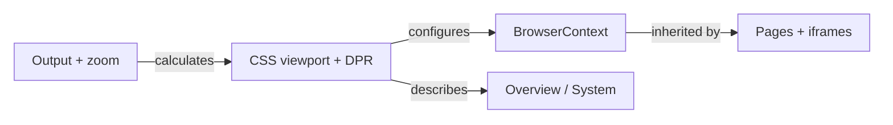
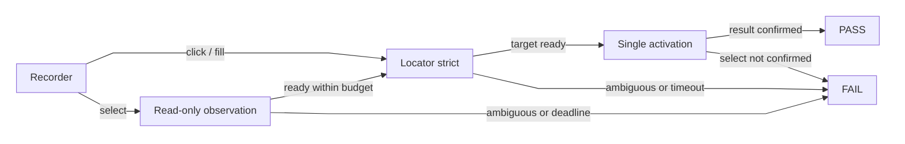
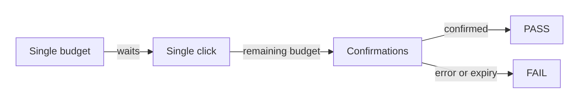
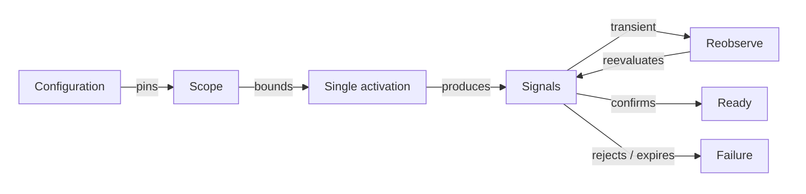
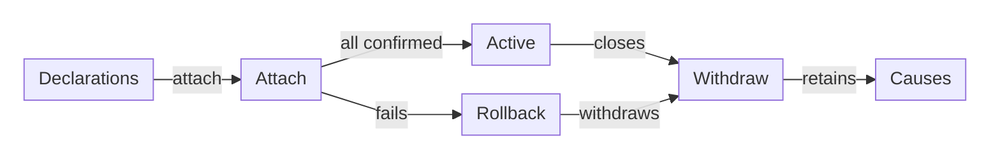
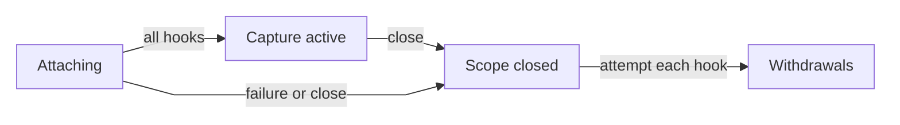

<a id="atf-ui--browser-context-and-playwright-session"></a>
<a id="atf-ui--browser-context-și-sesiune-playwright"></a>
# ATF UI — Browser, Context, and Playwright Session

`atf-ui` is the runtime infrastructure for the Playwright browser. It configures
the browser, context, page, timeouts, viewport, screenshots, and action recorder.
It does not contain report UI tests, the HTML renderer, the Extent publisher, or
product page objects.

<a id="at-a-glance"></a>
<a id="pe-scurt"></a>
## At a glance

**Local guides:** [Playwright](src/main/java/atf/ui/playwright/README.md) · [network](src/main/java/atf/ui/network/README.md).

**Quick links:** [Actions](#actions-and-locators) · [Backend policy](#backend-recovery-through-passive-observation) · [Capture and boundaries](#network-inspector--generic-responsibility-boundary) · [Local proof](#quick-verification)

| Input | Output | Boundary |
|---|---|---|
| YAML browser policy | browser/context/page | generic runtime |
| Playwright actions | neutral action records | no Extent |
| capture and native geometry | UI evidence and measurable dimensions | adapted for consumer Reporting |

<a id="core-diagram"></a>
<a id="diagramă-de-bază"></a>
## Core diagram

```mermaid
%%{init: {"themeVariables":{"fontSize":"15px"},"themeCSS":".nodeLabel, .nodeLabel p { font-size: 15px !important; line-height: 1.35 !important; } .edgeLabel, .edgeLabel p { font-size: 12px !important; font-weight: 400 !important; line-height: 1.2 !important; } .edgeLabel .labelBkg, .edgeLabel p { background: transparent !important; } .edgeLabel foreignObject { transform: translateY(-18px); overflow: visible; } .node rect { rx: 6px; ry: 6px; }","flowchart":{"curve":"linear","nodeSpacing":24,"rankSpacing":40,"padding":10,"diagramPadding":16}}}%%
flowchart LR
    Tests["Tests"] -->|select| Config["Policy"]
    Config -->|configures| Session["Session"]
    Session -->|opens| Browser["Browser"]
    Browser -->|produces| Evidence["Evidence"]
    Evidence -->|feeds| Reporting["Reporting"]
```



<details>
<summary><strong>Legend — browser runtime without reporting</strong></summary>

- configuration describes the browser and generic evidence;
- the session composes browser, context, and page, then records actions;
- atf-ui delivers payloads to the consumer; it does not decide verdicts or build HTML/CSS/Extent;
- the HTML publisher belongs to the selected Reporting library; `UiScreenAudit`
  owns generic screen observation in UI, while local consumer tests verify the
  artifacts their scenarios publish;
- the concrete scenario and business verdict stay with the consumer.
Short labels carry the following meanings:

| In the diagram | Full meaning |
|---|---|
| Tests | consumer tests |
| Policy | browser policy |
| Session | Playwright session |
| Browser | browser / page |
| Evidence | action + screenshot |

</details>

<details>
<summary><strong>Reading map</strong></summary>

- [runtime components](#runtime-components) and [configuration](#generic-configuration-without-a-redundant-flag);
- [actions and locators](#actions-and-locators), including CSS policy;
- [screen validation and screenshots](#screen-validation-and-screenshots);
- [network inspector](#network-inspector--generic-responsibility-boundary),
  boundaries, and [verification](#verification).

</details>

| Responsibility | Owner |
|---|---|
| browser, context, page, viewport, timeout | `atf-ui` |
| primitive Playwright actions and neutral recorder | `atf-ui` |
| page objects, flows, and declarative tests | Shop or AutoEx consumer module |
| selected Reporting contract and rendered output | Reporting library guide; consumer tests verify local integration |
| HTML, CSS, Extent lifecycle, and publisher | `atf-reporting` |
| mock-backed API scenarios and application contracts | Shop or AutoEx consumer tests |

`atf-ui` does not import the audit executor or section publisher: static
validation and report projection belong to `atf-reporting`, while E2E scenarios
are in the [Reporting library contract](../atf-reporting/README.md).
The UI module does not publish Extent or emit section assertions.

<a id="integration-path"></a>
<a id="traseul-de-integrare"></a>
## Integration path

| Intent | Owner and entry point | Evidence |
|---|---|---|
| open the browser and context | [PlaywrightUiSession](src/main/java/atf/ui/playwright/PlaywrightUiSession.java) | [native scale and configuration](src/test/java/atf/ui/playwright/PlaywrightUiSessionTest.java) |
| activate a control once | [single click with postcondition](#single-click-with-explicit-postcondition) | shared deadline and rejection of replay |
| observe the backend without mutation | [BE recovery](#backend-recovery-through-passive-observation) | typed trace and declared read-only operation |
| collect traffic or screenshots | [inspector](#network-inspector--generic-responsibility-boundary) / [screen audit](#shared-screen-audit) | bounded observation, no business verdict |

The application result belongs to the consumer, and HTML belongs to Reporting.
The scale check verifies the native CSS viewport and DPR; the metadata snapshot
describes the configuration and does not replace browser measurement.

<a id="session-lifecycle-and-evidence-boundary"></a>
<a id="lifecycle-ul-sesiunii-și-limita-probei"></a>
### Session lifecycle and evidence boundary

`PlaywrightUiSession` owns Playwright, browser, context, page, and inspector.
It records each release immediately after acquiring an owner. The context
closes the page; the page does not receive an independent second close.

| Boundary | Verified contract |
|---|---|
| partial acquisition | `RuntimeException` and `Error` preserve the same instance; rollback touches only resources returned successfully |
| release | inspector → context → browser → driver; every stage is attempted even if the previous one fails |
| concurrent causes | the first cause remains primary; distinct causes follow in `suppressed`, without self-suppression |
| repeated close | ownership is consumed even when the first close fails; the sequence is not rerun |

The [lifecycle check](src/test/java/atf/ui/playwright/PlaywrightUiSessionTest.java)
uses driver-interface doubles and a package-private seam, without a public fault
hook. The [native component check](src/test/java/atf/ui/playwright/PlaywrightUiSessionTest.java)
separately verifies the browser, scale, and pointer. Listener checks remain
distinct: they do not replace session ownership or the consumer's account policy.

<a id="runtime-components"></a>
<a id="componentele-runtime"></a>
## Runtime components

- `UiBrowserConfiguration` — browser, headless, timeout, navigation timeout, and
  viewport;
- `UiScreenValidationConfiguration` — generic capture policy, without knowledge
  of the report, Extent, or output;
- `PlaywrightUiSession` — scoped lifecycle for a browser context and page;
- `PlaywrightBrowserActions` / `PlaywrightLocatorActions` — primitive operations;
- `PlaywrightActionSequence` / `UiActionRecorder` — neutral operation model;
- `UiScreenValidation` — captures the Base64 PNG payload from the page.

The session is idempotent on close and does not own the Debug UI server. `atf-ui`
does not discover project YAML, resolve outputs, or receive audit decisions;
the consumer composes generic policies and publishes the artifact through
`atf-reporting`.

<a id="generic-configuration-without-a-redundant-flag"></a>
<a id="configurație-generică-fără-flag-redundant"></a>
## Generic configuration without a redundant flag

`atf-ui` exposes only values that describe browser execution and generic
capture. It does not own `report.directory`, `apiSetup`, `audit`, or
`filePrefix`; these settings are selected by the consumer and consumed by the
Reporting library. `atf-ui` does not read them:

[Reporting library contract](../atf-reporting/README.md)

```yaml
ui:
  browser: chromium
  baseUrl: about:blank
  headless: false
  timeout: PT10S
  navigationTimeout: PT45S
  viewport: { width: 1440, height: 900 }
  # Native context scale; output intent stays separate from the CSS layout.
  zoomPercent: 70
  screenshotOnFailure: true
  screenValidation:
    enabled: true
    fullPage: false
```

- `ui.enabled` does not exist and must not be added;
- the runtime is built when the consumer selects a test;
- concrete options describe the browser and evidence;
- `ui.screenValidation.enabled` controls screenshot capture only;
- the key does not activate tests or publish the report;
- `ui.zoomPercent` configures native context geometry; it does not inject
  `zoom`, `transform`, or a script into documents;
- `viewport.width` and `viewport.height` express the requested capture size;
  the effective CSS viewport is calculated separately;
- the value is validated in the `25..200` range, and an absent key preserves `100`;
- consumers own their report configuration, output resolution, and application-specific settings; atf-ui does not load report configuration or publish Extent output.

<a id="native-context-geometry"></a>
<a id="geometria-nativă-a-contextului"></a>
### Native context geometry

The generic default for `zoomPercent` is `100`; consumers' configured values
are read separately from YAML. The example below does not change this default.

[`UiViewportScale`](src/main/java/atf/ui/config/geometry/UiViewportScale.java)
owns the pure calculation, without Playwright or Reporting. The session applies
the CSS viewport and DPR before the first page. Consumers use the same value for
the `Viewport` row in Overview/System, without declaring an unmeasured capture.

| Configuration | Effective geometry |
|---|---|
| requested output `1440 × 1000`, zoom `70` | CSS viewport `2057 × 1429`, DPR `0.70` |
| general rule | DPR = zoom / 100; each CSS dimension = round(output / DPR), minimum 1 |
| zoom `100` | CSS viewport equals requested dimensions, DPR `1` |
| viewport capture | native dimensions may differ by one pixel due to engine rounding |



<details>
<summary><strong>Legend — one calculation, two projections</strong></summary>

- The consumer supplies the configuration; `UiViewportScale` resolves the geometry.
- `PlaywrightUiSession` applies the values to the context before pages are created.
- Shop/AutoEx adapters publish a description of the same geometry in System;
  Reporting retains ownership of rendering.
- The page and iframe receive native input in their CSS space; there is no
  second zoom applied to the child and no manual coordinate correction.

</details>

<details>
<summary><strong>Contract and checks — pointer, layout, and evidence</strong></summary>

- The same geometry applies to new pages, navigations, and iframes; child
  documents are not scaled a second time.
- This emulates the context; it is not the browser menu's zoom command.
  Media queries and layout use the effective CSS viewport; DPR is visible to
  the application. The page's own CSS remains unchanged.
- `fullPage` retains whole-document capture semantics, and masks resolve in the
  same geometry. Output size does not limit full-page capture to viewport height.
- CSS dimension overflow is rejected before browser acquisition. No `force`,
  manually corrected coordinates, or replay is used to obtain PASS.
- [UiViewportScaleTest](src/test/java/atf/ui/config/geometry/UiViewportScaleTest.java)
  protects calculations at 25/70/100/125/200 and overflow.
- [PlaywrightPointerGeometryComponentTest](src/test/java/atf/ui/playwright/geometry/PlaywrightPointerGeometryComponentTest.java)
  checks same/cross-origin and nested HTTP iframes, trusted pointer,
  focus/keyboard, scroll/fixed, navigation/popup, pixels, and masks. An overlay,
  disabled control, or removed frame remains rejected, without activation.
- The 70% cross-origin check runs in Chromium, Firefox, and WebKit; the neutral
  fixture does not certify an external journey or CSS zoom introduced by a site.
- Explicit JavaScript activation remains a separate contract; it is not a
  geometry fallback and does not produce a trusted event.

</details>

<a id="geometry-fixture-gate"></a>
<a id="gate-ul-fixture-ului-de-geometrie"></a>
### Geometry fixture gate

The UI fixture prepares the five documents, layout, and native capture within
the existing navigation budget, then tests the pointer with its native limit of
850 ms. This preparation belongs in `src/test`, separate from application runtime.

```mermaid
%%{init: {"themeVariables":{"fontSize":"15px"},"themeCSS":".nodeLabel, .nodeLabel p { font-size: 15px !important; line-height: 1.35 !important; } .edgeLabel, .edgeLabel p { font-size: 12px !important; font-weight: 400 !important; line-height: 1.2 !important; } .edgeLabel .labelBkg, .edgeLabel p { background: transparent !important; } .edgeLabel foreignObject { transform: translateY(-18px); overflow: visible; } .node rect { rx: 6px; ry: 6px; }","flowchart":{"curve":"linear","nodeSpacing":24,"rankSpacing":16,"padding":10,"diagramPadding":16}}}%%
flowchart LR
    Load["Navigation"] -->|same 5 s budget| Ready["Initialized documents"]
    Ready -->|observes layout| Layout["Stable frames"]
    Layout -->|without input| Paint["Native capture"]
    Paint -->|single activation| Click["Pointer · 850 ms"]
    Click -->|observes| Facts["Count + trusted"]
```



<details>
<summary><strong>Legend — preparation, deadline, and independent oracles</strong></summary>

- [PointerGeometryFixture.openReady](src/test/java/atf/ui/tests/support/geometry/PointerGeometryFixture.java)
  consumes the remainder of the same monotonic 5 s budget for navigation,
  document initialization, three equal observations of iframe rectangles at
  `requestAnimationFrame` cadence, and PNG capture; no stage gets another 5 s.
- Fixture initialization is explicit and verifiable. Preparation does not
  activate, focus, or pre-scroll the target; the browser counter remains zero
  before the single native click.
- The click retains native actionability, hit testing, and auto-scroll at 850 ms.
  An overlay, disabled control, or removed frame remains a rejection; no trial
  click, DOM activation, `force`, or mutation replay is used for preparation.
- [PointerGeometryPreparationComponentTest](src/test/java/atf/ui/playwright/geometry/PointerGeometryPreparationComponentTest.java)
  checks initialization longer than the pointer limit at 70/100% and shared
  navigation-budget exhaustion while layout is still moving, with zero
  activations on failure even when document markers are ready.
- The existing matrix retains all frames, scales, and engines, independent
  pixels, masks, keyboard, and scrolling. The preparation PNG is evidence of
  the captured viewport, not proof that an iframe outside it was already shown.
  Original standards/quirks-mode documents are retained and checked in a browser.
- A later native timeout remains FAIL and does not authorize replay. The
  investigation retains the first activation's trace and real counters; a green
  retry alone does not establish the cause of an earlier failure.

</details>

<a id="actions-and-locators"></a>
<a id="acțiuni-și-locatori"></a>
## Actions and locators

`atf-ui` can perform an operation on an `AtfLocator`, but it does not choose the
selector or know the business intent. Locators, page objects, and business
intent belong to the consumer; `atf-ui` supplies generic browser and locator
operations.

Reusable DOM vocabulary is owned here, close to the UI runtime:

- `HtmlElement` defines canonical tags (`input`, `textarea`, `select`,
  `option`, `button`, `a`, `img`, and frequently used structural elements);
- `HtmlAttribute` defines stable HTML/automation attributes and composes exact
  or prefix selectors using centralized escaping;
- `CssStringEscaper` escapes dynamic values for quoted CSS contexts;
- `CssPseudoClass` composes reusable pseudo-classes, such as `:checked`;
- consumer modules keep only product values and semantics locally, not copies of
  the physical DOM vocabulary.

Example:

```java
HtmlElement.INPUT.attributeEquals(HtmlAttribute.ID, "email");
HtmlElement.ANCHOR.attributeStartsWith(HtmlAttribute.DATA_TEST, "product-");
CssPseudoClass.CHECKED.applyTo(HtmlElement.OPTION.selector());
```

```text
Report*Locators
    → AtfLocator(selector + Locator)
    → PlaywrightLocatorActions
    → PlaywrightActionSequence
    → flow / extractor / validator in atf-reporting
```

- tests do not call `page.locator(...)`, `getByRole(...)`, or
  `getByText(...)`;
- `TARGET` publishes the actual selector used, not descriptions such as
  `"selected owner"` or `"collapse node"`;
- supported operations are `Navigate`, `Click`, `Get text`, `Find element`,
  `Expect text`, `Focus`, `Wait for visible`, `Expect visible`, and `Wait`;
- `Get text` returns the observed text to the caller for in-memory assertions;
  for sensitive locators, the action record and trace publish only
  `[REDACTED]`. `Expect text` compares the actual value at runtime and retains
  the same redaction in evidence;
- asynchronous states use Playwright waits with timeouts:
  `waitFor`, `waitForCondition`, `waitForURL`;
- `waitForTimeout` is not an accepted stabilization API.

<a id="native-waiting-and-uniqueness"></a>
<a id="așteptare-nativă-și-unicitate"></a>
### Native waiting and uniqueness

`Click`, `Fill`, and `Select option` retain strict Playwright operations.
Selection adds read-only observation before the first native activation: the
locator is resolved again for each observation, and the control must be visible,
enabled, and contain the option according to the native `option.label` property.
The recorder publishes one action; `UiRetryPolicy` does not retry the mutation.

A temporarily absent target can become available; ambiguity remains an error.
`Select option` also requires confirmation of a selected value: an empty native
result produces FAIL, retaining the selector, with no additional attempt.

| Owner | Responsibility |
|---|---|
| `PlaywrightSelectAction` | read-only preparation and the single `selectOption` call; `fieldset`, ARIA, and frame/document through the strict locator |
| `PlaywrightLocatorActions` | redaction, single record, and context; native cause for non-sensitive targets |
| `ObservationBudget` | one deadline from the sequence timeout; observation consumes budget, and selection gets only the remainder |

The adapter does not use sleep, `force`, or selection events generated by script.

| Situation | Required result |
|---|---|
| select replaced before activation | observe the current target and select natively once |
| ambiguous, absent, or unready target at the deadline | FAIL without a native selection call |
| native value not confirmed after the call | FAIL; do not retry the call or infer success from the DOM value alone |
| exception after an event has occurred | preserve FAIL and the diagnostic allowed by redaction; no further activation or rollback |



<details>
<summary><strong>Legend — resolution before activation</strong></summary>

- The delegated contract is [Playwright actionability](https://playwright.dev/java/docs/actionability),
  with uniqueness and checks specific to each operation.
- `PlaywrightLocatorReadinessComponentTest` uses a browser and local documents:
  delayed target, permanently missing target, ambiguity, new document, and
  replaced target.
- `PlaywrightSelectContinuityComponentTest` separately counts native calls,
  input/change events, and activations of the old control. It covers replacement,
  delayed/missing options, ambiguity, same/cross-origin frame, document,
  label/multiple select, consumed budget, unknown result, and sensitive data.
- The fixture browser belongs to the test class, and each case receives a new
  context and page; startup is outside the selection deadline. Checks do not
  increase the budget when the browser or application is slow.
- No observation changes the value or dispatches events. The pinned driver
  remains the same; a replacement during the native call can remain an
  unconfirmed FAIL, without replay. Business preconditions stay with the consumer.
- Sensitive actions preserve the recorder's safe diagnostic without the raw
  cause that could reveal the label. The non-sensitive check verifies the
  identity of the native cause.
The short labels have the following meanings:

| In diagram | Full meaning |
|---|---|
| Recorder | recorder · one operation |
| Read-only observation | target and option observed before the first activation, within the same deadline |
| Strict locator | strict locator · one wait budget |
| Single activation | one activation |
| FAIL | auditable FAIL |

</details>

<a id="single-click-with-explicit-postcondition"></a>
<a id="click-unic-cu-postcondiție-explicită"></a>
### Single click with explicit postcondition

`PlaywrightActionSequence.clickAndAwait` confirms a consumer-selected read-only
postcondition instead of implicitly waiting for navigations triggered by a click.

- The operation uses the strict native pointer; it does not activate through JavaScript or use `force`.
- The click and postcondition share the action's captured, monotonically measured budget.
- The callback uses read-only confirmations only. Each native wait receives
  `ObservationBudget.remainingMilliseconds()`, with no new budget or replay.
- Native waits track document replacement; a Java predicate that queries the
  DOM during navigation is not used as a polling mechanism.
- A failure before the click preserves the native error; after the click, the
  error states that activation completed but the postcondition was not confirmed,
  preserving the cause.



<details>
<summary><strong>Legend — activation versus state confirmation</strong></summary>

The composition is explicit and does not change `click` for other actions.
The adapter uses the pinned driver's navigation option, according to the
[Playwright contract](https://playwright.dev/java/docs/api/class-locator#locator-click-option-no-wait-after).
It does not interpret native logs as proof of success or grant the postcondition
a second full budget. `PlaywrightClickPostconditionComponentTest` checks an
uncommitted subframe, a missing postcondition, and absent/ambiguous targets.
The short labels have the following meanings:

| In diagram | Full meaning |
|---|---|
| Single budget | One budget |
| Single click | Strict pointer · one activation |
| Confirmations | Native read-only confirmations |
| PASS | auditable PASS |
| FAIL | FAIL · no replay |
| waits | waits for actionability |

</details>

<a id="ui-locator-conventions"></a>
<a id="convenții-pentru-locatori-ui"></a>
### UI locator conventions

CSS is the default choice for stable DOM contracts. Prefer an exact selector
anchored on an element and attribute, in the form `element[attribute='value']`,
for example `a[href='/products']` or `input[data-qa='signup-email']`. Use
`data-qa`, `id`, or `name` for stable hooks; for navigation, an exact `href`
expresses the destination better than position or visual appearance.

- Reuse `HtmlElement` and `HtmlAttribute` for tags, attributes, and escaping
  when the result remains readable. `HtmlElement.attributeEquals(String
  name, String value)` also covers valid attributes without a dedicated enum,
  such as `data-qa`.
- Keep compound or application-specific selectors explicit and named in the
  consumer; do not expand the generic vocabulary for one page.
- Avoid fragile positional selectors (`nth`/`first` without demonstrated unique
  context), purely visual classes, and XPath. Use Playwright pseudo-selectors
  such as `:visible` or `:has-text(...)` only when visibility/text is a real
  precondition and stable CSS cannot express the contract.
- Do not extract every literal into a constant: centralize repeated or
  contractual values, and avoid generic constants with one consumer.
- Test-scope locator wrappers must not hide the target: the action sequence
  reports the actual selector used, not a description such as
  `"selected owner"` or `"collapse node"`.

Selector composition and generic escaping (`CssStringEscaper`) are checked by
`atf-ui` component tests; consumer tests then verify selectors against the
real application's markup.

In CI/ATF Debug, the provisioned headless browser can be selected only as a
bootstrap override:

- JVM: `-Datf.ui.playwright.executablePath=<chromium-executable>`;
- environment: `ATF_UI_PLAYWRIGHT_EXECUTABLE_PATH`;
- this is not a business YAML key;
- without an override, the launcher retains standard Playwright provisioning
  and fails closed if the browser is unavailable.

`PlaywrightActionSequence` is the recorder, not the auditor:

- records order, target, expected, observed, duration, and status;
- redacts sensitive values before they enter records or the diagnostic trace;
  common selectors for passwords, personal data (including
  `mobile_number`, `postal_code`, and `zipcode`), and card/CVC data are
  recognized automatically; for an opaque control name, the consumer uses
  `new AtfLocator(locator, selector).withSensitiveData()`. The actual action
  receives the original value, but report/replay/trace do not retain it, and
  locator failure messages do not propagate raw text;
- action ordinals are monotonic within a sequence and continue across `drain()`;
  in E2E, the same sequence retains identity across setup and body checkpoints;
- the pure validator in `atf-reporting` decides whether the DOM snapshot matches
  the expected projection.

<a id="readiness-with-a-shared-deadline"></a>
<a id="readiness-cu-deadline-comun"></a>
### Readiness with a shared deadline

`awaitVisible(AtfLocator, Consumer<ObservationBudget>)` composes explicit
consumer preparation with the final native visibility check. The
`PlaywrightBrowserActions` owner uses the same recorder and sequence timeout;
the callback receives only the remaining budget, not a way to reset it.

- The consumer limits every native call with `remainingMilliseconds()`.
  A callback that finishes after the deadline is rejected even if the element is visible.
- A successful callback does not replace the native check. The original error
  propagates, and the final action remains FAIL if preparation or visibility fails.
- `Await visible` is not in the global retry allowlist; the entire callback is
  not retried automatically. Policy for a business read remains with the consumer.
- Sensitive data uses the same locator classification and redaction as existing
  actions; UI does not know Shop routes or statuses.

`PlaywrightReadinessBudgetComponentTest` checks the single deadline, original
cause, absence of replay, and required native check. The `clickAndAwait`,
pointer/JavaScript, and read-only retry contracts retain separate checks.

<a id="explicit-javascript-activation"></a>
<a id="activare-javascript-explicită"></a>
### Explicit JavaScript activation

`clickWithJavaScript(AtfLocator, String, Runnable)` is opt-in for a control that
allows DOM activation. It is not a fallback for `click(...)` and does not
simulate a trusted pointer event. The consumer justifies the choice and supplies
a read-only postcondition that throws if the expected effect is missing.

| Contract | Behavior |
|---|---|
| Preconditions | unique, visible, and enabled target; postcondition required |
| Execution | call `HTMLElement.click()` once, then run the postcondition |
| Evidence | one `JavaScript click` row; PASS only after the postcondition, with shared duration |
| Failure | FAIL on activation or postcondition; propagate the error and redact sensitive data |
| Retry | no automatic mutation retry, even when read-only retries are enabled |
| Normal click | remains a Playwright pointer operation with hit testing; it does not switch to JavaScript automatically |

`PlaywrightJavaScriptClickComponentTest` checks these rules at 70%, in the main
document and same-origin/isolated iframes. The fixture is neutral HTML owned by
`atf-ui`, not an advertisement or simulated business page.

<a id="instrumented-download-without-replay"></a>
<a id="download-instrumentat-fără-replay"></a>
### Instrumented download without replay

`PlaywrightActionSequence.download(...)` arms the listener before the click,
passes the remaining budget to the caller's observation, and requires a real
Download event. The entire operation has one ACTION record with measured status
and duration.

- The consumer callback may observe or replay an explicitly owned GET; policy
  for the application remains with the consumer, with no endpoints in UI.
- Download is not eligible for the recorder's automatic retry. The listener is
  removed even if registration or the callback fails.
- The original cause and distinct cleanup remain inspectable. The generic check
  is `PlaywrightDownloadComponentTest`; application fixtures stay with the consumer.

<a id="screen-validation-and-screenshots"></a>
<a id="validarea-ecranului-și-capturi-de-ecran"></a>
## Screen validation and screenshots

`UiScreenValidation.capture(page, configuration, title)` returns a Base64 PNG
payload and does not write an external PNG file. The publisher in
`atf-reporting` exposes it once as an inline `📷 base64 img` link with
`data:image/png;base64,...`. Pill alignment, table separation, and disclosures
are reporting contracts, not CSS in `atf-ui`.

The generic separation of flow mode, screenshot policy, and capture source is
documented in
[`docs/ATF_Evidence_Capture_Contract.md`](../docs/ATF_Evidence_Capture_Contract.md).
`atf-ui` is the browser provider, not the owner of the policy, consumer YAML,
or HTML publisher.

A `UI validation` step must keep the following in the same visual state:

```text
real Playwright actions
  → screenshot of that state
  → observations
  → assertions
```

Do not attach the same image to every assertion or use a Java assertion that
hides the action from the report. The full contract for cardinality, markup,
and rendering is in the [Reporting JAR atlas](../atf-reporting/README.md).

<a id="shared-screen-audit"></a>
<a id="audit-comun-al-ecranului"></a>
### Shared screen audit

- `atf.ui.audit.UiScreenAudit` records the screen observation and can
  transfer the action sequence with one `drain`.
- It receives the assertion count and consumer verdict; it does not know Shop,
  AutoEx, JUnit, or Reporting and does not calculate the business verdict.
- It reuses `UiScreenValidation.Evidence.hasScreenshotPayload()`; a requested
  but missing or invalid screenshot does not consume prior evidence.

<a id="backend-recovery-through-passive-observation"></a>
<a id="recuperare-be-prin-observație-pasivă"></a>
## Backend recovery through passive observation

`UiBackendRecovery` coordinates one semantic operation in the current document.
The scope opens before the action; the application executes the action once,
and `await` receives only a side-effect-free DOM observation.

The observation must be bounded: the controller checks the deadline before and
after the call, but does not interrupt a blocking callback. Nested waits use
`remaining()`, with no new deadline.



<details>
<summary><strong>Legend — shared deadline and observation limits</strong></summary>

- `UiRecoveryConfiguration` is immutable; `enabled=false` and capture OFF are
  defaults, and the accepted profile is `read-only`.
- `begin(operation)` starts the monotonic deadline before the action.
  `remaining()` lets the original wait be limited to the budget remaining.
- The first evaluation consumes one attempt; observations and backoff consume
  the same deadline. Success after the deadline counts as exhaustion.
- Reobservation does not receive a click, request, or journey callback; it does
  not send BE calls. It adds no global retry for setup, cleanup, or components.
- `UiRetryPolicy` and existing settlement retain their contracts; this
  controller does not chain new budgets or replay automatically.

The INFO observation has zero row duration; observation/backoff/total are
explicit measurements in metadata, and cumulative total is not summed across
each row. Explicit E2E phase duration remains separate from total BE scope
duration, according to the [typed timing contract](../atf-reporting/README.md#timing-măsurat-înaintea-publicării).
The short labels have the following meanings:

| In diagram | Full meaning |
|---|---|
| Configuration | YAML + neutral restriction |
| Scope | scope opened before the action |
| Single activation | one activation only |
| Signals | document + BE signal + DOM |
| Reobserve | reobserve within the same budget |
| Ready | INITIAL_READY / RECOVERED |
| Failure | failure with an explicit reason |
| confirms | correlated 2xx + valid state |
| transient | permitted transient response |
| rejects / expires | rejection or exhaustion |

</details>

<details>
<summary><strong>Correlation, rejections, and captured data</strong></summary>

| Condition | Decision |
|---|---|
| Initially READY, policy or capture OFF | initial success; no recovery |
| Explicit READ_ONLY operation, allowlist, and capture opt-in | may reobserve |
| Correlated 2xx + DOM still pending | wait within budget; 2xx alone does not certify the business outcome |
| Correlated 429/502/503/504 | reobserve without retransmission; valid Retry-After stays within the deadline |
| Redirect, rejected HTTP status, request-failed, or missing signal | distinct rejection; no invented HTTP status |
| Changed document, different frame, changed query, or incompatible concurrent request | cannot borrow the signal |
| Invalid business state, wrong session, or ambiguity | reject; do not normalize the expected value |
| Observation/capture/publication error or interruption | propagate/stop; do not rerun the business action |

The observer listens only for metadata from requests started after the scope
opens, in the owned main frame, for the page origin or explicitly declared
backend endpoint. It does not read bodies, cookies, or authorization.

The receipt retains invocation, operation, frame/document, sequence, and
`capturedAt`; two different complete URLs are not the same request. The full
query is compared privately in memory and is not published.

Capture is opt-in through `captureBackendSignals`, separately from UI/UI_API
presentation. The 64-request limit and overlapping scopes are rejected;
responses to requests from before the scope cannot authorize it.

This increment classifies only explicitly read-only GET/HEAD requests in the
same document. A mutating GET remains excluded; recovery navigation and
idempotency for writes require separate contracts.

</details>

`UiRecoveryConfigurationTest`, `UiRecoveryLoopTest`, and
`UiBackendRecoveryComponentTest` check the policy, deadline, and browser.
Application operations are in consumer main sources; the neutral declaration is in
[Kit](../lib/README.TestKit.md#scope-and-integration).

<a id="observation-listener-scope"></a>
<a id="scope-ul-listener-elor-de-observație"></a>
## Observation listener scope

`ObservationBudget` accounting has a [controlled-tick check](src/test/java/atf/ui/playwright/ObservationBudgetComponentTest.java):
confirmations consume the same deadline, exact expiry is rejected, and a
fraction of a millisecond does not become a zero native timeout. [Browser integration](src/test/java/atf/ui/playwright/PlaywrightReadinessBudgetComponentTest.java)
separately checks native observation, the original cause, and absence of replay.

`UiBackendRecovery.recording` composes the controller and INFO rows used by
Shop and AutoEx, with explicit policy, operations, and recorder. The endpoint,
method, and read-only classification remain with the consumer; BE is not enabled
by default.

| Protocol | Preserved observation and decision |
|---|---|
| passive UI BE | allowlisted GET/HEAD, invocation/operation/document stamp, conflicts, and at most 64 signals; no retransmission |
| Shop catalog | latest eligible GET/QUERY, current request/frame/document; at most one home GET after a confirmed transient response, within the initial budget |
| AutoEx navigation | document GET and application route/origin; observed queue-full or 520/525, with its own policy |

These protocols are not interchangeable. Shop separates observation from the
refresh decision in main; the passive UI observer does not become permissive for
QUERY or concurrent requests.

- In the passive loop, `Retry-After` anchors the delta to signal receipt and
  rejects invalid input.
- The Core parser receives an explicit clock and fallback; a mechanical
  replacement would change the grammar or remaining budget.

`UiListenerScope` owns attachment and removal of browser callbacks. The passive
UI observer, Shop catalog, and address lookup compose it in main; business
policies and the JUnit runner remain with their owners.



<details>
<summary><strong>Legend — atomic callback attachment and withdrawal</strong></summary>

- Declarations pin attach/detach pairs before browser effects.
- Partial attachment is not active; rollback and close withdraw every declared
  pair, with callbacks already inactive.
- The first cause remains primary, and later distinct causes are suppressed;
  reusing the same instance does not cause self-suppression.

</details>

| Stage | Contract |
|---|---|
| Declaration | all attach/detach pairs are registered before the first attachment |
| Attachment | `active()` becomes true only after every attachment succeeds; callbacks check this guard before using driver objects |
| Rollback | the first acquisition cause remains primary; each distinct cleanup error is suppressed, including `Error` |
| Close | the scope becomes inactive before withdrawal; all pairs are attempted once, in declared order |
| Identical errors | object identity prevents self-suppression and duplicate causes; cleanup continues |

Even if close fails, ownership is consumed: all withdrawals have already been
attempted, and a second close is inert. The scope uses the caller's Playwright
thread; it does not introduce transport, replay, or a new timeout.

`UiListenerScopeComponentTest`, `UiRecoveryObserverLifecycleComponentTest`, and
`ShopCatalogLifecycleComponentTest` check normal behavior, partial attachment,
identical/distinct causes, and retained callbacks.

<a id="network-inspector--generic-responsibility-boundary"></a>
<a id="inspectorul-de-rețea--limită-generică-de-responsabilitate"></a>
## Network inspector — generic responsibility boundary

The cross-module flow and setup/causal baseline have one owner in the
[architecture diagram](../docs/ATF_Architecture.md#ui-traffic-capture-and-selection).

`UiNetworkInspector` is opt-in and restricted to configured hosts:

- listeners observe request start, `request-finished`, and `request-failed`; they
  do not replay requests or decide the test verdict;
- observations become typed data, with URL/query, headers, and body redacted/bounded;
- a failure without a response has status `Unavailable` and an explicit reason;
- no response is fabricated for a failed request.

| Contract | Owner |
|---|---|
| raw stream and presentation-only collapse of consecutive signatures | `atf-ui` |
| bounded waiting through an explicit settlement policy, without action retry/replay | `atf-ui` |
| service alias, checkpoint correlation, and business verdict | consumer |
| HTML cards and aggregate summary | `atf-reporting` |

Selection precedes body reading and budget reservation:

```mermaid
%%{init: {"themeVariables":{"fontSize":"15px"},"themeCSS":".nodeLabel, .nodeLabel p { font-size: 15px !important; line-height: 1.35 !important; } .edgeLabel, .edgeLabel p { font-size: 12px !important; font-weight: 400 !important; line-height: 1.2 !important; } .edgeLabel .labelBkg, .edgeLabel p { background: transparent !important; } .edgeLabel foreignObject { transform: translateY(-18px); overflow: visible; } .node rect { rx: 6px; ry: 6px; }","flowchart":{"curve":"linear","nodeSpacing":24,"rankSpacing":40,"padding":10,"diagramPadding":16}}}%%
flowchart LR
    Event["Event"] -->|filters| Host["Host"]
    Host -->|selects| Policy["Policy"]
    Policy -->|reserves| Budget["Journal"]
    Budget -->|redacts| Body["Observation"]
    Body -->|publishes| Consumer["Adapter"]
```



<details>
<summary><strong>Legend — scope, budget, and cursor</strong></summary>

- `UiNetworkCapturePolicy.asynchronous()` selects XHR/fetch regardless of route
  prefix or Content-Type; static resources do not consume the journal.
- `includingDocuments()` explicitly includes navigations and forms;
  `forPaths(...)` optionally narrows the consumer's scope. The host allowlist
  remains mandatory. Earlier constructors retain `allResources()` for
  compatibility; API consumers configure the async policy explicitly.
- `UiNetworkObservation.resourceKind()` retains Playwright classification;
  `OTHER` preserves compatibility with earlier typed fixtures without
  reclassifying known browser resources as API traffic.
- `statistics()` separates accepted, retained, excluded, and dropped;
  `inFlight` counts capture reservations in progress, not all browser requests.
  `limitReached` indicates rejection at the limit, not merely reaching capacity.
- `captureSummary()` retains the compatible projection of earlier counters;
  `statistics()` is the extended snapshot.
- Capture is complete within the scope at snapshot time only if there are no
  lost observations or in-progress captures; it does not certify future traffic.
- `observationsSince(cursor)` preserves append-only order and delimits capture
  windows. Presentation collapse does not move the cursor; receipt time does
  not prove when a request started.
- Cookie/Set-Cookie, auth headers, and credentials with known keys/paths are
  redacted before subscribers; redirects and Referer do not publish queries or
  fragments. HTTP/2 pseudo-headers do not duplicate the raw URL in
  headers/replay. Application-specific PII policy remains with the consumer.

`UiNetworkInspectorComponentTest` also checks, in a local browser with controlled
intercepted traffic, asset filtering, successful/failed fetches, and overflow.
The checks do not depend on a public store or Reporting.
The short labels have the following meanings:

| In diagram | Full meaning |
|---|---|
| Event | Request finished / failed |
| Host | Host allowlist |
| Policy | Resource type + path policy |
| Journal | Bounded journal |
| Observation | Typed observation |
| Adapter | Subscriber / reporting adapter |
| redacts | reads and redacts |

</details>

`capture(UiNetworkObservation)` also accepts fixtures/adapters. Before storage
and subscriber notification, the inspector reconstructs or bounds URL/path,
headers, body, auth/source, failure, service, and signature. The negative test
for caller-created input protects this boundary.

Request-start identity and receipt order have distinct contracts:

| Boundary | Contract |
|---|---|
| Start | `UiRequestTimeline` produces `UiRequestIdentity`: scope UUID and local sequence, without payload. |
| Marker | `requestMarker()` passively reads the browser to process events that preceded the action boundary. |
| Selection | `isAfter(...)` requires the same scope and a strictly later start; receipt sequence remains separate. |
| Compatibility | A legacy observation without identity remains unknown; redaction preserves explicit identity. |
| Custom adapter | Uses `requestStarted()` and `withRequestIdentity(...)` only after explicitly observing the start. |

Raw journal completeness and delivery to subscribers have distinct limits:

- Each notification uses the same subscriber snapshot. A `RuntimeException`
  is isolated, and healthy subscribers receive the same redacted observation,
  regardless of registration order or context closure during the callback.
- `deliveryFailures()` provides an immutable snapshot with observation sequence,
  subscriber ordinal, safe signature, and original cause; it does not fabricate
  HTTP errors or change accepted/retained/dropped. The cause is not published in
  HTML by default.
- A fatal `Error` propagates; in this case the inspector does not claim complete delivery.
- `UiNetworkDeliveryComponentTest` and `UiRequestIdentityComponentTest` check
  these limits through the public port and a real fetch in a local browser, without replay.
- Logical close precedes unsubscribe: new captures and subsequent native
  callbacks become inert, while already retained evidence remains inspectable.
  A subscriber snapshot whose delivery has started completes even if a
  subscriber closes the inspector.
- Every acquired unsubscribe is attempted once. The first error remains
  primary, including `Error`; distinct errors are suppressed. A repeated close
  does not repeat operations with an unknown native result.
- `UiRequestTimeline` compensates for its own registration even when used
  directly, without an inspector. An explicit capture after close does not
  dereference an expired browser `Response`; the retained journal remains
  available for audit.
- Partial attachment failure is compensated locally; the acquisition cause
  remains primary, with each distinct rollback error directly suppressed. No
  capture is retained or delivered before the last registration succeeds.
  Reentrant close stops further registrations; a closed scope is not reopened.
  Native unsubscribe rejection is not presented as successful withdrawal.
- `UiNetworkLifecycleComponentTest` injects failures in every registration and
  unsubscribe, before/after the registration effect, with multiple/identical
  causes, capture during partial attachment, and close during registration,
  capture, or delivery. Delivery and start-identity regressions remain separate.

When the scope may publish:



<details>
<summary><strong>Legend — attachment and closure</strong></summary>

- Attachment becomes active only after the final registration; a premature
  capture does not consume the journal or reach subscribers.
- The scope closes before withdrawals. A cleanup error does not reopen it or
  authorize repeating a withdrawal with an unknown result.
- A delivery snapshot that has already started completes; a capture still being
  built at close is dropped. The session continues to own the page/context.

</details>

- Captured bodies do not use `trim()`; leading/trailing whitespace and
  whitespace-only payloads remain data, not absence.
- Redaction and the preview limit remain active before storage/subscribers;
  the signature uses the same redacted, bounded body without removing spaces.
- `UiNetworkBodyFidelityComponentTest` checks local browser capture, typed
  sanitization, subscriber notification, and signature separation.

The raw journal preserves the order and status of each observation. Presentation
compaction retains the first observation in each sequence with the same
signature; non-consecutive repetitions and total occurrence counts remain inspectable.

`UiNetworkPresentationStreamComponentTest` independently checks ordering,
`201→500`, disabled policy, and repetitions separated by another request.
A compacted view does not replace the journal used for business selection.

Read-back after an action:

- before the action: capture `observationCursor()`;
- after the action: use `awaitAfter(cursor, predicate, timeout)`; a GET captured
  before the cursor cannot satisfy the current settlement;
- limit: the cursor guarantees capture order, not request start, payload
  identity, or idempotency. A previous request still in flight may be captured
  after the cursor; associating it with the action requires additional
  correlation. `await(...)` searches the entire journal, and no method retries the mutation.

Playwright retry contract:

- `UiRetryOperation` permits read-only operations only; click, submit, and other
  mutations are not configurable and do not get a second attempt;
- business-specific retry belongs to the consumer and requires stable identity,
  a fully associated payload, and a server-side idempotency guarantee;
- `requestSignature` groups observations and uses a redacted/bounded body; it
  does not represent payload identity for replay;
- request observation and a temporal cursor do not prove idempotency.

Reopen the contract only if a caller-supplied observation can bypass
resanitization/bounding, a previous read-back satisfies a new settlement,
request-failed fabricates a response/verdict, or a mutation is retried without
an idempotency contract. Any retry extension remains a separate consumer
decision and does not change the generic fail-closed policy.

<a id="what-does-not-belong-in-atf-ui"></a>
<a id="ce-nu-se-pune-în-atf-ui"></a>
## What does not belong in `atf-ui`

- JUnit tests or API collections;
- consumer-specific report configuration, API setup, and audit composition;
- application-specific report locators, fixtures, and business expectations;
- HTML/CSS/Extent nodes or artifact finalization;
- page objects, product selectors, and business flows;
- fallback to an arbitrary artifact or modification of API input.

These boundaries are intentional: `atf-ui` provides the local Playwright
 adapter, and the versioned Reporting library provides report publication. Practice Shop and AutoEx keep their application scenarios, adapters, and report checks in their own J1 modules.

<a id="verification"></a>
<a id="verificare"></a>
## Verification

Runtime/configuration tests:

```text
mvn -pl atf-ui -am test
```

Run the local report-producing component check, for example:

```text
mvn -pl atf-test-auto-ex -am -Dtest=AutoExE2eOverviewNarrativeComponentTest -Dsurefire.failIfNoSpecifiedTests=false test
```

Build and audit:

- build in external staging (`${ATF_STAGING_ROOT}/atf-ui-<id>`);
- current runs and servers remain intact;
- publish the approved UI report only to the consumer's configured directory;
- verify the resulting HTML artifact through ATF Debug UI and Playwright/browser
  MCP;
- checks cover clicks, expand/collapse, accessibility tree,
  console/network, and rendering;
- do not use the real Windows browser.

For synchronization and safety, see
[`docs/ATF_Build_And_Execution_Safety.md`](../docs/ATF_Build_And_Execution_Safety.md);
for the visual contract, see
[Reporting JAR atlas](../atf-reporting/README.md).

<a id="quick-verification"></a>
<a id="verificare-rapidă"></a>
## Quick verification

| Decision | Source and limit |
|---|---|
| bounded capture, filtering, and retention | [owner source](src/main/java/atf/ui/network/UiNetworkInspector.java); check: [UiNetworkInspectorComponentTest](src/test/java/atf/ui/network/UiNetworkInspectorComponentTest.java) |
| dependencies and source sets | [POM](pom.xml); declared scope is authoritative for integration |
| What this check does not demonstrate | Complete retention does not prove delivery to all subscribers or causality of an action. |

<details>
<summary><strong>Command for a local check</strong></summary>

Run from the root of [external staging](../docs/ATF_Build_And_Execution_Safety.md), with JDK 21 and Maven.

```powershell
mvn -B -pl atf-ui -am "-Dtest=UiNetworkInspectorComponentTest" "-Dsurefire.failIfNoSpecifiedTests=false" test
```

The command selects the named check and builds its dependencies; it does not
claim that the entire module passed. Complete retention does not prove delivery
to all subscribers or causality of an action.

</details>

<a id="full-context-screenshots"></a>
<a id="capturi-de-ecran-cu-context-complet"></a>
## Full-context screenshots

Every screenshot used as test evidence preserves the surrounding page context.
Shop and AutoEx journeys use their configured 70% zoom and complete browser
viewport; Android retains its entire physical display and orientation.

| Boundary | Required behavior |
|---|---|
| Capture | Use the complete page viewport; preserve navigation, surrounding content and every frame edge |
| Zoom | Keep the configured browser-context scale; Shop/AutoEx use 70% to expose more page context |
| Additional detail | A region or element close-up may supplement the original context image, never replace it |
| Report viewer | Fit the complete source image to the available screen, preserving aspect ratio and every edge |
| Full document | Explicit full-page capture preserves document height; the configured output height does not crop it |
| Test coverage | Pixel oracles verify all four corners at 70/100% and extra lower-page context at 70%; independent geometry-scale tests keep their own scales |

The [native geometry regression](src/test/java/atf/ui/playwright/geometry/PlaywrightPointerGeometryComponentTest.java)
checks captured PNG pixels rather than configuration alone. This owner
contract covers capture, viewer geometry and consumer context.

<a id="explicit-fixture-preparation"></a>
<a id="pregătirea-explicită-a-fixture-ului"></a>
## Explicit fixture preparation

[`PlaywrightPagePreparation`](src/main/java/atf/ui/playwright/PlaywrightPagePreparation.java)
prepares a document before a measured native operation. Callers choose it
explicitly; ordinary runtime actions retain their existing behavior.

| Phase | Native operation | Budget and authority |
|---|---|---|
| Document load | `navigate` or `setContent` | existing navigation budget starts once |
| Current document context | attach `:root` | remaining navigation budget; no target selection or mutation |
| Rendered viewport | native PNG, animations allowed | same remaining budget; no click, fill or forced action |
| Native input and postcondition | existing recorder | original action budget; strict visibility/stability/hit testing and no replay |

- The receipt exposes fresh viewport PNG bytes, elapsed preparation time and
  the document URL. PNG bytes are defensive copies; capture failure or late
  completion cannot authorize input.
- A painted document does not certify a disabled, covered, moving or readonly
  target. Those refusals and a false postcondition keep their original action deadline.
- Fixture preparation consumes one bounded navigation allowance across all
  stages; attachment and capture do not receive a renewed timeout.

<a id="deterministic-click-deadline-with-a-postcondition"></a>
<a id="deadline-determinist-al-clickului-cu-postcondiție"></a>
## Deterministic click deadline with a postcondition

`ObservationBudgetComponentTest` checks the arithmetic and actual
`clickAndAwait` owner with a controlled monotonic clock: the pointer, successive
observations, and callback return consume the same deadline. Injectable
constructors remain package-private; ordinary execution uses `System.nanoTime`.

The duration reported by the recorder remains measured in real time,
independently of the check's clock. Browser checks verify state and activation
after fixture preparation; they do not infer deadline propagation from a
system wall-clock threshold.
