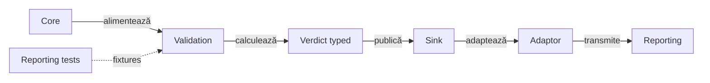
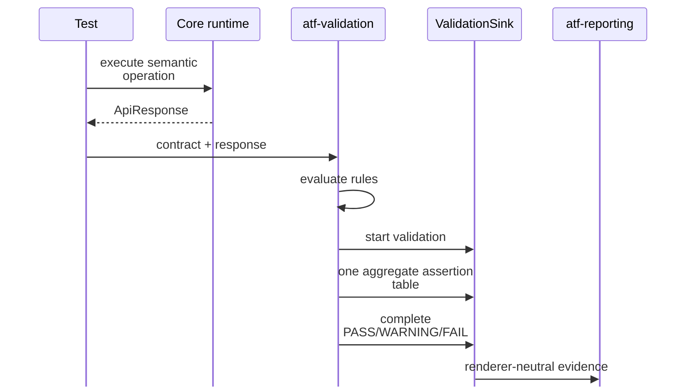

# ATF Validation — contracte independente de motorul de randare

`atf-validation` este modulul care transformă un `ApiResponse` și un contract
de response într-o decizie verificabilă și într-un set de assertions publicabil.
Este un JAR reutilizabil: nu face HTTP, nu cunoaște Extent și nu construiește
HTML/CSS.

## Pe scurt

**Trasee rapide:** [API public](#responsabilități-publice) · [Audit componentă](#limita-față-de-auditul-testelor-componente) · [Comparator AI](#comparatorul-ai--contract-implementat) · [Probe locale](#verificare-rapidă)

| Input | Decision | Output |
|---|---|---|
| response + rules | contract evaluation | typed validation outcome |
| outcome + evidence sink | semantic publication | port neutru către reporting |
| invalid payload | failure evidence | fără renderer în runtime |

## Diagramă de bază

Diagrama arată fluxul de date și colaborarea runtime; nu este graful de
dependențe Maven. Graful de module și sensul săgeților sunt în README-ul
rădăcină și în `docs/ATF_Architecture.md`.



<details>
<summary><strong>Legendă — verdict fără renderer</strong></summary>

- `atf-core` oferă modele și porturi neutre;
- `atf-validation` evaluează contractul și produce decizia typed;
- `ValidationSink` este singurul seam către publicare;
- adapterul consumerului mapează evidence-ul spre `atf-reporting`, fără să schimbe verdictul calculat;
- `atf-reporting` rămâne standalone și nu devine dependent de `atf-validation`.
Etichetele scurte păstrează următorul sens:

| În schemă | Sens complet |
|---|---|
| Core | core models |
| Reporting tests | reporting tests |
| Verdict typed | typed decision |
| Sink | validation sink |
| Adaptor | consumer adapter |
| publică | publică prin |
| transmite | trimite către |

</details>

Direcția este intenționată:

- `atf-core` definește modele neutre și porturi mici;
- `atf-validation` depinde numai de core și de biblioteca JSON necesară evaluării;
- `atf-core` orchestrează mecanica generică a request-ului și lifecycle-ului, dar
  nu deține regulile de contract;
- consumerul mapează decizia către portul reporting folosit de propria compoziție;
- `atf-reporting` deține exclusiv Extent, HTML, CSS, asset-urile și finalizarea
  artifactului, fără dependență de acest modul;
- `atf-reporting-tests` test scope verifică modulele prin fake-uri deterministe și
  scenarii de integrare; `atf-tests` păstrează numai guvernanța globală a reactorului.

## Alege forma validării

| Caz | Intrare și rezultat | Verificarea potrivită |
|---|---|---|
| response API și reguli | `ResponseContract` → `ValidationDecision` | [contracte pure](src/test/java/atf/validation/ResponseContractTest.java) |
| evaluare și publicare prin port | `ResponseContractReporter` + `ValidationSink` | [protocol, refuz și cleanup](src/test/java/atf/validation/protocol/ValidationProtocolTest.java) |
| comparație JUnit auditabilă | extensia consumerului → Test Kit | [limita auditului componentelor](#limita-față-de-auditul-testelor-componente) |
| output AI deja furnizat | evaluator pur → snapshot immutable | [contractul implementat](#comparatorul-ai--contract-implementat) |

Expected-ul este input independent; evaluarea produce verdictul înaintea
redactării sau preview-ului. Alegerea profilului de raport și a rendererului
aparține compoziției, iar publicarea nu reevaluează comparația.

Pentru adopție, începe cu un rezultat pur și un sink controlat; adaugă
integrarea rendererului numai la ownerul adaptorului. [Utilizarea ca JAR](#utilizare-ca-jar)
și [proba locală](#verificare-rapidă) delimitează dependențele și acceptanța.

## Responsabilități publice

| Componentă | Responsabilitate | Nu deține |
|---|---|---|
| `ResponseContract` | fațadă fluentă pentru compunerea regulilor și lifecycle one-shot | transport sau UI |
| `ResponseContractRuleSet` | construiește regulile pentru status, headers, JSON path, arrays și schema I/O | duplicate identity sau verdict global |
| `ResponseValidationRule` | descrie o regulă individuală | lifecycle-ul request-ului |
| `ValidationEvaluator` | evaluează regulile și calculează statusul | Extent și markup |
| `ValidationOutcomePolicy` | exprimă politica strictă sau soft-warning fără booleani împrăștiați | transport sau UI |
| `ValidationDecision` | păstrează verdictul, mesajul, assertions și regula soft/fail | publicarea artifactului |
| `ValidationTable` | agregă assertions într-o singură colecție | layout-ul tabelului |
| `ResponseContractReporter` | leagă evaluarea de `ValidationSink` | implementarea sink-ului |
| `SchemaResourceResolver` | rezolvă schema din rădăcini declarate fără traversal | filesystem global sau raportare |
| `AiEvaluationCase` + `AiFieldExpectation` | expected versionat, independent de output; fiecare field poate declara o cerință typed de grounding | apelarea unui model, output-ul observat sau decizia consumerului asupra expected-ului business |
| `AiEvaluationEvaluator` + `AiEvaluationPolicy` | comparații typed, score ponderat, threshold explicit și hard-fail critic | provider AI, renderer sau workflow review |
| `AiInvocationEvidence` | clasifică real/mock/fallback/unknown și păstrează referințe opace request/response/output | payload, prompt, token, credential sau invocation efectivă |
| `ai.grounding`: `AiGroundingRequirement`, `AiSourceReference`, `AiGroundingObservation` | allowlist de source IDs și verdict per field fără a copia payload-ul sursei | ambiguitate/run-level ledger sau reporting |
| `AiEvaluationSnapshot` + `AiFieldComparison` | snapshot immutable `COMPLETE` cu policy, timestamp, invocation, comparații, observații de grounding și hard-fails cu expected/observed/reason/evidence reference | run-level evidence ledger și proiecție raport |

`ResponseContract` nu mai conține mecanica fiecărei reguli. `ResponseContractRuleSet`
producește definiții compozabile (`identity`, `title`, `ResponseValidationRule`),
inclusiv adapterul pentru schema I/O. Fațada păstrează compatibilitatea DSL-ului,
deduplicarea și regula one-shot; `ValidationEvaluator` rămâne singurul owner al
deciziei aggregate și al politicii strict/warning.

## Portul către raportare

Validarea nu primește `ExtentTest`, `ExtentReports` sau un tip concret de request.
Primește doar:

```java
ValidationDecision decision = reporter.validate(
        request,
        "Validate response contract",
        response,
        contract,
        warningMode);
```

`request` trebuie doar să implementeze `ValidationSink`. Portul deschide o
singură zonă de validation, primește toate rândurile într-un tabel agregat,
publică statusul calculat și se închide determinist. Consumerul poate adapta
această evidence către portul reporting pe care îl folosește; `atf-reporting`
nu importă acest modul și nu primește direct `ValidationDecision`.

### Cauza primară și refuzul înaintea evaluării

`ResponseContractReporter` separă evaluarea, publicarea și închiderea:

- Un FAIL strict păstrează `ApiValidationException`; close-ul defect devine suppressed.
- Erorile de publicare/completare sunt propagate fără repetarea scrierii în scope.
- O eroare runtime de evaluare publică o singură dovadă FAIL, dacă sink-ul permite;
  erorile secundare rămân inspectabile și nu produc self-suppression.

`ValidationTable.check(...)` verifică lifecycle-ul, identitatea și callback-ul
înainte să execute predicatul. După publicare sau pentru o identitate invalidă,
numărul evaluărilor este zero.

- Un predicat eligibil care aruncă se execută o dată și produce dovada FAIL;
  comparația integrală precede redacția și preview-ul 240.

Probele de port sunt în [ValidationProtocolTest](src/test/java/atf/validation/protocol/ValidationProtocolTest.java),
fără renderer ori fixture-uri business.

Și testele UI folosesc același contract de assertions:

```text
Playwright check → AtfAssertion → UiExtentReportSession
                 → ASSERTION | EXPECTED | ACTUAL | RESULT
```

API și UI împart forma tabelului; verdictul și ownerul evidence-ului rămân
specifice verificării. Consumerul alege sesiunea individuală sau partajată de
suită și păstrează rezultatul fiecărui scenariu.

### Limita față de auditul testelor componente

- `ResponseContract` și `ValidationEvaluator` evaluează contracte API; nu există
  încă un evaluator general de aserțiuni pentru modele și componente.
- `ValidationTable` redactează valorile și numele pe context complet prin Core, apoi păstrează un preview, implicit
  maximum 240 de caractere pe câmp, inclusiv marcajul `…` la trunchiere; constructorul
  permite o limită pozitivă explicită. O extensie viitoare păstrează plafonul
  configurat, inclusiv în detaliile expandate. `ValidationPreviewRedactionTest` protejează ordinea redactare → plafon și verdictul calculat pe inputul integral.
- Comparația se face pe valorile integrale; scurtarea textului raportat nu
  schimbă verdictul. Mesajul auditabil trebuie să explice diferența în limita
  configurată, inclusiv când diferența este dincolo de preview.
- Componentele AutoEx și Shop folosesc
  [fațada JUnit auditabilă din Test Kit](../atf-test-kit/README.md#comparații-junit-cu-dovadă-neutră),
  adaptată de consumer la `AssertionStep` Reporting. Extensia evaluatorului pur
  este descrisă separat ca [design amânat](#evaluator-general-pentru-modele).



<details>
<summary><strong>Legendă — secvența unei validări</strong></summary>

- testul execută operația și trimite response-ul către evaluator;
- evaluatorul compune un singur tabel de assertions și un verdict agregat;
- sink-ul primește evidence renderer-neutral, iar reporting-ul doar îl proiectează.
Etichetele scurte păstrează următorul sens:

| În schemă | Sens complet |
|---|---|
| Core runtime | atf-core / generic lifecycle |

</details>

### Evaluator general pentru modele

Propunerea `CONSUMER-COMPONENT-ASSERTIONS-01` este o extensie amânată.
`ValidationEvaluator` evaluează astăzi contracte API, iar auditul componentelor
folosește comparația JUnit din Kit și adaptorul consumerului către Reporting.
Aceste contracte sunt utilizabile independent de un evaluator general nou.

<details>
<summary><strong>Criterii pentru o schimbare separată</strong></summary>

- Testul consumerului furnizează expected independent, observația și regula
  business. Validation deține evaluarea pură și rezultatul imutabil; adaptorul
  convertește rezultatul fără a repeta comparația.
- Un model, un adaptor API și un adaptor UI din ambele module trebuie să
  demonstreze operatorii necesari înaintea extinderii API-ului.
- Tipurile, `null`, diferențele dincolo de preview și mesajul concis sunt probe
  negative obligatorii. Redactarea precedă plafonul, implicit 240 inclusiv `…`.
- Politica JUnit și excepțiile așteptate rămân în Kit. Extensia nu introduce
  dependențe Kit către Core, Validation ori Reporting.

</details>

### Vocabular HTTP independent de locale

Comparația case-insensitive Content-Type și identitatea regulii pentru un
header folosesc `Locale.ROOT`. DSL-ul `contentTypeContains` rămâne o verificare
de conținut declarată de caller; nu devine clasificator MIME ori parser de body.

[ResponseContractRuleSetTest](src/test/java/atf/validation/contract/ResponseContractRuleSetTest.java)
verifică aceeași decizie nominală, refuzul unui tip diferit și identitatea regulii
în `tr-TR`; testul izolează și restaurează starea JVM.

## Reguli de separare

1. Nu se adaugă importuri Extent, HTML, CSS sau JUnit în `src/main` al acestui
   modul.
2. Regula de contract este pură și testabilă cu un response construit în memorie.
3. `warningMode` poate transforma o încălcare într-un soft assertion `WARNING`,
   dar nu ascunde rândul, mesajul sau actualul din tabel.
4. O validare publică un singur tabel agregat; nu se creează câte un container
   pentru fiecare assertion.
5. Reporterul nu decide business verdictul; folosește rezultatul evaluatorului.
6. Orice resursă de schema se rezolvă numai din rădăcinile declarate și nu poate
   traversa în afara lor.
7. `atf-validation` nu deschide sau închide sesiunea de raportare; lifecycle-ul
   aparține testului/execution, iar rendererul aparține reporting.

## Teste de contract

Testele modulului protejează separat:

- compunerea și evaluarea contractelor;
- statusurile `PASS`, `WARNING` și `FAIL`;
- agregarea tuturor assertions într-o singură tabelă;
- publicarea printr-un fake `ValidationSink`, fără Extent;
- rezolvarea sigură a schemelor și respingerea traversal-ului;
- închiderea scope-ului și publicarea failure-ului când evaluarea aruncă.
- evaluatorul AI pur: expected versionat, comparații typed, missing/invented și
  output nedeclarat, hard-fail critic, threshold configurabil și agregare
  ponderată; fără provider, browser sau renderer.

Testele sunt ratchet tests: când un contract eșuează, se repară
implementarea, nu se relaxează assertion-ul pentru a face build-ul verde.
Validarea vizuală a artifactului rămâne responsabilitatea suitei din
`atf-reporting-tests`; verificarea manuală finală folosește ATF Debug/TAB MCP.

## Comparatorul AI — contract implementat

`atf.validation.ai` evaluează output-ul furnizat de consumer. Expected-ul
versionat se construiește separat, iar evaluatorul produce un instantaneu
`COMPLETE` fără să invoce un model sau un renderer.

| Contract | Comportament executabil |
|---|---|
| Comparații | `EXACT`, `NORMALIZED_TEXT`, `SET`, `ORDERED_LIST`, `RANGE`, `ALLOWED_VARIANTS`, `PRESENT`, `ABSENT` |
| Expected / observed | copii defensive inclusiv pentru valori nested; căile expected duplicate sunt respinse |
| Prezența informației | lipsa critică, invenția critică și contradicția dintre sursă și expected au motive distincte |
| Output nedeclarat | hard-fail implicit; când politica permite câmpul extra, mismatch-ul și penalizarea rămân vizibile |
| Scor și verdict | scor ponderat, prag explicit; eșecul critic prevalează asupra scorului |
| Invocare | numai `REAL_AI` cu referințe complete poate primi quality score; mock/fallback sunt `NOT_EVALUATED`; output-ul produs cu mod `UNKNOWN` sau dovezile reale incomplete produc `FAIL` |
| Fundamentare per field | source IDs allowlisted; `SUPPORTED`, `UNSUPPORTED`, `MISSING_REFERENCE`, `NOT_REQUIRED`; fundamentarea obligatorie lipsă/nesuportată produce hard-fail |
| Instantaneu | policy, timestamp din `Clock`, invocation, comparații, grounding și hard-fails cu field/expected/observed/reason/evidence reference |

Responsabilitățile sunt separate între pachetul `ai` (comparator și snapshot),
`ai.grounding` (cerințe și referințe) și `ai.invocation` (proveniența apelului).
`AiEvaluationValues` păstrează intern mecanica de copiere; guvernanța coeziunii
protejează inventarul pachetului și limita de opt clase.

| Probă în `AiEvaluationEvaluatorTest` | Ce protejează |
|---|---|
| comparații, threshold și critical mismatch | evaluare deterministă și precedența hard-fail |
| missing/invented/undeclared output | diagnostice distincte și referința la output |
| real/mock/fallback și invocation incompletă | eligibilitatea scorului și refuzul dovezilor incomplete |
| grounding lipsă sau în afara allowlist-ului | `MISSING_GROUNDING_REFERENCE` / `UNSUPPORTED_GROUNDING` |
| clock injectat și mutații ale valorilor nested | finalizare `COMPLETE` și imuabilitate |

Limitele implementării rămân explicite:

- `AMBIGUOUS` există în enum, dar evaluatorul nu îl produce.
- Run ledger, lifecycle, review/state, reporting și regression delta rămân în [feedback-ul AI](../docs/feedback/README_AI_Evaluation.md).
- Modelele țintă și deciziile de boundary sunt în [designul AI](../docs/ATF_AI_Evaluation_Design.md); schemele propuse nu sunt semnături suplimentare ale API-ului implementat.
- `REGEX_RESTRICTED` cere un matcher cu execuție limitată; scorul tehnic existent nu este încă o rubrică business configurabilă pe caz.

## Utilizare ca JAR

Un consumator care are nevoie numai de validare depinde de:

```xml
<dependency>
    <groupId>atf.api</groupId>
    <artifactId>atf-validation</artifactId>
    <version>1.0.0-SNAPSHOT</version>
</dependency>
```

Pentru raportare Extent se adaugă separat `atf-reporting` și se furnizează un
`ValidationSink`. Astfel pachetele pot fi versionate și reutilizate fără ca un
consumator de contracte să tragă în classpath rendererul sau asset-urile HTML.

## Verificare rapidă

| Decizie | Sursă și limită |
|---|---|
| Evaluare pură și verdict typed | [sursa ownerului](src/main/java/atf/validation/evaluation/ValidationEvaluator.java); probă: [ResponseContractTest](src/test/java/atf/validation/ResponseContractTest.java) |
| Dependențe și source-set-uri | [POM](pom.xml); scope-ul declarat este autoritatea pentru integrare |
| Ce nu demonstrează această probă | Trecerea contractului nu validează transportul, rendererul sau un provider AI. |

<details>
<summary><strong>Comandă pentru proba locală</strong></summary>

Rulați din rădăcina unui [staging extern](../docs/ATF_Build_And_Execution_Safety.md), cu JDK 21 și Maven.

```powershell
mvn -B -pl atf-validation -am "-Dtest=ResponseContractTest,ValidationPreviewRedactionTest,AiEvaluationEvaluatorTest" "-Dsurefire.failIfNoSpecifiedTests=false" test
```

Comanda selectează proba numită și construiește dependențele; nu declară
trecerea întregului modul. Trecerea contractului nu validează transportul, rendererul sau un provider AI.

</details>

## Contract JSON și subset de schemă

Evaluarea parsează cel mult o dată body-ul în contextul apelului. Documentul
trebuie consumat integral; JSON malformat, chei duplicate și trailing data
produc comparații negative. Contextul nu supraviețuiește între evaluări; portul public
`ResponseValidationRule` rămâne compatibil.

| Boundary | Contract executabil |
|---|---|
| Prezență | document invalid, cale invalidă, missing și valoare prezentă sunt distincte; explicit null este prezent |
| Căi | proprietăți/indexuri `$.item[0].id`, forma simplă `item.id` și JSON Pointer cu escape-uri valide; wildcard/filter/recursive descent sunt refuzate |
| Egalitate scalară | obiectele/array-urile nu devin șir gol; `jsonPathEquals` și membrii `everyArrayItemEquals` cer scalari |
| Schema | preflight independent de instanță, inclusiv ramuri neatinse; schemă obiect sau boolean |
| Tipuri și valori | `type` unic sau listă, `enum`, comparații numerice exacte; integer include valoarea numerică integrală |
| Obiecte | `required`, `properties`, `additionalProperties` boolean/schemă; false funcționează și fără properties |
| Array-uri | `items` boolean/schemă, `minItems`, `maxItems` |
| Șiruri | `minLength`/`maxLength` în codepoints Unicode; `pattern` folosește regex Java valid |
| Numere | `minimum`/`maximum` inclusiv, cu BigDecimal; fără conversie la double pentru verdict |
| Metadate | `$schema` acceptă numai URI-ul draft 2020-12; `$comment`, `title`, `description`, `default`, `examples` sunt adnotări |
| Nesuportat | orice alt keyword, inclusiv `const`, `$ref` și `format`, ori formă invalidă este refuzată; nu pretindem întregul JSON Schema |

URI-ul acceptat este `https://json-schema.org/draft/2020-12/schema`.
Un keyword refuzat rămâne refuzat chiar dacă inputul i-ar satisface sensul;
`const:42` nu este ignorat nici pentru 42, nici pentru 99.

Strict produce FAIL, iar politica warning păstrează rândurile negative și
starea WARNING. Valorile integrale decid verdictul; proiecția auditului
păstrează preview-ul 240, fără reevaluare în renderer.

### Probe și integrare

Regresii permanente: [prezență și containere](src/test/java/atf/validation/JsonPresenceContractTest.java)
și [subsetul schemei](src/test/java/atf/validation/JsonSchemaContractTest.java).
Acceptanța API sintetică în Extent/fallback verifică separat verdictul,
rândurile și preview-ul; nu demonstrează transport real sau acuratețe speech.
