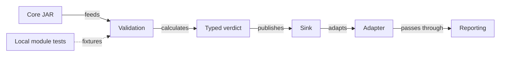
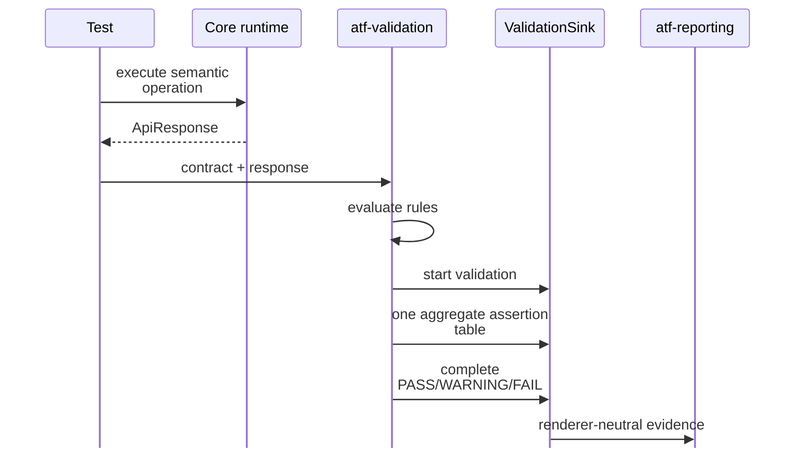

<a id="atf-validation--contracts-independent-of-the-rendering-engine"></a>
<a id="atf-validation--contracte-independente-de-motorul-de-randare"></a>
# ATF Validation — contracts independent of the rendering engine

`atf-validation` turns an `ApiResponse` and response contract into a verifiable
decision and a publishable set of assertions. It is a reusable JAR: it does not
make HTTP calls, know about Extent, or build HTML/CSS.

<a id="at-a-glance"></a>
<a id="pe-scurt"></a>
## At a glance

**Quick links:** [Public API](#public-responsibilities) · [Component audit](#boundary-with-component-test-audits) · [AI comparator](#ai-comparator--implemented-contract) · [Local proofs](#quick-verification)

| Input | Decision | Output |
|---|---|---|
| response + rules | contract evaluation | typed validation outcome |
| outcome + evidence sink | semantic publication | neutral port to reporting |
| invalid payload | failure evidence | no renderer in runtime |

<a id="core-diagram"></a>
<a id="diagramă-de-bază"></a>
## Core diagram

The diagram shows data flow and runtime collaboration; it is not the Maven
dependency graph. The module graph and arrow directions are in the root README
and `docs/ATF_Architecture.md`.



<details>
<summary><strong>Legend — verdict without a renderer</strong></summary>

- `atf-core` provides neutral models and ports;
- `atf-validation` evaluates the contract and produces the typed decision;
- `ValidationSink` is the only seam to publication;
- the consumer adapter maps evidence to `atf-reporting` without changing the calculated verdict;
- `atf-reporting` remains standalone and does not become dependent on `atf-validation`.
Short labels carry the following meanings:

| In the diagram | Full meaning |
|---|---|
| Core | core models |
| Module tests | atf-validation unit and component tests |
| Verdict typed | typed decision |
| Sink | validation sink |
| Adaptor | consumer adapter |
| publishes | publishes through |
| passes through | sends to |

</details>

The dependency direction is intentional:

- `atf-core` defines neutral models and small ports;
- `atf-validation` depends only on Core and the JSON library required for evaluation;
- `atf-core` orchestrates generic request and lifecycle mechanics but does not
  own contract rules;
- the consumer maps the decision to the reporting port used by its composition;
- `atf-reporting` exclusively owns Extent, HTML, CSS, assets, and artifact
  finalization, without depending on this module;
- local module tests verify the validation module through deterministic fakes;
  `atf-tests` covers whole-reactor governance without taking ownership of
  application behavior.

<a id="choose-the-validation-form"></a>
<a id="alege-forma-validării"></a>
## Choose the validation form

| Case | Input and result | Suitable verification |
|---|---|---|
| API response and rules | `ResponseContract` → `ValidationDecision` | [pure contracts](src/test/java/atf/validation/ResponseContractTest.java) |
| evaluation and publication through a port | `ResponseContractReporter` + `ValidationSink` | [protocol, rejection, and cleanup](src/test/java/atf/validation/protocol/ValidationProtocolTest.java) |
| auditable JUnit comparison | consumer extension → Test Kit | [component-test audit boundary](#boundary-with-component-test-audits) |
| already supplied AI output | pure evaluator → immutable snapshot | [implemented contract](#ai-comparator--implemented-contract) |

Expected is independent input; evaluation produces the verdict before
redaction or preview. The composition chooses the report profile and renderer,
and publication does not reevaluate the comparison.

For adoption, start with a pure result and controlled sink; add renderer
integration only at the adapter owner. [JAR usage](#jar-usage) and
[local proof](#quick-verification) define dependencies and acceptance.

<a id="public-responsibilities"></a>
<a id="responsabilități-publice"></a>
## Public responsibilities

| Component | Responsibility | Does not own |
|---|---|---|
| `ResponseContract` | fluent facade for composing rules and one-shot lifecycle | transport or UI |
| `ResponseContractRuleSet` | builds rules for status, headers, JSON paths, arrays, and I/O schema | duplicate identity or global verdict |
| `ResponseValidationRule` | describes one rule | request lifecycle |
| `ValidationEvaluator` | evaluates rules and calculates the status | Extent or markup |
| `ValidationOutcomePolicy` | expresses strict or soft-warning policy without scattered booleans | transport or UI |
| `ValidationDecision` | retains the verdict, message, assertions, and soft/fail rule | artifact publication |
| `ValidationTable` | aggregates assertions in one collection | table layout |
| `ResponseContractReporter` | connects evaluation to `ValidationSink` | sink implementation |
| `SchemaResourceResolver` | resolves schemas from declared roots without traversal | global filesystem or reporting |
| `AiEvaluationCase` + `AiFieldExpectation` | versioned expected input, independent of output; each field can declare a typed grounding requirement | invoking a model, observed output, or the consumer's decision about the business expected value |
| `AiEvaluationEvaluator` + `AiEvaluationPolicy` | typed comparisons, weighted score, explicit threshold, and critical hard-fail | AI provider, renderer, or review workflow |
| `AiInvocationEvidence` | classifies real/mock/fallback/unknown and retains opaque request/response/output references | payload, prompt, token, credential, or actual invocation |
| `ai.grounding`: `AiGroundingRequirement`, `AiSourceReference`, `AiGroundingObservation` | allowlisted source IDs and per-field verdict without copying source payload | ambiguity/run-level ledger or reporting |
| `AiEvaluationSnapshot` + `AiFieldComparison` | immutable `COMPLETE` snapshot with policy, timestamp, invocation, comparisons, grounding observations, and hard-fails with expected/observed/reason/evidence reference | run-level evidence ledger and report projection |

`ResponseContract` no longer contains the mechanics for each rule.
`ResponseContractRuleSet` produces composable definitions (`identity`, `title`,
`ResponseValidationRule`), including the I/O schema adapter. The facade preserves
DSL compatibility, deduplication, and the one-shot rule; `ValidationEvaluator`
remains the sole owner of the aggregate decision and strict/warning policy.

<a id="reporting-port"></a>
<a id="portul-către-raportare"></a>
## Reporting port

Validation does not receive `ExtentTest`, `ExtentReports`, or a concrete request
type. It receives only:

```java
ValidationDecision decision = reporter.validate(
        request,
        "Validate response contract",
        response,
        contract,
        warningMode);
```

`request` only needs to implement `ValidationSink`. The port opens one validation
area, receives all rows in an aggregate table, publishes the calculated status,
and closes deterministically. The consumer can adapt this evidence to its
reporting port; `atf-reporting` does not import this module or receive
`ValidationDecision` directly.

<a id="primary-cause-and-rejection-before-evaluation"></a>
<a id="cauza-primară-și-refuzul-înaintea-evaluării"></a>
### Primary cause and rejection before evaluation

`ResponseContractReporter` separates evaluation, publication, and closure:

- A strict FAIL preserves `ApiValidationException`; a close failure becomes suppressed.
- Publication/completion errors propagate without repeating the write in the scope.
- A runtime evaluation error publishes one FAIL record if the sink allows it;
  secondary errors remain inspectable and do not cause self-suppression.

`ValidationTable.check(...)` validates the lifecycle, identity, and callback
before executing the predicate. After publication or with an invalid identity,
the evaluation count is zero.

- An eligible predicate that throws runs once and produces FAIL evidence;
  the full comparison precedes redaction and the 240-character preview.

Port checks are in [ValidationProtocolTest](src/test/java/atf/validation/protocol/ValidationProtocolTest.java),
without a renderer or business fixtures.

UI tests use the same assertion contract:

```text
Playwright check → AtfAssertion → UiExtentReportSession
                 → ASSERTION | EXPECTED | ACTUAL | RESULT
```

API and UI share the table shape; the verdict and evidence owner remain specific
to the check. The consumer chooses an individual or suite-shared session and
retains each scenario's result.

<a id="boundary-with-component-test-audits"></a>
<a id="limita-față-de-auditul-testelor-componente"></a>
### Boundary with component-test audits

- `ResponseContract` and `ValidationEvaluator` evaluate API contracts; there is
  not yet a general assertion evaluator for models and components.
- `ValidationTable` redacts values and names using the full context through Core,
  then keeps a preview, 240 characters per field by default, including the `…`
  truncation marker; the constructor allows an explicit positive limit. A future
  extension retains the configured limit, including in expanded details.
  `ValidationPreviewRedactionTest` protects redaction-before-limit ordering and
  the verdict calculated from the full input.
- Comparison uses full values; shortening reported text does not change the
  verdict. The auditable message must explain the difference within the
  configured limit, including when the difference falls beyond the preview.
- AutoEx and Shop components use
  [auditable JUnit facade in Test Kit](../lib/README.TestKit.md#scope-and-integration),
  adapted by the consumer to Reporting's `AssertionStep`. The pure evaluator
  extension is described separately as [deferred design](#general-evaluator-for-models).



<details>
<summary><strong>Legend — validation sequence</strong></summary>

- the test executes the operation and sends the response to the evaluator;
- the evaluator composes one assertion table and an aggregate verdict;
- the sink receives renderer-neutral evidence, which reporting only projects.
The short labels have the following meanings:

| In diagram | Full meaning |
|---|---|
| Core runtime | atf-core / generic lifecycle |

</details>

<a id="general-evaluator-for-models"></a>
<a id="evaluator-general-pentru-modele"></a>
### General evaluator for models

The `CONSUMER-COMPONENT-ASSERTIONS-01` proposal is a deferred extension.
`ValidationEvaluator` currently evaluates API contracts, while component audits
use Kit's JUnit comparison and the consumer's adapter to Reporting. These
contracts can be used independently of a new general evaluator.

<details>
<summary><strong>Criteria for a separate change</strong></summary>

- The consumer test supplies the independent expected value, observation, and
  business rule. Validation owns pure evaluation and the immutable result; the
  adapter converts the result without repeating the comparison.
- A model, API adapter, and UI adapter from both modules must demonstrate the
  required operators before the API is extended.
- Types, `null`, differences beyond the preview, and concise messages are
  required negative checks. Redaction precedes the limit, 240 by default,
  including `…`.
- JUnit policy and expected exceptions remain in Kit. The extension does not
  add Kit dependencies on Core, Validation, or Reporting.

</details>

<a id="locale-independent-http-vocabulary"></a>
<a id="vocabular-http-independent-de-locale"></a>
### Locale-independent HTTP vocabulary

Case-insensitive Content-Type comparison and rule identity for a header use
`Locale.ROOT`. The `contentTypeContains` DSL remains a caller-declared content
check; it does not become a MIME classifier or body parser.

[ResponseContractRuleSetTest](src/test/java/atf/validation/contract/ResponseContractRuleSetTest.java)
checks the same nominal decision, rejection of a different type, and rule
identity in `tr-TR`; the test isolates and restores JVM state.

<a id="separation-rules"></a>
<a id="reguli-de-separare"></a>
## Separation rules

1. Do not add Extent, HTML, CSS, or JUnit imports to this module's `src/main`.
2. Contract rules are pure and testable with an in-memory response.
3. `warningMode` can turn a violation into a `WARNING` soft assertion, but it
   does not hide the table row, message, or actual value.
4. A validation publishes one aggregate table; do not create one container per
   assertion.
5. The reporter does not decide the business verdict; it uses the evaluator's result.
6. Resolve schema resources only from declared roots; they must not traverse
   outside those roots.
7. `atf-validation` does not open or close the reporting session; the test or
   execution owns the lifecycle, and reporting owns the renderer.

<a id="contract-tests"></a>
<a id="teste-de-contract"></a>
## Contract tests

The module tests separately protect:

- contract composition and evaluation;
- `PASS`, `WARNING`, and `FAIL` statuses;
- aggregation of all assertions into one table;
- publication through a fake `ValidationSink`, without Extent;
- safe schema resolution and rejection of traversal;
- scope closure and failure publication when evaluation throws;
- pure AI evaluator: versioned expected values, typed comparisons, missing/invented
  and undeclared output, critical hard-fail, configurable threshold, and weighted
  aggregation; no provider, browser, or renderer.

The tests are ratchet tests: when a contract fails, fix the implementation;
do not weaken the assertion to make the build green. Visual validation of the
consumer report acceptance remains with the local test that publishes it; final manual review uses ATF Debug/TAB MCP.

<a id="ai-comparator--implemented-contract"></a>
<a id="comparatorul-ai--contract-implementat"></a>
## AI comparator — implemented contract

`atf.validation.ai` evaluates output supplied by the consumer. The versioned
expected value is built separately, and the evaluator produces a `COMPLETE`
snapshot without invoking a model or renderer.

| Contract | Executable behavior |
|---|---|
| Comparisons | `EXACT`, `NORMALIZED_TEXT`, `SET`, `ORDERED_LIST`, `RANGE`, `ALLOWED_VARIANTS`, `PRESENT`, `ABSENT` |
| Expected / observed | defensive copies, including nested values; duplicate expected paths are rejected |
| Information presence | critical omission, critical invention, and source/expected contradiction have distinct reasons |
| Undeclared output | hard-fail by default; when policy allows an extra field, the mismatch and penalty remain visible |
| Score and verdict | weighted score, explicit threshold; a critical failure takes precedence over the score |
| Invocation | only `REAL_AI` with complete references can receive a quality score; mock/fallback are `NOT_EVALUATED`; output produced in `UNKNOWN` mode or incomplete real evidence produces `FAIL` |
| Per-field grounding | allowlisted source IDs; `SUPPORTED`, `UNSUPPORTED`, `MISSING_REFERENCE`, `NOT_REQUIRED`; missing/unsupported required grounding produces a hard-fail |
| Snapshot | policy, timestamp from `Clock`, invocation, comparisons, grounding, and hard-fails with field/expected/observed/reason/evidence reference |

Responsibilities are split among package `ai` (comparator and snapshot),
`ai.grounding` (requirements and references), and `ai.invocation` (invocation
provenance). `AiEvaluationValues` keeps copy mechanics internal; cohesion
governance protects the package inventory and eight-class limit.

| Check in `AiEvaluationEvaluatorTest` | What it protects |
|---|---|
| comparisons, threshold, and critical mismatch | deterministic evaluation and hard-fail precedence |
| missing/invented/undeclared output | distinct diagnostics and output reference |
| real/mock/fallback and incomplete invocation | score eligibility and rejection of incomplete evidence |
| missing or non-allowlisted grounding | `MISSING_GROUNDING_REFERENCE` / `UNSUPPORTED_GROUNDING` |
| injected clock and mutations to nested values | `COMPLETE` finalization and immutability |

Implementation limits remain explicit:

- `AMBIGUOUS` exists in the enum, but the evaluator does not produce it.
- Run ledger, lifecycle, review/state, reporting, and regression delta remain in [AI feedback](../docs/feedback/README_AI_Evaluation.md).
- Target models and boundary decisions are in the [AI design](../docs/ATF_AI_Evaluation_Design.md); proposed schemas are not additional signatures of the implemented API.
- `REGEX_RESTRICTED` requires a matcher with bounded execution; the existing technical score is not yet a per-case configurable business rubric.

<a id="jar-usage"></a>
<a id="utilizare-ca-jar"></a>
## JAR usage

A consumer that needs only validation depends on:

```xml
<dependency>
    <groupId>atf.api</groupId>
    <artifactId>atf-validation</artifactId>
    <version>1.0.0-SNAPSHOT</version>
</dependency>
```

For Extent reporting, add `atf-reporting` separately and provide a
`ValidationSink`. This allows the packages to be versioned and reused without
pulling the renderer or HTML assets onto the classpath of a contract consumer.

<a id="quick-verification"></a>
<a id="verificare-rapidă"></a>
## Quick verification

| Decision | Source and limit |
|---|---|
| pure evaluation and typed verdict | [owner source](src/main/java/atf/validation/evaluation/ValidationEvaluator.java); check: [ResponseContractTest](src/test/java/atf/validation/ResponseContractTest.java) |
| dependencies and source sets | [POM](pom.xml); declared scope is authoritative for integration |
| What this check does not demonstrate | Passing the contract does not validate transport, the renderer, or an AI provider. |

<details>
<summary><strong>Command for a local check</strong></summary>

Run from the root of [external staging](../docs/ATF_Build_And_Execution_Safety.md), with JDK 21 and Maven.

```powershell
mvn -B -pl atf-validation -am "-Dtest=ResponseContractTest,ValidationPreviewRedactionTest,AiEvaluationEvaluatorTest" "-Dsurefire.failIfNoSpecifiedTests=false" test
```

The command selects the named check and builds its dependencies; it does not
claim that the entire module passed. Passing the contract does not validate
transport, the renderer, or an AI provider.

</details>

<a id="json-contract-and-schema-subset"></a>
<a id="contract-json-și-subset-de-schemă"></a>
## JSON contract and schema subset

Evaluation parses the body at most once in the call context. The document must
be consumed in full; malformed JSON, duplicate keys, and trailing data produce
negative comparisons. The context does not survive between evaluations; the
public `ResponseValidationRule` port remains compatible.

| Boundary | Executable contract |
|---|---|
| Presence | invalid document, invalid path, missing value, and present value are distinct; explicit null is present |
| Paths | properties/indexes `$.item[0].id`, simple form `item.id`, and JSON Pointer with valid escapes; wildcard/filter/recursive descent are rejected |
| Scalar equality | objects/arrays do not become empty strings; `jsonPathEquals` and `everyArrayItemEquals` members require scalars |
| Schema | instance-independent preflight, including untouched branches; object or boolean schema |
| Types and values | one `type` or a list, `enum`, exact numeric comparisons; integer includes integral numeric values |
| Objects | `required`, `properties`, `additionalProperties` as boolean/schema; false works even without properties |
| Arrays | `items` as boolean/schema, `minItems`, `maxItems` |
| Strings | `minLength`/`maxLength` in Unicode code points; `pattern` uses a valid Java regex |
| Numbers | inclusive `minimum`/`maximum`, using BigDecimal; no conversion to double for the verdict |
| Metadata | `$schema` accepts only the draft 2020-12 URI; `$comment`, `title`, `description`, `default`, `examples` are annotations |
| Unsupported | any other keyword, including `const`, `$ref`, and `format`, or an invalid form is rejected; this does not claim full JSON Schema support |

The accepted URI is `https://json-schema.org/draft/2020-12/schema`.
A rejected keyword remains rejected even if the input would satisfy its meaning;
`const:42` is not ignored for either 42 or 99.

Strict mode produces FAIL, while warning policy preserves negative rows and
the WARNING status. Full values determine the verdict; the audit projection
retains the 240-character preview without reevaluation in the renderer.

<a id="proofs-and-integration"></a>
<a id="probe-și-integrare"></a>
### Proofs and integration

Permanent regressions: [presence and containers](src/test/java/atf/validation/JsonPresenceContractTest.java)
and the [schema subset](src/test/java/atf/validation/JsonSchemaContractTest.java).
Synthetic API acceptance in Extent/fallback separately checks the verdict,
rows, and preview; it does not demonstrate real transport or speech accuracy.

<a id="content-type--semantic-json-classification"></a>
<a id="content-type--clasificare-semantică-json"></a>
### Content-Type — semantic JSON classification

`contentTypeJson()` delegates concrete type/subtype classification to Core's
`MediaTypes.isJson`. Parameters cannot turn a `text/plain` type into JSON;
ACTUAL retains the observed header, redacted and bounded after evaluation.

| Observed header | Rule verdict |
|---|---|
| application/json, including with charset | PASS; type and subtype are case-insensitive |
| application/problem+json or application/vnd.atf+json | PASS; concrete JSON suffix |
| text/json or text/vnd.atf+json | PASS under Core's vocabulary, with no default restriction to application |
| text/plain with profile="application/json" | FAIL; the parameter is not the type/subtype |
| application/jsonp, absent type, wildcard, or list of types | FAIL; the requirement is one concrete JSON type |

- `userItem`, `userCollection`, `postItem`, `postCollection`, and
  `relationshipCollection` use the semantic rule, retaining their statuses and
  payload requirements.
- `contentTypeContains` remains a literal compatibility operation.
  The semantic row has a Content-Type JSON identity distinct from the literal
  row, so both rules can be composed in one contract.
- Classification does not validate the full parameter syntax or body.
  JSON rules separately validate the document and required fields.

[JsonMediaTypeContractTest](src/test/java/atf/validation/media/JsonMediaTypeContractTest.java)
protects the five contracts, strict/warning behavior, nominal types, and
misleading parameters; neutral-port and artifact acceptance remain with the consumer.

<a id="shared-parser-and-data-ownership"></a>
<a id="parser-comun-și-proprietatea-datelor"></a>
### Shared parser and data ownership

Complete documents use Core's JsonDocuments: no duplicates or trailing content,
with exact decimals. Validation retains its own diagnostics and null policy; it
does not own a parallel strict mapper.
