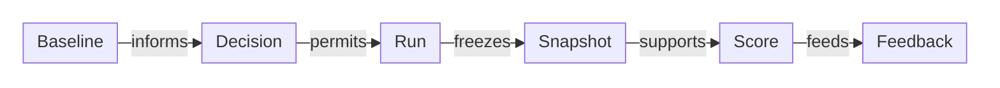
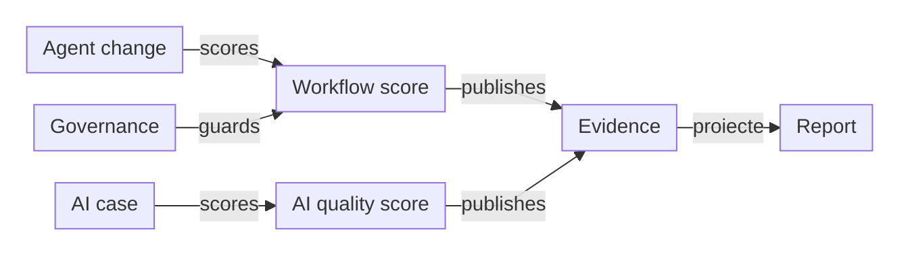
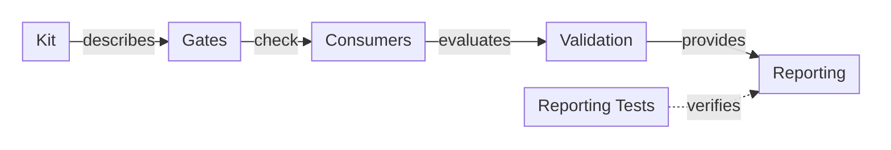

<a id="atf-ai--reference-design-for-evaluation-and-agentic-workflow"></a>
<a id="atf-ai--design-de-referință-pentru-evaluare-și-workflow-agentic"></a>
# ATF AI — Reference Design for Evaluation and Agentic Workflow

<a id="at-a-glance"></a>
<a id="pe-scurt"></a>
## At a glance

This project design document covers two boundaries: deterministic evaluation of AI output and governance for changes proposed by an agent. The models and guards below are design targets, not complete signatures or claims of shipped functionality.

The reactor keeps exactly the 12 existing modules, including for AI design. The separation below are responsibilities and packages to the current owners; I do not propose an additional Maven module.

| Information type | Authoritative source |
|---|---|
| Implemented API and proofs | [ATF Validation](../atf-validation/README.md#ai-comparator--implemented-contract) |
| Gap, readiness score, and next proof | [AI feedback](feedback/README_AI_Evaluation.md) |
| Target models, separations, and adoption conditions | this design |
| General rules already executable | [ATF Tests](../atf-tests/README.md), [testing guide](ATF_Testing_Guide.md) |

Adopt observable contracts and patterns, not business behavior, scores, or orchestration from reference codebases. This design does not authorize code generation, provider connections, or relaxed governance tests.

<a id="reading-map"></a>
<a id="hartă-de-lectură"></a>
## Reading map

The document separates the AI evaluation contract from agentic workflow governance. Use the relevant range for the design question; a schema in the target section does not mean that the API is implemented.

| Part | Sections | What it covers |
|---|---|---|
| AI contract | [1–20](#1-purpose-and-boundary) | normative limits, input/expected/observed, grounding, review/state, invocation, verdict, snapshot, and proofs |
| Agentic workflow | [21–30](#21-deep-analysis--two-axes-that-must-not-be-confused) | score separation, proposed change, handoff, guards, and controlled pilot |
| Sources and ATF model | [31–40](#31-agentic-workflow-status) | references, readiness, compared patterns, candidate design, and accepted/deferred/rejected decisions |
| Current boundary | [41–42](#41-recalibration-rule) | recalibration against live code and the distinction between design and implementation |

For behavior already shipped, start with [ATF Validation](../atf-validation/README.md#ai-comparator--implemented-contract); for prioritization and gaps, read the [AI feedback](feedback/README_AI_Evaluation.md) separately.

<a id="1-purpose-and-boundary"></a>
<a id="1-scop-și-limită"></a>
## 1. Purpose and boundary

This document defines the requirements ATF Java needs to support AI evaluation that is auditable, repeatable, and extensible.

The schemas in sections 4–18 are the target model, not complete signatures for the shipped API. The implemented form is documented in [ATF Validation](../atf-validation/README.md#ai-comparator--implemented-contract); intent/review/state, separate normalized values, and the run registry are not claimed to be implemented merely because they appear in the schemas.

This document does not describe an AI provider, prompt framework, or business product. It defines the neutral contracts through which a consumer can state:

```text
this is the controlled case
this is the observed output
these are the verifiable expectations
this is the verdict and its reason
this is the evidence that supports it
```

Security, secrets, and the CLI are out of scope.

Core principle:

> ATF Java must not own AI business semantics. It must own deterministic > evaluation, evidence, verdicts, and auditable projections.

<a id="2-maturity-objective"></a>
<a id="2-obiectiv-de-maturitate"></a>
## 2. Maturity objective

An AI case is evaluated only when the following sequence is demonstrated by data and tests:

```text
versioned case
  → controlled input
  → observable invocation
  → normalized output
  → field-level comparison
  → missing/grounding/review/state checks
  → score + hard-fail
  → semantic snapshot
  → evidence in the report
  → comparison with the previous baseline
```

A `200 OK`, plausible text, or a green run are not sufficient.

<a id="3-normative-rules"></a>
<a id="3-reguli-normative"></a>
## 3. Normative rules

<a id="r-01--expected-is-separate-from-output"></a>
<a id="r-01--expected-ul-este-separat-de-output"></a>
### R-01 — Expected is separate from output

The evaluator receives `expected case`, `observed output`, and `evaluation policy` separately. Expected cannot be built from output or from the report.

**Invariant:** changing output does not change expected.

**Gate:** a component test builds expected before invocation and verifies that the evaluator neither moves nor fills it automatically.

<a id="r-02--every-verdict-has-a-cause"></a>
<a id="r-02--fiecare-verdict-are-cauză"></a>
### R-02 — Every verdict has a cause

Every `PASS`, `FAIL`, `WARNING`, `SKIP`, or special AI verdict has:

- the evaluated criterion;
- the expected value;
- the observed value;
- the comparison rule;
- the rule result;
- an evidence reference.

Verdicts without a cause are diagnostics, not evidence.

<a id="r-03--a-score-does-not-hide-a-critical-failure"></a>
<a id="r-03--scorul-nu-ascunde-eșecul-critic"></a>
### R-03 — A score does not hide a critical failure

A case with a score of 98 can be `FAIL` if it has a hard failure. The score is an aggregate; the hard failure is an acceptance rule.

<a id="r-04--fallback-is-not-ai-quality"></a>
<a id="r-04--fallback-ul-nu-este-ai-quality"></a>
### R-04 — Fallback is not AI quality

A fallback may be accepted as an operational result when declared, but it does not count toward the model-quality score.

<a id="r-05--the-renderer-does-not-decide"></a>
<a id="r-05--renderer-ul-nu-decide"></a>
### R-05 — The renderer does not decide

Extent, fallback HTML, and UI audit project the semantic snapshot. They do not recalculate the score, hard-fail, grounding, or state.

<a id="r-06--the-browser-verifies-effects-not-internal-truth"></a>
<a id="r-06--browser-ul-verifică-efectul-nu-adevărul-intern"></a>
### R-06 — The browser verifies effects, not internal truth

The browser verifies the visibility and consistency of the verdict, evidence, and review. The comparator remains in the evaluator.

<details>
<summary>Target model — contracts, rubric, projections, and test matrix</summary>

<a id="4-ai-case-contract"></a>
<a id="4-contractul-cazului-ai"></a>
## 4. AI case contract

<a id="41-identity-and-version"></a>
<a id="41-identitate-și-versiune"></a>
### 4.1 Identity and version

```text
AiEvaluationCase
  caseId
  caseVersion
  category
  inputReference
  expectedIntent
  expectedFields
  expectedMissingFields
  expectedReview
  allowedStates
  groundingRequirements
  scoringPolicyId
```

`caseId` identifies the semantic scenario. `caseVersion` identifies the approved expectation. Changing expected without changing the version is drift.

<a id="42-input-reference"></a>
<a id="42-referința-de-intrare"></a>
### 4.2 Input reference

The input is referenced by a controlled fixture identifier, not by a local path, artifact name, or timestamp.

The input reference must answer:

- which data was given to the model;
- which data was allowed for grounding;
- which data was intentionally absent;
- which fixture version was used.

<a id="43-expected-intent"></a>
<a id="43-intenția-așteptată"></a>
### 4.3 Expected intent

Intent is an enum or typed vocabulary, not free text:

```text
CREATE | UPDATE | REVIEW_REQUIRED | REJECT |
REQUEST_MORE_INFORMATION | NO_ACTION
```

The evaluator distinguishes incorrect intent, incorrect review, and incorrect final state.

<a id="5-expected-field-contract"></a>
<a id="5-contractul-câmpurilor-așteptate"></a>
## 5. Expected-field contract

<a id="51-field-expectations"></a>
<a id="51-așteptări-pentru-câmpuri"></a>
### 5.1 Field expectations

```text
AiFieldExpectation
  fieldPath
  expectedValue
  comparisonMode
  required
  critical
  allowedValues
  sourceRequirement
  missingPolicy
```

`fieldPath` is semantic and stable. It is not a CSS selector, accidental JSON index, or visual label.

<a id="52-required-comparison-modes"></a>
<a id="52-moduri-obligatorii"></a>
### 5.2 Required comparison modes

| Mode | Rule |
|---|---|
| `EXACT` | strict equality after type checking |
| `NORMALIZED_TEXT` | documented normalization without semantic change |
| `SET` | same values; order does not matter |
| `ORDERED_LIST` | same values in the same order |
| `RANGE` | value is within approved bounds |
| `ALLOWED_VARIANTS` | only explicitly declared variants |
| `PRESENT` | field exists and is non-empty |
| `ABSENT` | field is missing or explicitly unknown |
| `REGEX_RESTRICTED` | **deferred:** Java regex without a time-bounded engine can exhibit unbounded backtracking; not enabled by default |

Generic `contains` is not accepted as a semantic comparison.

<a id="53-comparison-result"></a>
<a id="53-rezultatul-comparației"></a>
### 5.3 Comparison result

```text
AiFieldComparison
  fieldPath
  expected
  observed
  comparisonMode
  normalizedExpected
  normalizedObserved
  result
  critical
  sourcePresence
  evidenceReference
  reasonCode
```

Reason codes stabile:

```text
MATCH | MISMATCH | MISSING_OBSERVED | UNEXPECTED_VALUE |
UNEXPECTED_PRESENT | NORMALIZATION_REJECTED | TYPE_MISMATCH |
SOURCE_UNSUPPORTED
```

The implementation produces immutable comparisons with expected/observed values, the declared source, reason code, and opaque output reference. The assertion message is not the contract.

<a id="6-missing-information-and-the-prohibition-on-invention"></a>
<a id="6-informații-lipsă-și-interdicția-de-a-inventa"></a>
## 6. Missing information and the prohibition on invention

The evaluator distinguishes:

1. expected field present and correct;
2. expected field missing from output;
3. intentionally absent field correctly omitted;
4. field absent from input but invented in output;
5. field present in input but incorrectly marked missing;
6. unknown field with no objective expected value.

```text
AiMissingInformationResult
  fieldPath
  inputPresence
  expectedPresence
  observedPresence
  result
  critical
  reasonCode
```

Inventing a critical entity produces `INVENTED_CRITICAL_ENTITY`, while a missing critical field from a source declared present produces `MISSING_CRITICAL_FIELD`, regardless of score. If the source is `UNKNOWN`, do not claim grounding or automatically call the value “invented.”

These cases are covered by component tests: omitted output for a present source, invented output for an absent source, expected ABSENT conflicting with a present source, and an undeclared extra field in the output. The last produces `UNDECLARED_OUTPUT_FIELD` and defaults to hard fail; an explicit policy may tolerate it, but the comparison remains a mismatch and lowers the score.

<a id="7-grounding-and-source-references"></a>
<a id="7-fundamentare-și-referințe-la-surse"></a>
## 7. Grounding and source references

### 7.1 Contract

```text
AiSourceReference
  sourceId
  sourceType
  location
  excerptReference
  fieldPath
  supportStatus
```

`sourceType` may be `INPUT_FIELD`, `DOCUMENT_SPAN`, `EVENT`, `API_RESPONSE`, or a consumer-extended type.

<a id="72-rules"></a>
<a id="72-reguli"></a>
### 7.2 Rules

- every field with `sourceRequirement` has a reference;
- the reference points to a source allowed for the case;
- the reference alone does not prove semantic support;
- the evaluator may mark `UNSUPPORTED_SOURCE`;
- do not copy the excerpt into every projection; retain the canonical reference
  and a bounded projection.

```text
AiGroundingObservation
  fieldPath
  sourceReference
  supportStatus
  result
  reasonCode
```

Minimum results: `SUPPORTED`, `UNSUPPORTED`, `AMBIGUOUS`, `NOT_REQUIRED`, `MISSING_REFERENCE`.

**Implemented slice in `atf-validation`:**

- `AiGroundingRequirement` declares the allowed `sourceId` list for a field.
- `AiSourceReference` retains only opaque pointers; the evaluator produces one
  `AiGroundingObservation` per field.
- A missing required reference produces `MISSING_GROUNDING_REFERENCE`;
  a reference outside the allowlist produces `UNSUPPORTED_GROUNDING`.
- Payloads, prompts, and credentials cannot be included in these types.

<a id="8-review-and-workflow-state"></a>
<a id="8-review-și-workflow-state"></a>
## 8. Review and workflow state

<a id="81-review-action"></a>
<a id="81-acțiunea-de-revizuire"></a>
### 8.1 Review action

```text
AiReviewExpectation
  required
  action
  allowedActions
  expectedReasonCodes
  correctionRequired
```

Actions: `ACCEPT`, `REJECT`, `REQUEST_MORE_INFORMATION`, `ESCALATE`, `NO_REVIEW`.

<a id="82-state-transition"></a>
<a id="82-tranziția-de-stare"></a>
### 8.2 State transition

```text
AiStateObservation
  previousState
  observedState
  allowedTransition
  transitionReason
  sequence
```

Correct final state does not repair an invalid intermediate transition.

<a id="83-invariants"></a>
<a id="83-invariante"></a>
### 8.3 Invariants

- required review cannot be omitted;
- `NO_REVIEW` is valid only when the case allows it;
- user correction occurs before the final state that reflects it;
- persistence failure is separate from model failure;
- a technical retry is not a new AI decision.

<a id="9-model-invocation-and-fallback"></a>
<a id="9-apelarea-modelului-și-soluția-de-rezervă"></a>
## 9. Model invocation and fallback

### 9.1 Contract

```text
AiInvocationEvidence
  invocationId
  mode
  providerReference
  modelReference
  requestReference
  responseReference
  startedAt
  completedAt
  outputProduced
  references: INVOCATION | REQUEST | RESPONSE | OUTPUT
```

```text
InvocationMode
  REAL_AI | MOCK_MODEL | EXPLICIT_FALLBACK | UNKNOWN
```

| Mode | AI quality score | Interpretation |
|---|---:|---|
| `REAL_AI` | allowed with complete evidence | actual AI evaluation |
| `MOCK_MODEL` | prohibited | integration/comparator test |
| `EXPLICIT_FALLBACK` | prohibited | separate operational evidence |
| `UNKNOWN` | prohibited | hard-fail for an AI test |

`AiInvocationEvidence` retains only opaque references, not prompts, payloads, tokens, or credentials. `REAL_AI` receives a quality score only when it has invocation/provider/model, a time interval, output, and all four references; `MOCK_MODEL` and `EXPLICIT_FALLBACK` remain `NOT_EVALUATED` for model quality.

Valid output without invocation evidence is classified explicitly:

```text
SILENT_FALLBACK | MISSING_INVOCATION_EVIDENCE | UNCLASSIFIED_OUTPUT
```

<a id="10-scoring-and-critical-failure-policy"></a>
<a id="10-punctaj-și-politica-eșecurilor-critice"></a>
## 10. Scoring and critical-failure policy

<a id="101-default-rubric"></a>
<a id="101-rubrică-implicită"></a>
### 10.1 Default rubric

| Criterion | Points |
|---|---:|
| Correct intent | 15 |
| Critical entities and fields | 25 |
| Missing information / non-invention | 15 |
| Routing and review | 15 |
| Grounding | 15 |
| Explanation clarity | 10 |
| Format / schema | 5 |
| **Total** | **100** |

The scoring policy is identified by `scoringPolicyId` and versioned.

<a id="102-critical-failure-catalog"></a>
<a id="102-catalogul-eșecurilor-critice"></a>
### 10.2 Critical-failure catalog

| Code | Condition |
|---|---|
| `INVENTED_CRITICAL_ENTITY` | invented critical entity |
| `MISSING_CRITICAL_FIELD` | expected critical field is missing |
| `WRONG_INTENT` | intent is incompatible with the case |
| `REQUIRED_REVIEW_SKIPPED` | required review did not occur |
| `INVALID_STATE_TRANSITION` | disallowed transition |
| `UNSUPPORTED_GROUNDING` | value has no allowed source |
| `MISSING_INVOCATION_EVIDENCE` | test claims real AI but does not prove invocation |
| `UNDECLARED_OUTPUT_FIELD` | output contains a field absent from the case contract |
| `INCOMPLETE_EVIDENCE` | verdict cannot be reconstructed |

<a id="103-final-verdict"></a>
<a id="103-verdict-final"></a>
### 10.3 Final verdict

```text
AiEvaluationVerdict
  status
  score
  scoreBreakdown
  hardFailures
  fieldComparisons
  missingInformation
  groundingObservations
  reviewObservation
  stateObservations
  invocationEvidence
  evidenceReferences
```

Precedence:

```text
INCOMPLETE_EVIDENCE > HARD_FAIL > FAIL > TRIAGE_REQUIRED
> PASS_WITH_REVIEW > PASS
```

`SKIP` remains a distinct state and is excluded from the success rate.

<a id="11-semantic-snapshot-and-immutability"></a>
<a id="11-instantaneu-semantic-și-imuabilitate"></a>
## 11. Semantic snapshot and immutability

The evaluator produces an immutable `AiEvaluationSnapshot` after the case closes.

```text
AiEvaluationSnapshot
  caseIdentity
  inputIdentity
  outputIdentity
  invocationIdentity
  verdict
  evidenceIndex
  traceMetadata
  completed
```

Invariants:

- the snapshot does not change after `complete`;
- the renderer receives the snapshot, not the mutable evaluator;
- the HTML projection cannot change the verdict;
- the same semantics produce the same Extent and fallback projections;
- evidence references remain stable within the run.

**Implemented slice in `atf-validation`:**

| Contract | Implemented evidence |
|---|---|
| Lifecycle | only a `COMPLETE` snapshot, created after comparisons |
| Payload | case/version/input, policy, timestamp, verdict, eligibility, invocation, comparisons, and hard-fails |
| Immutability | defensive copies; fixed-clock and mutation tests |
| Remains open | extended evidence index/run correlation, trace metadata, and lifecycle integration |

<a id="12-integration-with-the-atf-lifecycle"></a>
<a id="12-integrarea-cu-ciclul-de-viață-atf"></a>
## 12. Integration with the ATF lifecycle

```text
SETUP
  → case/input evidence
TEST BODY
  → invocation
  → observed output
  → AI validation
  → score/hard-fails
TEARDOWN
  → read-back/review persistence, if applicable
```

In a UI/API flow:

```text
single semantic checkpoint
  ├── UI validation
  ├── API validation
  └── AI validation
       ├── invocation evidence
       ├── field assertions
       ├── grounding
       └── score summary
```

Do not create a second AI card merely because the output is rendered in another section.

<a id="13-reporting-and-projections"></a>
<a id="13-raportare-și-proiecții"></a>
## 13. Reporting and projections

<a id="report-overview-section"></a>
<a id="secțiunea-overview-din-raport"></a>
### Report overview section

Show aggregates:

- evaluated cases;
- `PASS`, `FAIL`, `TRIAGE_REQUIRED`, `SKIP`;
- average score only for eligible cases;
- hard-fail count;
- fallback count;
- missing-evidence count;
- regression count.

<a id="test-details"></a>
<a id="detaliile-testului"></a>
### Test details

For each case, make these items navigable:

1. identity and version;
2. input reference;
3. invocation mode;
4. expected/observed summary;
5. field-level table;
6. missing information;
7. grounding;
8. review/state;
9. score breakdown;
10. hard-fails;
11. evidence and trace.

<a id="failures-and-parity"></a>
<a id="fails-și-parity"></a>
### Failures and parity

Each critical failure is individually addressable. Compare Extent and fallback through the semantic snapshot, not HTML string equality.

<a id="14-regression-comparison"></a>
<a id="14-compararea-regresiilor"></a>
## 14. Regression comparison

Baseline identity is:

```text
caseId + caseVersion + inputReference + scoringPolicyId
```

The comparator produces:

```text
AiRegressionDelta
  scoreDelta
  newFailures
  fixedFailures
  newHardFailures
  changedFields
  changedMissingInformation
  changedGrounding
  changedReview
  changedState
  changedInvocationMode
```

Rules:

- HTML is not a semantic baseline;
- changing table order is not a business regression;
- changing a critical field is a regression even if the total score increases;
- `SKIP → PASS` is not an improvement without valid evidence;
- `REAL_AI → FALLBACK` is an invocation regression regardless of output.

<a id="15-architecture-and-responsibilities"></a>
<a id="15-arhitectură-și-responsabilități"></a>
## 15. Architecture and responsibilities

| Contract | Owner | Prohibition |
|---|---|---|
| case and expected | consumer / composition root | does not enter the renderer |
| field comparator | `atf-validation` or dedicated AI module | does not enter UI |
| score policy | semantic evaluator | is not calculated in HTML |
| invocation adapter | integration boundary | is not inferred from HTTP status |
| semantic snapshot | renderer-neutral boundary | contains no markup |
| Extent/fallback projection | `atf-reporting` | does not change the verdict |
| browser audit | `atf-ui` + consumer | does not decide model quality |
| layer/coverage guards | `atf-test-kit`, `atf-tests` | are not relaxed for AI |
| production package cohesion | `atf-validation` + `atf-tests` | comparator packages and `grounding` / `invocation` boundaries retain the governed limit; the current inventory belongs in the module README |

<a id="16-required-tests"></a>
<a id="16-teste-obligatorii"></a>
## 16. Required tests

### Unit

- all comparison modes;
- deterministic normalization;
- allowed variants;
- required/critical semantics;
- missing information;
- grounding reason codes;
- score calculation;
- hardfail and precedent verdict;
- regression delta.

<a id="component"></a>
<a id="componentă"></a>
### Component

- case + expected + observed → snapshot;
- Utput invented → hard-fail;
- review omitted → hard-fail;
- source unsupported → grounding failure;
- unknown invocation → evidence failure;
- mock model → non-quality verdict;
- fallback explicit → evidence-only;
- Snapshot immutable after complete.

<a id="integration"></a>
<a id="integrare"></a>
### Integration

- provider/mock exchange + invocation evidence;
- correlation request/output/validation;
- phase/checkpoint attachment;
- Extent/fallback snapshot parity;
- regression baseline and delta;
- multi-field, multi-exchange case.

### E2E

Only when visible behavior exists:

- review UI displays the verdict;
- corrected fields are visible;
- the final status is observable;
- AI validation is in the correct checkpoint;
- evidence of the disclosures are watertight;
- there is no duplication of UI / API / AI validation.

<a id="architecture"></a>
<a id="arhitectură"></a>
### Architecture

- the evaluator does not import the renderer;
- the renderer does not import the AI provider;
- the consumption does not duplicate the logical scoring;
- fixture/support does not become an implicit test;
- each public seam are proof class;
- Snapshots are renderer-neutral.

<a id="17-failure-taxonomy"></a>
<a id="17-taxonomia-eșecurilor"></a>
## 17. Failure taxonomy

| Category | Meaning | Required distinction |
|---|---|---|
| `EXTRACTION` | incorrect or missing value | not UI rendering |
| `CLASSIFICATION` | incorrect intent or case type | not a state transition |
| `ROUTING` | incorrect review/action | not a field mismatch |
| `WORKFLOW` | incorrect DAG/state/retry | not incorrect AI output |
| `REVIEW` | missing HITL or unretained correction | not an invocation failure |
| `GROUNDING` | absent/ambiguous/unsupported source | not a schema failure |
| `INVOCATION` | unknown AI/fallback | not a business mismatch |
| `EVIDENCE` | verdict cannot be reconstructed | not a low score |
| `SCHEMA` | output has invalid form | not an incorrect business value |
| `PERSISTENCE` | result was not retained | not model quality |

Each failure has a likely owner, but the owner is not inferred from the exception's free-form message.

<a id="18-acceptance-criteria"></a>
<a id="18-criterii-de-acceptare"></a>
## 18. Acceptance criteria

Accept the implementation only when:

- an AI case is defined without logic in the renderer;
- expected and observed are distinct objects;
- each field comparison is typed and navigable;
- missing information is evaluated separately from mismatch;
- grounding can be `SUPPORTED`, `AMBIGUOUS`, or `MISSING_REFERENCE`;
- review and state are evaluated separately;
- invocation mode is explicit;
- fallback does not count toward the quality score;
- hard-fail dominates the score;
- the snapshot becomes immutable at completion;
- Extent and fallback produce the same semantics;
- regression delta compares snapshots, not raw HTML;
- each layer has its own test;
- each rule has a nominal and negative case;
- each failure can be traced to case, field, phase, and evidence.

</details>

<a id="19-architectural-increment-order"></a>
<a id="19-ordinea-arhitecturală-a-incrementelor"></a>
## 19. Architectural increment order

Comparator → snapshot and references → lifecycle → projections → regressions → UI proof.

Each increment preserves the previous boundary and requires nominal and negative cases. Status and delivery criteria are not duplicated here; they are in [active feedback](feedback/README_AI_Evaluation.md#gap-uri-rămase-pentru-evaluator).

<a id="20-evaluator-status"></a>
<a id="20-starea-evaluatorului"></a>
## 20. Evaluator status

Undelivered requirements and their criteria are kept only in [evaluator gaps](feedback/README_AI_Evaluation.md#gap-uri-rămase-pentru-evaluator).

<details>
<summary>Agentic workflow — proposed proposal, handoff, guards, and validation plan</summary>

<a id="21-deep-analysis--two-axes-that-must-not-be-confused"></a>
<a id="21-analiză-profundă--două-axe-care-nu-trebuie-confundate"></a>
## 21. Deep analysis — two axes that must not be confused

### 21.1 `AI-assisted workflow`

`AI-assisted workflow` answers the question:

> How can an agent propose, modify, and extend ATF tests without breaking > contracts, layers, ownership, or evidence?

It does not measure the quality of the model under test. It measures the quality of the process through which the agent changes the framework and tests.

ATF Java already has important protections for agents:

- `atf-test-kit` enforces the test layer;
- `atf-tests` checks modules, ownership, package cohesion, and documentation;
- `atf-reporting-tests` are composition roots and proof lower- level;
- `atf-reporting` is separate from consumers and test support;
- READMEs and feedback have owners and closure criteria;
- test changes require exact YAML scope, Git baseline, expiry, and proof;
- artifacts can be audited in a browser, not only read as text.

The `testChanges` register is executable for scope authorization, not for semantic evaluation of the agent's proposal. The full contract remains:

```text
agent proposal
  → scope and owner
  → expected delta
  → test placement
  → proof plan
  → implementation
  → governance gates
  → narrow test evidence
  → compiled feedback for the next agent
```

Without this separation, an agent may produce code that compiles but:

- lands in the wrong module;
- duplicates an existing abstraction;
- adds E2E for a component-level problem;
- moves business logic into reporting;
- claims coverage without evidence;
- changes a guard to get a green result;
- leaves documentation behind the code;
- turns a green run into a quality claim.

<a id="212-actual-ai-evaluation"></a>
<a id="212-ai-evaluation-propriu-zis"></a>
### 21.2 `Actual AI evaluation`

`AI evaluation` answers the question:

> Is the AI output correct, complete, grounded, routed, and explainable for the > controlled case?

This axis uses the contracts in sections 4–18. The agent that writes the test must not be the final judge of its own output. Evaluation must be performed by rules, comparators, fixtures, and evidence independent of the agent's text.

The required separation is:

```text
agent proposes the test
ATF runs the test
evaluator compares expected with observed
governance checks the change structure
reporting publishes the snapshot
```

An agent may explain a failure, but cannot turn it into `PASS`, invent expected after seeing the output, or relax a hard-fail.

<a id="213-interaction-between-the-axes"></a>
<a id="213-interacțiunea-dintre-axe"></a>
### 21.3 Interaction between the axes

| Situation | What we evaluate | What we do not infer |
|---|---|---|
| Agent generates a good test | test-creation workflow | it does not prove the tested AI model's quality |
| AI test passes | output for that case | it does not prove the agent followed the architecture |
| Governance passes | placement, layer, proof, and boundary | it does not prove business correctness |
| Report looks good | evidence projection | it does not prove the verdict is correct |
| Model produces plausible output | semantic comparison | it does not prove grounding or real invocation |

Workflow score and AI quality score must remain two distinct values in all future feedback.

<a id="22-what-to-extract-from-atf1-and-what-not-to-import"></a>
<a id="22-ce-extragem-din-atf1-și-ce-nu-importăm"></a>
## 22. What to extract from ATF1 and what not to import

ATF1 contains useful ideas in its pretraining, orchestration, execution and understanding, reporting, and score overview documents. Do not import its methodology as-is. Extract only principles that strengthen existing ATF Java contracts.

| ATF1 idea | Transferable value | Coherent form in ATF Java | What not to import |
|---|---|---|---|
| cold pretraining | agent rereads the live source before changing it | `baseline + owner + expected delta` in the change contract | parallel prompt library as source of truth |
| anti-copy | benchmark provides a form, not a verdict or business behavior | governance checks source of truth and drift | copying scores, business behavior, or prose from examples |
| orchestrator / execution / reporting | separate decisions, execution, and publication | `atf-tests` checks; modules execute; reporting projects | a new production runtime orchestrator |
| run-state and package-state | next agent has cold-start context | bounded snapshot/checklist tied to evidence | dozens of mandatory files for every small test |
| expected delta | change must add something verifiable | delta card with claim, owner, proof, and result | artificial test-count target |
| frontier ranking | agent selects the next area with a real gap | feedback priority + missing proof in owner docs | slot accounting and portfolio process |
| claim → proof → artifact | no claim without evidence | coverage/proof contract in `atf-tests` | separate report that rejudges runtime |
| cold score cap | good form does not compensate for missing substance | hard cap for missing business/evidence proof | decorative score wall or parallel scores |
| feedback per run | next agent learns from the previous failure | compiled feedback with `lesson`, `owner`, `next proof` | long narrative log with no effect on decisions |

The conclusion is that ATF should adopt disciplined memory, proof, and handoff, not ATF1's entire economy of runs, slots, prompts, and state files.

<a id="23-atf-native-model-for-agentic-test-creation"></a>
<a id="23-model-atf-native-pentru-agentic-test-creation"></a>
## 23. ATF-native model for agentic test creation

<a id="231-agent-proposed-change-contract"></a>
<a id="231-contractul-schimbării-propuse-de-agent"></a>
### 23.1 Agent-proposed change contract

Before implementation, any relevant agentic change must be representable by a bounded contract:

```text
AtfAgentChangeProposal
  proposalId
  targetOwner
  targetBoundary
  sourceBaseline
  problemStatement
  expectedDelta
  affectedModules
  proposedLayer
  proofPlan
  negativeCasePlan
  documentationImpact
  knownLimits
```

Semantics are strict:

- `targetOwner` says who should own the change;
- `targetBoundary` says which seam changes;
- `sourceBaseline` identifies the code/test/document reread;
- `expectedDelta` describes what is new, not code volume;
- `proposedLayer` is the minimum layer that can demonstrate the change;
- `proofPlan` lists the required test and artifact;
- `negativeCasePlan` prevents a happy-path test without a contract failure;
- `documentationImpact` says which README/feedback changes;
- `knownLimits` prevents the agent from presenting partial proof as a complete solution.

<a id="232-handoff-contract"></a>
<a id="232-contractul-de-handoff"></a>
### 23.2 Handoff contract

After implementation, the agent must leave enough information to reconstruct:

```text
AtfAgentChangeHandoff
  proposalId
  changedSources
  testsAddedOrChanged
  gatesExecuted
  evidenceProduced
  verdict
  unresolvedGaps
  nextProof
```

The handoff is not a conversation summary. It is a cold reference linking the source diff, test, gate, and artifact.

<a id="233-proposed-flow"></a>
<a id="233-fluxul-propus"></a>
### 23.3 Proposed flow

```mermaid
%%{init: {"themeVariables":{"fontSize":"15px"},"themeCSS":".nodeLabel, .nodeLabel p { font-size: 15px !important; line-height: 1.35 !important; } .edgeLabel, .edgeLabel p { font-size: 12px !important; font-weight: 400 !important; line-height: 1.2 !important; } .edgeLabel .labelBkg, .edgeLabel p { background: transparent !important; } .edgeLabel foreignObject { transform: translateY(-18px); overflow: visible; } .node rect { rx: 6px; ry: 6px; }","flowchart":{"curve":"linear","nodeSpacing":24,"rankSpacing":4,"padding":6,"diagramPadding":20}}}%%
flowchart LR
    Agent["Proposal"] -->|compares| Baseline["Baseline"]
    Baseline -->|defines| Contract["Contract"]
    Contract -->|verifies| Owner["Responsible"]
    Owner -->|scopes| Implement["Change"]
    Implement -->|proves| Unit["Tests"]
    Unit -->|feeds| Governance["Governance"]
    Governance -->|produces| Artifact["Evidence"]
    Artifact -->|compiles| Handoff["Feedback"]
    Handoff -->|decide| Next["Decision"]
```



<details>
<summary><strong>Legend — proposed flow and evaluation boundary</strong></summary>

- `Agent proposal` is the proposed change, not proof that the change is correct.
- `Whole-ATF governance` validates the contract, layer, tests, and documentation.
- `AI evaluation` measures output quality and remains separate from the workflow score.
Short labels have the following meanings:

| In the scheme | Full meaning |
|---|---|
| Baseline | Live baseline |
| Contract | Change contract |
| Owner | Owner/layer check |
| Change | Scoped implementation |
| Tests | Focused tests |
| Evidence | Evidence/artifact |
| Feedback | Compiled feedback |
| Decision | Next agent decision |

</details>

Stop rule: if the baseline, owner, or proof plan is unclear, the agent does not start a broad refactor. It produces a gap diagnosis and asks for a narrower contract.

<a id="24-recommended-direction-for-atf-tests"></a>
<a id="24-direcția-recomandată-pentru-atf-tests"></a>
## 24. Recommended direction for `atf-tests`

Yes, `atf-tests` is the right place for cross-cutting governance, but not for generating product tests or implementing agent logic.

`atf-tests` should verify properties of agentic changes, not understand each consumer's business.

<a id="241-proposed-guards--design-only-not-implementation"></a>
<a id="241-guard-uri-propuse--doar-design-nu-implementare"></a>
### 24.1 Proposed guards — design only, not implementation

| Proposed guard | What it checks | Useful failure for the agent |
|---|---|---|
| `AgentChangeOwnerGovernanceTest` | change is in the correct owner module/package | “move the test to the consumer that owns the flow” |
| `AgentTestLayerGovernanceTest` | declared layer matches the boundary | “component proof is sufficient; do not add E2E” |
| `AgentProofPlanGovernanceTest` | each new public seam has identifiable test/proof | “claim has no proof class” |
| `AgentNegativeCaseGovernanceTest` | contract change has a failure path | “missing proof for invalid/missing state” |
| `AgentDuplicateAbstractionGovernanceTest` | no duplicate service/validator/adapter exists | “reuse the existing owner” |
| `AgentBoundaryDependencyGovernanceTest` | no reverse imports or renderer/business leakage | “change crossed a prohibited boundary” |
| `AgentDocumentationDriftGovernanceTest` | README/feedback remains consistent with source and tests | “update the owner doc or mark the limit” |
| `AgentEvidenceBindingGovernanceTest` | test produces evidence linked to checkpoint/request | “verdict cannot be reconstructed” |
| `AgentNoLiteralVerdictGovernanceTest` | assertions do not use `true`/`false` without an observed fact | “replace the constant verdict with a real observation” |
| `AgentFixtureIsolationGovernanceTest` | fixture does not depend on implicit global state | “isolate context per test” |
| `AgentChangeHandoffGovernanceTest` | change leaves a delta, gates, verdict, and gaps | “handoff is incomplete for the next agent” |

<a id="242-what-a-guard-must-produce"></a>
<a id="242-ce-trebuie-să-producă-un-guard"></a>
### 24.2 What a guard must produce

Each guard must emit a structured diagnostic:

```text
ruleId
severity
file
line
owner
observedFact
expectedContract
minimalRemediation
proofRequired
```

The message must let the agent make a local correction without guessing intent. The guard must not generate patches automatically or hide exceptions with a generic allowlist.

<a id="243-guard-order"></a>
<a id="243-ordinea-guard-urilor"></a>
### 24.3 Guard order

Order matters; otherwise the agent may fix symptoms in the wrong sequence:

```text
1. source/baseline readable
2. owner and boundary
3. layer minim
4. dependency direction
5. assertion/evidence trust
6. negative case
7. documentation drift
8. artifact/handoff completeness
```

An owner failure must be reported before a report-formatting failure. An evidence failure must be reported before a business score.

<a id="25-atf-pretraining-reduced-to-essentials"></a>
<a id="25-pretraining-atf-redus-la-esențial"></a>
## 25. ATF pretraining reduced to essentials

We do not recommend separate pretraining with numerous prompts and artifacts. We recommend a bounded `cold baseline read` before a significant agentic change.

<a id="251-minimum-input"></a>
<a id="251-input-minim"></a>
### 25.1 Minimum input

The agent rereads only:

1. the owner README;
2. the affected POM and modules;
3. relevant tests;
4. the owner's active feedback;
5. the gate that can validate the change;
6. the latest relevant artifact or snapshot, if the change is visual/
   semantics.

<a id="252-minimum-output"></a>
<a id="252-output-minim"></a>
### 25.2 Minimum output

Produce a short card:

```text
baseline found = yes/no
owner = ...
boundary = ...
existing seam = ...
new gap = ...
minimum layer = ...
proof class = ...
negative case = ...
documentation impact = ...
```

The agent must not copy a score, verdict, or business behavior from a benchmark without checking local code and tests.

<a id="253-when-the-baseline-is-insufficient"></a>
<a id="253-când-baseline-ul-este-insuficient"></a>
### 25.3 When the baseline is insufficient

The agent must stop and diagnose if:

- source and README contradict each other;
- the cited test does not exist;
- the artifact is stale and cannot be linked to source;
- boundary ownership is ambiguous;
- the business expected value is not objective;
- the change would require more than one major owner at once.

This is `BLOCKED_FOR_BASELINE`, not an implementation failure or a reason to invent a parallel architecture.

<a id="26-actual-ai-evaluation-in-this-workflow"></a>
<a id="26-ai-evaluation-propriu-zis-în-acest-workflow"></a>
## 26. Actual AI evaluation in this workflow

<a id="261-distinct-roles"></a>
<a id="261-roluri-distincte"></a>
### 26.1 Distinct roles

| Role | Responsibility | Must not |
|---|---|---|
| agent author | proposes the test, fixture, and proof plan | decide the AI verdict alone |
| test runtime | executes the exchange and captures facts | fill in expected |
| AI evaluator | compares expected/observed and calculates the score | read markup to determine the verdict |
| governance | checks layer, owner, boundary, and trust | judge the business value of the output |
| reporting | publishes the snapshot | recalculate the score |
| reviewer | decides whether the remaining limit is acceptable | turn missing evidence into a pass |

<a id="262-agent-generated-tests-must-contain-observable-facts"></a>
<a id="262-testul-generat-de-agent-trebuie-să-conțină-facts-observabile"></a>
### 26.2 Agent-generated tests must contain observable facts

For an AI test, the assertion must be built from facts:

```text
observed intent
observed field value
observed source reference
observed review action
observed workflow state
observed invocation mode
```

This is not acceptable:

```java
assertTrue("AI result looks correct");
```

Use a semantic assertion that can populate `AiFieldComparison`, `AiGroundingObservation`, `AiReviewObservation`, or `AiStateObservation`.

<a id="263-the-generated-test-must-not-be-the-evaluator"></a>
<a id="263-testul-generat-nu-trebuie-să-fie-evaluatorul"></a>
### 26.3 The generated test must not be the evaluator

The agent may generate the fixture and wiring, but the score policy must be reused from the evaluator. If each test implements its own score calculation, results are no longer comparable and governance cannot identify drift.

<a id="264-quality-score-and-workflow-score"></a>
<a id="264-quality-score-și-workflow-score"></a>
### 26.4 Quality score and workflow score

Keep these separate:

```text
AI quality score
  = correctness, completeness, grounding, review, state

agent workflow score
  = owner, layer, proof, evidence, documentation, handoff
```

An agent can have workflow score 100 and produce a test showing that the model has quality score 42. That is a good test run that found a real problem.

Conversely, a test can show AI quality 96 but have a low workflow score if expected was invented, invocation was not proven, or the assertion is literal.

<a id="27-compiled-feedback-for-the-next-agent"></a>
<a id="27-feedback-compilat-pentru-următorul-agent"></a>
## 27. Compiled feedback for the next agent

Feedback should be concise in the consumption view but precise enough to guide repair:

```text
AtfAgentFeedback
  proposalId
  status: ACCEPTED | PARTIAL | REPAIR_REQUIRED | BLOCKED_FOR_BASELINE
  strongestProof
  decisiveFailure
  violatedRuleId
  affectedOwner
  observedFact
  whyItMatters
  minimalNextChange
  nextProofClass
  notToDo
```

<a id="271-constructive-example"></a>
<a id="271-exemplu-constructiv"></a>
### 27.1 Constructive example

```text
status = REPAIR_REQUIRED
violatedRuleId = AgentEvidenceBindingGovernanceTest
observedFact = test asserts HTTP 200 but does not publish response field evidence
whyItMatters = a green test cannot reconstruct the business verdict
minimalNextChange = bind response snapshot to the existing API checkpoint
nextProofClass = component + report contract
notToDo = do not add a second E2E journey
```

<a id="272-feedback-order"></a>
<a id="272-ordinea-feedback-ului"></a>
### 27.2 Feedback order

Compiled feedback must answer these questions in order:

1. what has been demonstrated;
2. what remains unproven;
3. which rule was violated;
4. which owner repairs it;
5. what the minimum change is;
6. what proof comes next;
7. which apparent solution to avoid.

This order reduces the agent's tendency to make a broad refactor after a local failure.

<a id="28-constructive-feedback-on-the-atf-java-direction"></a>
<a id="28-feedback-constructiv-asupra-direcției-atf-java"></a>
## 28. Constructive feedback on the ATF Java direction

<a id="strength-to-preserve"></a>
<a id="punct-forte-de-păstrat"></a>
### Strength to preserve

ATF Java already has a strong boundary between the test contract, runtime, verdict, reporting, and browser audit. Do not replace it with an agent runtime or prompt framework in production.

<a id="main-gap"></a>
<a id="gap-principal"></a>
### Main gap

Current governance already expresses scope, reason, baseline, and proof through `testChanges`. It does not yet express the complete semantic proposal: expected delta, justified minimum layer, observable facts, and reconstructible handoff.

<a id="secondary-gap"></a>
<a id="gap-secundar"></a>
### Secondary gap

AI evaluation is conceptually defined through case, expected, observed, score, and evidence, but is not yet connected to a test-generation workflow that can automatically produce a failure the agent can explain.

<a id="greatest-risk"></a>
<a id="riscul-cel-mai-mare"></a>
### Greatest risk

Adding an “AI layer” directly to `atf-reporting` or `atf-core` would mix business semantics, provider details, and rendering. It might appear to increase capability, but would reduce reuse and make the score hard to reconstruct.

<a id="recommended-direction"></a>
<a id="direcția-recomandată"></a>
### Recommended direction

1. keep the evaluator and case model renderer-neutral;
2. put consumer-specific expected in the composition root;
3. use `atf-tests` for whole-repository guards;
4. use `atf-test-kit` only for vocabulary and the layer contract;
5. uses `atf-reporting-tests` for composition and proof;
6. keep active feedback as the gap registry, not as a duplicate of
   READMEs;
7. implement the contract and gates first, then any agentic orchestration.

<a id="29-decision-before-implementation"></a>
<a id="29-decizie-înainte-de-implementare"></a>
## 29. Decision before implementation

Do not implement anything yet until the following decisions are approved:

| Decision | Question to resolve |
|---|---|
| contract | Is `AtfAgentChangeProposal` sufficient, or should it be reduced? |
| artifact | Which part is machine-readable and which part remains Markdown? |
| owner | Does `atf-tests` verify the proposal or only the result of the change? |
| layer | Does `atf-test-kit` receive agent vocabulary or remain strictly layer-only? |
| score | Is workflow score diagnostic or a gate? |
| evidence | Which facts are required for an AI-generated test? |
| baseline | What does a stale artifact mean and how is it detected? |
| handoff | What is the minimum needed by the next agent? |
| scope | Which guards are generic whole-ATF and which remain consumer-specific? |

Recommended rule: the first implementation should be a small set of governance guards and a feedback contract, not a complete agent.

<a id="30-proposed-validation-plan-implementation-not-yet-started"></a>
<a id="30-plan-de-validare-propus-fără-implementare-încă"></a>
## 30. Proposed validation plan, implementation not yet started

<a id="stage-a--contract-review"></a>
<a id="etapa-a--contract-review"></a>
### Stage A — contract review

Validate the vocabulary, owners, severity, and required proposal/handoff/feedback fields. No new product test.

<a id="stage-b--governance-proof"></a>
<a id="etapa-b--dovada-de-guvernanță"></a>
### Stage B — governance proof

Design a few artificial fixtures to show that guards detect the wrong owner, overly broad layer, literal verdict, missing evidence, and documentation drift.

<a id="stage-c--one-agentic-pilot-test"></a>
<a id="etapa-c--un-singur-test-agentic-pilot"></a>
### Stage C — one agentic pilot test

Choose a small seam from `atf-reporting-tests`, not a large flow business. The pilot must produce proposal, diff, focused test, gate result and feedback.

<a id="stage-d--ai-evaluation-pilot"></a>
<a id="etapa-d--ai-evaluation-pilot"></a>
### Stage D — AI evaluation pilot

Use a controlled case with simple expected/observed values, one critical failure, and one fallback case. Validate that quality score remains separate from workflow score.

<a id="stage-e--expansion-decision"></a>
<a id="etapa-e--decizie-de-extindere"></a>
### Stage E — expansion decision

Extend guards to the rest of the reactor only if the pilot produces actionable feedback and reconstructible evidence.

</details>

<a id="31-agentic-workflow-status"></a>
<a id="31-starea-workflow-ului-agentic"></a>
## 31. Agentic workflow status

Proposal, handoff, facts, and score separation are tracked in the [workflow gaps](feedback/README_AI_Evaluation.md#gap-uri-de-design-pentru-workflow-ul-agentic). This design does not authorize implementation of the proposed classes or modules.

<a id="32-sources-reviewed-for-this-extension"></a>
<a id="32-surse-analizate-pentru-această-extindere"></a>
## 32. Sources reviewed for this extension

ATF Java:

- [`atf-tests/README.md`](../atf-tests/README.md)
- [`atf-test-kit/README.md`](../atf-test-kit/README.md)
- [`ATF_Architecture.md`](ATF_Architecture.md)
- [`ATF_Evidence_Capture_Contract.md`](ATF_Evidence_Capture_Contract.md)
- [`ATF_Reporting_Contract.md`](ATF_Reporting_Contract.md)

ATF1, used only as a source of ideas:

```text
${ATF1_ROOT}/test-framework/docs/prompts/md-en/pretraining-reference.md
${ATF1_ROOT}/test-framework/docs/prompts/md-en/orchestrate-iterative-runs.md
${ATF1_ROOT}/test-framework/docs/prompts/md-en/execute-and-understand-run.md
${ATF1_ROOT}/test-framework/docs/prompts/md-en/business-flow-graph-rubric.md
${ATF1_ROOT}/test-framework/docs/prompts/md-en/reporting.md
${ATF1_ROOT}/test-framework/docs/prompts/md-en/score-overview-reference.md
```

Use these sources to extract pressure, proof, handoff, anti-copy, and cold baseline practices; do not import verdicts, scores, business behavior, or a parallel methodology.

<a id="33-atf-contract-sources"></a>
<a id="33-surse-contractuale-atf"></a>
## 33. ATF contract sources

- [`ATF_Architecture.md`](ATF_Architecture.md)
- [`ATF_Evidence_Capture_Contract.md`](ATF_Evidence_Capture_Contract.md)
- [`ATF_Reporting_Contract.md`](ATF_Reporting_Contract.md)
- [`ATF_Testing_Guide.md`](ATF_Testing_Guide.md)
- [`atf-ui/README.md`](../atf-ui/README.md)

Live implementation of the analyzed vertical slice:

- `../atf-ui/src/main/java/atf/ui`;
- `../atf-ui/src/main/java/atf/ui`;
- `../atf-ui/src/main/java/atf/ui`;
- `../atf-ui/src/main/java/atf/ui`;
- `../atf-test-practice-shop/src/main/atf/shop`;
- `../atf-reporting/src/main/java/atf/reporting`.

<a id="34-readiness-and-evidence"></a>
<a id="34-readiness-și-dovezi"></a>
## 34. Readiness and evidence

Scores, actual capabilities, and limits are calibrated only in the [feedback scorecard](feedback/README_AI_Evaluation.md#scorecard-executiv). This document does not maintain a second set of scores or run results.

<details>
<summary>Reference patterns — .NET, ATF1, and the proposed agentic boundary</summary>

<a id="35-patterns-extracted-from-the-reference-net-suite"></a>
<a id="35-pattern-uri-extrase--suita-net-de-referință"></a>
## 35. Patterns extracted from the reference .NET suite

The .NET suite does not implement a generic AI evaluator. Its value to ATF is more specific: it shows how to separate a business workflow, typed read model, semantic verdict, retry, and evidence projection.

```mermaid
%%{init: {"themeVariables":{"fontSize":"15px"},"themeCSS":".nodeLabel, .nodeLabel p { font-size: 15px !important; line-height: 1.35 !important; } .edgeLabel, .edgeLabel p { font-size: 12px !important; font-weight: 400 !important; line-height: 1.2 !important; } .edgeLabel .labelBkg, .edgeLabel p { background: transparent !important; } .edgeLabel foreignObject { transform: translateY(-18px); overflow: visible; } .node rect { rx: 6px; ry: 6px; }","flowchart":{"curve":"linear","nodeSpacing":24,"rankSpacing":24,"padding":6,"diagramPadding":20}}}%%
flowchart LR
    Scenario["Scenario state"] -->|owns| Workflow["Workflow"]
    Workflow -->|calls| Gateway["Gateway"]
    Gateway -->|returns| ReadModel["Read model"]
    ReadModel -->|feeds| Validator["Validator"]
    Validator -->|binds| Evidence["Evidence"]
    Evidence -->|proiecte| Report["Report"]
```



<details>
<summary><strong>Legend — what the .NET code demonstrates</strong></summary>

| Observed seam | Live source | Transferable lesson for ATF Java |
|---|---|---|
| transport-edge read model | `AIExtractionReviewEvidence`, `AIExtractionReviewDiffRow`, `AIQuoteResolutionContracts` | parse JSON once; steps and evaluator consume typed models, not repeated JSON searches |
| expected/actual with path and classification | `RiskObjectAssertion`, `FieldDecisionEvidence`, `ReferenceMappingEvidence` | every decision needs a path, expected, observed, classification, and provenance |
| scenario identity and lifecycle | `ScenarioSession`, `ScenarioArtifactState` | business identity is not mixed with artifact paths, cache, or global state |
| fixture boundary | `FixtureExecutionProfile`, `FixtureTransportBoundaryContract`, `VoyageBusinessEvidencePolicy` | actual transport is checked separately from runsettings intent; implicit fallback is prohibited |
| safe retry for ambiguous POST | `SubmissionRetryContract`, `SubmissionRetryExecutor` | replay requires the same idempotency tuple and payload fingerprint |
| correlated browser retry | `BrowserResponseCapture`, `BrowserRequestRetryPolicy` | do not repeat the action if the request or `RequestFailed` was already observed |
| evidence ownership | `ApiEvidencePolicy`, exchange writers, and report composers | one owner per exchange; retry adds facts without duplicating the request |
| observable and redacted auth | `ApiAuthenticationEvidence`, `AuthObservationCollector` | publish the observed method and source, never credentials; service mapping is centralized |
| hard gate versus advisory | `VoyageBusinessEvidencePolicy`, `PdfSemanticValidationPolicy` | warning is allowed only on an explicit lane; contractual regression cannot pass with `WARN + return` |
| workflow without HTML | capability workflows and `AIExtractionReviewValidator` | workflow produces typed observations; reporting adapter decides HTML form |
| architecture contracts | `VoyageArchitectureContractTests` | ownership/registration rules and absence of `CreateNode`/HTML in workflow can be governed automatically |

The short labels shall be kept as follows:

| In the scheme | Full meaning |
|---|---|
| Scenario state | Scenario scoped state |
| Workflow | Capability workflow |
| Gateway | Typed gateway / transport |
| Read model | Typed read model |
| Validator | Expected vs actual validator |
| Evidence | Evidence adapter |
| Report | Extent / report projection |

</details>

<a id="351-what-to-adopt-from-net"></a>
<a id="351-ce-adoptăm-din-net"></a>
### 35.1 What to adopt from .NET

```text
transport / UI observation
        → typed boundary
        → business read model
        → explicit expected-vs-observed decision
        → single evidence owner
        → report projection
```

- `ScenarioSession` is the correct model for correlating `fixture → submission → review → quote → document`;
- `ScenarioArtifactState` is the correct model for keeping technical artifacts out of business identity;
- `RiskObjectAssertion` is a good precursor to `AiFieldComparison`, but remains specific to the Voyage domain;
- `SubmissionRetryContract` is a required pattern for any agentic retry that could repeat a mutation;
- `ApiEvidencePolicy` and `ConsecutiveApiEvidenceDeduplicator` confirm that deduplication must happen before the renderer;
- `VoyageBusinessEvidencePolicy` confirms that the `exploratory` lane cannot be confused with contractual evidence;
- `ApiAuthenticationEvidence` confirms that auth reporting is a technical observation, not proof that a token is valid.

<a id="352-gaps-found-in-the-net-source"></a>
<a id="352-gap-uri-descoperite-în-sursa-net"></a>
### 35.2 Gaps found in the .NET source

| Gap | Risk if copied into ATF without reduction | Decision |
|---|---|---|
| AI contracts are tied to quote/review/email/PDF | a generic module could end up knowing consumer business | adopt the typed form, not the names or payload |
| `MockAdvisory` modes / known projection gap | an agent may interpret a warning as success | every advisory must be tied to a lane, reason, owner, expiry, and negative test |
| `AIQuoteResolutionClient` compatibility | a large facade may become a new single point of duplication | new modules should consume narrow capability interfaces |
| hardcoded gap allowlists | exceptions may become permanent | every exception has a `ruleId`, source, scope, reason, and removal criterion |
| early-generated run identifiers | snapshots may become difficult to compare semantically | keep correlation identity and semantic identity separate |
| evidence reported from many hooks | duplicates or ambiguous ownership may emerge | one composer per category; workflows do not write HTML directly |
| .NET `AuthObservationCollector` | classifies observed auth for browser and `HttpClient` without credentials | adopt typed vocabulary, not business services; Java keeps auth at the browser boundary and passes it to the consumer |
| .NET `BrowserRequestRetryPolicy` | UI retry is allowed only when the request was absent and no matching failure exists | adopt the rule as a safety guard; Java does not replay by default and requires idempotency proof for any mutation retry |
| .NET `FrontendAssetNetworkObserver` | asset request/response/failure is separate from API evidence | Java does not mix asset traffic with the API inspector; request-failed API capture is typed and remains explicit evidence, not a hidden warning |

Summary rule: adopt **boundary discipline**; do not import the .NET business model into `atf-core` or `atf-reporting`.

<a id="36-patterns-extracted-from-atf1-test-framework"></a>
<a id="36-pattern-uri-extrase--atf1-test-framework"></a>
## 36. Patterns extracted from ATF1 `test-framework`

ATF1 contributes two distinct things and should be read at two levels:

1. the Java code demonstrates lifecycle, adapter, buffer, and screenshot contracts;
2. the prompt library demonstrates a process of cold reread, spend, freeze, score,
   and handoff, but is not yet an executable Java contract.



<details>
<summary><strong>Legend — what the ATF1 code and documents demonstrate</strong></summary>

| Observed seam | Live source | Lesson for ATF Java |
|---|---|---|
| lifecycle state | `TestListener`, `TestExecutionState`, `TestContext`, `LifecycleFlusher` | setup, body, teardown, and flow mode need explicit, tested state |
| evidence buffering | `StepBufferRegistry`, `StepBufferLogger` | setup/teardown evidence can be attached later without opening phantom tests |
| nested semantic steps | `StepLogger`, `GroupController` | reporting must preserve nesting without inventing verdicts |
| adapter boundary | `ReportLogger`, `ExtentAdapter`, Allure adapters | runtime must not depend on a concrete renderer |
| failure idempotency | `TestListenerFailureContractTest` | listener must not duplicate a failure already recorded in the step |
| screenshot policy | `ScreenshotManager`, `UiScreenshotFailureHandler` | capture is policy, not an implicit requirement for every step |
| configuration | `ConfigManager`, `framework.properties` | profile can select engine, timeout, screenshot, and reporting mode |
| cold reread | `pretraining-reference.md` | agent must read live source and note what it does not inherit |
| run/package separation | `orchestrate-iterative-runs.md` | `tests produced`, `runs consumed`, and `package closure` are different metrics |
| claim-to-proof chain | `execute-and-understand-run.md`, `reporting.md` | claim → diff → artifact → report must be reopenable |
| application-first graph | `business-flow-graph-rubric.md` | business graph must not be replaced with a list of classes or runs |
| score cap | `score-overview-reference.md` | good reporting does not compensate for absence of the business object |

The short labels shall be kept as follows:

| In the scheme | Full meaning |
|---|---|
| Baseline | Cold baseline |
| Decision | Frontier decision |
| Rolling | Governed run |
| Snapshot | Diff + artifacts + state |
| Score | Business / proof score |
| Feedback | Feedback + next decision |

</details>

<a id="361-atf1-limits-to-close-in-the-agentic-workflow"></a>
<a id="361-limitele-atf1-care-trebuie-închise-în-workflow-ul-agentic"></a>
### 36.1 ATF1 limits to close in the agentic workflow

- prompts and run state are documented, not typed in a machine-readable contract;
- `md-en` and `html_EN` have a generation relationship that must be checked for drift; an agent must not automatically use two competing sources;
- `StepLogger` retains status and text, but has no typed `expected`, `observed`, `grounding`, `invocation`, or `evidenceReference`;
- `ConfigManager`, `ReportingManager`, and `DriverManager` have static/global state; an agentic workflow must declare isolation and must not assume parallel execution is safe without proof;
- contract tests that end with only `assertTrue(true)` prove at most the absence of an exception; do not use them as proof of semantic correctness;
- the Extent/Allure adapter is a good foundation for reuse, but the AI model must remain renderer-neutral and be compared before projection.

<a id="362-what-to-adopt-and-not-adopt-from-atf1"></a>
<a id="362-ce-adoptăm-și-ce-nu-adoptăm-din-atf1"></a>
### 36.2 What to adopt and not adopt from ATF1

| Adopt | Do not adopt |
|---|---|
| cold baseline read | new production runtime orchestrator |
| source → claim → proof → artifact | scores copied from a benchmark |
| compiled feedback and cold handoff | business behavior imported from examples |
| countability separate from runs | artificial slot economy as an ATF metric |
| application map + package overlay | technical graph presented as a business graph |
| render/link audit at publication | HTML as the authority for the verdict |
| adapter contract and lifecycle tests | `StepLogger` text as a substitute for a semantic model |

<a id="37-synthesis-two-different-outputs-of-the-same-workflow"></a>
<a id="37-sinteza-două-produse-diferite-ale-aceluiași-workflow"></a>
## 37. Synthesis: two different outputs of the same workflow

The agentic workflow should support **creating and verifying a test**. The AI evaluator should verify **the AI output under test**. They should use the same evidence infrastructure, but not the same metric.



<details>
<summary><strong>Legend — separating workflow from AI quality</strong></summary>

Workflow score measures whether the agent's change is governed correctly. AI quality score measures the AI output. Both publish facts to the same evidence, which reporting only projects.

The short labels shall be kept as follows:

| In the scheme | Full meaning |
|---|---|
| Agent change | Agent proposes test change |
| AI case | AI case runs |
| Evidence | Shared evidence contract |
| Governance | Whole-ATF governance |
| Report | Renderer-neutral report projection |

</details>

| Axis | Question | Conceptual owner | Dominant failure |
|---|---|---|---|
| agent workflow | is the change in the correct owner, layer, and boundary? | `atf-tests` + consumer composition | owner/layer/proof/documentation drift |
| AI quality | is the output correct, complete, grounded, and routed? | dedicated semantic evaluator | wrong intent, missing/invented field, bad state |
| evidence trust | can a reviewer reconstruct the verdict? | `atf-validation` + reporting contract | missing reference, duplicate exchange, unknown invocation |
| publication | is the projection navigable and faithful? | `atf-reporting` + composition tests | HTML/Extent/fallback drift |

A workflow score of 100 may identify an AI model with quality score 42. This result is useful and must not be “fixed” by relaxing the test.

<a id="38-design-candidate--composition-in-existing-modules"></a>
<a id="38-candidat-de-design--compoziție-în-modulele-existente"></a>
## 38. Design candidate — composition in existing modules

This is a design proposal, not implementation authorization. Composition remains **test-only, opt-in, and provider-neutral**; responsibilities are distributed among existing owners without a new Maven project.



<details>
<summary><strong>Legend — proposed ownership in the existing reactor</strong></summary>

- Edges describe conceptual collaboration, not new Maven dependencies.
- Kit owns only neutral declarations, without Core, Validation, or Reporting imports.
- `atf-tests` owns proposal/handoff and test-change controls;
  consumers compose evaluation without moving business YAML or the browser into Kit.
- Validation owns the AI verdict; Reporting projects the snapshot through
  its own contracts, and Reporting Tests proves its / her rendering and parity.
- All of this remains design; the absence of an additional module is not a gap.

The short labels shall be kept as follows:

| In the scheme | Full meaning |
|---|---|
| Kit | Neutral declarations · Kit |
| Gates | Proposal and gates · Tests |
| Consumers | Composition · consumers |
| Validation | Evaluator · Validation |
| Reporting | Snapshot · Reporting |
| Reporting Tests | Probe · Reporting Tests |

</details>

<a id="381-allowed-responsibilities"></a>
<a id="381-responsabilități-permise"></a>
### 38.1 Allowed responsibilities

- `AtfAgentChangeProposal`: owner, boundary, baseline, expected delta, layer, and
  proof plan;
- `AtfAgentChangeHandoff`: changed sources, focused tests, gates, artifacts,
  verdict, limits, and next proof;
- `AtfAgentFeedback`: `ruleId`, severity, observed fact, minimum remediation, and
  next proof;
- bounded baseline read: owner README, POM, code, tests, feedback, and relevant
  artifact;
- evaluation plan linking `case`, expected, observed, invocation, and
  evidence reference;
- test annotation to declare the agentic target and the layer already provided by
  `atf-test-kit`, without creating a new layer;
- optional reporting adapter through the semantic contract, not direct HTML.

<a id="382-mandatory-prohibitions"></a>
<a id="382-interdicții-obligatorii"></a>
### 38.2 Mandatory prohibitions

- do not run an AI provider in production ATF;
- do not generate or modify source files automatically without an approved change
  and inspectable diff;
- do not move business expected values into the renderer or prompt;
- do not decide `PASS` from agent-generated text;
- do not change, disable, or relax `atf-tests` to get a green result;
- do not introduce the browser, Playwright, business YAML, or Extent directly into
  `atf-core`;
- do not publish a score when invocation, expected, observed, or evidence reference
  is unknown;
- do not turn fallback, mock, or advisory into an AI quality score.

<a id="383-conceptual-plug-and-play-configuration"></a>
<a id="383-configurare-conceptuală-plug-and-play"></a>
### 38.3 Conceptual plug-and-play configuration

The configuration below is only a decision shape to validate; do not add it to live ATF YAML yet:

```yaml
agentTestKit:
  enabled: false
  mode: PROPOSAL_ONLY # PROPOSAL_ONLY | GOVERNANCE | EVALUATION
  owner: atf-test-practice-shop
  baseline:
    required: true
    include: [owner_readme, pom, source, tests, active_feedback]
  proof:
    minimumLayer: component
    requireNegativeCase: true
    requireEvidenceBinding: true
  evaluation:
    invocationMode: EXPLICIT
    scoreQualitySeparately: true
  handoff:
    required: true
    machineReadable: true
```

The configuration selects **gates and proof**, not business truth. Business expected values remain with the consumer that owns the case.

<a id="39-governance-tests-derived-from-the-two-sources"></a>
<a id="39-teste-de-guvernanță-derivate-din-cele-două-surse"></a>
## 39. Governance tests derived from the two sources

The following list is a proposed suite, not yet implemented. Each rule must be able to fail intentionally on an artificial fixture and explain the remediation without inspecting markup as the source of the verdict.

| Proposed rule ID | What it governs | Minimum expected message |
|---|---|---|
| `AGENT-BASELINE-01` | source, README, POM, and cited test exist under the same root | “reread the live baseline; cited source cannot be verified” |
| `AGENT-OWNER-01` | declared owner matches the module and package | “move the change to the consumer that owns the flow” |
| `AGENT-LAYER-01` | layer is the minimum that can prove the claim | “component proof is sufficient; do not add E2E” |
| `AGENT-EXPECTED-01` | expected is created before and separately from observed | “expected was derived from output; separate the contract” |
| `AGENT-FACTS-01` | assertion uses typed facts, not a literal verdict | “publish path, expected, observed, and reason code” |
| `AGENT-RETRY-01` | retry retains identity and payload fingerprint | “mutation replay is not safe” |
| `AGENT-EVIDENCE-01` | each exchange has one evidence owner | “do not duplicate the request; attach retry facts to the exchange” |
| `AGENT-LANE-01` | advisory/mock/exploratory cannot pass contractually without a real boundary | “warning is not proof of regression behavior” |
| `AGENT-AUTH-01` | auth is observed and redacted, not invented | “publish method/source; do not publish credentials” |
| `AGENT-EXCEPTION-01` | allowlist has scope, reason, owner, expiry, and negative proof | “exception is unbounded; add a removal criterion” |
| `AGENT-REPORT-01` | workflow does not write HTML and renderer does not decide the verdict | “move presentation/evaluation to the correct boundary” |
| `AGENT-HANDOFF-01` | diff, gates, artifacts, verdict, and unresolved gaps are reconstructible | “handoff cannot start the next agent” |
| `AGENT-DOC-01` | README/feedback reflects source and actual tests | “update the owner doc or mark the limit” |
| `AGENT-SOURCE-01` | Markdown/HTML prompt mirrors have no unexplained drift | “choose the source of truth and publish the derivation” |

The recommended order remains:

```text
baseline → owner → layer → dependency → expected/observed → retry/evidence
         → negative case → lane/advisory → documentation → handoff
```

<a id="40-design-decision-after-analyzing-the-two-codebases"></a>
<a id="40-decizie-de-design-după-analiza-celor-două-codebase-uri"></a>
## 40. Design decision after analyzing the two codebases

<a id="adopt-as-atf-principles"></a>
<a id="adoptăm-ca-principii-atf"></a>
### Adopt as ATF principles

- typed boundary at the transport edge;
- scenario-scoped identity and separate artifacts;
- explicit, bounded, idempotent retry;
- single evidence owner with deduplication before the renderer;
- contractual lane separate from exploratory/advisory;
- workflows without HTML and reporting without business semantics;
- cold baseline, claim → proof → artifact, and cold handoff;
- governance that produces actionable diagnostics, not opaque patches.

<a id="defer-until-there-is-a-vertical-pilot"></a>
<a id="amânăm-până-există-un-pilot-vertical"></a>
### Defer until there is a vertical pilot

- AI provider or orchestration framework in runtime;
- automatic generation of Java classes;
- vector memory, prompt registry, or scoring based on free-form text;
- a new layer in `atf-test-kit`;
- coupling the agentic workflow to the renderer instead of the semantic contract;
- automatic modification of governance tests.

These limits remain in force for agentic composition and any AI provider. They do not block a separate technical boundary already useful to a UI consumer: bounded and redacted browser traffic observation. The network inspector is not an agent or AI evaluator and does not decide the business verdict.

<a id="401-implemented-vertical-slice--ui-network-observation"></a>
<a id="401-vertical-slice-implementat--network-observation-pentru-ui"></a>
### 40.1 Implemented vertical slice — UI network observation

Closed and promoted in [ATF UI](../atf-ui/README.md). The inspector proves traffic observation; it is not AI evaluation and does not authorize mutation replay. There is no remaining AI ToDo for this capability.

<a id="402-implemented-vertical-slice--ai-comparator-and-invocation-evidence"></a>
<a id="402-felie-verticală-implementată--comparator-ai-și-dovezi-despre-apel"></a>
### 40.2 Implemented vertical slice — AI comparator and invocation evidence

The executable contract and tests are promoted in [ATF Validation](../atf-validation/README.md#ai-comparator--implemented-contract). Remaining work is indexed only in [active evaluator gaps](feedback/README_AI_Evaluation.md#gap-uri-rămase-pentru-evaluator), including `AMBIGUOUS` classification, the evidence registry, and publication.

<a id="explicitly-reject"></a>
<a id="respingem-explicit"></a>
### Explicitly reject

- `WARN + return` in contractual scenarios;
- a duplicated request/retry as two exchanges;
- AI score calculated from HTML or report appearance;
- expected derived after observed;
- fallback raportat drept `REAL_AI`;
- an agent relaxing its own gates;
- copying business behavior, scores, or verdicts from ATF1/.NET.

</details>

<a id="41-recalibration-rule"></a>
<a id="41-regula-de-recalibrare"></a>
## 41. Recalibration rule

Code and tests determine delivery. Change the design only when a contract or architectural decision changes; status, scores, and gaps remain in [feedback-ul activ](feedback/README_AI_Evaluation.md).

<a id="42-implementation-boundary"></a>
<a id="42-limita-de-implementare"></a>
## 42. Implementation boundary

- The agent composition and its configuration remain test-only, eighty-in and neutral-provider proposals in the existing 12 modules.
- The network inspector and existing comparator are not an agent or an end-to-end AI vertical slice.
- The first agentic pilot requires valid/invalid fixtures and diagnostics; it does not require a provider, browser, or HTML.
- Mutation replay requires an explicit domain and idempotency contract, as described in [ATF UI](../atf-ui/README.md).
