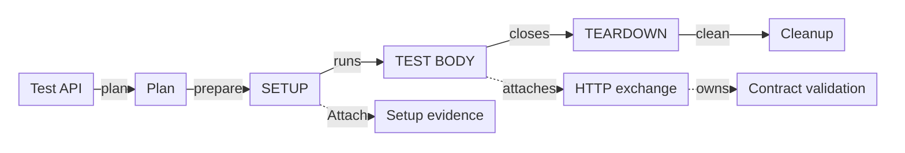

<a id="guide-to-add-a-api-test-to-atf-java"></a>
<a id="ghid-pentru-adăugarea-unui-test-api-în-atf-java"></a>
<a id="guide-to-adding-an-api-test-in-atf-java"></a>
# Guide to adding an API test in ATF Java

<a id="at-a-glance"></a>
<a id="pe-scurt"></a>
## At a glance

- goal: a deterministic, semantic, reproducible API test;
- boundary: the test composes Core, the configured transport, and the validator;
- verify the report separately against the Extent contract;
- architecture: [ATF_Architecture.md](ATF_Architecture.md);
- reporting: [ATF_Reporting_Contract.md](ATF_Reporting_Contract.md).

<a id="binding-steps"></a>
<a id="pașii-obligatorii"></a>
<a id="required-steps"></a>
## Required steps

- [ ] define the API behavior and acceptance criterion;
- [ ] inspect the existing route, model, service, and validator;
- [ ] keep route vocabulary with its owner: `MockRoutePaths` covers the `atf-mock`
 demo service, not each consumer's routes; for live traffic, `ApiLiveTransportCatalog` provides generic transport with a declared endpoint and explicit opt-in;
- [ ] add a semantic service only when the operation has domain meaning;
- [ ] execute through the executor and injected transport; the test does not
 construct the HTTP client;
- [ ] group response checks in one assertions table;
- [ ] register cleanup immediately after acquiring ownership;
- [ ] add a unit/component test for the new rule first;
- [ ] name the scenario and tags after its intent;
- [ ] generate the artifact and verify the report against its contract.

<details>
<summary><strong>Flow with multiple requests</strong></summary>

- the mutation contract and read-model contract remain separate;
- the relationship between responses verifies `id/self-link`, version, or lineage;
- attach the verification to the read-back request as evidence;
- do not invent an HTTP request to explain the relationship.

</details>

<a id="minimum-structure-of-a-scenario"></a>
<a id="structura-minimă-a-unui-scenariu"></a>
<a id="minimum-scenario-structure"></a>
## Minimum scenario structure



<details>
<summary><strong>Legend — minimum API scenario</strong></summary>

- the solid line shows `API TEST → plan → SETUP → TEST BODY → TEARDOWN`;
- dotted branches show only evidence local to that phase;
- `SETUP` prepares only preconditions that exist in the scenario;
- `TEST BODY` keeps contract validation nested under the request whose response
 it verifies;
- `TEARDOWN` appears only when there is real cleanup or read-back;
- the assertions table is the semantic verdict, not a duplicate phase summary.

The short labels shall be kept as follows:

| In the scheme | Full meaning |
|---|---|
| Plan | Scenario plan |
| SETUP | Optional setup |
| Cleanup | Cleanup/read-back |
| Setup evidence | Setup request |
| HTTP exchange | Request + trace · response evidence |
| Contract validation | Contract validation + aggregate · assertion table |
| attaches | local evidence |
| owns | owns |

</details>

For a simple test, TEST BODY must contain the request and its validation. For a
 lifecycle scenario, create phases only when they have real content. A TEST BODY node does not repeat failures already shown in the assertions table; the phase shows only a summary, while detailed diagnostics remain under validation.

<a id="what-checks-a-api-test"></a>
<a id="ce-verifică-un-test-api"></a>
<a id="what-an-api-test-verifies"></a>
## What an API test verifies

A validator can group the following in the same table:

| Assertion | Expected | Actual | Result |
|---|---|---|---|
| HTTP status | expected code and text | received response | PASS/FAIL/WARNING |
| Content-Type | accepted type | received header | PASS/FAIL |
| JSON schema | contract schema | evaluated schema | PASS/FAIL |
| required field | expected value or type | received value | PASS/FAIL/WARNING |
| relationship | associated resource | verification result | PASS/FAIL |

Do not create a node for each assertion. The table aggregates the current
 response so all deviations are visible together.

The correlation chooses the current observation before the status assessment according to [contract of proof](ATF_Evidence_Capture_Contract.md#alegerea-dovezii-înaintea-verdictului). An error response and absence of capture have distinct diagnoses; an older 2xx cannot replace the evidence of the assessed operation.

<a id="duration-and-status-in-the-report"></a>
<a id="durată-și-status-în-raport"></a>
## Duration and status in the report

Visible rules:

- duration has an explicit unit (`ms` or `s`);
- status and duration are separate tokens;
- a leaf uses its measured duration;
- a parent uses its own duration and the totals of its direct children;
- an inclusive Extent duration is not added again to its descendants;
- a timestamp is not a duration and does not appear as a column in `Tests`.

The unit, geometry and badge palette are common visual contracts, not API rules; the regulatory source is [contract Reporting Display](ATF_Reporting_Display_Contract.md#tokens-vizuale).

<a id="separation-of-responsibilities"></a>
<a id="separarea-responsabilităților"></a>
## Separation of responsibilities

```text
MockRoutePaths              -> rutele serviciului demo atf-mock
ApiLiveTransportCatalog    -> catalog generic de endpoint-uri live, opt-in
ApiOperationLabel           -> label semantic pentru raport
Service                     -> acțiune semantică
ApiExecutor                 -> transport, retry și durată
Validator                   -> assertions și tabel agregat
Report session              -> arbore și evidence
Scenario                    -> ordine și intenție
```

If a test starts to contain infrastructure JSON, CSS, Extent markup, retry
 policies, or literal endpoints, the responsibility is in the wrong place.

`ApiLiveTransportCatalog` does not discover the service host or automatically
 select a business route: the consumer provides the endpoint from its configuration, then the catalog validates `LIVE` mode, opt-in, and request origin. The service contract and its routes remain in the consumer module.

<a id="hand-replay-and-actual-requests"></a>
<a id="replay-manual-și-request-uri-reale"></a>
<a id="manual-replay-and-real-requests"></a>
## Manual replay and real requests

The API report provides reproducible steps: `METHOD`, `URL`, effective
 headers, `REQUEST JSON`, `RESPONSE JSON`, `TRANSPORT PROVENANCE`, and `MANUAL REPLAY`. In acceptance, a configured real URL is only mock metadata; the report marks it `ACCEPTANCE / MOCK` and `NOT EXECUTABLE`. Do not copy cURL from a mock report as if it had been executed.

Real requests are separate and opt-in:

```yaml
api:
  transport: live
  baseUri: https://<real-api-host>/<base-path>
```

Live transport requires an explicit mode and opt-in at the composition root,
 plus an endpoint validated by `ApiLiveTransportCatalog`. Generic configuration can read `atf.api.live.optIn` or `ATF_API_LIVE_OPT_IN`; consumer gates have their own policies.

| Launch | Current gate | Owner |
|---|---|---|
| configured generic catalog | `live` profile and transport opt-in | `atf-core` |
| AutoEx API | independent opt-ins `atf.autoex.api.readonly.live.enabled` and `atf.autoex.api.live.enabled` | [AutoEx](../atf-test-auto-ex/README.md#api-direct-și-limita-evidence-ului-uiapi) |
| authenticated Shop API | permitted authenticated profile, valid fixture, and API mode `LIVE` | [Shop](../atf-test-practice-shop/README.md#de-ce-raportul-api-nu-arată-ca-raportul-ui) |

In every case, preserve:

- generate cURL replay after execution, with tokens and sensitive headers redacted;
- no network for tests that do not explicitly declare the `live` profile;
- no placeholder acceptance and no request outside the selected endpoint origin.

<a id="report-ownershipwwnnnnnnnnnnnnnnnnnnnnnnnnnn"></a>
<a id="ownership-ul-raportului"></a>
<a id="report-ownership"></a>
## Report ownership

The suite alone does not guarantee a shared report: the adapter must explicitly
 own the session and finalization. AutoEx declares `suite` scope for API runs and keeps `class` scope for individual runs; Shop has one class in its live API suite.

- Shop audit starts before the client and credentials and publishes after
 cleanup, including on failure exits. A missing response does not invent an HTTP status or body.
- A rejected HTTP response retains the request, available response, and FAIL
 comparisons; a passing class does not cover a sibling class failure in the shared artifact.
- Components without traffic shall publish checks through the component adapter,
  no synthetic quests; the contract is in [test guide](ATF_Testing_Guide.md#auditul-componentelor-consumerilor).

<a id="cleanup-and-faillure"></a>
<a id="cleanup-și-failure"></a>
<a id="cleanup-and-failure"></a>
## Cleanup and failure

- register a created resource in the scenario registry immediately;
- run teardown after a body failure when ownership exists;
- cleanup failure does not hide the primary failure;
- final status follows the same precedence everywhere;
- a skipped test does not simulate a pass or publish invented assertions.

<a id="verification-of-the-report"></a>
<a id="verificarea-raportului"></a>
<a id="verifying-the-report"></a>
## Verifying the report

After offline tests and the scenario run:

- [ ] open the HTML artifact in TAB MCP;
- [ ] verify `Tests → Category → Fails → Overview`, with `Overview` as the default;
- [ ] select one passing test and one warning/fail/skip test;
- [ ] expand the request, trace, JSON, and validation;
- [ ] confirm `Contract validation` is nested under the evaluated request and uses one table;
- [ ] confirm JSON scrolls internally without page overflow;
- [ ] verify tags in the scenario details;
- [ ] verify Fails has one section, a schematic summary, and a stable link;
- [ ] confirm that no external resources or auxiliary Extent folder appear.

Visual validation is part of the reporting test. A green build alone is not
 sufficient when a change affects the DOM or CSS.

