# Arhitectura ATF Java

ATF Java este împărțit în module cu responsabilități distincte. Direcția
dependențelor este de la scenarii spre infrastructură; infrastructura nu
cunoaște rutele sau intenția unui test de produs.

## Pe scurt

Reactorul păstrează exact cele 12 module existente. Extinderile se implementează
în pachetele și contractele ownerilor actuali, păstrând direcția dependențelor.

| Boundary | Owner | Contract stabil | Gate executabil |
|---|---|---|---|
| kernel și politici | `atf-core` | modele, porturi, snapshot-uri și vocabular fizic | unit + governance |
| execuție API generică | `atf-core` | executor, lifecycle și binding de transport | unit/component + consumer |
| verdicturi | `atf-validation` | reguli și `ValidationResult` prin port neutru | unit/component |
| artifact | `atf-reporting` | renderer semantic standalone, Extent/HTML și contracte pure | POM standalone + unit/component |
| reporting composition | `atf-reporting-tests` | mock → API → raport, cu component/integration proof și browser/E2E pentru contractul reporting | component + integration/API + Chromium/Playwright |
| Practice Shop consumer | `atf-test-practice-shop` | journey UI/API, configurație, pagini și runtime de aplicație | component + API live + E2E |
| Automation Exercise consumer | `atf-test-auto-ex` | journey UI, contracte API și runtime separat de adaptorul JUnit | component + API live + E2E opt-in |
| guvernanță whole-ATF | `atf-tests` | graph, dependency direction și architecture boundary | architecture/component |

- `atf-reporting` este biblioteca standalone și nu compune suita;
- `atf-reporting-tests` dovedește integrarea API/mock și randarea browser;
- `atf-tests` deține guvernanța întregului reactor;
- feedback-ul activ păstrează numai riscuri reproductibile care pot schimba
  codul sau packaging-ul; nu redefinește contractele închise.

### Harta modulelor: platformă și consumatori

Platforma, scope-urile consumerilor și verificarea se citesc separat.
Dependențele Maven și relațiile de guvernanță au sensuri distincte, explicite.

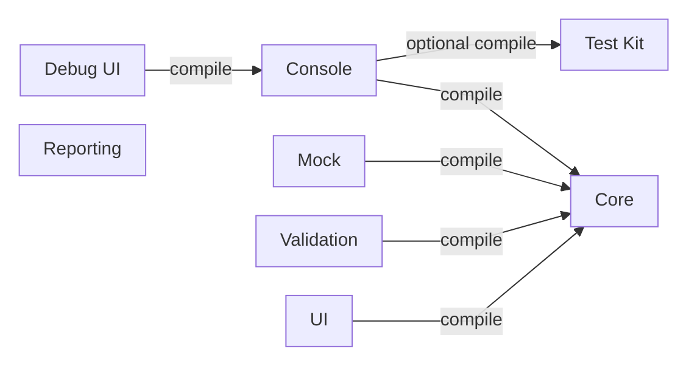

<details>
<summary><strong>Legendă — hartă module și direcția dependency</strong></summary>

- săgeata pleacă din modulul care declară dependența; `compile` și `test scope`
  descriu scope-ul din POM, nu ownership-ul funcțional;
- `atf-reporting` nu are dependențe ATF în production; `atf-console` consumă
  evenimentele și contractele neutre din Core, independent de Reporting;
- `atf-reporting-tests` este composition root pentru probele reporting, iar
  `atf-tests` deține guard-urile whole-reactor; legăturile lor complete de test
  scope sunt în POM-uri, nu redate ca o plasă de muchii în diagramă;
- muchiile etichetate `guard, not dependency` sunt relații de verificare a
  repository-ului, nu muchii Maven;
- Practice Shop și AutoEx declară Test Kit în `test` scope, conform POM-urilor;
- `atf-console` declară Test Kit ca dependență `optional` compile deoarece
  adaptorul JUnit din `src/main` citește adnotările și resolver-ele lui; asta nu
  transformă Test Kit într-o bibliotecă de business.

Etichetele scurte păstrează următorul sens:

| În schemă | Sens complet |
|---|---|
| Mock | atf-mock |
| Core | atf-core |
| Validation | atf-validation |
| Test Kit | atf-test-kit |
| UI | atf-ui |
| Debug UI | atf-debug-ui |
| Shop | atf-test-practice-shop |
| AutoEx | atf-test-auto-ex |

</details>

**Dependențele consumerilor.** Matricea păstrează separat scope-urile din POM;
lista dintr-o celulă înseamnă dependență directă către fiecare modul enumerat.

| Consumer | `compile` | `test` |
|---|---|---|
| Shop | Core, Console, Reporting, UI | Test Kit |
| AutoEx | Core, Reporting, UI | Console, Test Kit |

**Relațiile de verificare.** Compoziția Reporting consumă biblioteca în test;
guvernanța inspectează sursele consumerului și ale probelor Reporting.
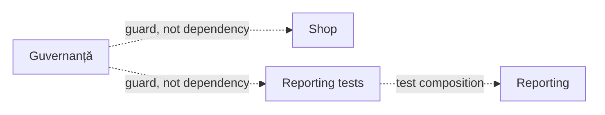
<details>
<summary><strong>Legendă — compoziție și guvernanță</strong></summary>

- `Reporting tests` înseamnă `atf-reporting-tests`; muchia `test composition`
  este dependența sa `test` către `atf-reporting`.
- `Guvernanță` înseamnă `atf-tests`; cele două muchii `guard, not dependency`
  inspectează repository-ul și nu adaugă dependențe Maven către Shop sau Reporting Tests.
- Scope-urile complete ale compozițiilor se citesc în POM-uri. Harta selectează
  relațiile explicative, păstrând explicit diferența dintre consum și verificare.

</details>

În această diagramă, semnificația este dată de eticheta muchiei și nu trebuie
dedusă din poziția nodurilor:

- `atf-validation` și fixture-urile reporting depind de `atf-core`;
- `atf-reporting` nu depinde de niciun modul ATF în production;
- testele de compoziție Reporting sunt în
  `atf-reporting-tests/src/test/java`, cu mock, consolă, Playwright și debug UI
  strict în test scope;
- `atf-tests` rulează separat `atf.api.tests.governance.ArchitectureModuleBoundaryTest`
  pentru guvernanța întregului reactor;
- `atf-test-practice-shop` găzduiește testele aplicației consumatoare; configurația
  și flow-urile aplicației nu intră în `atf-reporting-tests`.
- `atf-test-auto-ex` este un consumer independent; nu partajează selectorii,
  datele sau page objects cu Practice Shop.

- Standalone înseamnă zero dependențe ATF pentru `atf-reporting/src/main`.
- Testele de integrare pot compune modulele ATF în test-scope prin adaptoare
  explicite.
- `ReportModelAdapters` normalizează modele existente la boundary-ul de mapare;
  nu mută reguli de business în reporting și nu autorizează dependențe ale
  rendererului către modele ATF.

`atf-test-kit` expune vocabularul unit/component/integration/e2e și adnotările
transversale pentru testare. Boundary-urile actuale sunt:

- consumul din aplicațiile testate rămâne test-only; adapter-ele de infrastructură
  pot necesita compile scope pentru integrarea JUnit, iar excepțiile se verifică
  în POM-ul fiecărui modul;
- Practice Shop și AutoEx consumă Test Kit în `test` scope; harness-urile și
  compoziția consolei rămân în sursele de test;
- Console și Reporting sunt independente; compoziția transmite câmpurile
  evenimentului extern către fabrica neutră `AtfConsoleEvent.fromExternalEnums`
  din Core, iar Reporting Tests verifică vocabularele reale;
- `atf-mock` depinde numai de `atf-core`, iar `atf-debug-ui` este un launcher
  read-only; pornirea sa din teste sau IntelliJ nu îl transformă într-o
  dependență a rendererului.

### Platforma reutilizabilă față de punctul de compunere

Contractele generice care nu au nevoie de JUnit, filesystem, YAML sau browser
stau în modulele de jos. `atf-core` oferă contractul neutru pentru selecția
programatică a scenariilor API, iar `atf-reporting` oferă contractul pur pentru
validarea unui artifact UI static:

```mermaid
%%{init: {"themeVariables":{"fontSize":"15px"},"themeCSS":".nodeLabel, .nodeLabel p { font-size: 15px !important; line-height: 1.35 !important; } .edgeLabel, .edgeLabel p { font-size: 12px !important; font-weight: 400 !important; line-height: 1.2 !important; } .edgeLabel .labelBkg, .edgeLabel p { background: transparent !important; } .edgeLabel foreignObject { transform: translateY(-18px); overflow: visible; } .node rect { rx: 6px; ry: 6px; }","flowchart":{"curve":"linear","nodeSpacing":24,"rankSpacing":24,"padding":6,"diagramPadding":20}}}%%
flowchart LR
    Core["Core contract"] -->|oferă| Catalog["Catalog"]
    Catalog -->|compune| ApiArtifact["API artifact"]
    ApiArtifact -->|este inspectat de| Browser["Browser audit"]
    Browser -->|verifică| Reporting["Reporting"]
    Reporting -->|publică| UiArtifact["UI artifact"]
```

<details>
<summary><strong>Legendă — separarea production și composition</strong></summary>

- core expune selecția typed, iar catalogul concret aparține consumerului;
- API artifactul este input read-only pentru inspectorul UI;
- validatorul UI aparține librăriei reporting, iar browserul rămâne în test scope;
- niciun `Page`, `Locator` sau JUnit nu intră în production reporting.

Etichetele scurte păstrează următorul sens:

| În schemă | Sens complet |
|---|---|
| Core contract | core contract |
| Catalog | test catalog |
| Browser audit | browser audit |
| Reporting | reporting contract |
| oferă | oferă contract |

</details>

Limitele de compoziție și ownership sunt:

- `atf-reporting-tests` rezolvă sursele deterministe, lifecycle-ul JUnit și auditul Playwright al raportului;
- `atf-tests` deține guvernanța whole-ATF; testele aplicațiilor rămân în consumerii Shop și AutoEx;
- production reporting nu primește `Page`, `Locator` sau JUnit;
- modelele Core nu citesc YAML și nu primesc catalogul concret; adaptorul de
  surse `atf.core.config.source` rămâne separat și este apelat la composition root;
- `atf-reporting` nu primește `Page` sau `Locator`;
- separarea permite testare unit, component și E2E fără dublarea regulilor.

## Responsabilități

| Modul | Deține | Nu deține |
|---|---|---|
| atf-core | request/response, transport, configurație typed și adaptorul său de surse, autentificare, retry, redaction, status, porturi și `ApiScenarioSelection` | HTML, CSS, Extent, JUnit, citirea YAML din modelele neutre, browser, cataloguri concrete și rute de produs |
| atf-mock | transport fake configurabil și catalog de răspunsuri deterministe | HTTP real, Extent, JUnit, validare de business |
| atf-validation | contracte response, reguli, evaluator, verdict și publicare prin port neutru | HTTP, Extent, HTML, CSS, lifecycle |
| atf-console | formatter pentru evenimentele de consolă, `ConsoleSettings`, YAML, nesting, statusuri, fallback ASCII/UTF-8 și ownership-ul exclusiv al stdout/stderr | HTML, Extent, apeluri HTTP, verdicturi inventate |
| atf-reporting | sesiune, arbore Extent, theme, finalizare HTML, audit kernel renderer-neutral, planuri de audit, contracte API renderer-neutral, metadata failure surfaces, motorul pur `api.contract`, auditul static al artifactului API, auditorul JSON static, contractul pur al raportului UI și lifecycle-ul generic de evidence | apeluri HTTP/transport, consolă concretă, acceptance scenarios, browser/Playwright și fixture-uri de test; nu depinde runtime de `atf-mock` |
| atf-ui | configurație browser și adaptor Java Playwright pentru verificări UI automate | generarea HTML-ului și testele executabile |
| atf-debug-ui | publică read-only un HTML existent pe loopback și furnizează target-ul pentru TAB MCP | renderer, modificarea artifactului, verdicturi și teste executabile |
| atf-test-kit | adnotări, resolvere și primitive test-only de achiziție/rollback/cleanup; [contract](../atf-test-kit/README.md) | cod production, renderer, browser și reguli business |
| atf-reporting-tests | contracte component/integration API/mock și E2E UI care verifică exclusiv `atf-reporting`; fixture-uri și adaptoare ale raportului | nu devine suita unei aplicații și nu mută aceste responsabilități în production |
| atf-test-practice-shop | testele aplicației, runtime, pagini, flow-uri și mapping-ul dovezilor business | rendererul/publisherul generic și guvernanța whole-ATF |
| atf-test-auto-ex | teste component/UI E2E/API live și adaptoare JUnit în test; configurație, pagini, flow-uri și runtime specific în main | fixture-uri sau flow-uri Practice Shop |
| atf-tests | guvernanța whole-ATF și gates de arhitectură | teste de produs și contracte interne ale `atf-reporting` |

| **Dovada cerută** | **Owner** |
|---|---|
| fake-ul poate valida modelul, rendererul, markup-ul sau publisherul | `atf-reporting` |
| trebuie verificată compoziția JUnit/mock ori randarea raportului | `atf-reporting-tests` |
| trebuie verificat comportamentul aplicației | modulul consumer, de exemplu `atf-test-practice-shop` |
| trebuie verificat un alt site de practică UI/API | consumer separat `atf-test-auto-ex`, cu canalul declarat prin Test Kit |
| trebuie contactat un serviciu real | test separat, opt-in explicit |

## Limitele de responsabilitate ale testelor API și auditului UI

`atf.reporting.api.tests.api` este exclusiv pentru teste API: resurse, request-uri,
headere, contracte, scenarii stateful și lifecycle. Nu poate importa browser,
Playwright, `Page`, `Locator`, DOM, screenshot sau Debug UI.

Auditul API→UI este împărțit astfel:

- browser audit: `atf.ui.tests.extent` din `atf-reporting-tests/src/test/java`;
- contract pur: snapshot-uri, verdicturi, reconciliere, planuri, checks, validatori și failure surfaces în `atf.reporting.audit` și `atf.reporting.ui.audit.*`;
- browser generic și captură: `atf-ui`;
- configurație output, audit suite și input report: `atf-reporting-tests/src/test/java/atf/ui/tests/extent/support/config`;
- servire read-only pentru TAB MCP: `atf-debug-ui`;
- singura fațadă pentru precondiția API: `ApiReportAuditSetup`;
- lifecycle și contracte pure de secțiune: `atf-reporting`;
- DOM, computed-style, click, collapse și randare: browser test scope;
- acceptance plan și publisher API→Extent: `atf.reporting.api.acceptance`.

Contractul raportului API are un boundary suplimentar, fără browser:

```text
catalog YAML/mock sau live adapter
        → ApiReportContractCatalog
        → ApiReportContractAuditor
        → body / metadata / execution / JSON-tree validators
        → ValidationResult
        → optional HTML evidence publisher
```

`atf-reporting` expune doar portul și modelele renderer-neutral. `atf-mock` este
folosit de testele reporting prin scope `test`, nu de producția reporting;
`atf-reporting-tests` păstrează exclusiv adaptorul care extrage
`ApiReportContractInput` din DOM. Astfel același contract poate fi verificat ca
unit, componentă sau integrare, iar browserul rămâne un nivel separat de
verificare.

Contractul UI are un kernel pur și două compoziții browser; browserul rămâne
exclusiv în test scope-ul `atf-reporting-tests`:

| Pachet | Input | Scop |
|---|---|---|
| `atf.ui.tests.extent.e2e.section` | raport API generat sau static | setup/mock, projection, request/response evidence, paritate API în browser |
| `atf.reporting.ui.contract` | annotation, spec, check-uri, snapshot și validator pur | reguli structurale fără DOM/browser |
| `atf.ui.tests.extent.e2e.uireport` | raport UI anterior, static | rezolvare input, tab-uri, structură DOM, stil, collapsed state, Fails și UI validation |

Auditul `atf.ui.tests.extent.e2e.uireport` nu citește expected business values
din YAML și nu cere request-uri API. Pornește cu `@UiExtentReportContract` și `-Datf.ui.report=...`, apoi
publică un artifact UI nou fără să modifice inputul.

Lanțul observabil este:

```text
setup configurabil
  → scenarii API
  → atf-reporting-tests/src/test/resources/atf-mock.yaml / AtfMockTransport
  → raport API read-only
  → audit Playwright în atf.ui.tests.extent
  → validare DOM/evidence
  → raport UI separat
```

Regulile pentru expected și selecția suitei sunt:

- expected-ul UI se construiește înainte de browser din selecția API, catalog și mock;
- actualul se citește din DOM prin locatorii semantici;
- selectorii stau în `ReportUiLocators`, acțiunile în adapters, ordinea în flows, iar verdictul în validators/snapshot-uri;
- nu se introduce `ui.enabled`; selecția suitei și a regulilor vine din adnotare, YAML sau proprietăți JVM.

Regulile pentru smoke E2E sunt:
- selecția explicită prin `@ApiScenarioSetup` are prioritate peste `families`;
- metodele sunt exacte și ne-redundante; familia rămâne fallback pentru suite/YAML;
- matricea completă de API și contractele reporting păstrează coverage-ul larg;
- browserul dovedește doar legarea setup → mock → artifact → DOM și interacțiunile reale.

Regula pentru `SETUP` este:

- publică un tabel compact `Setup evidence` (`CHECK / EXPECTED / ACTUAL / RESULT`)
  pentru precondiții și starea pregătirii; tabelul nu înlocuiește evidence-ul
  tehnic;
- dacă setup-ul produce exchange-uri reale și profilul le colectează, acestea
  rămân `API validation` sub același checkpoint `SETUP`, cu request, response
  și execution evidence canonicală;
- acțiunile de pregătire nu devin `UI validation`, iar setup-ul nu primește
  `UI validation`;
- `UI validation` există numai în `TEST BODY`, după acțiunile reale de browser.

## Capturarea și selecția traficului UI

Cum ajunge traficul produs de browser la checkpoint-ul care îl explică?
Selecția se aplică înainte de citirea body-ului și de consumarea bugetului
jurnalului; un cursor delimitează observațiile recepționate înainte și după
baseline. Request-urile începute anterior și terminate ulterior cer corelare
suplimentară; ordinea capturării nu dovedește singură cauzalitatea business.

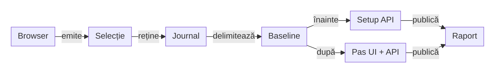

<details>
<summary><strong>Legendă — selecția și ownership-ul dovezii</strong></summary>

- `atf-ui` aplică allowlist-ul de host și politica typed pentru tipul resursei
  și prefixul rutei. Resursele excluse nu sunt citite ca body și nu ocupă
  jurnalul; plafonul păstrează contori accepted/retained/dropped.
- Consumerul declară rutele business și marchează baseline-ul după setup.
  În AutoEx, `GET /api/productsList` este un fetch al aceleiași sesiuni
  browser, publicat la precondiția catalogului; nu devine încă un exchange
  cauzal al coșului. `GET /add_to_cart/1` este observat după baseline și
  aparține checkpoint-ului cart-add, fără replay.
- `atf-reporting` afișează schimbul lângă pasul său și rezumă separat scope-ul,
  setup/causal și `COMPLETE`/`INCOMPLETE`. Inspectorul nu decide verdictul
  business și nu clonează request-urile în sumar.

Etichetele scurte păstrează următorul sens:

| În schemă | Sens complet |
|---|---|
| Selecție | Selecție UI |
| Journal | Jurnal bounded |

</details>

Contractul generic al filtrului și cursorului este în
[README-ul ATF UI](../atf-ui/README.md#inspectorul-de-rețea--limită-generică-de-responsabilitate);
selecția rutelor și asocierea cu pașii AutoEx sunt în
[README-ul AutoEx](../atf-test-auto-ex/README.md#boundary-ul-cauzal-pentru-ui_api).

## Fluxul unei cereri

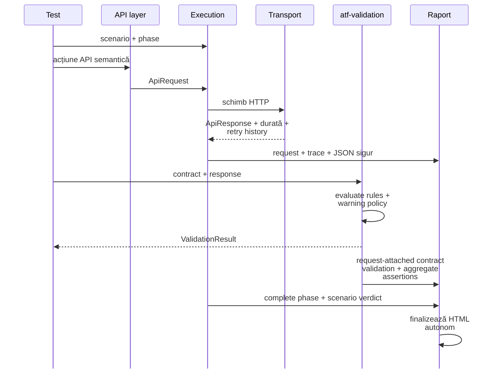

<details>
<summary><strong>Legendă — fluxul semantic al unei cereri</strong></summary>

- executorul publică faptele transportului și istoricul retry;
- validation-ul calculează verdictul, iar reporting-ul doar proiectează evidence;
- request-ul deține contract validation-ul nested în evidence-ul său; UI/API
  validation-urile rămân separate sub checkpoint-ul Gherkin UI;
- finalizarea produce un artifact autonom, fără a muta verdictul.

</details>

Faptele transportului, satisfacerea contractului și verdictul scenariului sunt
lucruri diferite:

```text
schimb HTTP finalizat  !=  contract satisfăcut  !=  scenariu trecut
```

## Profile de transport și boundary-ul acceptance

ATF are două profile de transport, cu scopuri diferite:

| Profil | Implementare | Rețea | Proprietar | Scop |
|---|---|---:|---|---|
| `acceptance` | `AtfMockTransport` (`atf-mock`) | nu | `atf-reporting-tests` test scope | raport determinist, contracte, lifecycle și randare |
| `live` | `HttpClientTransport` | da | testul live / consumator | verificarea unui serviciu HTTP disponibil |

Boundary-ul acceptance este explicit:

- `AtfMockTransport` este test double din `atf-mock`, nu HTTP server local și nu proxy către `atf.local`;
- este injectat explicit în `ApiModuleFactory`;
- URL-ul construit de `ApiExecutor` rămâne în evidence pentru ruta semantică;
- transportul fake nu execută DNS, TLS sau request network;
- raportarea și contractele nu depind de un serviciu extern.

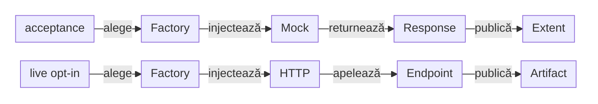

<details>
<summary><strong>Legendă — acceptance offline versus live opt-in</strong></summary>

- acceptance folosește fake transport și produce un response determinist;
- live folosește HTTP numai prin policy și opt-in explicit;
- URL-ul afișat în acceptance este evidence semantică, nu dovadă de trafic;
- cele două profile nu se convertesc implicit unul în celălalt.

Etichetele scurte păstrează următorul sens:

| În schemă | Sens complet |
|---|---|
| Factory | module factory |
| Mock | mock transport |
| Response | deterministic response |
| Extent | Extent artifact |
| HTTP | HTTP transport |
| Endpoint | real endpoint |
| Artifact | live artifact |

</details>

Regula verificabilă este:

```text
ApiReportAuditSetup -> AtfMockTransport -> offline artifact
Live API test       -> HttpClientTransport -> real endpoint
```

Un URL precum `https://atf.local/public/v2/users` dintr-un acceptance report
este metadata a request-ului, nu o afirmație că host-ul a fost contactat.
Disponibilitatea DNS, TLS, autentificarea și contractul serviciului sunt
verificabile numai în profilul `live`.

`ApiTransportProvenance` circulă în `ApiExecutionResult` până la publisher-ul
API. Raportul afișează astfel adevărul transportului și un replay manual sigur:

```text
acceptance → ACCEPTANCE / MOCK → URL metadata + MANUAL REPLAY: NOT EXECUTABLE
live       → LIVE / HTTP       → URL contactat + cURL method/headers/body redacted
```

Nu se introduce în raport un URL de fallback inventat și nu se declară că un
endpoint a fost contactat dacă a fost folosit `AtfMockTransport`. Pentru live,
operatorul completează credențialele redacted înainte de a executa cURL-ul.

| Control live | Contract |
|---|---|
| opt-in | `-Datf.api.live.optIn=true` sau `ATF_API_LIVE_OPT_IN=true` |
| target | `api.baseUri` numit explicit |
| adapter | `ApiLiveTransportCatalog` respinge politica acceptance și placeholder-ul `https://atf.local` |
| acceptance | nu consultă catalogul și nu devine implicit test de rețea |

## Vocabularul rutelor

Rutele nu se scriu ca string-uri repetate în teste. Vocabularul stabil al
căilor este separat de catalogul operațional și de configurația mediului:

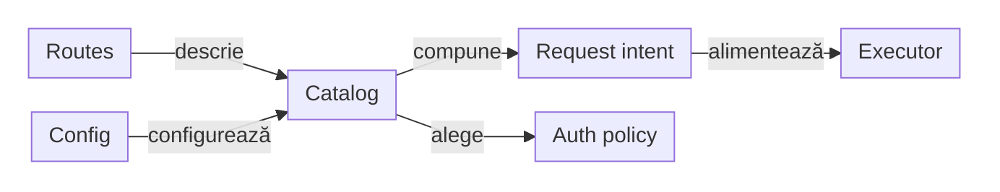

<details>
<summary><strong>Legendă — vocabularul rutelor</strong></summary>

- `Paths` definește vocabularul stabil, fără endpoint de business hardcodat;
- catalogul combină ruta, operația și politica de autentificare;
- configurația mediului poate schimba baza URL fără să schimbe testele;
- executorul primește un request deja compus semantic.

Etichetele scurte păstrează următorul sens:

| În schemă | Sens complet |
|---|---|
| Routes | route vocabulary |
| Config | environment config |
| Catalog | operation catalog |
| Request intent | request intent |
| Auth policy | auth policy |
| Executor | API executor |

</details>

Catalogul descrie operația, metoda, resursa și autentificarea. Configurația
poate suprascrie baza URL sau șabloanele fără ca testele să cunoască detaliile
de mediu.

## Configurație și snapshot

Configurația urmează un singur traseu operațional:

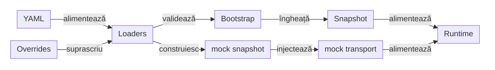

<details>
<summary><strong>Legendă — de la sursă la runtime</strong></summary>

- `YAML sources` = `atf.yaml`, catalogul `atf-mock.yaml` și configurația
  consumatorului, inclusiv `atf-practice-shop.yaml`;
- `owner loaders` = loader-e distincte pentru API, mock și aplicație;
- `typed bootstrap` = validare la composition root, înaintea execuției;
- `immutable snapshot` = configurație înghețată, transmisă consumatorilor;
- `mock transport` = transport selectat de politica `acceptance`;
- `runtime consumers` = executor, validation, reporting și fixture-urile de test;
- săgeata nu reprezintă un import Maven, ci fluxul datelor de configurare.

Etichetele scurte păstrează următorul sens:

| În schemă | Sens complet |
|---|---|
| Overrides | explicit overrides |
| alimentează | sunt citite de |

</details>

<details>
<summary><strong>Surse și ownership</strong></summary>

- `atf.yaml` este configurația generală a proiectului consumator;
- secțiunile `api`, `validation` și `reporting` aparțin proiectului care compune
  rularea, nu unui request individual;
- configurația UI de audit și catalogul mock pentru contractul reporting sunt
  test-owned de `atf-reporting-tests`;
- catalogul este în
  `atf-reporting-tests/src/test/resources/atf-mock.yaml` și este încărcat prin
  `ReportingTestResources`;
- configurația aplicației este test-owned de `atf-test-practice-shop`;
- configurația aplicației este în
  `atf-test-practice-shop/src/test/resources/atf-practice-shop.yaml`;
- configurația Automation Exercise este test-owned de `atf-test-auto-ex` și se
  află în `atf-test-auto-ex/src/test/resources/atf-auto-ex.yaml`;
- nu există `ui.enabled`;
- rutele, răspunsurile, body-urile și fallback-ul pentru raportare sunt încărcate
  explicit prin resursa de test, nu dintr-un endpoint extern.

</details>

<details>
<summary><strong>Bootstrap și politica de transport</strong></summary>

- `ApiBootstrapConfiguration` compune `ApiSettings` și `ApiTransportPolicy`;
- `ApiBootstrapConfigurationLoader` citește secțiunea `api` o singură dată,
  o validează și o transmite către `ApiModuleFactory`;
- `AtfMockConfigurationLoader` citește catalogul mock; override-urile acceptate
  sunt `atf.mock.config`, `ATF_MOCK_CONFIG` și surse explicite de test;
- `api.baseUri`, timeout-ul, retry-ul, auth profile-ul și `transport` sunt
  tipizate la bootstrap;
- `ApiReportAuditSetup` injectează `AtfMockTransport` pentru `acceptance`;
- un `baseUri` în YAML nu activează singur rețeaua;
- `api.transport` acceptă `acceptance` — alias compatibil `mock` — sau `live`;
- `acceptance` este implicit; `live` cere
  `-Datf.api.live.optIn=true` sau `ATF_API_LIVE_OPT_IN=true`;
- loaderul `atf-reporting` consumă `reporting.extent` pentru artifactul HTML;
  consola nu este fallback-ul rendererului și nu este încărcată de Extent.

</details>

<details>
<summary><strong>Snapshot și reguli operaționale</strong></summary>

- `AtfRuntimeSnapshot` păstrează `ApiSettingsSnapshot` și `ReportingSettings`
  fără YAML, filesystem, environment sau Extent în `atf-core`;
- `atf-core` deține modelele typed, snapshot-urile și adaptorul explicit
  [ApiBootstrapConfigurationLoader](../atf-core/src/main/java/atf/core/config/source/ApiBootstrapConfigurationLoader.java).
  Adaptorul citește sursele la composition root; modelele nu citesc YAML ori environment.
  Compoziția de test API este în `atf-reporting-tests`, iar consumerii își păstrează wiring-ul;
- `ApiModuleFactory` proiectează snapshot-ul în executorul API, iar reporting
  consumă separat politica sa;
- `reporting.extent` rămâne responsabilitatea reporting; timeout, retry, auth,
  routes, redaction și schema roots sunt setări runtime neutre;
- loaderul eșuează clar la chei necunoscute, URI invalid, timeout invalid, root
  de schemă absent sau output path nesigur;
- căile relative se rezolvă față de fișierul YAML, nu față de `user.dir`;
- secretele sunt referințe către un provider explicit, nu valori YAML publicate;
- fiecare rulare primește snapshot-uri immutable; rulările paralele nu se pot
  modifica reciproc;
- nu se introduce un modul `atf-config`; `atf-reporting` își păstrează loaderul
  specializat pentru `reporting.extent`.

</details>

## Contracte de arhitectură verificate în codul live

Reconcilierea curentă separă contractul implementat de riscurile de evoluție:

| Contract verificat | Implementare | Dovadă |
|---|---|---|
| secțiuni `Overview`, `Tests`, `Categories`, `Fails`, `Evidence`, `UI validation` | `SectionAuditCheckExecutor` → `SectionAuditCheckPolicy` → `SectionAuditResult` | `ExtentSectionAuditPublisher` + teste component/E2E |
| raport UI read-only pe tab-urile principale | `@UiExtentReportContract` și `StaticUiExtentReportContractTest` | `atf-reporting-tests` |
| HTML/CSS/JavaScript și asset manifest | contracte pure în `atf-reporting` | `UiReportArtifactContractTest` |
| direcție module, ownership constante/CSS, output și import graph | boundary-uri Maven/source | `atf-tests` + architecture tests |
| paritate Extent ↔ fallback | `AtfReportSemanticSnapshot` | [comparație între renderer-e în test](../atf-reporting-tests/src/test/java/atf/reporting/semantic/AtfReportSemanticSnapshotTest.java) |
| consistență internă fallback | `AtfReportSemanticSnapshot.from(ReportExecutionModel)` | documentul și recorderul aceleiași sesiuni sunt comparate înainte de render |

Acestea sunt capabilități închise și normative. Un document de feedback nu le
repetă și nu le transformă într-un scor; se redeschid numai printr-o regresie
reproductibilă, o schimbare de consumator sau o schimbare publică de contract.

### Parity semantică între renderer-e

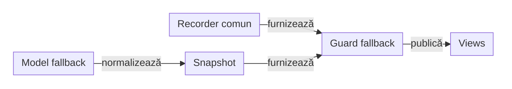

<details>
<summary><strong>Legendă — parity semantică între renderer-e</strong></summary>

- guard-ul din `HtmlReportSession.render()` compară modelul fallback cu
  recorderul semantic al aceleiași sesiuni, înaintea construirii views;
- adapterul normalizează modelul fallback, fără să forțeze aceeași structură internă;
- comparația acoperă class, scenario, phase, request, validation și evidence counts;
- diferența se repară în provider/model, nu prin ascunderea ei în UI.
- paritatea Extent/fallback se verifică separat, prin publicarea acelorași
  fapte în ambele sesiuni și compararea snapshot-urilor în test.

Etichetele scurte păstrează următorul sens:

| În schemă | Sens complet |
|---|---|
| Recorder comun | recorderul semantic al sesiunii fallback |
| Model fallback | documentul de execuție fallback |
| Snapshot | semantic snapshot |
| Guard fallback | verificarea consistenței interne înainte de render |
| Views | coherent views |

</details>

| Model | Owner | Rol |
|---|---|---|
| `ReportExecutionModel` | fallback | proiecțiile `Overview`, `Categories`, `Fails` |
| `AtfReportSemanticSnapshot` | recorder comun și adaptoare | contract semantic renderer-neutral |

Guard-ul local verifică arborele `class → scenario → phase → request → validation`,
package-ul și evidence counts. [AtfReportSemanticSnapshotTest](../atf-reporting-tests/src/test/java/atf/reporting/semantic/AtfReportSemanticSnapshotTest.java)
compară separat rezultatele Extent/fallback. Modelele rămân distincte; renderul
fallback nu deschide o sesiune Extent pentru a-și confirma outputul.

### Evoluție controlată și redeschidere

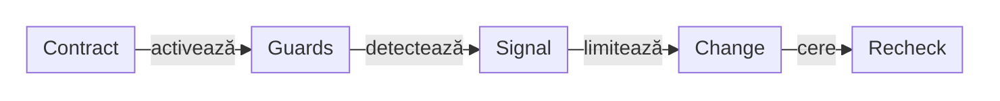

<details>
<summary><strong>Legendă — când se redeschide un contract</strong></summary>

- **Închis**: boundary-ul este documentat, iar implementarea are consumatori și teste.
- **Protejat**: snapshot-urile neutre sunt validate de `ExtractionValidationConvergenceTest`;
  sync-ul live↔staging este apărat de `AtfPromotionManifest` și `AtfPromotionGuard`;
  transportul live explicit este `ApiLiveTransportCatalog`.
- **Redeschidere justificată**: defect reproductibil, al doilea consumator sau schimbare publică de contract.
- **Schimbare țintită**: se adaugă numai coverage-ul necesar, de exemplu snapshot/golden; nu se face split cosmetic.
- **Închidere**: se revalidează codul și testele, apoi decizia se consolidează în README-ul ownerului.
- **Feedback**: păstrează doar regresiile viitoare; nu dublează deciziile deja închise.

`AtfReportTheme` și `UiExtentReportSession` au boundary-uri documentate și
colaboratori semantici suficienți pentru codul live. `ExtentReportRuntimeBehaviour`
compune `Core`, `Tests`, `Overview`, `Evidence`, `Navigation`, `Duration` și
`Failure`, iar `ExtentReportRuntimeScriptTest` apără compoziția. Aceste decizii
rămân în README-ul reporting și nu se copiază în registrul de feedback.

Fallback-ul HTML păstrează aceeași separare: `HtmlReportSession` este composition
root pentru document/lifecycle, iar comportamentul tab-urilor este un asset
injectabil prin `HtmlReportScript`, implementat de `HtmlReportNavigationScript`.
Markup-ul semantic, lifecycle-ul și JavaScript-ul au seam-uri independente fără
browser sau DOM în modelul de raportare.

În `atf.reporting.html.scope`, `HtmlReportScenarioScope`,
`HtmlReportPhaseScope`, `HtmlReportRequestScope` și `HtmlReportValidationScope`
implementează porturile `AtfReportPorts`. Sesiunea creează scope-urile, modelul
semantic oferă numai mutații controlate, iar renderer-ul nu primește câmpuri
interne și nu devine dependent de lifecycle.

Etichetele scurte păstrează următorul sens:

| În schemă | Sens complet |
|---|---|
| Contract | contract closed |
| Guards | guards active |
| Signal | valid signal |
| Change | targeted change |
| Recheck | owner revalidation |

</details>

## Ciclu de viață și responsabilități

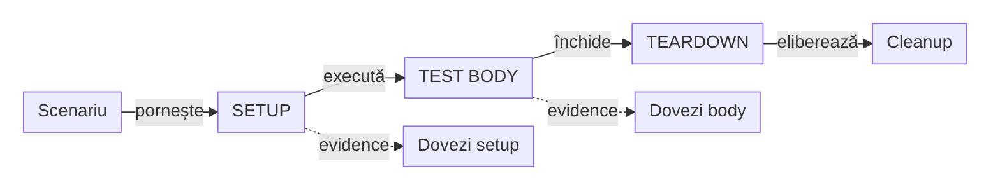

<details>
<summary><strong>Legendă — lifecycle și ownership</strong></summary>

- săgeata solidă = progresul lifecycle-ului; fazele apar numai când au
  conținut real;
- săgeata punctată = grupare vizuală a evidence-ului local, nu o fază nouă;
- contract validation-ul este nested sub request-ul evaluat; UI/API validation-urile
  rămân copii semantici ai checkpoint-ului Gherkin UI;
- cleanup-ul închide resursele create în ordine inversă;
- precedence-ul verdictului rămâne responsabilitatea lifecycle-ului, nu a rendererului.

Etichetele scurte păstrează următorul sens:

| În schemă | Sens complet |
|---|---|
| Cleanup | cleanup invers |
| Dovezi setup | Setup evidence |
| Dovezi body | Body evidence |

</details>

Lifecycle-ul request-ului păstrează dovezile sub schimbul care le-a produs:

- request-ul se închide numai după publicarea evidence-ului tehnic și a validării;
- în API direct, `Contract validation` este copilul request-ului evaluat;
- mai multe assertions pentru același response formează un singur tabel;
- în UI, `UI validation` și `API validation` sunt copii ai aceluiași checkpoint,
  iar request-urile rămân sub `API validation`.

Responsabilități obligatorii:

- executorul publică faptele HTTP și durata;
- validatorul calculează rezultatele și publică tabelul agregat;
- lifecycle-ul închide fazele și aplică precedence-ul verdictului;
- reporting-ul redă structura fără să modifice verdictul;
- cleanup-ul deține resursele create și rulează best effort în ordine inversă.

## Namespace-uri și rădăcini de surse

Numele pachetului vine din declarația `package`; rădăcina surselor vine din
POM-ul modulului. Nu deducem una din cealaltă și nu reconstruim inventarul din
namespace-uri istorice.

Coordonatele Maven au alt rol: `groupId` poate rămâne `atf.api` fără ca pachetele
Java să păstreze acest prefix. Rename-ul unui namespace nu redenumește implicit artifactul.

| Owner | Namespace runtime / teste | Rădăcini Maven curente |
|---|---|---|
| [Shop](../atf-test-practice-shop/README.md) | `atf.shop` / `atf.shop.tests` | `src/main` / `src/test`, declarate în POM |
| [AutoEx](../atf-test-auto-ex/README.md) | `atf.autoex` / `atf.autoex.tests` | `src/main/java` / `src/test/java`, convenția Maven implicită |

Structura se reia din surse la fiecare refactorizare:

```text
POM → rădăcini surse → declarații package → apelanți și suite → README owner
```

Gate-ul whole-reactor descoperă sursele din `sourceDirectory` și
`testSourceDirectory` declarate per POM; dacă lipsesc, folosește convențiile
Maven `src/main/java` și `src/test/java`. Astfel, un modul cu `src/test` declarat
nu dispare din inventar doar fiindcă nu folosește layout-ul implicit.

- Pachetul identifică aplicația/ownerul și responsabilitatea; numele business,
  paginile și porturile aplicației nu se mută în Kit pentru uniformitate.
- Rename-ul păstrează apelanții, resursele și identitățile cazurilor verificate;
  mutarea fizică nu demonstrează separarea semantică a flow-urilor.
- Inventarul folosește fișierele curente, fără `target`, artifacte sau copii de
  staging. Adnotarea layer-ului clasifică testul, nu numele directorului.
- Linkurile către surse și exemplele de import se actualizează împreună;
  path-urile istorice din controalele `testChanges` își păstrează baza aprobată.

`AtfJavaSourceReferences` din Core recunoaște namespace-uri Java în cod,
inclusiv importuri normale/static/wildcard, declarații package și FQCN în
semnături sau corpuri de metodă. Separă identificatorii (`atf.ui` nu este
`atf.uikit`) și ignoră comentarii, string-uri, caractere și text blocks.

- Un exemplu documentar nu maschează o referință reală adiacentă.
- Guard-urile whole-ATF și API/UI folosesc aceeași regulă; probele controlate
  introduc încălcări înainte și după mutare și verifică path-ul și regula diagnosticului.
- Escape-urile Unicode se traduc înaintea separării comentariilor și literalilor.

Verificarea unei mutări urmează
[inventarul executabil](ATF_Testing_Guide.md#inventarul-executabil-după-mutări-și-reclasificare)
și [guvernanța consumerilor](../atf-tests/README.md). Rădăcinile declarate în POM
au prioritate față de presupunerea că fiecare modul folosește convenția implicită.

## Reguli OOP

1. Fațadele coordonează; politicile de status, retry, redaction și agregare sunt
   obiecte mici, pure și testabile.
2. Modelele din atf-core nu cunosc HTML, CSS, selectorii sau
   viewport-ul.
3. Starea de execuție este per sesiune și per scenariu; nu se introduce state
   static mutabil între teste.
4. O interfață apare pentru un seam real: transport, reporter, clock, auth sau
   cleanup. Nu se creează interfețe decorative.
5. Orice componentă care decide simultan transportul, verdictul și layout-ul
   are prea multe responsabilități și trebuie separată.

## Testabilitate

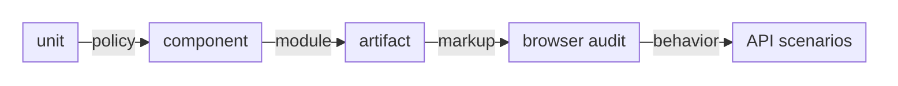

<details>
<summary><strong>Legendă — nivelurile de proof</strong></summary>

- unit verifică politica pură;
- component verifică modulul și fake transportul;
- artifactul verifică markup/CSS/JavaScript produs;
- TAB MCP verifică interacțiunea reală, iar scenariul API verifică behavior-ul live.

</details>

Fiecare schimbare de raportare care afectează structură, collapse, tab-uri,
font, culoare, scroll sau overflow are nevoie de test de cod și verificare a
artifactului. Un string găsit în HTML nu dovedește că elementul se comportă
corect la click.

## Suport consumer și selecții principale

| Contract | Owner |
|---|---|
| Cont, catalog, coș, checkout, confirmare și factură | runtime-ul și testele business Shop/AutoEx |
| Extensie JUnit și configurarea scenariului aplicației | rădăcina testelor din POM: Shop `src/test`, AutoEx `src/test/java` |
| Inițializare, close-once și compensare armată | pachetul `lifecycle` din `atf-test-kit`, fără modul nou |
| Comparații JUnit cu dovada verificărilor evaluate | evaluare JUnit unică, display injectat și colectare pe faze în main Test Kit; consumerul adaptează rândurile sigure la `AssertionAuditReport` |
| Audit neutru al ecranului, cursorul observațiilor și validarea capturii | `atf-ui`; fără dependență de Reporting sau JUnit |
| Failure evidence, replay și profile de randare | `atf-reporting-tests`, cu fixture-uri neutre |
| Descriere sigură a excepțiilor | `ReportFailureDescription` în Reporting; consumerul decide faza, exchange-ul și verdictul |
| Clasificare globală și acoperirea disjunctă a celor trei suite principale | `atf-tests`, în suita whole-ATF |

Clasele executabile ale fiecărui consumer sunt repartizate exact o dată între
local, UI E2E și API live. Opt-in-urile externe rămân independente; mutarea unui
helper nu autorizează un apel remote și nu transformă un fixture în dovadă live.

## Core ca bibliotecă — owner și deployment

J0 păstrează sursa și testele native Core; reactorul sursă are în continuare 12 module.
[Contractul Core](ATF_Core_Consumer.md) separă sursa și publicarea de acceptanța independentă a fiecărui consumator J1–J6.
Testele native se păstrează în J0, iar acceptanța pe binar rulează în TMP.


## Shared platform libraries

Reactorul J0 are 12 module sursă. [Contractul bibliotecilor](ATF_Platform_Libraries.md) definește cei cinci owneri, distribuția plată, bootstrap-ul Maven/IntelliJ și acceptanța independentă a consumerilor. Testele native Console/Mock rămân în J0; adaptoarele și cataloagele rămân locale.
