<a id="atf-java-architecture"></a>
<a id="arhitectura-atf-java"></a>
# ATF Java architecture

ATF Java is divided into modules with distinct responsibilities. The direction of the dependencies is from scenarios to infrastructure; the infrastructure does not know the routes or the intention of a product test.

<a id="at-a-glance"></a>
<a id="pe-scurt"></a>
## At a glance

The reactor retains exactly 12 existing modules. Expansions are implemented in the packages and contracts of current owners, maintaining the direction of the dependencies.

| Boundary | Owner | Stable contract | Executable Gate |
|---|---|---|---|
| kernel and policies | `atf-core` | models, ports, snapshots and physical vocabulary | unit + governance |
| generic API execution | `atf-core` | executor, lifecycle and transport binding | unit/component + consumer |
| verdicts | `atf-validation` | rules and `ValidationResult` by neutral port | unit/component |
| artifact | `atf-reporting` | standalone semantic renderer, Extent / HTML and pure contracts | POM standalone + unit/component |
| reporting composition | `atf-reporting-tests` | mock → API → ratio, with component / integration proof and browser / E2E for the reporting contract | component + integration/API + Chromium/Playwright |
| Practice Shop consumer | `atf-test-practice-shop` | UI / API, configuration, pages and application runtime | component + API live + E2E |
| Automation Exercise consumer | `atf-test-auto-ex` | UI, API contracts and runtime separate from JUnit adapter | component + API live + E2E opt-in |
| whole governance - ATF | `atf-tests` | graph, dependence direction and architecture boundary | architecture/component |

- `atf-reporting` is the standalone library and does not compose the suite;
- `atf-reporting-tests` proves API / mok integration and browser rendering;
- `atf-tests` has the governance of the entire reactor;
- active feedback only reproducible risks that can change
  code or packaging; do not redefine closed contracts.

<a id="plugin-map-platform-and-consumers"></a>
<a id="harta-modulelor-platformă-și-consumatori"></a>
### Plugin Map: Platform and Consumers

The platform, consumer scopes and verification are read separately. Maven and governance relationships have distinct, explicit meanings.

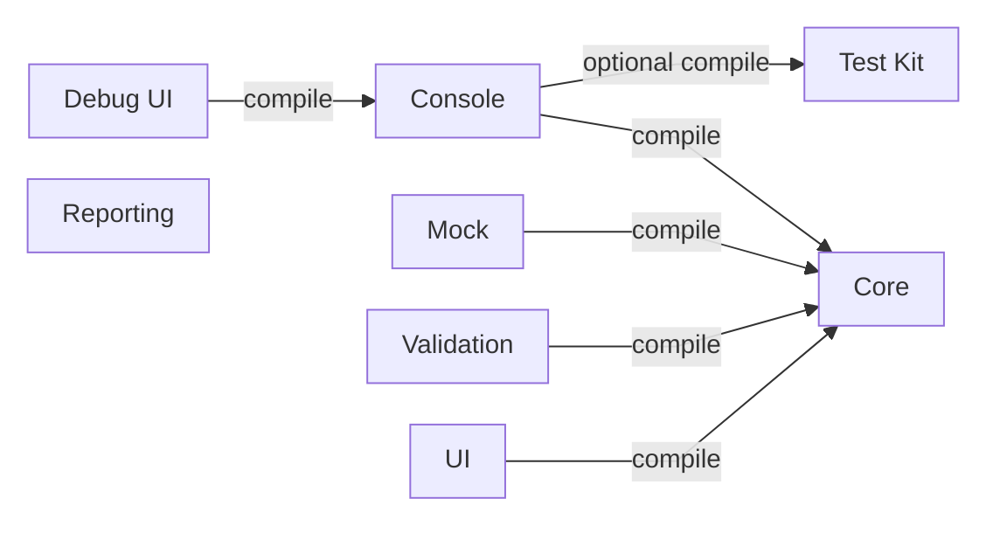

<details>
<summary><strong>Legend - module map and direction of dependence</strong></summary>

- The arrow leaves the addictive module; `compile` and `test scope`
  describe the scope of POM, not the functional ownership;
- `atf-reporting` does not have ATF dependencies in production; `atf-console` consumes
  neutral events and contracts in Core, independent of Reporting;
- `atf-reporting-tests` is the composition root for Reporting samples, and
  `atf-tests` holds the full-reactor guards- their complete scope test links are in POM, not played as a net of edges in the diagram;
- `guard, not dependency` labelled edges are verification relationships for
  repository of, not Maven edges;
- Shop and AutoEx practice declares Test Kit in `test` scope, according to POM;
- `atf-console` declares Test Kit as `optional` dependence because
  JUnit adapter in `src/main` reads its annotations and resolvers; this does not transform Test Kit into a business library.

The short labels shall be kept as follows:

| In the scheme | Full meaning |
|---|---|
| Mock | atf-mock |
| Core | atf-core |
| Validation | atf-validation |
| Test Kit | atf-test-kit |
| UI | atf-ui |
| Debug UI | atf-debug-ui |
| Shop | atf-test-practice-shop |
| AutoEx | atf-test-auto-ex |

</details>

**Dependencies of consumption.** Matrix keeps separate the scopes of POM; the list in the cell means direct dependence on each module listed.

| Consumer | `compile` | `test` |
|---|---|---|
| Shop | Core, Console, Reporting, UI | Test Kit |
| AutoEx | Core, Reporting, UI | Console, Test Kit |

**Verification relationships.** Composition Reporting consumes the library in the test; governance inspects the sources of the consumer and the Reporting samples.
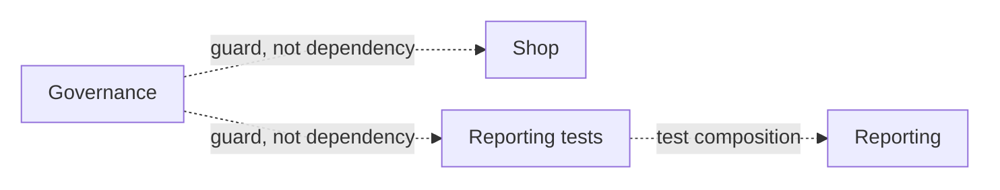
<details>
<summary><strong>Legend - composition and governance</strong></summary>

- `Reporting tests` means `atf-reporting-tests`; edge `test composition`
  `test` is its dependence on `atf-reporting`.
- `Guvernanță` means `atf-tests`; the two edges `guard, not dependency`
  inspect the repository and do not add Maven dependencies to Shop or Reporting Tests.
- The complete compositions are read in POM. The map selects
  explanatory relationships, explicitly keeping the difference between consumption and verification.

</details>

In this diagram, the meaning is given by the edge label and must not be deducted from the position of the nodes:

- `atf-validation` and reportable fixtures depend on `atf-core`;
- `atf-reporting` does not depend on any ATF module in production;
- Reporting composition tests are in
  `atf-reporting-tests/src/test/java`, with mock, console, Playwright and debug UI strictly in the scope test;
- `atf-tests` runs separately `atf.api.tests.governance.ArchitectureModuleBoundaryTest`
  for the governance of the whole reactor;
- `atf-test-practice-shop` hosts consumer application tests; configuration
  and application flows do not enter `atf-reporting-tests`.
- `atf-test-auto-ex` is an independent consumer; it does not share the selectors,
  data or pages objects with Practice Shop.

- Standalone means zero ATF dependencies for `atf-reporting/src/main`.
- Integration tests can compose ATF modules in adapters test-scopes
  explicit.
- `ReportModelAdapters` normalizes existing models at the mapping boundary;
  does not move business rules into reporting and does not authorise renderer dependencies to ATF models.

`atf-test-kit` displays the vocabulary unit / component / integration / e2e and transverse annotations for testing. The current boundary are:

- consumption from tested applications remains test-only; infrastructure adapters
  may require scope compiles for JUnit integration and the exceptions shall be checked in POM each module;
- Shop and AutoEx practice consume Test Kit in `test` scope; harness and
  The composition of the console remains in the test sources;
- Console and Reporting are independent; the composition transmits fields
  external event to `AtfConsoleEvent.fromExternalEnums` neutral factory in Core, and Reporting Tests check actual vocabulary;
- `atf-mock` depends only on `atf-core` and `atf-debug-ui` is a launcher
  Readonly; its starting from tests or IntelliJ does not make it dependent on the renderer.

<a id="reusable-platform-relative-to-the-composition-point"></a>
<a id="platforma-reutilizabilă-față-de-punctul-de-compunere"></a>
### Reusable platform relative to the composition point

Generic contracts that do not need JUnit, filesystem, YAML or browser stay in the lower modules. `atf-core` provides the neutral contract for the programmatic selection of API scenarios and `atf-reporting` offers the pure contract for the validation of a static UI artifact:

```mermaid
%%{init: {"themeVariables":{"fontSize":"15px"},"themeCSS":".nodeLabel, .nodeLabel p { font-size: 15px !important; line-height: 1.35 !important; } .edgeLabel, .edgeLabel p { font-size: 12px !important; font-weight: 400 !important; line-height: 1.2 !important; } .edgeLabel .labelBkg, .edgeLabel p { background: transparent !important; } .edgeLabel foreignObject { transform: translateY(-18px); overflow: visible; } .node rect { rx: 6px; ry: 6px; }","flowchart":{"curve":"linear","nodeSpacing":24,"rankSpacing":24,"padding":6,"diagramPadding":20}}}%%
flowchart LR
    Core["Core contract"] -->|offer| Catalog["Catalog"]
    Catalog -->|compose| ApiArtifact["API artifact"]
    ApiArtifact -->|be inspected by| Browser["Browser audit"]
    Browser -->|verifies| Reporting["Reporting"]
    Reporting -->|publishes| UiArtifact["UI artifact"]
```

<details>
<summary><strong>Legend - separation of production and composition</strong></summary>

- core displays typed selection and the specific catalogue belongs to the consumer;
- API the artifact is input readonly for inspector UI;
- UI validator belongs to the reporting library and the browser remains in the scope test;
- any `Page`, `Locator` or JUnit shall not enter the production reporting.

The short labels shall be kept as follows:

| In the scheme | Full meaning |
|---|---|
| Core contract | core contract |
| Catalog | test catalog |
| Browser audit | browser audit |
| Reporting | reporting contract |
| offer | offer contract |

</details>

The composition and ownership limits are:

- `atf-reporting-tests` solves deterministic sources, JUnit lifecycle and Playwright report audit;
- `atf-tests` holds the governance of the whole- ATF; applications tests remain in the consumers Shop and AutoEx;
- the product reporting does not receive `Page`, `Locator` or JUnit;
- Core models do not read YAML and do not receive the specific catalogue; the adapter
  `atf.core.config.source` sources remain separate and is called upon to composition root;
- `atf-reporting` does not receive `Page` or `Locator`;
- The separation allows united testing, component and E2E without doubling the rules.

<a id="liabilities"></a>
<a id="responsabilități"></a>
## Liabilities

| Module | Owned | Does not own |
|---|---|---|
| atf-core | demand / response, transport, typed configuration and its source adapter, authentication, return, editorial, status, ports and `ApiScenarioSelection` | HTML, CSS, Extent, JUnit, reading YAML from neutral models, browser, concrete catalogues and product routes |
| atf-mock | Configurable fake transport and deterministic response catalogue | HTTP actual Extent JUnit business validation |
| atf-validation | Answering contracts, rules, valuer, verdict and publication through neutral port | HTTP, Extent, HTML, CSS, lifecycle |
| atf-console | Console event formatter `ConsoleSettings`, YAML, non-ending, statuses, Fallback ASCII / UTF-8 and exclusive ownership of stout / stderr | HTML, Extent, HTTP calls, invented verdicts |
| atf-reporting | Session, Extent tree, theme, HTML completion, audit kernel renderer-neutral, audit plans, API contracts renderer-neutral, metadata failure surfaces, pure `api.contract` engine, static audit of the API artifact, JSON auditor, static contract pure UI ratio and generic lifecycle of evidence | HTTP/transport calls, a concrete console, acceptance scenarios, browser/Playwright and test fixtures; no runtime dependency on `atf-mock` |
| atf-ui | Java Playwright browser configuration and adapter for automatic UI checks | generation HTML and executable tests |
| atf-debug-ui | read-only an existing HTML on the loopback and provide the target for TAB MCP | renderer, modification of artifact, verdicts and executable tests |
| atf-test-kit | annotations, resolvers and primitive test-only acquisition / rollback / cleanup; [contract](../atf-test-kit/README.md) | production code, renderer, browser and business rules |
| atf-reporting-tests | contracts component / integration API / mock and E2E UI which exclusively checks `atf-reporting`; fixtures and adapters of the ratio | does not become the suite of an application and does not move these responsibilities into production |
| atf-test-practice-shop | application tests, runtime, pages, flows and business evidence mappings | generic renderer / publicist and governance of whole- ATF |
| atf-test-auto-ex | UI E2E / API live tests and JUnit adapters in the test; configuration, pages, flows and runtime specific to the main | Shop practical fixtures or flows |
| atf-tests | governance of the whole- ATF and architectural gates | product tests and internal contracts of `atf-reporting` |

| **Proof required** | **Responsible** |
|---|---|
| fakeer can validate model, renderer, marker or publisher | `atf-reporting` |
| JUnit / mock composition or ratio rendering shall be checked | `atf-reporting-tests` |
| application behaviour must be checked | consumer module, e.g. `atf-test-practice-shop` |
| another UI / API site must be checked | separate `atf-test-auto-ex` consumer with declared channel Test Kit |
| actual service must be contacted | separate test, opt-in explicit |

<a id="liability-limits-of-api-tests-and-audit-ui"></a>
<a id="limitele-de-responsabilitate-ale-testelor-api-și-auditului-ui"></a>
## Liability limits of API tests and audit UI

`atf.reporting.api.tests.api` is exclusively for API tests: resources, requests, headers, contracts, stateful scenarios and lifecycle. It cannot import browser, Playwright, `Page`, `Locator`, DOM, screenshots or Debug UI.

API audit → UI is divided as follows:

- audit browser: `atf.ui.tests.extent` from `atf-reporting-tests/src/test/java`;
- pure contract: snapshots, verdicts, reconciliation, plans, checks, validators and failures surfaces in `atf.reporting.audit` and `atf.reporting.ui.audit.*`;
- generic browser and capture: `atf-ui`;
- Output configuration, audit suite and input report: `atf-reporting-tests/src/test/java/atf/ui/tests/extent/support/config`;
- read-only serving for TAB MCP: `atf-debug-ui`;
- the only front for API precondition: `ApiReportAuditSetup`;
- Lifecycle and section pure contracts: `atf-reporting`;
- DOM, computer-style, click, collapse and rendering: browser test scope;
- Acceptance plan and publisher API → Extent: `atf.reporting.api.acceptance`.

API report contract has an additional Boundary without browser:

```text
catalog YAML/mock sau live adapter
        → ApiReportContractCatalog
        → ApiReportContractAuditor
        → body / metadata / execution / JSON-tree validators
        → ValidationResult
        → optional HTML evidence publisher
```

`atf-reporting` only displays the port and renderer-neutral models. `atf-mock` is used by the `test` restarting tests, not by the reporting production; `atf-reporting-tests` only keeps the `ApiReportContractInput` extractor from DOM. Thus the same contract can be checked as units, component or integration, and the browser remains a separate level of verification.

UI contract has a pure kernel and two browser compositions; the browser remains exclusively in the test `atf-reporting-tests` scope:

| Package | Input | Purpose |
|---|---|---|
| `atf.ui.tests.extent.e2e.section` | API generated or static ratio | setup / mock, project, request / answer evidence, API parity in your browser |
| `atf.reporting.ui.contract` | Annotation, spec, checks, snapshot and pure validator | structural rules without DOM / browser |
| `atf.ui.tests.extent.e2e.uireport` | UI prior static report | input solution, taboos, DOM structure, style, collapsed state, Fails and UI validation |

`atf.ui.tests.extent.e2e.uireport` audit does not read expected business values from YAML and does not ask for API quests. It starts with `@UiExtentReportContract` and `-Datf.ui.report=...`, then publishes a new UI artifact without altering the input.

The observable chain is:

```text
setup configurabil
  → scenarii API
  → atf-reporting-tests/src/test/resources/atf-mock.yaml / AtfMockTransport
  → raport API read-only
  → audit Playwright în atf.ui.tests.extent
  → validare DOM/evidence
  → raport UI separat
```

The rules for the expected and selection of the suite are:

- UI is built before the browser in the API selection, catalogue and mock;
- the current is read from DOM through semantic locators;
- the selectors stay in `ReportUiLocators`, the actions in adapters, the order in flows, and the verdict in validators / snapshots;
- `ui.enabled` is not introduced; the selection of the suite and the rules comes from annotation, YAML or JVM properties.

The rules for E2E smoke are:
- explicit selection by `@ApiScenarioSetup` takes precedence over `families`;
- the methods are accurate and non-redundant; the family remains fallback for the suite / YAML;
- the full API matrix and the reporting contracts keep the cover wide;
- The browser only proves the binding of setup → mock → artifact → DOM and actual interactions.

The rule for `SETUP` is:

- publish a compact table `Setup evidence` (`CHECK / EXPECTED / ACTUAL / RESULT`)
  for preconditions and condition of preparation; the table does not replace the technical evidence;
- if the setup produces real exchanges and the profile collects them, they
  remain `API validation` under the same checkpoint `SETUP`, with demand, response and canonical evidence execution;
- training actions do not become `UI validation`, and the setup does not receive
  `UI validation`;
- `UI validation` exists only in `TEST BODY` after the real actions of the browser.

<a id="ui-traffic-capture-and-selection"></a>
<a id="capturarea-și-selecția-traficului-ui"></a>
## UI traffic capture and selection

How does the browser traffic get to the checkpoint that explains it? The selection is applied before the body is read and the budget is consumed; a cursor delimits the comments received before and after baseline. The requirements previously started and subsequently completed require additional correlation; the order of capture does not prove business causality alone.

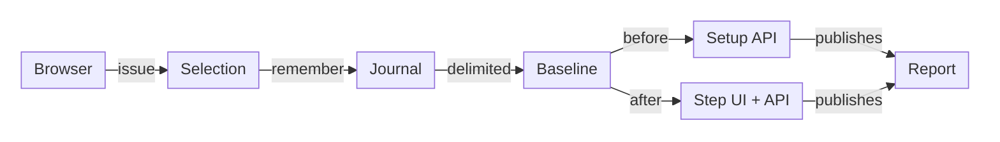

<details>
<summary><strong>Legend - selection and evidence ownership</strong></summary>

- `atf-ui` applies host allowlist and typed policy for resource type
  excluding resources are not read as body and do not occupy the journal; the ceiling keeps the meters accepted / retested / dropped.
- The consumer declares business routes and marks the baseline after the setup.
  AutoEx, `GET /api/productsList`, is a fetch of the same browser session, published at the precondition of the catalogue; it does not become a causative exchange of the basket. `GET /add_to_cart/1` is observed after baseline and belongs to the checkpoint card-add, without replay.
- `atf-reporting` displays the exchange near its step and summarizes the scope separately,
  setting / causal and `COMPLETE` / `INCOMPLETE`. The inspector shall not decide the business verdict or clone the requests in summary.

The short labels shall be kept as follows:

| In the scheme | Full meaning |
|---|---|
| Selection | UI Selection |
| Journal | Bounded diary |

</details>

The generic contract of the filter and cursor is in [README-ul ATF UI](../atf-ui/README.md#inspectorul-de-rețea--limită-generică-de-responsabilitate); route selection and association with AutoEx steps are in [README-ul AutoEx](../atf-test-auto-ex/README.md#boundary-ul-cauzal-pentru-ui_api).

<a id="flow-of-an-application"></a>
<a id="fluxul-unei-cereri"></a>
## Flow of an application

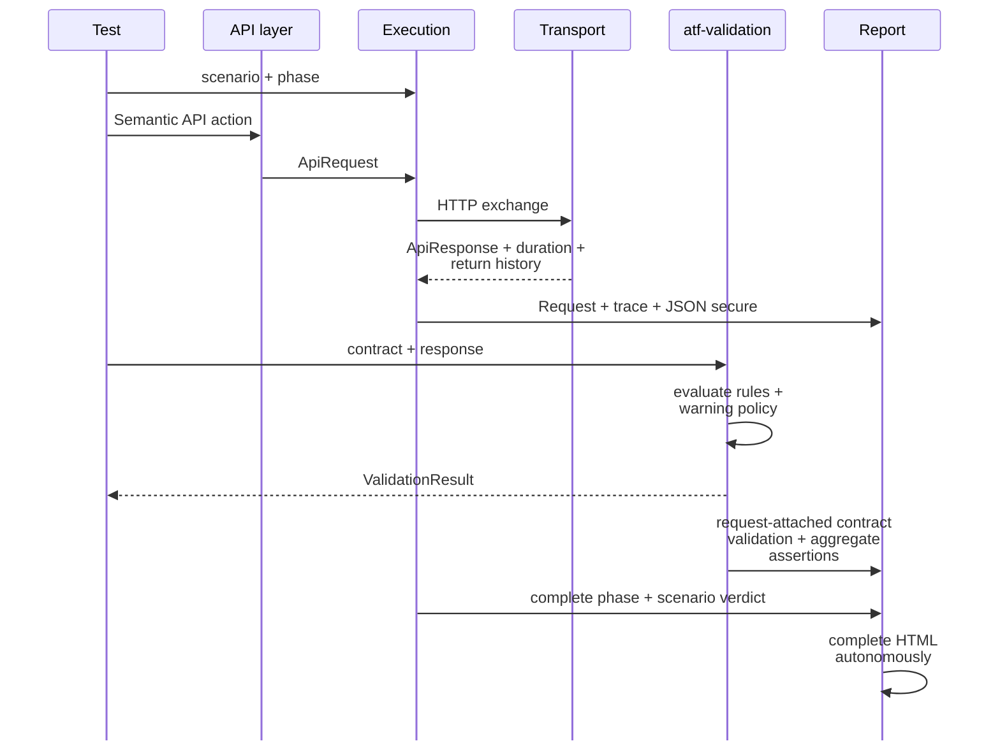

<details>
<summary><strong>Legend - Semantic flow of an application</strong></summary>

- the executor shall publish the facts of the transport and the history of the return;
- The validator calculates the verdict, and the reporter just designs evidence;
- The quest holds a contract the nested validation in its record; UI / API
  Validations remain separated under the Gherkin UI checkpoint;
- The completion produces an autonomous artifact without moving the verdict.

</details>

The facts of transport, the fulfilment of contract and the verdict of the scenario are different things:

```text
schimb HTTP finalizat  !=  contract satisfăcut  !=  scenariu trecut
```

<a id="consignee-and-acceptance-boundary-profiles"></a>
<a id="profile-de-transport-și-boundary-ul-acceptance"></a>
## Consignee and acceptance boundary profiles

ATF has two transport profiles for different purposes:

| Profile | Implementation | Network | Owner | Purpose |
|---|---|---:|---|---|
| `acceptance` | `AtfMockTransport` (`atf-mock`) | no | `atf-reporting-tests` test scope | deterministic ratio, contracts, lifecycle and rendering |
| `live` | `HttpClientTransport` | yes | live test / consumer | checking available HTTP service |

The accept boundary is explicit:

- `AtfMockTransport` is a double test of `atf-mock`, not HTTP local server and not proxy to `atf.local`;
- is explicitly injected into `ApiModuleFactory`;
- URL-ul built by `ApiExecutor` remains in evidence for semantic route;
- Fake transport does not execute DNS, TLS or request network;
- reporting and contracts do not depend on an external service.

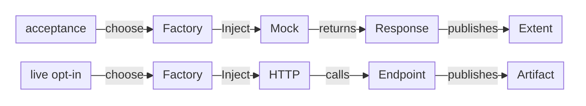

<details>
<summary><strong>Legend - acceptance offline versus live opi-in</strong></summary>

- acceptance uses fake transport and produces a deterministic response;
- live uses HTTP only by policy and explicit eighty-in;
- URL-ul displayed in the acceptance is semantic evidence, not evidence of traffic;
- the two profiles do not by default convert into each other.

The short labels shall be kept as follows:

| In the scheme | Full meaning |
|---|---|
| Factory | module factory |
| Mock | mock transport |
| Response | deterministic response |
| Extent | Extent artifact |
| HTTP | HTTP transport |
| Endpoint | real endpoint |
| Artifact | live artifact |

</details>

The verifiable rule is:

```text
ApiReportAuditSetup -> AtfMockTransport -> offline artifact
Live API test       -> HttpClientTransport -> real endpoint
```

A URL like `https://atf.local/public/v2/users` from an acceptance report is the metadata of the request, not an assertion that the host has been contacted. DNS, TLS, authentication and service contract are verifiable only in the `live` profile.

`ApiTransportProvenance` circulates in `ApiExecutionResult` to API. The report thus displays the truth of transport and a safe manual reply:

```text
acceptance → ACCEPTANCE / MOCK → URL metadata + MANUAL REPLAY: NOT EXECUTABLE
live       → LIVE / HTTP       → URL contactat + cURL method/headers/body redacted
```

No URL invented fallback shall be entered in the report and no endpoint shall be declared if `AtfMockTransport` has been used. For live, the operator shall complete the redacted credentials prior to execution of the CURL.

| Control live | Contract |
|---|---|
| opt-in | `-Datf.api.live.optIn=true` or `ATF_API_LIVE_OPT_IN=true` |
| target | `api.baseUri` numit explicit |
| adapter | `ApiLiveTransportCatalog` rejects the acceptance policy and placeholder `https://atf.local` |
| acceptance | does not consult the catalogue and does not become a network test by default |

<a id="roundtrack-vocabulary"></a>
<a id="vocabularul-rutelor"></a>
## Roundtrack vocabulary

The routes are not written as repeated strings in tests. The stable track vocabulary is separated from the operational catalogue and the environmental configuration:

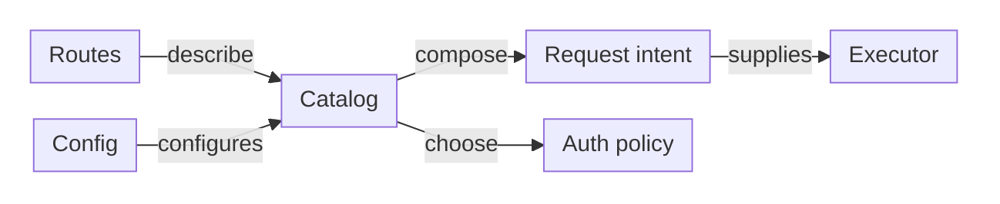

<details>
<summary><strong>Legend - the vocabulary of the routes</strong></summary>

- `Paths` defines stable vocabulary without hardcoded business endpoint;
- the catalogue combines the route, operation and authentication policy;
- environmental configuration can change URL base without changing tests;
- the executor receives a request already composed semantically.

The short labels shall be kept as follows:

| In the scheme | Full meaning |
|---|---|
| Routes | route vocabulary |
| Config | environment config |
| Catalog | operation catalog |
| Request intent | request intent |
| Auth policy | auth policy |
| Executor | API executor |

</details>

The catalogue describes the operation, method, resource and authentication. The configuration can override URL base or templates without the tests knowing the environmental details.

<a id="configuration-and-snapshot"></a>
<a id="configurație-și-snapshot"></a>
## Configuration and snapshot

The configuration shall follow a single operational route:

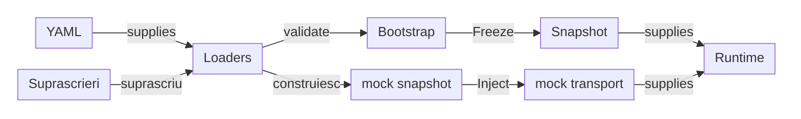

<details>
<summary><strong>Legend - source to runtime</strong></summary>

- `YAML sources` = `atf.yaml`, `atf-mock.yaml` catalogue and configuration
  the consumer, including `atf-practice-shop.yaml`;
- `owner loaders` = distinct lower- s for API, mock and application;
- `typed bootstrap` = validation at the composition root, prior to execution;
- `immutable snapshot` = frozen configuration, transmitted to consumers;
- `mock transport` = transport selected by `acceptance` policy;
- `runtime consumers` = executor, validation, reporting and test fixtures;
- The arrow is not an import Maven, but the flow of the configuration data.

The short labels shall be kept as follows:

| In the scheme | Full meaning |
|---|---|
| Suprascrieri | explicit overrides |
| supplies | read by |

</details>

<details>
<summary><strong>Sources and ownership</strong></summary>

- `atf.yaml` is the general configuration of the consumer project;
- `api`, `validation` and `reporting` sections belong to the composite project
  roll, not individual request;
- UI audit configuration and the mock catalogue for the reporting contract are
  test-owned de `atf-reporting-tests`;
- the catalogue is in
  `atf-reporting-tests/src/test/resources/atf-mock.yaml` and is loaded by `ReportingTestResources`;
- the application configuration is test-owned by `atf-test-practice-shop`;
- application configuration is in
  `atf-test-practice-shop/src/test/resources/atf-practice-shop.yaml`;
- Automation Exercise configuration is test-owned by `atf-test-auto-ex` and be
  is in `atf-test-auto-ex/src/test/resources/atf-auto-ex.yaml`;
- `ui.enabled` does not exist;
- the routes, responses, bodywork and reporting fallback are loaded
  explicit by test resource, not from an external endpoint.

</details>

<details>
<summary><strong>Bootstrap and transport policy</strong></summary>

- `ApiBootstrapConfiguration` composes `ApiSettings` and `ApiTransportPolicy`;
- `ApiBootstrapConfigurationLoader` read section `api` only once,
  validate and transmit it to `ApiModuleFactory`;
- `AtfMockConfigurationLoader` reads the catalog of mock; supported overrides
  are `atf.mock.config`, `ATF_MOCK_CONFIG` and explicit test sources;
- `api.baseUri`, the timeout, the retry, the auth profile and `transport` are
  printed on bootstrap;
- `ApiReportAuditSetup` injects `AtfMockTransport` for `acceptance`;
- a `baseUri` in YAML does not activate the network itself;
- `api.transport` accepts `acceptance` - `mock` compatible - or `live`;
- `acceptance` is default; `live` requires
  `-Datf.api.live.optIn=true` or `ATF_API_LIVE_OPT_IN=true`;
- `atf-reporting` loader consumes `reporting.extent` for the HTML artifact;
  The console is not the backrest of the renderer and is not loaded by Extent.

</details>

<details>
<summary><strong>Snapshot and operational rules</strong></summary>

- `AtfRuntimeSnapshot` keeps `ApiSettingsSnapshot` and `ReportingSettings`
  YAML, filesystem, environment or Extent in `atf-core`;
- `atf-core` holds typed models, snapshots and explicit adapter
  [ApiBootstrapConfigurationLoader](../atf-core/src/main/java/atf/core/config/source/ApiBootstrapConfigurationLoader.java). The adapter reads the sources at the composition root; the models do not read YAML or environment. API test composition is in `atf-reporting-tests`, and the consumers retain their wirling;
- `ApiModuleFactory` designs snapshots in API executor and reporting
  separately consume its policy;
- `reporting.extent` remains the responsibility of reporting; timeout, return, uth,
  routes, redaction and roots scheme are neutral runtime settings;
- The loader clearly fails at unknown keys, URI invalid, disabled timeout, root
  unsecured schematic or output path;
- relative pathways are solved against YAML file, not `user.dir`;
- Secrets are references to an explicit provider, not published YAML values;
- Each run receives immutable snapshots; parallel runs cannot be carried out
  modify each other;
- no `atf-config` module is inserted; `atf-reporting` retains its lodger
  specialised in `reporting.extent`.

</details>

<a id="architectural-contracts-checked-in-live-code"></a>
<a id="contracte-de-arhitectură-verificate-în-codul-live"></a>
## Architectural contracts checked in live code

Current reconciliation separates the contract implemented from the risks of evolution:

| Verified contract | Implementation | Proof |
|---|---|---|
| `Overview`, `Tests`, `Categories`, `Fails`, `Evidence`, `UI validation` | `SectionAuditCheckExecutor` → `SectionAuditCheckPolicy` → `SectionAuditResult` | `ExtentSectionAuditPublisher` + component tests / E2E |
| UI report read-only on main tables | `@UiExtentReportContract` and `StaticUiExtentReportContractTest` | `atf-reporting-tests` |
| HTML / CSS / JavaScript and asset manifest | pure contracts in `atf-reporting` | `UiReportArtifactContractTest` |
| direction modules, constant ownership / CSS, output and import graph | boundary-uri Maven/source | `atf-tests` + architecture tests |
| Extent ↔ fallback parity | `AtfReportSemanticSnapshot` | [comparison of renderers in the test](../atf-reporting-tests/src/test/java/atf/reporting/semantic/AtfReportSemanticSnapshotTest.java) |
| internal fallback consistency | `AtfReportSemanticSnapshot.from(ReportExecutionModel)` | the document and recorder of the same session are compared before the render |

These are closed and normative capabilities. A feedback document does not repeat them and does not convert them into a score; only reopen through reproducible regression, a consumer change or a public contract change.

<a id="semantic-parity-between-renderers-e"></a>
<a id="parity-semantică-între-renderer-e"></a>
### Semantic parity between renderers-e

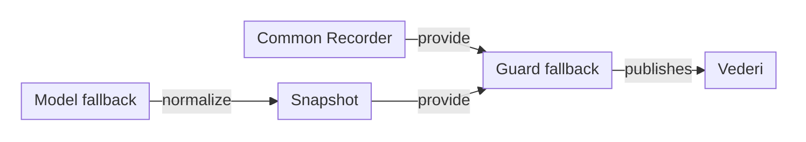

<details>
<summary><strong>Legend - semantic parity between renderers-e</strong></summary>

- `HtmlReportSession.render()` guard compares the fallback model with
  Semantic recorder of the same session before the building of views;
- the adapter normalises the fallback model without forcing the same internal structure;
- the comparison covers class, scenario, phase, request, validation and evidence of countries;
- the difference is repaired in the provider / model, not by hiding it in UI.
- Extent / fallback parity shall be checked separately by publication of the same
  Facts in both sessions and comparison of snapshots in the test.

The short labels shall be kept as follows:

| In the scheme | Full meaning |
|---|---|
| Common Recorder | Semantic recorder of the fallback session |
| Model fallback | Fallback execution document |
| Snapshot | semantic snapshot |
| Guard fallback | internal consistency check before render |
| Vederi | coherent views |

</details>

| Model | Owner | Role |
|---|---|---|
| `ReportExecutionModel` | fallback | `Overview`, `Categories`, `Fails` |
| `AtfReportSemanticSnapshot` | Common recorder and adapters | contract semantic renderer-neutral |

The local guard checks the `class → scenario → phase → request → validation` tree, the package and the obvious counts.[AtfReportSemanticSnapshotTest](../atf-reporting-tests/src/test/java/atf/reporting/semantic/AtfReportSemanticSnapshotTest.java) compares the results of Extent / fallback separately. The models remain distinct; the fallback render does not open a Extent session to confirm the output.

<a id="controlled-evolution-and-reopening"></a>
<a id="evoluție-controlată-și-redeschidere"></a>
### Controlled evolution and reopening

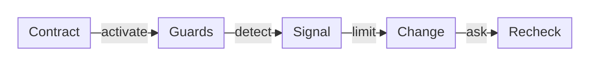

<details>
<summary><strong>Legend - when a contract reopens</strong></summary>

- **Closed**: Boundary is documented and implementation has consumers and tests.
- **Protected**: neutral snapshots are validated by `ExtractionValidationConvergenceTest`;
  The live sync ↔ staging is defended by `AtfPromotionManifest` and `AtfPromotionGuard`; the explicit live transport is `ApiLiveTransportCatalog`.
- **Justified reopening**: Reproducible defect, second consumer or public contract change.
- **Target change**: add only the required cover, e.g. snapshot / golden; do not do cosmetic split.
- **Closure**: revalidate the code and tests, then the decision is consolidated in the README of the owner.
- **Feedback**: only keeps future regression; does not double decisions already closed.

`AtfReportTheme` and `UiExtentReportSession` have documented boundaries and semantic collaborators that fit the live code. `ExtentReportRuntimeBehaviour` composes `Core`, `Tests`, `Overview`, `Evidence`, `Navigation`, `Duration` and `Failure`; `ExtentReportRuntimeScriptTest` protects the composition. These decisions remain in README reporting and are not duplicated in feedback.

HTML Flatback keeps the same separation: `HtmlReportSession` is the composition root for document / lifecycle, and the behavior of the tables is an asset injected via `HtmlReportScript`, implemented by `HtmlReportNavigationScript`. Semantic Markup, lifecycle and JavaScriptV have independent seams without browser or DOM in the reporting model.

`atf.reporting.html.scope`, `HtmlReportScenarioScope`, `HtmlReportPhaseScope`, `HtmlReportRequestScope` and `HtmlReportValidationScope` implement `AtfReportPorts` ports. The session creates scouts, the semantic model provides only controlled mutations, and the renderer does not receive internal fields and becomes dependent on lifecycle.

The short labels shall be kept as follows:

| In the scheme | Full meaning |
|---|---|
| Contract | contract closed |
| Guards | guards active |
| Signal | valid signal |
| Change | targeted change |
| Recheck | owner revalidation |

</details>

<a id="lifetime-cycle-and-responsibilities"></a>
<a id="ciclu-de-viață-și-responsabilități"></a>
## Lifetime cycle and responsibilities

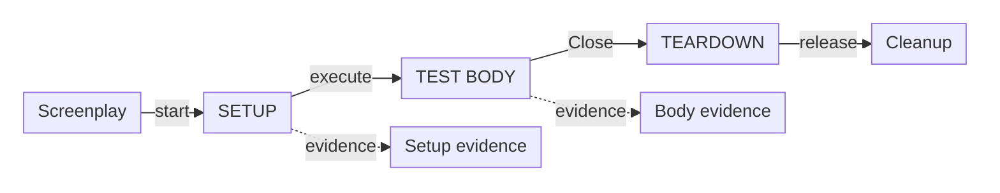

<details>
<summary><strong>Legend - lifecycle and ownership</strong></summary>

- solid arrow = progress of lifecycle; phases only occur when they have
  actual content;
- the punctured arrow = visual grouping of local evidence, not a new phase;
- contract the validation is nested under the assessed requirement; UI / API validations
  remain semantic children of Gherkin UI checkpoint;
- the cleanup closes the resources created in reverse order;
- The precedent of the verdict remains the responsibility of the lifecycle, not the renderer.

The short labels shall be kept as follows:

| In the scheme | Full meaning |
|---|---|
| Cleanup | cleanup invers |
| Setup evidence | Setup evidence |
| Body evidence | Body evidence |

</details>

The lifecycle of the request shall keep the evidence under the exchange which produced it:

- the request shall be closed only after the publication of the technical evidence and validation;
- in API directly, `Contract validation` is the child of the assessed request;
- multiple assertions for the same response form a single table;
- in UI, `UI validation` and `API validation` are copies of the same checkpoint,
  and the requests remain under `API validation`.

Mandatory responsibilities:

- the executor shall publish the facts of HTTP and duration;
- the validator shall calculate the results and publish the aggregate table;
- lifecycle closes phases and applies the precedent of the verdict;
- The reporter returns the structure without altering the verdict;
- the cleanup holds the resources created and runs the best effort in reverse order.

<a id="namespaces-and-source-roots"></a>
<a id="namespace-uri-și-rădăcini-de-surse"></a>
## Namespaces and source roots

The package name comes from the `package` declaration; the root of sources comes from POM modules. We do not deduce one of the other and we do not rebuild the inventory from historical namespaces.

Maven coordinates have another role: `groupId` can remain `atf.api` without Java packages keeping this prefix. The rename of a namespace does not necessarily rename the artifact.

| Owner | Namespace runtime / tests | Current Maven roots |
|---|---|---|
| [Shop](../atf-test-practice-shop/README.md) | `atf.shop` / `atf.shop.tests` | `src/main` / `src/test`, declared in POM |
| [AutoEx](../atf-test-auto-ex/README.md) | `atf.autoex` / `atf.autoex.tests` | `src/main/java` / `src/test/java` convention default Maven |

The structure shall be restarted from sources at each refactoring:

```text
POM → rădăcini surse → declarații package → apelanți și suite → README owner
```

The whole- reactor gait discovers sources in `sourceDirectory` and `testSourceDirectory` declared per POM; if they are missing, it uses the Maven `src/main/java` and `src/test/java` conventions. Thus, a declared `src/test` module does not disappear from the inventory just because it does not use the default layout.

- The package identifies the application / owner and responsibility; business name,
  application pages and ports do not move to Kit for uniformity.
- The rename shall keep the callers, resources and identities of the cases checked;
  physical movement does not demonstrate semantic separation of the flows-
- Inventory uses current files without `target`, artifacts or copies of
  The annotation of the layer classifies the test, not the director's name.
- The links to the sources and examples of import shall be updated together;
  The historical pathology in `testChanges` controls shall retain its approved base.

`AtfJavaSourceReferences` in Core recognises Java namespaces in code, including normal / static / wildcard imports, package statements and FQCN in signatures or method bodies. Separate identifiers (`atf.ui` is not `atf.uikit`) and ignore comments, strings, characters and text blocks.

- A documentary example does not mask a real adjacent reference.
- The whole- ATF and API / UI guards- uses the same rule; controlled samples
  enter infringements before and after the move and check the pathogen and diagnostic rule.
- Unicode Escapes translate before the separate commentary and literal.

The verification of a move follows [Executive inventory](ATF_Testing_Guide.md#inventarul-executabil-după-mutări-și-reclasificare) and [consumer governance](../atf-tests/README.md). The roots declared in POM take precedence over the assumption that each module uses the default convention.

<a id="oop-rules"></a>
<a id="reguli-oop"></a>
## OOP Rules

1. Faces coordinate; status, return, editorial and aggregation policies are
   Small, pure and testable objects.
2. atf-core models do not know HTML, CSS, selector or
   viewport-ul.
3. The execution status is per session and per scenario; no States are introduced
   static mutable between tests.
4. An interface appears for a real seam: transport, reporter, clock, auth or
   Cleanup. No decorative interfaces are created.
5. Any component that simultaneously decides the transport, verdict and layout
   has too many responsibilities and must be separated.

## Testabilitate

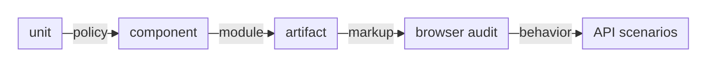

<details>
<summary><strong>Legend - levels of proof</strong></summary>

- unites check the pure policy;
- the component checks the module and fake the consignment;
- the artifact checks the mark / CSS / JavaScript product;
- TAB MCP checks for real interaction, and API checks live Behavior.

</details>

Every change in reporting affecting structure, collapse, tabs, font, color, scroll or overflow needs code test and artifact verification. A string found in HTML does not prove that the item is behaving correctly at click.

<a id="consumer-support-and-main-selections"></a>
<a id="suport-consumer-și-selecții-principale"></a>
## Consumer support and main selections

| Contract | Owner |
|---|---|
| Account, catalogue, basket, checkout, confirmation and invoice | Shop / AutoEx business runtime and tests |
| JUnit Extension and application scenario configuration | POM test root: Shop `src/test`, AutoEx `src/test/java` |
| Initialization, close-once and armed clearing | `lifecycle` package from `atf-test-kit` without new plugin |
| Comparison JUnit with evidence of the checks assessed | unique JUnit evaluation, injection display and phase collection in the main Test Kit; the consumer adapts safe rows to `AssertionAuditReport` |
| Neutral screen audit, observation cursor and catch validation | `atf-ui`; not dependent on Reporting or JUnit |
| Propellant fault, replay and rendering profiles | `atf-reporting-tests` with neutral fixtures |
| Safe description of exceptions | `ReportFailureDescription` in Reporting; the consumer decides the phase, the exchange and the verdict |
| Global classification and disjunction of the three main suites | `atf-tests`, in the suite of whole- ATF |

The executable classes of each consumer are spread exactly once between the local UI E2E and API live. External opt ins remain independent; moving a helper does not authorise a remote call and does not convert a fixture into live proof.

<a id="core-as-library---owner-and-deployment"></a>
<a id="core-ca-bibliotecă--owner-și-deployment"></a>
## Core as library - owner and deployment

J0 retains Core source and native tests; the source reactor still has 12 modules. [Core contract](ATF_Core_Consumer.md) separates source ownership and publication from each J1–J7 consumer's independent acceptance. Native tests remain in J0; binary acceptance runs in TMP.


<a id="shared-platform-libraries"></a>
<a id="bibliotecile-comune-ale-platformei"></a>
## Shared platform libraries

J0 reactor has 12 source modules. [Library contract](ATF_Platform_Libraries.md) defines the five owners, flat distribution, Maven / IntelliJ bootstrap and independent acceptance of consumers. Console / Mock native tests remain in J0; adapters and catalogs remain local.
