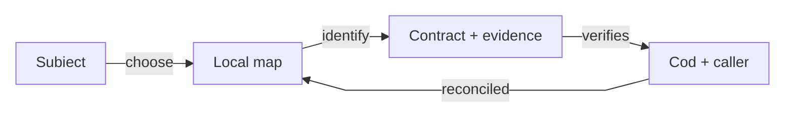

# ATF context atlas - inputs, ownership and evidence

[J0 reference and consumption synchronisation](ATF_Workspace_Synchronization.md) fixes the ownership, target status and proof of each delivery.

## At a glance

J0 has Reporting implementation and regressions; J1 holds AutoEx / Shop scenarios. J2 is WIP for framework and Kafka / messaging tests, with PowerShell Setup in Podman; [map of workspaces](ATF_Workspace_Synchronization.md) separates the infrastructure copied from the contracts and the acceptance of the message.

The Atlas reduces the initial context for a reader or AI: choose the boundary, identify the contract and the sample, then open only the relevant source and its caller. Code, POM and live tests remain the authority for what exists.

| Topic | Local map | Read the code when |
|---|---|---|
| source / binary governance | [deployment](../atf-tests/src/test/java/atf/api/tests/governance/distribution/README.md) | change catalogue, documentary targets, POM distributed, CodeSource or proof of independence; same suite protects both forms |
| writing and literal mask | [Core security](../atf-core/src/main/java/atf/core/security/README.md) | change strategy, replacement, sensitive fields or fallback; the preview and the renderer have another owner |
| main inventory / test and output excluded | [ATF Tests inventory](../atf-tests/README.md#inventarul-comun-al-surselor-java) | change POM or segment exclusion; face compilable source with inspected set |
| selective promotion | [guard-ul Core](../atf-core/README.md#manifest-și-promovare-guarded) | change baseline, source / parents eligibility or atomic copying |
| amount of the AutoEx invoice | [monetary contract](../atf-test-auto-ex/README.md#validarea-completă-a-sumei-facturii) | change the delimitation of the clause, numerical grammar, comparison or projection; independent checks and auditable negative samples |
| runtime AutoEx | [runtime AutoEx](../atf-test-auto-ex/src/main/java/atf/autoex/runtime/README.md) | change composition, account owner, bill observation or completion |
| Shop support | [Shop support](../atf-test-practice-shop/src/main/atf/shop/support/README.md) | change validation, basket confirmation, traffic selection or readiness |
| lifecycle browser Reporting Tests | [Harness and selections](../atf-reporting-tests/README.md#izolarea-tuturor-intrărilor-browser) | change the setup / cleanup, identity of JUnit, inventory of SDK or source classification / JAR |
| browser operations | [browser operations](../atf-ui/src/main/java/atf/ui/playwright/README.md) | change the deadline, interaction or diagnosis |
| browser network | [browser network](../atf-ui/src/main/java/atf/ui/network/README.md) | exchange hookies, identity, retention or cleanup |
| Reporting library | [atlas Reporting](../atf-reporting/src/main/java/atf/reporting/README.md) | change model, renderer, publication or contract JAR |
| viewer PNG | [inline audit contract](ATF_Inline_Audit_Contract.md) | keep the frame, local caption and context after close, without rebuilding the consumption setup |
| large reports | [incremental navigation](ATF_Large_Report_Navigation.md) | keep all evidence, delay hidden measurement and check the inset / PNG; bulk only in neutral fixture |
| Inline composition | [contract](ATF_Inline_Audit_Contract.md) | separate the renderer caller's facts and try out the complete text, assertions and PNG without external files |
| Reporting consolidation and evidence | [implementation](feedback/ATF_Reporting_Feedback.md) / [Reporting Tests](feedback/ATF_Reporting_Tests_Feedback.md) | separate the defect from lifecycle / API from oracle, binary fixture and navigation of evidence |

<strong>Cross-cutting contracts - deadline, geometry, lifecycle and audit</strong>

| Topic | Local map | Read the code when |
|---|---|---|
| AutoEx product transition | [AutoEx contract](../atf-test-auto-ex/README.md#confirmarea-tranziției-către-produs) | change the single click, the observed document or GET-ul bound |
| Billing and autofill Shop | [Shop contract](../atf-test-practice-shop/README.md#confirmarea-lookup-ului-de-adresă) | change the debounce, the lookup or the ownership. fields |
| the root of Shop reports | [Dissolution of configuration](../atf-test-practice-shop/README.md#rădăcina-directoarelor-de-raportare) | change the work directory or source consumption / JAR; POM Shop establishes the base without Reporting marker |
| geometry and iframe | [UI geometry](../atf-ui/README.md#geometria-nativă-a-contextului) | change required output, CSS, DPR or System projection in consumeri |
| 850 ms geometry | [preparation of fixture](../atf-ui/README.md#gate-ul-fixture-ului-de-geometrie) | separate initialization, stable layout and capture from the single pointer; check the unrenewed navigation budget and zero meter |
| lifecycle observations | [scope-ul UI](../atf-ui/README.md#scope-ul-listener-elor-de-observație) | change the activation of callbacks, rollbacks, causes or close-once |
| Catalogue observation and decision | [UI contract](../atf-ui/README.md#scope-ul-listener-elor-de-observație) → [Shop map](../atf-test-practice-shop/src/main/atf/shop/support/README.md) | separate passive GET / QUERY from Shop; GET / HEAD controller and AutoEx navigation have other protocols |
| executable documentary fidelity | [guard-ul factual](../atf-tests/README.md#documente-și-responsabilități) | change the modules, Kit scope, UI implicit or YAML Shop / AutoEx geometry geometry; prose compares to POM / configuration / model, by documentary mutants |
| continuity of selection | [UI contract](../atf-ui/README.md#așteptare-nativă-și-unicitate) | change the observation before activation, native confirmation or refusal of reply |
| purchase and close of UI session | [contract UI](../atf-ui/README.md#lifecycle-ul-sesiunii-și-limita-probei) | change the primary cause, resource rollback or simultaneous errors of cleanup |

## Boundary of fidelity

| Change | Contract and evidence |
|---|---|
| literal mask and Authentication quoted / truncate | [Core security](../atf-core/src/main/java/atf/core/security/README.md); original comparison → editorial → preview → Extent / fallback |
| MIME and effective heads | [Core HTTP](../atf-core/README.md#media-type-headere-și-vocabular-de-protocol); type / subtype, precedence and one consignment |
| URI of the artifact | [Debug UI](../atf-debug-ui/README.md#identitatea-path-ului-uri); plus space and single decoding |
| compilable source versus output | [ATF Tests](../atf-tests/README.md#inventarul-comun-al-surselor-java); POM discovery separated from the root of Java |
| credit institutions in API AutoEx form | [the audit of the fixture](../atf-test-auto-ex/README.md#credentiale-în-aserțiunile-componente-api); equality of original map, public projection and diagnosis without gross password |

## Background

<strong>Legend - orientation and revalidation</strong>

| In the scheme | Full meaning |
|---|---|
| Topic | the requested behaviour and the owner deciding it |
| Local map | README package; inputs, invariants and limits |
| Contract + evidence | stable rule and test that protects it |
| Cod + caller | live implementation, configuration and effects on the caller |

The edges are reading and maintenance steps, not Maven dependencies. Atlas start the investigation; does not replace the verification of the affected source.

## Minimum context for a change

| Initial decision | Source of truth | Her limit |
|---|---|---|
| What reactor do they use? | [workspace-uri](ATF_Workspace_Synchronization.md), then POM and README target | J0 owns the source; read J1–J7 roles and modules from each live project, without inferring them from absent directories |
| Reporting change? | [J0 source atlas](../atf-reporting/src/main/java/atf/reporting/README.md) and [permanent regression](../atf-reporting-tests/README.md) | Each J1-J7 consumer has its own acceptance; the source documentation does not automatically certify the JAR consumed |
| app change? | [Shop](https://github.com/crististefanita/atf_j1/blob/HEAD/atf-test-practice-shop/README.md) or [AutoEx](https://github.com/crististefanita/atf_j1/blob/HEAD/atf-test-auto-ex/README.md) | Expected, catch and business selection remain in the consumer |
| Kafka / Podman change? | [J2 atlas](https://github.com/crististefanita/atf_j2/blob/HEAD/docs/ATF_Context_Atlas.md), then Setup and configuration | three MOCK components and existing scripts; Java client / actual broker are WIP |

1. Read the package map and relevant section of README module.
   Before refactoring, reconcile the host feedback with the live source and specify the closing sample; update the finding during the increment.
2. Open indicated entry, caller and positive / negative sample; extend
   seeking only when an dependency or a concrete contradiction arises.
3. Check POM for scope, Deadline / Policy configuration and test
   A class name does not demonstrate behavior.
4. After the change, update the close map and input link if you have
   Gaps remain in feedback.

## Cross-cutting points

### Composition and life

A joint report does not mean browser, account or business status. Follow the resource owner and runner adapter before an extraction.

| Boundary | Entry and map | What remains separate |
|---|---|---|
| E2E Shop | [ShopE2eTestSupport](../atf-test-practice-shop/src/test/atf/shop/tests/support/ShopE2eTestSupport.java) → [ShopE2eContext](../atf-test-practice-shop/src/test/atf/shop/tests/support/lifecycle/ShopE2eContext.java) → [ShopBrowserRuntime](../atf-test-practice-shop/src/main/atf/shop/runtime/ShopBrowserRuntime.java) | Height JUnit in test, purchase in main, browser per invoicing and own / common ratio |
| E2E AutoEx | [AutoExRunFactory](../atf-test-auto-ex/src/test/java/atf/autoex/tests/extension/AutoExRunFactory.java) → [runtime](../atf-test-auto-ex/src/main/java/atf/autoex/runtime/README.md) | Store / finalization JUnit in test; browser, observations and port lifecycle in main |
| audited components | [audit guide](ATF_Testing_Guide.md#auditul-componentelor-consumerilor) → Consumerous extension → [Kit](../atf-test-kit/README.md#comparații-junit-cu-dovadă-neutră) | JUnit comparison is evaluated once; Reporting library receives neutral proof |
| browser and actions | [PlaywrightUiSession](../atf-ui/src/main/java/atf/ui/playwright/PlaywrightUiSession.java) → [UI operations](../atf-ui/src/main/java/atf/ui/playwright/README.md) | session holds browser / context / page; new sequence has its own action log |

The successful support belongs to the owner's hand; the controlled fixtures and the JUnit wiring.The two POM consumer keeps Kit in `test` scope; [architecture matrix](ATF_Architecture.md) and POM fixed the dependencies.

### Business failure and isolation of the following scenario

It starts with explicit acceptance [Shop](../atf-test-practice-shop/README.md#acceptanța-failure-urilor-business) or [AutoEx](../atf-test-auto-ex/README.md#acceptanța-failure-urilor-business). The fixtures alter the observation, and the journey and the expectation remain the real ones.

```mermaid
%%{init: {"themeVariables":{"fontSize":"15px"},"themeCSS":".nodeLabel, .nodeLabel p { font-size: 15px !important; line-height: 1.35 !important; } .edgeLabel, .edgeLabel p { font-size: 12px !important; font-weight: 400 !important; line-height: 1.2 !important; } .edgeLabel .labelBkg, .edgeLabel p { background: transparent !important; } .edgeLabel foreignObject { transform: translateY(-18px); overflow: visible; } .node rect { rx: 6px; ry: 6px; }","flowchart":{"curve":"linear","nodeSpacing":24,"rankSpacing":24,"padding":6,"diagramPadding":20}}}%%
flowchart LR
    Journey["Journey real"] -->|notice foul| Gate["Gate business"]
    Gate -->|mismatch| Evidence["Original catch"]
    Gate -->|PASS then error| Failure["Original cause"]
    Failure -->|keep FAIL| Evidence
    Evidence -->|prior to cleanup| Owner["Owner Resources"]
    Owner -->|Close context| Next["Healthy Opposite Profile"]
    Evidence -->|publishes| Report["Extent individual / joint"]
```

<strong>Legend - foul, proof and cleanup</strong>

- `Gate business` independently checks the identity, basket or confirmation of the order.
- `Cauză originală` maintains the error subsequent to the PASS checkpoint without rewriting its previous verdict.
- `Captură originală` shall retain the fixture marking prior to the navigation of the cleanup.
- `Owner resurse` delete AutoEx own account or issue the Scoped Shop reference;
  Different policy does not generalize through a neutral erasure callback.
- `Profil opus sănătos` uses new browser; joint report does not transfer DOM,
  Foul status or verdict between scenarios.

CLI-ul accepts only the exact number of FAIL-uri intended and successful, same primary cause in JUnit, the numbered mutations and a HTML per launch. Check each owner / scenario / phase in the artifact, with identifiable capture and totals Tests / Fails / Overview; a proof of sibling does not satisfy the current call.

The pre-generic error checkpoint remains PASS, and the subsequent cause has distinct FAIL diagnosis. Negative fixtures do not enter into canon selections.

| Additional branch | Entry and stop |
|---|---|
| AutoEx guest cart | `boundaries`: recalculation after two adds or confirmation after a removal; independently expected, without account / payment and without continuation after mismatch |
| after PASS | `boundaries` in both consumers; AutoEx delegates the pre-error checkpoint, Shop uses intermediate checkpoint and only completes the healthy neighbor |
| audit without application | `audit <artifact-expectations.json>` checks HTML already delivered and local mutants; does not start the journey or a remote mutation |

### Owner decides by effect

| Responsibility | Owner and limit of dependence | What Consumera keeps |
|---|---|---|
| HTTP execution, request and observed response | [Core](../atf-core/README.md); Reporting receives values without executor | endpoint, operation and application |
| comparison and validation result | [Validation](../atf-validation/README.md); without renderer or JUnit | business rule and independent expectations |
| browser, deadline, catch and listener | [UI](../atf-ui/README.md); without Shop / AutoEx routes | application signal confirming action and selection of proof |
| Runner protocol, scalps and neutral cleanup | [Test Kit](../atf-test-kit/README.md); [Owner J0 and adoption](ATF_Test_Kit_Library.md) | Actual stock, accounts and own resources order |
| Typed projection, status, markup and publication | [Reporting](../atf-reporting/docs/README.md); without Core, UI or Kit | observation, verdict and metadata of the application |
| observed query and identity | [Reporting contract](../atf-reporting/README.md#fidelitatea-contractului-query); UI calculates the fingerprint prior to the redaction | mapper preserves available pairs or opaque footprint; business selection remains local |
| Console diagnostic | [Console](../atf-console/README.md); bridge to composition | choosing the synchronization; without Console dependence in JAR Reporting |
| beehive, routing and mock association | [Mock](../atf-mock/README.md); the reporting adapter is checked separately | the fixture and the intention of the scenario |
| local readonly inspection | [Debug UI](../atf-debug-ui/README.md) | choice of source and session inspected |
| neutral reporting and composition samples | [Reporting Tests](../atf-reporting-tests/README.md) | actual adapter sample and business route remain Shop / AutoEx |
| Cross-modules governance and negative evidence | [ATF Tests](../atf-tests/README.md) | contract compliance, without local exceptions for refactor |

A Reporting import in a Shop test does not convert it into a generic test. A sample that verifies the real JUnit extension, the configuration of the application or the selection of the order remains with the consumer. A neutral fixture of HTML, renderer or lifecycle without application policy belongs to the infrastructure owner tests.

### Re-use without moving application policy

Compare the two real uses before an extraction. The composition INFO has owner UI, and the runner's cleanup consumes Kit in the scope test; the resemblance of a manufacturer or an import does not justify yet a generic API.

| Inspired pair | Decision and reason |
|---|---|
| `ShopBackendRecovery.open` / `AutoExBackendRecovery.open` | `UiBackendRecovery.recording` composition; endpoint, method and enumeration of the operation remain local |
| `ShopCatalogReadiness` / `UiRecoveryObserver` | Shop separates the passive observer from the refresh decision; QUERY and the last eligible request does not replace the strict GET / HEAD protocol with stamp and conflict |
| `ShopApiNetworkJournal` / `AutoExE2eRun` | the origin of the catch Shop is explicitly configured; the coats Shop consume delivery to the replies, and inspector UI to the quest-finished; the movement between them requires reconciliation of consumers, marker and cursor |
| `ShopE2eContext.close` / `AutoExRunLifecycleAdapter.finish` | `FailureAwareCleanup` composition for primary cause and all stages; browser order / report vs account / diagnosis / phase remains explicit to the adapter |
| `SuiteReportResource` Shop / `ReportResource` AutoEx | The Storekeeper holds the report, not the browser; Shop also keeps the scaled account reference, AutoEx holds a session; no common container is introduced for these different ownerships |
| CLI-s of acceptance Shop / AutoEx | `ScopedAcceptanceRun` from Kit restores the override and collects the caller artifacts; JUnit laser, account policy and browser oracle remain at the consumer |
| Console bridge and artifact prefixes | application composition; Reporting library receives sink and metadata, without Core / Console / JUnit dependencies |

`ScopedTestValue`, `CloseOnceResource` and `TestRunInitialization` remain the primitive Kit used by the harness. The error fixture, browser and endpoint policy do not move into Kit to unify the shape of the classes.

### Minimum investigation routes

| Symptoms / Change | Order of reading and the required test |
|---|---|
| component without audible assertions | test consumer → Kit adaptor → `AssertionAuditReport` → renderer; check the collapsible group and verdict, separate from the unit tests |
| record browser different from the executed call | capture UI → mapper main Shop / AutoEx → request / trac Reporting → aggregate; compare full query and identity, not only URL- displayed |
| Misproof of command | Shop → selector → the window of the request → validator; a display signature does not substitute business causality |
| Compact confused with no-replay | [neutral sample UI](../atf-ui/src/test/java/atf/ui/network/UiNetworkPresentationStreamComponentTest.java) → [read-back Shop](../atf-test-practice-shop/src/test/atf/shop/tests/api/network/ShopUiNetworkSettlementComponentTest.java) → [actual activation](../atf-test-practice-shop/src/test/atf/shop/tests/component/cart/ShopCartAcknowledgementComponentTest.java); the comments provided do not count executed orders |
| faulty on purchase runtime | [ShopBrowserRuntime](../atf-test-practice-shop/src/main/atf/shop/runtime/ShopBrowserRuntime.java) → Harness call → [partial acquisition evidence](../atf-test-practice-shop/src/test/atf/shop/runtime/ShopBrowserAcquisitionComponentTest.java); follows the native context closeup, original cause and transferred ownership |
| AutoEx setup failure | `AccountPage.registerFromStore` → lifecycle owned → `AutoExAccountCleanupRecoveryComponentTest`; logo / created once, foreign identity without deletes, cause and initial catch; local documents do not certify remote integration |
| false positive HTML oracle | Marker → the published comparison → control without marker, with JavaScript kept; [evidence rule](ATF_Testing_Guide.md#auditul-componentelor-consumerilor) separates the artifact from the runtime selector |
| individual vs single report by suite | The extension and Storeul of the consumer → own / common resource → publisher; the large only discovers the selected classes prior to execution |
| pointer iframe or catch at 70% | `UiViewportScale` → `PlaywrightUiSession` → HTTP neutral UI → configuration and metadata Shop / AutoEx; a DOM click does not prove pointer trusted |
| timeout in the native geometry gate | `openReady` → Traces of preparation and click → actual meter; 5 s are consumed once and the pointer retains 850 ms without retry |
| external query that interrupts the account's cleanup | [listenerul AutoEx](../atf-test-auto-ex/src/main/java/atf/autoex/support/account/AutoExAccountDeletionAttempt.java) → [browser sample](../atf-test-auto-ex/src/test/java/atf/autoex/tests/component/business/AutoExBusinessFaultComponentTest.java); the query and fragment do not participate in the matching or redirect diagnosis |
| intermittent cancellation in Core test | [ExecutionResilienceTest](../atf-core/src/test/java/atf/core/ExecutionResilienceTest.java) → [proof contract](../atf-core/README.md#determinism-și-concurență); the barrier confirms the entry of the transport, and FutureTask transfers the result to JUnit |
| renewed confirmatory data | [ObservationBudgetComponentTest](../atf-ui/src/test/java/atf/ui/playwright/ObservationBudgetComponentTest.java) → [native integration](../atf-ui/src/test/java/atf/ui/playwright/PlaywrightReadinessBudgetComponentTest.java); arithmetic uses controlled ticks and integration checks the browser separately and activates the unique |
| renewed GET timeout in AutoEx adapter | [native sample](../atf-test-auto-ex/src/test/java/atf/autoex/tests/component/navigation/AutoExReadOnlyBudgetBoundaryComponentTest.java) measures the timeouts actually sent to the browser, separate from the arithmetic of the UI clock; one pointer and two readonly recoveries |
| Reporting library extracted | [portable context](../atf-reporting/docs/README.md) → POM → local isolated gate → external Maven consumer with real JAR; reactor check alone is insufficient |

Keep the application in the main and the JUnit glue in the test. The kite offers neutral primitives, does not receive the browser or business policy. An extraction requires two real uses, explicit differences and a sample that would refuse old behavior; moving the same class into another module is not this sample.

### Contracts and governance

| Decision | Owner starting |
|---|---|
| modules and direction of dependence | [ATF_Architecture](ATF_Architecture.md) |
| What remains in the main and what belongs to the test | [ATF_Testing_Guide](ATF_Testing_Guide.md) |
| Primitives JUnit and auditable assertions | [Test Kit contracts](../atf-test-kit/README.md) |
| OOP rules and liability limits | [README_Atf_CodeBestPractices](README_Atf_CodeBestPractices.md) |
| build in TMP and selective promotion | [ATF_Build_And_Execution_Safety](ATF_Build_And_Execution_Safety.md) |
| criteria not yet demonstrated | [feedback registry](feedback/README.md) |
| Reporting library and its own documentation | [Reporting contract](../atf-reporting/README.md) |

Shop is the explicit exception of [Git testChanges control](../atf-tests/README.md#guvernanța-schimbării-testelor), not of architecture, cohesion or behavioural checks. Do not add Shop path in a formal control and do not infer from this exception that a test can be relaxed.

Reporting is treated as a library at the consumed boundary. The consumer's atlas do not copy its internal inventory, renderer or contracts; they remain in the library documentation, including when the artifact is delivered separately as JAR.

### Read the proof at the checked level

When investigating AutoEx, distinguish the GET document, DOM observation and product business gate. The [transition contract](../atf-test-auto-ex/README.md#confirmarea-tranziției-către-produs) owns the single budget; purchase doubles implement its typed port and prove stopping before checkpoint or mutation without simulating a successful click. UI owns the package-private clock and `ObservationBudgetComponentTest`; the consumer browser checks document, product and activation without a wall-clock oracle or slow-520 race.

| Available evidence | Interpretation limit | Owner of criterion |
|---|---|---|
| fixture / proxy / loop back component | check the boundary and local refusals; external service and isolation of the complete suite require separate executions | [Test levels](ATF_Testing_Guide.md) |
| Filtered suite and single report | verify actual selection; do not certify all UI / UI + API profiles, accounts or combinations of classes | [profile consumer](ATF_Testing_Guide.md#acceptanța-business-individual-și-prin-suită) |
| `201` log followed by `500` | presentation can compact; business selection reads eligible observations and does not inherit old PASS-ul | [Shop current command](../atf-test-practice-shop/README.md#dovada-comenzii-curente) |
| Green documentary guard | confirms the rules implemented by the guard; the meaning of the claim is faced with POM / source, independent of text | [factual fidelity](../atf-tests/README.md#documente-și-responsabilități) |

The feedback indicates the lack and the closing criterion, README describes the contract, and `VERIFIED` baseline authorises a precise Git difference. These three roles are not substituted; [storage](README_Atf_DocumentationBestPractices.md#păstrarea-și-ștergerea-feedback-ului) decides what moves or is removed after proof.

## Maintenance without drift

- The links and fragments of the atlas are checked by
  [governance of documentary links](../atf-tests/src/test/java/atf/api/tests/governance/documentation/links/DocumentationLinkGovernanceTest.java), together with README and other `docs` documents.

- Each map keeps the inputs, ownerships, source invariants and
  relevant evidence. Do not copy the entire tree, API or implementation.
- Checklists in good practice are recurrent review criteria;
  The backlog is in feedback. A procedural check is not a defect and does not delete to declare a closed backlog.
- A refactor updates the map in the same increment. A contradiction solves
  Code / POM / test; unimplemented intent is labelled in feedback.
- Do not keep Counts, Notes or a PASS dated as a behavior guarantee.
  The evidence of the running remains in staging; README maintains the proven contract.
- Intermediate snacks shall be kept outside the audited source tree.
  A README copied to go does not accidentally become the document of the project.
- Resume live hashes before promotion. The previously read context does not authorise
  Overwriting parallel changes and does not automatically certify the new combination.

## Core as library - owner and deployment

J0 retains Core source and native tests; the source reactor still has 12 modules. [Core contract](ATF_Core_Consumer.md) separates source ownership and publication from each J1–J7 consumer's independent acceptance. Native tests remain in J0; binary acceptance runs in TMP.

## Reporting Inspector and Time Sources

| Start context | Input and sample |
|---|---|
| [Artact profile](../atf-reporting/README.md#inspecția-artifactului-cu-intenție-explicită) | intended by the caller; Extent / fallback, inventory at the original owner and refusal of incomplete result |
| [Length below the captured phase](../atf-reporting/README.md#originea-duratelor-sub-o-fază-capturată) | Distinguishing execution, transport and publication, without duplication or zero invented |
| [Permanent samples](../atf-reporting-tests/README.md#probe-inspector-timing-și-indicator-assertions) | nominally, mutants, browser and JAR physical; no business code in the autonomous library |

Consumers who maintain the inspector's legal appeal continue to receive the strict contract Extent / HTTP. The adoption of the explicit overload and the acceptance of the application are consumer decisions, separated from the distribution of the binary.

## Cold report initialization

[The navigation contract](ATF_Large_Report_Navigation.md#cold-startup-and-readiness) links the lifecycle owner, truthful readiness, native link repair and permanent neutral regressions. [navigation contract](ATF_Large_Report_Navigation.md) records the source/JAR boundary and independent consumer checks.

## Shared platform libraries

J0 reactor has 12 source modules. [Library contract](ATF_Platform_Libraries.md) defines the five owners, flat distribution, Maven / IntelliJ bootstrap and independent acceptance of consumers. Console / Mock native tests remain in J0; adapters and catalogs remain local.
