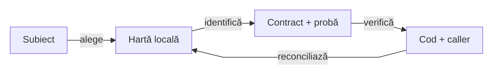

# Atlas de context ATF — intrări, ownership și probe

## Pe scurt

Atlasul reduce contextul inițial pentru un cititor sau un AI: alegi boundary-ul,
identifici contractul și proba, apoi deschizi numai sursa relevantă și callerul
său. Codul, POM-ul și testele live rămân autoritatea pentru ceea ce există.

| Subiect | Hartă locală | Citește codul când |
|---|---|---|
| promovare selectivă | [guard-ul Core](../atf-core/README.md#manifest-și-promovare-guarded) | schimbi baseline-ul, eligibilitatea sursei/părinților ori copierea atomică |
| runtime AutoEx | [runtime AutoEx](../atf-test-auto-ex/src/main/java/atf/autoex/runtime/README.md) | schimbi compoziția, ownerul contului, observația facturii ori finalizarea |
| suport Shop | [suport Shop](../atf-test-practice-shop/src/main/atf/shop/support/README.md) | schimbi validarea, confirmarea coșului, selecția traficului ori readiness-ul |
| operații browser | [operații browser](../atf-ui/src/main/java/atf/ui/playwright/README.md) | schimbi deadline-ul, interacțiunea ori diagnosticul |
| rețea browser | [rețea browser](../atf-ui/src/main/java/atf/ui/network/README.md) | schimbi hook-uri, identitate, retenție ori cleanup |
| biblioteca Reporting | [atlas Reporting](../atf-reporting/src/main/java/atf/reporting/README.md) | schimbi modelul, rendererul, publicarea ori contractul JAR |

## Traseul de context

<strong>Legendă — orientare și revalidare</strong>

| În schemă | Sens complet |
|---|---|
| Subiect | comportamentul cerut și ownerul care îl decide |
| Hartă locală | README-ul pachetului; intrări, invarianti și limite |
| Contract + probă | regula stabilă și testul care o protejează |
| Cod + caller | implementarea live, configurația și efectele asupra callerului |

Muchiile sunt pași de lectură și întreținere, nu dependențe Maven. Atlasul
pornește investigația; nu înlocuiește verificarea sursei afectate.

## Context minim pentru o schimbare

1. Citește harta pachetului și secțiunea relevantă din README-ul modulului.
2. Deschide intrarea indicată, callerul și proba pozitivă/negativă; extinde
   căutarea numai când apare o dependență sau o contradicție concretă.
3. Verifică POM-ul pentru scope, configurația pentru deadline/policy și testul
   pentru afirmația exactă. O denumire de clasă nu demonstrează comportamentul.
4. După schimbare, actualizează harta apropiată și linkul de intrare dacă s-au
   mutat responsabilitatea, invariantul ori proba. Gap-urile rămân în feedback.

## Repere transversale

| Decizie | Owner de pornire |
|---|---|
| module și direcția dependențelor | [ATF_Architecture](ATF_Architecture.md) |
| ce rămâne în main și ce aparține testului | [ATF_Testing_Guide](ATF_Testing_Guide.md) |
| primitive JUnit și assertion-uri auditabile | [README](../atf-test-kit/README.md) |
| reguli OOP și limite de responsabilitate | [README_Atf_CodeBestPractices](README_Atf_CodeBestPractices.md) |
| build în TMP și promovare selectivă | [ATF_Build_And_Execution_Safety](ATF_Build_And_Execution_Safety.md) |
| criterii încă nedemonstrate | [README](feedback/README.md) |
| biblioteca Reporting și documentația sa proprie | [README](../atf-reporting/README.md) |

Reporting este tratat ca bibliotecă la boundary-ul consumat. Atlasul consumerilor
nu copiază inventarul intern, rendererul sau contractele sale; acestea rămân în
documentația bibliotecii, inclusiv când artifactul este livrat separat ca JAR.

## Întreținere fără drift

- Fiecare hartă păstrează intrările stabile, ownership-ul, invarianti cu sursă și
  probele relevante. Nu copiază întregul arbore, API-ul sau implementarea.
- Un refactor actualizează harta în același increment. O contradicție se rezolvă
  din cod/POM/test; o intenție neimplementată este etichetată în feedback.
- Nu păstra count-uri, note sau un PASS datat ca garanție de comportament.
  Dovezile rulării rămân în staging; README-ul păstrează contractul demonstrat.
- Snapshot-urile intermediare se păstrează în afara arborelui de surse auditat.
  Un README copiat pentru merge nu devine accidental document al proiectului.
- Reia hash-urile live înaintea promovării. Contextul citit anterior nu autorizează
  suprascrierea schimbărilor paralele și nu certifică automat noua combinație.
