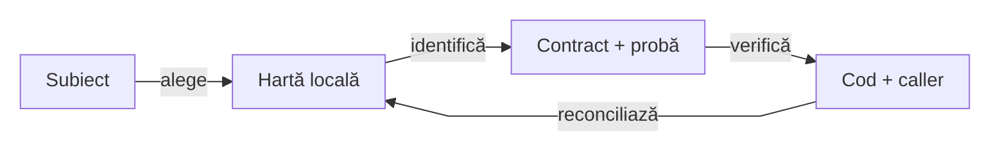

# Atlas de context ATF — intrări, ownership și probe

[Referința J0 și sincronizarea J1/J2](ATF_Workspace_Synchronization.md) fixează ownership-ul, starea țintelor și dovada fiecărei livrări.

## Pe scurt

J0 deține implementarea și regresiile Reporting; J1 deține scenariile AutoEx/Shop.
J2 este WIP pentru framework și teste Kafka/mesagerie, cu Setup PowerShell în Podman;
[harta workspace-urilor](ATF_Workspace_Synchronization.md) separă infrastructura copiată de contractele și acceptanța mesageriei.

Atlasul reduce contextul inițial pentru un cititor sau un AI: alegi boundary-ul,
identifici contractul și proba, apoi deschizi numai sursa relevantă și callerul
său. Codul, POM-ul și testele live rămân autoritatea pentru ceea ce există.

| Subiect | Hartă locală | Citește codul când |
|---|---|---|
| guvernanță source/binary | [deployment](../atf-tests/src/test/java/atf/api/tests/governance/distribution/README.md) | schimbi catalogul, țintele documentare, POM-ul distribuit, CodeSource-ul ori dovada de independență; aceeași suită protejează ambele forme |
| redactare și mască literală | [Core security](../atf-core/src/main/java/atf/core/security/README.md) | schimbi strategia, replacement-ul, câmpurile sensibile ori fallback-ul; preview-ul și rendererul au alt owner |
| inventar main/test și output exclus | [inventarul ATF Tests](../atf-tests/README.md#inventarul-comun-al-surselor-java) | schimbi parcurgerea POM-urilor sau excluderea segmentelor; confruntă sursa compilabilă cu setul inspectat |
| promovare selectivă | [guard-ul Core](../atf-core/README.md#manifest-și-promovare-guarded) | schimbi baseline-ul, eligibilitatea sursei/părinților ori copierea atomică |
| suma facturii AutoEx | [contractul monetar](../atf-test-auto-ex/README.md#validarea-completă-a-sumei-facturii) | schimbi delimitarea clauzei, gramatica numerică, comparația sau proiecția; checks independente și probe negative auditabile |
| runtime AutoEx | [runtime AutoEx](../atf-test-auto-ex/src/main/java/atf/autoex/runtime/README.md) | schimbi compoziția, ownerul contului, observația facturii ori finalizarea |
| suport Shop | [suport Shop](../atf-test-practice-shop/src/main/atf/shop/support/README.md) | schimbi validarea, confirmarea coșului, selecția traficului ori readiness-ul |
| operații browser | [operații browser](../atf-ui/src/main/java/atf/ui/playwright/README.md) | schimbi deadline-ul, interacțiunea ori diagnosticul |
| rețea browser | [rețea browser](../atf-ui/src/main/java/atf/ui/network/README.md) | schimbi hook-uri, identitate, retenție ori cleanup |
| biblioteca Reporting | [atlas Reporting](../atf-reporting/src/main/java/atf/reporting/README.md) | schimbi modelul, rendererul, publicarea ori contractul JAR |
| viewer PNG | [J16](ATF_Reporting_J16_Verification.md) | păstrezi cadrul integral, caption-ul local și contextul după close, fără a reconstrui setup-ul consumerului |
| compoziție inline | [contract](ATF_Inline_Audit_Contract.md) și [J15](ATF_Reporting_J15_Verification.md) | separi faptele callerului de renderer și probezi textul complet, assertions și PNG fără fișiere externe |
| consolidare Reporting și probe | [implementare](feedback/ATF_Reporting_Feedback.md) / [Reporting Tests](feedback/ATF_Reporting_Tests_Feedback.md) | separi defectul de lifecycle/API de oracol, fixture binar și navigarea dovezii |

<strong>Contracte transversale — deadline, geometrie, lifecycle și audit</strong>

| Subiect | Hartă locală | Citește codul când |
|---|---|---|
| tranziția produsului AutoEx | [contractul AutoEx](../atf-test-auto-ex/README.md#confirmarea-tranziției-către-produs) | schimbi clickul unic, documentul observat ori GET-ul bounded |
| billing și autofill Shop | [contractul Shop](../atf-test-practice-shop/README.md#confirmarea-lookup-ului-de-adresă) | schimbi debounce-ul, scope-ul lookup-ului ori ownership-ul câmpurilor |
| rădăcina rapoartelor Shop | [rezolvarea configurației](../atf-test-practice-shop/README.md#rădăcina-directoarelor-de-raportare) | schimbi working directory ori consumul sursă/JAR; POM-ul Shop stabilește baza, fără marker Reporting |
| geometrie și iframe | [geometria UI](../atf-ui/README.md#geometria-nativă-a-contextului) | schimbi ieșirea cerută, viewport-ul CSS, DPR ori proiecția System în consumeri |
| gate de geometrie 850 ms | [pregătirea fixture-ului](../atf-ui/README.md#gate-ul-fixture-ului-de-geometrie) | separi inițializarea, layout-ul stabil și captura de unicul pointer; verifici bugetul nereînnoit de navigare și contorul zero |
| lifecycle observeri | [scope-ul UI](../atf-ui/README.md#scope-ul-listener-elor-de-observație) | schimbi activarea callback-urilor, rollback-ul, cauzele sau close-once |
| observație și decizie catalog | [contractul UI](../atf-ui/README.md#scope-ul-listener-elor-de-observație) → [harta Shop](../atf-test-practice-shop/src/main/atf/shop/support/README.md) | separi listener-ele pasive GET/QUERY de refresh-ul Shop; controllerul GET/HEAD și navigarea AutoEx au alte protocoale |
| fidelitate documentară executabilă | [guard-ul factual](../atf-tests/README.md#documente-și-responsabilități) | schimbi modulele, scope-ul Kit, implicitul UI ori geometria YAML Shop/AutoEx; proza se compară cu POM/configurație/model, prin mutanți documentari |
| continuitatea selectului | [contractul UI](../atf-ui/README.md#așteptare-nativă-și-unicitate) | schimbi observația înaintea activării, confirmarea nativă ori refuzul replay-ului |
| achiziție și close ale sesiunii UI | [contract UI](../atf-ui/README.md#lifecycle-ul-sesiunii-și-limita-probei) | schimbi cauza primară, rollback-ul resurselor ori erorile simultane de cleanup |

## Boundary-uri de fidelitate

| Schimbare | Contract și probă |
|---|---|
| mască literală și Authorization quoted/trunchiat | [Core security](../atf-core/src/main/java/atf/core/security/README.md); comparație originală → redacție → preview → Extent/fallback |
| MIME și headere efective | [Core HTTP](../atf-core/README.md#media-type-headere-și-vocabular-de-protocol); tip/subtip, precedență și o singură expediere |
| URI al artifactului | [Debug UI](../atf-debug-ui/README.md#identitatea-path-ului-uri); plus, spațiu și o singură decodare |
| sursă compilabilă versus output | [ATF Tests](../atf-tests/README.md#inventarul-comun-al-surselor-java); descoperire POM separată de parcurgerea rădăcinii Java |
| credentiale în formularul API AutoEx | [auditul fixture-ului](../atf-test-auto-ex/README.md#credentiale-în-aserțiunile-componente-api); egalitatea map-ului original, proiecție publică și diagnostic fără parola brută |

## Traseul de context

<strong>Legendă — orientare și revalidare</strong>

| În schemă | Sens complet |
|---|---|
| Subiect | comportamentul cerut și ownerul care îl decide |
| Hartă locală | README-ul pachetului; intrări, invarianti și limite |
| Contract + probă | regula stabilă și testul care o protejează |
| Cod + caller | implementarea live, configurația și efectele asupra callerului |

Muchiile sunt pași de lectură și întreținere, nu dependențe Maven. Atlasul
pornește investigația; nu înlocuiește verificarea sursei afectate.

## Context minim pentru o schimbare

| Decizie inițială | Sursa de adevăr | Limita ei |
|---|---|---|
| ce reactor folosesc? | [workspace-uri](ATF_Workspace_Synchronization.md), apoi POM-ul țintei | J0 sursă 12, J1 JAR 9, J2 WIP 8, J3 speech 7, J4 Android 7; profilurile nu se deduc din foldere absente |
| schimbare Reporting? | [atlasul sursei J0](../../atf_j0/atf-reporting/src/main/java/atf/reporting/README.md) și [regresiile permanente](../../atf_j0/atf-reporting-tests/README.md) | Reporting J14 are acceptanțe distincte în J1/J2/J3/J4; documentația sursei nu certifică automat JAR-ul consumat |
| schimbare de aplicație? | [Shop](../../atf_j1/atf-test-practice-shop/README.md) sau [AutoEx](../../atf_j1/atf-test-auto-ex/README.md) | expected, captură și selecție business rămân în consumer |
| schimbare Kafka/Podman? | [atlasul J2](../../atf_j2/docs/ATF_Context_Atlas.md), apoi Setup și configurația | trei componente MOCK și scripturi existente; clientul Java/brokerul real sunt WIP |

1. Citește harta pachetului și secțiunea relevantă din README-ul modulului.
   Înaintea refactorizării, reconciliază feedback-ul ownerului cu sursa live și
   precizează proba de închidere; actualizează constatarea pe parcursul incrementului.
2. Deschide intrarea indicată, callerul și proba pozitivă/negativă; extinde
   căutarea numai când apare o dependență sau o contradicție concretă.
3. Verifică POM-ul pentru scope, configurația pentru deadline/policy și testul
   pentru afirmația exactă. O denumire de clasă nu demonstrează comportamentul.
4. După schimbare, actualizează harta apropiată și linkul de intrare dacă s-au
   mutat responsabilitatea, invariantul ori proba. Gap-urile rămân în feedback.

## Repere transversale

### Compoziție și durata de viață

Un raport comun nu înseamnă browser, cont sau stare business comune.
Urmărește ownerul resursei și adaptorul runnerului înaintea unei extracții.

| Boundary | Intrare și hartă | Ce rămâne separat |
|---|---|---|
| E2E Shop | [ShopE2eTestSupport](../atf-test-practice-shop/src/test/atf/shop/tests/support/ShopE2eTestSupport.java) → [ShopE2eContext](../atf-test-practice-shop/src/test/atf/shop/tests/support/lifecycle/ShopE2eContext.java) → [ShopBrowserRuntime](../atf-test-practice-shop/src/main/atf/shop/runtime/ShopBrowserRuntime.java) | harness JUnit în test, achiziție în main, browser per invocare și raport propriu/comun |
| E2E AutoEx | [AutoExRunFactory](../atf-test-auto-ex/src/test/java/atf/autoex/tests/extension/AutoExRunFactory.java) → [runtime](../atf-test-auto-ex/src/main/java/atf/autoex/runtime/README.md) | Store/finalizare JUnit în test; browser, observații și port lifecycle în main |
| componente auditate | [ghidul auditului](ATF_Testing_Guide.md#auditul-componentelor-consumerilor) → extensia consumerului → [Kit](../atf-test-kit/README.md#comparații-junit-cu-dovadă-neutră) | comparația JUnit se evaluează o dată; biblioteca Reporting primește dovada neutră |
| browser și acțiuni | [PlaywrightUiSession](../atf-ui/src/main/java/atf/ui/playwright/PlaywrightUiSession.java) → [operații UI](../atf-ui/src/main/java/atf/ui/playwright/README.md) | sesiunea deține browser/context/page; secvența nouă are propriul jurnal de acțiuni |

Suportul reutilizabil aparține main-ului ownerului; fixture-urile controlate și
wiring-ul JUnit rămân în test. Cele două POM-uri consumer păstrează Kit în
`test` scope; [matricea arhitecturii](ATF_Architecture.md) și POM-ul fixează dependențele.

### Failure business și izolarea următorului scenariu

Pornește de la acceptanța explicită
[Shop](../atf-test-practice-shop/README.md#acceptanța-failure-urilor-business) sau
[AutoEx](../atf-test-auto-ex/README.md#acceptanța-failure-urilor-business).
Fixture-urile alterează observația, iar journey-ul și expected-ul rămân cele reale.

```mermaid
%%{init: {"themeVariables":{"fontSize":"15px"},"themeCSS":".nodeLabel, .nodeLabel p { font-size: 15px !important; line-height: 1.35 !important; } .edgeLabel, .edgeLabel p { font-size: 12px !important; font-weight: 400 !important; line-height: 1.2 !important; } .edgeLabel .labelBkg, .edgeLabel p { background: transparent !important; } .edgeLabel foreignObject { transform: translateY(-18px); overflow: visible; } .node rect { rx: 6px; ry: 6px; }","flowchart":{"curve":"linear","nodeSpacing":24,"rankSpacing":24,"padding":6,"diagramPadding":20}}}%%
flowchart LR
    Journey["Journey real"] -->|observă fault| Gate["Gate business"]
    Gate -->|mismatch| Evidence["Captură originală"]
    Gate -->|PASS apoi eroare| Failure["Cauză originală"]
    Failure -->|păstrează FAIL| Evidence
    Evidence -->|înainte de cleanup| Owner["Owner resurse"]
    Owner -->|închide contextul| Next["Profil opus sănătos"]
    Evidence -->|publică| Report["Extent individual/comun"]
```

<strong>Legendă — fault, dovadă și cleanup</strong>

- `Gate business` verifică independent identitatea, coșul sau confirmarea comenzii.
- `Cauză originală` păstrează eroarea ulterioară checkpoint-ului PASS, fără a-i rescrie verdictul anterior.
- `Captură originală` păstrează marcajul fixture-ului înaintea navigării de cleanup.
- `Owner resurse` șterge contul propriu AutoEx sau eliberează referința scoped Shop;
  politica diferită nu se generalizează printr-un callback neutru de ștergere.
- `Profil opus sănătos` folosește browser nou; raportul comun nu transferă DOM-ul,
  starea de fault ori verdictul între scenarii.

CLI-ul acceptă numai numărul exact de FAIL-uri intenționate și succese, aceeași
cauză primară în JUnit, mutațiile numărate și un HTML per lansare. Verifică
fiecare owner/scenariu/fază în artifact, cu captura identificabilă și totaluri
Tests/Fails/Overview; o dovadă a sibling-ului nu satisface invocarea curentă.

Checkpoint-ul anterior erorii generice rămâne PASS, iar cauza ulterioară are
diagnostic FAIL distinct. Fixture-urile negative nu intră în selecțiile canonice.

| Ramură suplimentară | Intrare și oprire |
|---|---|
| AutoEx guest cart | `boundaries`: recalculare după două add-uri ori confirmare după un removal; expected independent, fără cont/payment și fără continuare după mismatch |
| după PASS | `boundaries` la ambii consumeri; AutoEx deleagă checkpoint-ul de creare înaintea erorii, Shop folosește checkpoint intermediar și finalizează numai vecinul sănătos |
| audit fără aplicație | `audit <artifact-expectations.json>` verifică HTML-ul deja livrat și mutanții locali; nu pornește journey-ul ori o mutație remote |

### Ownerul se decide după efect

| Responsabilitate | Owner și limită de dependență | Ce păstrează consumerul |
|---|---|---|
| execuție HTTP, request și răspuns observat | [Core](../atf-core/README.md); Reporting primește valori, fără executor | endpoint, operația și expected-ul aplicației |
| comparație și rezultat de validare | [Validation](../atf-validation/README.md); fără renderer ori JUnit | regula business și expected-ul independent |
| browser, deadline, captură și listener | [UI](../atf-ui/README.md); fără rute Shop/AutoEx | semnalul aplicației care confirmă acțiunea și selecția dovezii |
| protocol runner, scope și cleanup neutru | [Test Kit](../atf-test-kit/README.md); compus la granița JUnit | Store-ul concret, conturile și ordinea proprie a resurselor |
| proiecție typed, status, markup și publicare | [Reporting](../atf-reporting/docs/README.md); fără Core, UI sau Kit | observația, verdictul și metadata aplicației |
| query observat și identitate | [contractul Reporting](../atf-reporting/README.md#fidelitatea-contractului-query); UI calculează amprenta înaintea redactării | mapperul conservă perechile disponibile sau amprenta opacă; selecția business rămâne locală |
| diagnostic de consolă | [Console](../atf-console/README.md); bridge la compoziție | alegerea sink-ului; fără dependență Console în JAR-ul Reporting |
| stub, rutare și asociere mock | [Mock](../atf-mock/README.md); adaptorul de raportare este verificat separat | fixture-ul și intenția scenariului |
| inspecție locală read-only | [Debug UI](../atf-debug-ui/README.md) | alegerea sursei și sesiunea inspectată |
| probe neutre de raportare și compoziție | [Reporting Tests](../atf-reporting-tests/README.md) | proba adaptorului real și traseul business rămân Shop/AutoEx |
| guvernanță cross-module și probe negative | [ATF Tests](../atf-tests/README.md) | respectarea contractului, fără excepții locale pentru refactor |

Un import Reporting într-un test Shop nu îl transformă într-un test generic.
O probă care verifică extensia JUnit reală, configurația aplicației sau selecția
comenzii rămâne la consumer. Un fixture neutru de HTML, renderer ori lifecycle
fără politică de aplicație aparține testelor ownerului infrastructurii.

### Reutilizare fără mutarea politicii aplicației

Compară cele două utilizări reale înaintea unei extracții. Compoziția INFO are
owner UI, iar cleanup-ul runnerului consumă Kit în test scope; asemănarea unui
constructor sau a unui import nu justifică încă un API generic.

| Pereche inspectată | Decizie și motiv |
|---|---|
| `ShopBackendRecovery.open` / `AutoExBackendRecovery.open` | compun `UiBackendRecovery.recording`; endpoint-ul, metoda și enum-ul operației rămân locale |
| `ShopCatalogReadiness` / `UiRecoveryObserver` | Shop separă observerul pasiv de decizia de refresh; QUERY și ultimul request eligibil nu înlocuiesc protocolul strict GET/HEAD cu stamp și conflicte |
| `ShopApiNetworkJournal` / `AutoExE2eRun` | originea capturii Shop este explicit configurată; gate-urile Shop consumă livrarea la response, iar inspectorul UI la request-finished; mutarea între ele cere reconcilierea consumatorilor, a markerului și a cursorului |
| `ShopE2eContext.close` / `AutoExRunLifecycleAdapter.finish` | compun `FailureAwareCleanup` pentru cauza primară și toate etapele; ordinea browser/raport vs cont/diagnostic/fază rămâne explicită la adaptor |
| `SuiteReportResource` Shop / `ReportResource` AutoEx | Store-ul deține raportul, nu browserul; Shop păstrează și referința scoped a contului, AutoEx deține o sesiune proprie; nu se introduce container comun pentru aceste ownership-uri diferite |
| CLI-urile de acceptanță Shop / AutoEx | `ScopedAcceptanceRun` din Kit restaurează override-ul și colectează artifactele callerului; launcherul JUnit, politica contului și oracolul browser rămân la consumer |
| bridge de consolă și prefixuri de artifact | compoziție a aplicației; biblioteca Reporting primește sink și metadata, fără dependențe Core/Console/JUnit noi |

`ScopedTestValue`, `CloseOnceResource` și `TestRunInitialization` rămân primitivele
Kit folosite de harness-uri. Fixture-ul de eroare, browserul și politica
endpoint-ului nu se mută în Kit pentru a uniformiza forma claselor.

### Trasee minime de investigație

| Simptom / schimbare | Ordinea lecturii și proba necesară |
|---|---|
| componentă fără assertions auditabile | test consumer → adaptorul Kit → `AssertionAuditReport` → renderer; verificați grupul colapsabil și verdictul, separat de unit tests |
| evidence browser diferit de apelul executat | captura UI → mapperul main Shop/AutoEx → request/trace Reporting → agregat; comparați query-ul complet și identitatea, nu numai URL-ul afișat |
| dovada greșită a comenzii | jurnal Shop → selector → fereastra request-ului → validator; o semnătură de display nu substituie cauzalitatea business |
| compactare confundată cu no-replay | [proba neutră UI](../atf-ui/src/test/java/atf/ui/network/UiNetworkPresentationStreamComponentTest.java) → [read-back Shop](../atf-test-practice-shop/src/test/atf/shop/tests/api/network/ShopUiNetworkSettlementComponentTest.java) → [activarea reală](../atf-test-practice-shop/src/test/atf/shop/tests/component/cart/ShopCartAcknowledgementComponentTest.java); observațiile furnizate nu numără comenzi executate |
| failure la achiziția runtime | [ShopBrowserRuntime](../atf-test-practice-shop/src/main/atf/shop/runtime/ShopBrowserRuntime.java) → callerul din harness → [proba achiziției parțiale](../atf-test-practice-shop/src/test/atf/shop/runtime/ShopBrowserAcquisitionComponentTest.java); urmărește close-ul contextului nativ, cauza originală și ownership-ul transferat |
| failure după setup AutoEx | `AccountPage.registerFromStore` → lifecycle owned → `AutoExAccountCleanupRecoveryComponentTest`; signup/create o dată, identitate străină fără delete, cauză și captură inițiale; documentele locale nu certifică integrarea remote |
| oracol HTML fals pozitiv | markerul din markup → comparația publicată → control fără marker, cu JavaScript păstrat; [regula probelor](ATF_Testing_Guide.md#auditul-componentelor-consumerilor) separă artifactul de selectorul runtime |
| raport individual vs raport unic prin suită | extensia și Store-ul consumerului → resursa proprie/comună → publisher; proba descoperă numai clasele selectate înainte de execuție |
| pointer iframe sau captură la 70% | `UiViewportScale` → `PlaywrightUiSession` → proba HTTP neutră UI → configurația și metadata Shop/AutoEx; un click DOM nu dovedește pointer trusted |
| timeout în gate-ul nativ de geometrie | fixture `openReady` → trace al pregătirii și al clickului → contorul real; cele 5 s se consumă o dată, iar pointerul păstrează 850 ms, fără retry |
| query extern care întrerupe cleanup-ul contului | [listenerul AutoEx](../atf-test-auto-ex/src/main/java/atf/autoex/support/account/AutoExAccountDeletionAttempt.java) → [proba browser](../atf-test-auto-ex/src/test/java/atf/autoex/tests/component/business/AutoExBusinessFaultComponentTest.java); query-ul și fragmentul nu participă la matching ori la diagnosticul redirectului |
| anulare intermitentă în testul Core | [ExecutionResilienceTest](../atf-core/src/test/java/atf/core/ExecutionResilienceTest.java) → [contractul probei](../atf-core/README.md#determinism-și-concurență); bariera confirmă intrarea transportului, iar FutureTask transferă rezultatul către JUnit |
| deadline reînnoit de confirmări | [ObservationBudgetComponentTest](../atf-ui/src/test/java/atf/ui/playwright/ObservationBudgetComponentTest.java) → [integrarea nativă](../atf-ui/src/test/java/atf/ui/playwright/PlaywrightReadinessBudgetComponentTest.java); aritmetica folosește ticks controlați, iar integrarea verifică separat browserul și activarea unică |
| timeout GET reînnoit în adaptorul AutoEx | [proba nativă](../atf-test-auto-ex/src/test/java/atf/autoex/tests/component/navigation/AutoExReadOnlyBudgetBoundaryComponentTest.java) măsoară timeout-urile efectiv trimise browserului, separat de aritmetica ceasului UI; un pointer și două recuperări read-only |
| bibliotecă Reporting extrasă | [contextul portabil](../atf-reporting/docs/README.md) → POM → gate local izolat → consumer Maven extern cu JAR real; verificarea reactorului singură este insuficientă |

Păstrați adaptarea aplicației în main și glue-ul JUnit în test. Kit-ul oferă
primitive neutre, nu primește browserul ori politică business. O extracție cere
două utilizări reale, diferențe explicite și o probă care ar refuza vechiul
comportament; mutarea aceleiași clase într-un alt modul nu este această probă.

### Contracte și guvernanță

| Decizie | Owner de pornire |
|---|---|
| module și direcția dependențelor | [ATF_Architecture](ATF_Architecture.md) |
| ce rămâne în main și ce aparține testului | [ATF_Testing_Guide](ATF_Testing_Guide.md) |
| primitive JUnit și assertion-uri auditabile | [contractele Test Kit](../atf-test-kit/README.md) |
| reguli OOP și limite de responsabilitate | [README_Atf_CodeBestPractices](README_Atf_CodeBestPractices.md) |
| build în TMP și promovare selectivă | [ATF_Build_And_Execution_Safety](ATF_Build_And_Execution_Safety.md) |
| criterii încă nedemonstrate | [registrul feedback-urilor](feedback/README.md) |
| biblioteca Reporting și documentația sa proprie | [contractul Reporting](../atf-reporting/README.md) |

Shop este excepția explicită a [controlului Git testChanges](../atf-tests/README.md#guvernanța-schimbării-testelor),
nu a arhitecturii, coeziunii ori verificărilor comportamentale. Nu adăuga path-uri
Shop într-un control formal și nu deduce din această excepție că un test poate fi relaxat.

Reporting este tratat ca bibliotecă la boundary-ul consumat. Atlasul consumerilor
nu copiază inventarul intern, rendererul sau contractele sale; acestea rămân în
documentația bibliotecii, inclusiv când artifactul este livrat separat ca JAR.

### Citește dovada la nivelul verificat

La investigarea tranziției AutoEx, separă documentul GET, observația DOM și
gate-ul business al produsului. [Contractul de tranziție](../atf-test-auto-ex/README.md#confirmarea-tranziției-către-produs)
deține bugetul unic; dublurile Purchase implementează portul typed și probează
oprirea înaintea checkpoint-ului ori a mutației, fără simularea unui click reușit.
Ceasul injectabil package-private și proba `ObservationBudgetComponentTest`
sunt la UI; browserul consumerului verifică documentul, produsul și activarea,
fără oracle wall-clock sau cursa slow-520.

| Dovadă disponibilă | Limita de interpretare | Ownerul criteriului |
|---|---|---|
| componentă cu fixture/proxy/loopback | verifică boundary-ul și refuzurile locale; serviciul extern și izolarea suitei complete cer execuții distincte | [niveluri de testare](ATF_Testing_Guide.md) |
| suită filtrată și raport unic | verifică selecția efectivă; nu certifică toate profilele UI/UI+API, conturile sau combinațiile de clase | [profile consumer](ATF_Testing_Guide.md#acceptanța-business-individual-și-prin-suită) |
| jurnal cu `201` urmat de `500` | prezentarea poate compacta; selecția business citește observațiile eligibile și nu moștenește PASS-ul vechi | [comanda curentă Shop](../atf-test-practice-shop/README.md#dovada-comenzii-curente) |
| guard documentar verde | confirmă regulile implementate de guard; sensul afirmației se confruntă cu POM/sursă, independent de text | [fidelitate factuală](../atf-tests/README.md#documente-și-responsabilități) |

Feedback-ul indică lipsa și criteriul de închidere, README-ul ownerului descrie
contractul, iar baseline-ul `VERIFIED` autorizează o diferență Git precisă.
Aceste trei roluri nu se substituie; [procesul de păstrare](README_Atf_DocumentationBestPractices.md#păstrarea-și-ștergerea-feedback-ului)
decide ce se mută sau se elimină după dovadă.

## Întreținere fără drift

- Linkurile și fragmentele atlasului sunt verificate de
  [guvernanța linkurilor documentare](../atf-tests/src/test/java/atf/api/tests/governance/documentation/links/DocumentationLinkGovernanceTest.java),
  împreună cu README-urile și celelalte documente din `docs`.

- Fiecare hartă păstrează intrările stabile, ownership-ul, invarianti cu sursă și
  probele relevante. Nu copiază întregul arbore, API-ul sau implementarea.
- Checklist-urile din bunele practici sunt criterii recurente de review;
  restanțele implementării sunt în feedback. O bifă procedurală nu este un
  defect și nu se șterge pentru a declara un backlog închis.
- Un refactor actualizează harta în același increment. O contradicție se rezolvă
  din cod/POM/test; o intenție neimplementată este etichetată în feedback.
- Nu păstra count-uri, note sau un PASS datat ca garanție de comportament.
  Dovezile rulării rămân în staging; README-ul păstrează contractul demonstrat.
- Snapshot-urile intermediare se păstrează în afara arborelui de surse auditat.
  Un README copiat pentru merge nu devine accidental document al proiectului.
- Reia hash-urile live înaintea promovării. Contextul citit anterior nu autorizează
  suprascrierea schimbărilor paralele și nu certifică automat noua combinație.

## Core ca bibliotecă — owner și deployment

J0 păstrează sursa și testele native Core; reactorul sursă are în continuare 12 module.
[Contractul Core C3](ATF_Core_Consumer.md) separă sursa, publicarea și acceptanțele J1/J2/J3.
Testele native se păstrează în J0, iar acceptanța pe binar rulează în TMP.

## Inspectorul și sursele de timp Reporting

| Context de pornire | Invariantă și probă |
|---|---|
| [Profilul artifactului](../atf-reporting/README.md#inspecția-artifactului-cu-intenție-explicită) | intenție furnizată de caller; Extent/fallback, inventar la ownerul original și refuzul rezultatului incomplet |
| [Durate sub faza capturată](../atf-reporting/README.md#originea-duratelor-sub-o-fază-capturată) | Execution, Transport și Publication distincte, fără dublare ori zero inventat |
| [Probe permanente](../atf-reporting-tests/README.md#probe-inspector-timing-și-indicator-assertions) | nominale, mutanți, browser și JAR fizic; niciun cod business în biblioteca autonomă |

Consumerii care păstrează apelul legacy al inspectorului primesc în continuare contractul strict Extent/HTTP.
Adopția overload-ului explicit și acceptanța aplicației sunt decizii ale consumerului, separate de distribuția binarului.
