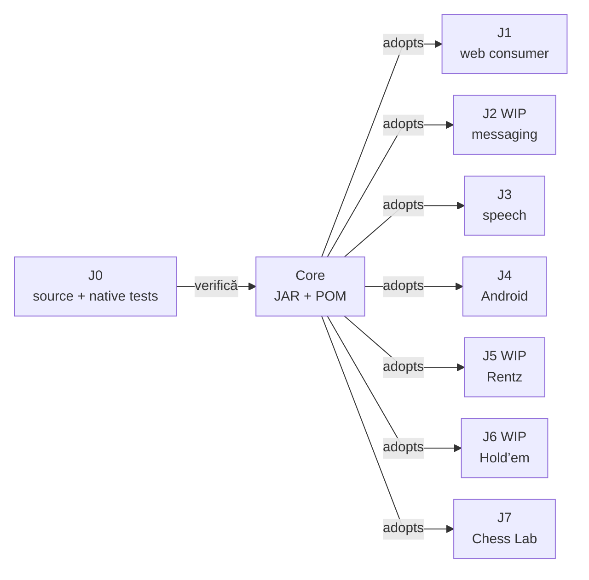

<a id="atf-core--source-ownership-and-binary-consumption"></a>
<a id="atf-core--ownership-ul-sursei-și-consumul-binar"></a>
# ATF Core — ownership-ul sursei și consumul binar

<a id="at-a-glance"></a>
<a id="pe-scurt"></a>
## Pe scurt

J0 deține implementarea și testele native Core. Consumerii binari păstrează ultimele perechi Core și Reporting JAR/POM direct în `lib`; fiecare bibliotecă are coordonate, proveniență și acceptanță independente.

| Boundary | Current contract |
|---|---|
| runtime | Java 21 și dependențele Jackson declarate în [Core POM](../atf-core/pom.xml) |
| independență | POM fără părinte; fără dependență de producție către alt modul ATF, JUnit sau renderer |
| layout | o pereche JAR/POM per bibliotecă, direct în `lib`; fără repository imbricat sau sursă paralelă |
| identitate | proprietățile POM ale consumerului și `library-provenance.json` rădăcină: coordonate, hash-uri, intrări ale producătorului și catalog nativ |
| ownership | sursa și testele native rămân în J0; consumerii dețin adaptoarele, aserțiunile business și acceptanța independentă |

Schemele de proveniență depind de deployment: consumerii comuni folosesc `coreLibrary`, iar alții identifică Core prin inventarul bibliotecilor. Citiți POM și metadatele țintei efective, fără deducții dintr-un proiect vecin.

<a id="maven-and-intellij"></a>
<a id="maven-și-intellij"></a>
## Maven și IntelliJ

Bootstrap-ul consumerului instalează perechile plate în repository-ul Maven selectat. IntelliJ reîncarcă POM rădăcină pe acel repository; JAR-urile atașate manual și `systemPath` sunt în afara rutei susținute.

```powershell
mvn -B "-Dmaven.repo.local=${ATF_STAGING_ROOT}/m2" validate
mvn -B "-Dmaven.repo.local=${ATF_STAGING_ROOT}/m2" -pl atf-tests -am "-Dtest=${ATF_GOVERNANCE_SELECTION}" "-Dsurefire.failIfNoSpecifiedTests=false" test
```

- Rulați din rădăcina staging-ului consumerului, cu selecția de guvernanță declarată de acel deployment.
- O lansare doar a modulului, fără bootstrap-ul rădăcinii, cere instalarea aceleiași perechi în prealabil.
- Rulează `-pl atf-core` numai în J0; consumerii selectează versiunea Core prin proprietatea POM proprie.

<a id="publication-and-independent-verification"></a>
<a id="publicare-și-verificare-independentă"></a>
## Publicare și verificare independentă

1. Reconciliază sursa, testele și diferențele consumerului la J0 fără a suprascrie lucrul local.
2. Construiește modulul fără părinte în TMP propriu; transformarea publicației schimbă versiunea bibliotecii și păstrează POM efectiv și versiunile dependențelor de test.
3. Rulați contractele native și pe JAR fizic fără sursa Core în classpath-ul consumerului; Kit/JUnit rămân dependențe de test.
4. Verifică independent compilarea fiecărui consumer, contractele afectate, guvernanța, CodeSource/hash-ul și dovezile relevante ale raportului.
5. Promovează selectiv perechea și proveniența verificate, apoi retrage perechea anterioară după recitirea live.

| Gate | Required evidence |
|---|---|
| source | teste native și intrări brute ale producătorului |
| JAR | CodeSource/hash încărcat, POM încorporat și tranzitive declarate; refuză coordonate lipsă, surse paralele, fișiere suplimentare/imbricate și metadate alterate |
| consumerul | its reactor, configuration, adapters and independent business oracles |
| împachetare | o singură înregistrare curentă lângă pachetul corespunzător; fără cronologie de release în contractele oficiale |

[protocol de sincronizare](ATF_Workspace_Synchronization.md) și [proces de build izolat](ATF_Build_And_Execution_Safety.md) guvernează livrarea. Publicarea sau un fixture mock nu certifică aplicația reală, brokerul, dispozitivul sau execuția acustică ASR.

## Core delivery map



<details>
<summary><strong>Legendă — un binar, acceptanță independentă</strong></summary>

- Muchiile descriu livrarea și adopția, nu dependențe Maven între workspace-uri.
- J0 păstrează sursa și testele native; harness-urile JAR temporare nu devin module ale consumerului.
- Fiecare consumer primește aceeași pereche și își probează propria integrare; acceptanța sursei nu se moștenește.
- Reporting are versionare/proveniență independentă; niciuna dintre biblioteci nu are dependență de producție către cealaltă.

</details>

<a id="json-and-evidence-fidelity"></a>
<a id="json-și-fidelitatea-dovezilor"></a>
## JSON și fidelitatea dovezilor

| Limită | Contract |
|---|---|
| JsonDocuments | un singur document complet; fără conținut ulterior sau chei duplicate, inclusiv imbricate; cititor imuabil și arbore nou la fiecare apel |
| fabrici pentru scriere | scalarii și null literal sunt sintaxă JSON; fabricile JSON POST/PUT refuză null înaintea expedierii |
| explicit request | text/form rămân explicite; executorul nu deduce JSON din metoda HTTP |
| Egalitate Mock | zecimale exacte fără reducerea preciziei; distincțiile număr/string și întreg/zecimal rămân; corpul brut rămâne intact |
| Redactare Core | token-urile numerice publice și câmpurile duplicate sunt păstrate; fiecare valoare sensibilă este mascată integral |
| Reporting | proiecția streaming independentă păstrează numerele și duplicatele înaintea preview-ului configurat |
| assertions | comparația precedă redactarea/preview-ul; verdictul capturat de caller este independent de afișarea implicită de 240 caractere |

- Parsarea strictă refuză ambiguitatea pentru decizii; proiecția dovezilor păstrează aparițiile duplicate pentru audit.
- Mock acceptă null literal ca sintaxă, independent de restricția fabricii de scriere; JSON invalid din diagnostic nu devine payload valid expediat.
- Testele native rămân la ownerul sursei; harness-urile temporare verifică JAR-uri fizice fără clase de implementare paralele.

<a id="console-and-transport-cancellation"></a>
<a id="consolă-și-anularea-transportului"></a>
## Consolă și anularea transportului

[Contractul lifecycle Core](../atf-core/README.md#ciclu-de-viață-generic-și-reutilizabil) păstrează precedența fazelor, eroarea primară și diagnosticele cleanup suppressed. `HttpClientTransport` leagă anularea de future-ul upstream deținut; anularea nu dovedește rollback pe server.

- `UrlConnectionTransport` deține subscription-ul body, workerul virtual și conexiunea. Colectarea body-ului, connect și read folosesc deadline-ul monotonic original; un body întârziat nu poate expedia după anulare sau expirare.
- Contractele native cu publisher controlat și loopback acoperă anularea, deadline-ul original de 250 ms, erorile body/cleanup și cursele terminale pe sursă și JAR fizic.
- Acceptanța consumerului rămâne distinctă; o mutație cu rezultat incert nu este eligibilă pentru replay automat.


<a id="shared-platform-libraries"></a>
<a id="bibliotecile-comune-ale-platformei"></a>
## Bibliotecile comune ale platformei

Reactorul curent are 12 module sursă. [Consumul bibliotecilor platformei](ATF_Platform_Libraries.md) definește cei cinci owneri ai bibliotecilor, distribuția plată, bootstrap-ul Maven/IntelliJ și acceptanța independentă. Testele native Console/Mock rămân în J0; adaptoarele și cataloagele consumerilor rămân locale.
